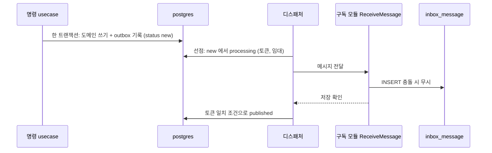

# ADR-005: Transactional Outbox — 쓰기와 이벤트는 한 트랜잭션, 수신 쪽은 Inbox
- 상태: Accepted (2026-11-03 개정: inbox 를 ADR-020 으로 분리·확정, 선점 규약을 ADR-021 로 일원화)
- 날짜: 2026-11-03
- 근거: 원 계획안 모순 #11, Phase 3 / 명세 FR-020·021·030~032·040, AC-001~003 / 사용자 지시("outbox 및 inbox 필수")

## 맥락
상태를 DB 에 쓰고 이벤트를 발행하는 두 동작은 **따로 실패할 수 있다**(저장은 됐는데 발행 누락, 또는 반대). 수신 측은 재시작·재전달로 같은 메시지를 두 번 받을 수 있다. 이 문제를 풀어야 이벤트 시각화가 "보기만 좋은 그림"이 아니라 정합성의 증거가 된다. 이 ADR 은 **보내는 쪽(outbox)** 을 정하고, **받는 쪽(inbox)** 은 [ADR-020](ADR-020-inbox.md), 선점 규약은 [ADR-021](ADR-021-concurrency-control.md) 이 정한다.

## 결정
- 명령 usecase 가 도메인 쓰기와 outbox 기록을 **한 DB 트랜잭션**에 넣는다(ADR-019).
- 디스패처가 outbox 를 읽어 **구독 모듈의 `ReceiveMessage`** 로 전달한다. 전달은 **최소 한 번(at-least-once)** 이다.
- 수신 쪽은 **inbox** 에 저장하고 선점해 처리하여 **효과는 정확히 한 번**이 되게 한다(ADR-020).
- 실패는 상한까지 재시도 후 `dead` 로 격리해 지표·시각화에 노출한다.
- 이 규약은 전달 계층(ADR-006)이 무엇이든 바뀌지 않는다.

## 설계 상세

### outbox 테이블 (`events.outbox_event`)
| 컬럼 | 의미 |
|---|---|
| `id` | 이벤트 식별자(전역 유일). **수신 쪽 inbox 의 `message_id`** |
| `seq` | 단조 증가 순번(전역). 읽기 모델의 순서 검사와 대상별 순서에 사용 |
| `aggregate_type`, `aggregate_id` | 어떤 대상의 이벤트인가 |
| `type`, `payload` | 이벤트 종류와 내용(스키마 정본은 `packages/protocol`) |
| `schema_version`, `occurred_at`, `aggregate_version` | 봉투 메타(소비자의 Upcaster 판정·`version` 반영) |
| `trace_id`, `owner_key` | 흐름 추적 묶음과 소유자(시각화). `owner_key` = 내부 행위자 키 |
| `status` | `new` / `processing` / `published` / `dead` |
| `claim_token`, `claimed_by`, `lease_until` | 선점 정보(ADR-021) |
| `attempts`, `next_attempt_at`, `last_error` | 재시도 |
| `created_at`, `published_at` | |

> 상태 이름: 이전 문서의 `pending` 은 `new` 로 바꿨다. 선점 중인 상태를 `processing` 이라 부르며, 비즈니스 상태 `PENDING`(예: 보상)과 구분하기 위해서다(ADR-021).

### 디스패처 동작
1. **동시에 하나의 인스턴스만 활성**이다(어드바이저리 락 보유, ADR-021). 그래서 `seq` 순서가 곧 전달 순서다.
2. 대기 이벤트를 `FOR UPDATE SKIP LOCKED` 로 골라 `processing` 으로 **선점**(토큰 발급, 임대 설정)한다.
3. 구독 모듈의 `ReceiveMessage` 에 전달한다. 성공(= inbox 저장 확인)이면 토큰 일치 조건으로 `published`.
4. 실패하면 `new` 로 되돌리며 `attempts` 증가, 지수 백오프로 `next_attempt_at`. 상한 초과 시 `dead`.
5. 깨우기: `NOTIFY` 로 즉시 처리하고, 놓쳐도 되도록 **주기적 폴링을 안전망**으로 함께 둔다.
6. 디스패처가 죽으면 임대 만료 후 다른 인스턴스가 락을 얻어 회수·재개한다.

### 전달 흐름

- 전달은 최소 한 번이다: 디스패처가 `published` 표시 전에 죽으면 같은 이벤트가 다시 전달된다. **inbox 의 PK 가 이를 흡수**한다.

### 순서
같은 `aggregate_id` 안의 순서는 `seq` 로 보장한다(단일 활성 디스패처 전제). 서로 다른 대상 간 전역 순서는 보장하지 않는다. 읽기 모델은 자기 행의 마지막 `seq` 보다 작은 이벤트를 무시한다(ADR-018).

### 단계 추적
이벤트가 작성→outbox→전달→수신→처리를 지날 때마다 `events.trace_step` 에 단계를 **추가 전용**으로 남긴다. 시각화(FR-040·041)가 이를 쓴다. 7일 후 삭제(ADR-008).

## 대안과 기각 이유
- **저장 후 직접 발행(이중 쓰기)**: 부분 실패에서 영구 불일치.
- **분산 트랜잭션(2PC)**: 운영 복잡도가 과하고 지원하지 않는 전달 계층이 많다.
- **로그 기반 변경 수집(CDC)**: 정확하지만 구성 요소가 늘어 무료 자원에서 부담. 폴링으로 시작한다.
- **이전 설계(소비자 키 기록 `processed_event` 만)**: 중복은 막지만 수신 메시지를 보관하지 않아 재처리·감사·수신/처리 분리가 불가. inbox 로 대체했다.

## 결과
- 얻는 것: 원자성·멱등을 인수 기준(AC-002·003)으로 증명. 전달 계층과 독립인 정확히 한 번 효과.
- 치르는 것: 결과적 일관성(전파 지연), outbox 정리 작업, 선점·회수 구현.

## 위험과 완화
| 위험 | 완화 |
|---|---|
| 폴링 지연으로 시각화가 굼뜸 | `NOTIFY` 로 깨움, 폴링은 안전망 |
| outbox 무한 증가 | `published` 를 7일 후 정리(배치 크기 제한) |
| 독 메시지(계속 실패)가 막음 | 상한 후 `dead` 격리, 다음 이벤트 진행 |
| 디스패처 이중 활성 | 어드바이저리 락 + 토큰 완료 조건 |
| 디스패처 단일화가 병목 | 측정 후 대상 단위 락 기반 병렬화(재검토 조건) |

## 검증 방법
- AC-002: 도메인 쓰기와 outbox 기록 중 하나를 실패시키면 둘 다 없다.
- AC-003: 같은 이벤트를 두 번 전달해도 효과는 한 번.
- 디스패처 강제 종료 후 재개: 유실도 중복 효과도 없음.
- 선점 동시성 시험: ADR-021 시험표.

## 실서비스라면
동일하다. 발행 지연이 문제면 CDC(로그 기반)로 폴링을 대체한다.

## 재검토 조건
전달 지연이 사용자 체감 한계를 넘을 때. 단일 활성 디스패처가 처리량 병목일 때.

## 관련 ADR
ADR-006(전달 계층), ADR-008(보관), ADR-010(재고), ADR-018(CQRS), ADR-019(계층), ADR-020(inbox), ADR-021(동시성)
