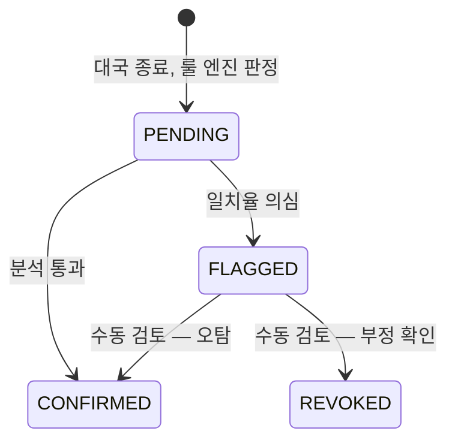

# ADR-009: 승패는 룰 엔진 즉시 판정, KataGo 는 비동기 사후 분석
- 상태: Accepted
- 날짜: 2026-11-03
- 근거: 원 계획안 모순 #4, Phase 1-A·2

## 맥락
원안은 KataGo 가 리플레이를 검증한 뒤 승패를 승인했다. 그러나 KataGo 는 **AI 일치율 기반 부정행위 탐지·사후 분석** 용도이고 비동기라 지연이 크다. 승패 판정이 비동기 분석에 묶이면 대국 흐름이 멈춘다.

## 결정
- **승패는 룰 엔진(서버 권위 상태머신)이 즉시 판정**한다.
- KataGo 워커는 `game.review.requested` 이벤트를 받아 **비동기로 분석**한다.
- 보상은 `PENDING → CONFIRMED / FLAGGED` 상태로 관리하고, 오탐 시 **수동 검토 경로**를 둔다.
- 워커는 리소스 limits 를 분리한다(CPU 우선, GPU 선택).

## 설계 상세

### 상태머신

### 흐름
1. 룰 엔진이 종료를 판정 → 대국 결과, 보상(`PENDING`), 분석 요청 이벤트를 **한 트랜잭션**으로 기록(ADR-005).
2. 워커가 이벤트를 소비(멱등)하여 기보(SGF)를 분석, 일치율 계산.
3. 임계값 기준으로 `CONFIRMED` 또는 `FLAGGED`. **임계값은 실제 대국 데이터로 보정하며 현재 수치는 없다.**
4. `FLAGGED` 는 관리자 검토 화면에서 판정.

### 원칙
- 분석이 실패하거나 지연돼도 대국 결과는 유효하다. 보상만 `PENDING` 에 머문다.
- 분석 재시도는 멱등해야 한다. 같은 대국을 두 번 분석해도 상태는 한 번만 바뀐다.
- 사용자에게는 `PENDING` 상태와 의미를 화면에 설명한다.

## 대안과 기각 이유
- **KataGo 승인 후 승패 확정**: 판정이 비동기에 묶여 대국이 막힌다.
- **분석 없이 즉시 확정**: 부정행위 탐지 서사가 사라진다.

## 결과
- 얻는 것: 실시간 대국 흐름 유지, 보상 지연 정책의 명시.
- 치르는 것: 상태 전이 모델과 수동 검토 경로를 구현해야 한다.

## 위험과 완화
| 위험 | 완화 |
|---|---|
| 오탐으로 정상 유저 보상 지연 | `FLAGGED → CONFIRMED` 수동 경로, 사유 기록 |
| 분석 워커가 자원을 독점 | 리소스 limits 분리, 큐 길이 지표 |
| 임계값이 근거 없음 | 보정 전에는 자동 `REVOKED` 금지, 수동 검토만 |

## 검증 방법
Phase 2 DoD: 대국 종료 → 비동기 분석 → 보상 확정 end-to-end, 실패·재시도 처리 확인.

## 실서비스라면
금전이 걸리면 분석 확정 전까지 출금을 막는 정책을 둔다. 이 프로젝트의 포인트는 모의 재화다.

## 재검토 조건
오탐률이 높아 수동 검토가 병목이 될 때.

## 관련 ADR
ADR-005, ADR-006(전달 계층), ADR-015(모의 면책)
