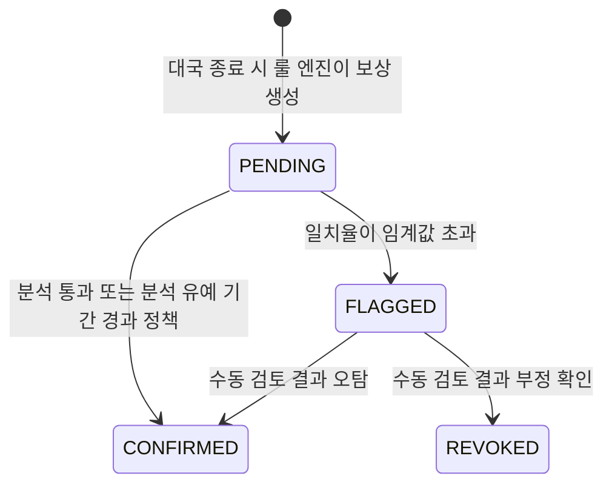
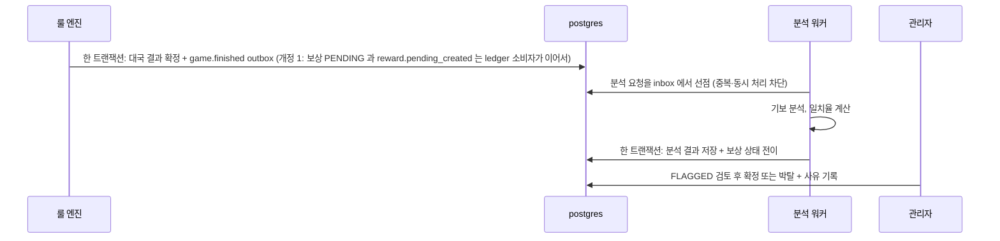

# ADR-009: 승패는 룰 엔진 즉시 판정, KataGo 는 비동기 사후 분석
- 상태: Accepted (**개정 1 — 2026-11-04**: 분석 요청·보상 생성 모델 변경. 아래 "개정 1" 참조)
- 날짜: 2026-11-03
- 근거: 원 계획안 모순 #4, Phase 1-A·2 / 데이터 구조는 [database-schema.md](../domains/database-schema.md) §10

## 개정 1 (2026-11-04) — 보상 생성과 분석 요청의 순서
영역 설계 검토([phases/01-baduk.md](../design/phases/01-baduk.md) §2.3·§9·§10, [ADR-036](ADR-036-katago-analysis-worker.md)·[ADR-037](ADR-037-simulated-points-ledger.md))에서 원안의 두 가지가 고쳐졌다. **승패는 룰 엔진 즉시 판정·분석은 보상 상태만 바꾼다는 핵심 결정은 그대로**다.

| 원안 | 개정 |
|---|---|
| `game.review.requested` 이벤트가 분석을 요청하고, **분석 요청과 보상 생성이 같은 트랜잭션** | 폐기. `ledger` 가 `game.finished` 를 소비해 `EligibilityPolicy`(ledger 소유)로 자격을 판정하고 보상 `PENDING` 을 만든 뒤 **`reward.pending_created`** 를 발행한다. `analysis` 는 **이 이벤트를 구독**해 `analysis_job` 을 만든다. 보상 행이 있어야 분석 작업이 생기므로 순서 의존이 구조적으로 없고, 자격 미달 대국은 분석하지 않는다. `game`(L3)은 `ledger`(L4)를 직접 호출하지 않는다(경계 규칙 R3) |
| 판정 단위가 대국 | 판정은 **색(참가자)별**이고 보상은 자기 색의 판정으로 전이한다. 2단계 후에도 결론이 안 나면(`INCONCLUSIVE`) `CLEAN` 취급으로 `CONFIRMED`(감사·지표 기록) |
| `REVOKED` 는 상쇄 항목으로 되돌림, "분석 유예 경과" 전이 미결 | `REVOKED` 는 `PENDING`/`FLAGGED` 의 무효화일 뿐 **기장이 없다**. `CONFIRMED` 는 종결이며 사후 역분개 경로가 없다(필요해지면 별도 ADR). 유예 경과 자동 확정은 두지 않고 `PENDING` 체류를 지표로 감시한다 |

아래 본문 중 위 표와 충돌하는 서술(`game.review.requested`, "분석 요청과 보상 생성은 같은 트랜잭션", "`REVOKED` 는 상쇄 항목")은 **이 개정이 우선**한다.

## 맥락
원안은 KataGo 가 리플레이를 검증한 뒤 승패를 승인했다. 그러나 KataGo 는 **AI 일치율 기반 부정행위 탐지·사후 분석** 용도이고 비동기라 지연이 크다. 승패 판정이 비동기 분석에 묶이면 대국 흐름이 멈추고, 분석 장애가 곧 서비스 장애가 된다. 또한 승패와 보상은 **서로 다른 성격의 사실**이다: 승패는 규칙이 결정하는 확정 사실이고, 보상은 의심이 풀릴 때까지 보류될 수 있는 정책 결과다.

## 결정
- **승패는 룰 엔진(서버 권위 상태머신)이 즉시 판정**하고 대국 결과로 확정한다. 이후 분석이 결과를 뒤집지 않는다.
- KataGo 워커는 ~~`game.review.requested`~~ → **`reward.pending_created`**(개정 1)를 받아 **비동기로 분석**한다.
- **보상**만 `PENDING → CONFIRMED / FLAGGED → REVOKED` 상태로 관리하고, 의심(FLAGGED)은 **수동 검토**를 거친다.
- 워커는 리소스 limits 를 분리한다(CPU 우선, GPU 선택).

## 설계 상세

### 책임 분리
| 판단 | 누가 | 결과가 바꾸는 것 |
|---|---|---|
| 착수 합법성, 종료, 승패, 계가 | 룰 엔진(서버) | 대국 결과(**불변**) |
| 부정행위 의심 | 분석 워커 | 보상 상태만 |
| 의심의 최종 판정 | 관리자(사람) | 보상 상태, 사유 기록 |

### 상태 전이

- `CONFIRMED` 와 `REVOKED` 는 종결 상태다. 종결 후 변경은 새 이력으로만 남긴다(원장은 추가 전용, ADR-017).
- "분석 유예 기간 경과" 전이를 허용할지는 **미결**이다. 허용하면 분석 장애 시에도 보상이 영원히 `PENDING` 에 머물지 않지만, 부정을 놓칠 수 있다. 기본은 허용하지 않고 `PENDING` 체류 시간을 지표로 감시한다.

### 흐름

- (개정 1) 결과 확정과 `game.finished` 기록이 **같은 트랜잭션**이다(ADR-005). 대국은 끝났는데 이벤트가 없는 상태가 생기지 않고, 보상 `PENDING` → `reward.pending_created` → 분석 작업은 at-least-once 와 멱등 소비로 이어진다.
- 같은 대국을 두 번 분석해도 보상 상태는 한 번만 바뀐다(멱등).
- **분석은 트랜잭션 밖에서** 한다: 선점(`processing`, 토큰 발급) → 분석 → 토큰 일치 조건으로 결과 저장과 상태 전이. 분석이 길어도 DB 행 잠금을 쥐지 않고, 늦게 돌아온 이전 워커는 결과를 덮어쓰지 못한다(ADR-021).

### 데이터(윤곽, database-schema.md §10)
- `game`: 대국, 수(`move`)는 (대국, 순번) 유일. (개정 2, U11) 비레이팅 대국의 무르기는 새 이벤트로 남고 유효 수열은 이벤트를 접어 얻는다(ADR-035). 레이팅(보상) 대국은 무르기 불허이고, 분석 입력은 유효 수열이다.
- `ledger.reward`: 상태 컬럼과 상태 이력. 포인트 지급은 **복식 원장**에 추가 전용으로 기록한다. (개정 1) `REVOKED` 는 기장이 없는 무효화이고 확정된 보상의 사후 상쇄 경로는 없다.
- 분석 결과 테이블: 대국 식별자, 일치율, 분석기 버전, 분석 시각.

### 임계값
**임계값은 실제 대국 데이터로 보정한다. 현재 수치가 없다.** 보정 전에는 `REVOKED` 를 **자동으로 만들지 않는다** — 자동 전이는 `FLAGGED` 까지만이고 박탈은 사람이 한다. 분석기 버전을 결과에 기록해 임계값 변경 시 과거 결과와 구분한다.

### 사용자에게 보이는 것
`PENDING` 상태와 의미를 화면에 설명한다("분석 중이며 포인트는 아직 지급 전"). `FLAGGED` 는 사용자에게 사유를 단정적으로 드러내지 않는다(검토 중 표기).

### 운영 지표
`reward_pending_age_seconds`(가장 오래된 PENDING), `review_queue_depth`, `review_duration_seconds`, `flagged_total`, 수동 검토 처리 시간.

## 대안과 기각 이유
- **KataGo 승인 후 승패 확정**: 판정이 비동기에 묶여 대국이 막히고 분석 장애가 서비스 장애가 된다.
- **분석 없이 즉시 확정**: 부정행위 탐지 서사가 사라진다.
- **분석 결과로 대국 결과를 뒤집기**: 관전자·기보 등 이미 공개된 사실과 충돌한다. 되돌림은 보상 단위로 제한한다.

## 결과
- 얻는 것: 실시간 대국 흐름 유지, 보상 지연 정책의 명시, 장애 영역 분리(분석이 죽어도 대국은 계속).
- 치르는 것: 상태 전이 모델과 수동 검토 경로(관리자 화면)를 구현해야 한다. 임계값 보정 전까지 수동 작업이 생긴다.

## 위험과 완화
| 위험 | 완화 |
|---|---|
| 오탐으로 정상 유저 보상 지연 | `FLAGGED → CONFIRMED` 수동 경로, 사유 기록 |
| 분석 워커가 자원을 독점 | 리소스 limits 분리, 큐 길이 지표 |
| 임계값이 근거 없음 | 보정 전 자동 박탈 금지, 분석기 버전 기록 |
| 분석 장애로 PENDING 이 쌓임 | `reward_pending_age_seconds` 경보, 유예 경과 전이 도입 여부 재검토 |
| 수동 검토가 병목 | 검토 큐 우선순위, 임계값 조정 |

## 검증 방법
Phase 2 DoD: 대국 종료 → 비동기 분석 → 보상 확정 end-to-end, 실패·재시도 처리 확인. 시험 항목:
| 시나리오 | 기대 |
|---|---|
| 분석 요청 이벤트 중복 전달 | 상태 전이 한 번 |
| 분석 워커 중단 후 재개 | 유실 없이 이어서 처리 |
| 분석 결과가 FLAGGED | 포인트 지급 보류, 관리자 큐에 등장 |
| 오탐으로 확정 | 보상 지급, 이력에 사유 |
| 분석 장애 장기화 | PENDING 체류 시간 경보 |

## 실서비스라면
금전이 걸리면 분석 확정 전까지 출금을 막는 정책과 이의제기 절차를 둔다. 이 프로젝트의 포인트는 모의 재화다.

## 재검토 조건
오탐률이 높아 수동 검토가 병목이 될 때. 분석 유예 경과 전이를 도입할 필요가 생길 때.

## 관련 ADR
ADR-005, ADR-006(전달 계층), ADR-015(모의 면책), ADR-017, ADR-020, ADR-021
