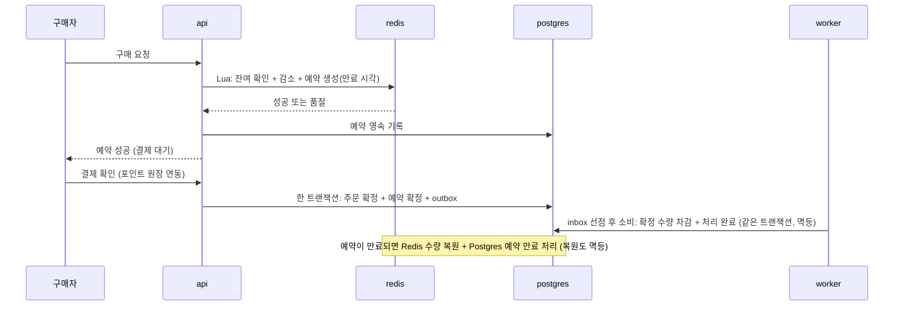

# ADR-010: 재고 정합성 — Lua 원자 선점 + 예약 TTL + outbox + 멱등 소비
- 상태: Accepted
- 날짜: 2026-11-03
- 근거: 원 계획안 모순 #11, Phase 3 / 데이터 구조는 [database-schema.md](../domains/database-schema.md) §10

## 맥락
원안의 `Redis DECRBY → Kafka → PG 차감` 은 **음수 재고, 롤백, 중복 소비**에 대한 정합성 설계가 없다. 타임딜은 짧은 시간에 동시 구매가 몰리므로, "빠르게 거절하는 쪽"(Redis)과 "정확히 기록하는 쪽"(Postgres)의 역할을 나누고 **둘이 어긋났을 때 무엇이 이기는지**를 먼저 정해야 한다.

## 결정
- Redis **Lua 스크립트로 원자 선점**하고 **예약 TTL** 로 미결제 재고를 되돌린다.
- 확정은 Postgres 트랜잭션 + **outbox**(ADR-005) → 소비자가 **멱등**하게 차감한다.
- **재고의 정본은 Postgres**다. Redis 는 선점 속도를 위한 캐시이고, 유실되면 Postgres 에서 재구성한다.
- 장애 시나리오(Consumer 중복, 재시작, Redis 유실)를 자동화 시험으로 검증한다.
- DoD: **초과 판매 0건** + k6 부하 결과(ADR-013).

## 설계 상세

### 불변식
```
확정 수량 + 활성 예약 수량 ≤ 총량        (언제나)
어떤 구매도 선점과 확정 중 하나의 결과로만 끝난다 (이중 확정 불가)
```
불변식이 깨지면 그것이 결함이다. 점검 작업이 주기적으로 대조하고 지표(`stock_invariant_violations`)로 노출한다.

### 역할 분담
| 층 | 역할 | 틀렸을 때 |
|---|---|---|
| Redis | 빠른 선점·거절. 잔여 수량과 예약 목록(만료 시각 포함) | 재구성 가능. 다만 재구성 중에는 구매를 잠시 막는다 |
| Postgres `deal.stock` | **확정 수량의 정본** | 정본이므로 틀리면 안 된다 |
| Postgres `deal.reservation` | 예약의 영속 기록(만료 시각, 상태) | Redis 유실 시 복구 근거 |

### 흐름

- 선점 → 영속 기록 사이에서 앱이 죽을 수 있다. 이때 Redis 에만 예약이 남고 Postgres 에는 없다. **대조 작업이 Redis 예약 중 Postgres 에 없는 것을 TTL 후 회수**하는 것으로 수습한다.
- 결제 연동 대상은 모의 포인트 원장이다(ADR-016, ADR-015).

### 예약 TTL
결제에 걸리는 시간 분포를 측정해 정한다. **현재 값이 없다.** 너무 짧으면 정상 결제를 거절하고, 너무 길면 재고가 묶인다. 측정 전에는 값을 두지 않고 설정으로 뺀다.

### 장애 시나리오 시험표
| 시나리오 | 기대 결과 |
|---|---|
| 소비자가 같은 이벤트를 두 번 받음 | 차감 한 번 |
| 소비자 재시작 | 유실·중복 없이 재개 |
| Redis 재시작으로 선점 상태 유실 | 구매 일시 차단 → Postgres 의 확정+활성 예약으로 수량 재구성 → 불변식 유지. 유실된 예약은 만료로 취급 |
| 선점 후 영속 기록 전에 api 종료 | 대조 작업이 고아 예약을 TTL 후 회수 |
| 결제 도중 실패 | TTL 만료 후 재고 복원 |
| 마지막 1개를 두고 동시 요청 | 정확히 한 명만 성공 |
| 만료 복원이 두 번 실행됨 | 수량 한 번만 복원 |
| Redis 와 Postgres 수량 불일치 주입 | 점검 작업이 탐지, 지표 상승, Postgres 기준으로 교정 |

### Redis 내구성 설정과의 관계
Redis 의 영속화 설정에 따라 유실 범위가 달라진다. 이 설정과 전달 계층 후보(Redis Streams, ADR-006)의 내구성 비교는 **같은 시험을 공유**한다 — 한 번 구성해 두 질문에 답한다.

### 동시성 규약 (ADR-021)
- 예약 상태는 `active → confirming → confirmed / expired` 이며 **모든 전이는 기대 상태 조건부 UPDATE** 다. 결제 확인과 만료 복원이 동시에 와도 한쪽만 성공한다.
- 결제 연동(외부 호출)은 선점 트랜잭션과 완료 트랜잭션 **사이**에서 하고, 호출 동안 행 잠금을 쥐지 않는다.
- 완료 갱신은 `claim_token` 일치 조건이다. 임대가 만료돼 다른 주체가 가져간 뒤 늦게 도착한 완료는 거절된다.

## 대안과 기각 이유
- **DB 행 잠금만**: 정합성은 단순하지만 경합이 높을 때 처리량이 낮다. **부하 시험에서 Redis 방식과 나란히 비교**해 기록한다(Redis 가 이기는지 증명한다).
- **단순 DECRBY**: 음수 재고·롤백 부재.
- **낙관적 잠금(버전 컬럼) 재시도**: 경합 시 재시도 폭주.

## 결과
- 얻는 것: 정합성 규칙의 명시, 시험 가능성, "빠른 층과 정확한 층"의 역할 분리 서사.
- 치르는 것: Redis 유실 시 복구 절차, 대조 작업, 예약 상태 관리의 복잡도.

## 위험과 완화
| 위험 | 완화 |
|---|---|
| Redis 와 Postgres 불일치 | 대조 작업, 지표, Postgres 우선 교정 |
| TTL 오설정 | 결제 시간 측정 후 보정, 설정화 |
| Redis 가 재고 선점과 이벤트 전달을 겸해 장애 영역이 공유됨 | 인스턴스 분리 검토(ADR-006) |
| 부하 시험 환경이 실제와 다름 | ADR-013 의 측정 규칙(환경 함께 기록) |

## 검증 방법
Phase 3 DoD: 초과 판매 0건, 부하 시험 결과표(환경 포함). 위 시험표를 자동화.

## 실서비스라면
동일한 구조. 선점 키 설계와 TTL 은 결제 수단별 지연 데이터로 정하고, 정본 DB 는 가용성 구성을 갖춘다.

## 재검토 조건
부하 시험에서 초과 판매가 1건이라도 나올 때. DB 행 잠금 방식이 요구 처리량을 충족함이 측정으로 드러날 때(Redis 도입 정당성 재평가).

## 관련 ADR
ADR-005, ADR-006, ADR-013, ADR-016, ADR-017, ADR-020, ADR-021
