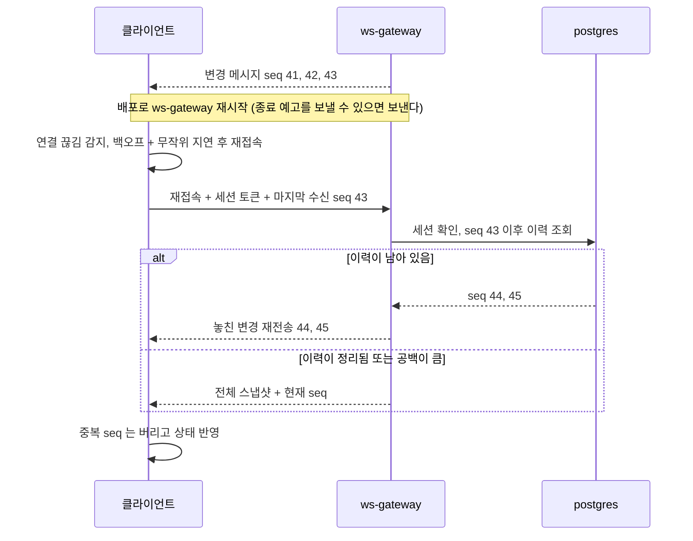
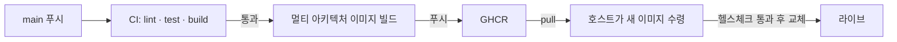

# ADR-014: 배포·무중단 — CD, probe, 소켓 재접속·세션 복구, 에셋 캐시
- 상태: Accepted
- 날짜: 2026-11-03
- 근거: 원 계획안 모순 #10, Phase 1-A·4 / 명세 NFR Operability, FR-051, 가정 A-002 / 구조는 [architecture.md](../domains/architecture.md) §2·§9, 이력 테이블은 [database-schema.md](../domains/database-schema.md) §5-3

## 맥락
원 계획안은 "Zero-Downtime", "상용 프로덕션 수준"을 내세웠지만 **관측성·CI/CD·probe·PDB·재접속 설계가 계획에 없었고**, `ws-gateway` 는 배포 시 소켓이 끊긴다. 무중단을 주장하려면 "연결은 끊기되 사용자는 모르게 복구된다"를 설계와 시험으로 보여야 한다. 또한 이 프로젝트는 **Compose(라이브)와 K8s(검증본)가 공존**하므로(ADR-002) 각 환경이 무엇을 보장하는지 구분해서 말해야 한다.

## 결정
- **배포**: GitHub Actions 가 이미지를 빌드해 GHCR 에 올리고, 호스트가 pull 한다(가정 A-002). 라이브(Compose)와 검증(k3d)은 **같은 이미지**를 쓴다.
- **무중단의 정의**: 서버 재시작 중에도 **클라이언트가 자동 재접속하고 상태가 복구된다.** 연결이 끊기지 않는다는 뜻이 아니다.
- **상태를 프로세스 메모리에 두지 않는다.** 세션·대국 상태의 정본은 DB 다.
- **환경별 보장을 구분해 서술한다**: Compose 는 짧은 단절 후 복구, k3d 는 롤링 업데이트 중 복구를 시험으로 증명.
- 정적 에셋은 캐시 헤더와 압축을 적용한다.

## 설계 상세

### 재접속·세션 복구 프로토콜
핵심은 **순번(seq)** 이다. 서버가 채널별로 단조 증가 순번을 붙여 보내고(`realtime_read.change_log`), 클라이언트는 마지막으로 받은 순번을 기억한다.

- 클라이언트는 **seq 로 중복을 제거**한다(재전송과 정상 전송이 겹칠 수 있다).
- 스냅샷은 방명록처럼 상태가 작은 채널에서 항상 가능하다. 대국 같은 큰 상태는 수순 이력 + 현재 국면으로 복원한다(Phase 1).
- **쓰기 요청의 재시도**: 연결이 끊긴 사이 보낸 쓰기는 결과를 모를 수 있다. 쓰기는 클라이언트가 만든 요청 식별자로 **멱등**하게 받는다(같은 식별자의 재요청은 같은 결과). 이는 ADR-005 의 멱등 규칙을 입구까지 확장한 것이다.

### 재접속 폭주 방지
`ws-gateway` 재시작은 접속자 전원이 거의 동시에 재접속하게 만든다. 클라이언트는 **지수 백오프 + 무작위 지연**으로 분산하고, 서버는 동시 복구 처리량에 상한을 둔다(상한 값은 측정 후, 현재 수치 없음). 서버는 종료 시 여유가 있으면 **종료 예고**를 보내 클라이언트가 즉시 다른 인스턴스로 가도록 돕는다.

### 서버 종료 절차(`ws-gateway`)
1. 종료 신호 → 헬스 응답을 '준비 안 됨'으로 전환(새 연결이 오지 않게).
2. 접속자에게 종료 예고 전송.
3. 유예 시간 동안 진행 중인 메시지를 비운다. 느린 클라이언트의 송신 큐는 **상한이 있어** 넘치면 해당 연결을 끊는다(백프레셔).
4. 남은 연결을 닫고 종료.

### probe (K8s 검증본)
| probe | 판정 기준 | 주의 |
|---|---|---|
| readiness | DB 연결 가능, 의존 초기화 완료. **종료 중이면 실패** | 이게 실패하면 트래픽이 빠진다 |
| liveness | 프로세스가 응답 | **DB 같은 외부 의존 장애를 liveness 로 보지 않는다** — 재시작 루프를 만든다 |

PDB 로 동시에 내려가는 인스턴스 수를 제한한다. 롤링 업데이트 중 재접속 시험이 이 환경의 핵심 증거다.

### 환경별 보장
| 환경 | 보장 | 근거 |
|---|---|---|
| k3d (검증본) | 롤링 업데이트 중에도 새 인스턴스가 준비된 뒤 교체, 연결은 끊기되 복구 | 시험으로 증명 |
| Compose (라이브) | **짧은 단절 후 복구.** 컨테이너 교체 순간 연결이 끊긴다 | 헬스체크 기반 교체 절차를 문서화하고 단절 길이를 측정해 기록 |

**Compose 를 "무중단"이라고 쓰지 않는다.** README 에도 이 구분을 둔다.

### 정적 에셋 (Phase 1-B 이후 3D 포함)
- 파일명에 내용 해시 → 긴 캐시 기간, 변경 시 새 이름.
- 압축 적용(텍스트 자산). 3D 에셋(glTF/텍스처)은 경량화한다.
- 모바일 브라우저에서 프레임 시간과 메모리를 확인한다(Phase 1-B DoD).

### CD 절차

호스트가 이미지를 받는 방식(주기 확인, 수동 트리거, 웹훅)은 구현 시 정한다(미결). 집 PC 가 인바운드 접속을 받지 않는 구성(터널)이라 **호스트가 먼저 가져가는 pull 방식이 자연스럽다.**

## 대안과 기각 이유
- **연결 드레이닝만으로 무중단 주장**: 장시간 연결에서는 결국 끊기므로 재접속 설계가 필수다.
- **프로세스 메모리에 세션 보관**: 재시작마다 상태 상실.
- **푸시 방식 배포(CI 가 호스트로 접속)**: 집 PC 가 외부 접속을 받아야 해서 터널 구성과 보안 면에서 불리하다.

## 결과
- 얻는 것: "끊겨도 복구된다"를 시험으로 증명한다. 원 계획안 Phase 4 의 요구를 설계로 닫는다. 환경별 보장을 정직하게 구분한다.
- 치르는 것: 순번·이력·스냅샷 복구 로직, 멱등 쓰기 식별자, 재접속 시험 자동화.

## 위험과 완화
| 위험 | 완화 |
|---|---|
| 재접속 폭주(thundering herd) | 백오프 + 무작위 지연, 서버 복구 처리량 상한 |
| 복구 로직 버그로 중복 표시·누락 | seq 기반 중복 제거, E2E 시험 |
| 이력 정리 후 장기 단절 클라이언트 | 스냅샷 경로 |
| Compose 단절을 무중단이라 홍보 | 환경별 보장 구분, 단절 길이 측정 기록 |
| 터널이 WebSocket 을 통과하지 않음(🔴 미확인) | 구현 초기 실측(ADR-003). 실패 시 대체 방식에 같은 순번 규약을 적용 |

## 검증 방법
| 시험 | 기대 |
|---|---|
| AC-008: 연결 끊김 → 복구 | 놓친 변경이 반영, 중복 없음 |
| `ws-gateway` 재시작 중 접속자 N 명 | 전원 자동 재접속, 순번 공백 없음 |
| 이력 정리 후 재접속 | 스냅샷으로 복구 |
| 같은 쓰기 요청 식별자 재전송 | 한 번만 반영 |
| k3d 롤링 업데이트 | 재접속 후 상태 일치 |
| Compose 교체 | 단절 길이 측정 기록 |

## 실서비스라면
커넥션 드레이닝, 카나리 배포, 다중 지역을 추가한다. 쓰기 멱등 식별자는 그대로 유지한다.

## 재검토 조건
재접속 복구가 시험에서 안정적이지 않거나 CD 방식이 호스트 제약에 맞지 않을 때.

## 관련 ADR
ADR-001, ADR-002, ADR-003, ADR-004, ADR-005, ADR-007
