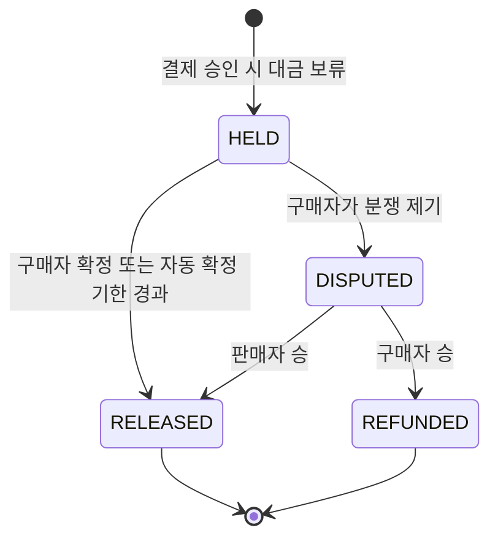
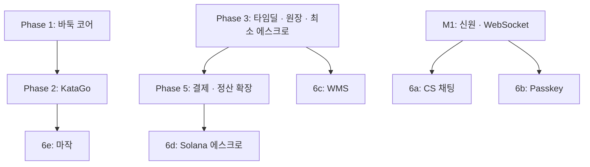

# ADR-016: 결제·정산(모의)과 Phase 6 확장은 순서대로, 독립 DoD 로
- 상태: Proposed
- 날짜: 2026-11-03
- 근거: 원 계획안 Phase 5·6, Part 3 / 데이터 윤곽은 [database-schema.md](../domains/database-schema.md) §10

## 맥락
원 계획안의 후반 단계는 범위가 넓고 외부 서비스(결제 대행사 테스트 모드, 블록체인 테스트넷)에 의존한다. 지금 시점에는 세부를 확정할 근거가 부족하다. 이 ADR 은 **순서, 완료 기준, 선행 조건, 착수 시 반드시 내려야 할 결정**을 고정하고, 세부는 각 단계 착수 시 항목별 ADR 로 확정한다. Phase 4 완료 시점부터 제출 가능하므로(README 로드맵), 이 ADR 의 범위는 **중단 가능한 후속 작업**이다.

## 결정 (원칙)
- 각 항목은 **독립 DoD** 를 가지며 하나씩 완성한 뒤 다음으로 이동한다. 어느 항목에서든 중단 가능하다.
- 모든 금전 요소는 모의·테스트 환경이다(ADR-015).
- 확정이 필요한 세부는 **착수 시 후속 ADR** 로 남긴다. 이 ADR 은 그때 Superseded 되거나 항목별로 분할된다.
- 선행 조건이 충족되지 않으면 착수하지 않는다.

## 설계 상세

### Phase 5 — 결제·정산(모의)

| 항목 | 방향 | 착수 시 결정할 것 |
|---|---|---|
| 결제 | 전통 PG **테스트 모드** 연동 | 어느 PG 를 쓸지, 테스트 모드의 웹훅 방식·한도 |
| 에스크로 | 결제 → 보류 → 확정 / 분쟁의 상태 흐름. **최소형(hold / release / refund)은 Phase 3 에 먼저 들어오고**([ADR-040](ADR-040-escrow-settlement-and-ledger.md), [ADR-048](ADR-048-mock-currency-and-mixed-payment.md)) 이 단계가 분쟁·반품 동결·정산·자동 확정을 확장한다 | 분쟁 해결 기준과 기간 |
| 시세 | ADR-011 의 스냅샷 + 견적 TTL | 시세 소스, 허용 지연, 괴리 한도 |
| 원장 | 정산 원장과 감사 로그(추가 전용) | 복식 원장 계정 체계 |
| UI | 결제 수단 선택, 견적 표시, 정산 내역 | 모의임을 알리는 표기 위치(ADR-015) |

**에스크로 상태 흐름(초안)**

전이마다 감사 로그 한 줄이 추가된다. 자동 확정 기한 값은 착수 시 정한다(미결).

선행 조건: ADR-011 확정(통화·환율), `ledger`·최소 `pricefeed`·최소 `escrow`·`payment`(원장 결제)와 `deal`(모두 Phase 3)의 결제 연동 지점, PG 테스트 계정.
DoD: 결제 → 에스크로 → 정산 전 과정 재현, 환율 고정 시점이 기록으로 남음.

### Phase 6 — 확장 (순서대로, 중단 가능; 6a~6e)

| 순서 | 항목 | 선행 조건 | 재사용하는 것 | 착수 시 결정할 것 | DoD |
|---|---|---|---|---|---|
| 6a | 1:1 CS 실시간 채팅 | M1 의 WebSocket·신원 | `/ws/room`(룸 채널 모델, [ADR-032](ADR-032-room-channel-model.md)), 순번 복구(ADR-014) | 상담원 신원·권한, 메시지 보관 기간 | 두 사용자 간 실시간 대화, 재접속 복구 |
| 6b | Passkey(WebAuthn) 2차 인증 | 신원 모듈, 고액 판단 기준 | `identity` 확장 | 고액 기준 금액, 복구 수단 | 고액 사용·정산 시 Passkey 요구 |
| 6c | WMS 풀필먼트 | `deal` 주문 | 이벤트·상태 모델 | Zone-Aisle-Rack-Shelf 모델 상세 | 피킹/패킹/출고 상태 흐름 재현 |
| 6d | Solana(Anchor) USDC 에스크로 | ADR-011, Phase 5 에스크로 | 에스크로 상태 모델 | 지갑·키 관리, 오프체인 상태와의 동기화 | **devnet** 에서 결제 → 보류 → 확정/환불 |
| 6e | 마작 | Phase 1 의 R3F·프로토콜 | 렌더링·프로토콜 구조 | 4인 룰·비공개 정보 처리, 점수 계산 | 4인 대국 완료 |

### 항목 간 의존

## 대안과 기각 이유
- **지금 세부 확정**: 외부 서비스 상태가 바뀔 수 있어 낡은 결정이 된다.
- **Phase 6 삭제**: 확장 서사가 사라지지만 필수는 아니다. 중단 가능하게 둔다.
- **Phase 6 를 병렬 진행**: 선행 조건이 서로 달라 혼선이 생긴다. 순서를 지킨다.

## 결과
- 얻는 것: 범위를 약속하지 않고 순서·선행 조건·결정 목록만 고정해 부담을 줄인다.
- 치르는 것: 세부 미정으로 일정 예측이 불가하다.

## 위험과 완화
| 위험 | 완화 |
|---|---|
| 범위 과대로 Phase 4 이후가 완성되지 않음 | Phase 4 부터 제출 가능, 이후는 병행·중단 가능 |
| 외부 테스트 환경 정책 변경 | 착수 시 이용 조건 확인 |
| 테스트넷 키·지갑 관리 부주의 | 착수 시 키 관리 ADR 선행, 저장소에 비밀 금지(ADR-015) |
| 모의 표기 누락 | 점검표(ADR-015) |

## 검증 방법
각 항목의 DoD 충족. 항목 착수 시 이 ADR 의 해당 행을 개별 ADR 로 옮기고 상태를 갱신한다.

## 실서비스라면
실제 결제는 PG 계약, 정산 규정, 보안 심사가 선행된다.

## 재검토 조건
각 항목 착수 시.

## 관련 ADR
ADR-009, ADR-010, ADR-011, ADR-014, ADR-015, ADR-017, ADR-020(웹훅 inbox), ADR-021(결제 상태 선점)
