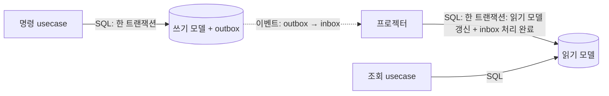

# ADR-018: CQRS — 명령/조회 모델 분리, 읽기 모델은 프로젝션 테이블
- 상태: Accepted
- 날짜: 2026-11-03
- 근거: 사용자 지시("CQRS 와 domain:service:usecase 가 기본 베이스 아키텍처") / 인터뷰 R10-Q1 / 구조는 [architecture.md](../domains/architecture.md), 테이블은 [database-schema.md](../domains/database-schema.md)

## 맥락
이 프로젝트의 목적은 이벤트 기반 정합성과 실시간 반영을 **구조로 증명**하는 것이다. 쓰기는 정확해야 하고(제약·불변식), 읽기는 빨라야 하며(목록·집계), 두 요구는 같은 테이블 모양으로 만족시키기 어렵다. 이미 반응 집계(`reaction_summary`)를 이벤트로 갱신하는 프로젝션으로 설계해 두었으므로, 이를 **전 모듈의 기본 규칙**으로 일반화한다. 무료 호스팅 자원에서 DB 를 추가로 띄울 수 없으므로 분리의 수준은 **논리 분리**로 한다.

## 결정
1. **명령(쓰기)과 조회(읽기)를 코드와 테이블 모두에서 분리한다.** 명령 핸들러는 쓰기 모델만 다루고, 조회 핸들러는 읽기 모델만 다룬다.
2. **쓰기 모델**은 정규화된 정본이다. 모듈 스키마 `<m>` 에 둔다. 불변식·제약·버전은 여기서 지킨다.
3. **읽기 모델**은 조회에 맞게 비정규화한 **프로젝션 테이블**이다. 모듈 스키마 `<m>_read` 에 둔다.
4. **읽기 모델은 명령이 직접 쓰지 않는다.** 이벤트(inbox 경유, ADR-020)를 소비하는 프로젝터, 또는 추가 전용 로그를 집계하는 주기 작업만 갱신한다.
5. **조회 핸들러는 `<m>_read` 만 읽는다.** 쓰기 모델을 조회에 쓰지 않는다.
6. 같은 Postgres 인스턴스를 쓴다(논리 분리). 물리 분리(읽기 전용 DB)는 하지 않는다.
7. 읽기 모델은 **언제든 정본(쓰기 모델·이벤트)에서 재구성할 수 있어야** 한다.

## 설계 상세

### 두 쪽의 계약
| | 명령(Command) | 조회(Query) |
|---|---|---|
| 목적 | 상태를 바꾼다 | 상태를 읽는다 |
| 읽는 곳 | 쓰기 모델(정본) | 읽기 모델(`<m>_read`) |
| 쓰는 곳 | 쓰기 모델 + outbox (**한 트랜잭션**) | 없음 |
| 반환 | 결과 식별자·생성된 뷰 최소량·추적 id | DTO(읽기 모델 모양) |
| 일관성 | 강한 일관성(트랜잭션) | **결과적 일관성** |
| 코드 위치 | `usecase/command/` | `usecase/query/` (ADR-019) |

### 갱신 경로

- 점선은 비동기다. **쓰기와 읽기 반영 사이에 지연(결과적 일관성)이 존재한다.**

### 읽기 모델 갱신의 안전장치
- **순서가 뒤집힌 이벤트 무시**: 읽기 모델 행은 마지막 반영 이벤트의 `seq` 를 기억하고, 그보다 작거나 같은 `seq` 의 이벤트는 건너뛴다. 재전달·역전에도 같은 결과가 나온다.
- **멱등**: inbox 가 같은 메시지의 중복 처리를 막는다(ADR-020).
- **재구성**: 읽기 모델을 비우고 정본·이벤트에서 다시 채우는 절차를 둔다. 이 절차 자체가 시험 대상이다.
- **대조**: 정본 대비 읽기 모델의 어긋남을 주기적으로 센다(`projection_drift`), 반영 지연을 잰다(`projection_lag_seconds`).

### 자기 글이 목록에 안 보이는 문제 (read-your-writes)
결과적 일관성 때문에, 글을 쓴 직후 목록 조회에 그 글이 없을 수 있다. 대응:
1. **명령 응답에 생성된 뷰를 담아 돌려준다.** 클라이언트가 즉시 화면에 합친다.
2. 이후 공개 채널의 메시지(`EntryPosted` 반영)가 도착하면 같은 글(식별자 동일)로 **중복 없이 병합**한다.
3. 반영 지연이 목표를 넘으면 지표로 드러낸다.
이 지연과 병합은 **시각화 데모의 일부**(작성→outbox→전달→소비→읽기 모델 반영)로 그대로 보여준다.

### M1 에 적용되는 범위
| 모듈 | 쓰기 모델 (`<m>`) | 읽기 모델 (`<m>_read`) |
|---|---|---|
| `guestbook` | `entry`, `reaction`, `report`, `moderation_action` | `entry_view`(글 + 반응 집계), `report_queue` |
| `events` | `outbox_event`, `trace_step`(추가 전용) | `flow_counter`(주기 집계) |
| `realtime` | — | `change_log`(재접속 복구용 이력) |
| `identity` | `user_account`, `session` | 없음(조회 없음, 인증 확인은 쓰기 쪽 키 조회) |

`identity` 의 세션 확인은 **명령 쪽 보조 조회**다. 요청마다 필요한 단건 키 조회이고 읽기 모델을 만들 이유가 없다 → 예외로 인정하되 이유를 database-schema.md 에 적는다.

### 모듈이 늘 때의 규칙
새 모듈을 만들 때 읽기 모델이 필요한가를 먼저 묻는다. **조회가 없는 모듈에는 읽기 모델을 만들지 않는다**(관례를 위한 관례 금지).

## 대안과 기각 이유
- **물리 분리(읽기 전용 복제 DB)**: 확장성 서사는 강하지만 컨테이너·메모리가 늘어 무료 자원과 충돌하고 복제 지연 관리가 추가된다.
- **읽기 모델을 Redis 에 둠**: 조회는 가장 빠르나 Redis 가 정본·전달·읽기를 겸해 장애 영역이 커진다(ADR-006).
- **CQRS 없이 단일 모델**: 단순하지만 이 프로젝트가 증명하려는 읽기/쓰기 분리와 결과적 일관성을 보이지 못한다.
- **이벤트 소싱**: 정본을 이벤트로 두는 방식. 범위가 과하다. 쓰기 모델은 상태 저장이고 이벤트는 그 변화의 통지다.

## 결과
- 얻는 것: 읽기/쓰기 책임이 구조에서 보인다. 조회 최적화가 쓰기 불변식을 흔들지 않는다. 시각화 데모가 실제 아키텍처의 흐름을 보여준다.
- 치르는 것: 결과적 일관성 처리(병합, 지연 감시), 프로젝터와 재구성 절차 구현, 테이블 수 증가.

## 위험과 완화
| 위험 | 완화 |
|---|---|
| 읽기 모델이 정본과 어긋남 | 순번 검사, 대조 지표, 재구성 절차 |
| 사용자가 자기 글을 못 봄 | 명령 응답에 뷰 포함 + 중복 없는 병합 |
| 조회가 편의상 쓰기 모델을 읽음 | 임포트 경계 검사: `usecase/query` 는 `*_read` 접근만 허용(ADR-019) |
| 프로젝터 지연이 누적 | `projection_lag_seconds` 경보, 소비 동시성 조정 |
| 과도한 분리로 단순 모듈이 무거워짐 | "조회가 없으면 읽기 모델 없음" 규칙 |

## 검증 방법
- 읽기 모델 재구성: 비운 뒤 다시 채워 원래와 일치.
- 이벤트 중복·역전 주입 시 읽기 모델이 같은 결과.
- 쓰기 직후 조회에 대한 병합 시험(E2E).
- 구조 검사: `usecase/query` 가 쓰기 스키마를 참조하지 않음.

## 실서비스라면
읽기 규모가 커지면 읽기 모델을 별도 DB 나 검색 엔진으로 옮긴다. 이 구조는 그 이동이 설정과 어댑터 교체로 끝나게 해 준다.

## 재검토 조건
반영 지연이 사용자 체감 한계를 넘을 때. 조회가 쓰기 모델을 읽어야 하는 사례가 반복될 때.

## 관련 ADR
ADR-005(outbox), ADR-017(DB 규약), ADR-019(계층), ADR-020(inbox)
