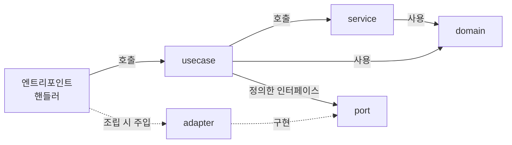

# ADR-019: 모듈 내부 구조 — domain · service · usecase (usecase → service → domain)
- 상태: Accepted
- 날짜: 2026-11-03
- 근거: 사용자 지시 / 인터뷰 R10-Q2 / 모듈 경계는 ADR-001, 읽기/쓰기 분리는 ADR-018

## 맥락
ADR-001 은 모듈 **사이**의 경계를 정했다. 이 ADR 은 모듈 **안**의 구조를 정한다. CQRS(ADR-018)의 명령/조회는 코드에서 한 건씩 눈에 보여야 하고, 트랜잭션 경계(outbox 기록과 같은 트랜잭션)는 한 곳에서 일관되게 열려야 한다. 비즈니스 규칙은 DB·HTTP 없이 시험할 수 있어야 한다.

## 결정
모듈은 세 계층 + 포트/어댑터로 나눈다. **의존은 usecase → service → domain 한 방향**이다.

| 계층 | 담는 것 | 할 수 있는 일 | 할 수 없는 일 |
|---|---|---|---|
| `domain` | 엔티티, 값 객체, 불변식, 도메인 이벤트 정의, 상태 전이 규칙 | 자기 데이터로 규칙 검증, 이벤트 생성 | I/O, 시간·난수 직접 호출, 프레임워크 임포트 |
| `service` | **여러 엔티티에 걸친** 순수 도메인 규칙(도메인 서비스) | domain 만 사용 | I/O, usecase 호출 |
| `usecase` | 명령·조회 **한 건**의 응용 로직, **트랜잭션 경계**, 인가 확인 순서, 포트 호출 | service, domain, 포트(인터페이스) 사용 | SQL·HTTP 직접 작성 |
| `port` | 저장소, outbox, inbox, 시계, 식별자 생성 등의 **인터페이스** | usecase 가 정의 | 구현 |
| `adapter` | 포트 구현(Postgres 등), 외부 연동 | 포트를 구현 | 규칙 판단 |

엔트리포인트(`apps/*`)의 HTTP/WebSocket 핸들러는 **얇다**: 입력 검증 → usecase 호출 → 응답 매핑. 규칙을 담지 않는다.

## 설계 상세

### 디렉토리(제안)
```
modules/<name>/
  domain/            엔티티 · 값 객체 · 도메인 이벤트 · 불변식
  service/           도메인 서비스 (순수)
  usecase/
    command/         명령 한 건 = 파일 한 개 (예: post-entry, add-reaction, hide-entry)
    query/           조회 한 건 = 파일 한 개 (예: list-entries, get-report-queue)
    event/           수신 메시지 처리 (프로젝터, 소비자) — 사실상 명령의 일종
  port/              인터페이스 (repository, outbox, inbox, clock, id)
  adapter/           포트 구현 (postgres …)
  index              모듈 공개 API — 다른 모듈은 여기만 임포트
```

### 의존 방향

- `adapter` 가 `port` 를 구현하고, 조립은 엔트리포인트(합성 루트)에서 한다. **의존 역전**: usecase 는 adapter 를 모른다.
- 역방향 임포트(domain → service 등)는 CI 경계 검사로 막는다(ADR-001).

### 명령 usecase 의 표준 형태
1. 입력과 호출자(세션/사용자) 받기. 인가 확인.
2. **트랜잭션 시작**(포트의 작업 단위).
3. 쓰기 모델 조회 → domain/service 로 규칙 적용 → 새 상태와 **도메인 이벤트** 산출.
4. 상태 저장 + **outbox 기록(이벤트)** — 같은 트랜잭션.
5. 커밋. 결과(식별자, 생성된 뷰, 추적 id) 반환.
도메인 이벤트는 domain 이 **값으로 반환**하고, outbox 에 쓰는 일은 usecase 가 포트로 한다 → domain 이 인프라를 모른다.

### 조회 usecase 의 표준 형태
읽기 모델 포트만 호출해 DTO 를 돌려준다. 쓰기 모델 포트를 주입받지 않는다(구조로 금지). 트랜잭션이 필요 없다.

### 이벤트 처리 usecase (`usecase/event/`)
수신 메시지 한 건 = 한 usecase: inbox 에서 선점(ADR-021) → 효과 적용(읽기 모델 갱신 등) → inbox 처리 완료를 **같은 트랜잭션**에서 기록(ADR-020).

### 모듈 간 호출
다른 모듈을 쓰려면 **그 모듈의 `index` 가 내보낸 usecase** 만 호출한다(읽기 전용 질의, 또는 명령). 다른 모듈의 `domain`, `adapter`, 테이블을 직접 참조하지 않는다. 이벤트로 알리는 것이 기본이고, 동기 호출은 세션 확인처럼 필요한 곳에 한정한다.

### 시험 전략
| 계층 | 시험 | 의존 |
|---|---|---|
| domain, service | 단위 시험 (순수, 빠름) | 없음 |
| usecase | 포트를 가짜(메모리 구현)로 바꿔 시험 | 가짜 포트 |
| adapter | 실제 Postgres 로 통합 시험 | DB 컨테이너 |
| 엔트리포인트 | E2E | 전체 |

## 대안과 기각 이유
- **service 가 응용 계층, usecase 는 그 안의 동작**: 용어는 익숙하나 CQRS 의 명령/조회가 usecase 한 건씩에 대응하는 구조가 흐려지고, 트랜잭션 경계가 service 의 여러 메서드에 흩어진다.
- **계층 없이 모듈 평면 구조**: 작은 프로젝트에 빠르지만 규칙·I/O 가 섞여 시험 비용이 커진다.
- **헥사고날 용어 전체 채택(inbound/outbound 포트 분리)**: 이 규모에서는 과하다. 포트는 outbound 만 명시한다.

## 결과
- 얻는 것: 명령/조회가 파일 단위로 보인다. 규칙은 I/O 없이 시험된다. 트랜잭션·outbox 기록 위치가 한 곳이다.
- 치르는 것: 작은 기능에도 파일이 늘고, 포트·어댑터 배선이 필요하다.

## 위험과 완화
| 위험 | 완화 |
|---|---|
| 규칙이 핸들러·어댑터로 새어 나감 | 경계 검사 + 리뷰 항목 "규칙이 domain/service 에 있는가" |
| service 가 빈약한 껍데기가 됨 | **여러 엔티티에 걸치지 않는 규칙은 domain 에 둔다.** service 는 필요할 때만 만든다 |
| usecase 비대화 | 한 usecase = 한 명령/조회. 길어지면 service 로 규칙을 이동 |
| 가짜 포트와 실제 어댑터가 달라짐 | 어댑터 통합 시험이 같은 포트 계약 시험을 공유 |

## 검증 방법
- CI 의존 방향 검사(역방향 임포트 실패).
- `usecase/query` 가 쓰기 포트를 임포트하지 않음.
- domain/service 시험이 DB 없이 돌아간다.

## 실서비스라면
동일하다. 모듈이 서비스로 분리될 때 `index` 공개 API 가 서비스 경계(계약)가 된다.

## 재검토 조건
service 계층이 대부분의 모듈에서 비어 있을 때(두 계층으로 단순화 검토).

## 관련 ADR
ADR-001, ADR-005, ADR-018, ADR-020, ADR-021
