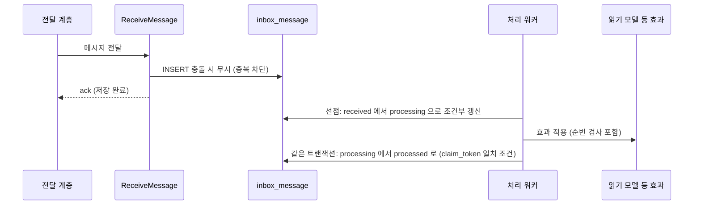

# ADR-020: Inbox — 수신 메시지를 먼저 저장하고, 선점해서 한 번만 처리한다
- 상태: Accepted
- 날짜: 2026-11-03
- 근거: 사용자 지시("outbox 및 inbox 필수") / ADR-005 개정 / 명세 FR-031 / 테이블은 [database-schema.md](../domains/database-schema.md)

## 맥락
outbox 는 **보내는 쪽**의 원자성(쓰기와 발행)을 보장한다. 받는 쪽에도 같은 종류의 문제가 있다: 같은 메시지가 두 번 오거나, 처리 도중 프로세스가 죽거나, 처리가 느려서 전달 계층이 막히는 일이다. 당초 설계는 `processed_event`(소비 완료 기록)만 두었으나, 이는 "이미 처리했는가"만 알려줄 뿐 **수신한 메시지 자체를 보관하지 않고, 처리 상태·재시도·감사를 담지 못한다.** 또한 전달 계층이 Postgres 폴링에서 Redis Streams/Kafka 로 바뀌어도(ADR-006) 수신 쪽 규약은 그대로여야 한다. 외부 입력(Phase 5 의 결제 웹훅)도 같은 문제를 갖는다.

## 결정
- 이벤트·외부 메시지를 받는 모듈은 **자기 스키마에 `inbox_message` 테이블**을 갖는다(모듈이 소유, ADR-001·017).
- **수신(receive)과 처리(process)를 분리**한다.
  1. 수신: 메시지를 inbox 에 **저장**하고 즉시 확인(ack)한다. 같은 메시지 id 는 **유일 키**로 중복을 걸러낸다.
  2. 처리: 처리 워커가 inbox 에서 메시지를 **선점**(ADR-021)하여 효과를 적용하고, **효과와 처리 완료 표시를 같은 트랜잭션**에서 기록한다.
- 전달 계층은 구독 모듈의 **`ReceiveMessage` usecase** 만 호출한다. 전달 계층 구현이 바뀌어도 이 접점은 바뀌지 않는다.
- 이전의 `events.processed_event` 는 **inbox 로 대체**한다.

## 설계 상세

### 테이블 형태(모듈마다 동일한 모양)
| 컬럼 | 설명 |
|---|---|
| `message_id` | uuid. **수신 메시지의 식별자.** outbox 이벤트 id 와 같다. 유일 키(소비자 구분이 필요하면 `consumer` 와 함께 복합) |
| `consumer` | 이 메시지를 처리하는 소비자 이름(같은 메시지를 여러 소비자가 받을 수 있다) |
| `source` | 발신 모듈 또는 외부 출처 |
| `type` | 메시지 종류 |
| `seq` | 발신 쪽 순번(읽기 모델의 순서 검사에 사용) |
| `payload` | jsonb |
| `status` | `received` / `processing` / `processed` / `dead` |
| `attempts`, `next_attempt_at` | 재시도 |
| `claim_token`, `claimed_by`, `lease_until` | 선점 정보(ADR-021) |
| `last_error` | 마지막 실패 사유(길이 제한) |
| `received_at`, `processed_at` | |
| 키 | **PK (`consumer`, `message_id`)** |

### 수신 → 처리 흐름

- 수신 쪽 응답은 **저장까지**다. 처리가 느려도 전달 계층이 막히지 않는다.
- 처리 실패: 상한까지 `received` 로 되돌리고(`attempts` 증가, 백오프), 초과하면 `dead`.
- 처리 도중 프로세스가 죽으면 `lease_until` 이 지난 `processing` 행을 회수 작업이 `received` 로 되돌린다(ADR-021). **효과 적용은 멱등**이어야 한다(순번 검사 또는 자연 키).

### outbox 와 inbox 의 대칭
| | outbox (보내는 쪽) | inbox (받는 쪽) |
|---|---|---|
| 목적 | 쓰기와 발행을 원자적으로 | 수신과 효과를 정확히 한 번 |
| 기록 시점 | 도메인 쓰기와 **같은 트랜잭션** | 수신 즉시 / 효과와 **같은 트랜잭션**에서 완료 표시 |
| 중복 방지 | 이벤트 id 생성 | PK 충돌 |
| 상태 | `new` → `processing` → `published` / `dead` | `received` → `processing` → `processed` / `dead` |
| 재시도 | 디스패처 | 처리 워커 |

### 소비자 목록(M1)
| 소비자 | 모듈 | 하는 일 |
|---|---|---|
| `guestbook-projector` | guestbook | 글·반응 이벤트로 읽기 모델 갱신 |
| `realtime-broadcaster` | realtime | 변경을 `change_log` 에 기록하고 접속자에게 브로드캐스트 |
| `flow-tracer` | events | 흐름 단계 기록(필요 시) |

### 외부 입력
Phase 5 의 PG 웹훅은 `source` 가 외부인 메시지로 같은 inbox 에 저장한다. **웹훅 본문의 서명 검증은 수신 usecase 의 첫 단계**이고, 서명이 틀리면 저장하지 않는다. 외부 메시지 id 가 유일 키가 된다.

### 보관
`processed` 는 7일 후 삭제(ADR-008·017). `dead` 는 30일·1만 건 상한(ADR-023). 정리 작업은 배치 크기를 제한한다.

## 대안과 기각 이유
- **`processed_event` 키 기록만**: 중복은 막지만 메시지를 보관하지 않아 재처리·감사·수신/처리 분리가 불가능하다.
- **수신 즉시 처리(동기)**: 단순하나 처리 지연이 전달 계층을 막고 실패 시 재전달에 의존한다.
- **전달 계층(Kafka/Streams)의 오프셋/ack 에만 의존**: 계층마다 의미가 달라 교체 때 정확히 한 번 보장이 흔들린다. inbox 는 계층에 독립적이다.

## 결과
- 얻는 것: 전달 계층과 무관한 정확히 한 번 효과, 수신/처리 분리, 감사·재처리 가능, 외부 입력에 같은 규약 재사용.
- 치르는 것: 모듈마다 inbox 테이블과 처리 워커, 보관 비용, 한 단계 늘어난 지연.

## 위험과 완화
| 위험 | 완화 |
|---|---|
| 수신-처리 사이 지연 누적 | `inbox_depth`, `inbox_oldest_age_seconds` 지표·경보 |
| 처리 중 죽어 `processing` 에 고착 | 임대 만료 회수(ADR-021) |
| 효과가 멱등이 아님 | 순번 검사/자연 키 설계를 리뷰 항목으로, 중복 주입 시험 |
| 독 메시지가 반복 실패 | 상한 후 `dead` 로 격리 |
| inbox 무한 증가 | 7일 정리 작업 |

## 검증 방법
| 시나리오 | 기대 |
|---|---|
| 같은 메시지 두 번 수신 | inbox 한 행, 효과 한 번 |
| 처리 중 워커 강제 종료 | 임대 만료 후 재처리, 효과 한 번 |
| 처리 실패 반복 | 상한 후 `dead`, 다음 메시지 진행 |
| 순서가 뒤집힌 두 메시지 | 읽기 모델은 최신 순번 기준 |
| 전달 계층 교체(Postgres → Streams) | 소비자 코드·inbox 불변 |

## 실서비스라면
동일하다. 처리량이 크면 inbox 를 파티셔닝하거나 처리 워커를 늘린다.

## 재검토 조건
수신 지연이 체감 한계를 넘거나 inbox 쓰기가 병목이 될 때(수신과 처리를 합치는 최적화 검토).

## 관련 ADR
ADR-005, ADR-006, ADR-018, ADR-019, ADR-021
