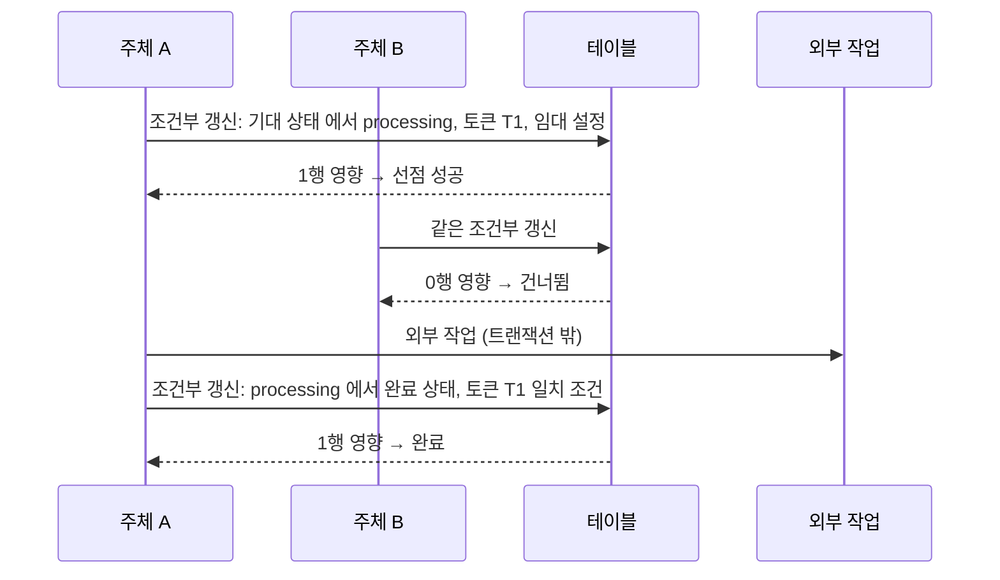
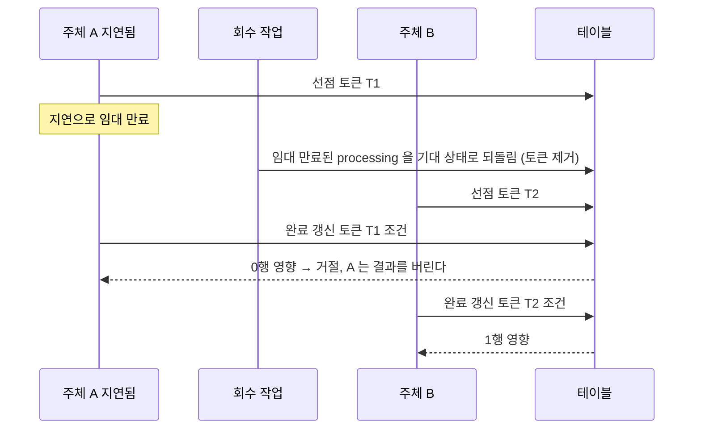

# ADR-021: 동시성 제어 — 상태 선점(CAS) + 임대 + 낙관적 버전
- 상태: Accepted
- 날짜: 2026-11-03
- 근거: 사용자 지시("update 전 pending 처리 등") / 인터뷰 R10-Q3 / ADR-005·010·020과 연결

## 맥락
이 시스템에는 "같은 일을 두 번 하면 안 되는" 자리가 많다: 이벤트 전달, 메시지 처리, 보상 확정, 주문·재고·결제 상태 전이. 또한 사용자가 같은 글을 동시에 수정할 수도 있다. 긴 DB 행 잠금은 교착과 지연을 만들고, 외부 호출(결제·분석기)은 트랜잭션 안에 둘 수 없다. 그래서 **"처리 시작 전에 상태를 먼저 선점 표시한다"** 는 규약을 시스템 전체에 일관되게 적용한다.

## 용어: 선점(pending claim)
비즈니스 상태 이름 `PENDING`(예: 보상이 분석 대기 중)과 혼동을 피하려고, 선점 상태는 **`processing`** 이라 부른다. 의미는 같다: "누군가 이 항목을 처리 중이며 다른 주체는 건드리지 않는다."

## 결정
1. **선점(CAS)**: 처리를 시작하기 전에 **조건부 UPDATE** 로 상태를 `processing` 으로 원자 전이한다. 영향받은 행이 1개인 주체만 처리한다. 0개면 다른 주체가 선점했거나 이미 끝난 것이다.
2. **임대(lease)**: 선점에는 만료 시각이 있다. 만료되면 회수 작업이 되돌려 다른 주체가 처리할 수 있다.
3. **펜싱 토큰**: 선점할 때 `claim_token` 을 발급하고, **완료 갱신은 토큰이 일치할 때만** 성공한다. 임대가 만료돼 다른 주체가 가져간 뒤 늦게 돌아온 이전 주체가 결과를 덮어쓰지 못한다.
4. **외부 호출은 트랜잭션 밖에서**: 선점(트랜잭션 1) → 외부 작업 → 완료(트랜잭션 2). 외부 호출 동안 DB 행 잠금을 쥐지 않는다.
5. **낙관적 버전**: 사용자가 동시에 수정할 수 있는 엔티티는 `version` 컬럼을 두고 `WHERE version = 기대값` 으로 갱신한다. 어긋나면 409 와 최신 상태를 돌려준다.
6. **유일 제약을 심판으로**: 중복을 막는 최종 수단은 DB 의 유일 키다(반응 PK, inbox PK 등). 코드의 사전 확인은 최적화일 뿐이다.
7. **모든 쓰기(C·U·D)는 트랜잭션 안에서**: 한 문장짜리 쓰기도 `UnitOfWork.run` 으로 감싼다. 읽기 전용 핸들에는 쓰기 메서드가 없어 구조로 강제한다(ADR-025).
8. **기본 격리 수준은 READ COMMITTED** 이며, 위 장치로 정합성을 얻는다. SERIALIZABLE 은 쓰지 않는다.
9. **싱글톤 작업**(디스패처)은 어드바이저리 락 하나를 보유한 인스턴스만 수행한다.

## 설계 상세

### 선점이 필요한 테이블의 공통 컬럼
| 컬럼 | 설명 |
|---|---|
| `status` | 항목별 상태 값 + `processing` |
| `claim_token` | uuid, 선점 때마다 새로 발급, 해제 시 NULL |
| `claimed_by` | 선점한 주체 이름(진단용) |
| `lease_until` | 임대 만료 시각 |
| `attempts` | 재시도 횟수 |
| `version` | 낙관적 버전(사용자 수정 대상일 때) |

### 선점 → 처리 → 완료

### 임대 만료와 늦게 돌아온 주체

- 이 때문에 **효과 자체도 멱등**이어야 한다. A 가 외부 효과를 이미 일으켰을 수 있다(ADR-005·020). 토큰은 "상태 덮어쓰기"를 막고, 멱등은 "효과 중복"을 막는다 — 둘 다 필요하다.

### 적용 지도
| 대상 | 선점 상태 흐름 | 추가 장치 |
|---|---|---|
| `events.outbox_event` | `new` → `processing` → `published` / `dead` | 단일 디스패처(어드바이저리 락), 순번 순서 |
| `<m>.inbox_message` | `received` → `processing` → `processed` / `dead` | PK 중복 차단, 읽기 모델 순번 검사 |
| `ledger.reward` (Phase 2) | `PENDING` → (분석 선점 `processing`) → `CONFIRMED`/`FLAGGED` | 분석은 트랜잭션 밖, 토큰 완료 |
| `deal.reservation` (Phase 3) | `active` → `confirming` → `confirmed` / `expired` | Redis Lua 선점(ADR-010), 만료 복원도 선점 후 멱등 |
| `payment.payment` / `escrow` (Phase 3 최소형, Phase 5 확장) | 상태 전이마다 기대 상태 조건 | PG 호출은 트랜잭션 밖, 웹훅은 inbox |
| `guestbook.entry` 수정·숨김 | `version` 비교 | 409 + 최신 상태 반환 |
| `guestbook.report` 처리 | `open` → `resolved` 조건부 갱신 | 관리자 동시 처리 시 한 명만 성공 |

### 배치 선점(큐 소비)
여러 항목을 한 번에 가져올 때는 `FOR UPDATE SKIP LOCKED` 로 후보를 고르는 하위 질의와 선점 UPDATE 를 한 문장으로 묶어, 잠금 대기 없이 **서로 다른 항목을 나눠 가진다.** 선점 UPDATE 가 반환하는 행만 처리한다.

### 회수 작업
주기적으로 `lease_until` 이 지난 `processing` 행을 기대 상태로 되돌리고 `attempts` 를 증가한다. 상한을 넘으면 `dead`. 회수 자체도 조건부 UPDATE 라 여러 회수 작업이 동시에 돌아도 안전하다.

### 임대 길이
작업 시간 분포를 측정한 뒤 정한다. **현재 값이 없다.** 너무 짧으면 정상 처리 중 회수되고, 너무 길면 장애 복구가 느리다. 설정으로 뺀다. 오래 걸리는 작업은 중간에 임대를 연장(heartbeat)한다 — 토큰 일치 조건으로.

### 낙관적 버전
- 수정 요청은 읽은 `version` 을 함께 보낸다. `WHERE id = ? AND version = ?` 로 갱신하고 `version + 1`.
- 0행이면 409 와 최신 본문. 클라이언트가 병합하거나 다시 시도한다.
- 반응처럼 **서로 충돌하지 않는 연산**은 버전을 쓰지 않고 유일 키로 처리한다.

## 대안과 기각 이유
- **SELECT FOR UPDATE 위주(비관적 잠금)**: 일관성은 강하나 트랜잭션이 길어지면 경합·교착 위험이 있고 외부 호출을 안에 넣을 수 없다.
- **낙관적 버전만**: 가볍지만 "한 번만 실행"을 보장하지 못하고 충돌 시 재시도 폭주가 날 수 있다.
- **분산 락(Redis 등)으로 선점**: 상태가 DB 와 분리되어 정합성 문제가 생긴다. 선점은 정본 DB 안에서 한다. (Redis 는 재고 선점 같은 속도 최적화에 한정, ADR-010)
- **SERIALIZABLE 격리**: 단순해 보이나 직렬화 실패 재시도가 곳곳에 필요하고 성능 예측이 어렵다.

## 결과
- 얻는 것: 모든 "한 번만"이 같은 모양(선점 → 처리 → 토큰 완료)이다. 장애 복구가 임대 만료로 자동화된다. 긴 잠금이 없다.
- 치르는 것: 모든 선점 테이블에 컬럼과 회수 작업, 멱등 효과 설계, 동시성 시험.

## 위험과 완화
| 위험 | 완화 |
|---|---|
| 임대가 너무 짧아 이중 처리 | 토큰 완료 + 효과 멱등, 임대 측정 후 설정, 필요 시 연장 |
| 회수 작업 버그로 항목이 영구 `processing` | `oldest_processing_age_seconds` 경보 |
| 선점 후 완료 갱신이 0행인데 효과는 일으킴 | 효과 멱등 규약, 완료 실패 시 로그·지표 |
| 상태 전이 표 누락 | 상태 전이를 domain 에 표로 정의, 허용 전이 외 거부 시험 |
| 재시도 폭주 | 백오프, 상한 후 `dead` |

## 검증 방법
동시성 시험은 **병렬 N 개가 같은 항목을 선점**하는 시나리오를 결정적으로 재현한다(배리어로 동시 출발).
| 시험 | 기대 |
|---|---|
| N 개 워커가 같은 outbox/inbox 항목 선점 | 정확히 1개 성공 |
| 선점 후 임대 만료, 다른 워커가 재선점, 첫 워커가 늦게 완료 | 첫 워커 완료는 0행, 효과 중복 없음 |
| 같은 글 동시 수정 두 건 | 하나 성공, 하나 409 |
| 같은 반응 동시 추가 | 한 요청만 행을 만들고 나머지도 **200(멱등, 이미 있음)** 으로 응답한다. 409 를 쓰지 않는다(03·08·F11 과 일치, 2026-11-05 정정) |
| 신고 동시 처리 | 한 명만 성공 |
| 허용되지 않은 상태 전이 시도 | 거부 |
| 회수 작업 동시 실행 | 이중 회수 없음 |

## 실서비스라면
동일한 장치에 더해 지표 기반 자동 임대 조정, 데드레터 재처리 도구, 부하 시험으로 경합 지점을 확인한다.

## 재검토 조건
임대 만료로 인한 중복 효과가 시험이나 운영에서 관측될 때. 경합이 특정 항목에 집중돼 CAS 재시도가 병목이 될 때.

## 관련 ADR
ADR-005, ADR-009, ADR-010, ADR-017, ADR-019, ADR-020
