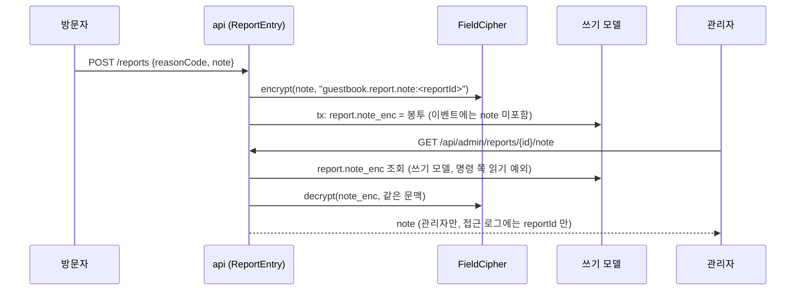

# ADR-026: 데이터 보호 — 분류와 암호화
- 상태: Accepted
- 날짜: 2026-11-04
- 근거: 사용자 요청("데이터 암호화 방법과 대상 필드 정의") / 사용자 선택(필드 암호화는 `report.note` 만) / AES-256-GCM·AAD·변조 거부의 Bun 1.4.4 실측 / ADR-008(개인정보 최소화)·ADR-022(세션 토큰 해시)·ADR-023(IP 미저장·백업)
- 관련 문서: [database-schema.md](../domains/database-schema.md), [design/10](../design/10-security.md), [F16](../design/features/16-cross-cutting.md), [F17](../design/features/17-ops-observability.md)

## 맥락
이 사이트가 저장하는 개인정보는 적다(IP·이메일을 받지 않는다). 그래서 암호화는 "전부"가 아니라 **분류에 맞는 도구를 고르는 일**이다. 또 필드 암호화는 DB 접근 권한이 있는 쪽을 막는 장치인데, 접근 주체가 서버 하나와 관리자뿐이라 효과가 큰 곳에만 둔다.

## 결정
1. 데이터를 **5개 등급**으로 분류하고 등급별 보호 수단을 정한다(§분류).
2. 공통 보호는 전부 적용한다: 전송 TLS, 토큰 해시, 쿠키 서명, **백업 암호화(`age`)**, 시크릿 파일.
3. **필드 단위 암호화는 `guestbook.report.note` 하나**에 적용한다. 메커니즘(`FieldCipher` 포트, 키 ID, 회전)은 처음부터 일반형으로 만들어 필드 추가가 쉽게 한다.
4. 호스트 볼륨 암호화는 **앱 책임이 아니라 호스트 책임**으로 문서화한다.

## 설계 상세

> 컬럼 단위의 전체 구분표는 [database-schema.md §9.1](../domains/database-schema.md) 이다. 아래는 등급별 요약이다.

### 분류와 보호
| 등급 | 데이터 | 보호 |
|---|---|---|
| **공개** | 방명록 본문·표시 이름, 반응 개수 | 없음(원래 공개). XSS 방지는 텍스트 렌더(ADR-008) |
| **가명 식별자** | 세션 ID, `actor_key`, `author_session_id`, `user_id` | 7일 후 익명화(ADR-008), 로그·지표 레이블 금지 |
| **개인 연결** | `user_account.github_id`·`login`·`display_name`, `report.reporter_key` | **평문 유지.** GitHub 공개 프로필 정보이고, `github_id` 는 유일 조회·관리자 허용목록 대조에 쓰인다. 최소 수집(스코프 없음, 이메일 없음)이 보호 |
| **자유 텍스트** | `guestbook.report.note`(신고자 메모 ≤200자) | **필드 암호화(AES-256-GCM)** |
| **비밀** | 세션 토큰, OAuth 서명 키, GitHub client secret, DB 비밀번호, 필드 키, 백업 키, **tUSDC 민트 권한 키·devnet 수수료 대납 키**(6d, devnet 전용 — ADR-048 U28; 메인넷 키는 어떤 설정에도 두지 않는다) | 아래 표 |

### 층별 보호
| 층 | 방식 | 세부 |
|---|---|---|
| 전송 | TLS | 방문자↔우리 PC(Funnel 은 TCP 프록시라 중계 서버가 복호화하지 못하고 TLS 는 PC 에서 종료, 공식 문서). Funnel→nginx 는 같은 호스트 로컬 평문, Oracle 경로(선택적 후속, 미추진)는 nginx 가 TLS 종료(G7 ③ 미확인). 컨테이너 간 통신은 compose 내부 네트워크(비공개) |
| 세션 토큰 | **SHA-256 해시 저장** | 토큰이 256비트 난수이므로 솔트·느린 해시가 불필요하다(무차별 대입 불가). 비교는 길이 검사 + `timingSafeEqual`(길이가 다르면 예외 — 실측) |
| 쿠키 서명 | HMAC-SHA256 | OAuth 임시 쿠키(`OAUTH_STATE_SECRET`) |
| 비밀값 | `_FILE` 시크릿 파일 | 저장소·이미지에 없음, 로그 마스킹(`SecretString`) |
| 백업 | **`age` 암호화** | `pg_dump` 를 수신자 공개키로 암호화 후 보관·외부 업로드. **개인키는 서버에 두지 않는다**(사용자 보관). 서버에는 공개키(`BACKUP_AGE_RECIPIENT`, 비밀 아님)만 |
| 디스크 | 호스트 볼륨 암호화 | 집 PC: LUKS 등 호스트 설정(선택, 앱 범위 밖). Oracle(미추진): 블록 볼륨 기본 암호화 여부는 미확인 |
| 필드 | AES-256-GCM | 아래 |

### 필드 암호화 메커니즘
| 항목 | 내용 |
|---|---|
| 포트 | `FieldCipher { encrypt(plaintext, context): string; decrypt(envelope, context): string }` (`packages/kernel/ports`), 구현 `packages/infra/crypto` (`node:crypto` AES-256-GCM, Bun 실측 통과) |
| 봉투 형식 | `v1.<keyId>.<base64url(iv ‖ ciphertext ‖ tag)>` — iv 12바이트(CSPRNG, 매번 새로), tag 16바이트 |
| AAD(문맥 바인딩) | `"<스키마>.<테이블>.<컬럼>:<행 id>"` — 암호문을 다른 행·컬럼으로 옮기면 복호화가 거부된다(실측: AAD 불일치·변조 모두 거부) |
| 키 | 키링 파일(비밀): `{ active: "k2", keys: { k1: <32바이트 base64>, k2: … } }`. 키 ID 는 봉투에 들어가므로 복호화는 해당 키로 한다 |
| 키 위치 | 시크릿 파일 `FIELD_KEYS_FILE`(api·worker). DB 와 같은 곳에 두지 않는다 |
| 회전 | ① 새 키 추가 후 `active` 변경(새 쓰기는 새 키) ② 재암호화 잡(`worker rotate-field-keys`)이 배치마다 짧은 tx(ADR-025)로 옛 키 행을 새 키로 다시 쓰기, 멱등 ③ 옛 키 제거는 잔여 0 확인 후 |
| 확장 | 필드가 늘면 같은 포트를 쓴다. 필드가 많아지거나 키 분리가 필요해지면 **KEK/DEK 봉투 암호화**(DEK 를 DB 에 KEK 로 감싸 저장)로 올린다 — 재검토 조건 |
| 검색·인덱스 | 암호화 필드는 검색·정렬·인덱스하지 않는다(`note` 는 해당 없음) |
| 실패 | 복호화 실패(키 없음·변조) → `PermanentError`, 값은 "복호화 불가"로 표시, 지표 `pf_field_decrypt_failures_total{field}`, 로그에 평문·키 금지 |

### `report.note` 의 흐름

- 컬럼은 `note` → **`note_enc`**(text, 봉투). 평문 컬럼은 없다. 길이 제한(200자)은 **암호화 전** 앱에서 검사한다.
- 읽기 모델·이벤트·로그에 `note` 가 나가지 않는다(05 정본). 관리자 큐 목록에는 `reasonCode` 만 보이고, 메모는 상세 조회 `GetReportNote`(GB-27)로 필요할 때만 복호화한다.
- 신고가 `resolved` 된 뒤에도 `note_enc` 는 보관 정책(글과 같이 보관)을 따른다.

### 암호화하지 않는 것과 이유
| 대상 | 이유 |
|---|---|
| 방명록 본문·표시 이름 | 공개 데이터 |
| `github_id`·`login` | 공개 프로필, 유일 조회·허용목록 대조에 쓰임(암호화하면 블라인드 인덱스가 필요해 이득 대비 복잡) |
| outbox/inbox `payload`, `request_key.response_body` | 공개 데이터이고 7일/24시간 후 삭제 |
| 세션 ID·`actor_key` | 가명 식별자, 만료 시 익명화 |

## 대안과 기각 이유
- **`pgcrypto` 로 DB 안에서 암호화**: 키가 SQL·로그·`pg_stat_statements` 에 노출될 수 있다. 앱 레벨이 키 경계를 분리한다.
- **모든 개인 연결 필드 암호화**: `github_id` 조회를 위해 블라인드 인덱스(HMAC)가 필요하고, 공개 정보라 보호 이득이 작다(사용자 선택에서 제외).
- **KEK/DEK 봉투를 처음부터**: 필드가 하나뿐인 지금은 과하다. 키링 + 키 ID 로 시작하고 올릴 경로를 남겼다.
- **볼륨 암호화를 앱이 보장**: 호스트마다 수단이 다르다(집 PC, 선택적 후속인 Oracle 포함). 앱 범위 밖으로 문서화.

## 결과
- 얻는 것: 분류 기준이 문서화되고, DB 덤프·백업이 유출돼도 신고 메모와 백업 전체가 보호되며, 암호화 경로가 일반형이라 필드 추가가 쉽다.
- 치르는 것: `FIELD_KEYS_FILE` 키 관리(백업·회전) 부담, 관리자 메모 조회 경로(`GetReportNote`) 추가, 키 분실 시 메모 복구 불가(→ 키링 백업을 백업 키와 별도로 보관).

## 위험과 완화
| 위험 | 완화 |
|---|---|
| 키 분실 | 키링을 별도 안전한 곳에 보관(백업 개인키와 분리), 분실 시 메모만 손실(글은 무관) |
| 같은 iv 재사용 | iv 는 매번 CSPRNG 12바이트, 단위 시험에서 중복 검출 |
| 평문이 로그·지표로 샘다 | `SecretString`·`Redactor`, 시험에서 로그에 센티널 문자열 부재 검증 |
| 회전 중 일부 행이 옛 키 | 봉투에 키 ID, 복호화는 키링 전체로 시도하지 않고 ID 로 선택 |
| 백업 개인키 유실 | 개인키 사본을 오프라인 보관(사용자), 복구 시험에서 복호화 확인 |

## 검증 방법
- 단위: 왕복, AAD 불일치 거부, 변조 거부, iv 중복 없음, 키 ID 선택, 회전 재암호화 멱등.
- 통합: `pg_dump` 결과에 센티널 평문 부재, 로그·지표에 평문 부재(08).
- 복구 시험: 암호화된 백업을 개인키로 복호화해 복원(F17 §백업).

## 실서비스라면
KMS/HSM 으로 KEK 를 관리하고, DB 는 TDE/볼륨 암호화, 키 접근 감사와 자동 회전을 둔다.

## 재검토 조건
암호화 필드가 3개 이상으로 늘 때(KEK/DEK 로 상향). 개인정보(이메일 등)를 수집하게 될 때. (Oracle 을 쓰게 될 경우) Oracle 볼륨 암호화가 기본 제공이 아님이 확인될 때.

### 메모 (2026-11-04, Phase 설계 반영)
Phase 1~6 영역 설계가 ENC 필드를 **M1 의 1개에서 7개 논리 필드(8개 컬럼)로** 늘린다 — `report.note_enc`(M1), `order.shipping_address_enc`(Phase 3), `payment.provider_payment_key_enc`·`escrow_dispute.reason_enc`(Phase 5), `fulfillment_order.recipient_enc`·`chat.message.body_enc`(+읽기 사본)·`chat.report.snapshot_enc`(Phase 6). 위 재검토 조건("3개 이상")이 충족되므로 **KEK/DEK 상향은 Phase 5 착수 전**에 한다. 통합표·상향 작업 항목·PII 이벤트 지침은 [phases/00 §9.3~9.6](../design/phases/00-platform-evolution.md). 결정(U14)은 사용자 확정 대기.

## 관련 ADR
ADR-008, ADR-022, ADR-023, ADR-024, ADR-025
