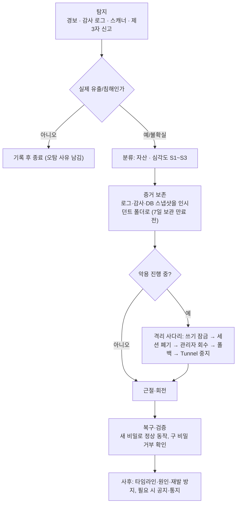

# ADR-028: 보안사고 대응 — 심각도, 비상 스위치, 자산별 런북
- 상태: Accepted
- 날짜: 2026-11-04
- 근거: 사용자 요청("보안사항 유출에 대한 대응법도 필요") / ADR-008(개인정보)·023(백업·쓰기 잠금)·026(데이터 보호)·027(감사·로그) / design/10 §5(비밀 회전)
- 관련 문서: [design/13 보안사고 대응](../design/13-incident-response.md), [design/10](../design/10-security.md), [F17](../design/features/17-ops-observability.md)

## 맥락
회전 절차는 비밀별로 흩어져 있고, "사고가 났을 때 무엇부터 하는가"가 없다. 운영자는 1인이고 로그는 7일만 남아(ADR-027) 증거를 먼저 보존하지 않으면 사라진다. 자산마다 유출 시 영향이 달라(예: 필드 키가 유출돼도 이미 만든 백업은 그 키로 복호화된다) 일반 절차만으로는 부족하다.

## 결정
1. **심각도 3단계**(S1~S3)와 단계별 목표 시간을 정한다.
2. **공통 절차** 6단계: 탐지 → 분류 → **증거 보존** → 격리 → 근절·회전 → 복구·사후. 증거 보존이 격리보다 먼저다(로그 7일).
3. **비상 스위치 사다리**: ① 쓰기 잠금(기존) ② 세션 전체 폐기(`worker admin revoke-sessions`, 신규) ③ 관리자 권한 회수(허용목록에서 제거 후 재배포) ④ 정적 폴백 전환 ⑤ Tunnel 중지(사이트 오프라인). 낮은 단계부터 필요한 만큼만 올린다.
4. **자산별 런북**을 `design/13` 에 둔다: 각 자산의 유출 영향, 즉시 조치, 회전 절차, 검증, 후속.
5. **예방과 리허설**: 저장소 비밀 스캔(CI + pre-commit), 분기별 **회전 리허설**로 절차가 실제로 동작함을 확인한다.
6. 법적 통지 의무(개인정보 유출 통지 등)는 **법무 검토 대상**으로 두고 설계는 판단에 필요한 사실(무엇이 얼마나 유출됐는가)을 빠르게 뽑는 데까지 책임진다.

## 설계 상세

### 심각도
| 단계 | 기준 | 목표(제안) |
|---|---|---|
| **S1** | 비밀 키·DB 덤프·백업 개인키·관리자 계정이 외부에 노출됐거나 악용 정황 | 즉시 증거 보존·격리, **24시간 내 회전 완료** |
| **S2** | 노출 가능성은 높지만 악용 정황 없음(저장소에 비밀 커밋, 웹훅 URL 노출 등) | 24시간 내 회전 |
| **S3** | 저위험(의존성 취약점 공지, 시도 흔적, 로그의 마스킹 발동) | 1주 내 조치 |

### 공통 절차

### 증거 보존 (격리보다 먼저)
- 관련 기간의 앱·접근 로그 아카이브와 감사 로그를 `incidents/<날짜>/` 로 복사한다(로그 7일 만료 전). 이 폴더는 외부 업로드·백업 제외, 권한 0700.
- DB 는 읽기 전용 스냅샷(`pg_dump` 암호화)을 뜬다. **로그·감사 기록을 삭제하지 않는다**(보관 정리가 도는 중이면 일시 정지: `worker retention:pause` 제안).
- 타임라인을 시간순으로 적는다(탐지 시각, 조치 시각, 결과).

### 신규 기능
| 기능 | 내용 |
|---|---|
| **ID-11 `RevokeSessions`** | `worker admin revoke-sessions --all | --user <id> | --session <id>`. 대상 세션의 `expires_at = now`(ID-10 정리 잡이 이후 익명화·삭제). 감사 `admin.sessions_revoked` 기록(대상 수). 같은 트랜잭션. WS private 연결은 캐시 만료(≤30초) 후 `4401` |
| 감사 action 추가 | `admin.sessions_revoked`, `system.retention_paused` |
| `worker retention:pause|resume` | 증거 보존 중 보관 정리를 멈춘다(상태는 `status/` 파일, 재개 잊음 방지로 24시간 자동 해제 + 경보) |
| 비밀 스캔 | CI `secret-scan` 잡 + pre-commit(도구 미확인: gitleaks 후보), GitHub 공개 저장소의 비밀 스캔·푸시 보호(무료 여부 **미확인**) |

### 자산별 요약 (상세는 design/13)
| 자산 | 유출 시 영향 | 핵심 조치 |
|---|---|---|
| 세션 토큰(대량) | 계정·익명 세션 탈취 | `revoke-sessions --all` |
| `OAUTH_STATE_SECRET` | 진행 중 로그인 위조 | 키 교체(진행 중 로그인만 실패) |
| GitHub OAuth client secret | 로그인 흐름 위조 | GitHub 에서 재발급 후 교체 |
| DB 비밀번호 | 전체 DB 접근 | 비밀번호 변경 + 재기동, 접속 로그 점검, 필요 시 S1 |
| `FIELD_KEYS` | 신고 메모 복호화(과거 백업 포함) | 새 키 + 재암호화 + 과거 백업은 노출로 간주 |
| 백업 age 개인키 | 모든 과거 백업 복호화 | 새 키쌍, 외부 백업 삭제·재생성, 과거 노출로 간주 |
| Discord 웹훅 | 경보 채널에 위조 메시지 | 웹훅 삭제·재생성 |
| Tunnel 토큰 | 트래픽 가로채기 가능성 | 토큰 폐기·재발급, 필요 시 Tunnel 재생성 |
| 관리자 GitHub 계정 | 숨김·메모 열람·권한 오남용 | 허용목록 제거 + 재배포, 세션 폐기, GitHub 2FA·토큰 폐기 |
| 저장소 비밀 커밋 | 공개 저장소라 즉시 노출 | **삭제로 해결되지 않는다** — 무조건 회전 |
| 공급망(의존성 변조) | 코드 실행 | 이미지 롤백, 잠금 파일 대조, 설치 스크립트가 돌았다면 모든 비밀 회전 |
| DB 덤프·백업 유출 | 데이터 노출 | 내용 분류표로 영향 산정(아래), 통지 판단 |

### DB 덤프가 유출됐을 때 영향 (ADR-026 분류 기준)
| 포함 데이터 | 영향 |
|---|---|
| 방명록 본문·표시 이름·반응 | 원래 공개 → 없음 |
| `github_id`·`login`·`display_name` | GitHub 공개 프로필 → 낮음(사이트 이용 사실이 연결됨) |
| 세션 `token_hash` | 해시만 → 토큰 복구 불가, 단 만료 전 세션은 `revoke-sessions --all` 로 무효화 |
| `report.note_enc` | 암호화됨 → `FIELD_KEYS` 가 함께 유출되지 않았다면 안전 |
| IP·이메일 | 저장하지 않음 → 없음 |

## 대안과 기각 이유
- **절차 없이 그때그때 대응**: 1인 운영·로그 7일이라 증거 유실과 누락 위험이 크다.
- **일률적 전체 회전**: 자산마다 영향이 달라 과하거나(Discord 웹훅) 부족하다(필드 키는 과거 백업이 남는다).
- **전체 자동 대응(Runbook 자동화)**: M1 규모에 과하다. 회전 리허설로 수동 절차를 검증한다.

## 결과
- 얻는 것: 사고 시 판단 순서가 정해지고 증거가 보존되며, 영향 산정이 빠르다.
- 치르는 것: `RevokeSessions` 와 보관 정지 CLI, 비밀 스캔 잡, 분기별 리허설 시간.

## 위험과 완화
| 위험 | 완화 |
|---|---|
| 증거 보존 전에 로그가 만료 | 격리보다 먼저 보존, 보관 정지, 로그 7일 안에 대응하는 목표 시간 |
| 런북이 낡아 동작 안 함 | 분기별 회전 리허설과 S8 완료 기준에 리허설 포함 |
| 정지한 보관 정리를 재개 안 함 | 24시간 자동 해제 + 경보 |
| 격리가 과해 사이트 오프라인 | 사다리 낮은 단계부터, 각 단계의 사용자 영향 명시 |

## 검증 방법
- 리허설: 각 비밀을 한 번 회전하고 구 비밀 거부·새 비밀 정상 동작을 확인(S8-8).
- 통합: `revoke-sessions --all` 후 기존 쿠키 요청이 새 익명 세션으로 처리, private 연결이 `4401`.
- CI: 비밀 스캔 잡이 시험용 비밀 패턴을 잡는다.

## 실서비스라면
보안 담당과 온콜, SIEM·KMS 기반 자동 회전, 법무·고객 통지 절차와 사고 대응 훈련(테이블탑)을 둔다.

## 재검토 조건
운영자가 둘 이상이 될 때. 개인정보 수집 범위가 늘 때. 실제 사고 발생 후(포스트모템 반영).

## 관련 ADR
ADR-008, ADR-023, ADR-026, ADR-027
