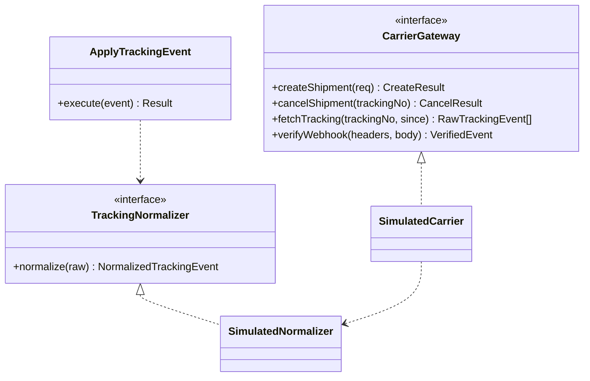

# ADR-044: 배송사 어댑터와 추적 모델
- 상태: **Proposed** (사용자 확정 대기)
- 날짜: 2026-11-04
- 근거: Phase 6 WMS 항목(ADR-016), ADR-015(모의 면책)·020(inbox)·021·023(레이트 제한 수치)·026(PII) / [phases/03-fulfillment.md](../design/phases/03-fulfillment.md) §5.3·§12.5
- 구현 순서(P0 D24): 6c.

## 맥락
배송 추적은 외부 시스템(택배사)의 상태를 우리 도메인으로 가져오는 문제다. 택배사마다 상태 어휘가 다르고, 이벤트가 **중복·지연·순서 역전**으로 오며, 웹훅과 폴링 둘 다 쓰는 경우가 많다. 이 프로젝트는 모의 환경이라 실제 택배사에 연결하지 않지만, **어댑터 경계를 실제처럼** 설계해 견고성을 보여야 한다(ADR-015).

## 결정
1. **포트 `CarrierGateway`** 를 두고 구현은 어댑터로 분리한다: `createShipment`, `cancelShipment`, `fetchTracking(trackingNo, since)`. M1 구현은 **`SimulatedCarrier` 하나**. 실제 택배사 연동은 같은 포트의 새 어댑터로 추가할 수 있고, M1+ 범위에서는 하지 않는다.
2. **정규화된 추적 상태 어휘**를 도메인이 소유한다: `LABEL_CREATED`, `PICKED_UP`, `IN_TRANSIT`, `OUT_FOR_DELIVERY`, `DELIVERED`, `FAILED_ATTEMPT`, `EXCEPTION`, `RETURNING`, `RETURNED_TO_SENDER`, `LOST`. 택배사별 원시 상태는 `TrackingNormalizer`(어댑터 쪽 매핑 표)가 변환한다.
3. **웹훅은 inbox 로 받고**(서명·타임스탬프 검증, `(carrier, event_id)` 유일) 폴링은 보조 경로다(웹훅 유실 대비). 두 경로가 같은 `carrier_event` 와 같은 반영 usecase(`ApplyTrackingEvent`)로 합쳐진다.
4. **상태 반영 규칙**: 상태에 **순위(rank)** 를 두고 현재보다 낮은 순위의 늦은 이벤트는 **이력만 기록하고 상태를 되돌리지 않는다**. 같은 순위 재전송은 `ON CONFLICT` 로 무시. `FAILED_ATTEMPT ↔ OUT_FOR_DELIVERY`, `EXCEPTION ↔ IN_TRANSIT` 같은 정의된 순환 전이만 예외로 허용하되, **현재 반영된 이벤트보다 `attempt_no`(EXCEPTION 은 `exception_seq`) 또는 `occurred_at` 이 엄격히 큰 이벤트만** 순환 전이를 일으킨다(같거나 작으면 — 늦게 온 재전송 포함 — 이력만). 예: OFD(attempt 1)→FAILED(attempt 1) 후 OFD(attempt 1) 재전송은 FAILED 를 되돌리지 못한다.
4-1. **반송 이후**: `RETURNED_TO_SENDER` 는 종결이 아니라 `ReturnCase(origin = RTS)` 생성의 트리거이고, 반송 입고(`RETURN_RECEIPT`)·검수·재입고/폐기로 이어져 재고가 원장에 돌아온다. 종료 상태에서는 추적 이벤트가 상태를 바꾸지 못하지만 ReturnCase 는 별도 집합체로 진행한다.
5. **외부 호출은 트랜잭션 밖**에서 하고(ADR-021) 택배 멱등 키는 `fo_id + seq` 로 한다.
6. **개인정보 최소화**: 택배 이벤트는 `raw_status` 와 시각만 저장하고 수취인 정보를 가져오지 않는다. 택배사로 보내는 수취인 정보는 `createShipment` 호출 시점에만 복호화해 전달하고 로그에 남기지 않는다.

## 설계 상세

### 포트와 어댑터

### 상태 순위 (제안)
| 상태 | rank |
|---|---|
| LABEL_CREATED | 10 |
| PICKED_UP | 20 |
| IN_TRANSIT | 30 |
| OUT_FOR_DELIVERY | 40 |
| FAILED_ATTEMPT | 35 (OUT_FOR_DELIVERY 와의 순환 전이 허용) |
| EXCEPTION | 33 (복구 전이 허용) |
| RETURNING | 50 |
| DELIVERED / RETURNED_TO_SENDER / LOST | 90 (종료) |

종료 상태(`DELIVERED`·`RETURNED_TO_SENDER`·`LOST`)에서는 어떤 추적 이벤트도 상태를 바꾸지 못한다(이력만). 순환 전이 쌍은 위 4번의 단조 조건을 만족해야 한다.

### 웹훅 보안
- `X-Signature`(HMAC-SHA256 over `timestamp + "." + body`), `X-Timestamp` 허용 오차 5분(제안). 재생 방지는 `(carrier, event_id)` 유일.
- 서명 키: 시크릿 파일 `CARRIER_WEBHOOK_SECRET`(회전 절차는 ADR-028 표에 추가).

### 시뮬레이터 신뢰도
`SimulatedCarrier` 는 설정으로 **지연 분포, 실패율, 중복, 역순, 유실, 서명 오류**를 주입한다. 이것이 추적 견고성 시험의 입력이다. 시뮬레이터 시간 가속은 `SimClock` 으로 한다.

## 대안과 기각 이유
- **실제 택배사 API 연동**: 계정·비용·요청 한도 의존, 포트폴리오의 모의 원칙(ADR-015)과 무료 호스팅 제약에 맞지 않다.
- **택배사 상태를 그대로 저장**: 도메인이 택배사 어휘에 결합된다.
- **웹훅만 사용**: 유실 시 복구 수단이 없다. 폴링 보조 필요.
- **최신 시각만 믿기**: 택배사 시계 오차·같은 시각 이벤트 때문에 순위 규칙이 더 안전하다.

## 결과
- 얻는 것: 택배 연동의 실제 난점(중복·역순·유실)을 시험 가능한 형태로 다룬다, 어댑터 교체 가능.
- 치르는 것: 정규화 표·시뮬레이터 유지, 웹훅 서명 관리.

## 위험과 완화
| 위험 | 완화 |
|---|---|
| 순위 규칙이 현실 택배의 예외 흐름과 안 맞음 | 순환 전이 표 명시, 순환은 `attempt_no`/`occurred_at` 단조 조건, 시뮬레이터에 예외 시나리오 추가 |
| 웹훅 유실 | 폴링 보조 + `pf_wms_carrier_event_lag_seconds` 경보 |
| 서명 키 유출 | 회전 절차, 타임스탬프 윈도우 |
| 어댑터 외부 호출 중복 | 택배 멱등 키 + 유일 (`fo_id`,`seq`) |

## 검증 방법
- 단위: `TrackingNormalizer` 매핑 표, 순위 규칙 표 기반.
- 통합: 중복·역순·유실 주입 시 최종 상태가 기대와 같음(AC-WM-07).
- 보안: 서명 오류·오래된 타임스탬프 거절.

## 실서비스라면
택배사별 어댑터와 SLA 모니터링, 운송장 재발급 자동화, 배송 조회 API 의 요청 한도 관리, 택배사 점검 시 자동 우회를 둔다.

## 재검토 조건
실제 택배사 연동을 추가할 때. 상태 어휘가 모자라 정규화 표가 커질 때.

## 관련 ADR
ADR-015, ADR-020, ADR-021, ADR-026, ADR-028, ADR-043
