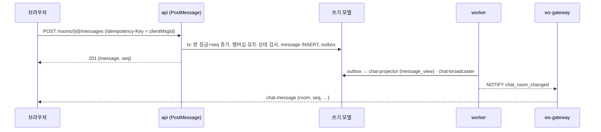

# ADR-045: 채팅 메시지 전달 모델 — REST 쓰기, 방별 순번, 멱등, 재개
- 상태: **Proposed** (사용자 확정 대기. 설계 문서 [phases/04-chat](../design/phases/04-chat.md))
- 날짜: 2026-11-04
- 근거: README 로드맵 Phase 1(대국 채팅)·Phase 6(CS 채팅) / ADR-014(재접속)·018(CQRS)·020(inbox)·021(동시성)·025(쓰기는 트랜잭션) / design/04(WS 프로토콜)·F14(realtime)
- 구현 순서(P0 D24): `chat` 코어는 **6a(CS 채팅)에서 먼저 도입**되고 대국 채팅 룸 종류는 Phase 1 에서 추가된다(P0 §1.4 G9).
- 관련 문서: [phases/04-chat](../design/phases/04-chat.md) §4·§5·§13

## 맥락
M1 의 WebSocket 은 **읽기 전용 푸시 채널**이고 쓰기는 REST 이다(ADR-018). 채팅은 사용자 입력이 잦고 순서·중복·재접속 복구가 핵심이다. 정해야 할 것은 ① 메시지를 어디로 보내는가(REST vs WS 인바운드) ② 순서의 기준(방별 순번을 누가 언제 부여하는가) ③ 중복 전송 방지 ④ 놓친 메시지 복구 경로이다. M1 은 `change_log` 채널 순번을 **소비자(broadcaster) 쪽**에서 부여한다(F14 D1). 같은 방식이 채팅에 맞는지 평가가 필요하다.

## 결정 (잠정 — 사용자 확정 전)
1. **쓰기는 REST** (`POST /api/rooms/{roomId}/messages`). 가드 체인(Origin·Session·RateLimit·Schema)·`Idempotency-Key`·감사·오류 매핑을 M1 과 그대로 재사용한다. WS 는 **푸시 + 구독 제어(join/leave) + 휘발성 입력(typing)** 만 인바운드로 허용한다.
2. **방별 순번은 명령 쪽에서 부여한다.** 같은 트랜잭션에서 `chat.room.last_seq` 를 `UPDATE … SET last_seq = last_seq + 1 … RETURNING` 으로 올려 메시지 `seq` 로 쓴다(방 행 잠금으로 방 안 쓰기 직렬화, seq 순서 = 커밋 순서, 롤백하면 구멍 없음). **정책 검사(`ContentPolicy`)는 잠금 이전**에 한다.
3. **중복 전송은 클라이언트 메시지 id 로 막는다.** 헤더 `Idempotency-Key` 를 `client_msg_id` 로 삼고 `UNIQUE (room_id, sender_key, client_msg_id)` 를 **최종 심판**으로 둔다(ADR-021 6번). 같은 id 의 재전송은 **기존 메시지(같은 seq)를 돌려준다**. `request_key`(24시간)가 남아 있으면 저장된 응답을 재생하고, **만료된 뒤 유일 키 충돌**이 나면 카운터가 이미 올랐을 수 있으므로 **트랜잭션을 롤백(카운터 원복)하고 기존 메시지를 조회해 응답**한다 — 어떤 경로에서도 방 seq 는 연속이다. (검토 반영: 롤백 없이 기존 행을 반환하면 카운터만 오른 채 커밋되어 영구 gap 이 생긴다.)
4. **전파는 M1 파이프라인을 따른다**: 메시지 저장 + outbox(`chat.message_posted`)가 한 트랜잭션 → 디스패처 → 소비자 둘(`chat-projector` 가 `chat_read.message_view` 갱신, `chat-broadcaster` 가 `/ws/room` 구독자에게 푸시). 푸시 메시지는 **방 순번 `seq` 를 그대로 싣는다**(소비자가 새로 부여하지 않는다).
5. **재개는 읽기 모델로**: 클라이언트가 방별 마지막 `seq` 를 `room.join { room, resume }` 에 보내면 gateway 가 `RoomEventSource`(chat 구현)로 `chat_read.message_view` 에서 `seq > resume` 를 재생하고, 이력이 없거나 너무 크면 최근 N건 스냅샷으로 대체한다. **구독을 먼저 등록한 뒤** `head` 를 쓰기 모델 `room.last_seq` 에서 읽고, 읽기 모델이 `head` 에 못 미치면 gateway 가 대기·재시도(100ms 간격 최대 2초)하며, 그래도 모자라면 클라이언트가 gap 으로 감지해 REST `GET ?after=` 로 채운다(소비자 둘의 처리 지연 차이로 push 가 투영보다 앞설 수 있기 때문, 검토 반영).
6. **암호화 방(CS)은 응답 재생·재개에서도 본문을 내보내지 않는다**: `request_key.response_body` 는 `{messageId, seq}` 만 저장하고, 재개·스냅샷 모드는 `room.joined{head}` + `chat.notice {room, seq}` 만 보낸다. 본문은 REST 조회(api 가 복호화, ADR-047). 지원 방 전송은 `/support/tickets/{id}/messages` 만이며 `POST /rooms/{id}/messages` 는 `support_ticket` 방을 `409 room_kind_mismatch` 로 거절한다.
7. **WS 인바운드는 `room.join`·`room.leave`·`typing` 3종**(P0 §6.3 허용 목록)뿐이고 `room.join` 은 연결당 초당 5회(P0 §6.8, 초과 시 `4429`)다. 어느 인바운드도 DB 쓰기·임대 연장을 하지 않는다.

## 설계 상세

### 순번 부여 위치 비교
| 안 | 방식 | 장점 | 단점 | 판정 |
|---|---|---|---|---|
| A. M1 방식(소비자 쪽 채널 카운터) | broadcaster 가 `change_log` 트랜잭션에서 부여 | M1 코드 재사용 | 순번이 **전달 순서**이지 작성 순서가 아니다(소비자 동시성에 의존). 이력 보관 1시간(ADR-023) 한계 | 기각 |
| **B. 명령 쪽 방 카운터(채택)** | PostMessage 트랜잭션에서 부여 | 작성 순서가 정본, 영속 이력이 곧 재개 원본, 클라이언트가 gap 을 정확히 감지 | 방 단위 쓰기 직렬화(핫 방 경합) | **채택**. 방당 쓰기율이 낮아 문제 없음(§20 추정) |
| C. uuid v7 시간순만 | 순번 없이 id 정렬 | 락 없음 | gap 감지 불가, 재개 기준 모호 | 기각 |

### 쓰기 경로(요약)

### WS 인바운드 예외
M1 의 "WS 는 읽기 전용"을 **세 가지 휘발성/제어 메시지**에 한해 완화한다: `room.join`/`room.leave`(구독 제어), `typing`(상태 표시). 어느 것도 DB 에 쓰지 않고 감사 대상이 아니며 **티켓 임대도 연장하지 않는다**. 속도는 M1 의 클라이언트 메시지 한도(초당 10건, `4429`)와 룸 구독 한도(`room.join` 초당 5회, P0 §6.8)를 따른다.

### REST 대신 WS 로 보내는 안의 철회 조건
REST 쓰기 지연(요청→응답)이 **p95 150ms**(제안) 를 넘는 것이 측정되면 `chat.send` 인바운드를 도입한다. 그때도 같은 usecase·`client_msg_id` 규약을 쓴다(전송 수단만 다르다).

## 대안과 기각 이유
- **WS 인바운드 전송을 기본으로**: 지연은 줄지만 가드 체인·멱등·CSRF 방어를 WS 용으로 다시 만들어야 하고 M1 의 "WS 읽기 전용" 원칙을 깬다. 측정 전 기각(위 철회 조건 참조).
- **읽기 모델 없이 `chat.message` 를 직접 조회**: CQRS 규칙(조회는 읽기 모델만)을 깬다. 이력 조회는 `chat_read` 로 한다.
- **방 단위 락 없이 uuid 정렬**: gap 감지가 불가능해 재접속 복구 규약이 약해진다.

## 결과
- 얻는 것: 작성 순서가 정본인 방별 순번, 중복 전송 안전, 재접속 복구가 DB 이력으로 보장, M1 인프라(가드·outbox·inbox·감사) 재사용.
- 치르는 것: 방 단위 쓰기 직렬화, 전송이 REST 왕복 + 비동기 푸시(수십~수백 ms)라 즉시성은 WS 직접 전송보다 낮다, `/ws/room` 인바운드 예외 3종.

## 위험과 완화
| 위험 | 완화 |
|---|---|
| 푸시가 읽기 모델 투영보다 먼저 도착해 재개가 비어 보임 | plain 방은 push 가 본문을 포함하므로 재조회가 필요 없다. 재개는 **구독 먼저 → `head`(쓰기 모델) → 읽기 모델 대기·재시도** 순서로 구독 직전 push 유실을 막고, 그래도 모자라면 클라이언트가 gap 으로 감지해 REST 로 채운다. CS 방은 알림 전용이므로 GET 이 비면 짧은 백오프 재시도 |
| 핫 방의 방 행 경합 | 방당 쓰기율 상한(속도 제한), 관전자 쓰기 별도 등급, 대국 방은 최대 인원 제한 |
| 전달 지연이 길어 채팅이 답답함 | 지표 `pf_chat_fanout_seconds` 로 감시, 철회 조건 충족 시 WS 전송 도입 |
| 동일 `client_msg_id` 를 다른 본문으로 재사용 | `request_hash` 불일치 시 `422 idempotency_key_reuse`(M1 규칙) |
| `request_key` 만료 뒤 재전송이 카운터만 올림 | 충돌 시 롤백 후 기존 행 반환(결정 3), 시험 CH-AC9 |

## 검증 방법
- 동시성: 같은 방에 N 명이 동시에 전송 → seq 연속·유일, 순서 = 커밋 순서.
- 멱등: 같은 `client_msg_id` 동시 2회 → 메시지 1건, 응답 같은 seq.
- 재접속: 클라이언트가 중간 seq 를 놓친 뒤 `resume` → 누락 없이 재생.
- 지연 측정: REST 쓰기 p95, 푸시까지 종단 지연 p95 를 기록해 철회 조건 판단.

## 실서비스라면
채팅 전용 서비스(Redis Streams/Kafka 팬아웃)와 메시지 저장소 분리, 방 샤딩, 읽음 상태를 별도 저장소에 둔다.

## 재검토 조건
REST 쓰기 p95 가 150ms 초과. 방당 쓰기율이 방 행 잠금 경합을 일으킴. ADR-031(이벤트 전달 계층)이 Redis Streams 로 바뀌어 팬아웃 구조가 달라질 때.

## 관련 ADR
ADR-014, ADR-018, ADR-020, ADR-021, ADR-025, ADR-032(실시간 채널 모델, P0 제안), ADR-046, ADR-047
