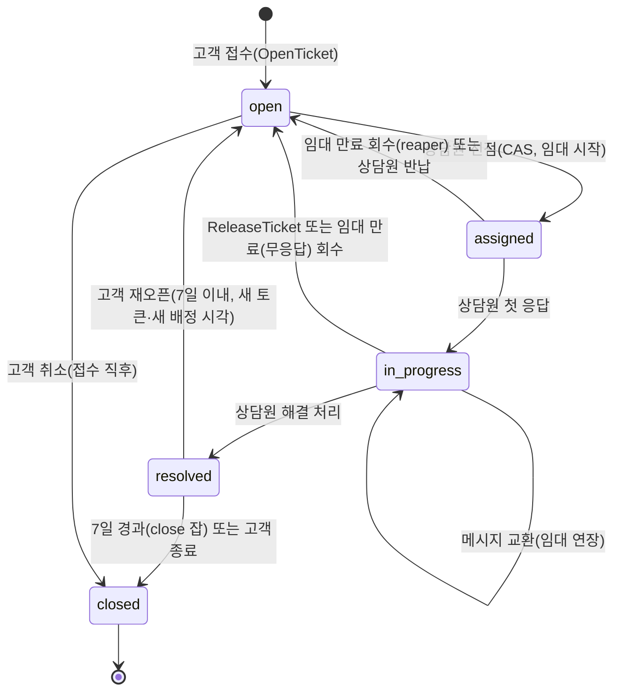
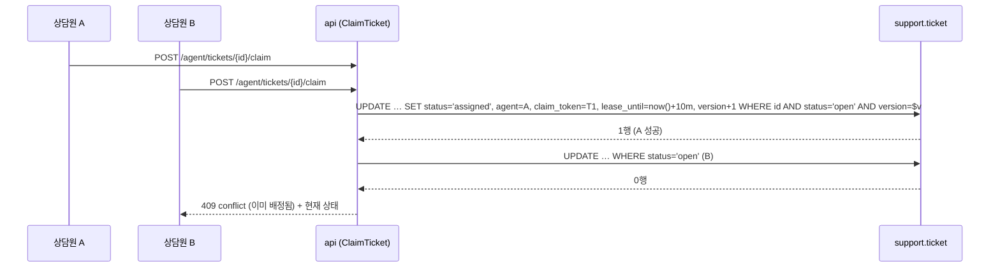

# ADR-046: CS 티켓과 상담원 배정 — 상태 머신, 선점(CAS)+임대, 주문 연동
- 상태: **Accepted** (2026-11-05, 사용자 일괄 확정 U1. Phase 6 항목)
- 날짜: 2026-11-04
- 근거: README 로드맵 Phase 6(CS 채팅) / ADR-016(확장은 독립 DoD) / ADR-021(상태 선점·임대·낙관적 버전) / ADR-028(역할·감사)
- 구현 순서(P0 D24): 6a.
- 관련 문서: [phases/04-chat](../design/phases/04-chat.md) §3.4·§15·§16

## 맥락
CS 채팅은 일반 대화방과 달리 **작업 단위(티켓)** 가 있다: 접수 → 배정 → 진행 → 해결 → 종료. 여러 상담원이 같은 티켓을 동시에 집는 경합, 응답 없는 상담원이 티켓을 붙잡는 문제, 주문 정보 연동, 응대 품질 지표(첫 응답 시간)가 설계 대상이다. 운영자는 현재 1인이지만 구조는 N 명을 가정한다.

## 결정 (잠정)
1. **모듈 분리**: `chat`(범용 방·메시지 엔진)과 `support`(티켓 수명주기·배정·SLA)를 나눈다. `support` 가 `chat` 의 공개 `…InTx` 함수(`OpenRoomInTx`, `PostMessageInTx`, `CloseRoomInTx`, `AddParticipantInTx`, `RemoveParticipantInTx`)를 호출하고, `chat` 은 `support` 를 모른다(`support.*` 이벤트도 구독하지 않는다).
2. **티켓 상태 머신**: `open → assigned → in_progress → resolved → closed`, `resolved → open`(재오픈은 대기열로, 새 `claim_token`·새 `claimed_at`). `resolved`·`closed` 전이는 같은 tx 로 상담원을 `RemoveParticipantInTx` 하고 `claim_token` 을 교체한다. 모든 전이는 **조건부 UPDATE**(`WHERE status = $기대 AND version = $v`).
3. **배정은 당기기(pull) 방식**이 기본이다: 상담원이 대기열에서 티켓을 **선점(claim)** 한다(CAS). 자동 배정(최소 부하)은 같은 CAS 를 호출하는 선택 잡으로 둔다.
4. **선점에는 임대가 있다**: 상담원 **REST 활동**(메시지 전송, `POST /agent/tickets/{id}/heartbeat`)마다 `lease_until` 이 연장된다. **`typing` 은 연장 신호가 아니다**(WS 인바운드는 DB 에 쓰지 않고 gateway 에 쓰기 경로가 없다). 연장에는 **총 상한**이 있다: `lease_until ≤ claimed_at + 2시간`(제안) — 상한을 넘기면 임대가 만료되어 티켓이 대기열로 돌아가고 다시 `ClaimTicket` 해야 한다(무응답 상담원이 티켓을 영구히 붙잡는 일을 막음). 임대가 만료된 **`assigned`·`in_progress` 티켓은 모두** `open` 으로 되돌린다(reaper 잡). 되돌릴 때는 `claim_token` 을 바꿔 이전 상담원의 늦은 응답이 상태를 덮지 못하게 한다(ADR-021 펜싱). 상담원의 임대 연장 근거는 M1 ADR-021(토큰 조건 연장 허용)이며 간격은 임대의 1/3 이하.
5. **역할**: 일반 사용자 `customer`, 상담원 `agent`, 관리자 `admin`(P0 D11: `agent`·`operator`·`admin` 은 모두 설정 허용목록, DB 권한 플래그 없음). 상담원 목록은 M1 관리자와 같은 방식의 **설정 허용목록**(`AGENT_GITHUB_IDS`)으로 시작한다(Passkey 도입 시 재검토). 고객은 **로그인 사용자만** 티켓을 열 수 있다(주문과 연결하려면 신원이 필요).
6. **티켓 전이와 메시지·방·참가자 변경은 한 트랜잭션**이다: `support`(조율자, L5)가 `chat.PostMessageInTx`·`OpenRoomInTx`·`CloseRoomInTx`·`AddParticipantInTx`·`RemoveParticipantInTx`(L3)를 직접 호출하는 B12 허용 쌍 #1 ([ADR-030](ADR-030-service-boundary-criteria.md) / [phases/00 §2.4](../design/phases/00-platform-evolution.md)). 쌍 #1 의 조율자는 `OpenTicket`·`ClaimTicket`·`ReleaseTicket`·`ReplyTicket`·`ResolveTicket`·`CloseTicket`·`TicketAutoCloser`·`TicketLeaseReaper` 이다(P0 표 갱신 요청). **`ClaimTicket` 은 상담원을 참가자로 추가하고 `ReleaseTicket`·reaper 는 이전 상담원을 제거**한다 — 제거하지 않으면 이전 상담원이 REST 조회로 복호화한 대화를 계속 읽을 수 있다. 방 접근 판정 포트 `RoomAccessPolicy` 는 `realtime` 소유이고 `support` 가 `CsRoomPolicy` 를 구현해 등록한다(쓰기 모델 `ticket.agent_user_id` 기준). `chat` 은 `support` 를 임포트하지 않고, 중첩 `uow.run` 은 없다.
7. **주문 연동**: 티켓은 `order_id`(선택)를 가진다. 상담원 화면에는 주문 요약을 **읽기 포트**(`commerce` 의 공개 usecase)로 가져온다. 고객이 자기 주문만 연결할 수 있도록 서버가 소유자를 검증한다.
8. **재오픈 창**: 해결 후 7일(제안) 안에 고객이 재오픈할 수 있고, 그 뒤 `closed` 로 자동 전이한다(`close` 잡). 종료된 티켓의 방은 읽기 전용이 된다.
9. **SLA 지표**: 첫 응답 시간, 해결 시간, 대기열 길이를 지표로 노출한다(식별자 레이블 금지).
10. **열람 감사**: 상담원·관리자의 CS 대화 열람은 `admin.support_conversation_opened`(감사 `actor_role=agent|admin`)를 **열람 세션당 1회** 기록한다(조회마다가 아님, ADR-047).

## 설계 상세

### 상태 머신

### 선점 경합

### 임대 회수와 펜싱
- `lease_until` 기본 10분(제안), 상담원 **메시지 전송·하트비트(REST)** 마다 +10분, 단 `claimed_at + 2시간`을 넘지 못한다(제안). `typing` 은 연장하지 않는다.
- reaper 가 만료된 `assigned`/`in_progress` 를 `open` 으로 되돌리고(`ReleaseTicket` 도 같은 두 상태에서) `claim_token` 을 새로 만들며 **이전 상담원을 참가자에서 제거**(`RemoveParticipantInTx`)하고 시스템 메시지를 남긴다. 이전 상담원이 늦게 보낸 `resolve` 는 토큰 불일치로 `409`.
- 같은 상담원의 재선점은 별도 조항이 없다 — `open` 으로 돌아온 티켓을 일반 `ClaimTicket` 으로 다시 집는 것뿐이다(임대 새로 시작, `claimed_at` 갱신).

## 대안과 기각 이유
- **채팅과 티켓을 한 모듈에**: 범용 엔진(대국 채팅)이 CS 도메인을 알게 된다. 분리하면 CS 를 Phase 6 에서 독립 DoD 로 중단·재개할 수 있다.
- **자동 배정만**: 상담원이 한 명뿐이라 의미가 적고, 부하 분산 규칙(스킬, 근무 시간)이 범위를 키운다. pull + 선택 자동 배정으로 시작.
- **임대 없는 배정**: 무응답 상담원이 티켓을 영구히 붙잡는다.
- **외부 헬프데스크 연동**: 무료·무카드 원칙과 "백엔드 역량 증명" 목적에 맞지 않는다.

## 결과
- 얻는 것: 경합에 안전한 배정, 무응답 회수, 범용 채팅과 CS 의 경계 분리, 응대 지표.
- 치르는 것: `support` 모듈과 reaper/close 잡 추가, 상담원 허용목록 운영, 주문 연동용 읽기 포트 의존.

## 위험과 완화
| 위험 | 완화 |
|---|---|
| 임대 회수와 상담원 응답이 경합 | `claim_token` 펜싱, 응답 usecase 가 토큰·상태 조건을 확인 |
| 고객이 남의 주문을 연결 | 서버가 `order.owner == customer` 를 검증, 불일치는 `403` |
| 상담원 계정 탈취 | 허용목록 회수 + 세션 폐기(ADR-028), 상담 대화 열람은 감사 기록(열람 세션당 1회) |
| 배정이 풀린 상담원이 대화를 계속 읽음 | `RemoveParticipantInTx` + `CsRoomPolicy` 가 쓰기 모델 `ticket.agent_user_id` 로 판정(읽기 모델 지연 무관) |
| 티켓 스팸 | 고객당 열린 티켓 상한(제안 3), 접수 속도 제한 |

## 검증 방법
- 동시성: 두 상담원이 동시에 claim → 한 명만 성공. 임대 만료 후 이전 상담원 resolve 거절.
- 상태 머신: 허용되지 않는 전이는 `409`. 재오픈 창 경계(7일). 해결 뒤 이전 상담원의 REST 열람이 `403`, 재오픈 티켓의 `claimed_at + 2시간` 상한이 새 배정 시각부터 다시 계산됨.
- 통합: 접수 → 배정 → 대화 → 해결 → 종료의 end-to-end, 재접속 복구.

## 실서비스라면
상담원 근무 일정·스킬 라우팅·SLA 경보·CSAT 설문, 전용 CS 도구와 감사 로그 장기 보관을 둔다.

## 재검토 조건
상담원이 둘 이상이 될 때(자동 배정 규칙 확정). 임대 10분이 실제 응대 패턴과 맞지 않을 때. Passkey/RBAC 도입(ADR-030 P0 제안).

## 관련 ADR
ADR-016, ADR-021, ADR-027, ADR-028, ADR-045, ADR-047
