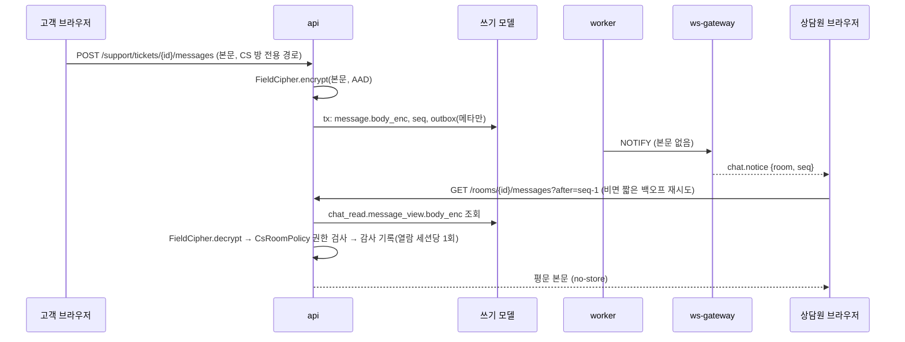

# ADR-047: 채팅 데이터 보호·보관 — 방 종류별 등급, CS 본문 암호화, 알림 전용 푸시
- 상태: **Accepted** (2026-11-05, 사용자 일괄 확정 U1. ADR-026 재검토 조건 "개인정보를 수집하게 될 때"에 해당)
- 날짜: 2026-11-04
- 근거: ADR-008(보관·개인정보)·026(데이터 보호)·027(감사)·028(사고 대응) / README Phase 1·6 / design/04-ws-protocol
- 구현 순서(P0 D24): CS 채팅 보호는 6a, 대국 채팅 보관은 Phase 1.
- 관련 문서: [phases/04-chat](../design/phases/04-chat.md) §7, [database-schema.md §9.1](../domains/database-schema.md)

## 맥락
M1 의 필드 암호화는 `report.note` 하나였고, 이유는 "저장하는 개인정보가 적다"였다(ADR-026). CS 채팅은 그 전제를 깬다: 고객이 이름·주소·주문 번호·연락 수단을 자유 텍스트로 적는다. 대국 채팅은 공개에 가까운 대화이지만 개인정보가 섞일 수 있다. 본문을 어디까지 보호하고, WS 로 푸시할 때 키가 어디에 노출되는지, 얼마나 오래 보관하는지를 정해야 한다.

## 결정 (잠정)
1. **방 종류별 본문 등급**
   - 대국 채팅(`game_players`, `game_spectators`): **`PUB`**(방에 접근할 수 있는 누구에게나 보이는 대화). 평문. 보관 짧게.
   - CS 티켓 채팅(`support_ticket`): **`ENC`**(고객·상담원·관리자만 보는 개인 대화). `body_enc` 에 AES-256-GCM 봉투(AAD `chat.message.body_enc:<messageId>`). **키 방식**: Phase 6 시점에는 P0 D13 의 KEK/DEK 상향이 끝나 있으므로 봉투는 `v2.<dekId>.…`, 키는 `KEK_KEYS_FILE` 유래 DEK 다(M1 의 `FIELD_KEYS`/v1 은 상향 전 설명).
2. **암호화 필드는 `chat.message.body_enc` + 읽기 사본 `chat_read.message_view.body_enc`, 그리고 `chat.report.snapshot_enc`(CS 방 신고 스냅샷)** 이며(P0 §9.5 통합표 #6·#7, 둘 다 키 회전 대상) 평문 컬럼은 CS 방에 존재하지 않는다. `CHECK`: 텍스트 메시지는 `status='deleted'`(묘비: 본문 컬럼 모두 NULL)가 아닌 한 `body` 와 `body_enc` 중 **정확히 하나**만 NOT NULL.
3. **CS 방의 WS 푸시는 알림 전용 — 재개·스냅샷 모드도 마찬가지**: 이벤트·푸시에는 본문을 싣지 않고 `chat.notice {room, seq}` 만 보낸다. 재개는 `room.joined{head}` + 알림 한 번이며 gateway 는 `body_enc` 암호문조차 읽지 않는다. 클라이언트가 REST(`GET /api/rooms/{id}/messages?after=`)로 본문을 받아오면 **api 가 복호화**한다(읽기 모델 투영이 늦어 비어 있으면 짧은 백오프로 재시도). 그래서 **키 재료(KEK/DEK, 상향 전 `FIELD_KEYS`)는 api·worker 에만 있고 ws-gateway 에는 두지 않는다**(인터넷에 직접 연결된 프로세스에 키를 두지 않는다).
4. **outbox/inbox 페이로드에도, `request_key.response_body` 에도 CS 본문을 싣지 않는다**(7일/24시간 보관·PUB 가정, ADR-026 §9.1). CS 이벤트는 메타데이터만, CS 전송의 멱등 재생 응답은 `{messageId, seq}` 만 가진다.
5. **보관**: 대국 채팅은 대국 종료 후 **30일**(확정, U7), CS 채팅은 해결·종료 후 **1년**(확정, U7, 법적 보관 의무는 **법무 검토 필요·미확인**). 보관 기간이 지나면 삭제한다(익명화가 아니라 행 삭제 + 이벤트 없는 읽기 모델 정리 — database-schema §9 예외 목록에 추가 필요).
6. **열람 감사**: 상담원·관리자가 CS 대화를 열면 감사 로그(`admin.support_conversation_opened`, category `admin`, `actor_role=agent|admin`)를 **대화 열람 세션당 1회**(같은 `(actor, room)` 의 첫 복호화 조회, 이후 30분 윈도우 제안) 같은 트랜잭션에 남긴다. 조회마다 쓰면 알림마다 `audit_log` 가 쏠린다. M1 `report_note_read` 와 같은 "조회도 짧은 쓰기 tx" 패턴이다(ADR-027 확장; `actor_role` 열거에 `agent`/`operator` 추가가 필요).
7. **삭제 요청(`DeleteMessage`)**: 발신자 본인(또는 관리자)이 삭제를 요청하면 한 트랜잭션에서 본문 컬럼을 NULL 로 비우고 묘비(`status=deleted`, `deleted_at`)로 두며 발신자 연결을 `purged:<uuid>` 로 끊고 `chat.message_deleted` 를 발행한다(읽기 모델도 비운다). `hold`(신고 보류) 방·법적 보존 대상이면 거절하고 사유를 기록한다(정책은 법무 검토 후, 미확인). **신고 전 삭제의 증거 소실을 막기 위해 삭제 본문은 기존 ENC 필드 `message.body_enc` 에 72시간(제안, `quarantine_until`) 암호화 격리한다** — 클라이언트·읽기 모델·push·이벤트에는 나가지 않고, 그 안에 신고가 접수되면 신고 스냅샷으로 승격하며 아니면 NULL 로 정리한다(새 ENC 필드 없음, 법무 검토 후 기간 확정). 신고 스냅샷(`snapshot_enc`)에는 삭제가 소급되지 않는다(증거 보존, 처리 후 90일 뒤 삭제).
8. **로그**: 채팅 본문, 방 id 와 발신자의 결합은 어떤 로그에도 남기지 않는다(`room_id` 는 허용, 본문·표시 이름 금지). `Redactor` 거부 목록에 `body`·`note` 는 이미 있다.
9. **세션 행위자 키 익명화**: 세션은 7일이면 삭제되는데 채팅 보관은 30일~1년이므로, `chat` 이 `AnonymizeSessionData` 를 등록해 `participant.actor_key`·`message.sender_key`·`report.reporter_key` 의 `session:` 값을 `purged:<uuid>` 로 교체하고 `chat_read.participant_view` 를 정리한다(읽기 모델 직접 쓰기 예외, database-schema §9).

## 설계 상세

### 등급 표 (database-schema §9.1 확장안)
| 테이블.컬럼 | 등급 | 비고 |
|---|---|---|
| `chat.message.body` | PUB | 대국 채팅 방만, CS 방에서는 NULL |
| `chat.message.body_enc` | **ENC** | CS 방, 그리고 삭제된 plain 방 메시지의 72시간 격리본(`quarantine_until`). 평문 컬럼과 상호 배타 |
| `chat.message.sender_key` | PSD | 행위자 키. 클라이언트에는 방 범위 `sender_ref` 만 노출. 세션 만료 시 익명화 |
| `chat.participant.actor_key` | PSD | 세션 만료 시 익명화 |
| `chat.report.reporter_key` | PSD | 세션 만료 시 익명화 |
| `chat.report.snapshot_enc` | **ENC** | CS 방 신고 스냅샷(대국 방은 `snapshot` 평문 PUB) |
| `request_key.response_body` (CS 전송) | SYS | `{messageId, seq}` 만 — 본문 평문 금지 |
| `support.ticket.subject_code` | SYS | 고정 열거(자유 텍스트 제목 금지) |
| `support.ticket.customer_user_id`, `agent_user_id` | PSD | |
| `support.ticket.order_id` | PSD | 주문 id 는 식별자(주문 본문은 commerce 소유) |

### 알림 전용 푸시 경로

### 보관·정리
| 데이터 | 보관 | 정리 방식 |
|---|---|---|
| 대국 채팅 메시지·읽기 모델 | 대국 종료 + 30일 | 배치 삭제(ADR-025), 이벤트 없는 읽기 모델 삭제는 예외 목록에 등재 |
| CS 메시지·티켓 | 종료 + 1년(확정, U7) | 같음. 삭제 요청 처리분은 묘비 |
| 신고된 메시지 스냅샷 | 신고 처리 + 90일(확정, U7) | 증거 보존용, 신고 처리 후 삭제 |
| `chat.read_marked` 이벤트 | outbox 7일 | 일반 이벤트 규칙 |

## 대안과 기각 이유
- **CS 본문을 평문으로**: M1 방식과 일관되지만 개인정보가 섞이는 대화를 DB 덤프·백업에서 그대로 노출한다. 필드 암호화가 이미 있으므로 적용 비용이 낮다.
- **gateway 가 복호화해 푸시**: 한 번에 즉시 보이지만 키가 인터넷 직결 프로세스에 간다. 알림+REST 조회로 키 경계를 지킨다.
- **대국 채팅도 전부 암호화**: 공개에 가까운 데이터라 이득이 작고, 팬아웃 때 복호화 비용·키 노출이 커진다.
- **메시지를 보관하지 않음(휘발)**: 재접속 복구와 신고 증거가 불가능해진다.

## 결과
- 얻는 것: 개인 대화의 저장 시 보호, 키가 gateway 에 가지 않는 구조, 열람 감사, 방 종류별 보관.
- 치르는 것: CS 대화는 푸시 후 REST 조회가 필요(왕복 1회), 채팅의 암호화 필드(`body_enc`, `snapshot_enc`)가 P0 §9.5 통합표(논리 필드 7개, 컬럼 8개)에 포함되어 ADR-026 의 KEK/DEK 상향 재검토 조건("암호화 필드 3개 이상")은 **충족**되고 Phase 5 착수 전 상향(P0 D13)이 선행 조건이다, 검색 불가.

## 위험과 완화
| 위험 | 완화 |
|---|---|
| 키 분실로 CS 기록 복구 불가 | 키링 별도 보관(ADR-026), 회전 시 재암호화 잡 |
| 상담원이 과도하게 열람 | 열람 감사 + 지표, 관리자 정기 검토 |
| 푸시 후 REST 조회 폭주 | 알림에 seq 범위를 담아 한 번에 가져오기, 클라이언트 합치기. 조회 감사는 열람 세션당 1회 |
| 보관 정리가 신고 증거를 지움 | 신고된 방은 정리 대상에서 제외하는 보류(hold) 플래그 |
| 법적 보관 의무와 삭제 요청 충돌 | 법무 검토 후 정책 확정, 그 전에는 삭제 요청 처리 보류 |

## 검증 방법
- 덤프 시험: CS 메시지 센티널이 DB 덤프·outbox·read model·로그에 평문으로 없음(08 §2.0b 확장).
- 키 경계: ws-gateway 프로세스에 키 재료(Phase 5 상향 후 `KEK_KEYS_FILE`/DEK, 상향 전 `FIELD_KEYS`)가 로드되지 않음(설정 스키마 시험).
- 열람 감사: 상담원이 대화를 열면 감사 행이 생기고, 트랜잭션 롤백 시 사라진다.
- 보관: 시간 경과 시험으로 정리 규칙 동작, hold 플래그 존중.

## 실서비스라면
KMS 로 키 관리, 대화 검색을 위한 별도 보호 색인, 개인정보 영향평가와 보관 기간 법무 확정, 상담원 접근 승인 워크플로를 둔다.

## 재검토 조건
암호화 필드 통합표(P0 §9.5)의 KEK/DEK 상향이 늦어질 때(이 ADR 은 상향 완료를 전제).  법적 보관 기간 확정. 첨부 파일 도입. 상담원이 외부 인력이 될 때.

## 관련 ADR
ADR-008, ADR-026, ADR-027, ADR-028, ADR-045, ADR-046
