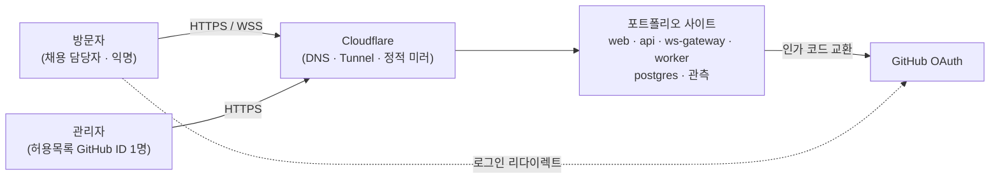
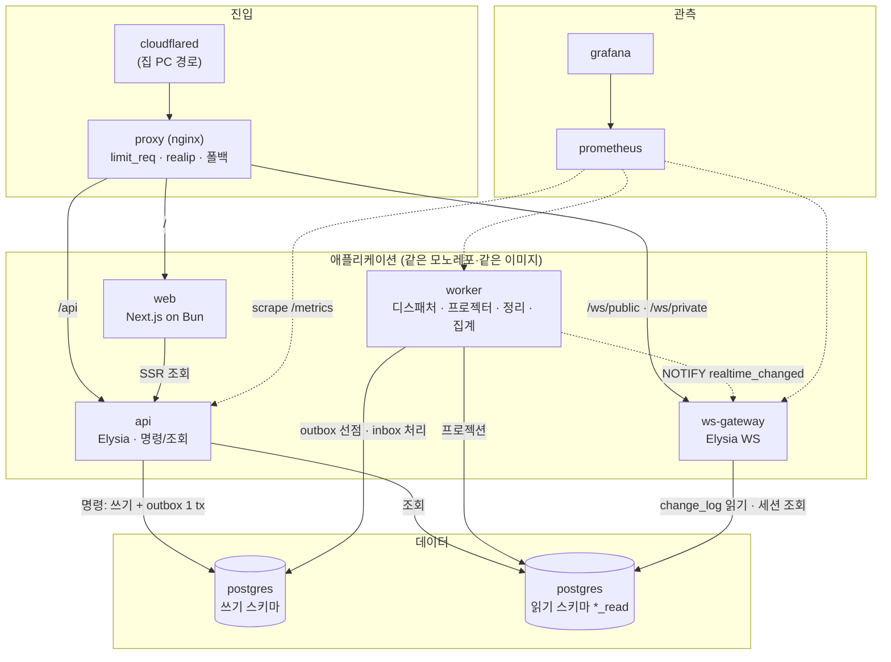
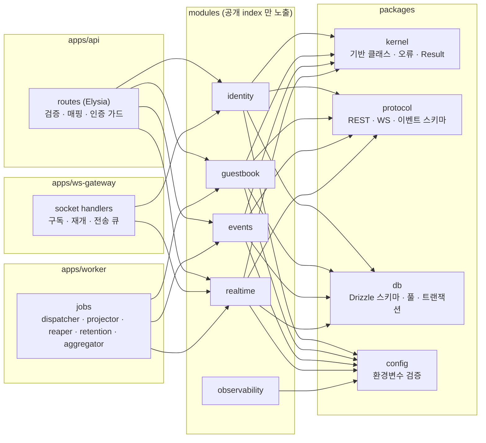
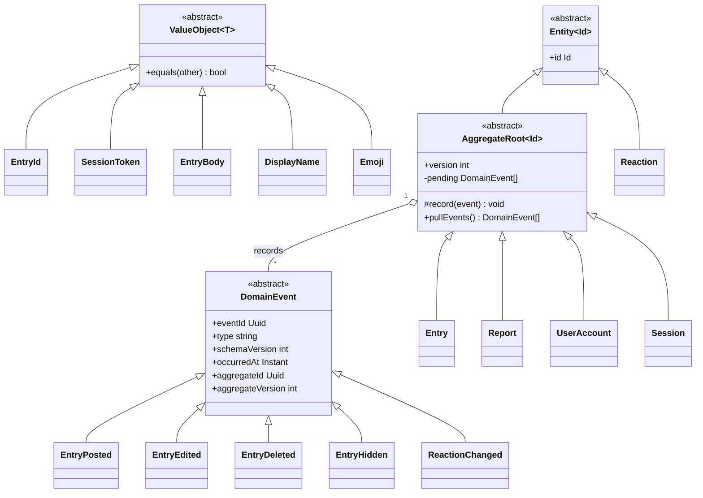
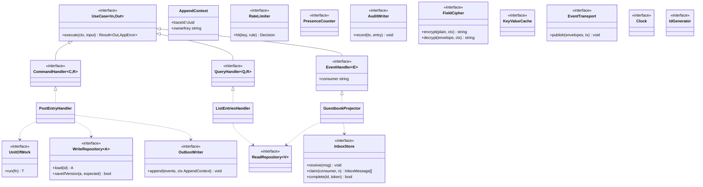
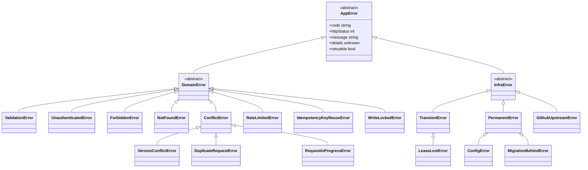
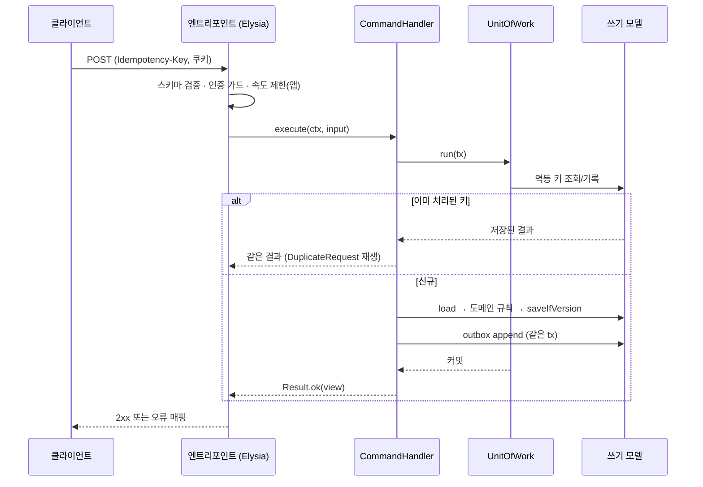
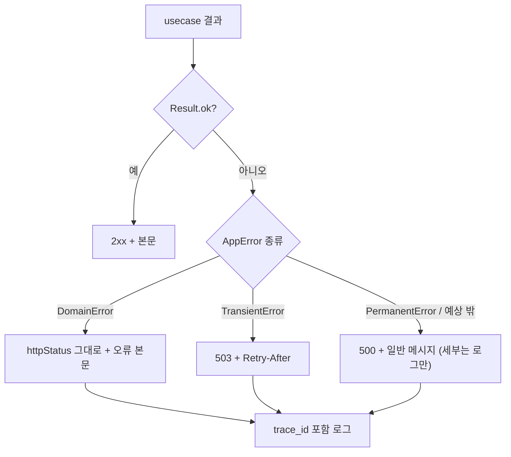
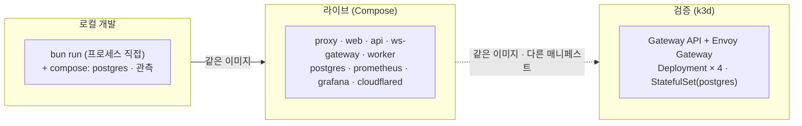

# 00. 전체 시스템 아키텍처와 공통 규약

설계 문서 묶음의 **출발점이자 공통 규약**이다. 이후 문서(01~12)는 여기의 이름·기반 클래스·오류 체계를 그대로 쓴다.
결정의 근거는 `docs/adr/`, 구성·흐름의 요약은 [architecture.md](../domains/architecture.md), 이 묶음은 **구현이 바로 따라 쓸 수 있는 수준의 상세**다.

| 문서 | 내용 |
|---|---|
| **00 (이 문서)** | 시스템 전체 구조, 공통 기반 클래스·오류·식별자 규약 |
| [01](01-repository-structure.md) | 저장소 골격, 네이밍, tsconfig·스크립트, 환경변수 스키마 |
| [02](02-dev-environment.md) | 로컬 compose, 시드, 비밀값, Tunnel·OAuth 로컬 시험 |
| [03](03-api-contract.md) | REST 계약, 에러 형식, 페이지네이션, 멱등 키 |
| [04](04-ws-protocol.md) | WebSocket 봉투, 채널, seq·재접속, 스냅샷 |
| [05](05-event-catalog.md) | 이벤트 종류·페이로드·버전 규칙 |
| [06](06-auth.md) | OAuth 흐름, 쿠키·CSRF·CORS, 세션, 관리자 |
| [07](07-frontend.md) | 화면, 시각화 설계, 디자인 시스템, i18n, 접근성 |
| [08](08-test-strategy.md) | 계층별 시험, 동시성·재접속·장애 시험, 성능 측정 |
| [09](09-ci-cd.md) | 워크플로, 브랜치·릴리스, 이미지 태그 |
| [10](10-security.md) | CSP·보안 헤더, 시크릿, 의존성 점검 |
| [11](11-implementation-plan.md) | M1 작업 분할, 단계 0 관문, 완료 기준 |
| [12](12-content.md) | 자기소개·개인정보 안내 문구 구조 |
| [13](13-incident-response.md) | 보안사고 대응: 심각도, 증거 보존, 비상 스위치, 자산별 런북, 리허설 |
| [14](14-seo-and-error-pages.md) | SEO·공유 미리보기·robots/sitemap·JSON-LD·오류 화면(404/403/500/점검) |
| [15](15-visual-design.md) | 시각 디자인: 토큰·타이포·컴포넌트 모양·핵심 화면 목업(모던 미니멀) |
| [features/](features/00-feature-catalog.md) | **기능 114개 세분화(F00)와 모듈별 상세 설계 F10~F17**: 클래스·시퀀스·순서도·상속 구조 |
| [phases/](phases/00-platform-evolution.md) | **Phase 1~6 영역 설계**: 공통 진화(P0: 서비스 경계·B12 트랜잭션 참여 규칙·이벤트 계약 정본·ENC 통합표·사용자 결정 목록), 바둑(P1), 상거래(P2), 풀필먼트(P3), 채팅(P4). ADR-030~047(Proposed) |

각 문서는 해당하는 만큼 **시퀀스 · 순서도 · 클래스 · 상속 구조** 다이어그램을 갖는다. 해당 없는 종류는 이유를 한 줄로 적는다.

---

## 1. 시스템 컨텍스트

외부 시스템은 **GitHub(로그인)** 과 **Cloudflare(진입·폴백)** 둘뿐이다. 그 밖의 외부 의존은 두지 않는다(무료·무카드 원칙).

## 2. 컨테이너와 데이터 경로

## 3. 컴포넌트 구성 (엔트리포인트별)

모듈은 한 코드베이스이고, 엔트리포인트가 필요한 모듈의 usecase 만 조립한다(ADR-001).

## 4. 공통 기반 (`packages/kernel`) — 클래스 구조

모든 모듈이 같은 기반 위에 선다. **이 절의 이름이 다른 문서의 정본 이름**이다.

### 4.1 도메인 기반 (상속·구현 구조)

- `domain`/`service` 은 순수하다. 시간·식별자·난수는 **포트로 받은 값**을 쓴다(`Clock`, `IdGenerator`).
- `AggregateRoot.version` 은 낙관적 `version` 컬럼과 같은 값이다(ADR-021).
- 값 객체는 생성 시 불변식을 검사한다(예: `EntryBody` 는 500자·10줄, ADR-023).

### 4.2 usecase·포트 구조

- **`CommandHandler` 는 `ReadRepository` 를, `QueryHandler` 는 `WriteRepository` 를 주입받을 수 없다**(타입으로 분리 + dependency-cruiser 규칙). 이것이 구조적 CQRS 강제다.
- 포트 구현(`adapter/postgres`)은 엔트리포인트의 조립 단계에서만 연결한다.
- `AuditWriter.record(tx, entry)` 는 `OutboxWriter` 와 같은 패턴이다: `events` 모듈이 소유하고(`events.audit_log`), 다른 모듈의 usecase 가 **자기 트랜잭션 안에서** 호출해 행위와 감사 기록이 원자적이다([ADR-027](../adr/ADR-027-server-logs.md)).
- **모든 쓰기(C·U·D)는 `UnitOfWork.run` 의 트랜잭션 안에서만** 실행한다. `DbPool` 은 읽기 전용 핸들만 주고 쓰기 메서드는 `TxContext` 에만 있다([ADR-025](../adr/ADR-025-query-layer.md)).
- `OutboxWriter.append(events, ctx)` 는 **현재 `UnitOfWork` 트랜잭션 안에서** 호출되며, 도메인 이벤트를 봉투로 인코딩(어댑터의 `EventCodec`)해 `outbox_event` 에 쓰고 같은 트랜잭션에서 `trace_step`(written·outboxed)과 `pg_notify('outbox_new')` 를 처리한다(F13 EV-01). 명령 usecase 는 `trace_step` 을 따로 쓰지 않는다.
- `RateLimiter`·`PresenceCounter`·`KeyValueCache`·`EventTransport` 는 **M1 에서 메모리/Postgres 어댑터**(`packages/infra`)이고, Redis 어댑터는 도입 기준 충족 시 포트 구현만 추가한다([ADR-024](../adr/ADR-024-redis-seam.md)).

### 4.3 오류 계층 (상속 구조)

| 클래스 | HTTP | 코드(예) | 재시도 |
|---|---|---|---|
| `ValidationError` | 400 | `validation_failed` | 아니오 |
| `UnauthenticatedError` | 401 | `unauthenticated` | 아니오 |
| `ForbiddenError` | 403 | `forbidden` | 아니오 |
| `NotFoundError` | 404 | `not_found` | 아니오 |
| `ConflictError` / `VersionConflictError` | 409 | `conflict` / `version_conflict` | 클라이언트가 재조회 후 |
| `DuplicateRequestError` | (같은 결과 재생) | `duplicate_request` | — |
| `RequestInProgressError` | 409 | `request_in_progress` (+`Retry-After: 1`) | 같은 키로 잠시 후 |
| `IdempotencyKeyReuseError` | 422 | `idempotency_key_reuse` | 아니오(새 키로) |
| `WriteLockedError` | 503 | `write_locked` (+`Retry-After: 60`) | 잠금 해제 후 |
| `RateLimitedError` | 429 | `rate_limited` | `Retry-After` 후 |
| `TransientError` | 503 | `unavailable` | 예 (백오프, ADR-023) |
| `PermanentError` | 500 | `internal` | 아니오 → `dead` |
| `GithubUpstreamError` | 502 | `github_unavailable`(일시, 재시도 가능) / `github_rejected`(코드 거부, 재시도 불가) | 사용자가 로그인 재시작 |
| `ConfigError` | (기동 실패) | `config_invalid` | 아니오 — 프로세스 종료 |
| `MigrationBehindError` | (readyz 실패) | `migration_behind` | 마이그레이션 적용 후 |
| `LeaseLostError` | — | `lease_lost` | 처리 중단(결과 폐기) |

- `WriteLockedError` 는 `DomainError` 지만 상태 503 이다(서비스가 일부러 쓰기를 닫은 상태라 클라이언트는 `Retry-After` 를 따른다). `GithubUpstreamError` 는 인프라 계열이며 `retryable` 은 코드에 따른다.
- 오류는 **던지지 않고 `Result<T, AppError>` 로 돌려준다**(usecase 경계). 예상 밖 예외만 `PermanentError` 로 감싼다.
- 엔트리포인트의 오류 매핑은 한 곳(`errorToResponse`)이다. 규칙은 [03](03-api-contract.md).

## 5. 공통 규약

| 항목 | 규약 |
|---|---|
| 식별자 | 모든 PK 는 **uuid v7**, 앱이 생성(`IdGenerator`). 외부에 보이는 ID 도 같은 값 |
| 시각 | DB `timestamptz`, 전송은 **ISO 8601 UTC**(`2026-11-04T09:00:00.123Z`) |
| 요청 식별자 | 쓰기 요청 헤더 `Idempotency-Key: <uuid>`(클라이언트 생성). 상세 [03](03-api-contract.md) |
| 추적 식별자 | `trace_id`(= 흐름 하나). 응답·이벤트·`trace_step` 이 공유. 로그에는 남기고 **지표 레이블에는 쓰지 않는다** |
| 이벤트 이름 | `<aggregate>.<verb-past>` 소문자 점 표기: `entry.posted`, `reaction.changed`. 버전은 `schema_version` 정수 |
| 오류 코드 | 소문자 스네이크. **와이어 코드에는 모듈 접두사를 붙이지 않는다**(`entry_hidden`, `write_locked`, `github_unavailable`). 클라이언트는 `code` 로만 분기하고 충돌은 코드 이름을 전역에서 유일하게 지어 피한다 |
| 모듈 경계 | 다른 모듈은 `index` 의 usecase 와 `protocol` 타입만 참조 |
| 파일 이름 | usecase 하나 = 파일 하나, `kebab-case`: `post-entry.ts`. 클래스/타입은 `PascalCase` |
| 행위자 컨텍스트 | 모든 요청은 `ActorContext` 를 만든다: `kind`(`anonymous`\|`user`), `actorKey`(`session:<sessionId>`\|`user:<userId>`), `sessionId`, `userId?`, `displayName`(익명은 자동 이름), `isAdmin`, `traceId`, `idempotencyKey?`. usecase 는 이 값으로 `ownerKey`·소유 판정을 한다 |
| 설정 | `process.env` 직접 접근 금지 → `packages/config` 가 검증한 객체만([01](01-repository-structure.md)) |
| 로그 | 구조화(JSON), 필드 `trace_id`·`module`·`usecase`. **IP·본문·토큰은 기록하지 않는다** |

## 6. 요청 처리 파이프라인 (공통)

### 6.1 시퀀스 — 명령 한 건

### 6.2 순서도 — 오류 매핑

## 7. 배포 형상

세 환경 모두 **같은 이미지**를 쓰고 차이는 설정이다(ADR-002). 상세는 [02](02-dev-environment.md)·[09](09-ci-cd.md).
