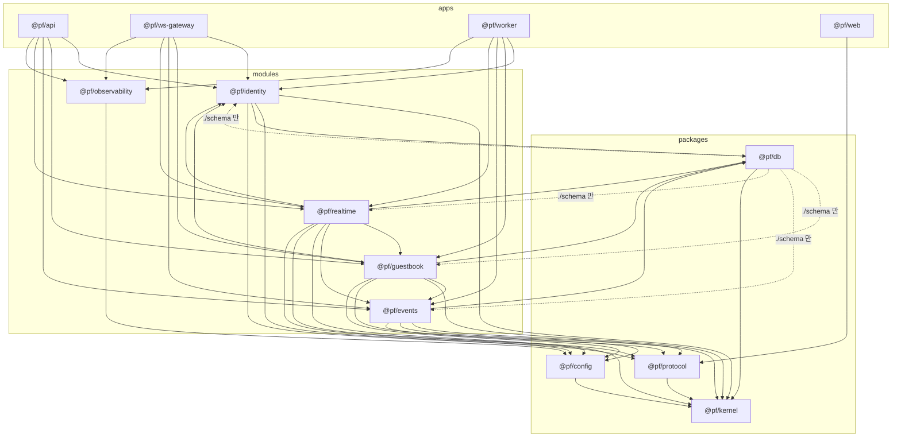
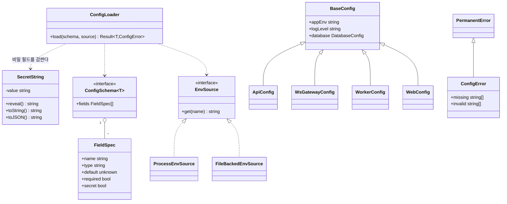
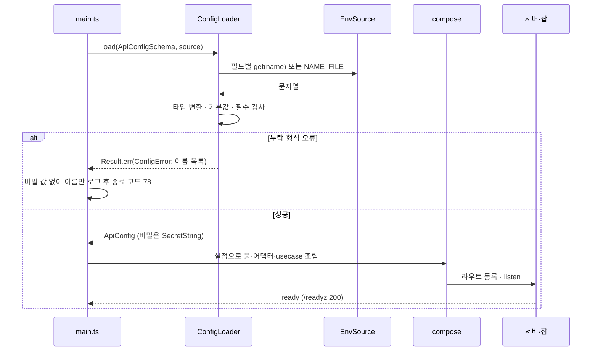
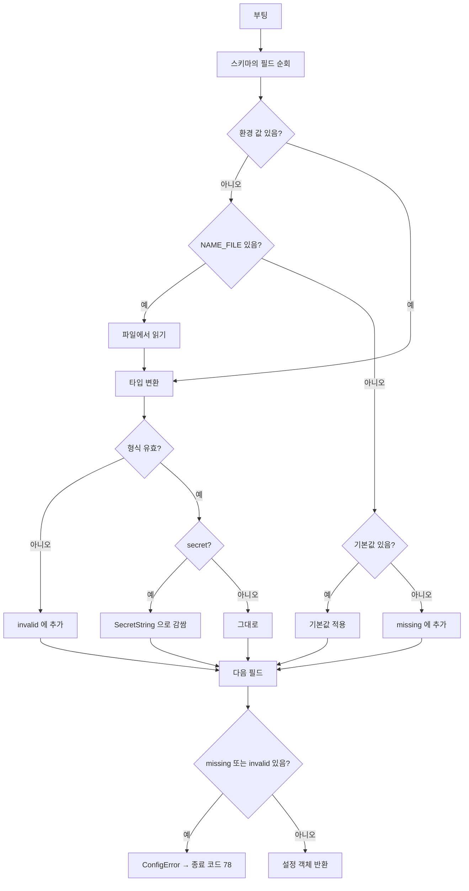

# 01. 저장소 골격

[00](00-system-overview.md) 의 이름·기반 클래스·오류 체계를 전제로, **파일을 어디에 만들고 무엇을 어떻게 부르는지**를 고정한다.
근거: ADR-001(모듈러 모놀리스) · ADR-019(계층) · ADR-022(스택, 도구) · [tech-stack.md](../domains/tech-stack.md).

> 다이어그램 해당 여부 — 시퀀스: 부팅·설정 검증(§7.2) / 순서도: 설정 검증, 검사 파이프라인 / 클래스: 설정 로더(§7.1) / 상속 구조: 앱별 설정 계층(§7.1).

---

## 1. 디렉토리 트리

```
portpolio_backend/
├─ apps/                         # 엔트리포인트 (조립만 한다, 규칙 없음)
│  ├─ api/
│  │  └─ src/{main.ts, routes/, compose/, error-to-response.ts}
│  ├─ ws-gateway/
│  │  └─ src/{main.ts, sockets/, compose/}
│  ├─ worker/
│  │  └─ src/{main.ts, jobs/, compose/, cli/}      # cli: rebuild, dead-requeue
│  └─ web/                       # Next.js (App Router)
│     ├─ src/{app/[locale]/…, components/, lib/, messages/{ko,en}.json, proxy.ts}
│     └─ content/                # MDX·프로필 데이터·다이어그램 소스 (12)
├─ modules/                      # 도메인 모듈 (공개 API 는 index.ts 하나)
│  ├─ identity/
│  ├─ guestbook/
│  ├─ events/
│  ├─ realtime/
│  └─ observability/
├─ packages/                     # 공용 라이브러리 (모듈에 의존하지 않는다)
│  ├─ kernel/                    # 기반 클래스·오류·Result (00 §4) + ports/ (RateLimiter·PresenceCounter·KeyValueCache·EventTransport, ADR-024)
│  ├─ protocol/                  # REST·WS·이벤트 스키마와 상수 (TypeBox 정의 + JSON Schema 내보내기)
│  ├─ db/                        # 풀·트랜잭션·마이그레이션·드리즐 구성
│  ├─ infra/                     # 보조 포트 구현: memory/ postgres/ (redis/ 는 도입 시, ADR-024)
│  ├─ config/                    # 환경변수 스키마·로더 (process.env 를 읽는 유일한 곳)
│  └─ testkit/                   # 시험 지원: FakeClock·FakeIdGenerator·TestDb·WorkerHarness·FaultInjector (08)
├─ infra/
│  ├─ compose/                   # compose.yaml, compose.dev.yaml, compose.live.yaml (02)
│  ├─ docker/                    # Dockerfile.server, Dockerfile.web, (조건부) Dockerfile.proxy
│  ├─ nginx/                     # nginx.conf, conf.d/, 정적 폴백 페이지 (G7)
│  ├─ k8s/                       # k3d 검증 매니페스트 (Gateway API, Deployment …)
│  ├─ prometheus/  grafana/      # 설정·대시보드 프로비저닝
│  └─ scripts/                   # pull-deploy.sh, backup.sh 등 (09, 02)
├─ scripts/                      # TypeScript(Bun) 저장소 도구: check-purity.ts, gen-schema.ts, seed.ts
├─ test/                         # 교차 시험: chaos/(동시성·장애), e2e/, load/ (k6) (08 §11). 재접속 시험은 apps/ws-gateway/test/
├─ docs/  specs/                 # 문서
├─ .dependency-cruiser.cjs  biome.json  tsconfig.base.json  tsconfig.json
├─ bunfig.toml  bun.lock  package.json  .env.example  .gitignore
└─ README.md  CLAUDE.md
```

### 1.1 모듈 내부 (모든 모듈 동일, ADR-019)

```
modules/guestbook/
├─ package.json                  # name: @pf/guestbook, exports 아래 참고
└─ src/
   ├─ domain/                    # entry.ts, reaction.ts, entry-body.ts, events.ts …  (순수)
   ├─ service/                   # entry-policy.ts, reaction-rules.ts                 (순수)
   ├─ port/                      # entry-repository.ts(쓰기), entry-view-repository.ts(읽기), …
   ├─ usecase/
   │  ├─ command/                # post-entry.ts, edit-entry.ts, hide-entry.ts …     (파일 1개 = 명령 1개)
   │  ├─ query/                  # list-entries.ts, list-reports.ts …
   │  └─ event/                  # guestbook-projector.ts                              (inbox 소비자)
   ├─ adapter/
   │  └─ postgres/               # *-repository.ts 구현(Drizzle 빌더), schema.ts (표 정의), raw/ (손으로 쓴 SQL — ADR-025)
   └─ index.ts                   # 공개 API: usecase 팩토리·타입만 내보낸다
```

- **`exports` 필드는 두 개뿐이다**: `"."` → `src/index.ts`, `"./schema"` → `src/adapter/postgres/schema.ts`. 깊은 경로 임포트는 패키지 해석 단계에서 막힌다(§5 규칙으로 이중 방어).
- `./schema` 는 **`packages/db`(drizzle-kit 집계용)와 그 모듈 자신만** 쓴다. 쓰기/읽기 표 정의는 모듈이 소유한다(DB 정본은 Drizzle 스키마, 마이그레이션은 `packages/db/migrations`).
- 조립(`compose/`)만 어댑터를 임포트해 usecase 에 포트 구현을 꽂는다.

## 2. 패키지와 의존 방향



- `@pf/web` 은 **`@pf/protocol` 만** 임포트한다(서버 코드가 번들에 섞이지 않게).
- 점선은 drizzle-kit 집계 전용 예외다.
- `GB → EV` 는 `events` 공개 포트(outbox 기록)로만 연결된다(architecture.md §4 모듈 지도).

## 3. 패키지 이름·네이밍

| 대상 | 규칙 | 예 |
|---|---|---|
| 워크스페이스 패키지 | `@pf/<디렉토리명>` | `@pf/guestbook`, `@pf/ws-gateway` |
| 파일 | `kebab-case.ts` (React 컴포넌트는 `kebab-case.tsx`) | `post-entry.ts`, `entry-card.tsx` |
| 클래스·타입·인터페이스 | `PascalCase`, 인터페이스에 `I` 접두 금지 | `EntryRepository` |
| 함수·변수 | `camelCase`, 불리언은 `is/has/can` | `isHidden` |
| 상수 | `UPPER_SNAKE_CASE` (모듈 최상위 불변값) | `ENTRY_BODY_MAX_CHARS` |
| usecase | `<동사><명사>` 파일 1개, 클래스명 `PostEntryHandler`, 입력 `PostEntryCommand` / 조회 `ListEntriesQuery` | `post-entry.ts` |
| 포트 | 쓰기 `XxxRepository`, 읽기 `XxxViewRepository`, 부수효과 `OutboxWriter`·`Clock` | |
| 어댑터 | `Pg` 접두 + 포트명 | `PgEntryRepository` |
| 이벤트 | 클래스 `EntryPosted`, 전송 이름 `entry.posted` (00 §5) | |
| DB | 스키마 `<module>` / `<module>_read`, 표·열 `snake_case`, 단수 표 이름 | `guestbook.entry` |
| 환경변수 | `UPPER_SNAKE_CASE`, 접두로 소유 앱 표시 (`API_`, `WS_`, `WORKER_`, `WEB_`) | `WS_SEND_QUEUE_MAX` |
| 브랜치·커밋 | [09](09-ci-cd.md) | |

## 4. tsconfig 계층

```
tsconfig.base.json            # 엄격 옵션 전부. 모든 패키지가 extends
├─ packages/*/tsconfig.json   # extends base, include: src, test (golden JSON 은 packages/protocol/golden)
├─ modules/*/tsconfig.json    # extends base, include: src, test
├─ apps/*/tsconfig.json       # include: src, test (test/ 도 tsc -b·dependency-cruiser 검사 대상)
├─ apps/api|ws-gateway|worker/tsconfig.json   # extends base, types: ["bun"]
└─ apps/web/tsconfig.json     # extends base, lib: DOM, jsx: preserve, Next 플러그인
tsconfig.json                 # 루트: files: [], references 로 위 전부 나열 (tsc -b 용)
```

`tsconfig.base.json` 핵심 옵션(typescript-strict 규약과 같다):

| 옵션 | 값 | 이유 |
|---|---|---|
| `strict` | true | |
| `noUncheckedIndexedAccess` | true | 배열·맵 접근의 `undefined` 처리 강제 |
| `exactOptionalPropertyTypes` | true | `undefined` 와 "없음"의 구분 |
| `noImplicitOverride` | true | 상속 구조(00 §4)의 오버라이드 명시 |
| `verbatimModuleSyntax` | true | 타입 임포트 분리 |
| `moduleResolution` | `bundler` | Bun·Next 공통 |
| `target` / `module` | `ES2023` / `ESNext` | |
| `isolatedModules` | true | |
| `noEmit` | true | 실행은 Bun 이 직접 TS 를 읽는다. `tsc` 는 검사 전용 |
| `paths` | 사용하지 않는다 | 워크스페이스 해석에 맡긴다(별칭이 경계 검사를 흐리지 않게) |

## 5. 경계 검사 규칙 (dependency-cruiser)

`.dependency-cruiser.cjs` 에 규칙으로 둔다. **위반 = CI 실패**(ADR-001). Biome 는 임포트하는 쪽을 구분하지 못하므로 이 도구가 담당한다.

| ID | 규칙 | 금지 대상 |
|---|---|---|
| **B1** 계층 방향 | `domain` ↛ `service`·`usecase`·`port`·`adapter` / `service` ↛ `usecase`·`adapter` / `port` ↛ `usecase`·`adapter` / `usecase` ↛ `adapter` | 역방향·건너뛰기 임포트 |
| **B2** 순수성 | `domain`·`service` ↛ `node:*`, `bun`, `@pf/db`, `postgres` 계열 드라이버, 네트워크·파일 모듈 | I/O 의존 |
| **B3** CQRS | `usecase/command/**` ↛ `*-view-repository`(읽기 포트) / `usecase/query/**` ↛ 쓰기 포트(`*-repository`, `OutboxWriter`) | 명령·조회 혼합 (00 §4.2) |
| **B4** 모듈 공개 API | 모듈 밖에서는 `@pf/<m>` (`index`)만 임포트. `@pf/<m>/schema` 는 `packages/db` 와 자기 자신만 | 내부 경로·상대 경로로 타 모듈 침범 |
| **B5** 순환 금지 | 모듈·패키지 단위 순환 | `GB → ID → GB` 같은 순환 |
| **B6** 조립 위치 | `adapter/**` 임포트는 `apps/*/src/compose/**` 와 같은 모듈의 `adapter` 안에서만 | usecase 가 어댑터를 직접 앎 |
| **B7** 패키지 방향 | `packages/*` ↛ `modules/*`·`apps/*` / `modules/*` ↛ `apps/*` / `kernel` 은 아무것도 임포트 안 함 | 상향 의존 |
| **B8** 웹 격리 | `apps/web` 은 `@pf/protocol` 외 `@pf/*` 금지 | 서버 코드 번들 유입 |
| **B9** 환경 접근 | `process.env`·`Bun.env` 참조는 `packages/config` 에서만 | 설정 우회 (규칙은 `scripts/check-purity.ts` 의 문자열 검사로 보강) |
| **B11** 쓰기는 트랜잭션 | `.insert(`·`.update(`·`.delete(`·쓰기 `execute` 는 `UnitOfWork` 가 주는 `TxContext` 에서만. `ReadDb`/풀 핸들에는 쓰기 메서드가 없다. `check-purity` 가 `adapter/postgres` 밖 사용을 문자열로 검출 | 자동 커밋 쓰기 (ADR-025) |
| **B10** 보조 포트 구현 격리 | `@pf/infra` 는 `apps/*/src/compose/**` 에서만 임포트. `domain`·`service`·`usecase` ↛ `@pf/infra` | usecase 가 Redis·메모리 구현에 결합 (ADR-024) |

시간·난수 직접 호출 금지(`Date.now`, `new Date()`, `Math.random`, `crypto.randomUUID` in `domain`·`service`)는 임포트가 아니라 호출이라 dependency-cruiser 로 못 잡는다 → **`scripts/check-purity.ts`**(대상 디렉토리 텍스트 검사)로 CI 에서 확인한다. Biome 의 해당 규칙 사용 여부는 **미확인**(구현 시 확인하고, 있으면 그쪽으로 이관).


## 6. bun 스크립트

루트 `package.json` 의 `scripts`(워크스페이스 일괄은 `bun run --filter`):

| 스크립트 | 하는 일 |
|---|---|
| `dev` | 인프라(compose.dev) 기동 + api·ws-gateway·worker·web 를 `bun --watch` 로 병렬 실행 |
| `dev:api` · `dev:ws` · `dev:worker` · `dev:web` | 개별 실행 |
| `build` | web `next build`(standalone), 서버 번들 점검 |
| `typecheck` | `tsc -b --noEmit` |
| `lint` / `format` | `biome check` / `biome format --write` |
| `arch` | dependency-cruiser + `scripts/check-purity.ts` |
| `gen:schema` | `@pf/protocol` TypeBox → JSON Schema 내보내기. `--check` 는 변경이 있으면 실패 |
| `test` · `test:unit` | 전체 `bun test` (unit, L2). `test` 는 `test:unit` 의 별칭 |
| `test:integration` | DB 가 필요한 시험(컨테이너 또는 compose 서비스, 08) |
| `test:chaos` | 동시성·장애 시험(`test/chaos/`, L3, 08 §5·§7) |
| `test:e2e` · `test:load` | 교차 시험·k6 (08). `load:api` 는 API 부하(k6) 별칭 |
| `load:api` | k6 API 부하 시나리오 실행 (08 §9) |
| `build:fallback` | 정적 폴백 페이지 빌드(OB-08, F17) → `infra/nginx/fallback/` |
| `worker <cmd>` | 관리 CLI 진입점: `rebuild`, `dead-requeue`, `admin write-lock on\|off`, `retention:run` (F16 §11 정본). 예: `bun run worker dead-requeue` |
| `db:generate` / `db:generate:custom` | drizzle-kit 마이그레이션 생성 / raw SQL 마이그레이션 틀 |
| `db:migrate` | forward-only 적용 |
| `db:seed` | 개발 시드 (02) |
| `compose:up` · `compose:down` | 로컬 인프라 |
| `k3d:up` · `k3d:down` | 로컬 K8s 검증 환경 (02) |
| `content:check` | 사이트 변수·프로필 스키마 검사. 비면 경고, `CONTENT_STRICT=1` 이면 릴리스 필수 변수가 비었을 때 실패 (12 §1.1) |
| `check` | `lint → typecheck → arch → gen:schema --check → test:unit` (CI 의 PR 검사와 같은 순서). `content:check` 는 릴리스 워크플로가 별도 실행 (09) |

## 7. 설정 (`packages/config`)

### 7.1 클래스 구조



- `SecretString` 은 `toString`·`toJSON`·로그 직렬화에서 `***` 를 돌려준다. 값은 `reveal()` 로만 꺼낸다(로그·오류 메시지에 비밀이 새지 않게, 10 §5).
- `FileBackedEnvSource`: `NAME` 이 없고 `NAME_FILE` 이 있으면 그 파일 내용을 읽는다(Docker secrets 규약, 02 §5). `ProcessEnvSource` 가 우선, 둘 다 없으면 기본값.
- `ConfigError` 는 `PermanentError`(00 §4.3)의 하위다. 부팅 중 발생하면 재시도하지 않는다.
- 앱별 설정은 `BaseConfig` 를 확장한다. **각 앱은 자기 설정 타입만 로드**하고 다른 앱의 필수 변수는 요구하지 않는다.

### 7.2 부팅 시퀀스



### 7.3 설정 검증 순서도



## 8. 환경변수 스키마

`.env.example` 이 이 표의 정본 사본이다(02 §5). "사용 앱": **A**=api, **G**=ws-gateway, **W**=worker, **B**=web. 기본값이 `—` 이면 필수. 비밀 = `SecretString`, 저장소·이미지·로그에 넣지 않는다.

### 8.1 공통

| 이름 | 타입 | 기본값 | 필수 | 앱 | 비밀 |
|---|---|---|---|---|---|
| `APP_ENV` | `development`·`test`·`production` | `development` | 아니오 | AGWB | 아니오 |
| `LOG_LEVEL` | `debug`·`info`·`warn`·`error` | `info` | 아니오 | AGWB | 아니오 |
| `DATABASE_URL` | URL | — | **예** | AGW | **예** |
| `DATABASE_POOL_MAX` | int | `10` | 아니오 | AGW | 아니오 |
| `METRICS_ENABLED` | bool | `true` | 아니오 | AGW | 아니오 |
| `PUBLIC_ORIGIN` | URL (스킴+호스트) | — | **예** | AGB | 아니오 |
| `SESSION_COOKIE_NAME` | string | `__Host-sid` | 아니오 | AG | 아니오 |
| `COOKIE_SECURE` | bool | `true` | 아니오 | AG | 아니오 |
| `SESSION_TTL_DAYS` | int | `7` | 아니오 | AG | 아니오 |

- `SESSION_COOKIE_NAME` 은 개발(http)에서 `sid`, 운영 `__Host-sid`([10](10-security.md) §3). ws-gateway 가 `/ws/private` 업그레이드에서 쿠키를 파싱하므로 api 와 gateway 가 같이 쓴다.
- `PUBLIC_HOST` 는 별도 변수가 아니다 — `PUBLIC_ORIGIN` 에서 유도한다(CSP `connect-src wss://…` 등). 저장소 링크·Grafana 임베드 URL 은 환경변수가 아니라 **사이트 변수**(`site.repoUrl`·`site.metricsEmbedUrl`, [12](12-content.md) §1.1)다.

`LISTEN/NOTIFY` 전용 연결은 `DATABASE_URL` 로 따로 하나 더 연다(풀과 별개, G4).

### 8.2 api

| 이름 | 타입 | 기본값 | 필수 | 비밀 | 비고 |
|---|---|---|---|---|---|
| `API_PORT` | int | `3001` | 아니오 | 아니오 | |
| `GITHUB_CLIENT_ID` | string | — | **예** | 아니오 | |
| `GITHUB_CLIENT_SECRET` | string | — | **예** | **예** | |
| `OAUTH_STATE_SECRET` | string(32바이트 이상) | — | **예** | **예** | OAuth 임시 쿠키(`state`·PKCE verifier) 서명 키 ([06](06-auth.md) §3, ID-05). 회전 시 진행 중 로그인만 무효 |
| `GITHUB_REDIRECT_URI` | URL | `PUBLIC_ORIGIN` + `/api/auth/github/callback` | 아니오 | 아니오 | |
| `ADMIN_GITHUB_IDS` | 숫자 ID 쉼표 목록 | — | **예** | 아니오 | 로그인 이름이 아니라 **숫자 ID** (이름은 바뀔 수 있다) |
| `RATE_LIMIT_POST_PER_MIN` · `RATE_LIMIT_REACT_PER_MIN` · `RATE_LIMIT_REPORT_PER_MIN` | int | 미정 | 아니오 | 아니오 | 가정 A-011: 구현 시 정한다 |

### 8.3 ws-gateway

| 이름 | 타입 | 기본값 | 필수 | 비밀 | 비고 |
|---|---|---|---|---|---|
| `WS_PORT` | int | `3002` | 아니오 | 아니오 | |
| `WS_POLL_INTERVAL_MS` | int | `1000` | 아니오 | 아니오 | NOTIFY 보완 폴링 (ADR-023) |
| `WS_SEND_QUEUE_MAX` | int | `64` | 아니오 | 아니오 | 연결별 송신 큐 상한. 초과 시 연결 종료 (G2) |
| `WS_BACKPRESSURE_BYTES` | int | 미확인 (G2) | 아니오 | 아니오 | 적용 위치별 동작이 달라 실측으로 정한다 (ADR-022) |
| `WS_IDLE_TIMEOUT_SECONDS` | int | `120` | 아니오 | 아니오 | Elysia 기본값 |
| `WS_MAX_CONNECTIONS` | int | 미정 | 아니오 | 아니오 | 목표 동시 접속 50 이상의 여유로 G2 에서 |

### 8.4 worker

| 이름 | 타입 | 기본값 | 필수 | 비밀 | 비고 |
|---|---|---|---|---|---|
| `WORKER_PORT` | int | `3003` | 아니오 | 아니오 | `/metrics`·`/healthz` 전용 (**`/readyz` 없음** — 라우팅 대상이 아니다, F17 §5.1) |
| `LEASE_SECONDS` | int | `30` | 아니오 | 아니오 | ADR-023 |
| `HANDLER_TIMEOUT_SECONDS` | int | `10` | 아니오 | 아니오 | `LEASE_SECONDS / 2` 이하여야 한다(부팅 시 검사) |
| `REAPER_INTERVAL_SECONDS` | int | `10` | 아니오 | 아니오 | |
| `RETRY_BASE_SECONDS` · `RETRY_FACTOR` · `RETRY_CAP_SECONDS` | int | `1` · `2` · `300` | 아니오 | 아니오 | 완전 지터 |
| `MAX_ATTEMPTS` | int | `8` | 아니오 | 아니오 | 초과 시 `dead` |
| `CLAIM_BATCH_SIZE` | int | `50` | 아니오 | 아니오 | `SKIP LOCKED` 배치 |
| `RETENTION_DAYS` | int | `7` | 아니오 | 아니오 | 세션·이벤트 이력 |
| `DEAD_RETENTION_DAYS` · `DEAD_MAX_ROWS` | int | `30` · `10000` | 아니오 | 아니오 | |
| `CHANGE_LOG_RETENTION_MINUTES` · `CHANGE_LOG_MAX_ROWS_PER_CHANNEL` | int | `60` · `10000` | 아니오 | 아니오 | |

### 8.5 web

| 이름 | 타입 | 기본값 | 필수 | 비밀 | 비고 |
|---|---|---|---|---|---|
| `WEB_PORT` | int | `3000` | 아니오 | 아니오 | |
| `API_INTERNAL_URL` | URL | `http://api:3001` | 아니오 | 아니오 | SSR 이 api 를 부르는 내부 주소 |
| `NEXT_SERVER_ACTIONS_ENCRYPTION_KEY` | base64 | — | 다중 인스턴스일 때만 | **예** | 단일 인스턴스에서는 생략 가능 (tech-stack.md §5) |

### 8.6 코드 상수로 두는 것 (환경변수가 아님)

서버와 클라이언트가 같은 값을 써야 하므로 `@pf/protocol` 의 상수다(ADR-023).

| 상수 | 값 |
|---|---|
| `ENTRY_BODY_MAX_CHARS` / `ENTRY_BODY_MAX_LINES` | 500 / 10 |
| `DISPLAY_NAME_MIN_CHARS` / `DISPLAY_NAME_MAX_CHARS` | 2 / 20 |
| `REPORT_REASON_MAX_CHARS` | 200 |
| `ALLOWED_EMOJI` | 고정 6종 (목록은 구현 시 protocol 에 확정) |

## 9. 미결

| 항목 | 결정 시점 |
|---|---|
| Biome 로 시간·난수 호출 금지를 표현할 수 있는지 | 구현 단계 0 (`check-purity.ts` 로 시작) |
| `WS_BACKPRESSURE_BYTES`·`WS_MAX_CONNECTIONS` 값 | 관문 G2 |
| 속도 제한 수치 | 구현 시 (A-011) |
| 이모지 6종의 구체 목록 | protocol 작성 시 |
