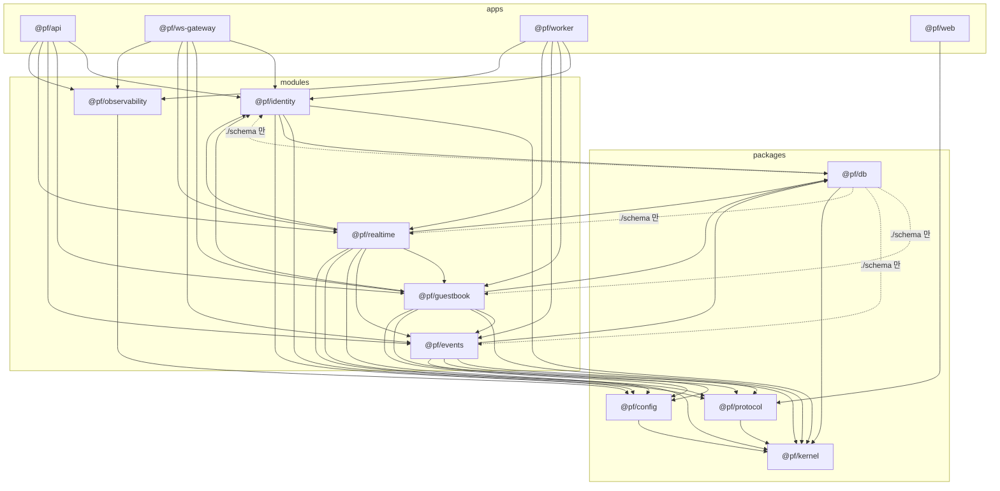
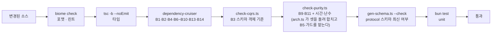
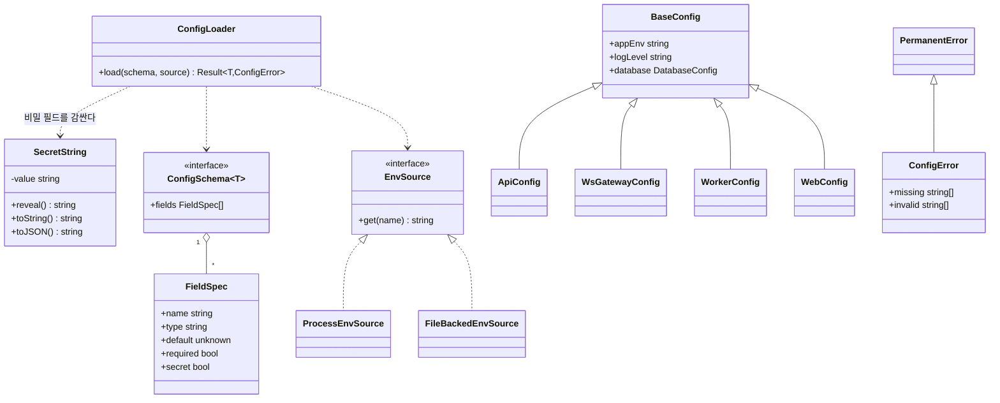
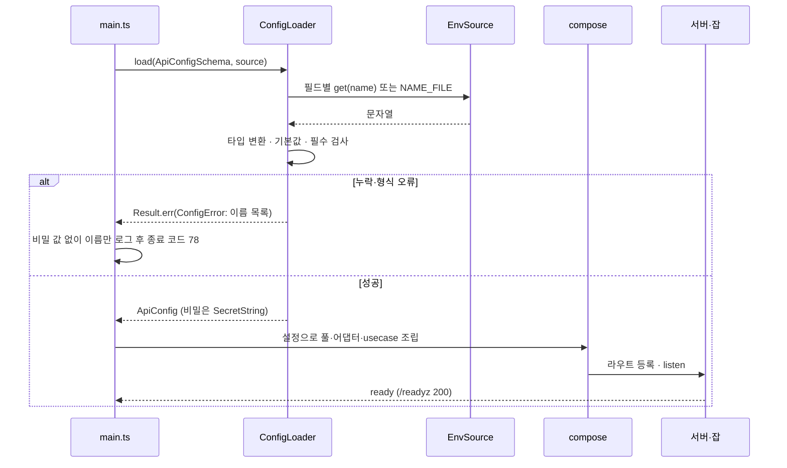
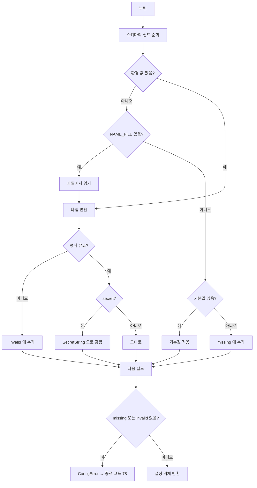

# 01. 저장소 골격

[00](00-system-overview.md) 의 이름·기반 클래스·오류 체계를 전제로, **파일을 어디에 만들고 무엇을 어떻게 부르는지**를 고정한다.
근거: ADR-001(모듈러 모놀리스) · ADR-019(계층) · ADR-022(스택, 도구) · [tech-stack.md](../domains/tech-stack.md).

> 다이어그램 해당 여부 — 시퀀스: 부팅·설정 검증(§7.2) / 순서도: 설정 검증, 검사 파이프라인 / 클래스: 설정 로더(§7.1) / 상속 구조: 앱별 설정 계층(§7.1).

---

## 1. 디렉토리 트리

```
portpolio_backend/
├─ apps/                         # 엔트리포인트 (조립만 한다, 규칙 없음)
│  ├─ api/
│  │  └─ src/{main.ts, routes/, compose/, error-to-response.ts}
│  ├─ ws-gateway/
│  │  └─ src/{main.ts, sockets/, compose/}
│  ├─ worker/
│  │  └─ src/{main.ts, jobs/, compose/, cli/}      # cli: rebuild, dead-requeue
│  └─ web/                       # Next.js (App Router)
│     ├─ src/{app/[locale]/…, components/, lib/, messages/{ko,en}.json, proxy.ts}
│     └─ content/                # MDX·프로필 데이터·다이어그램 소스 (12)
├─ modules/                      # 도메인 모듈 (공개 API 는 index.ts 하나)
│  ├─ identity/
│  ├─ guestbook/
│  ├─ events/
│  ├─ realtime/
│  └─ observability/
├─ packages/                     # 공용 라이브러리 (모듈에 의존하지 않는다)
│  ├─ kernel/                    # 기반 클래스·오류·Result (00 §4) + ports/ (RateLimiter·PresenceCounter·KeyValueCache·EventTransport, ADR-024 · FieldCipher, ADR-026 · AuditWriter, ADR-027)
│  ├─ protocol/                  # REST·WS·이벤트 스키마와 상수 (TypeBox 정의 + JSON Schema 내보내기)
│  ├─ db/                        # 풀·트랜잭션·**마이그레이션 실행기**(모듈 폴더 목록을 받아 적용; 표 정의·마이그레이션 파일은 모듈 소유, ADR-052 결정 7)
│  ├─ infra/                     # 보조 포트 구현: memory/ postgres/ (redis/ 는 도입 시, ADR-024)
│  ├─ config/                    # 환경변수 스키마·로더 (process.env 를 읽는 유일한 곳)
│  └─ testkit/                   # 시험 지원: FakeClock·FakeIdGenerator·TestDb·WorkerHarness·FaultInjector (08)
├─ infra/
│  ├─ compose/                   # compose.yaml, compose.dev.yaml, compose.live.yaml (02)
│  ├─ docker/                    # Dockerfile.server, Dockerfile.web, (조건부) Dockerfile.proxy
│  ├─ nginx/                     # nginx.conf, conf.d/, 정적 폴백 페이지 (G7)
│  ├─ k8s/                       # k3d 검증 매니페스트 (Gateway API, Deployment …)
│  ├─ prometheus/  grafana/      # 설정·대시보드 프로비저닝 (grafana/provisioning/alerting/: 연락처·정책·규칙, F17 §16.3)
│  ├─ systemd/                   # pf-archive-logs · pf-backup · pf-pull-deploy 의 .service/.timer (F17 §16.1.1)
│  └─ scripts/                   # pull-deploy.sh, backup.sh, archive-logs.sh, logq.sh 등 (09, 02, ADR-027)
├─ scripts/                      # TypeScript(Bun) 저장소 도구: arch.ts(경계 검사 실행기), check-purity.ts, check-cqrs.ts, gen-schema.ts, seed.ts · fixtures/arch/(경계 검사 픽스처 — 린트·타입·경계 검사에서 제외)
├─ test/                         # 교차 시험: chaos/(동시성·장애), e2e/, load/ (k6) (08 §11). 재접속 시험은 apps/ws-gateway/test/
├─ docs/  specs/                 # 문서
├─ .dependency-cruiser.cjs  biome.json  tsconfig.base.json  tsconfig.json
├─ bunfig.toml  bun.lock  package.json  .env.example  .gitignore
└─ README.md  CLAUDE.md
```

### 1.1 모듈 내부 (모든 모듈 동일, ADR-019)

```
modules/guestbook/
├─ package.json                  # name: @pf/guestbook, exports 아래 참고
└─ src/
   ├─ domain/                    # entry.ts, reaction.ts, entry-body.ts, events.ts …  (순수)
   ├─ service/                   # entry-policy.ts, reaction-rules.ts                 (순수)
   ├─ port/                      # entry-repository.ts(쓰기), entry-view-repository.ts(읽기), …
   ├─ usecase/
   │  ├─ command/                # post-entry.ts, edit-entry.ts, hide-entry.ts …     (파일 1개 = 명령 1개)
   │  ├─ query/                  # list-entries.ts, list-reports.ts …
   │  └─ event/                  # guestbook-projector.ts                              (inbox 소비자)
   ├─ adapter/
   │  └─ postgres/               # *-repository.ts 구현(Drizzle 빌더), schema.ts (표 정의), raw/ (손으로 쓴 SQL — ADR-025)
   └─ index.ts                   # 공개 API: usecase 팩토리·타입만 내보낸다
```

- **`exports` 필드는 두 개뿐이다**: `"."` → `src/index.ts`, `"./schema"` → `src/adapter/postgres/schema.ts`. 깊은 경로 임포트는 패키지 해석 단계에서 막힌다(§5 규칙으로 이중 방어).
- `./schema` 는 **`packages/db`(drizzle-kit 집계용)와 그 모듈 자신만** 쓴다. 쓰기/읽기 표 정의는 모듈이 소유한다(DB 정본은 Drizzle 스키마. **마이그레이션은 `modules/<m>/migrations/`, 설정은 `modules/<m>/drizzle.config.ts`, 이력 표는 `pf_migrations.<모듈>`** — ADR-052 결정 7, G10b 개발 PC 통과).
- 조립(`compose/`)만 어댑터를 임포트해 usecase 에 포트 구현을 꽂는다.

## 2. 패키지와 의존 방향



- `@pf/web` 은 **`@pf/protocol` 만** 임포트한다(서버 코드가 번들에 섞이지 않게).
- 점선은 drizzle-kit 집계 전용 예외다.
- `GB → EV` 는 `events` 공개 포트(outbox 기록)로만 연결된다(architecture.md §4 모듈 지도).

## 3. 패키지 이름·네이밍

| 대상 | 규칙 | 예 |
|---|---|---|
| 워크스페이스 패키지 | `@pf/<디렉토리명>` | `@pf/guestbook`, `@pf/ws-gateway` |
| 파일 | `kebab-case.ts` (React 컴포넌트는 `kebab-case.tsx`) | `post-entry.ts`, `entry-card.tsx` |
| 클래스·타입·인터페이스 | `PascalCase`, 인터페이스에 `I` 접두 금지 | `EntryRepository` |
| 함수·변수 | `camelCase`, 불리언은 `is/has/can` | `isHidden` |
| 상수 | `UPPER_SNAKE_CASE` (모듈 최상위 불변값) | `ENTRY_BODY_MAX_CHARS` |
| usecase | `<동사><명사>` 파일 1개, 클래스명 `PostEntryHandler`, 입력 `PostEntryCommand` / 조회 `ListEntriesQuery` | `post-entry.ts` |
| 포트 | 쓰기 `XxxRepository`, 읽기 `XxxViewRepository`, 부수효과 `OutboxWriter`·`Clock` | |
| 어댑터 | `Pg` 접두 + 포트명 | `PgEntryRepository` |
| 이벤트 | 클래스 `EntryPosted`, 전송 이름 `entry.posted` (00 §5) | |
| DB | 스키마 `<module>` / `<module>_read`, 표·열 `snake_case`, 단수 표 이름 | `guestbook.entry` |
| 환경변수 | `UPPER_SNAKE_CASE`, 접두로 소유 앱 표시 (`API_`, `WS_`, `WORKER_`, `WEB_`) | `WS_SEND_QUEUE_MAX` |
| 브랜치·커밋 | [09](09-ci-cd.md) | |

## 4. tsconfig 계층

```
tsconfig.base.json            # 엄격 옵션 전부. 모든 패키지가 extends
├─ packages/*/tsconfig.json   # extends base, types: ["bun"](시험이 bun:test 를 임포트), include: src, test (golden JSON 은 packages/protocol/golden)
├─ modules/*/tsconfig.json    # extends base, include: src, test
├─ apps/*/tsconfig.json       # include: src, test (test/ 도 tsc -b·dependency-cruiser 검사 대상)
├─ apps/api|ws-gateway|worker/tsconfig.json   # extends base, types: ["bun"]
├─ apps/web/tsconfig.json     # extends base, lib: DOM·ESNext, jsx: preserve, Next 플러그인
└─ scripts/tsconfig.json      # extends base, types: ["bun"], include: **/*.ts, exclude: fixtures/** (저장소 도구·저장소 시험. fixtures/ 는 의도적 위반 픽스처)
tsconfig.json                 # 루트: files: [], references 로 위 전부 나열 (tsc -b 용)
```

단위 tsconfig 사이에는 `references` 를 두지 않는다 — `tsc -b --noEmit` 에서 TS6310 으로 실패한다. 루트 `tsconfig.json` 의 `references` 로만 잇는다. 빈 디렉토리에는 단위 tsconfig 를 두지 않는다 — 내용 없는 단위는 TS18003, 참조 0 개인 루트는 TS18002 로 종료 1 이다(편차 DV-001).

`tsconfig.base.json` 핵심 옵션(typescript-strict 규약과 같다):

| 옵션 | 값 | 이유 |
|---|---|---|
| `strict` | true | |
| `noUncheckedIndexedAccess` | true | 배열·맵 접근의 `undefined` 처리 강제 |
| `exactOptionalPropertyTypes` | true | `undefined` 와 "없음"의 구분 |
| `noImplicitOverride` | true | 상속 구조(00 §4)의 오버라이드 명시 |
| `verbatimModuleSyntax` | true | 타입 임포트 분리 |
| `moduleResolution` | `bundler` | Bun·Next 공통 |
| `target` / `module` | `ESNext` / `Preserve` | Bun 권장(https://bun.com/docs/typescript-6) |
| `lib` | `["ESNext"]` | Bun 권장(https://bun.com/docs/typescript-6) |
| `moduleDetection` | `force` | Bun 권장(https://bun.com/docs/typescript-6) |
| `allowImportingTsExtensions` | true | Bun 권장(https://bun.com/docs/typescript-6) |
| `skipLibCheck` | true | Bun 권장(https://bun.com/docs/typescript-6) |
| `noFallthroughCasesInSwitch` | true | Bun 권장(https://bun.com/docs/typescript-6) |
| `isolatedModules` | true | |
| `noEmit` | true | 실행은 Bun 이 직접 TS 를 읽는다. `tsc` 는 검사 전용 |
| `paths` | 사용하지 않는다 | 워크스페이스 해석에 맡긴다(별칭이 경계 검사를 흐리지 않게) |

## 5. 경계 검사 규칙 (dependency-cruiser)

규칙은 수단이 셋이다 — 그래프 규칙은 `.dependency-cruiser.cjs`(구문 분석은 swc, [tech-stack §9](../domains/tech-stack.md)), B3 는 `scripts/check-cqrs.ts`, 시간·난수·환경·쓰기 규칙은 `scripts/check-purity.ts`(소스를 swc 로 파싱해 AST 노드를 판정한다). B5(패키지 순환)와 비공허성 가드는 셋을 하나로 돌리는 실행기 `scripts/arch.ts` 가 맡는다(`bun run arch`). **위반 = CI 실패**(ADR-001). Biome 는 임포트하는 쪽을 구분하지 못하므로 이 도구가 담당한다.

| ID | 규칙 | 금지 대상 |
|---|---|---|
| **B1** 계층 방향 | `domain` ↛ `service`·`usecase`·`port`·`adapter` / `service` ↛ `usecase`·`adapter` / `port` ↛ `usecase`·`adapter` / `usecase` ↛ `adapter` | 역방향·건너뛰기 임포트 |
| **B2** 순수성 | `domain`·`service` ↛ `node:*`, `bun`, `@pf/db`, `postgres` 계열 드라이버, 네트워크·파일 모듈 | I/O 의존 |
| **B3** CQRS | 포트의 종류(쓰기/읽기)를 **파일명이 아니라 그 포트를 구현하는 어댑터가 건드리는 스키마 객체**로 정한다. 쓰기 스키마(`<m>`) 표를 쓰는 포트는 쓰기 포트, 읽기 스키마(`<m>_read`) 표만 읽는 포트는 읽기 포트이며 `modules/<m>/port-kinds.json`(포트 → kind·표)에 선언하고 `scripts/check-cqrs.ts` 가 어댑터의 `schema.ts` 임포트로 선언을 검증한다. `usecase/command/**` ↛ 읽기 포트 / `usecase/query/**` ↛ 쓰기 포트·`OutboxWriter`. 단 `modules/cqrs-exceptions.json`(P0 §2.4 X1~X4)에 등재된 (usecase 또는 포트, 표) 쌍은 허용. DB 역할의 GRANT 가 같은 경계를 한 번 더 강제한다(`api_rw` 는 `*_read` 에 INSERT/UPDATE/DELETE 불가, ADR-026) | 명령·조회 혼합 (00 §4.2) |
| **B4** 모듈 공개 API | 모듈 밖에서는 `@pf/<m>` (`index`)만 임포트. `@pf/<m>/schema` 는 `packages/db` 와 자기 자신만. **(ADR-052 이후) 다른 모듈·엔트리포인트의 비조립 코드는 `@pf/<m>-contract` 만 임포트하고 구현 `@pf/<m>` 은 `apps/*/src/compose/**` 에서만** | 내부 경로·상대 경로로 타 모듈 침범 |
| **B5** 순환 금지 | 모듈·패키지 단위 순환 | `GB → ID → GB` 같은 순환 |
| **B6** 조립 위치 | `adapter/**` 임포트는 `apps/*/src/compose/**` 와 같은 모듈의 `adapter` 안에서만 | usecase 가 어댑터를 직접 앎 |
| **B7** 패키지 방향 | `packages/*` ↛ `modules/*`·`apps/*` / `modules/*` ↛ `apps/*` / `kernel` 은 아무것도 임포트 안 함 | 상향 의존 |
| **B8** 웹 격리 | `apps/web` 은 `@pf/protocol` 외 `@pf/*` 금지 | 서버 코드 번들 유입 |
| **B9** 환경 접근 | `process.env`·`Bun.env` 참조는 `packages/config` 에서만 | 설정 우회 (규칙은 `scripts/check-purity.ts` 의 AST 검사로 보강) |
| **B11** 쓰기는 트랜잭션 | `.insert(`·`.update(`·`.delete(`·쓰기 `execute` 는 `UnitOfWork` 가 주는 `TxContext` 에서만. `ReadDb`/풀 핸들에는 쓰기 메서드가 없다. `check-purity` 가 `adapter/postgres` 밖 사용을 문자열로 검출 | 자동 커밋 쓰기 (ADR-025) |
| **B13** 모듈 계약 패키지 (ADR-052) | 모듈 간·엔트리포인트 비조립 코드는 `@pf/<m>-contract`(이벤트 스키마·DTO·공개 포트·오류 코드)만 의존. 계약 패키지는 `@pf/kernel` 외 아무것도 임포트하지 않는다. 계약 변경은 `package.json` 버전 상승을 동반한다(골든 JSON 비교 CI) | 구현 임포트, 버전 없는 계약 변경 |
| **B14** 마이그레이션 격리 (ADR-052) | `modules/<m>/migrations` 의 SQL 은 다른 모듈의 스키마 객체(표·함수·트리거)를 참조하지 않는다. 모듈은 `identity` 를 호출하지 않고 엔트리포인트가 푼 `ActorContext` 를 받는다 | 타 모듈 스키마 참조, 모듈의 identity 직접 호출 |
| **B10** 보조 포트 구현 격리 | `@pf/infra` 는 `apps/*/src/compose/**` 에서만 임포트. `domain`·`service`·`usecase` ↛ `@pf/infra` | usecase 가 Redis·메모리 구현에 결합 (ADR-024) |

**규칙 정본 — 어느 수단이 무엇을 잡는가 (S1-5)**. 위반 보고는 아래 위반 ID 로 시작하므로 빨강을 본 사람이 위 표의 이유 열로 곧장 온다. 시험 픽스처는 `scripts/fixtures/arch/{violating,passing,empty}` 이고, 규칙마다 위반 트리에서 그 ID 가·통과 트리에서 무위반이·빈 트리에서 0건 가드가 `bun test` 로 확인된다(`scripts/arch.test.ts`).

| ID | 수단 · 위반 ID | S1-5 범위 |
|---|---|---|
| B1 | dependency-cruiser · `B1-domain`·`B1-service`·`B1-port`·`B1-usecase` | 구현 |
| B2 | dependency-cruiser · `B2-core`(내장 모듈 전부)·`B2-io-package`(`packages/db`·`postgres`·`pg`) / `check-purity` · `B2-time-random` | 구현. 드라이버 절은 고정 픽스처 없음 — 드라이버가 설치되면 해석 결과가 바뀐다(첫 사용 S1-4 가 `bun run arch` 로 본다). `check-purity` 절은 AST 노드로 판정한다 — `Date.now`·`Math.random`·`crypto.randomUUID`·`crypto.getRandomValues`·`performance.now`·`Bun.nanoseconds` 의 멤버 접근(`?.`·`["…"]`·`globalThis.` 경유 포함)과 인자 없는 `new Date`(괄호 생략 포함)·`Date()`. **한계**: 별칭(`const d = Date`)·구조분해(`{ now } = Date`)·다른 객체의 같은 이름 속성(`x.Date.now`)은 스코프·값 추적이 없어 못 잡는다 |
| B3 | `check-cqrs` · `B3-command-read`·`B3-query-write`·`B3-undeclared-port`·`B3-declaration` | 선언 형식·usecase 방향. 어댑터 스키마 대조는 S2-1. **한계**: 방향은 `usecase/command/`·`usecase/query/` 아래 파일이 같은 모듈의 포트 파일을 직접 임포트하는 간선만 판정한다 — 서비스·헬퍼를 거친 간접 경로와 그 밖 디렉토리의 usecase 는 보지 않는다(S2-1 이 이어받는다) |
| B4 | dependency-cruiser · `B4-deep-module`·`B4-deep-outside`·`B4-deep-db` | 구현 |
| B5 | `scripts/arch.ts` · `B5-module-cycle` — 파일 간선을 `apps/<a>`·`modules/<m>`·`packages/<p>` 로 접어 강연결요소로 판정(같은 패키지 안 파일 순환은 대상 아님, type-only 간선도 센다) | 구현 |
| B6 | dependency-cruiser · `B6-adapter` | 구현. 조립이 어댑터를 어떤 경로로 받는지는 정하지 않았다(아래 모호점) |
| B7 | dependency-cruiser · `B7-packages-up`·`B7-modules-up`·`B7-kernel` | 구현 |
| B8 | dependency-cruiser · `B8-web` | 구현 |
| B9 | `check-purity` · `B9-env` / dependency-cruiser · `B9-process-import` | 구현. `import { env } from "node:process"` 는 `process.env` 접근 노드가 없어 `B9-env` 를 우회하므로 임포트 규칙을 함께 둔다. `check-purity` 절은 AST 노드로 `process.env`·`Bun.env`·`import.meta.env` 와 같은 접근의 다른 표기(`process`·`Bun` 의 `?.env`·`["env"]`, `globalThis.process` 경유, `(process as X).env`, 구조분해 `{ env } = process`·`Bun`(따옴표·계산식 키·중첩·타입 주석·주석이 낀 것 포함), `bun` 에서 `env` 명명 임포트·재내보내기)를 잡는다 — 줄바꿈·공백·주석은 노드가 아니라서 한 줄이든 포매터가 여러 줄로 나눈 것이든 같다. 주석·문자열 안의 `process.env` 는 코드가 아니므로 잡지 않는다. **한계**: 이름공간·기본 임포트(`import * as b from "bun"`)의 `b.env`·별칭 변수(`const p = process`)·`require("bun")`·키를 변수로 계산하는 접근(`process[key]`)은 스코프·값 추적이 없어 못 잡고, `process`·`Bun` 을 지역 변수로 가려도 같은 이름이면 잡는다(세 규칙 공통의 한계는 아래 "검사하지 않는 것" ⑤) |
| B10 | dependency-cruiser · `B10-infra` | 구현 |
| B11 | `check-purity` · `B11-write`·`B11-raw-sql`(ADR-025 — raw SQL 은 `adapter/postgres/raw/` 에서만) | 구현. `B11-write` 는 속성 `insert`·`update`·`delete` 의 호출(객체는 따지지 않아 `Map`·`Set` 의 같은 이름 메서드도 걸린다)과, 첫 인자가 문자열·템플릿 리터럴(이어 붙인 것 포함)이거나 `sql.raw` 로 시작하는 체인인 `execute` 호출(`execute<Row>(`·`execute?.(` 포함)을 AST 노드로 잡는다 — `.execute(` 전체를 막으면 usecase 의 `handler.execute(cmd)` 관례가 걸리고, 변수로 넘긴 SQL 은 값 추적이 없어 못 잡는다. `B11-raw-sql` 은 식별자 `sql` 의 태그 템플릿(`sql<number>` 처럼 타입 인자가 붙은 것 포함)과 `sql.raw(…)` 호출 둘을 보며, `db.sql` 같은 다른 객체의 속성이나 `sql` 별칭은 보지 않는다 |
| B12 | — | 구현하지 않음(P0 §2.4 의 제안 단계) |
| B13 | dependency-cruiser · `B13-impl-module`·`B13-impl-app`·`B13-contract` | 임포트 규칙 구현. 계약 버전 상승·골든 JSON 비교 절은 S1-18 |
| B14 | dependency-cruiser · `B14-identity` | 임포트 규칙 구현. 마이그레이션 SQL 의 타 모듈 스키마 참조 절은 S1-18(S1-5 에서 이관, 편차 DV-005) |
| (공통) | dependency-cruiser · `unresolvable` / `scripts/arch.ts` · `GUARD-empty`·`GUARD-uncruised` | 해석 안 되는 지정자는 경로 규칙을 조용히 피하므로 그 자체가 위반이다. 가드는 독립 열거한 소스가 0 개이거나 결과의 로컬 소스에 빠진 것이 있으면 실패시킨다. 열거는 dependency-cruiser 가 읽는 범위와 같다 — `.ts`·`.tsx`·`.mts`·`.cts`·`.js`·`.jsx`·`.mjs`·`.cjs` 와 점 디렉토리 — 그리고 `check-purity` 가 같은 열거를 쓰므로 `.mts`·`.js`·`.hidden/` 아래 파일도 B9·B11·시간·난수가 본다 |

**범위 원칙**: 계층·순수성·환경·시간·쓰기·보조 포트 규칙(B1·B2·B6·B9~B11)은 제품 소스(`apps|modules|packages/<단위>/src/**`)에만 건다 — 시험은 정당하게 환경을 읽고 가짜·보조 구현을 쓴다. 패키지 경계 규칙(B4·B5·B7·B8·B13·B14)은 시험을 포함한 제품 트리 전체에 건다 — 모듈과 함께 떨어져 나갈 시험이 다른 모듈 구현에 붙으면 추출이 깨진다(ADR-052). 단 `kernel`(B7)과 계약 패키지(B13)가 "자기 밖 아무것도 임포트하지 않는다" 는 `src/` 에만 건다 — 그 패키지의 시험은 `bun:test` 를 임포트한다. B4 가 `packages/db` 에 허용한 스키마 진입(`adapter/postgres/schema.ts`)은 B7(`packages` ↛ `modules`)에서도 예외다 — 두 규칙이 서로 모순되지 않게 했다.

**검사하지 않는 것**: ① 전역 API 를 통한 I/O(`fetch`·`globalThis` 경유) ② `usecase/event/` 의 포트 종류(B3 는 `command`·`query` 만 본다) ③ testkit 이 제품 번들에 섞이는 경계(`features/16` 77행 — S1-10) ④ 동적 경로 임포트(템플릿·변수 경로의 `import()`) — 정적 임포트만 쓰는 저장소 관례에 기댄다 ⑤ `check-purity` 규칙(B9·B11·시간·난수) 전부 스코프·값 추적이 없다 — 이름이 같은 전역을 가리는 지역 변수를 구별하지 못하고, 별칭·구조분해로 옮긴 API·변수로 넘긴 SQL 문자열·`require` 경유는 구조만으로는 못 잡는다. 구문 오류로 파싱되지 않는 제품 소스는 조용히 통과하지 않고 `bun run arch` 가 경로를 담은 오류로 실패한다.

**문서 자체의 모호점 (규칙은 글자대로 두었다)**: B4·B6·§1.1 `exports` 는 조립이 어댑터를 어떤 경로로 받는지(`index` 가 어댑터 팩토리를 내보내는가 — 그러면 `index` → `adapter` 가 B6 위반)를 정하지 않았다. 두 규칙을 글자대로 두고 그 경로의 픽스처를 만들지 않았다 — 첫 모듈(S2-1)이 판정한다. §2 의존 다이어그램의 `GB → ID`·`RT → ID` 는 B14(모듈은 identity 를 호출하지 않는다)와 부딪힌다 — 다이어그램은 고치지 않았고 첫 모듈 전에 판정한다.

**B3 를 파일명 정규식으로 쓰지 않는 이유**: 읽기 포트 `entry-view-repository.ts` 는 `*-repository` 글롭에도 걸려, `usecase/query/**` 가 읽기 포트를 임포트하면 쓰기 포트로 **오탐**한다(`*-view-repository` 를 제외하는 정규식을 쓰더라도 `*-read-repository`·`*-projection-repository` 같은 새 이름에서 다시 샌다). 그래서 이름이 아니라 스키마 객체(어느 스키마의 표를 읽고 쓰는가)를 정본으로 하고, 이름 관례(`*-repository` 쓰기, `*-view-repository` 읽기)는 사람이 읽는 힌트로만 남긴다. 시험: 읽기 포트를 쓰는 query usecase(통과), 쓰기 포트를 쓰는 query usecase(실패), 읽기 포트를 쓰는 command usecase(실패), X3 의 `GetTrace`(통과)를 한 벌씩 두는 규칙 픽스처.

**S1-5 가 구현한 범위와 선언 형식**: `modules/<m>/port-kinds.json` 은 `{ "ports": { "<모듈 디렉토리 기준 포트 파일 경로 — 예 src/port/entry-repository.ts>": { "kind": "write" | "read", "tables": ["<스키마>.<표>", …] } } }` 이고, `modules/cqrs-exceptions.json` 은 `{ "exceptions": [{ "id": "X<n>", "reader": "<검사 루트 기준 usecase 또는 포트 파일 경로>", "schemaObject": "<스키마>.<표>" }] }` 다(`reader` 를 파일 경로로 정한 것은 P0 §2.4 의 "usecase 또는 포트" 를 기계가 모호하지 않게 읽기 위해서다). 표의 스키마는 `<m>` 또는 `<m>_read`(§3), 읽기 포트는 `<m>_read` 표만 선언하고(예외 등재분 제외), 쓰기 포트는 `<m>` 표를 하나 이상 갖는다. 계약 패키지(`-contract`)에는 선언을 두지 않는다. 실저장소의 `cqrs-exceptions.json` 은 첫 X 독자가 생기는 작업(X4 — S2-1)이 만든다. **S1-5 는 선언의 형식·정합과 usecase 방향까지 판정한다 — 어댑터가 실제로 건드리는 스키마 객체와 선언의 대조는 첫 모듈 스키마 작업(S2-1)이 이어받는다**(편차 DV-005). 규칙 픽스처는 `scripts/fixtures/arch/` 에 있다.

시간·난수 직접 호출 금지(`Date.now`, `new Date()`·괄호 없는 `new Date`·`new` 없는 `Date()`, `Math.random`, `crypto.randomUUID`·`crypto.getRandomValues`, `performance.now`, `Bun.nanoseconds` in `domain`·`service`)는 임포트가 아니라 호출이라 dependency-cruiser 로 못 잡는다 → **`scripts/check-purity.ts`**(대상 디렉토리 소스의 AST 노드 판정)로 CI 에서 확인한다(위반 ID `B2-time-random`). 줄바꿈은 노드를 바꾸지 않으므로 포매터가 `crypto`·`performance` 호출을 `.` 앞에서 나눈 것(`crypto` 와 `.randomUUID()` 사이가 줄바꿈)도 잡는다. Biome 내장 규칙으로는 속성 단위(`Date.now`·`Math.random`) 금지가 없다(S1-5 에서 `biome explain noRestrictedGlobals` 로 확인, Biome 2.6.8, 2026-11-16 — 전역 이름 전체를 막아 값 변환인 `new Date(value)` 까지 걸린다). GritQL·`noProcessEnv` 는 S1-5 에서 평가하지 않았고, 판정 메커니즘은 S1-5b 에서 swc AST 로 정했다(DV-008).



## 6. bun 스크립트

루트 `package.json` 의 `scripts`(워크스페이스 일괄은 `bun run --filter`):

| 스크립트 | 하는 일 |
|---|---|
| `dev` | 인프라(compose.dev) 기동 + api·ws-gateway·worker·web 를 `bun --watch` 로 병렬 실행 |
| `dev:api` · `dev:ws` · `dev:worker` · `dev:web` | 개별 실행 |
| `build` | web `next build`(standalone), 서버 번들 점검 |
| `typecheck` | `tsc -b --noEmit` |
| `lint` / `format` | `biome check` / `biome format --write` |
| `arch` | `bun scripts/arch.ts` — dependency-cruiser API 1회(swc 파서) + 비공허성 가드 + B5 + `scripts/check-cqrs.ts` + `scripts/check-purity.ts` 를 전부 돌려 위반을 합친다. 위반이거나 가드가 걸리면 종료 1. 검사 루트는 `apps`·`modules`·`packages`·`scripts`·`test` 다섯 개이고 `scripts/fixtures/` 는 제외 |
| `gen:schema` | `@pf/protocol` TypeBox → JSON Schema 내보내기. `--check` 는 변경이 있으면 실패 |
| `test` · `test:unit` | 전체 `bun test` (unit, L2). `test` 는 `test:unit` 의 별칭 |
| `test:integration` | DB 가 필요한 시험(컨테이너 또는 compose 서비스, 08) |
| `test:chaos` | 동시성·장애 시험(`test/chaos/`, L3, 08 §5·§7) |
| `test:e2e` · `test:load` | 교차 시험·k6 (08). `load:api` 는 API 부하(k6) 별칭 |
| `load:api` | k6 API 부하 시나리오 실행 (08 §9) |
| `build:fallback` | 정적 폴백 페이지 빌드(OB-08, F17) → `infra/nginx/fallback/` |
| `worker <cmd>` | 관리 CLI 진입점: `rebuild`, `dead-requeue`, `admin write-lock on\|off`, `retention:run` (F16 §11 정본). 예: `bun run worker dead-requeue` |
| `db:generate <모듈>` / `db:generate:custom <모듈>` | 그 모듈의 drizzle-kit 마이그레이션 생성 / raw SQL 마이그레이션 틀 (모듈별 설정, ADR-052) |
| `db:migrate [모듈…]` | 모듈 폴더별 forward-only 적용(인자 없으면 조립된 전 모듈). 적용 순서가 결과에 영향이 없어야 한다(B14) |
| `db:seed` | 개발 시드 (02) |
| `compose:up` · `compose:down` | 로컬 인프라 |
| `k3d:up` · `k3d:down` | 로컬 K8s 검증 환경 (02) |
| `check:classification` | 모든 Drizzle 컬럼이 `classification.ts` 에 등급(PUB·SYS·PSD·PII·HSH·ENC)을 가졌는지 검사 (ADR-026) |
| `content:check` | 사이트 변수·프로필 스키마 검사. 비면 경고, `CONTENT_STRICT=1` 이면 릴리스 필수 변수가 비었을 때 실패 (12 §1.1) |
| `check` | `lint → typecheck → arch → gen:schema --check → test:unit` (CI 의 PR 검사와 같은 순서). `content:check` 는 릴리스 워크플로가 별도 실행 (09). **현재 구성은 `lint → typecheck`(S1-1)** — `arch` 는 S1-5 사용자 결정으로 아직 편입하지 않았다(CI 의 `arch` 잡 배선은 S1-6, 편차 DV-006) |

## 7. 설정 (`packages/config`)

### 7.1 클래스 구조



- `SecretString` 은 `toString`·`toJSON`·로그 직렬화에서 `***` 를 돌려준다. 값은 `reveal()` 로만 꺼낸다(로그·오류 메시지에 비밀이 새지 않게, 10 §5).
- `FileBackedEnvSource`: `NAME` 이 없고 `NAME_FILE` 이 있으면 그 파일 내용을 읽는다(Docker secrets 규약, 02 §5). `ProcessEnvSource` 가 우선, 둘 다 없으면 기본값.
- `ConfigError` 는 `PermanentError`(00 §4.3)의 하위다. 부팅 중 발생하면 재시도하지 않는다.
- 앱별 설정은 `BaseConfig` 를 확장한다. **각 앱은 자기 설정 타입만 로드**하고 다른 앱의 필수 변수는 요구하지 않는다.

### 7.2 부팅 시퀀스



### 7.3 설정 검증 순서도



## 8. 환경변수 스키마

`.env.example` 이 이 표의 정본 사본이다(02 §5). "사용 앱": **A**=api, **G**=ws-gateway, **W**=worker, **B**=web. 기본값이 `—` 이면 필수. 비밀 = `SecretString`, 저장소·이미지·로그에 넣지 않는다.

### 8.1 공통

| 이름 | 타입 | 기본값 | 필수 | 앱 | 비밀 |
|---|---|---|---|---|---|
| `APP_ENV` | `development`·`test`·`production` | `development` | 아니오 | AGWB | 아니오 |
| `LOG_LEVEL` | `debug`·`info`·`warn`·`error` | `info` | 아니오 | AGWB | 아니오 |
| `DATABASE_URL` | URL | — | **예** | AGW | **예** |
| `DATABASE_POOL_MAX` | int | `10` | 아니오 | AGW | 아니오 |
| `METRICS_ENABLED` | bool | `true` | 아니오 | AGW | 아니오 |
| `PUBLIC_ORIGIN` | URL (스킴+호스트) | — | **예** | AGB | 아니오 |
| `SESSION_COOKIE_NAME` | string | `__Host-sid` | 아니오 | AG | 아니오 |
| `COOKIE_SECURE` | bool | `true` | 아니오 | AG | 아니오 |
| `SESSION_TTL_DAYS` | int | `7` | 아니오 | AG | 아니오 |

- `SESSION_COOKIE_NAME` 은 개발(http)에서 `sid`, 운영 `__Host-sid`([10](10-security.md) §3). ws-gateway 가 `/ws/private` 업그레이드에서 쿠키를 파싱하므로 api 와 gateway 가 같이 쓴다.
- `PUBLIC_HOST` 는 별도 변수가 아니다 — `PUBLIC_ORIGIN` 에서 유도한다(CSP `connect-src wss://…` 등). 저장소 링크·Grafana 임베드 URL 은 환경변수가 아니라 **사이트 변수**(`site.repoUrl`·`site.metricsEmbedUrl`, [12](12-content.md) §1.1)다.

`LISTEN/NOTIFY` 전용 연결은 `DATABASE_URL` 로 따로 하나 더 연다(풀과 별개, G4). **`DATABASE_URL` 은 앱 코드에서 단일 이름이지만 값은 프로세스별 DB 역할**이다 — api `pf_api_rw` · ws-gateway `pf_gateway_ro`(읽기 전용) · worker `pf_worker_rw` · `db:migrate` 일회성 `pf_migrator`(design/10 §5.1). compose 가 서비스별 비밀 파일(`secrets/database_url_<api|gateway|worker|migrator>`)을 `DATABASE_URL_FILE` 로 연결한다.

### 8.2 api

| 이름 | 타입 | 기본값 | 필수 | 비밀 | 비고 |
|---|---|---|---|---|---|
| `API_PORT` | int | `3001` | 아니오 | 아니오 | |
| `GITHUB_CLIENT_ID` | string | — | **예** | 아니오 | |
| `GITHUB_CLIENT_SECRET` | string | — | **예** | **예** | |
| `FIELD_KEYS` | 키링(JSON `{active, keys{id→32바이트 base64}}`) | — | **예** | **예**(api·worker) | 필드 암호화 키링 ([ADR-026](../adr/ADR-026-data-protection.md)). `FIELD_KEYS_FILE` 로 주입, 회전은 키 추가 후 `active` 변경 + 재암호화 잡 |
| `PF_LOG_DIR` | 경로 | `/var/log/pf` | 아니오 | **운영 스크립트 전용(앱 아님)** | 아니오 | 로그 아카이브 디렉터리. `/etc/pf/pf.env` 로 주입하고 **systemd 유닛 템플릿의 `@PF_LOG_DIR@` 로 절대 경로 치환**(유닛이 `$VAR` 를 확장하지 않음, 실측). rootless Docker 면 `~/.local/state/pf/logs` (F17 §16.1.1) |
| `STATUS_DIR` | 경로 | `/var/lib/pf/status` | 아니오 | W(읽기 전용 마운트) + 운영 스크립트 | 아니오 | `status/<job>/last_run.json` 위치. worker 의 `StatusFileCollector` 가 읽기 전용으로 읽는다 (F17 §16.2) |
| `DISCORD_WEBHOOK_URL` | URL | — | 운영 경보 시 | **grafana 컨테이너 전용** | **예** | Grafana 알림 연락처(Discord). `DISCORD_WEBHOOK_URL_FILE` 로 주입(Grafana 쪽은 `$__file{/run/secrets/…}`), 앱·worker 에는 주지 않는다. **누락/빈 값이면 Grafana alerting 프로비저닝 전체가 실패** — 개발은 프로비저닝을 마운트하지 않고, 운영은 배포 전 점검 (F17 §16.3, ADR-027) |
| `BACKUP_AGE_RECIPIENT` | string(`age1…` 공개키) | — | 백업 시 | 아니오 | 백업 암호화 수신자 공개키(**비밀 아님**). 개인키는 서버에 두지 않는다 (ADR-026, F17) |
| `OAUTH_STATE_SECRET` | string(32바이트 이상) | — | **예** | **예** | OAuth 임시 쿠키(`state`·PKCE verifier) 서명 키 ([06](06-auth.md) §3, ID-05). 회전 시 진행 중 로그인만 무효 |
| `GITHUB_REDIRECT_URI` | URL | `PUBLIC_ORIGIN` + `/api/auth/github/callback` | 아니오 | 아니오 | |
| `ADMIN_GITHUB_IDS` | 숫자 ID 쉼표 목록 | — | **예** | 아니오 | 로그인 이름이 아니라 **숫자 ID** (이름은 바뀔 수 있다) |
| `RATE_LIMIT_POST_PER_MIN` · `RATE_LIMIT_REACT_PER_MIN` · `RATE_LIMIT_REPORT_PER_MIN` | int | 5 · 30 · 5 | 아니오 | 아니오 | 가정 A-011: **2026-11-14 확정**(글 5/분·30/시간, 반응 30/분, 신고 5/분·20/시간 — 정본은 design/03 §1.1) |

### 8.3 ws-gateway

| 이름 | 타입 | 기본값 | 필수 | 비밀 | 비고 |
|---|---|---|---|---|---|
| `WS_PORT` | int | `3002` | 아니오 | 아니오 | |
| `WS_POLL_INTERVAL_MS` | int | `1000` | 아니오 | 아니오 | NOTIFY 보완 폴링 (ADR-023) |
| `WS_SEND_QUEUE_MAX` | int | `64` | 아니오 | 아니오 | 연결별 송신 큐 상한. 초과 시 연결 종료 (G2) |
| `WS_BACKPRESSURE_BYTES` | int | `262144` (256KB) | 아니오 | 아니오 | 적용 위치별 동작이 달라 실측으로 정한다 (ADR-022) |
| `WS_IDLE_TIMEOUT_SECONDS` | int | `120` | 아니오 | 아니오 | Elysia 기본값 |
| `WS_MAX_CONNECTIONS` | int | `400` | 아니오 | 아니오 | 탭마다 소켓이 둘(public+private)이라 동시 접속 50 이면 약 100~200 이다. 2배 여유로 초기값 400. G2 22분 소크는 1000연결에서 평탄했으나 수 시간 소크는 미실행 |

### 8.4 worker

| 이름 | 타입 | 기본값 | 필수 | 비밀 | 비고 |
|---|---|---|---|---|---|
| `WORKER_PORT` | int | `3003` | 아니오 | 아니오 | `/metrics`·`/healthz` 전용 (**`/readyz` 없음** — 라우팅 대상이 아니다, F17 §5.1) |
| `LEASE_SECONDS` | int | `30` | 아니오 | 아니오 | ADR-023 |
| `HANDLER_TIMEOUT_SECONDS` | int | `10` | 아니오 | 아니오 | `LEASE_SECONDS / 2` 이하여야 한다(부팅 시 검사) |
| `REAPER_INTERVAL_SECONDS` | int | `10` | 아니오 | 아니오 | |
| `RETRY_BASE_SECONDS` · `RETRY_FACTOR` · `RETRY_CAP_SECONDS` | int | `1` · `2` · `300` | 아니오 | 아니오 | 완전 지터 |
| `MAX_ATTEMPTS` | int | `8` | 아니오 | 아니오 | 초과 시 `dead` |
| `CLAIM_BATCH_SIZE` | int | `50` | 아니오 | 아니오 | `SKIP LOCKED` 배치 |
| `RETENTION_DAYS` | int | `7` | 아니오 | 아니오 | 세션·이벤트 이력 |
| `DEAD_RETENTION_DAYS` · `DEAD_MAX_ROWS` | int | `30` · `10000` | 아니오 | 아니오 | |
| `CHANGE_LOG_RETENTION_MINUTES` · `CHANGE_LOG_MAX_ROWS_PER_CHANNEL` | int | `60` · `10000` | 아니오 | 아니오 | |

### 8.5 web

| 이름 | 타입 | 기본값 | 필수 | 비밀 | 비고 |
|---|---|---|---|---|---|
| `WEB_PORT` | int | `3000` | 아니오 | 아니오 | |
| `API_INTERNAL_URL` | URL | `http://api:3001` | 아니오 | 아니오 | SSR 이 api 를 부르는 내부 주소 |
| `SEO_INDEXING` | `on`/`off` | `off` | 아니오 | 아니오 | 검색 색인 허용. 기본 `off`(`robots.txt` disallow + `noindex`), 공개 전환 시 `on` ([14](14-seo-and-error-pages.md)) |
| `NEXT_SERVER_ACTIONS_ENCRYPTION_KEY` | base64 | — | 다중 인스턴스일 때만 | **예** | 단일 인스턴스에서는 생략 가능 (tech-stack.md §5) |

**web `proxy.ts` matcher**: `/healthz`, `/readyz`, `/metrics`, `/api` 와 정적 자원은 반드시 제외한다. 예: `'/((?!api|healthz|readyz|metrics|_next|_vercel|.*\\..*).*)'`. 제외하지 않으면 로케일 협상이 이 경로를 `/en/healthz` 로 307 리다이렉트하고 따라간 결과가 404 가 된다(G3 실측: `/healthz`·`/api/time` 모두 재현).

**도구 버전(로컬 실측, 2026-11-04)**: gitleaks 8.30.1, age 1.3.2, Playwright 1.64.1(`@playwright/test`), testcontainers 12.2.1, k3d v5.9.0(k3s v1.35.5), Envoy Gateway v1.9.3, Gateway API v1.7.0 — 구현 시작 시 재조회한다([tech-stack §11.1](../domains/tech-stack.md)).

### 8.6 코드 상수로 두는 것 (환경변수가 아님)

서버와 클라이언트가 같은 값을 써야 하므로 `@pf/protocol` 의 상수다(ADR-023).

| 상수 | 값 |
|---|---|
| `ENTRY_BODY_MAX_CHARS` / `ENTRY_BODY_MAX_LINES` | 500 / 10 |
| `DISPLAY_NAME_MIN_CHARS` / `DISPLAY_NAME_MAX_CHARS` | 2 / 20 |
| `REPORT_REASON_MAX_CHARS` | 200 |
| `ALLOWED_EMOJI` | 고정 6종 (목록은 구현 시 protocol 에 확정) |

## 9. 미결

| 항목 | 결정 시점 |
|---|---|
| Biome 로 시간·난수 호출 금지를 표현할 수 있는지 | **내장 규칙으로는 속성 단위 금지가 없다(`noRestrictedGlobals` 확인, S1-5). GritQL·`noProcessEnv` 는 평가하지 않았다. 메커니즘은 `check-purity.ts`(swc AST)로 정했다 — S1-5b, DV-008** (§5 시간·난수 문단) |
| `WS_BACKPRESSURE_BYTES` 값 | 앱 레벨 큐 기준(256KB)으로 확정. 수 시간 소크 후 조정 |
| 속도 제한 수치 | 구현 시 (A-011) |
| 이모지 6종의 구체 목록 | protocol 작성 시 |
