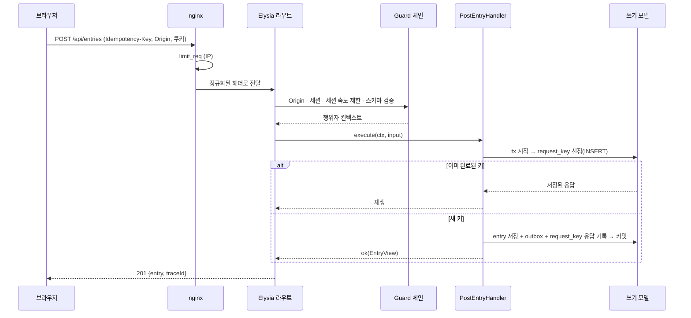
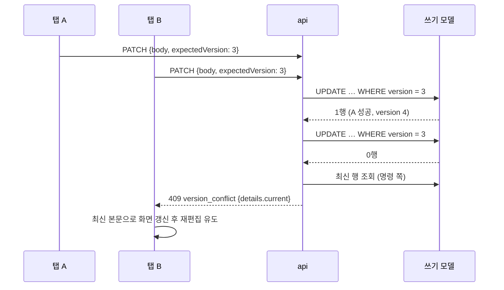
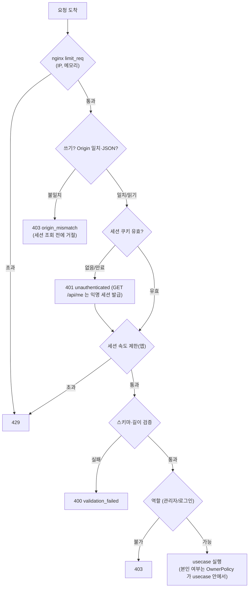
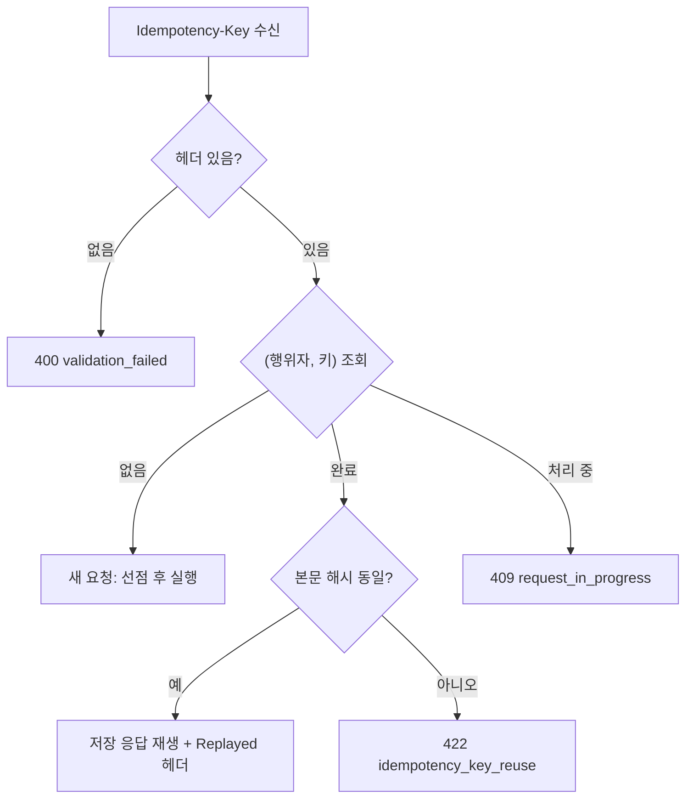
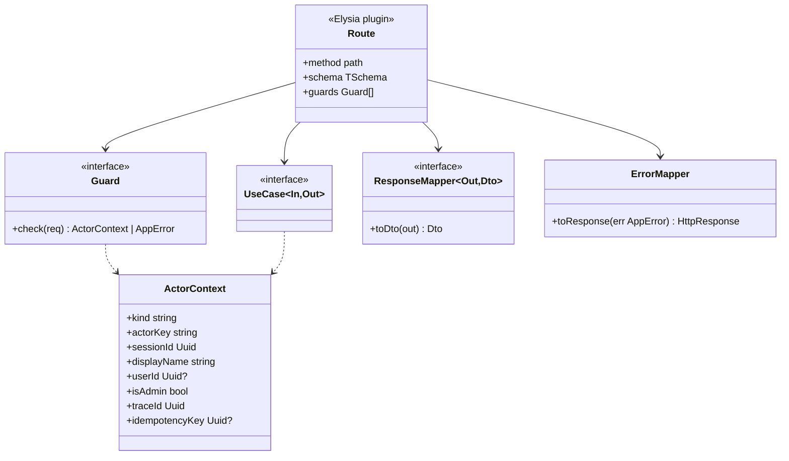
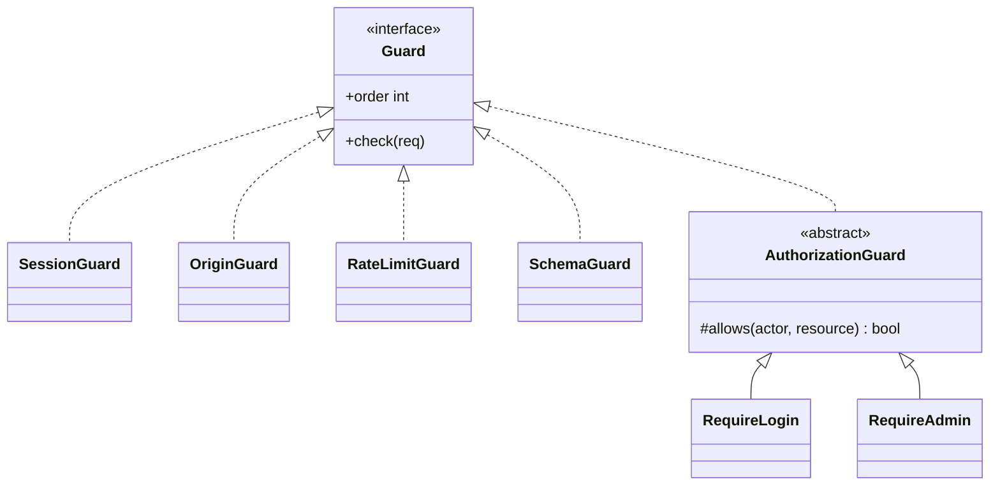

# 03. API 계약 (REST)

`apps/api` 가 노출하는 HTTP 계약의 정본 구조. **스키마는 코드(`packages/protocol/rest`, TypeBox)가 정본**이고 이 문서는 규칙과 목록이다.
공통 기반·오류 계층은 [00](00-system-overview.md), 인증은 [06](06-auth.md), 실시간은 [04](04-ws-protocol.md), 이벤트는 [05](05-event-catalog.md).

## 1. 공통 규칙

| 항목 | 규칙 |
|---|---|
| 기준 경로 | `/api` (버전 세그먼트 없음). 비호환 변경이 생기면 `/api/v2` 를 추가하고 v1 은 유지 |
| 형식 | 요청·응답 `application/json; charset=utf-8`. 본문은 UTF-8, 서버가 NFC 정규화 |
| 이름 | JSON 필드 `camelCase`, 경로 `kebab-case`, 열거값 `snake_case` 소문자 |
| 시각 | ISO 8601 UTC 문자열 |
| ID | uuid v7 문자열 |
| 인증 | 쿠키 세션(`__Host-sid`, 개발 `sid`). 익명 세션도 쿠키. **세션 쿠키가 없으면 보호 경로는 `401 unauthenticated`** — 클라이언트는 먼저 `GET /api/me` 로 세션을 확보한다(발급은 이 경로만, [06](06-auth.md) §2) |
| 쓰기 헤더 | `Idempotency-Key: <uuid>` **필수**(모든 `POST`/`PUT`/`PATCH`/`DELETE`, 로그인·로그아웃 제외) |
| CSRF | `SameSite=Lax` + `Origin` 검사 + JSON 전용 + `Idempotency-Key` 필수의 조합. 별도 토큰 없음([06](06-auth.md) §4, [10](10-security.md) §3.3) |
| 추적 | 모든 응답에 `X-Trace-Id`(= `traceId`). 쓰기 응답 본문에도 `traceId` |
| 속도 제한 | 초과 시 `429` + `Retry-After`. 헤더 `RateLimit-Limit`/`Remaining`/`Reset` 제공(앱 세션 단위 기준) |
| 캐시 | 조회는 `Cache-Control: no-store`(개인화·실시간), 정적 자원만 길게 |
| 압축 | 프록시(nginx) 담당 |

## 2. 에러 형식

모든 비 2xx 응답은 같은 모양이다(`errorToResponse` 한 곳, [00 §4.3](00-system-overview.md)).

```json
{
  "error": {
    "code": "version_conflict",
    "message": "다른 변경이 먼저 반영되었습니다.",
    "traceId": "0192f3c0-…",
    "details": { "current": { "…": "최신 EntryView" } }
  }
}
```

| 필드 | 규칙 |
|---|---|
| `code` | 00 §4.3 표의 코드. 클라이언트 분기는 **`code` 로만** 한다 |
| `message` | 사람이 읽는 문장. 요청 `Accept-Language`(ko/en)에 맞춤. 클라이언트는 표시용으로만 사용 |
| `details` | 코드별 구조: `validation_failed` → `fields: [{path, rule}]`, `version_conflict` → `current`, `rate_limited` → `retryAfterSeconds` |
| 코드 보강 | 00 §4.3 의 코드에 더해(**wire 코드에는 모듈 접두사를 붙이지 않는다**; 내부 클래스 코드 `guestbook.write_locked` 는 응답에서 `write_locked`): `write_locked`(503 + `Retry-After: 60`), `entry_hidden`(409, 이미 숨김), `entry_not_hidden`(409), `request_in_progress`(409 + `Retry-After: 1`), `idempotency_key_reuse`(422), `origin_mismatch`(403), `github_unavailable`(502), `github_rejected`(502), `oauth_state_invalid`(400), `oauth_state_expired`(400). 클라이언트 사전 키는 `errors.<code>` ([F15](features/15-web.md)) |
| 5xx | `message` 는 일반 문구, **내부 정보·스택을 담지 않는다** |

## 3. 멱등 키

쓰기 요청의 재시도를 안전하게 한다(ADR-014). 연결이 끊긴 사이 보낸 요청의 결과를 모를 때 같은 키로 다시 보낸다.

| 항목 | 규칙 |
|---|---|
| 형식 | uuid v4 또는 v7, 클라이언트 생성 |
| 범위 | **(행위자 키, `Idempotency-Key`)** — 행위자 = 로그인 사용자 또는 세션 |
| 같은 키 + 같은 요청 | 저장된 **원래 응답(상태·본문)을 재생**하고 `Idempotency-Replayed: true` 부착 |
| 같은 키 + 다른 요청 | `422` `idempotency_key_reuse` (본문 해시 불일치) |
| 처리 중 같은 키 | `409` `request_in_progress` + `Retry-After: 1` |
| 보관 | 24시간 (이후 같은 키는 새 요청으로 취급) |
| 저장 | 모듈 쓰기 스키마의 `request_key` 표(스키마 반영 필요, §9), **명령과 같은 트랜잭션**에서 기록 |

## 4. 엔드포인트

### 4.1 타입

```ts
type EntryView = {
  id: string;
  displayName: string;
  body: string;               // 텍스트로만 렌더 (HTML 해석 없음)
  authorKind: 'anonymous' | 'user';
  status: 'visible';          // hidden·deleted 는 공개 목록에 나오지 않는다 (deleted 는 묘비로만 존재, 목록·조회에 노출 안 함)
  reactions: Record<Emoji, number>;   // 예: { "👍": 3 }
  myReactions: Emoji[];       // 현재 행위자가 누른 것
  isMine: boolean;            // 현재 행위자의 글인가
  canEdit: boolean;           // 로그인 사용자 본인 글일 때만 true
  version: number;
  createdAt: string;
  updatedAt: string;
};
type Emoji = '👍' | '❤️' | '🎉' | '😂' | '🤔' | '👀';   // ADR-023 의 고정 6종 (목록은 protocol 상수)
type Page<T> = { items: T[]; nextCursor: string | null };
type ReasonCode = 'spam' | 'abuse' | 'personal_info' | 'off_topic' | 'other';   // 확정. protocol 상수. UI 라벨은 i18n 키 report.reason.<code> (F15)
type ReportView = {
  id: string;
  entryId: string;
  entryVersion: number;       // 관리자 hide/unhide 시 expectedVersion 으로 사용
  entryExcerpt: string;       // 본문 앞부분(길이 제한), 관리자 큐 전용
  reasonCode: ReasonCode;
  status: 'open' | 'resolved';
  createdAt: string;
};
type Me = {
  kind: 'anonymous' | 'user';
  userId?: string;
  displayName: string;
  isAdmin: boolean;
  writeLocked: boolean;       // 쓰기 잠금 중이면 true — 클라이언트는 작성 UI 를 비활성화한다
  locale?: 'ko' | 'en';
};
```

### 4.2 명령

### 4.2.0 인증 흐름 (세션 쿠키 발급·폐기)

| 메서드·경로 | 인증 | 요청 | 성공 응답 | 비고 |
|---|---|---|---|---|
| `GET /api/auth/github?returnTo=` | 없음 | 쿼리 `returnTo`(같은 출처 상대 경로만) | `302` → GitHub 인가 URL, `Set-Cookie` OAuth 임시 쿠키 | 상태를 바꾸지 않음. `Idempotency-Key` 면제 ([06](06-auth.md) §3) |
| `GET /api/auth/github/callback` | 없음 | 쿼리 `code`, `state` | `302` → `returnTo`, `Set-Cookie` 새 세션 | 검증 실패는 `400 oauth_state_invalid`/`oauth_state_expired`, 상류 실패는 `502 github_unavailable`/`github_rejected` |
| `POST /api/auth/logout` | 로그인 | (없음) | `200` `{}` | **`Idempotency-Key` 면제**(재호출해도 같은 결과). `Origin` 검사는 적용 |

#### 4.2.1 방명록 명령

| 메서드·경로 | 인증 | 요청 본문 | 성공 응답 | 주요 오류 |
|---|---|---|---|---|
| `POST /api/entries` | 익명 허용 | `{ displayName?, body }` | `201` `{ entry: EntryView, traceId }` | 400 검증, 429 |
| `PATCH /api/entries/{id}` | 로그인+본인 | `{ body, expectedVersion }` | `200` `{ entry, traceId }` | 401/403, 404, **409 `version_conflict`**(`details.current`) |
| `DELETE /api/entries/{id}` | 로그인+본인 | (없음) `If-Match: <version>` | `200` `{ traceId }` | 403, 404, 409 |
| `PUT /api/entries/{id}/reactions/{emoji}` | 익명 허용 | (없음) | `200` `{ count, mine: true, traceId }` | 404, 429. **이미 눌렀어도 200**(멱등) |
| `DELETE /api/entries/{id}/reactions/{emoji}` | 익명 허용 | (없음) | `200` `{ count, mine: false, traceId }` | 404 |
| `POST /api/entries/{id}/reports` | 익명 허용 | `{ reasonCode, note? }` | `202` `{ traceId }` | 404, 429 |
| `POST /api/admin/entries/{id}/hide` · `/unhide` | 관리자 | `{ expectedVersion, reason? }` | `200` `{ traceId }` | 403, 404, 409 (`version_conflict`, 이미 숨김이면 `entry_hidden`, 숨김이 아니면 `entry_not_hidden`) |
| `POST /api/admin/reports/{id}/resolve` | 관리자 | `{ resolution }` | `200` `{ traceId }` | 404, 409(이미 처리됨) |
| `POST /api/admin/write-lock` | 관리자 | `{ locked: boolean, reason?: string }` | `200` `{ writeLocked: boolean, changedAt: string }` | 403, 400 (409 없음: 단일 행 덮어쓰기, 멱등) |
| `PUT /api/me/profile` | 로그인 | `{ displayName }` | `200` `{ me }` | 400 |

- **표시 이름**: 익명이 글 작성 시 `displayName` 을 생략하면 서버가 `손님-xxxx`(세션 해시 4자리)를 부여한다. 로그인 사용자는 프로필 이름이 기본.
- **반응 중복은 오류가 아니다**: 이미 누른 반응에 `PUT`, 누르지 않은 반응에 `DELETE` 는 모두 `200` 이다(유일 키가 심판, 멱등). 409 를 쓰지 않는다.
- 반응 `count` 는 **쓰기 모델 기준 변경 후 총개수**이며 이벤트(`reaction.changed.count`)와 같은 값이다.
- **쓰기 잠금**(`POST /api/admin/write-lock` 으로 켠 상태)에서는 `POST /api/entries`, `PATCH`, 반응 추가(`PUT`), 신고가 `503` `write_locked` + `Retry-After: 60` 으로 거절된다. **삭제·반응 취소(`DELETE`)·관리자 조치·로그인 흐름은 잠금 대상이 아니다.** 상태는 `GET /api/me` 의 `writeLocked` 로 알 수 있다.
- **흐름 시각화 화면의 "보내기"**([07](07-frontend.md))는 별도 엔드포인트 없이 `POST /api/entries` 를 쓴다. 즉 **방명록에 실제 공개 글이 생기며**, 기본 문구(i18n 키)로 채워지고 같은 길이 제한·세션 속도 제한·쓰기 잠금을 받는다.
- 수정·삭제·숨김은 **조건부 갱신**이다. `expectedVersion` 불일치는 `409` + 최신 뷰(읽기 모델이 아닌 명령 쪽 조회로 만든 것)를 `details.current` 에 담는다.

### 4.3 조회

| 메서드·경로 | 인증 | 쿼리 | 성공 응답 |
|---|---|---|---|
| `GET /api/entries` | 익명 허용 | `limit`(1~50, 기본 20), `cursor` | `200` `Page<EntryView>` |
| `GET /api/me` | 익명 허용 | — | `200` `Me` — `{ kind:'anonymous'\|'user', userId?, displayName, isAdmin, writeLocked, locale? }` |
| `GET /api/admin/reports` | 관리자 | `status`, `limit`, `cursor` | `200` `Page<ReportView>` |
| `GET /api/flow/summary` | 익명 허용 | `window`(`5m`\|`1h`) | `200` `{ buckets: [{ at, step, count }] }` — **개수만**, 식별자·내용 없음 |
| `GET /api/flow/trace/{traceId}` | 행위자 본인 | — | `200` `{ steps: [{ step, at, detail? }] }` — 본인 `ownerKey` 일 때만, 아니면 404 |
| `GET /healthz` · `/readyz` · `/metrics` | **내부 전용** | — | 프록시가 외부 차단 |

- `GET /api/entries` 는 `guestbook_read.entry_view` 만 읽는다. `myReactions`·`isMine`·`canEdit` 는 행위자 컨텍스트로 **읽기 모델의 보조 테이블**(`my_reaction`, `entry_view.author_actor_key`, §9)에서 채운다.
- `/api/me` 는 세션 없이 호출돼도 **익명 세션을 발급**한다(첫 접속, 발급 트리거는 이 경로 하나).

## 5. 페이지네이션

| 항목 | 규칙 |
|---|---|
| 방식 | **커서**(키셋). `cursor` 는 불투명 문자열(base64url(JSON{entryId})) |
| 정렬 | `entry_id DESC` (uuid v7 = 시간순). 부분 인덱스 `status='visible'` |
| 응답 | `{ items, nextCursor }`. 끝이면 `nextCursor: null` |
| 일관성 | 읽기 모델 기준 결과적 일관. 새 글은 WS(`entry.created`)로 앞에 병합 — 중복은 `id` 로 제거 |
| 오류 | 잘못된 `cursor` → `400 validation_failed` |

## 6. 시퀀스

### 6.1 글 작성 (멱등 포함)



### 6.2 수정 충돌 (409)



## 7. 순서도

### 7.1 요청 한 건의 방어선



### 7.2 멱등 키 판정



## 8. 클래스 구조

### 8.1 계층과 의존



### 8.2 Guard 상속 구조



**`SessionGuard` 모드**: `required`(세션 없으면 401) · `issue`(없으면 익명 세션 발급 — **`GET /api/me` 에만**) · `optional`(없으면 익명 행위자로 취급하되 발급하지 않음, 공개 조회용).

실행 순서: `Origin(10) → Session(20) → RateLimit(30) → Schema(40) → Authorization(50)`. 순서는 §7.1 순서도와 같다. **Origin 을 세션보다 앞에 두는 이유**: 출처가 틀린 쓰기 요청은 세션 조회(DB·캐시) 전에 값싸게 거절한다.

`Authorization` 가드는 **역할**(로그인 필요, 관리자)만 판정한다. "이 글의 작성자인가"는 가드가 아니라 usecase 안의 도메인 서비스 **`OwnerPolicy`** 가 판정한다([10 §4](10-security.md), ADR-019) — 소유 규칙이 엔트리포인트에 새지 않게 한다.

## 9. 스키마 반영 필요 (이 문서가 요구하는 DB 추가)

| 추가 | 위치 | 이유 |
|---|---|---|
| `request_key` | `guestbook`·`identity` 쓰기 스키마 | 멱등 키 저장(§3). PK (`actor_key`, `key`), `request_hash`, `status`, `response_status`, `response_body`, `created_at`. 보관 24시간 |
| `my_reaction` | `guestbook_read` | 행위자별 눌림 표시(`myReactions`). PK (`entry_id`, `actor_key`, `emoji`), `reaction.changed` 로 갱신(행위자는 봉투 `ownerKey`) |
| `entry_view.author_actor_key` | `guestbook_read` | `isMine`/`canEdit` 계산(익명 포함). 응답에는 노출하지 않는다 |
| `entry.posted.authorUserId` | 이벤트 | 위 컬럼의 출처 (05 반영됨, 공개 변환에서 제거) |

위 항목은 [database-schema.md](../domains/database-schema.md) 에 반영되어 있다.

## 10. 미결

| 항목 | 결정 시점 |
|---|---|
| OpenAPI 문서 자동 생성 도구(Elysia 플러그인 vs TypeBox 변환) | 구현 초기(G 관문 없음, 교체 가능) |
| `Idempotency-Key` 보관 24시간 조정 | 운영 중 |
| 반응 종류 6종의 최종 이모지 | 디자인 시([07](07-frontend.md)) |
