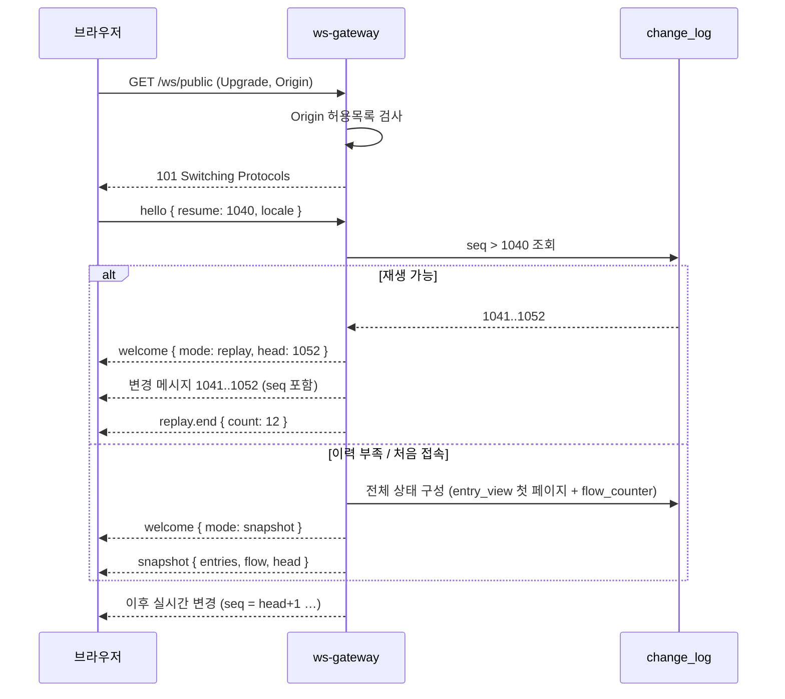
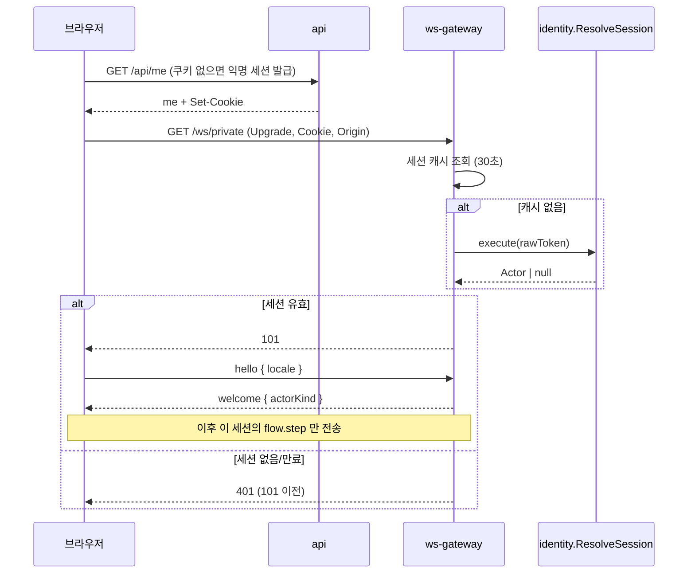
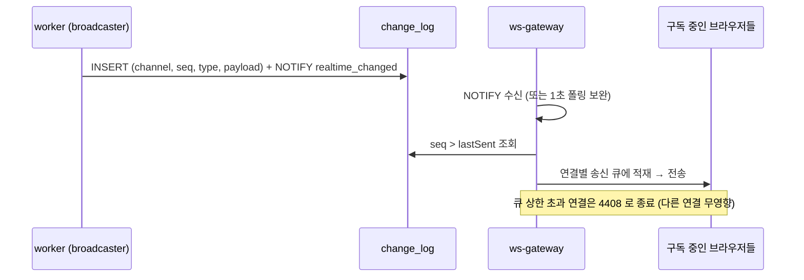
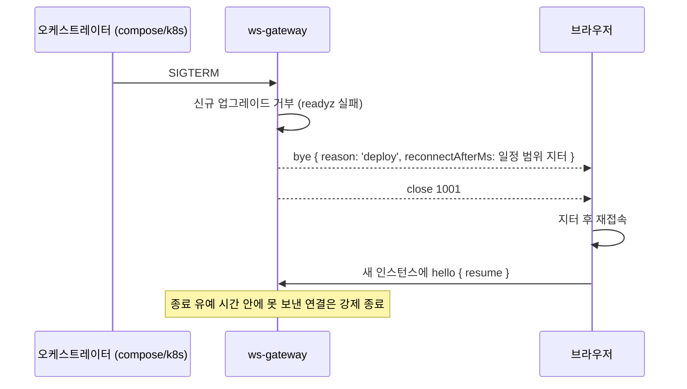
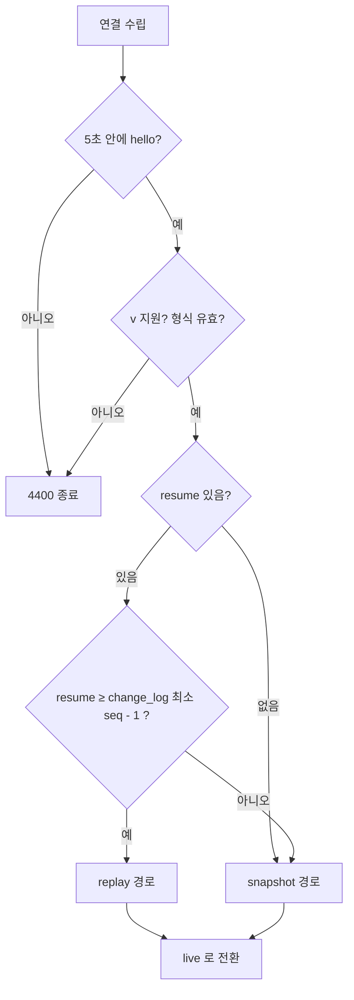
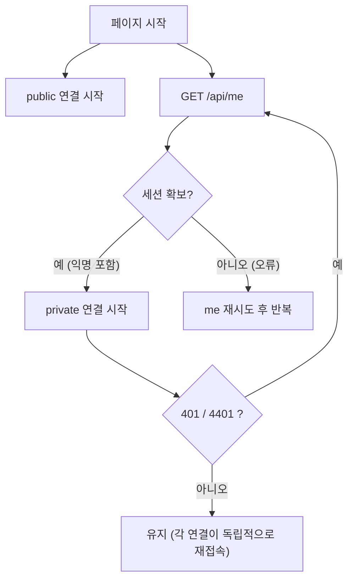
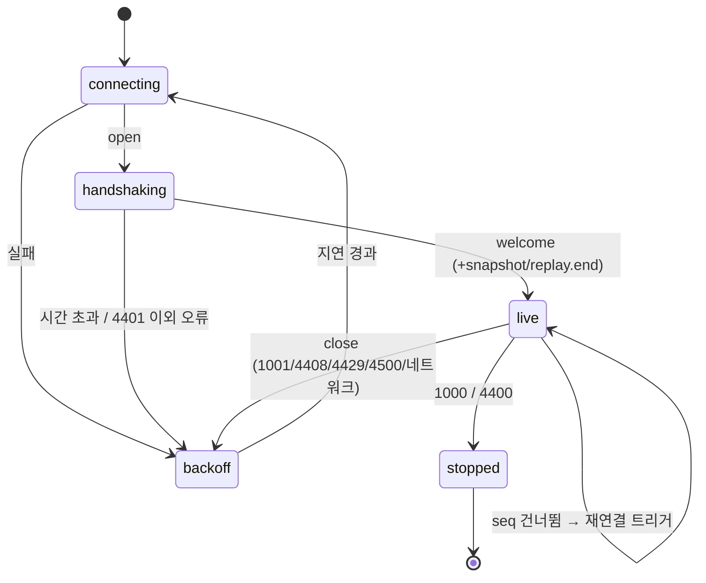
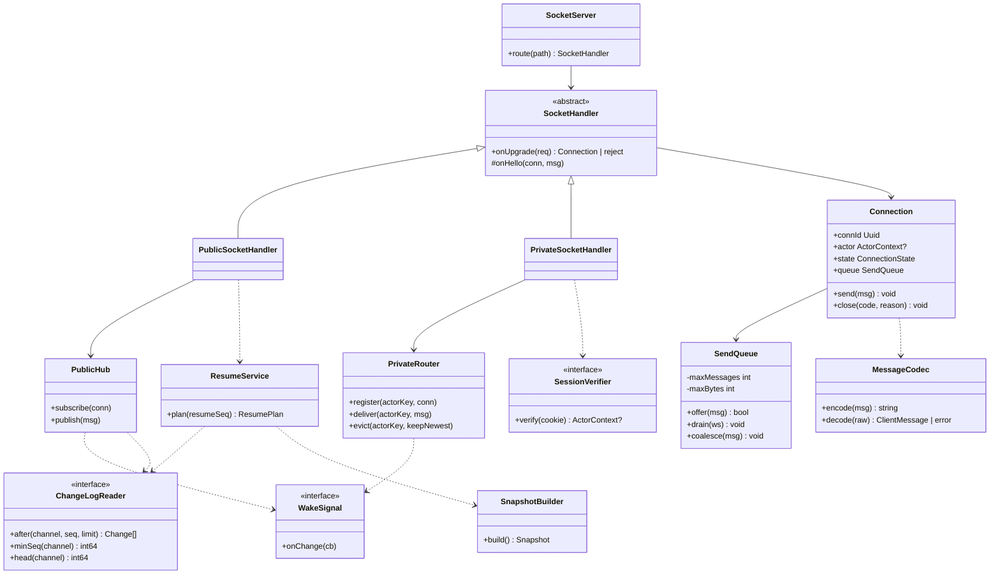
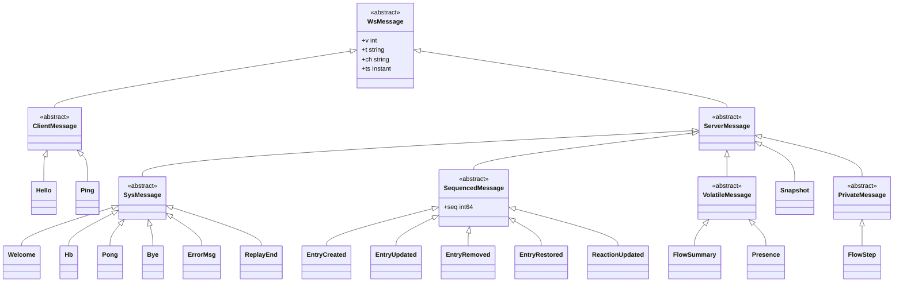
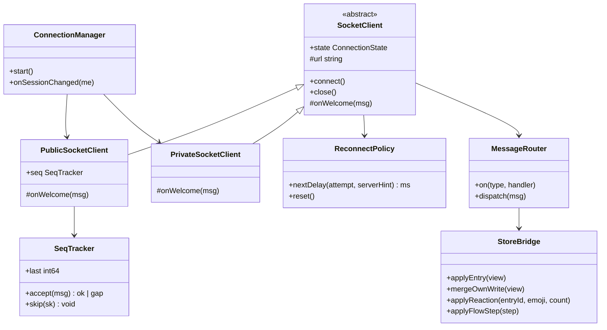

# 04. WebSocket 프로토콜

`apps/ws-gateway` 와 브라우저 사이의 계약. **스키마 정본은 `packages/protocol/ws`** (TypeBox, JSON Schema 로 내보낼 수 있는 형태 — 서버 구현이 바뀌어도 클라이언트가 안 바뀌게, ADR-022).
설계 근거: ADR-003(실시간), ADR-014(재접속·무중단), ADR-018(읽기 모델), ADR-023(`change_log` 1시간·알림). 이벤트는 [05](05-event-catalog.md), 인증은 [06](06-auth.md).

## 1. 연결

**public 과 private 은 서로 다른 연결**이다. 한 탭이 최대 두 소켓을 연다.

| 항목 | `/ws/public` | `/ws/private` |
|---|---|---|
| 연결 시점 | **사이트 최초 진입 시** 즉시 | **세션이 확인된 직후**(`/api/me` 가 익명 세션을 발급했거나 로그인 세션이 있을 때). 익명 세션도 연결한다 |
| 인증 | 없음 | **세션 쿠키 필수**. 없거나 만료면 업그레이드 단계에서 `401`(101 이전) |
| 받는 것 | 글·반응 변경, 익명 흐름 요약, 접속자 수 (모든 방문자 동일) | **내 흐름 상세**(`flow.step`) — 세션 소유자에게만 |
| 순번·재개 | 있음(`seq`, `change_log`, §5) | **없음**(best-effort, 놓친 단계는 REST 로 보충) |
| 보내는 쪽 | `hello` 한 번 | `hello` 한 번 |
| 부하 성격 | 많은 구독자에게 같은 메시지(팬아웃) | 연결마다 서로 다른 소량 메시지 |

공통 규칙:

| 항목 | 규칙 |
|---|---|
| 프록시 | nginx `location /ws/` 한 줄로 두 경로를 gateway 로 전달 (업그레이드 헤더·타임아웃은 10) |
| 프레임 | **텍스트 JSON**만. 바이너리 프레임은 `4400` 으로 종료 |
| `Origin` | 허용목록(사이트 도메인, 개발 로컬)만. 불일치는 업그레이드 `403` |
| 크기 제한 | 클라이언트→서버 4KB, 서버→클라이언트 64KB |
| 클라이언트 메시지 속도 | 초당 10건 초과 시 `4429` 종료 |
| 하트비트 | 서버가 25초마다 `hb`, 프로토콜 ping/pong 은 60초 간격. 무응답 시 서버가 종료(`idleTimeout` 120초, G2에서 확인) |
| 압축 | 사용하지 않는다(M1) |
| 세션당 private 연결 수 | 3 (탭 여러 개 허용), 초과분은 가장 오래된 연결을 `4409` 로 종료 |
| 전체 연결 수 | gateway 설정 상한(`WS_MAX_CONNECTIONS`, 미정) — 탭마다 소켓이 둘이라 동시 접속 50 이면 최대 약 200 |

**로그인과 연결**: GitHub 로그인은 전체 페이지 이동(OAuth 리다이렉트)이라 돌아오면 앱이 새로 시작되고 두 소켓이 새로 열린다. 세션이 회전되어 이전 익명 세션이 폐기되므로, 이전 세션의 private 연결은 서버가 `4401` 로 닫는다(세션 캐시 30초 이내, [06](06-auth.md) §6).

## 2. 봉투

모든 메시지가 같은 모양이다.

```json
{ "v": 1, "t": "entry.created", "ch": "public", "seq": 1042, "ts": "2026-11-04T09:00:00.123Z", "d": { "…": "종류별 본문" } }
```

| 필드 | 타입 | 설명 |
|---|---|---|
| `v` | int | 프로토콜 버전(현재 1). 모르는 높은 버전은 `4400` |
| `t` | string | 메시지 종류 (§3) |
| `ch` | `public` \| `private` \| `sys` | 채널. 연결마다 정해져 있다(`/ws/public` 은 `public`+`sys`, `/ws/private` 은 `private`+`sys`). `sys` 는 연결 관리 메시지 |
| `seq` | int64? | **채널 순번**. `public` 채널의 변경 메시지(`SequencedMessage`)에만 있다(§5). `presence`·`flow.summary`·`snapshot` 같은 순번 없는 메시지에는 없다 |
| `sk` | int64[]? | **건너뛴 순번 목록**(선택). 서버가 큐에서 `reaction.updated` 를 합치느라(§6) 보내지 않은 `seq` 들. 있으면 클라이언트가 gap 으로 오인하지 않는다(§5) |
| `ts` | ISO 8601 | 서버 송신 시각 |
| `d` | object | 본문 |

## 3. 메시지 종류

### 3.1 클라이언트 → 서버

두 연결 모두 `ch` 는 `sys` 인 연결 관리 메시지와, 연결 종류에 맞는 채널 메시지만 오간다. public 연결에 private 메시지는 오지 않는다.

| `t` | 채널 | 본문 | 설명 |
|---|---|---|---|
| `hello` | sys | public: `{ resume?: seq, locale }` / private: `{ locale }` | **연결 직후 5초 안에 첫 메시지**. 없으면 `4400`. `resume` 은 public 에서 마지막으로 처리한 순번 |
| `ping` | sys | `{ n }` | (선택) 왕복 측정. 서버는 `pong` 회신 |

쓰기는 REST 로만 한다. WS 는 **읽기 전용 푸시 채널**이다(ADR-018).

### 3.2 서버 → 클라이언트

| `t` | 채널 | 본문 | 설명 |
|---|---|---|---|
| `welcome` | sys | public: `{ connId, heartbeatSec, head: seq, mode: 'live'\|'replay'\|'snapshot' }` / private: `{ connId, heartbeatSec, actorKind: 'anonymous'\|'user' }` | `hello` 응답 |
| `snapshot` | public | `{ entries: PublicEntryView[], flow: FlowBuckets, head: seq }` | 재개 불가일 때 전체 상태. 이후 `head+1` 부터 이어진다 |
| `replay.end` | sys | `{ count }` | `mode: 'replay'` 일 때 놓친 변경 재생이 끝남 |
| `entry.created` | public | `{ entry: PublicEntryView }` | 새 글 |
| `entry.updated` | public | `{ entryId, body, updatedAt, version }` | 본문 **부분 갱신**(전체 뷰가 아니다). 클라이언트는 같은 `entryId` 의 캐시에 덮어쓴다 |
| `entry.removed` | public | `{ entryId, reason: 'deleted'\|'hidden' }` | 삭제·숨김. 목록에서 제거 |
| `entry.restored` | public | `{ entryId }` | **숨김 해제**. 변환기가 DB 를 읽지 않아 본문을 만들 수 없으므로 id 만 보내고, 클라이언트가 `GET /api/entries` 로 해당 글을 다시 가져오거나 다음 스냅샷으로 복원한다 |
| `reaction.updated` | public | `{ entryId, emoji, count }` | **총개수로 덮어쓴다**(05의 `count` 와 동일) |
| `flow.summary` | public | `{ window: '5m', buckets: FlowBucket[] }` | **익명 요약**. 개수만. **순번 없음(휘발성)**. 푸시는 `window` 고정(5분), 1시간 등은 REST(`GET /api/flow/summary`) |
| `presence` | public | `{ count }` | 접속자 수(근사). **순번 없음(휘발성)** |
| `flow.step` | private | `{ traceId, step, at, detail? }` | **내 흐름 상세**(단계 값은 05 §2.2) |
| `hb` | sys | public: `{ head: seq }` / private: `{}` | 하트비트 + (public 만) 채널 머리 번호(누락 감지) |
| `pong` | sys | `{ n }` | `ping` 응답 |
| `bye` | sys | `{ reason, reconnectAfterMs }` | **우아한 종료 예고**(배포·재시작). 이후 `1001` |
| `error` | sys | `{ code, message, fatal }` | 오류. `fatal` 이면 서버가 곧 종료 |

```ts
type PublicEntryView = Omit<EntryView, 'myReactions' | 'isMine' | 'canEdit'>;   // 개인 필드 없음 — 모든 방문자에게 같은 내용
type FlowBucket = { at: string; step: Step; count: number };                    // 식별자·내용 없음 (AC-009)
```

- **공개 채널 메시지는 모든 구독자에게 동일**하다. 개인 필드는 클라이언트가 자기 쓰기 응답(`myReactions` 등)과 합쳐서 만든다.
- 비공개 `flow.step` 은 **세션 소유자에게만** 전송한다. 필터링은 클라이언트가 아니라 **서버에서 한다**.

## 4. 오류와 종료 코드

| 종료 코드 | 의미 | 클라이언트 동작 |
|---|---|---|
| `1000` | 정상 종료 | 재접속 안 함(탭 종료 등) |
| `1001` | 서버 이동(배포) — 보통 `bye` 선행 | `reconnectAfterMs` 후 재접속 |
| `4400` | 잘못된 요청(형식·버전·바이너리·`hello` 누락) | **재접속 안 함**, 클라이언트 버그 로그 |
| `4401` | (private) 세션 폐기·만료·회전 | `/api/me` 로 세션 갱신 후 새 세션으로 private 재연결 |
| `4409` | (private) 세션당 연결 수 초과로 밀려남 | 재접속하지 않음(다른 탭이 유효) |
| `4408` | 느린 소비자(송신 큐 상한 초과) | 즉시 재접속 + `resume` (§6) |
| `4429` | 클라이언트 메시지 속도 초과 | 백오프 후 재접속 |
| `4500` | 서버 내부 오류 | 백오프 재접속 |

## 5. 순번(seq)과 재개

| 항목 | 규칙 |
|---|---|
| 범위 | **`public` 채널 단일 순번**. `realtime_read.change_log (channel, seq)` 가 정본 |
| 연속성 | 클라이언트는 `seq` 가 직전+1 인지 검사한다(서버가 합쳐서 건너뛴 번호는 `sk` 로 알려 준다). 그 외에 건너뛰면 **누락** → `resume` 로 재연결 |
| `private` 연결 | 순번이 없다(best-effort). 놓친 흐름은 REST `GET /api/flow/trace/{traceId}` 로 보충한다(클라이언트가 진행 중인 `traceId` 를 안다) |
| 건너뛴 순번(`sk`) | 서버는 큐에서 합친 `reaction.updated` 의 순번을 다음 메시지의 `sk` 에 담는다. 클라이언트 `SeqTracker` 는 `seq` 가 `last + 1` 이 아니어도 **`last+1 … seq-1` 이 전부 `sk` 에 있으면 gap 이 아니다**(`last = seq`). 하나라도 빠졌으면 gap → 재연결(`resume`) |
| 휘발성 메시지 | `presence`·`flow.summary` 는 순번이 없고 `change_log` 에도 없다. 재개(replay) 중에는 보내지 않고, `live` 전환 뒤 최신값 하나만 보낸다 |
| 중복 제거 | 클라이언트는 `entry.created` 를 `entry.id` 로, `reaction.updated` 는 덮어쓰기라 중복에 안전 |
| 내 쓰기 | REST 응답으로 받은 뷰를 먼저 표시하고, 같은 `id` 의 `entry.created` 가 오면 **병합**(교체)한다(ADR-018) |
| 재개 가능 조건 | `resume` ≥ `change_log` 최소 seq − 1 (보관은 1시간·채널당 1만 행, ADR-023) |
| 재개 불가 | `mode: 'snapshot'` → `snapshot` 으로 상태를 통째로 교체 |

## 6. 백프레셔

| 항목 | 규칙 |
|---|---|
| 연결별 송신 큐 | 메시지 **64건** 또는 **256KB** 중 먼저 닿는 쪽이 상한 |
| 초과 시 | `4408` 종료. 그 연결만 영향받고 다른 연결은 막히지 않는다 |
| 구현 | **Elysia 기본 `backpressureLimit` 에 기대지 않는다**(ADR-022 측정: 라우트 옵션 무시, 최상위 옵션은 지연 악화). 앱 코드에서 큐 길이를 직접 관리하고 `ws.send` 의 반환값(`-1` 버퍼링/`0` 드롭)을 확인한다. **관문 G2에서 이 동작을 시험** |
| 합치기 | 같은 `entryId`+`emoji` 의 `reaction.updated` 가 큐에 쌓이면 **최신 것만 남긴다**(덮어쓰기 의미라 안전). 버린 메시지의 `seq` 는 다음에 나가는 메시지의 `sk` 에 실어 gap 으로 오인되지 않게 한다(§5) |

## 7. 시퀀스

### 7.1 public 연결과 재개 (최초 진입)



### 7.1.1 private 연결 (세션 확인 후)



### 7.2 변경 전달 (worker → 브라우저)



### 7.3 우아한 종료 (배포)



## 8. 순서도

### 8.1 서버의 `hello` 처리 (public)



private 연결의 `hello` 는 형식 검사 후 바로 `welcome` 이다(재개 없음).

### 8.1.1 클라이언트의 연결 오케스트레이션



### 8.2 클라이언트 재접속 상태 (연결마다 독립)



- 두 연결은 **재접속도 독립**이다(public 이 끊겨도 private 은 유지). 아래 상태와 백오프는 연결마다 따로 돈다.
- 백오프: **1초부터 2배**, 완전 지터, 상한 30초. `live` 가 30초 이상 유지되면 초기화. 서버가 `bye.reconnectAfterMs` 를 주면 그 값을 우선한다.
- 탭이 숨겨져 있어도 연결은 유지하되, 오래(예: 5분) 숨겨지면 닫고 보일 때 다시 연다(자원 절약, 구현 시 판단).
- `navigator.onLine` 복귀 시 대기 중인 백오프를 즉시 해제한다.

## 9. 클래스 구조

### 9.1 ws-gateway 구성



`private` 메시지(`flow.step`)의 출처는 `trace_step` 이다. `WakeSignal` 이 `trace_step` 추가 신호(`NOTIFY trace_changed`, 채널·ownerKey 해시만)도 받아 `PrivateRouter` 가 해당 세션 연결에만 전달한다(03 §4.3 `GET /api/flow/trace` 와 같은 소유 규칙).

### 9.2 메시지 상속 구조



- `SequencedMessage`(public 변경)만 `seq` 를 갖고 `change_log` 에 남는다. `VolatileMessage`(`Presence`·`FlowSummary`)는 순번이 없고 `change_log` 에 쓰지 않으며, 재개 시 최신값 하나만 보낸다. `Snapshot` 은 순번을 갖지 않고 `head` 만 싣는다.

### 9.3 클라이언트 구성



`ConnectionManager` 가 8.1.1 순서도대로 두 클라이언트를 띄운다. `StoreBridge` 는 TanStack Query 캐시를 갱신하는 어댑터다([07](07-frontend.md)).

## 10. 보안 체크

| 항목 | 규칙 |
|---|---|
| Origin | 허용목록(사이트 도메인, 개발 로컬)만. 불일치는 업그레이드 거부 |
| 세션 | 쿠키 `HttpOnly`·`Secure`·`SameSite=Lax`. WS 로 토큰을 주고받지 않는다. private 만 세션 필수 |
| 개인정보 | 공개 채널에 ownerKey·세션·IP·userId 를 싣지 않는다(서버에서 변환 시 제거) |
| 연결 수 | 접속 주소당 동시 연결 수는 nginx `limit_conn`, 전체 상한은 gateway 설정 |
| 입력 | 클라이언트 메시지는 스키마 검증, 알 수 없는 필드 무시, 형식 오류는 `4400` |

## 11. 미결

| 항목 | 결정 시점 |
|---|---|
| 숨김 탭에서 연결을 닫는 시간 | 프론트 구현 시 |
| `hb` 주기·유휴 시간 조정, 큐 상한 조정 | G2 소크 시험 후 |
| 세션 검증 캐시 30초와 로그아웃/회전 반영 지연 | [06](06-auth.md) 구현 시 |
| `trace_changed` NOTIFY 대신 `trace_step` 폴링만 쓸지 | 구현 시(private 은 소량이라 폴링으로 충분할 수 있음) |
| 탭 간 소켓 공유(SharedWorker)로 연결 수를 줄일지 | G2 결과 후 |
