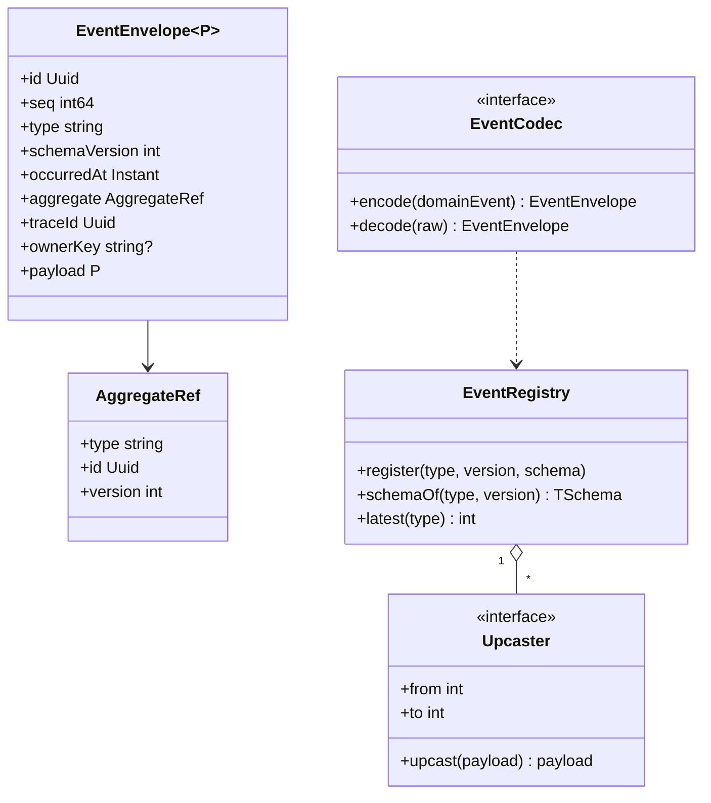
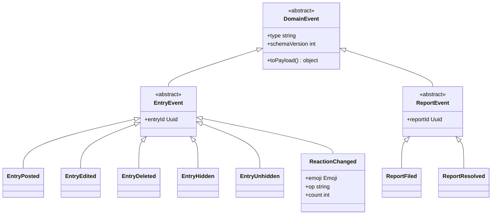
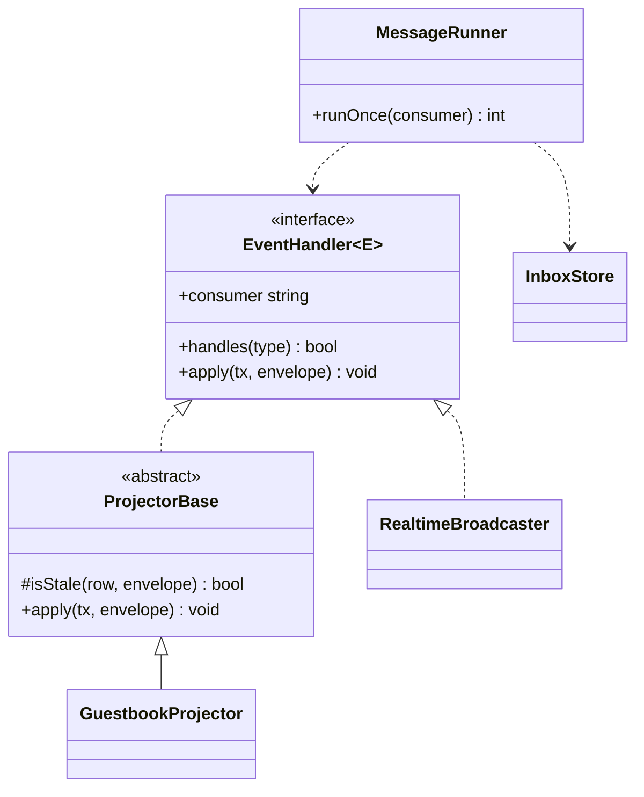
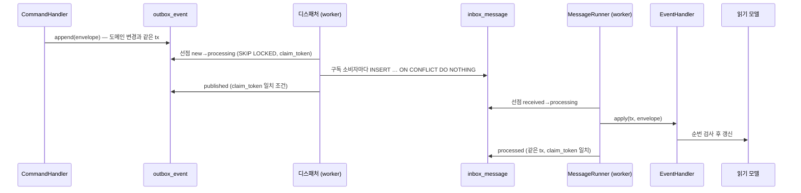
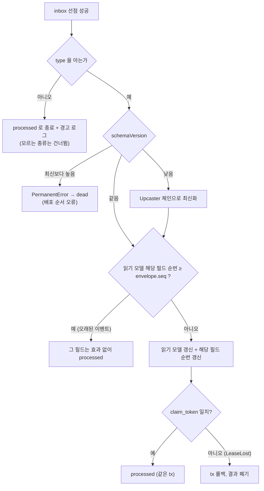
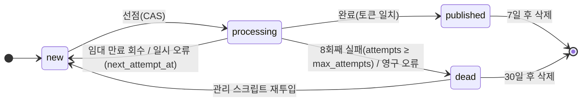

# 05. 이벤트 카탈로그

도메인 이벤트의 **종류·페이로드·버전 규칙**의 정본. 스키마는 코드(`packages/protocol/events`)가 정본이고, 이 문서는 그 구조와 규칙이다.
기반 클래스는 [00 §4.1](00-system-overview.md), 저장 구조는 [database-schema.md](../domains/database-schema.md) §4-3·4-5, 전달·선점 규칙은 ADR-005·020·021.

## 1. 봉투 (Envelope)

outbox 행과 inbox 행, 소비자 핸들러 입력이 **같은 모양**이다.

| 필드 | 타입 | 설명 |
|---|---|---|
| `id` | uuid v7 | 이벤트 식별자 = inbox `message_id` (중복 제거 키) |
| `seq` | int64 | outbox 전역 단조 증가. 읽기 모델의 필드별 순번(`content_seq`·`status_seq`·`reaction_seq`, report 는 `last_seq`) 비교 기준 |
| `type` | string | `<aggregate>.<verb-past>` (아래 §2) |
| `schemaVersion` | int | 페이로드 스키마 버전, 1부터 |
| `occurredAt` | ISO 8601 UTC | 도메인에서 사건이 일어난 시각 |
| `aggregate` | `{ type, id, version }` | 대상 집합체와 그 시점 `version` |
| `traceId` | uuid | 흐름 추적 단위. `trace_step` 과 공유 |
| `ownerKey` | string \| null | 이벤트를 일으킨 **행위자의 내부 키** — `session:<sessionId>` \| `user:<userId>`(= `ActorContext.actorKey`). 비공개 흐름 열람 권한과 프로젝터의 `actor_key`·`author_actor_key` 로 쓴다. **공개 채널로 나가는 변환에서 항상 제거** |
| `payload` | object | 종류별 본문 (§2) |

- 봉투에 **IP·토큰·원본 쿠키 값이 들어가지 않는다.**
- 봉투의 모든 필드는 outbox·inbox 행의 **컬럼으로 저장**된다(`schema_version`, `occurred_at`, `aggregate_type/id/version`, `trace_id`, `owner_key`; `payload` 는 본문만 — database-schema §4-3·§4-5). 소비자는 inbox 행만으로 Upcaster 판정과 `version`·행위자 반영을 할 수 있다.
- `ownerKey` 는 **내부 행위자 키와 같은 값**(`session:<id>` / `user:<id>`)이다. 별도 해시·변환 계층을 두지 않는다(형식이 둘이면 매핑 계층이 필요해진다). 이 값은 서버 내부(DB·워커·gateway 내부)에서만 돌고 **공개 변환에서 항상 삭제**된다(AC-009). 세션 ID 는 DB 의 uuid 이지 쿠키 토큰이 아니다.

## 2. 이벤트 종류 (M1)

| `type` | 발행 모듈 | 발행 시점(같은 트랜잭션) | `payload` (v1) |
|---|---|---|---|
| `entry.posted` | guestbook | `PostEntry` | `entryId`, `displayName`, `body`, `authorKind`(`anonymous`\|`user`), `authorUserId`(user 일 때만, **공개 변환에서 제거**), `createdAt` |
| `entry.edited` | guestbook | `EditEntry` | `entryId`, **`body`(전체)**, `updatedAt` |
| `entry.deleted` | guestbook | `DeleteEntry` | `entryId` |
| `entry.hidden` | guestbook | `HideEntry` | `entryId`, `actionId` |
| `entry.unhidden` | guestbook | `UnhideEntry` | `entryId`, `actionId` — **공개 변환에서 `entry.restored`(04)가 된다** |
| `reaction.changed` | guestbook | `AddReaction`/`RemoveReaction` | `entryId`, `emoji`, `op`(`added`\|`removed`), **`count`**(변경 후 이 이모지의 총개수) |
| `report.filed` | guestbook | `ReportEntry` | `reportId`, `entryId`, `reasonCode`, `excerpt`(앞 80자, **관리자 큐 전용**) — 신고자 `note` 는 싣지 않는다(`guestbook.report.note` 에만 둔다) |
| `report.resolved` | guestbook | `ResolveReport` | `reportId`, `resolution`(`dismissed`\|`entry_hidden`) |

- **`reaction.changed` 는 증감이 아니라 변경 후 총개수(`count`)를 싣는다.** 프로젝터가 `reactions[emoji] = count` 로 **덮어쓰므로** 재전달·순서 역전에서도 결과가 같다(`last_seq` 검사와 함께).
- `entry.posted` 의 `authorUserId` 는 이벤트에 남기되(소비자가 필요), 읽기 모델은 `author_actor_key`(`ownerKey` 와 같은 값)로 저장한다. 공개 변환에서는 둘 다 제거된다.
- `entry.posted` 의 `displayName` 은 발행 시점의 값이다. 이후 이름이 바뀌어도 과거 이벤트는 바꾸지 않는다.
- 사이트 공통 이벤트(`entry.*`, `reaction.*`)만 **공개 채널 변환 대상**이다. `report.*` 는 관리자 큐 전용이며 어떤 공개 채널로도 나가지 않는다.

### 2.1 소비자 매트릭스

| 소비자 | 소유 모듈 | 구독 `type` | 효과 |
|---|---|---|---|
| `guestbook-projector` | guestbook | `entry.*`, `reaction.changed`, `report.*` | `entry_view`·`my_reaction`·`report_queue` 갱신 (필드별 순번 검사; `entry.deleted` 는 본문·반응을 비움) |
| `realtime-broadcaster` | realtime | `entry.*`, `reaction.changed` | `change_log` 기록(채널 seq 부여) → 공개 메시지 생성 |
| `trace-recorder` (디스패처 내부) | events | 전부 | `trace_step`(`dispatched`/`received`/`processed`…) 기록 — 이벤트가 아닌 단계 기록 |

`flow_counter` 는 이벤트 구동이 아니라 `trace_step` **주기 집계**다.

### 2.2 흐름 단계(`trace_step.step`)

이벤트가 아니라 **시각화 입력**이다. 한 `traceId` 가 지나는 단계: `written → outboxed → dispatched → received → processed` (+ `retried`/`failed`/`dead`). 단계 이름은 [04](04-ws-protocol.md)의 비공개 메시지 `flow.step` 과 같은 값이다.

## 3. 클래스 구조

### 3.1 봉투와 페이로드



### 3.2 도메인 이벤트 상속 구조 (00 §4.1 의 구체화)



### 3.3 소비자(핸들러) 구조



`ProjectorBase.isStale` 가 필드별 순번 비교를 한 곳에서 한다(모든 프로젝터 공통).

## 4. 시퀀스 — 발행에서 소비까지



## 5. 순서도 — 소비자의 한 건 처리



## 6. 상태 — outbox / inbox 수명



inbox 는 `new` 대신 `received`, `published` 대신 `processed` 로 같은 모양이다(ADR-020). 값은 [ADR-023](../adr/ADR-023-operational-policies.md).

## 7. 버전 규칙

| 규칙 | 내용 |
|---|---|
| 호환 변경 | 선택 필드 **추가**는 같은 `schemaVersion` 안에서 허용. 소비자는 **모르는 필드를 무시**한다 |
| 비호환 변경 | 필드 제거·이름 변경·의미 변경 → `schemaVersion` +1, `Upcaster(N→N+1)` 를 함께 추가 |
| 소비자 허용 범위 | 최신(N)과 직전(N-1)을 읽는다. 더 오래된 행은 outbox 보관(7일)을 넘으면 사라지므로 불필요 |
| 배포 순서 | **소비자 먼저, 발행자 나중에**. 소비자가 모르는 더 높은 버전을 만나면 `dead` (§5) |
| 모르는 `type` | 건너뛰고 경고(다른 소비자용 이벤트일 수 있다) |
| 이름 | 한 번 낸 `type` 은 바꾸지 않는다. 의미가 바뀌면 새 `type` |
| 시험 | 각 `type` × 버전의 **골든 JSON**을 저장소에 두고 인코딩/디코딩/업캐스트를 시험한다([08](08-test-strategy.md)) |

## 8. 스키마 정의 예시 (정본은 코드)

```ts
// packages/protocol/events/entry-posted.ts  (TypeBox — JSON Schema 로 내보낼 수 있는 형태, ADR-022)
export const EntryPostedV1 = Type.Object({
  entryId: Type.String({ format: 'uuid' }),
  displayName: Type.String({ minLength: 2, maxLength: 20 }),
  body: Type.String({ minLength: 1, maxLength: 500 }),
  authorKind: Type.Union([Type.Literal('anonymous'), Type.Literal('user')]),
  createdAt: Type.String({ format: 'date-time' }),
});
registry.register('entry.posted', 1, EntryPostedV1);
```

## 9. 미결

| 항목 | 결정 시점 |
|---|---|
| (확정) `entry.edited` 는 본문 **전체**를 싣는다 | — |
| 익명→로그인 전환 시 귀속 이벤트 | ADR-008 미결과 함께 |
