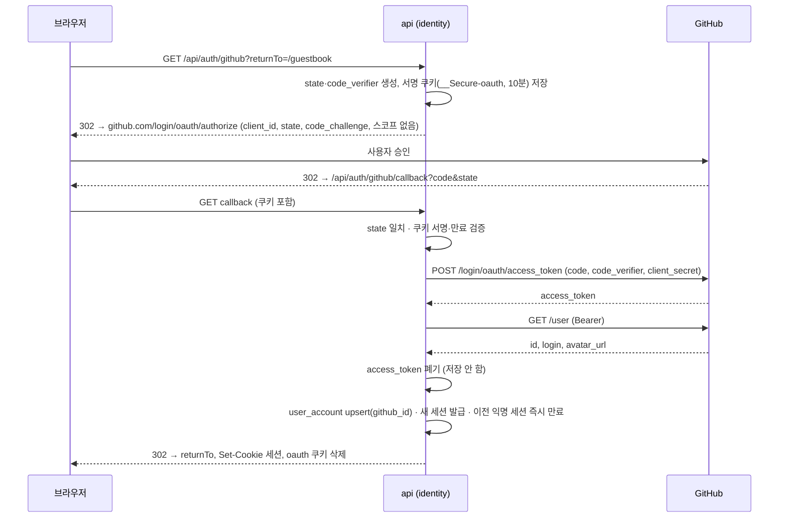
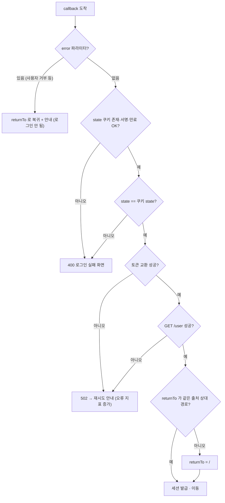
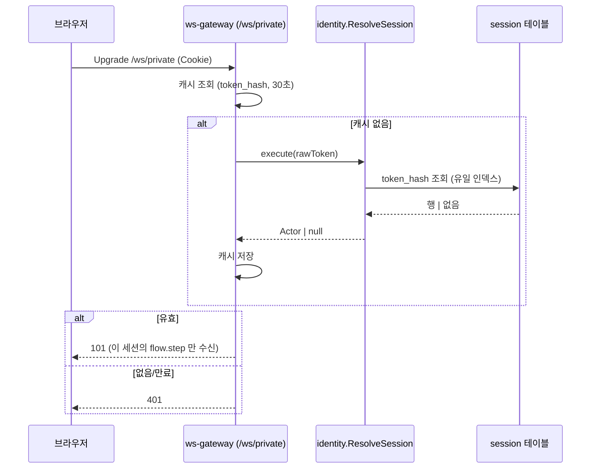
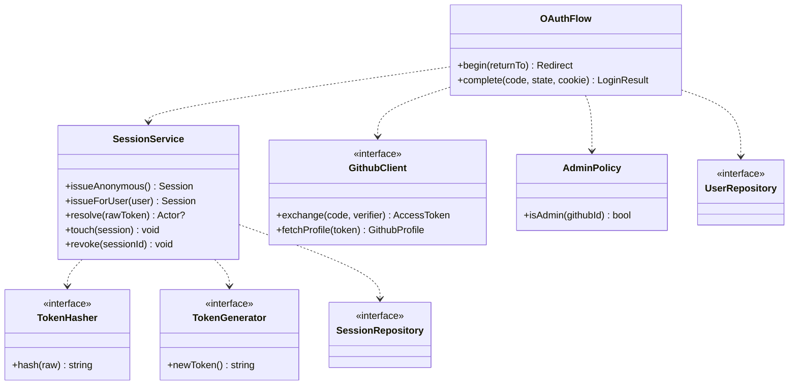
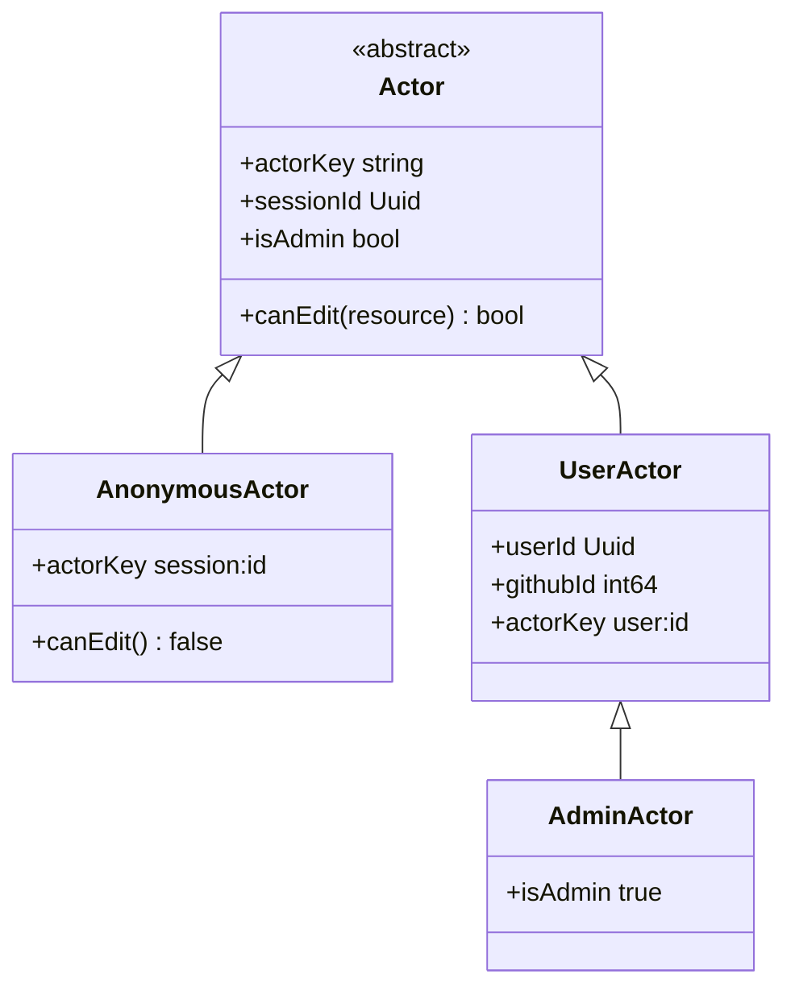
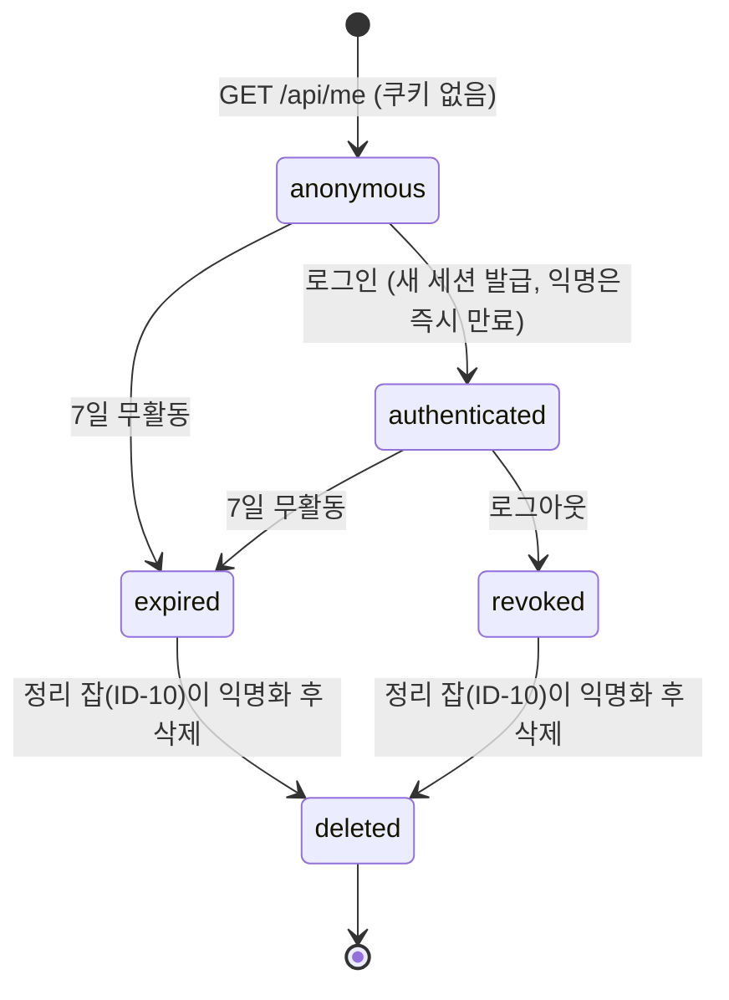

# 06. 인증·세션

`identity` 모듈의 상세. 근거: ADR-008(신원·악용), ADR-022(OAuth 직접 구현, 토큰 해시 저장), ADR-021(동시성). 계약은 [03](03-api-contract.md), WS 인증은 [04](04-ws-protocol.md), 보안 헤더는 [10](10-security.md).

## 1. 원칙

| 원칙 | 내용 |
|---|---|
| 익명 우선 | 첫 접속에 로그인 없이 **익명 세션**을 발급한다. 가입 장벽 없음 |
| 로그인은 영구 신원 | GitHub 로그인 사용자만 **본인 글 수정·삭제**와 표시 이름을 가진다 |
| 최소 권한 | GitHub 에 **스코프를 요청하지 않는다**(공개 프로필만). 이메일을 받지 않는다 |
| 토큰은 해시로만 | 세션 토큰은 원문을 저장하지 않는다(SHA-256 해시). GitHub 액세스 토큰은 **저장하지 않고** 사용 직후 폐기 |
| 같은 출처 | web·api·ws 가 한 도메인(nginx 경로 분기)이라 **CORS 가 필요 없다** |
| 서버가 판정 | 권한(본인·관리자)은 usecase 진입 전에 서버가 계산한다. 클라이언트 값 불신 |

## 2. 세션

| 항목 | 값 |
|---|---|
| 쿠키 이름 | 운영 `__Host-sid`, 개발 `sid` (`SESSION_COOKIE_NAME`; `__Host-` 는 `Secure`·`Path=/`·`Domain` 없음을 요구하므로 http 로컬에서는 쓰지 않는다) |
| 쿠키 속성 | `HttpOnly`, `Secure`(운영), `SameSite=Lax`, `Path=/`, `Max-Age=7일` |
| 토큰 | 32바이트 난수(CSPRNG), base64url. DB 에는 `token_hash`(SHA-256) 유일 |
| 수명 | 만료 = `last_seen_at + 7일`. `last_seen_at` 은 **1시간에 한 번만** 갱신(쓰기 폭주 방지). 만료 후 정리 잡(ID-10)이 익명화·삭제(보관 정책 7일) |
| 종류 | 익명(`user_id` NULL) / 로그인(`user_id` 있음) — 같은 표 |
| 회전 | 로그인 시 **새 세션을 발급**하고 이전 익명 세션은 **즉시 만료 처리**(`expires_at = now`, 세션 고정 방지). 이전 익명 글의 귀속은 하지 않는다(ADR-008 기본값) |
| 폐기 | 로그아웃·회전·관리자 즉시 폐기 = 행을 **지우지 않고 `expires_at = now` 로 즉시 만료 처리** + 쿠키 만료. 실제 삭제와 익명화(`entry.author_session_id` NULL, `reaction.actor_key` 교체, `my_reaction` 삭제)는 정리 잡 ID-10 한 경로만 지난다 |
| 개수 | 행위자당 활성 세션 수 제한은 두지 않는다(익명은 쿠키 단위) |

익명 세션 발급은 `GET /api/me` 가 쿠키 없이 호출될 때 일어난다(첫 화면 진입). 남용은 nginx `limit_req` 로 막는다(ADR-008).

### 2.1 행위자 키

| 상황 | `actorKey` |
|---|---|
| 익명 | `session:<sessionId>` |
| 로그인 | `user:<userId>` |

반응의 유일 키·멱등 키 범위가 이 값을 쓴다. **이벤트 봉투의 `ownerKey` 도 이 값 그대로**(`session:<id>`/`user:<id>`)이며, 별도 해시·HMAC 변환을 하지 않는다. 공개 채널 변환에서는 항상 제거된다([05 §1](05-event-catalog.md)). 세션이 삭제되면 `reaction.actor_key` 는 무작위 값으로 교체되어 집계만 남는다(database-schema §11).

## 3. GitHub 로그인 (인가 코드 + state, PKCE 는 지원 확인 후)

GitHub **OAuth App**을 쓴다(웹 서버 흐름). **PKCE(S256)는 GitHub OAuth App 의 지원을 확인한 뒤 쓴다(미확인); 미지원이면 `state` 만으로 로그인 CSRF·코드 가로채기를 막는다**(client_secret 이 서버에만 있어 코드 교환은 보호된다). 아래 시퀀스의 `code_challenge`/`code_verifier` 는 지원 확인 시에만 포함한다. 콜백 URL 은 환경별로 다른 앱(운영/개발)을 만든다([02](02-dev-environment.md)).

**콜백 주소(라이브)**: GitHub OAuth 앱의 Authorization callback URL 은 Funnel 의 고정 주소로 등록한다 — `https://<호스트>.<tailnet 이름>.ts.net/api/auth/github/callback`(자리표시자, 실제 값은 사용자 tailnet 이름에 의존). 이 주소는 설정값 `PUBLIC_ORIGIN` 에서 만들고 쿠키 `__Secure-`/`__Host-`·Origin 검증의 허용 오리진도 같은 호스트다([10 §3](10-security.md)). 주소가 바뀌면(tailnet·호스트 이름 변경) OAuth 앱 설정을 함께 고친다. 개발은 `http://localhost:8080/...`(02 §6).

### 3.1 시퀀스

### 3.2 순서도 — 콜백 검증

- `returnTo` 는 **`/` 로 시작하고 `//` 가 아닌 상대 경로**만 허용한다(오픈 리다이렉트 방지).
- 신뢰할 수 없는 값은 `returnTo`·`state`·`code` 셋이고 모두 위에서 검증한다.

## 4. CSRF

토큰을 따로 두지 않고 **겹치는 방어**로 막는다(정책 정본은 [10 §3.3](10-security.md)).

| 방어 | 내용 |
|---|---|
| `SameSite=Lax` | 교차 사이트 `POST` 에 세션 쿠키가 실리지 않음 |
| `OriginGuard` | 변경 요청의 `Origin`(없으면 `Referer`)이 `PUBLIC_ORIGIN` 과 일치해야 함, 아니면 `403 origin_mismatch` |
| JSON 전용 | 본문은 `application/json` 만 → 폼 전송 차단 |
| `Idempotency-Key` 필수 | 사용자 지정 헤더라 교차 사이트 폼으로 보낼 수 없음 |
| 로그인 시작·콜백 | `GET` 이지만 **상태를 바꾸지 않는다**(세션 발급은 콜백의 서버 결정). `state` 가 로그인 CSRF 를 막는다 |
| 로그아웃 | `POST /api/auth/logout`. **`Idempotency-Key` 면제**(재호출해도 같은 결과)이므로 방어는 `SameSite=Lax` + `OriginGuard` + JSON 전용 **3중**이다 |

## 5. 관리자

| 항목 | 규칙 |
|---|---|
| 판정 | `ADMIN_GITHUB_IDS`(숫자 GitHub ID 목록, 환경변수)에 로그인 사용자의 `github_id` 가 있으면 `isAdmin`. **로그인명이 아니라 숫자 ID**(로그인명은 바뀔 수 있다) |
| 저장 | DB 에 관리자 플래그를 두지 않는다 → 설정 변경만으로 권한 회수 |
| 범위 | 숨김·해제, 신고 처리, 쓰기 잠금 스위치 |
| 이력 | 모든 관리 조치는 `moderation_action` 에 행위자와 함께 남는다 |
| 보호 | 관리자 엔드포인트는 `RequireAdmin` + `OriginGuard` + 속도 제한 |

## 6. WebSocket 인증

연결이 둘이라 인증도 다르다([04 §1](04-ws-protocol.md)).

| 연결 | 인증 |
|---|---|
| `/ws/public` | 없음 (Origin 검사만) |
| `/ws/private` | **세션 쿠키 필수**(익명 세션 포함). 없거나 만료면 업그레이드 단계에서 `401` |

`ws-gateway` 는 같은 코드베이스의 **`identity` 공개 usecase(`ResolveSession`)를 직접 호출**한다(모듈 지도의 허용된 의존, architecture.md §4). 별도 내부 HTTP 엔드포인트를 두지 않는다.

- 캐시 때문에 **로그아웃·회전 반영 지연은 최대 30초**다. 로그인으로 세션이 회전되면 이전 익명 세션의 private 연결은 `4401` 로 닫힌다. 즉시성이 필요하면 해당 usecase 가 `NOTIFY session_revoked` 로 gateway 캐시를 비운다(미결, §9).
- `ws-gateway` 의 DB 접근은 세션 조회, `change_log` 읽기, `trace_step` 읽기뿐이다.
- 익명 세션의 `actorKey`(`session:<id>`)가 private 라우팅 키다 — 익명 방문자도 자기 흐름 상세를 본다(FR-040).

## 7. 클래스 구조

### 7.1 identity 모듈

### 7.2 행위자 상속 구조

`AdminActor` 는 별도 저장이 아니라 `AdminPolicy` 판정 결과로 만든 **런타임 표현**이다.

## 8. 상태 — 세션 수명

## 9. 미결

| 항목 | 결정 시점 |
|---|---|
| 로그아웃 즉시 반영(`NOTIFY session_revoked`)을 M1 에 넣을지 | WS 구현 시 |
| 익명→로그인 전환 시 이전 글 귀속 | ADR-008 미결(기본 안 함) |
| 계정 삭제(사용자 요청) 흐름 | M1 이후 |
| `GET /user` 실패(레이트 리밋) 시 재시도 정책 | 구현 시 |
