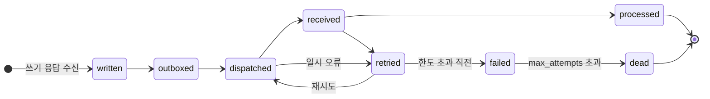
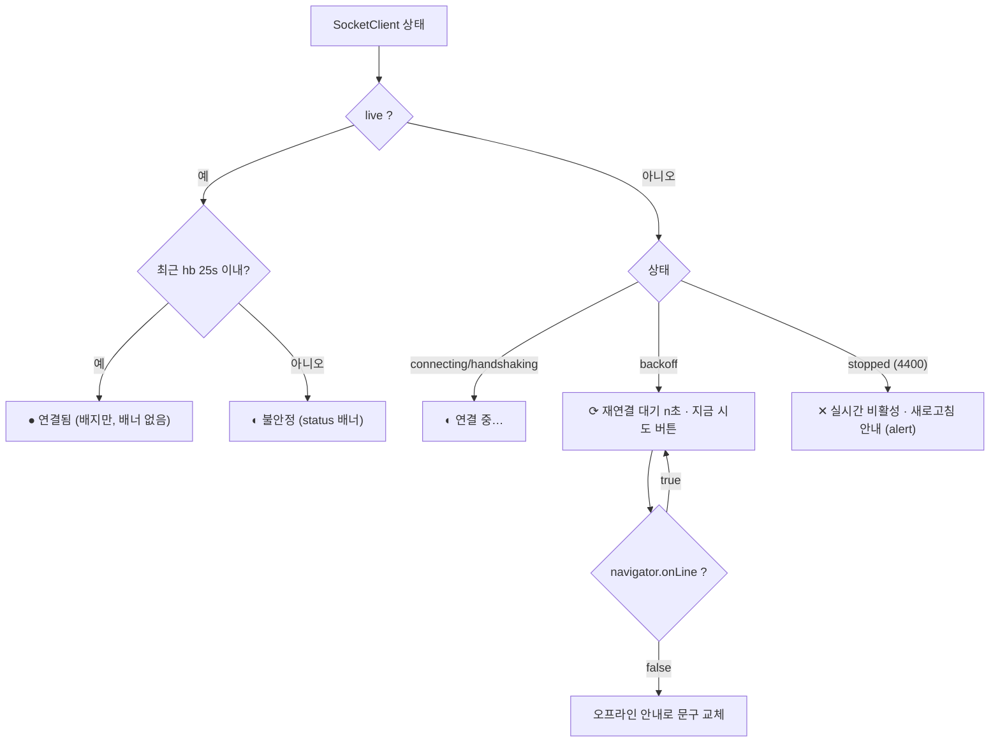
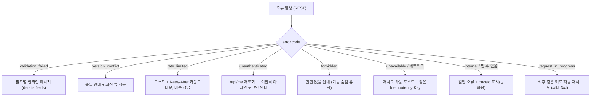
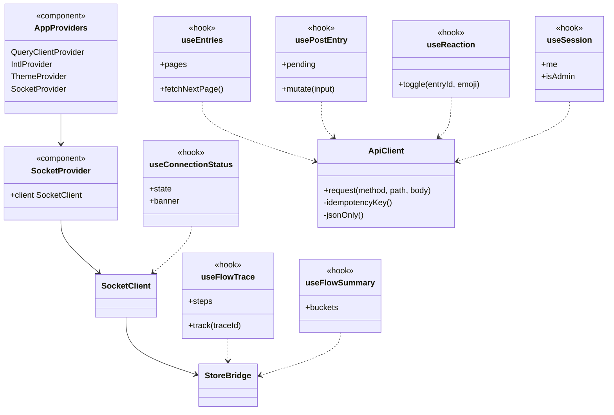
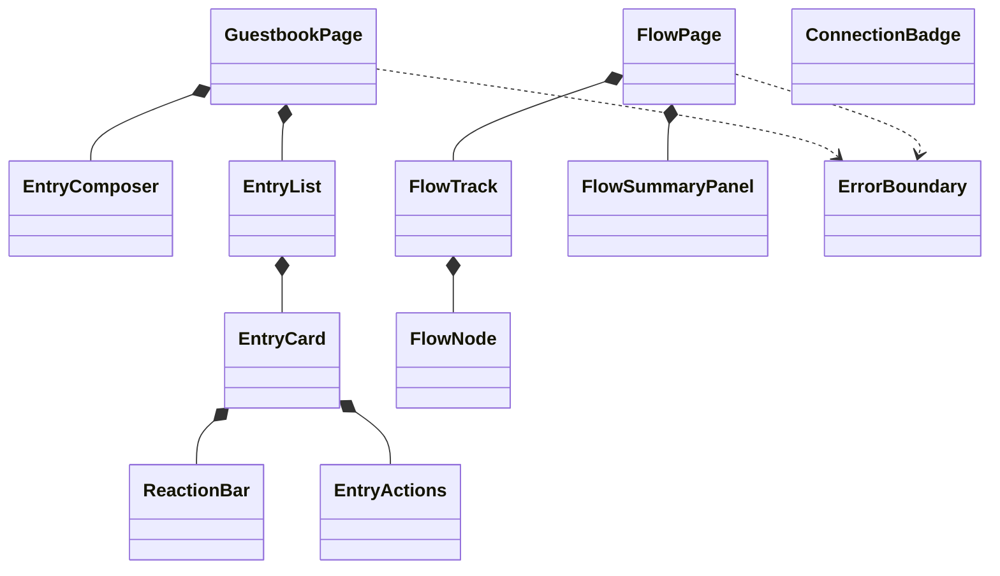
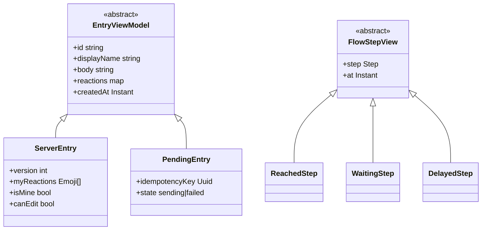
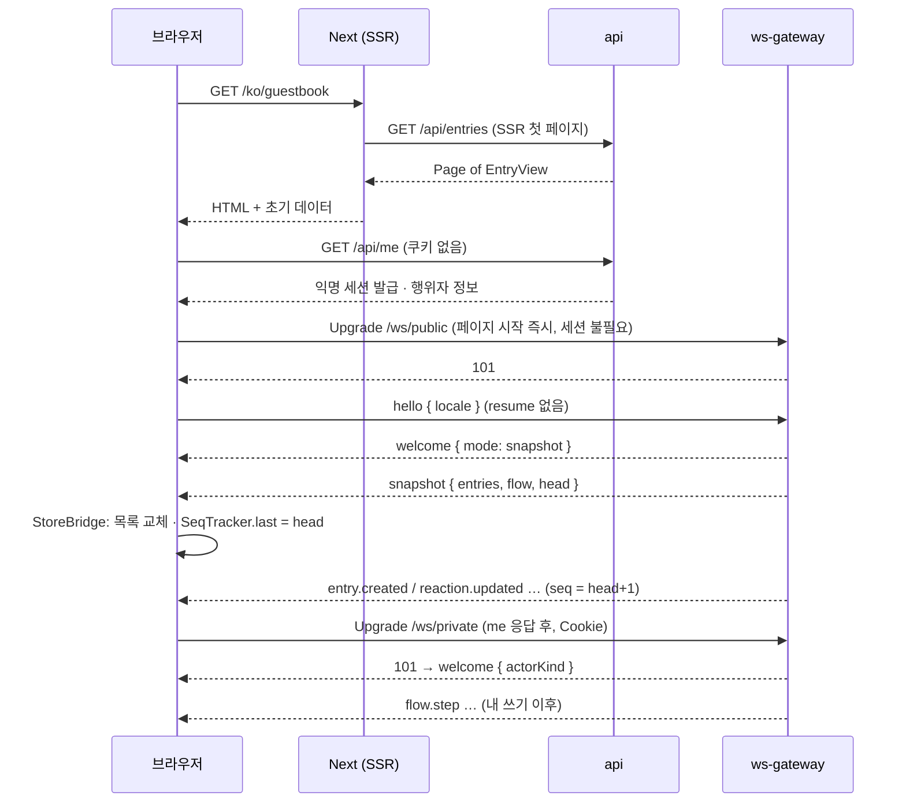
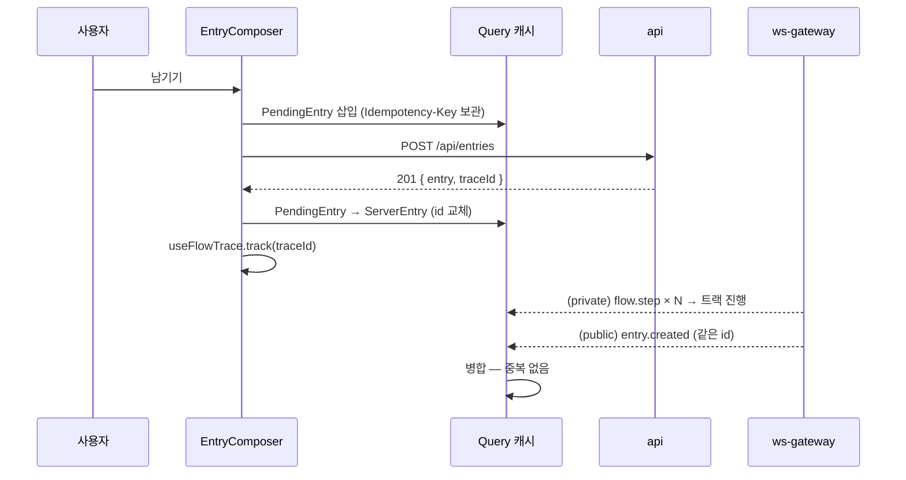
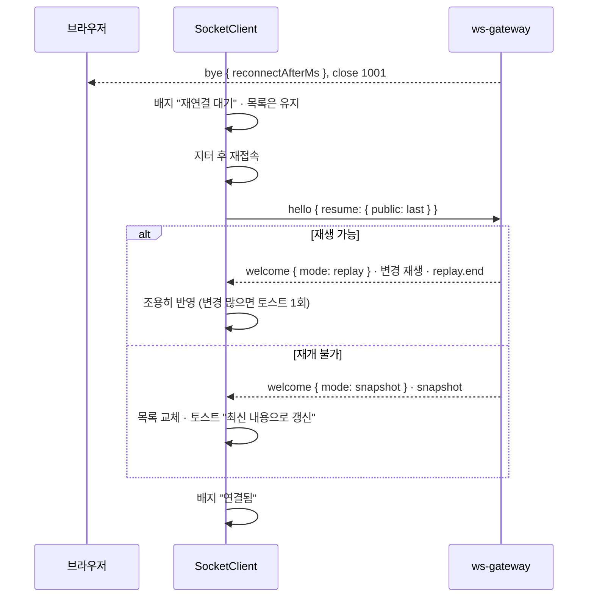

# 07. 프론트엔드 설계

`apps/web`(Next.js 16 App Router, React 19, Bun 실행 — 관문 G3)의 설계. 계약은 [03 API](03-api-contract.md)·[04 WS](04-ws-protocol.md)·[05 이벤트](05-event-catalog.md)·[06 인증](06-auth.md)을 **그대로** 따른다.
근거: ADR-003(실시간·폴백), ADR-004/022(스택), ADR-008(공개 시각화의 프라이버시), 명세 FR-001~004·040·041·050·051·061·070, AC-009.

## 1. 화면과 라우팅

모든 경로는 로케일 접두 `/ko`, `/en` 을 갖는다(`next-intl`, `localePrefix: 'always'`). 접두 없는 `/` 는 `Accept-Language` → 쿠키 `NEXT_LOCALE` 순으로 판정해 리다이렉트한다.

| 경로 | 화면 | 렌더링 | 데이터 | 정적 폴백(FR-070) |
|---|---|---|---|---|
| `/[locale]` | 홈 (소개 요약, 데모 진입점) | 정적(ISR 1h) | 없음 | **포함** |
| `/[locale]/about` | 자기소개(경력·연락처) | 정적 | MDX([12](12-content.md)) | **포함** |
| `/[locale]/architecture` | 이 사이트의 아키텍처 설명 | 정적 | MDX + 다이어그램 | **포함** |
| `/[locale]/guestbook` | 방명록 + 반응 | 동적(SSR 첫 페이지 + 클라이언트 실시간) | `GET /api/entries` | 제외("점검 중") |
| `/[locale]/flow` | 이벤트 흐름 시각화 데모 | 클라이언트 렌더 | WS `flow.step`·`flow.summary` | 제외 |
| `/[locale]/metrics` | 운영 지표(Grafana 공개 대시보드 임베드) | 정적 셸 + iframe | Grafana(G6) | 제외 |
| `/[locale]/admin` | 신고 큐·숨김 | 동적, 관리자만 | `GET /api/admin/reports` | 제외 |
| `/[locale]/privacy` | 개인정보·쿠키 안내 | 정적 | MDX | **포함** |
| `/[locale]/login` | 로그인 진입(→ `/api/auth/github`) | 정적 | 없음 | 제외 |
| `not-found` / `error` | 404 / 오류 경계 | 정적 | 없음 | 포함 |

- 레이아웃 공통: 상단 내비(홈·자기소개·방명록·흐름·아키텍처·지표), 언어 전환, 테마 전환, 로그인 상태, **연결 상태 배지**(§7.3).
- `admin` 은 `isAdmin` 이 아니면 `403` 화면(클라이언트 숨김이 아니라 **서버가 판정** — 06 §5). 메뉴에도 노출하지 않는다.

## 2. 와이어프레임

### 2.1 홈

```
┌──────────────────────────────────────────────────────────────┐
│ [로고] 홈 자기소개 방명록 흐름 아키텍처 지표   [KO|EN] [☀/☾] [로그인] ● 연결됨 │
├──────────────────────────────────────────────────────────────┤
│  이 사이트가 곧 백엔드 작품입니다                                  │
│  (한 줄 소개)                         [방명록에 글 남기기] [흐름 보기] │
├──────────────────────────────────────────────────────────────┤
│ ┌──────────┐ ┌──────────┐ ┌──────────┐ ┌──────────┐             │
│ │ 이벤트 흐름 │ │ 실시간     │ │ 운영 지표  │ │ 아키텍처   │             │
│ │ outbox/inbox│ │ WebSocket │ │ Grafana  │ │ ADR 22+  │             │
│ └──────────┘ └──────────┘ └──────────┘ └──────────┘             │
│ GitHub 저장소 링크 · CI 상태 배지                                  │
└──────────────────────────────────────────────────────────────┘
```

### 2.2 방명록

```
┌──────────────────────────────────────────────────────────────┐
│ 방명록                                          ● 연결됨 · 접속 12 │
│ ┌ 글 작성 ──────────────────────────────────────────────────┐ │
│ │ 이름 [손님-a3f9      ]  (2~20자)                              │ │
│ │ [                                                  ] 0/500    │ │
│ │ ※ 익명 글은 수정·삭제할 수 없습니다.  [GitHub로 로그인]  [남기기] │ │
│ └───────────────────────────────────────────────────────────┘ │
│ ┌ 글 카드 ──────────────────────────────────────────────────┐ │
│ │ 홍길동 · 3분 전                          [수정][삭제]  ← 본인(로그인)만 │
│ │ 본문 텍스트 (HTML 해석 없음)                                    │ │
│ │ [👍 3] [❤️ 1] [🎉] [😂] [🤔] [👀]            [신고]            │ │
│ └───────────────────────────────────────────────────────────┘ │
│ ... (무한 스크롤: nextCursor)                                      │
└──────────────────────────────────────────────────────────────┘
```

### 2.3 흐름 시각화 (핵심 볼거리)

```
┌──────────────────────────────────────────────────────────────┐
│ 내 동작                                                         │
│  [글 쓰기 테스트 ▾]  [보내기]                                     │
│                                                                │
│  written ──▶ outboxed ──▶ dispatched ──▶ received ──▶ processed │
│    ●───────────●────────────◐ (진행 중)      ○            ○        │
│  09:00:00.12   .15          .31                                │
│  ※ 실패 시: retried ↻ → failed ✕ → dead ▣                        │
├──────────────────────────────────────────────────────────────┤
│ 전체 방문자 (익명 요약 · 최근 5분)                                  │
│  written ▇▇▇▇▇ 24   dispatched ▇▇▇▇▇ 24   processed ▇▇▇▇ 23      │
│  retried ▇ 2        dead ▏ 0                                    │
│  ※ 개수만 표시됩니다. 다른 방문자의 내용·식별자는 보이지 않습니다.     │
└──────────────────────────────────────────────────────────────┘
```

### 2.4 운영 지표 · 관리자

```
┌ 운영 지표 ───────────────────────────────────────────────────┐
│ [Grafana 공개 대시보드 iframe — 읽기 전용]  (G6 실패 시: 익명 Viewer)   │
│ 하단: "지표 레이블에 식별자를 쓰지 않습니다" 설명 링크                   │
└────────────────────────────────────────────────────────────┘
┌ 관리자 ─────────────────────────────────────────────────────┐
│ 신고 큐 [열림 ▾]   글 발췌(80자)   사유   [숨김][기각]                 │
│ 쓰기 잠금 스위치 [OFF]                                            │
└────────────────────────────────────────────────────────────┘
```

## 3. 이벤트 흐름 시각화 설계

### 3.1 입력과 상태 모델

| 시각화 | 입력 | 단위 | 규칙 |
|---|---|---|---|
| **내 흐름 상세** | WS `private` `flow.step` (`traceId`, `step`, `at`, `detail?`) + 놓친 것은 REST `GET /api/flow/trace/{traceId}` | 한 `traceId` = 한 줄(트랙) | 내가 방금 보낸 쓰기 응답의 `traceId` 로 트랙을 만든다 |
| **전체 익명 요약** | WS `public` `flow.summary` (`buckets`) + 첫 화면은 `snapshot.flow` / `GET /api/flow/summary` | 단계별 개수 | **개수만** 그린다. 서버가 이미 가공했으므로 클라이언트에 식별자가 없다(AC-009) |

단계(`step`)는 05 §2.2 의 값 그대로다: `written → outboxed → dispatched → received → processed`, 예외 `retried`/`failed`/`dead`.



- 트랙의 노드는 **도착한 단계까지 채워지고**, 다음 단계는 "대기" 상태로 표시한다. 순서가 뒤바뀌어 도착해도(`at` 기준) 노드 위치는 단계 순서로 고정한다.
- 5초 안에 다음 단계가 없으면 노드에 "지연" 보조 표시(색이 아닌 아이콘+텍스트)를 붙이고 REST 로 한 번 보충 조회한다.
- 트랙은 `processed`/`dead` 도착 후 30초 뒤 접히고, 최근 5개만 목록에 남긴다. 새로고침하면 사라진다(저장하지 않음 — 서버 로그 보관 7일과 무관).

### 3.2 색·모양 규칙 (색만으로 전달하지 않는다)

| 단계 상태 | 색 토큰 | 모양 | 텍스트 대체 |
|---|---|---|---|
| 대기 | `--flow-pending` (회색) | ○ 빈 원 | "대기" |
| 진행 중 | `--flow-active` (파랑) | ◐ 반원 + 펄스(reduced-motion 시 정지) | "진행 중" |
| 완료 | `--flow-done` (초록) | ● 채운 원 + 체크 | "완료" |
| 재시도 | `--flow-warn` (주황) | ↻ | "재시도 n회" |
| 실패 | `--flow-error` (빨강) | ✕ | "실패" |
| 격리(dead) | `--flow-dead` (진회색) | ▣ | "격리됨" |

- 모든 노드에 `aria-label="{단계명}: {상태}, {시각}"`. 트랙 전체에는 요약 문장(예: "글 작성 흐름: 5단계 중 3단계 완료")을 `role="img"` 대체 텍스트로 붙인다.
- 애니메이션은 노드 사이 선이 채워지는 전이(150~300ms). `prefers-reduced-motion: reduce` 이면 즉시 전환.
- 단계 이름은 i18n 사전의 `flow.step.*` 키로 표시하고 원 값(`written` 등)은 툴팁/상세에 병기한다(백엔드 학습용).

### 3.3 전체 요약 표시

- 막대 길이는 상대 비율, **정확한 숫자를 항상 텍스트로 병기**한다. 표 보기 토글(접근성·복사용)을 제공한다.
- 창은 5분(`window=5m`) 기본, 1시간 전환. 갱신은 `flow.summary` 수신 시 덮어쓰기.
- "다른 방문자 내용은 보이지 않습니다" 안내 문구를 고정 표시한다(프라이버시 약속).

## 4. 디자인 시스템

### 4.1 토큰 (Tailwind 4, CSS 변수)

`apps/web/src/styles/tokens.css` 에 `@theme` 로 선언한다(경로는 [01](01-repository-structure.md) 확정 시 맞춘다 — 미확인).

| 분류 | 토큰 |
|---|---|
| 색(의미) | `--color-bg`, `--color-surface`, `--color-text`, `--color-muted`, `--color-border`, `--color-primary`, `--color-danger`, `--color-focus` |
| 흐름 | `--flow-pending/active/done/warn/error/dead` (§3.2) |
| 간격 | 4px 기준 스케일(Tailwind 기본) |
| 반경 | `--radius-sm 4px`, `--radius-md 8px`, `--radius-lg 12px` |
| 그림자 | `--shadow-sm`, `--shadow-md` (다크 모드에서는 보더 강조로 대체) |
| 모션 | `--dur-fast 150ms`, `--dur-base 250ms`, 이징 `ease-out` |

- 모든 텍스트/배경 조합은 **대비 4.5:1 이상**(큰 글자 3:1), 포커스 링 3:1 이상. 토큰 쌍을 CI 에서 계산 검사한다(구현 시 도구 선정).
- **다크/라이트**: `prefers-color-scheme` 기본, 수동 전환 시 쿠키 `theme` 저장(SSR 깜빡임 방지를 위해 `<html data-theme>` 를 서버가 쓴다).

### 4.2 타이포·반응형

| 항목 | 규칙 |
|---|---|
| 글꼴 | 시스템 폰트 스택 우선(외부 폰트 요청 0건, 무료·개인정보 원칙). 한글/영문 모두 `system-ui` 계열, 코드 `ui-monospace` |
| 크기 | 본문 16px, 행간 1.6(한글), 제목 스케일 1.25 비율 |
| 브레이크포인트 | `sm 640` · `md 768` · `lg 1024` · `xl 1280` (Tailwind 기본). 모바일 우선, 흐름 시각화는 `< md` 에서 **세로 트랙**으로 전환 |
| 터치 | 인터랙티브 요소 최소 44×44px(WCAG 2.2 대상 크기 24px 이상은 최소 기준) |

### 4.3 shadcn/ui 사용 컴포넌트 (M1)

`Button`, `Input`, `Textarea`, `Label`, `Form`(react-hook-form 연동), `Card`, `Badge`, `Tooltip`, `Dialog`(신고·삭제 확인), `DropdownMenu`(언어·테마·사용자), `Toast`(Sonner), `Skeleton`, `Tabs`(요약 창 전환), `Switch`(쓰기 잠금), `Table`(관리자·표 보기), `Alert`(연결 배너·오류). 그 외는 필요할 때 추가하고 이 목록을 갱신한다.

## 5. i18n

| 항목 | 규칙 |
|---|---|
| 라이브러리 | `next-intl` 4. 메시지 파일 `apps/web/src/messages/{ko,en}.json`(01 에서 확정, [01](01-repository-structure.md) 확정 시 맞춤) |
| 네임스페이스 | 화면/기능 단위 최상위 키: `common`, `nav`, `home`, `about`, `guestbook`, `flow`, `metrics`, `admin`, `auth`, `errors`, `privacy` |
| 키 이름 | `네임스페이스.영역.요소` 소문자 점 표기, 단어는 `camelCase`: `guestbook.form.submit`, `errors.version_conflict` |
| 오류 문구 | 03 의 `error.code` 를 그대로 키로 쓴다: `errors.<code>`. 서버 `message` 는 보조이고 **클라이언트 사전이 우선** |
| 단계 이름 | `flow.step.written` 등 05 §2.2 값과 1:1 |
| 복수형·날짜 | ICU MessageFormat, 상대 시간은 `Intl.RelativeTimeFormat` |
| 누락 검사 | CI: ko/en 키 집합 동일, 미사용 키/미정의 키 0, ICU 구문 파싱 통과. 누락 시 빌드 실패 |
| 기본/대체 | 개발 중 누락은 키 문자열을 그대로 노출(조용한 영어 대체 금지) |
| 서버 메시지 언어 | 요청 `Accept-Language` 에 `ko`/`en` 을 보낸다(03 §2) |

## 6. 접근성 (WCAG 2.2 AA 목표)

| 영역 | 기준 |
|---|---|
| 키보드 | 모든 기능이 키보드로 가능. 논리적 탭 순서, 스킵 링크("본문으로 건너뛰기"), 모달 포커스 트랩/복귀 |
| 포커스 | 가시 포커스 링(대비 3:1 이상), 포커스 가려짐 금지(고정 헤더 아래 스크롤 여백) |
| 실시간 갱신 | 새 글/반응은 `aria-live="polite"` 영역에 **요약만** 알린다("새 글 1개"). 글 목록 자체를 live 로 두지 않는다. 오류·연결 끊김은 `role="status"`(심각한 것만 `alert`) |
| 폼 | 라벨 연결, 오류는 필드와 `aria-describedby` 로 연결, 글자 수는 `aria-live="off"` + 한도 근접 시 한 번 알림 |
| 색 | 의미를 색만으로 전달하지 않는다(§3.2 모양+텍스트) |
| 모션 | `prefers-reduced-motion` 존중, 자동 재생 애니메이션 5초 초과 시 정지 수단 |
| 언어 | `<html lang>` 로케일 반영, 언어 전환 링크에 `lang`/`hreflang` |
| 시험 | 자동(axe in Playwright, [08](08-test-strategy.md)) + 수동 키보드 점검 체크리스트. 스크린리더 점검은 구현 후반 1회 |

## 7. 상태 관리

### 7.1 TanStack Query 키

| 키 | 데이터 | 갱신 |
|---|---|---|
| `['me']` | `GET /api/me` (`{kind, userId?, displayName, isAdmin, locale?}`) | 앱 시작 1회, 로그인/로그아웃 후 무효화 |
| `['entries']` | `GET /api/entries` 무한 쿼리(`pages[]`, `nextCursor`) | WS 병합(§7.2), 스냅샷 시 교체 |
| `['flow','summary', window]` | `flow.summary` | WS 덮어쓰기 |
| `['flow','trace', traceId]` | 내 트랙 단계들 | WS `flow.step`, 누락 시 REST 보충 |
| `['admin','reports', status]` | 신고 큐 | 조치 후 무효화 |
| `['presence']` | 접속자 수 | WS |

- 쿼리 기본값: `staleTime` 30s(`['me']` 5분), `retry` 는 `TransientError`(503)만 지수 백오프 2회. 4xx 는 재시도하지 않는다.
- 서버 상태만 Query 에 둔다. UI 상태(입력 중 글, 모달)는 컴포넌트 상태.

### 7.2 StoreBridge 병합 규칙 (04 §5 구현)

| WS 메시지 | 동작 |
|---|---|
| `snapshot` | `['entries']` 첫 페이지를 **통째로 교체**하고 `SeqTracker.last = head`. 이어서 오는 `seq` 만 적용 |
| `entry.created` | `id` 가 이미 있으면 **병합(교체)**: 서버 필드로 덮되 `myReactions`/`isMine`/`canEdit` 은 기존 값 유지. 없으면 목록 맨 앞에 삽입 |
| `entry.updated` | 같은 `id` 의 본문·`updatedAt`·`version` 갱신. 사용자가 그 글을 편집 중이면 충돌 안내(§7.4) |
| `entry.removed` | 목록에서 제거(애니메이션 후). 내가 편집 중이면 안내 후 편집 종료 |
| `reaction.updated` | `reactions[emoji] = count` **덮어쓰기**(중복·역전에 안전). `myReactions` 는 건드리지 않는다 |
| `flow.summary` | 키 `['flow','summary', window]` 덮어쓰기 |
| `flow.step` | 해당 `traceId` 트랙에 단계 추가(없는 트랙이면 만들지 않고 무시 — 내 쓰기에서만 시작) |
| `presence` | `['presence']` 갱신 |
| `seq` 건너뜀 | 적용하지 않고 `SocketClient` 에 재연결 요청(`resume` 으로 복구) |

개인 필드는 서버가 보내지 않으므로(04 §3.2) 클라이언트가 **자기 쓰기 응답**에서 채운다: 반응 `PUT` 응답의 `mine`, 글 `POST` 응답의 `isMine`/`canEdit`.

### 7.3 연결 상태 배너 판정



- 재접속 중에도 **읽기와 쓰기(REST)는 계속 동작**한다. 목록은 마지막 상태를 유지하고 "실시간 갱신이 멈췄습니다" 표시만 한다.
- `live` 복귀 시 `mode: replay|snapshot` 에 따라 조용히 따라잡고, 놓친 변경이 많았으면 토스트 1회("최신 내용으로 갱신했습니다").

### 7.4 낙관적 갱신·롤백·409

| 동작 | 낙관적 처리 | 실패 시 |
|---|---|---|
| 글 작성 | 서버 응답 전까지 **임시 카드(회색, "전송 중")** 를 맨 앞에 두고 `Idempotency-Key` 를 보관 | 네트워크 오류/5xx → 같은 키로 재시도 버튼. 400 → 필드 오류 표시 후 임시 카드 제거. 429 → `Retry-After` 안내 |
| 반응 토글 | 즉시 `+1/-1` 및 `myReactions` 반영 | 실패 시 이전 값으로 롤백 + 토스트. 서버가 돌려준 `count` 로 최종 보정 |
| 수정 | 낙관 반영 안 함(버전 충돌 가능성) — 응답을 받아 교체 | **409 `version_conflict`**: `details.current` 로 카드를 최신으로 갱신하고 편집창에 "다른 변경이 먼저 반영되었습니다. 내 수정 내용 유지/최신으로 교체" 선택 제공 |
| 삭제 | 확인 다이얼로그 후 응답 대기, 성공 시 제거 | 409 → 최신 뷰로 갱신 후 재확인 |
| 신고 | 버튼 비활성 후 `202` 확인 | 실패 시 재활성 |

**낙관 임시 카드 → 실제 카드 병합**: 응답의 `entry.id` 로 교체하고, 뒤이어 오는 `entry.created`(같은 `id`)는 §7.2 규칙으로 병합하므로 **중복되지 않는다**(ADR-018).

### 7.5 오류 표시 판정



모든 오류 문구는 `errors.<code>`(ko/en) 사전으로 표시하고, `internal` 만 `traceId` 를 노출한다.

## 8. 렌더링 경계와 정적 폴백 (FR-070)

| 구분 | 방식 | 이유 |
|---|---|---|
| 정적(홈·자기소개·아키텍처·개인정보) | `generateStaticParams` 로 ko/en 사전 생성, ISR 1h | 앱 컨테이너가 죽어도 nginx 가 **같은 빌드 산출물**을 정적으로 서빙(ADR-023 1단계), Cloudflare 정적 미러(2단계, G11) |
| 방명록 첫 페이지 | 서버 컴포넌트가 `GET /api/entries` 를 SSR 로 읽어 초기 데이터 주입(`HydrationBoundary`) | LCP·SEO. 실패 시 빈 목록+재시도(SSR 오류가 페이지 전체를 막지 않게 격리) |
| 흐름·지표·관리자 | 클라이언트 전용 | 실시간·인증 의존 |
| 폴백 시 | 정적 페이지 + 데모 영역 대신 "점검 중" 카드 | FR-070 |

- 정적 페이지는 **API 호출 없이** 빌드되어야 한다(빌드 시 백엔드 부재 가정). 로그인 상태 표시 등 동적 요소는 클라이언트에서 `/api/me` 로 지연 채움(실패 무시).
- 정적 내보내기 대상 페이지 목록은 `apps/web` 설정에 한 곳(`staticPages`)으로 둔다(ADR-023 §7).

## 9. 성능 예산

| 지표 | 목표 | 수단 |
|---|---|---|
| LCP | **≤ 2.5s**(AC, 모바일 4G 프로파일) | 정적 페이지 우선, 시스템 폰트, 이미지 최적화(G3 에서 Bun 실행 확인), 방명록 SSR 첫 페이지 |
| INP | ≤ 200ms | 목록 가상화는 불필요(페이지당 20건), 이벤트 핸들러 경량 |
| CLS | ≤ 0.1 | 이미지/iframe 크기 고정, 임시 카드 높이 예약 |
| JS 초기 번들 | 라우트별 ≤ 170KB(gzip) 목표 | WS·시각화 코드 동적 import(`/flow`, `/guestbook` 에서만) |
| WS 연결 | 방명록/흐름 화면에서만 연결 | 정적 페이지는 연결 안 함 |

측정: Lighthouse CI(PR) + k6 브라우저가 아닌 API 측 지표는 [08](08-test-strategy.md). 예산 초과는 CI 경고(초기), 안정화 후 실패로 전환.

## 10. 클래스·훅 구조

React 이므로 **합성(훅+컴포넌트)** 이 중심이고, 상속은 타입 계층(화면 모델·메시지)에만 쓴다.

### 10.1 컴포넌트·훅 구성



- `ApiClient` 는 `Idempotency-Key` 생성·재전송 보관, JSON 전용 요청(`Content-Type: application/json`) 보장, 오류 본문→`AppError` 변환(03 §2)을 **한 곳**에서 한다.
- 화면 컴포넌트는 `ApiClient` 를 직접 쓰지 않고 훅만 쓴다(테스트 대체 용이).

### 10.2 화면 컴포넌트 계층(합성)



### 10.3 화면 모델 타입 상속



- `PendingEntry`(낙관 임시)와 `ServerEntry`(서버 확정)를 같은 목록이 다루되 **타입으로 구분**해 편집·반응 같은 동작이 임시 카드에 노출되지 않게 한다.

## 11. 시퀀스

### 11.1 첫 진입 → 세션 → 스냅샷 → 실시간



### 11.2 글 작성 (낙관 + 병합)



### 11.3 재접속 UI



## 12. 반응 이모지 (확정)

고정 6종, 목록 정본은 `packages/protocol` 상수이고 03 §4.1 과 같다.

| 이모지 | 이름(ko) | 이름(en) | `aria-label` 키 |
|---|---|---|---|
| 👍 | 좋아요 | Like | `guestbook.reaction.like` |
| ❤️ | 하트 | Love | `guestbook.reaction.love` |
| 🎉 | 축하 | Celebrate | `guestbook.reaction.celebrate` |
| 😂 | 웃겨요 | Funny | `guestbook.reaction.funny` |
| 🤔 | 고민돼요 | Thinking | `guestbook.reaction.thinking` |
| 👀 | 지켜봐요 | Watching | `guestbook.reaction.watching` |

버튼은 토글(`aria-pressed`), 개수는 텍스트로 병기한다.

## 13. 미결

| 항목 | 결정 시점 |
|---|---|
| 토큰·메시지 파일의 `apps/web` 하위 실제 경로 | [01](01-repository-structure.md) 확정 후 맞춤 |
| 색 토큰의 실제 값과 대비 검사 도구 | 구현 초기 |
| Grafana 임베드 가능 여부(G6)에 따른 지표 화면 형태 | G6 결과 |
| 숨김 탭에서 연결을 닫는 시간, 가상 스크롤 필요 여부 | 구현·측정 후 |
| 스크린리더 실점검 범위 | 구현 후반 |
