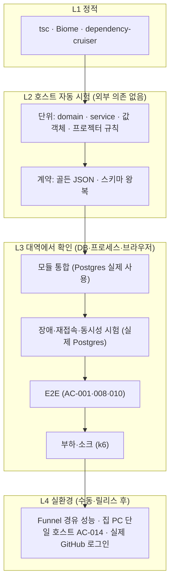
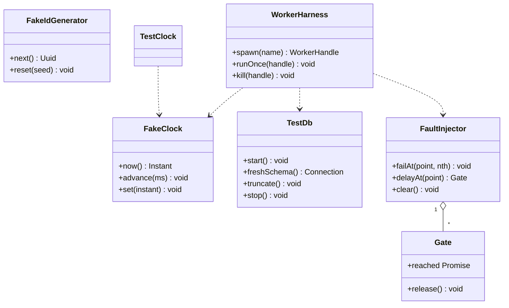
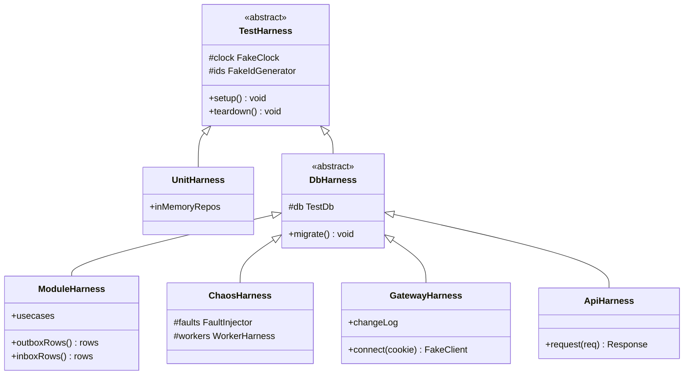
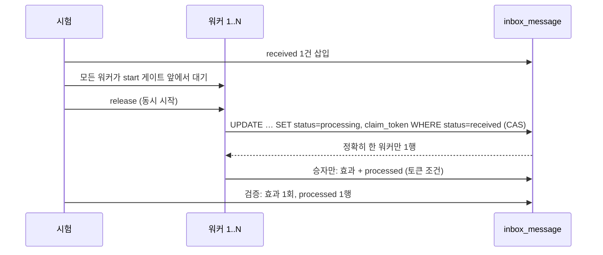
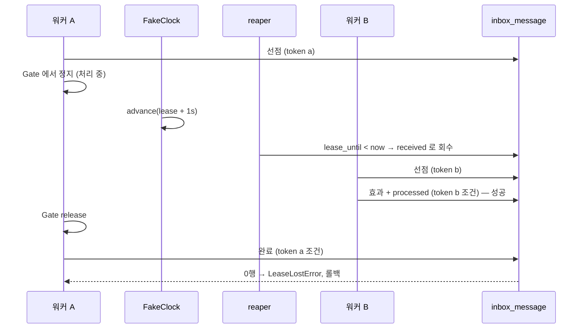
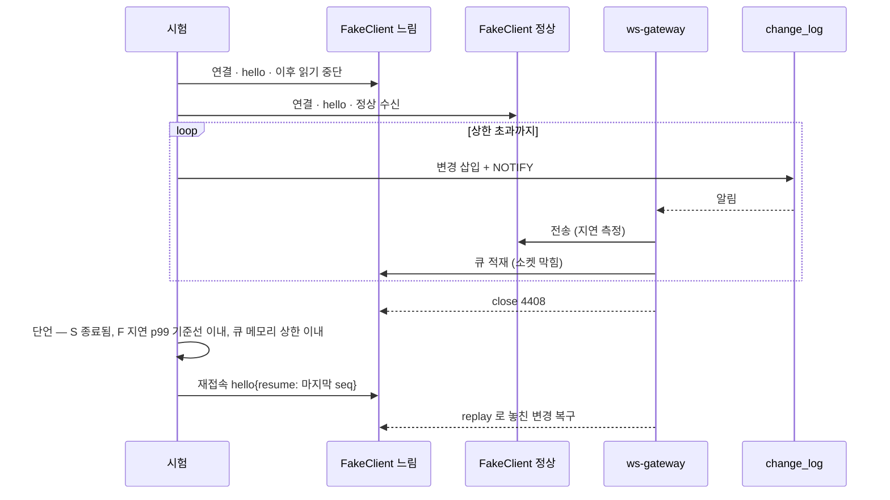
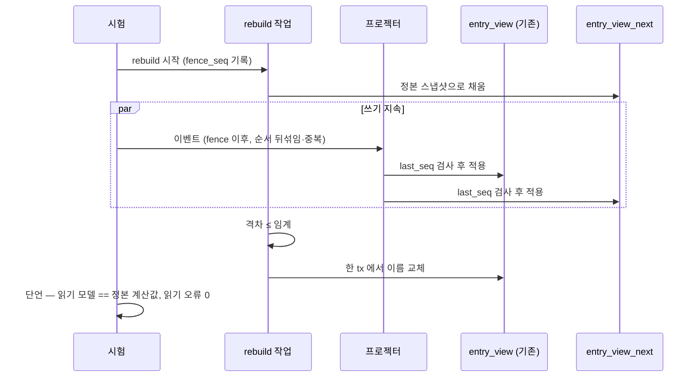
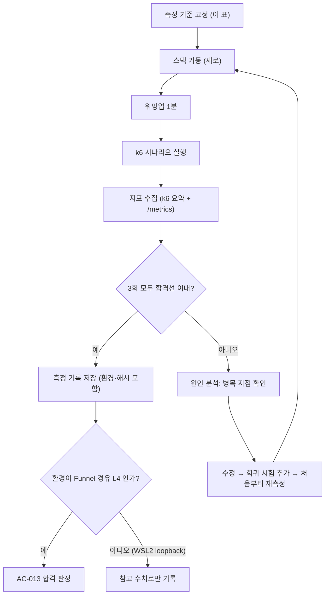

# 08. 테스트 전략

"어떻게 검증하는가"의 정본. 공통 기반·포트는 [00](00-system-overview.md), 계약은 [03](03-api-contract.md)·[04](04-ws-protocol.md)·[05](05-event-catalog.md), 인증은 [06](06-auth.md), CI 배치는 [09](09-ci-cd.md).
근거: ADR-005(outbox)·014(재접속·무중단)·020(inbox)·021(동시성)·022(스택·관문)·023(운영 정책), 명세 AC-001~038, 검증 등급 체계(L0~L4, `.claude/rules/pipeline-verification.md`).

## 1. 원칙

| 원칙 | 내용 |
|---|---|
| 등급을 거짓으로 올리지 않는다 | 외부 의존(DB·네트워크·실시간 시계·서브프로세스)을 타는 시험은 **L2 가 아니라 L3** 다. 그렇게 표기한다 |
| 회귀 가드는 "고치기 전에 실패한다" | 결함 수정의 시험은 **수정 전 코드에서 실패하는 것을 한 번 확인**하고 남긴다(통과만으로는 가드가 아니다). 확인 기록은 PR 설명에 한 줄 |
| 동시성은 결정적으로 | `sleep` 으로 경합을 기대하지 않는다. **대기 지점(barrier)을 주입**해 순서를 강제하고, 시계는 가짜 시계로 건너뛴다 |
| 숫자 없는 비기능 요구는 검증하지 않는다 | 성능은 수치·도구·환경·반복 횟수를 먼저 고정한다(§9) |
| 못 돌린 것과 안 한 것을 구분 | 불가(예: WSL2 에서 TLS 종단 성능)는 사유와 함께 "L4 미수행"으로 기록한다 |
| 시험이 설계를 강제한다 | `Clock`·`IdGenerator`·`UnitOfWork` 포트로만 시간·식별자·트랜잭션에 접근하므로 domain/service 는 DB 없이 시험된다(00 §4.2) |

## 2. 계층과 등급



| 계층 | 대상 | 등급 | 실행 | 위치 |
|---|---|---|---|---|
| 정적 | 타입·린트·경계(계층·CQRS 규칙) | **L1** | 매 PR | 저장소 전체 |
| 단위 | `domain`, `service`, 값 객체, 오류 매핑, `Upcaster`, `ProjectorBase.isStale`, 재시도 백오프 계산, `ReconnectPolicy`, `SeqTracker` | **L2** | 매 PR | `modules/<m>/**/*.test.ts` |
| 계약 | `packages/protocol` 의 REST/WS/이벤트 스키마: 골든 JSON 인코딩·디코딩·업캐스트, 서버·클라이언트가 같은 스키마를 쓰는지 | **L2** | 매 PR | `packages/protocol/test/` |
| 모듈 통합 | usecase + 실제 Postgres 어댑터, 트랜잭션·outbox·inbox·읽기 모델·마이그레이션 | **L3** | 매 PR | `modules/<m>/test/integration/` |
| 동시성·장애 | 선점 경쟁, fencing, 재구성, 디스패처 락 이동, dead | **L3** | 매 PR(빠른 것) / 야간(느린 것) | `test/chaos/` |
| 재접속 | ws-gateway + 실제 Postgres + 가짜 클라이언트 | **L3** | main 병합 후·야간(PR 게이트 아님, 09 §2) | `apps/ws-gateway/test/` |
| E2E | 브라우저(작성→시각화, 실시간 복구, 정적 폴백) | **L3** | main 병합 후 | `test/e2e/` (도구 미결, §11) |
| 부하·소크 | k6 (API p95, WS 다수 연결, 느린 소비자) | **L3** | 수동·야간 | `test/load/` |
| 실환경 | Funnel 경유 성능, 집 PC 단일 호스트(Oracle 미추진), 실제 GitHub OAuth | **L4** | 릴리스 전 수동 | 체크리스트 |

### 2.1 무엇이 L2 를 넘는가

| 항목 | 이유 | 등급 |
|---|---|---|
| Postgres 가 필요한 모든 시험 | 외부 프로세스·네트워크 | L3 |
| `LISTEN/NOTIFY`, 어드바이저리 락, `SKIP LOCKED` | DB 기능 자체가 대상 | L3 |
| WebSocket 서버를 실제로 띄우는 시험 | 소켓·타이머 | L3 |
| `Date.now()`·`setTimeout` 을 직접 쓰는 시험 | 실시간 시계 | L3 (가짜 시계로 바꾸면 L2) |
| 임대 만료·백오프 **계산 로직** | 가짜 시계로 순수 | **L2** |
| 읽기 모델 프로젝터 **규칙**(`last_seq` 비교, `count` 덮어쓰기) | 인메모리 저장소 대역으로 순수 | **L2** (SQL 반영은 L3) |
| 브라우저 구동, k6 | 서브프로세스·네트워크 | L3 |
| Funnel 경유 측정 | 실환경 | L4 |

### 2.0e 보안사고 대응 (ADR-028, design/13)

| 시험 | 기대값 | 등급 |
|---|---|---|
| `revoke-sessions --all` 후 기존 쿠키로 요청 | 가드가 세션 없음으로 판정, `GET /api/me` 가 **새 익명 세션** 발급(인증 안 됨) | L3 |
| 폐기 후 기존 `/ws/private` 연결 | 세션 캐시 만료(≤30초) 후 `4401` 로 종료, 새 연결은 새 세션으로만 | L3 |
| `revoke-sessions --user U` | U 의 세션만 만료, 다른 사용자 세션 유지 | L3 |
| `--dry-run` / 이미 만료된 세션 재실행 | 변경 없음 / 건수 0, 멱등 | L3 |
| 폐기 트랜잭션 롤백 | 감사 행 `admin.sessions_revoked` 도 없음 | L3 |
| `retention:pause` 중 정리 | 모든 `RetentionRule`·`PurgeExpiredSessions`·`archive-logs.sh` 삭제가 건너뛰어짐, `pf_retention_skipped_total{reason="paused"}` 증가 | L3 |
| 정지 TTL(24시간) 경과(가짜 시계) | 자동 해제, 감사 `auto_released`, 정지 중 `retention:run` 은 거부 | L2·L3 |
| `secret-scan` | 시험용 비밀 패턴 파일을 검출하고 PR 이 실패(도구 미확인, S1-15) | L3 |
| 회전 리허설 체크리스트(13 §10) | 9개 비밀·스위치 각각 구 비밀 거부 + 새 비밀 동작, 소요 시간 기록 | L4(리허설, 분기 1회) |

### 2.0d 운영 실측 회귀 시험 (ADR-027, 로컬 실측 반영)

| 시험 | 기대값 | 등급 |
|---|---|---|
| 카운터 선초기화 | 앱 기동 직후 `pf_auth_login_failed_total` 4개 reason 모두 0 으로 노출. 선초기화를 끄면(음성 시험) 실제 10건에도 `increase` 가 10 미만 — 회귀 방지 | L2·L3 |
| `promtool test rules` 이스케이프 회귀 | 정본 `pf.yml` 에 `\|` 가 없고(린트), `job=~"backup|archive_logs"` 가 두 job 에 모두 매치, 리터럴 `\|` 면 불발인 음성 시험 | L1·L2 |
| 시크릿 누락 시 프로비저닝 | `DISCORD_WEBHOOK_URL_FILE` 이 없거나 비면 배포 전 점검이 실패(Grafana 는 연락처 0개로 기동) | L3 |
| 아카이브 `+1 day` 계산 | KST 등 오프셋 있는 시간대에서 어제 00:00~오늘 00:00 범위가 24시간 | L3 |
| 아카이브 줄 순서 | `--timestamps` 정렬 후 같은 스트림 내 순서 보존(스트림 간 같은 시각 순서는 비보장) | L3 |
| 보관 경계 | 날짜 디렉터리 이름 기준 `<오늘−7일` 삭제, `touch -d` 로 mtime 을 바꿔도 결과 동일 | L3 |
| systemd 유닛 | 템플릿 치환 후 `systemd-analyze verify` 경고 0 (`ReadWritePaths` 가 절대 경로) | L1 |

### 2.0c 서버 기록·감사 (ADR-027)

| 시험 | 기대값 | 등급 |
|---|---|---|
| 감사 대상 usecase 의 행위를 중간에 실패(`faults.failAt`)시킴 | 행위·outbox·**감사 행 모두 0행**(롤백) | L3 |
| 감사 INSERT 를 실패시킴 | 행위도 롤백(감사만 빠진 성공 없음) | L3 |
| `AuditEntry.detail` 에 금지 키(`body`·`note`·`token`·`ip`·`cookie`) | `DetailValidator` 가 거부(`PermanentError`) | L2 |
| 로그인 실패(`state_invalid` 등) | 별도 tx 로 `auth.login_failed` 가 남는다, IP·`code`·`state` 없음 | L3 |
| 신고 메모 열람(GB-27) | `admin.report_note_read` 1행, `detail` 에 메모 없음 | L3 |
| 접근 로그: `GET /api/auth/github/callback?code=SECRET&state=X` 요청 | nginx 로그의 `uri` 에 쿼리 없음, 주소·UA·리퍼러·쿠키 필드 부재 | L3 |
| `rid` ↔ `req_id` | 한 요청의 nginx `rid` 가 앱 로그 `req_id` 와 같음 | L3 |
| `Redactor` 센티널 | 거부 키·토큰 패턴·IP 가 로그에서 `[redacted]`, `pf_log_redactions_total` 증가 | L2 |
| `archive-logs.sh` | 7일 지난 날짜 디렉터리 삭제, 중복 실행 방지(flock), 파일 권한 0640, `status/archive_logs/last_run.json` 갱신 | L3(스크립트) |
| `StatusFileCollector` | **파일 없음**(시리즈 없음, `absent()` 대상) / **오래됨**(`pf_ops_status_age_seconds` 큼) / **`ok=false`**(`pf_ops_last_run_ok=0`) / **깨진 JSON**(`pf_collector_errors_total`)을 서로 다른 결과로 구분 | L2 |
| 상태 파일 쓰기 | 임시 파일 + rename 이라 읽는 쪽이 부분 쓰기를 못 봄, 실패해도 `last_success_at` 유지 | L2·L3 |
| 경보 규칙 | `promtool check rules`·`promtool test rules`: `LoginFailedSpike` 10회 경계(9회 불발/10회 발화), `GitHubUnavailable` 3회/5분, `OpsJobStale` 26시간 경계, `DeployFailed` | L3(도구) |
| 알림 프로비저닝 | 연락처·정책·규칙 파일 lint, 웹훅 미설정 시 규칙 미로드, 시험 알림 1건 수동 확인 | L3·L4 |
| systemd 유닛 | `systemd-analyze verify infra/systemd/*.service *.timer`, `list-timers` 에 3개 등록, `Persistent=true` | L3(호스트) |
| 감사 보관 규칙 | `auth` 7일·`admin`/`system` 90일 경계에서 정확히 삭제, 배치별 별도 tx | L3 |
| 감사 조회 API | 비관리자 403, 키셋 이어받기, `since`·`category` 필터 | L3 |

### 2.0b 데이터 보호 (ADR-026)

| 시험 | 기대값 | 등급 |
|---|---|---|
| `check:classification` | 모든 컬럼에 등급, 맵에 없는 컬럼/남은 항목 없음 | L1·L2 |
| PSD 컬럼 값이 로그·지표 레이블에 | 나타나지 않음 | L3 |


| 시험 | 기대값 | 등급 |
|---|---|---|
| `FieldCipher` 왕복 | 복호화 결과 = 원문 | L2 |
| AAD(문맥) 불일치 / 암호문 변조 / 태그 변조 | 복호화 거부 | L2 |
| 같은 평문 두 번 암호화 | 서로 다른 봉투(iv 중복 없음) | L2 |
| 키 ID 선택, 없는 키 | 해당 키로 복호화 / 없으면 `PermanentError` + 지표 | L2 |
| `rotate-field-keys` 재실행 | 멱등, 중간 중단 후 이어서 완료, 끝나면 옛 키 행 0 | L3 |
| 신고 후 `pg_dump` 결과 | 센티널 평문이 덤프·outbox payload·`request_key.response_body` 어디에도 없음 | L3 |
| 로그·지표 | 평문 note·키 부재 | L3 |
| 세션 토큰 | DB 에 원문 없음, 비교는 길이 검사 후 `timingSafeEqual` | L2 |

### 2.0a 쓰기는 트랜잭션 (ADR-025)

| 시험 | 기대값 | 등급 |
|---|---|---|
| `ReadDb` 로 insert/update/delete 호출 | 타입 오류(컴파일), 우회 시 런타임 거절 | L1·L2 |
| 모든 쓰기 포트 메서드가 `TxContext` 없이 호출되면 | 시그니처상 불가 | L1 |
| 잡(reaper·세션 갱신·정리·집계) 실행 중 쓰기 | 트랜잭션 안에서 일어남(`pg_stat_activity.xact_start` 또는 쿼리 로그로 검증) | L3 |
| 대량 삭제 | 배치마다 별도 커밋(중간에 중단해도 앞 배치는 반영) | L3 |
| `check-purity` | `adapter/postgres` 밖의 `.insert(` 등을 검출 | L1 |

### 2.0 raw 쿼리 시험 (ADR-025)

`adapter/postgres/raw/` 의 쿼리마다 실제 Postgres 통합 시험을 하나 이상 둔다(경합이 있는 선점 쿼리는 §5 동시성 시험). 반환 행의 런타임 검증 실패, 그리고 **명령 트랜잭션 안에서 T2(별도 연결) 호출이 없음**을 구조 검사로 확인한다.

### 2.1 포트 계약 시험 스위트 (ADR-024)

`RateLimiter`·`PresenceCounter`·`KeyValueCache`·`EventTransport` 각각에 **어댑터 공용 시험 스위트**(`packages/infra/test/contract/*`)를 하나씩 둔다. 모든 어댑터(메모리·Postgres, 도입 후 Redis)가 같은 스위트를 통과해야 한다. Redis 어댑터가 추가될 때 Redis 컨테이너를 L3 환경에 넣는다.

## 3. 시험 지원 코드 (`packages/testkit`)

### 3.1 클래스 구조



- `FaultInjector` 의 **주입 지점(point)** 은 코드에 이름 붙은 훅 한 줄(`await faults.hit('events.outbox_dispatcher.after_claim')`)로 심는다. 운영 구현은 빈 함수다. 지점 이름 규칙은 **`<모듈>.<usecase 또는 컴포넌트>.<지점>` 소문자 snake_case**(`guestbook.edit_entry.before_save`, `events.outbox_dispatcher.after_claim`)이고, 상수 목록은 `packages/testkit` 이 관리한다(F16 §13.6). §5 의 시나리오에서 쓴다.
- `Gate.reached` 는 "해당 지점까지 도달했다"를 알리고, `release()` 가 진행을 허용한다. 이것이 `sleep` 없는 결정적 순서 강제다.
- `TestDb` 는 시험마다 **새 스키마**(또는 트랜잭션 롤백)를 쓴다. 병렬 시험이 서로 보지 못한다.

### 3.2 시험 하니스 상속 구조



| 클래스 | 용도 |
|---|---|
| `UnitHarness` | 인메모리 포트 구현(저장소·outbox·inbox·Clock·IdGenerator). L2 |
| `ModuleHarness` | 실제 Postgres + 실제 어댑터로 usecase 직접 호출 |
| `ChaosHarness` | 여러 워커 인스턴스·결함 주입·가짜 시계 |
| `ApiHarness` | api 조립 루트를 프로세스 안에서 구동하고 `request(req)` 로 HTTP 계약·가드·오류 매핑을 시험 (F16 `AppHarness` 와 같은 것) |
| `GatewayHarness` | ws-gateway 인스턴스 + `FakeClient`(프레임 기록·지연 수신·읽기 중단 가능) |

## 4. 시험 대상 매트릭스 (AC ↔ 시험)

| AC | 요지 | 시험 종류 | 계층·등급 | 위치 |
|---|---|---|---|---|
| AC-001 | 작성→outbox→전달→소비 단계 | 모듈 통합(행·`trace_step` 순서) + E2E(화면 단계) | L3 | `modules/guestbook/test/integration/post-entry.test.ts`, `test/e2e/flow-visualization.spec.ts` |
| AC-002 | 저장·outbox 원자성 | 결함 주입(`faults.failAt('events.outbox_writer.before_append')`)으로 롤백 확인 | L3 | `modules/guestbook/test/integration/atomicity.test.ts` |
| AC-003 | 멱등 소비 | 같은 이벤트 2회 `receive` → inbox 1행, 집계 1회 | L3 (규칙 부분 L2) | `modules/guestbook/test/integration/idempotent-consume.test.ts` |
| AC-004 | 익명 글 수정 403 | usecase 단위(권한 규칙 L2) + API 계약 시험 | L2·L3 | `modules/guestbook/test/unit/`, `apps/api/test/contract/` |
| AC-005 | 로그인 글 수정·삭제, 타 사용자 403 | API 통합(세션 2종) | L3 | `apps/api/test/integration/edit-delete.test.ts` |
| AC-006 | 관리자 숨김, 타 사용자 403 | API 통합 + 읽기 모델에서 제외 확인 | L3 | `apps/api/test/integration/hide.test.ts` |
| AC-007 | 속도 제한 429 | 앱 세션 제한 단위(L2) + API 통합(`Retry-After`). nginx `limit_req` 는 compose 시험 | L2·L3 | `apps/api/test/integration/rate-limit.test.ts`, `test/e2e/nginx-limit.sh` |
| AC-008 | 실시간 반영·복구 | 재접속 시험(§6, **프로젝터 정지 + 스냅샷 카오스 경로 포함**) + E2E 2 탭 | L3 | `apps/ws-gateway/test/resume.test.ts`, `test/e2e/realtime.spec.ts` |
| AC-009 | 프라이버시 | 구조 검사(§8) | L2·L3 | `packages/protocol/test/public-privacy.test.ts`, `apps/ws-gateway/test/privacy.test.ts` |
| AC-010 | 정적 폴백 | E2E: api·web 컨테이너 중단 후 소개·아키텍처 응답, 데모 '점검 중' | L3 (2단계 미러는 G11 후 L4) | `test/e2e/static-fallback.spec.ts` |
| AC-011 | 보관 | 정리 작업 통합 시험(가짜 시계로 7일 경과) | L3 | `modules/*/test/integration/retention.test.ts` |
| AC-012 | 지표·임베드 | `/metrics` 지표 존재·레이블 규칙(L3) + 임베드 표시(G6 후 E2E) | L3 | `apps/api/test/metrics.test.ts` |
| AC-013 | 성능 | k6 + Lighthouse (§9) | L3 → L4 | `test/load/` |
| AC-014 | 집 PC 단일 호스트 배포 | 집 PC(Compose, 백엔드+web)에 올려 Funnel 로 노출하고 AC-001·008·010 실행(Oracle 은 미추진) | L4 | 릴리스 체크리스트 |
| AC-015 | 동시 선점·fencing | 동시성 시험 §5.1·§5.2 | L3 | `test/chaos/claim-race.test.ts`, `claim-fencing.test.ts` |
| AC-016 | 동시 수정 409 | 동시성 시험 §5.3 | L3 | `test/chaos/version-conflict.test.ts` |
| AC-017 | 재구성·순서 뒤섞임 | 프로젝터 규칙(L2) + 뒤섞어 중복 전달 후 정본 대조(L3) + §7.4 | L2·L3 | `modules/guestbook/test/unit/projector.test.ts`, `test/chaos/rebuild.test.ts` |
| AC-018 | 신고 메모 보호·열람 | 센티널 메모 신고 후 `pg_dump`·outbox·`request_key`·로그 평문 부재(L3) + 관리자/비관리자 note 조회·감사 행 | L2·L3 | §2.0b, `modules/guestbook/test/integration/report-note.test.ts`, `apps/api/test/contract/` |
| AC-019 | 쓰기 잠금 | 잠금 on/off 후 대상 4종 503+`Retry-After: 60`, 허용 3종 정상, 감사 행 | L3 | `apps/api/test/integration/write-lock.test.ts` |
| AC-020 | 감사 기록 원자성 | 결함 주입(`faults.failAt('events.audit_writer.after_record')`)으로 글 상태·`moderation_action`·감사 행 동시 부재 확인 | L3 | §2.0c, `modules/guestbook/test/integration/audit-atomic.test.ts` |
| AC-021 | 접근 로그 프라이버시 | `?code=SECRET&state=X`·위조 `X-Forwarded-For` 요청 후 nginx 접근 로그·앱 로그 검사, `rid` 연결 | L3 | §2.0c, `test/compose/access-log.test.ts` |
| AC-022 | 세션 일괄 폐기 | `revoke-sessions --all` 후 기존 쿠키가 새 익명 세션으로 처리, private `4401`(캐시 30초 내), 감사 행 | L3 | §2.0e, `apps/ws-gateway/test/revoke.test.ts`, `apps/worker/test/cli/` |
| AC-023 | 모든 쓰기는 트랜잭션 | `ReadDb` 쓰기 시도 거절(L1·L2) + 잡 쓰기가 tx 안(L3) + 배치 삭제 배치별 커밋 + `check-purity` | L1·L2·L3 | §2.0a, `packages/db/test/` |
| AC-024 | 컬럼 보호 등급 | `check:classification` 이 등급 없는 컬럼을 검출, ENC 컬럼의 쓰기 경로가 `FieldCipher` 뿐임 | L1·L2 | §2.0b, `packages/db/test/classification.test.ts` |
| AC-025 | 운영 상태 지표·경보 | `promtool test rules`(10건 발화·9건 불발·`OpsJobStale` 경계), `StatusFileCollector` 3상태 구분, 시험 알림 수신 | L2·L3 (실제 Discord 는 L4) | §2.0d, `infra/prometheus/test/`, `apps/worker/test/status-collector.test.ts` |
| AC-026 | 보관 정지 | `retention:pause` 중 삭제 없음, 24시간 자동 해제(가짜 시계), 경보 | L3 | §2.0e, `modules/*/test/integration/retention-pause.test.ts` |
| AC-027 | 비밀 스캔 | 시험용 비밀 패턴 커밋이 `secret-scan`·pre-commit 에서 실패 | L1·L3 | §2.0e, `.github/workflows` 시험 브랜치 |
| AC-028 | 백업·복구 | 암호화 백업을 개인키로 복호화해 빈 DB 에 복원, 행 수·무결성, 서버에 개인키 부재 | L3 → L4(외부 보관) | §7.5, `test/restore-drill/` |
| AC-029 | 감사 조회·보관 | 비관리자 403, 키셋 조회, `auth` 7일·`admin`/`system` 90일 경계(가짜 시계) | L3 | §2.0c, `apps/api/test/integration/audit.test.ts` |
| AC-030 | dead 재투입 | `dead → received/new`, 시도 횟수 초기화, 사유·감사 행 | L3 | §7.2, `test/chaos/dead-requeue.test.ts` |
| AC-031 | public/private 분리 연결 | 쿠키 없는 `/ws/private` 업그레이드 401, 익명 세션의 `flow.step` 수신·타 세션 미수신, `4409` | L3 | §6.x, `apps/ws-gateway/test/channels.test.ts`, `test/e2e/realtime.spec.ts` |
| AC-032 | 라이선스·콘텐츠 고지 | 저장소 루트 `LICENSE`(MIT)와 README 고지 존재 검사 | L1 | `scripts/check-license.ts`(제안) |
| AC-033 | 멱등 쓰기 | 같은 키 재전송·동시 2건·다른 본문 422·처리 중 409 | L3 | `modules/guestbook/test/integration/idempotency.test.ts` |
| AC-034 | 필드 키 회전 | `k1`→`k2` 재암호화, 재실행 멱등, 중단 후 이어서, 옛 키 행 0 확인 | L3 | §2.0b, `packages/infra/test/crypto/rotate.test.ts` |
| AC-035 | 사고 대응 리허설 | design/13 §10 체크리스트 실행(구 비밀 거부·새 비밀 동작·소요 시간) | L4(수동) | 릴리스·분기 체크리스트 |
| AC-036 | 접근성 | axe-core(`wcag2a`·`wcag2aa`·`wcag21aa`·`wcag22aa`)를 주요 화면 10개 × 라이트·다크에서 실행(위반 0) + Playwright 키보드 시나리오(글 작성·반응·언어 전환), `aria-live` 알림 1회, `prefers-reduced-motion` 에뮬레이션. 스크린리더·400% 확대·실기기 터치는 **수동 점검(미실시)** | L3 (수동 항목 L4) | design/15 §접근성 체크리스트, `test/e2e/a11y.spec.ts`(제안) |
| AC-037 | 검색·공유·오류 화면 | `/robots.txt`·`/sitemap.xml`(hreflang) 응답 검사, 공개 페이지 `<head>`(canonical·로케일별 메타·OG 1200×630) 검사, 방명록·흐름·지표 `noindex, follow`, 404·403·500 상태 코드+`noindex`, web 중지 시 503+`Retry-After`+`X-Fallback: 1`, `SEO_INDEXING=off` 의 전체 금지 | L2·L3 | design/14 §9, `apps/web/test/seo.test.ts`(제안), `test/compose/fallback.test.ts` |
| AC-038 | 개인정보·쿠키 안내 | 변수를 비운 빌드에서 `/ko/privacy`·`/en/privacy` 렌더(자리표시), `CONTENT_STRICT=1` 빌드 실패, 쿠키 동의 배너 기본 비표시, 쿠키 목록이 실제 `Set-Cookie` 와 일치 | L2·L3 | design/12 §4, `scripts/content-check.ts`(제안), `apps/web/test/privacy.test.ts`(제안) |

| AC-040 | 동시 접속자 상한 | 상한(50) 도달 상태에서 51 번째 방문자가 503 `overloaded` + `Retry-After` + 대기 안내를 받고, 기존 연결은 유지, 상한 아래로 내려가면 정상 접속, 대체 페이지 영향 없음 | L3 (SG-6·SG-9 와 같은 몰림 시험) | design/18 §10.4, `test/load/` (제안) |
| AC-039 | 수동 전환 대체 페이지(별도 주소) | 빌드 산출물이 앱 주소 링크·복구 안내·GitHub 링크를 포함, 대체 페이지 axe 0·쿠키 0·외부 요청 0 | L2~L3 (실제 정적 호스트 배포는 L4) | design/16 §7, `infra/outage-page/test`(제안) |

## 5. 동시성 시험 설계

모든 시험은 **N 회 반복**(기본 50, 야간 500)하고 한 번이라도 어긋나면 실패한다. 순서는 `Gate` 로 강제하고, 경쟁이 필요한 곳(5.1)만 실제 병렬로 돌린다.

### 5.1 선점 경쟁 (AC-015 전반)

| 항목 | 내용 |
|---|---|
| 준비 | inbox 에 `received` 1건 |
| 행동 | 워커 N(=8) 개가 동시에 `claim(consumer, 1)` 후 처리 |
| 기대 | 처리(효과 적용)된 횟수 **정확히 1**, `processed` 행 1, 나머지는 선점 실패(0행) 또는 다른 행 선점. 읽기 모델 증가분 1 |
| 결정성 | 워커 시작을 `Gate` 한 개로 모아 동시에 풀어 경쟁을 최대화. **결과**는 경쟁 순서와 무관하므로 결정적 |



### 5.2 임대 만료 후 늦은 완료 거절 — fencing (AC-015 후반)

| 단계 | 동작 |
|---|---|
| 1 | 워커 A 가 선점(토큰 a), `faults.delayAt('events.message_runner.before_complete')` 에서 정지 |
| 2 | `FakeClock.advance(lease+1s)` 후 reaper 실행 → `received` 로 회수 |
| 3 | 워커 B 가 선점(토큰 b)하고 처리·`processed` |
| 4 | A 의 게이트를 `release()` → A 가 완료 시도 |
| 기대 | A 의 완료 UPDATE 는 **0행 갱신으로 거절**(`LeaseLostError`)되고 A 의 트랜잭션은 롤백된다. 완료 UPDATE 를 핸들러 효과보다 먼저 실행하는 설계(F13 T5)이므로 **늦은 러너는 핸들러를 호출하지 않는다** → 검증 항목: ① 읽기 모델·`last_seq` 에 A 의 효과가 **반영되지 않음**(행 수·값 불변) ② 핸들러 호출 횟수 0(스파이) ③ 최종 토큰 b, 효과 1회. `inbox.beforeComplete` 훅은 완료 UPDATE 직전 지점이라 이 시나리오에 여전히 유효하다 |



### 5.3 낙관적 version 충돌 (AC-016)

| 항목 | 내용 |
|---|---|
| 준비 | 로그인 사용자의 글 `version=3` |
| 행동 | 요청 R1·R2 가 `expectedVersion=3` 으로 동시 `PATCH`. 두 요청을 `faults.delayAt('guestbook.edit_entry.before_save')` 에서 모아 같은 시점에 풀어 `UPDATE … WHERE version=3` 이 겹치게 한다 |
| 기대 | 하나는 200(`version=4`), 하나는 409 `version_conflict` + `details.current`(본문=승자 값, `version=4`). outbox 이벤트 **1건**(`entry.edited`) |
| 반복 | 승자는 매번 달라도 **불변식**(성공 1·409 1·이벤트 1)이 유지됨을 검사 |

### 5.4 같은 멱등 키 동시 요청

| 시나리오 | 기대 |
|---|---|
| 같은 `Idempotency-Key`·같은 본문 두 요청 동시 | 하나는 `201`, 다른 하나는 처리 중이면 `409 request_in_progress`, 완료 후면 같은 응답 재생(`Idempotency-Replayed: true`). **글 1건, outbox 1건** |
| 같은 키·다른 본문 | `422 idempotency_key_reuse` |
| 응답 유실 후 재전송 | 첫 요청 커밋 후 연결을 끊고 같은 키로 재요청 → 재생 응답, 글 1건 |

결정성: `request_key` 선점 직후 `faults.delayAt('guestbook.idempotency.after_reserve')` 에서 정지시켜 두 번째 요청이 "처리 중"을 만나게 한다.

### 5.5 유일 키 반응 중복

| 시나리오 | 기대 |
|---|---|
| 같은 행위자가 같은 이모지로 `PUT` 을 동시에 K(=10)번 | 모두 200, 반응 행 **1개**, `count` 는 1 증가분만, `reaction.changed` 이벤트는 **실제 변경이 일어난 1건만**(나머지는 무변경이므로 발행 없음) |
| 서로 다른 행위자 K 명이 동시에 `PUT` | `count = K`, 이벤트 K건, 각 이벤트 `count` 가 단조 증가가 아니어도 프로젝터 최종값은 K |

### 5.6 디스패처 단일 활성 (어드바이저리 락)

| 항목 | 내용 |
|---|---|
| 행동 | 디스패처 2 인스턴스 기동. 활성 쪽 프로세스를 `kill` |
| 기대 | 동시에 활성인 인스턴스는 **항상 1**. kill 후 다른 쪽이 락을 얻어 이어서 `seq` 순서로 전달. 순서 역전 0 |

## 6. 재접속·무중단 시험 (ADR-014, 04)

`GatewayHarness` + `FakeClient`. 변경은 `change_log` 에 직접 삽입하고 `NOTIFY` 를 보내(또는 막고 폴링 확인) 구동한다.

| 시나리오 | 절차 | 기대 |
|---|---|---|
| seq 건너뜀 → resume | `FakeClient` 가 seq 5 이후 6을 건너뛴 7을 받음 → `SeqTracker` 가 gap 감지 → 재연결, `hello{resume:5}` | `mode: replay`, 6·7 재생, `replay.end{count:2}`, 중복 없음 |
| 이력 부족 → snapshot | `change_log` 최소 seq 를 resume 보다 크게 만든 뒤 재접속 | `mode: snapshot`, `snapshot.head` 이후만 이어짐 |
| 처음 접속 | `hello` 에 `resume` 없음 | snapshot |
| **프로젝터 정지 + 스냅샷**(카오스, AC-008) | `guestbook-projector` 소비를 멈춘 채 글 3건 작성(broadcaster 만 `head` 상승) → 처음 접속. ① 한도(2초) 안에 프로젝터 재개 ② 재개하지 않음 | ① 3건이 모두 든 `snapshot`, `head+1` 부터 이어지고 누락 0 ② `4500`(`unavailable`) 거절, 뒤처진 스냅샷 미전송, `pf_ws_snapshot_catchup_timeout_total` 증가 (F14 RT-05) |
| NOTIFY 유실 | `NOTIFY` 를 막고 변경 삽입 | 1초 이내 폴링으로 전달 |
| (종료 순서) | 서버가 `stop()` 을 **await 없이** 호출 → 각 소켓에 `bye`+`close(1001)` → 타임아웃 후 대기. `await server.stop()` 을 먼저 하면 열린 WS 때문에 교착(Bun 1.4.4 실측) | `GatewayHarness` 에서 교착 없이 종료됨을 시험 |
| `bye` → 재접속 | 게이트웨이에 SIGTERM 상당 호출 | `bye{reconnectAfterMs}` 후 `1001`, 클라이언트는 지터 지연 뒤 새 인스턴스에 `resume`, 놓침 0 |
| 쓰기 재시도 | 연결 단절 중 `POST` 응답을 못 받음 → 같은 `Idempotency-Key` 재전송 | 글 1건, 재생 응답 |
| `hello` 누락 | 5초 안에 `hello` 없음 | `4400` |
| 느린 소비자 → `4408` | `FakeClient` 가 읽기를 멈춘 채 변경을 큐 상한(64건/256KB)을 넘겨 발생 | 그 연결만 `4408` 종료, **다른 연결의 지연 증가 없음**(p99 비교), 서버 메모리 유한 |
| 같은 `entryId` 반응 합치기 | 느린 연결에 같은 `entryId` 의 `reaction.updated` 다수 | 큐에 최신값만 남음 |

**앱 레벨 큐 상한을 직접 시험하는 이유**: ADR-022 측정에서 Elysia `.ws()` 라우트 옵션의 `backpressureLimit`/`closeOnBackpressureLimit` 가 적용되지 않았고(끊김 0/10, RSS 110~120MB), 최상위 옵션은 종료는 되지만 정상 연결 p99 가 531~886ms 로 악화됐다. 그래서 게이트웨이는 자체 `SendQueue` 로 상한을 관리하고 `ws.send` 반환값을 확인하며, 이 시험이 **그 동작의 정본 시험**이다(관문 G2 통과 기준 일부).



### 6.x public / private 분리 연결 시험 (04 §1)

| 시험 | 기대값 | 등급 |
|---|---|---|
| 세션 쿠키 없이 `/ws/private` 업그레이드 | `401`, 101 이전 거절 | L3 |
| 익명 세션으로 `/ws/private` 연결 후 글 작성 | 해당 세션에만 `flow.step` 이 단계 순서대로 도착 | L3 |
| 다른 세션 두 개 | 서로의 `flow.step` 을 받지 않음 | L3 |
| 로그인(세션 회전) 후 이전 익명 세션의 private 연결 | 서버가 `4401` 로 닫음(캐시 30초 이내) | L3 |
| 한 세션 private 연결 4개 | 가장 오래된 연결이 `4409` 로 닫힘 | L3 |
| public 만 끊기고 private 유지 | 각자 독립적으로 재접속, public 은 `resume`, private 은 재개 없음 | L3 |
| private 연결이 없어도 public 동작 | 공개 변경 정상 수신 | L3 |

## 7. 장애 시험

### 7.1 worker 중단 후 적체·회복

| 단계 | 기대 |
|---|---|
| worker 정지 후 글 N(=100)건 작성 | 쓰기는 모두 성공(응답 시간 영향 없음). `outbox` `new` 가 N, 적체 지표 상승. 읽기 모델·시각화는 지연 |
| worker 재기동 | 적체가 `seq` 순서로 소진, 읽기 모델이 정본과 일치, 중복 효과 없음, 지표 복귀 |
| 처리 중 kill | 임대 만료 후 회수되어 다른 워커가 이어서 처리, 효과 1회 |

### 7.2 dead 이행과 재투입

| 단계 | 기대 |
|---|---|
| 핸들러가 영구 오류 발생 | 재시도 없이 즉시 `dead` + `trace_step: dead`, 지표 증가 |
| 일시 오류 반복 | 백오프(1·2·4… 지터, 상한 5분)로 `next_attempt_at` 증가(가짜 시계), `max_attempts=8` 초과 시 `dead` |
| 관리 스크립트 재투입 | `dead → new`, 시도 횟수 초기화, 사유 기록, 처리 성공 |
| 보관 | 31일 경과(가짜 시계) 시 삭제, 정상 이력은 8일째 삭제(ADR-023) |

### 7.3 처리 시간 규칙

핸들러 제한시간(10s) ≤ 임대(30s) ÷ 2 를 **구성 검증 단위 시험**으로 고정한다(설정이 규칙을 어기면 기동 실패). 처리 p99 × 10 ≤ 임대는 부하 시험의 지표로 확인한다.

### 7.4 읽기 모델 재구성 중 쓰기 (ADR-023, AC-017)

| 단계 | 기대 |
|---|---|
| `rebuild guestbook.entry_view` 시작(그림자 테이블 채움) | 읽기 API 는 계속 기존 테이블에서 응답(끊김 0) |
| 재구성 도중 쓰기·반응 지속 | 프로젝터가 **양쪽 테이블**에 적용 |
| 교체 | 한 트랜잭션에서 이름 교체. 교체 전후 목록 결과가 정본 계산값과 같음 |
| 뒤섞은 순서·중복 전달 | 이벤트를 무작위 순서로 2회 전달해도 최종 읽기 모델 = 정본에서 계산한 값 |



### 7.5 DB·진입 장애 (L3 → 일부 L4)

| 시나리오 | 기대 |
|---|---|
| `postgres` 중단·재기동 | api 는 `readyz` 실패·503(`Retry-After`), 복구 후 자동 재연결. worker·gateway 는 재연결 후 이어서 |
| 앱 컨테이너 중단 | nginx 가 정적 폴백(1단계)으로 응답(AC-010) |
| Funnel 중단 | 별도 주소 대체 페이지는 관문 G11 후 L4 로 확인(앱 주소는 연결 오류, 수용) |

## 8. 프라이버시 시험 (AC-009)

"눈으로 본다"가 아니라 **구조적으로** 검사한다.

| 검사 | 방법 | 등급 |
|---|---|---|
| 공개 변환 함수가 금지 필드를 제거 | 입력 봉투에 `ownerKey`, `authorUserId`, 세션 해시, IP 모양 문자열을 일부러 채우고, 공개 변환 출력의 **재귀 키 목록**이 허용 목록(`PublicEntryView`, `FlowBucket` 등 스키마 필드)과 같은지 단언 | L2 |
| 스키마가 허용하지 않음 | 공개 메시지 스키마는 `additionalProperties: false`. 금지 필드가 있는 객체는 검증 실패 | L2 |
| 실제 와이어 검사 | `GatewayHarness` 에 사용자 A 가 글·반응을 만들고 사용자 B 의 `FakeClient` 가 받은 **모든 프레임의 원문**에서 A 의 `sessionId`·`userId`·`ownerKey`·글 본문(요약 채널에서)·IP 정규식이 **0건** | L3 |
| 요약 채널은 개수만 | `flow.summary`/`GET /api/flow/summary` 의 모든 필드가 `at/step/count` 외에 없음 | L2·L3 |
| 비공개 채널 격리 | B 의 연결이 A 의 `traceId` 의 `flow.step` 을 받지 않음, `GET /api/flow/trace/{id}` 를 B 가 호출하면 404 | L3 |
| 로그·지표 | 로그 샘플과 `/metrics` 에서 IP·본문·토큰·`traceId` 레이블 부재 | L3 |

## 9. 성능 측정 절차 (AC-013, 비기능 요구)

숫자·도구·환경을 **측정 전에 고정**한다. 바꾸려면 이 표를 먼저 고친다.

| 항목 | 값 |
|---|---|
| 합격선 | 동시 50 에서 **API p95 ≤ 300ms**, 첫 화면 **LCP ≤ 2.5s** (명세 A-012, 2026-11-10 개정: **원점 판정**). **지표를 둘로 나눠 기록한다(사용자 결정 2026-11-10, ADR-051)**: ① **원점 p95** — nginx `$upstream_response_time`(및 k6 를 호스트 측에서 돌린 값). Funnel·클라이언트 회선을 뺀 **통제 가능 구간**이라 300ms 판정은 이 값으로 한다. ② **종단 값** — 한국 클라이언트에서 Funnel 경유로 잰 p50/p95. 통제 불가 구간(회선·Funnel 중계)을 포함하므로 합격선은 수치형 제안값(`tech-stack` G14 ⑦)으로 따로 두고 병기한다. **Funnel 경유 측정은 출발지당 동시 연결 ≤ 30 으로 한다**(실측: 단일 출발지 40 연결부터 ECONNRESET 0.6~1.6%, 50 에서 2.4~5.0%, 30 이하 0 — [ADR-051](../adr/ADR-051-funnel-g14-measurement-results.md)). 동시 50 부하는 호스트 쪽(compose 네트워크 안)에서 만든다 |
| 도구 | API·WS: **k6**(시나리오 스크립트 저장소 보관) / LCP: **Lighthouse CI** 또는 브라우저 Performance API 를 쓰는 E2E |
| 시나리오 | 방문자 50 가상 사용자: 목록 조회 70% · 반응 20% · 글 작성 5% · WS 접속 유지 100%(전원). 램프업 30s, 유지 5분, 램프다운 30s |
| 반복 | 최소 **3회**, 회마다 새로 기동한 스택. 판정은 **3회 모두** 합격선 이내(중앙값이 아니라 최악 값) |
| 워밍업 | 첫 1분 제외 |
| 기록 | 호스트 사양(코어·RAM·OS), 커밋 해시, 이미지 태그, 시나리오 해시, 측정 일시, 각 회의 p50/p95/p99/오류율, `outbox` 적체 최대값을 `docs/` 아래 측정 기록에 남긴다 |
| 증거 규칙 | 스크립트·원시 결과·호스트 사양·커밋 해시를 커밋하지 않은 수치는 사실로 쓰지 않고 `참고값(재현 불가)` 로 강등한다 — [ADR-050](../adr/ADR-050-evidence-rule.md) |
| 재현성 | 같은 입력으로 다른 사람이 재실행할 수 있어야 한다: 한 줄 명령(`bun run load:api`) + 환경 기록. 합격 기록은 **시험 코드 해시와 함께** 저장 |
| 보조 합격 조건 | 오류율 < 1%, 처리 지연(작성→시각화 반영) p95 기준은 측정 후 확정(현재 수치 없음), 서버 RSS 가 5분 유지 중 단조 증가하지 않음 |

한계(반드시 결과에 병기):

- 개발 머신은 **WSL2 loopback** 이다: 네트워크 지연·TLS·nginx 경유·Funnel 이 없고, 부하 생성기와 서버가 같은 CPU 를 쓴다(ADR-022 벤치에서도 부하 생성기 CPU 가 서버와 비슷했다). 이 환경의 수치는 **상대 비교·회귀 감지용**이며 AC-013 합격 판정은 **터널 경유 L4 측정**으로 한다.
- 소크(수 시간)는 별도: 메모리 증가 추세와 연결 수 유지를 본다(G2). 단시간 측정으로 대체하지 않는다. **DB 쪽 관찰 항목**(F17 §16.2.1): 큐·이력 테이블 크기와 `pf_db_dead_tuples` 가 시간이 지나도 증가하지 않고, `pf_db_oldest_xact_age_seconds` 가 `idle_in_transaction_session_timeout`(60초 제안) 안에 머문다. 새 DB 경보(`HostDiskHigh`·`DbOldestXactAge`·`DbConnectionsHigh`·`DbDeadTuplesHigh`)는 AC-025 의 `promtool test rules` 에 발화·불발 케이스를 추가한다.
- 팬아웃 지연은 반복 간 편차가 커서 순위가 아니라 **범위**로 기록한다.



### 9.1 몰림·과부하 시험 (design/18, ADR-049 Accepted 2026-11-06)

설계 근거·회귀 가드 설명은 [18 §10.4](18-hot-cache-and-surge-control.md). 합격선은 **AC-013·G14 ⑦(제안값)을 인용**하고 아래의 새 숫자는 제안이다. 각 가드는 **장치를 끈 변형이 실패하는지**로 검증한다(§12).

| ID | 시나리오 | 등급 | 합격 기준(제안) | 가드 검증(끈 변형이 실패) |
|---|---|---|---|---|
| SG-1 | 콜드 키 동시 300 요청(공개 첫 페이지) | L2 | 원본 호출 1 | 병합 끔 → 원본 > 1 |
| SG-2 | 보존 모드 만료 순간 동시 300 | L2 | 원본 ≤ 1, 대기 없이 응답 | 논리 만료 끔 → 대기 발생 |
| SG-3 | 읽기-쓰기 경쟁(`FaultInjector.Gate` 로 무효화를 읽기 결과 앞에) | L3 | 무효화 뒤 옛 값 저장 0 | 세대 가드 끔 → 옛 값 저장 |
| SG-4 | 재접속 폭풍 400(재배포 `bye`·`kill -9` 두 경로) | L3 | 99% 재연결 ≤ 30초, 누락·중복 0(AC-008), WS 접속 성공률 ≥ 99%(G14 ⑦) | 클라이언트 지터 끔 → 상한에 갇힘 |
| SG-5 | 스냅샷 head 공유 + 구독 순서 | L3 | 같은 head 생성 1회, `head+1` 부터 누락 0 | 구독→`lastRead` 순서 뒤집음 → 누락 검출 |
| SG-6 | 반응 핫 키(한 글에 300 세션 버스트 — 추가·취소·같은 행위자 재요청 혼합) + 카운터 열(HC-5) | L3 | 다른 글 목록 p95 AC-013 이내, 풀 대기 ≤ 1s, 종료 후 모든 (글, 이모지)에서 `reaction_count.count` = `reaction` 행 수(I-R1), 이모지별 이벤트를 `seq` 순으로 보면 `count` 가 ±1 씩만 변하고 마지막 값 = 카운터, 교착 0. 잠금 보유 시간을 `count(*)` 방식과 함께 기록 | 글 단위 세마포어 끔 → 풀 고갈 / 카운터를 행 변화 조건 없이 증감 → I-R1 위반 / 글 행 잠금 제거 + outbox 추가를 카운터 앞으로 → `seq` 순 `count` 가 ±1 을 벗어남 |
| SG-7 | 과부하 사다리(루프 지연·풀 대기 주입, 그림자→집행) | L3 | 진입·해제가 히스테리시스대로, C0·C1 거절 0 | 히스테리시스 끔 → 진동 |
| SG-8 | 교착 — 풀 2·클래스 허용량 1 에서 반응 3 + 읽기 3 | L3 | 전부 종료 | 획득 순서 뒤집음 → 시간 초과 |
| SG-9 | 링크 공유 300명(Funnel 경유, 한국 클라이언트) | L4 | 원점 p95 ≤ 300ms·종단 p95 ≤ 800ms(G14 ⑦), 5xx < 1% | — (측정 기록, §9 절차) |

- 카오스 연결(§7): Redis 강제 종료 중 타임딜(P2 L6 재사용), PG `pg_sleep`·행 잠금 보유 주입(SG-6·SG-7), worker 정지 + 재접속 폭풍(따라잡음 실패가 head 당 1회로 묶이는지).
- 실행 시점: SG-1~SG-3 은 S6-11, SG-5 는 S4-8, SG-6~SG-8 은 S6-12, SG-4·SG-9 와 사다리 임계 확정은 S9-6([11](11-implementation-plan.md)). SG-7 은 열화 경로가 썩지 않게 **CI L3 에 상시** 둔다.

## 10. 시험 데이터·시계·식별자

| 항목 | 규칙 |
|---|---|
| 시계 | 코드는 `Clock` 포트만 쓴다. 시험은 `FakeClock` 을 주입해 임대 만료·백오프·7일/30일 보관·세션 만료를 `advance` 로 건너뛴다. DB 쪽 `now()` 가 필요한 곳은 **시험에서 앱이 시각을 인자로 넘기도록** 설계한다(조건에 `$now` 바인딩) |
| 식별자 | `IdGenerator` 포트. 시험은 `FakeIdGenerator`(시드 고정, 단조 증가 uuid v7 모양)를 쓴다. 정렬 순서(`entry_id DESC`)가 결정적이다 |
| 데이터 | 팩토리 함수(`entryOf({...})`)로 필요한 필드만 지정. 공유 고정 데이터셋(시드)은 E2E·부하에서만. 한국어·이모지·결합 문자·경계 길이(500/501자, 10/11줄) 샘플 포함 |
| 격리 | 시험마다 새 스키마 또는 롤백. 전역 상태 금지 |
| 골든 JSON | `packages/protocol/golden/<type>.v<N>.json` — 각 이벤트·REST·WS 메시지 종류×버전. 인코딩/디코딩/업캐스트 왕복과 서버·클라이언트가 같은 파일을 읽어 일치함을 시험 |
| 비밀값 | 시험은 고정 가짜 비밀(`test-secret`) 사용. 실제 GitHub 호출 금지 — `GithubClient` 포트 가짜 구현으로 OAuth 흐름 시험([06](06-auth.md)) |

## 11. 이름·디렉토리·실행

```
modules/<m>/
  src/…
  test/
    unit/            *.test.ts       (L2)
    integration/     *.test.ts       (L3, Postgres)
apps/<a>/test/       contract/ integration/
packages/protocol/{test,golden}/   # 골든 JSON 은 packages/protocol/golden/ 한 경로
packages/testkit/                    (FakeClock · FakeIdGenerator · TestDb · 하니스)
test/
  chaos/             동시성·장애 (L3)
  e2e/               브라우저 (L3)
  load/              k6 (L3/L4)
```

| 규칙 | 내용 |
|---|---|
| 파일 | 대상과 같은 이름 + `.test.ts` (`post-entry.test.ts`) |
| 케이스 이름 | `<무엇이> <조건에서> <어떻게 된다>` 한국어 서술: `같은 version 으로 동시에 수정하면 하나는 409 를 받는다` |
| 실행기 | `bun test`. 계층별 스크립트: `test:unit`(L2), `test:integration`(L3), `test:chaos`, `test:e2e`, `test:load` |
| 태그 | 느린 시험은 이름에 `[slow]` 접두, 야간 전용 |
| 결정성 | 시험에서 `setTimeout`/`sleep` 으로 순서를 맞추지 않는다. `Gate`·`FakeClock`·이벤트 대기만 |
| 플레이크 | 실패는 재시도로 숨기지 않는다. 플레이크가 확인되면 원인(대개 순서 가정)을 고치거나 격리 표시와 이슈를 남긴다 |

### 11.1 CI 단계별 권장 (정본은 [09](09-ci-cd.md))

| 단계 | 돌리는 것 |
|---|---|
| PR | L1 전부 + `test:unit` + 계약 + `test:integration` + 빠른 `test:chaos` (재접속은 PR 에서 돌리지 않는다 — 09 §2 정본) |
| main 병합 후 | 위 전부 + 전체 `test:chaos` + **재접속 시험(`apps/ws-gateway/test/`)** + `test:e2e`(compose 위) |
| 야간 | `[slow]` + 반복 500 회 동시성 + k6 소크 |
| 릴리스 전(수동) | Funnel 경유 k6·Lighthouse, 집 PC 단일 호스트 E2E(AC-014), 실제 GitHub 로그인 |

## 12. 회귀 가드

| 규칙 | 내용 |
|---|---|
| 새 결함 수정 | 수정 전에 시험을 먼저 추가하고 **실패를 확인**한 뒤 수정한다. PR 설명에 "수정 전 실패 확인" 한 줄 |
| 가드 되돌림 | 핵심 가드(CAS 조건, `claim_token` 조건, `version` 조건, `last_seq` 검사, 멱등 키)는 **주기적으로 가드를 일부러 제거해** 해당 시험이 실패하는지 확인한다(뮤테이션 점검, 분기별) |
| 기존 가드 | 동시성·재접속 시험은 해당 코드 변경 시 **삭제·완화 금지**. 완화하려면 사유를 ADR 에 |
| 리팩토링 | 가드 방향이 반대다: 동작을 바꾸지 않는다는 것을 **기존 시험이 그대로 통과**하는 것으로 증명한다 |
| 불변식 시험 | 경쟁 시험은 "누가 이겼는가"가 아니라 불변식(효과 1회, 행 1개, 이벤트 1건)을 단언한다 |

## 13. 미결

| 항목 | 결정 시점 |
|---|---|
| ~~E2E 도구(Playwright 등)와 Bun 호환~~ | Playwright 1.64.1 이 Bun 에서 동작(tech-stack §11.1). 브라우저 약 150MB를 CI 에서 받아야 한다 |
| ~~Testcontainers on Bun~~ | G9 로컬 통과(testcontainers 12.2.1, postgres:18.6). 실패 대안은 **서비스 Postgres + 템플릿 DB 복제**(`CREATE DATABASE … TEMPLATE`) |

**G9 실측 패턴**: ① `bun test`(순차)에서는 `bunfig.toml` `preload` 로 컨테이너를 한 번 띄워 파일 간 공유 ② `bun test --parallel` 에서는 preload 가 워커마다 컨테이너를 만드므로(시작 3~4초) **래퍼 스크립트가 컨테이너 1개를 띄우고 `DATABASE_URL` env 로 넘기고** 워커가 공유(총 약 4초) ③ `beforeAll` 기본 타임아웃 5초는 컨테이너 시작에 걸려 한 번 실패했으므로 **60초**로 올린다 ④ Ryuk 필수(켜면 SIGKILL 후 약 11초 안에 정리, 끄면 12초 뒤에도 컨테이너 누수) ⑤ 시험 격리는 템플릿 DB 복제가 빠르다(복제 중앙값 약 36ms, 병렬 8개 191ms. 복제본 삭제는 `WAL_LOG` 복제본 10개에 4.2초라 컨테이너를 통째로 버리는 편이 안전해 보이나 이는 추측) ⑥ 템플릿에 접속 중이면 복제가 실패한다.

**WS 시험 규약(G2 실측)**: 서버 타임스탬프는 `Date.now()` 를 쓴다(`performance.timeOrigin + performance.now()` 는 이 WSL2 호스트에서 벽시계와 분당 수 초씩 어긋나 지연 값이 무효였다). 느린 소비자 시험은 클라이언트가 4408 close 프레임을 받는다고 단정하지 않는다(읽지 않는 연결은 `1006`). `await server.stop()` 교착 회피 종료 순서(stop() await 없이 → bye+1001 → 연결 0 대기)를 1000연결로 시험한다.
| 작성→시각화 반영 지연(p95) 합격선 | 측정 후 (현재 수치 없음) |
| 뮤테이션 점검 도구 | 수동 가드 제거로 시작, 자동화는 선택 |
| 2단계 정적 미러 시험 방법 | 관문 G11 |
