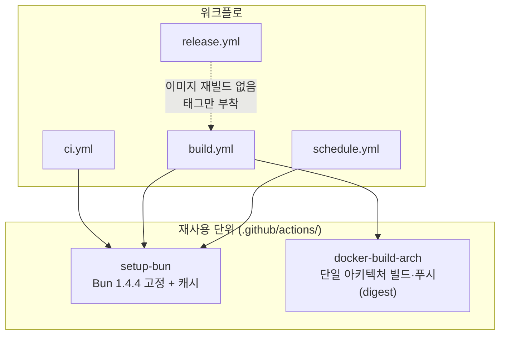
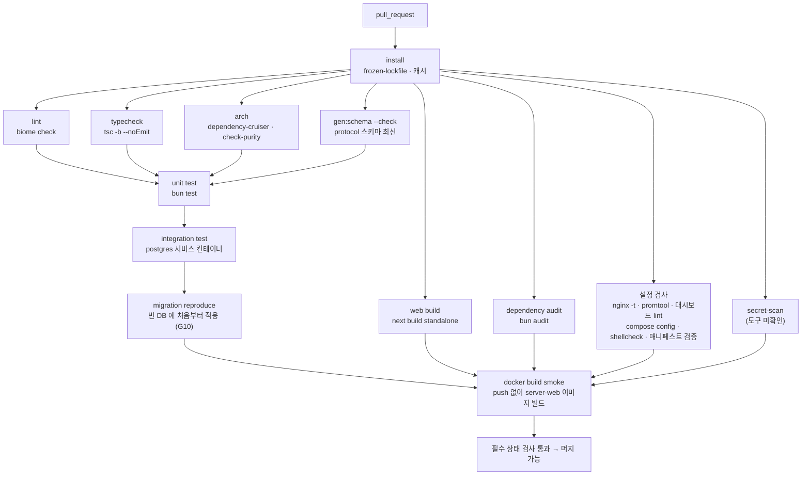
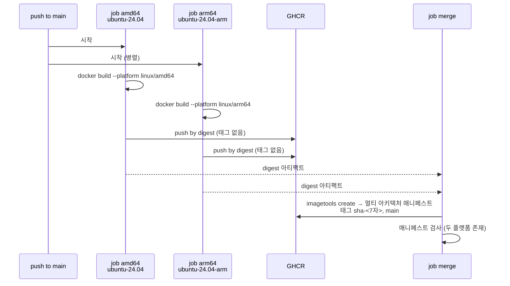
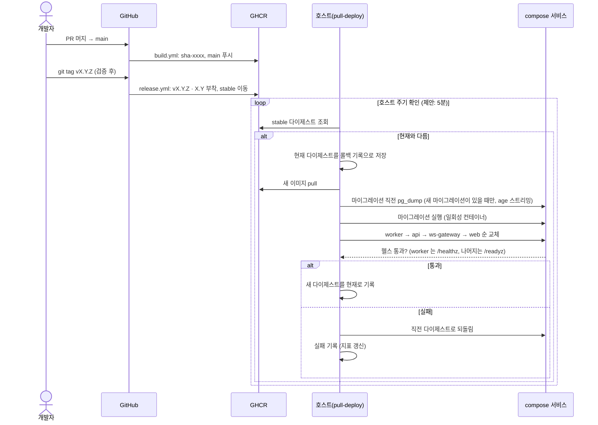

# 09. CI/CD

워크플로 구성, 브랜치·릴리스 규칙, 이미지 태그, 배포 트리거를 고정한다.
근거: ADR-002(Compose 라이브) · ADR-014(무중단·pull 배포) · ADR-022(GitHub Actions, 네이티브 러너) · [tech-stack.md](../domains/tech-stack.md) §7 · [01](01-repository-structure.md)(`check` 스크립트).

> 다이어그램 해당 여부 — 순서도: PR 검사 파이프라인(§2), 워크플로 호출 구조(§1) / 시퀀스: 릴리스·배포(§6) / 클래스·상속: **해당 없음** — 워크플로는 선언형 YAML 이라 클래스가 없다. 대신 재사용 단위(composite action)의 포함 관계를 §1 순서도로 나타낸다.

---

## 1. 워크플로 구성

| 파일 | 트리거 | 하는 일 | 권한 |
|---|---|---|---|
| `ci.yml` | `pull_request`, `push`(main 제외 브랜치는 PR 로 검사) | 검사 전부(§2). **이미지 푸시 없음** | `contents: read` |
| `build.yml` | `push` to `main`, 수동 | 이미지 빌드(amd64·arm64 네이티브) → GHCR 푸시 → 매니페스트 병합 | `contents: read`, `packages: write` |
| `release.yml` | `push` 태그 `v*.*.*` | 이미 빌드된 이미지에 버전 태그를 붙이고 `stable` 이동, GitHub Release 생성. **직전 릴리스 태그 대비 `drizzle/` 마이그레이션이 늘었으면 `stable` 은 옮기지 않고 수동 승격(`workflow_dispatch`)을 기다린다**(§6) | `contents: write`, `packages: write` |
| `schedule.yml` | 주 1회 cron | 의존성 점검(`bun audit`), 베이스 이미지 갱신 확인 | `contents: read`, `issues: write` |

공통 규칙:

- **액션은 커밋 SHA 로 고정**한다(태그가 아니라). 갱신은 Dependabot 이 PR 로 제안(10 §6).
- `permissions` 는 워크플로 최상단에서 `contents: read` 로 시작하고, 필요한 잡만 올린다.
- `concurrency`: PR 검사는 같은 PR 의 이전 실행을 취소(`cancel-in-progress: true`), `build.yml` 은 **취소하지 않고 대기**(이미지 일관성).
- 저장소는 **공개**다(arm 러너 무료, A-003). 비밀을 쓰는 외부 서비스가 없으므로 CI 는 `GITHUB_TOKEN` 만 쓴다. 포크 PR 에는 비밀이 주어지지 않는다.
- 설치는 항상 `bun install --frozen-lockfile`.

## 2. PR 검사 (`ci.yml`)

| 잡 | 내용 | 실패 시 |
|---|---|---|
| `lint` · `typecheck` · `arch` | [01](01-repository-structure.md) §5·§6 과 같은 명령 | 머지 불가 |
| `gen:schema --check` | 커밋된 JSON Schema 가 `@pf/protocol` 정의와 다르면 실패 | 재생성 후 커밋 |
| `unit` | `bun test` (DB 없음, L2) | |
| `integration` | PostgreSQL 18 서비스 컨테이너로 `test:integration` (outbox/inbox 동시성, 08) | |
| `migration reproduce` | 빈 DB 에서 마이그레이션 전부 적용 + 스키마 대조 (G10) | |
| `migration n-1` | **새 스키마에서 직전 릴리스 이미지 통합 시험**: 직전 릴리스 태그의 `pf-server` 이미지로 핵심 usecase 통합 시험을 돌리되 DB 는 이번 변경의 마이그레이션까지 적용한 상태로 둔다(§4 "한 버전 동안 호환"을 기계로 확인, F16 §순방향 호환). 마이그레이션이 없는 PR 은 건너뛴다 | 머지 불가 |
| `migration lint` | 위험 DDL 정적 검사 — 큰 테이블 `NOT NULL` 추가·기본값 없는 컬럼 추가·컬럼 삭제/이름 변경·`CONCURRENTLY` 없는 인덱스 등을 거부. 도구는 `squawk` 등을 **후보**로 두며 도입 시 Postgres 18 구문 지원을 확인한다(**도구명 미검증**). 의도된 예외는 PR 에 이유를 적는다 | 머지 불가 |
| `migration immutable` | **적용된 마이그레이션이 바뀌지 않았는지** 확인한다(tech-stack §11.1 운영 규칙 ③·④; Drizzle 은 적용된 파일의 해시를 검사하지 않아 고쳐도 오류 없이 무시된다 — 스파이크 G10 관찰 8). ① 기준 브랜치(main) 대비 `drizzle/*.sql` 은 **추가만** 허용하고 수정·삭제·이름 변경이 있으면 실패(`git diff --name-status`). ② `drizzle/meta/_journal.json` 의 `when` 이 항목 순서대로 증가하고, 새 항목이 기준 브랜치의 마지막 `when` 보다 크지 않으면 실패(과거 `when` 은 조용히 건너뛰어진다). 마이그레이션이 없는 PR 은 건너뛴다. 의도된 예외(아직 어디에도 적용되지 않은 파일을 고치는 경우)는 PR 에 이유를 적는다 | 머지 불가 |
| (로컬) pre-commit 훅 | 커밋 전에 같은 스캐너를 돌린다: `.githooks/pre-commit` + `git config core.hooksPath .githooks`(저장소가 안내만 하고 강제하지 않는다 → CI `secret-scan` 이 최종 방어) | |
| `audit` | `bun audit --audit-level=high --prod` — Bun 1.4.4 에서 존재·동작 실측 확인. 높음/치명 취약점이면 실패, 낮음은 경고 | 예외는 이유를 PR 에 기록 |
| `secret-scan` | 저장소 이력·변경분에서 비밀 패턴 검출(도구 `gitleaks` 8.30.1 로컬 확인: 이력 9커밋 누출 0. CI 는 `gitleaks git` 모드, 로컬 pre-commit 은 `gitleaks git --staged`. **기본 규칙에 Discord 웹훅이 없어 `.gitleaks.toml` 사용자 규칙이 필요**하고 추가하면 합성 비밀 3건을 모두 검출한다. 작업 트리 `dir` 모드는 `.claude/skills/*/references/secrets.md` 예제를 오탐하므로 쓰지 않는다. S1-15). 검출 시 머지 불가. 시험용 패턴 파일로 검출 동작을 검증한다 | 비밀이면 회전이 먼저([13](13-incident-response.md) §6.10) |
| `web build` | Next 빌드가 Bun 에서 성공 (G3 로컬 통과: `bun --bun next build` 약 6초). 종료 코드 143 은 SIGTERM 정상 종료이므로 compose `restart`·CI 가 비정상으로 보지 않게 한다 | |
| `e2e` 도구 | **Playwright 1.64.1**(`bunx playwright install chromium`, 브라우저 약 150MB를 캐시). Bun 에서 동작 확인(G3·도구 실측) | |
| 통합 시험 DB | Testcontainers 는 `bun test --parallel` 에서 워커마다 컨테이너를 띄우므로 **래퍼가 컨테이너 1개를 띄우고 `DATABASE_URL` env 로 공유**한다(08 §2). `beforeAll` 타임아웃 60초. 대안: 서비스 컨테이너 Postgres + 템플릿 DB 복제 | |
| `config check` | 운영 설정·스크립트 정적 검사: `nginx -t`(공식 nginx 이미지로 설정 검증), `promtool check config/rules`, Grafana 대시보드 JSON 문법 lint, `docker compose config`(각 오버라이드 조합), `shellcheck`(`infra/scripts/*.sh`), k8s 매니페스트 검증(`kubeconform` 등) — **도구명은 모두 미검증**, 도입 시 확인 | 머지 불가 |
| `docker build smoke` | 이미지가 빌드되고 `--help`/설정 검증이 동작 | |

- E2E·재접속·부하 시험은 PR 마다 돌리지 않는다. **main 머지 후 야간/수동** 워크플로(`e2e` 잡)로 분리해 PR 시간을 지킨다(08 에서 범위 확정).
- 필수 상태 검사(branch protection)는 `lint`·`typecheck`·`arch`·`gen:schema`·`unit`·`integration`·`migration`(reproduce·n-1·lint)·`web build`·`config check` 로 한다.

## 3. 이미지 빌드와 매니페스트 병합 (`build.yml`)

이미지는 **둘**이다(00 §7 "같은 이미지" = 환경 간 동일, 서버 세 엔트리포인트는 이미지 하나).

| 이미지 | 내용 | 실행 방법 |
|---|---|---|
| `ghcr.io/<owner>/pf-server` | api · ws-gateway · worker (모듈 포함) | 컨테이너 명령으로 엔트리 선택: `bun apps/api/src/main.ts` 등 |
| `ghcr.io/<owner>/pf-web` | Next `standalone` | `bun server.js` (G3 실패 시 Node 22 LTS 베이스로 교체) |
| `ghcr.io/<owner>/pf-proxy` | **조건부** — 공식 nginx 이미지에 `realip` 가 없을 때만 직접 빌드 (G7) | |

`<owner>` 는 저장소 소유자로 채운다(미정).

- 각 아키텍처를 **네이티브 러너**에서 빌드한다(에뮬레이션 안 함). 러너 라벨은 구현 시점에 확인한다(**미확인**: 공개 저장소 arm 러너 라벨 이름).
- 빌드는 레이어 캐시(GitHub Actions 캐시 또는 레지스트리 캐시)를 쓴다. 의존성 레이어를 소스보다 앞에 둔다.
- 푸시 전에 `pf-server` 로 설정 검증 명령(`--check-config`)을 컨테이너에서 실행해 기동 가능성을 확인한다.

## 4. 브랜치·커밋·릴리스 규칙

| 항목 | 규칙 |
|---|---|
| 모델 | **trunk-based**: `main` 이 항상 배포 가능. 단명 브랜치 → PR → **squash merge** |
| 브랜치 이름 | `feat/<짧은-설명>`, `fix/…`, `docs/…`, `chore/…`, `spike/g<번호>-…`(관문 시험) |
| `main` 보호 | 직접 푸시 금지, 필수 상태 검사(§2), 선형 이력 |
| 커밋 메시지 | 한국어 서술형 한 줄 제목(무엇을·왜), 본문은 선택. 기존 이력의 스타일을 따른다 |
| 버전 | SemVer 태그 `vMAJOR.MINOR.PATCH`. **M1 완료 전은 `v0.x`**, M1 DoD 통과 시 `v0.1.0` 이후 마일스톤마다 마이너 증가 |
| 릴리스 단위 | 태그 = 라이브에 올릴 후보. 태그는 `main` 의 커밋에만 붙인다. **릴리스 태그 빌드는 `CONTENT_STRICT=1 bun run content:check` 를 통과해야 한다**(공개 변수가 비어 있으면 실패, 12 §1.1) |
| DB 마이그레이션 | 앞으로 호환(forward-only) — 새 버전 코드는 이전 스키마에서, 이전 코드는 새 스키마에서 **한 버전 동안** 동작해야 한다(롤백 가능성, ADR-014). 컬럼 삭제·이름 변경은 두 릴리스에 걸쳐 |
| 핫픽스 | `fix/` → PR → main → 새 PATCH 태그. 릴리스 브랜치는 만들지 않는다 |

## 5. 이미지 태그 규칙

| 태그 | 부여 시점 | 용도 | 변하는가 |
|---|---|---|---|
| `sha-<7자>` | main 빌드마다 | 추적·롤백 기준 | 불변 |
| `main` | main 빌드마다 | 최신 빌드 | 이동 |
| `vX.Y.Z` | 릴리스 태그 | 릴리스 불변 참조 | 불변 |
| `X.Y` | 릴리스 태그 | 마이너 계열 최신 | 이동 |
| `stable` | 릴리스 후 승격 — **마이그레이션이 없는 릴리스는 자동, 마이그레이션을 포함한 릴리스는 수동**(GitHub 토큰이 탈취돼도 DB 를 바꾸는 코드가 5분 안에 라이브에 닿지 않게 하고, 승격 전에 백업 최신성을 사람이 본다) | **라이브 호스트가 따라가는 태그** | 이동 |

- 라이브 compose 는 `stable` 이 아니라 **다이제스트로 고정한 값을 배포 스크립트가 기록**한다(어느 다이제스트가 떠 있는지 항상 알 수 있고 롤백 대상이 명확하다).
- `latest` 태그는 쓰지 않는다.

## 6. 릴리스와 pull 배포

push 배포(CI 가 호스트로 접속)는 집 PC 가 외부 접속을 받아야 하므로 쓰지 않는다(ADR-014). **호스트가 가져간다.**

| 항목 | 내용 | 상태 |
|---|---|---|
| 확인 주기 | 5분 간격 폴링 — **systemd 타이머 `pf-pull-deploy.timer`**(`infra/systemd/`, F17 §16.1.1)로 확정. 매 실행마다 `status/pull_deploy/last_run.json` 을 쓴다(변경 없음도 `ok=true`) | 확정(2026-11-04). 웹훅은 집 PC 가 수신해야 하므로 제외 |
| 교체 순서 | worker(소비자) → api → ws-gateway → web. ws-gateway 교체 시 단절이 생기며 클라이언트가 재접속·복구 (ADR-014: Compose 는 "짧은 단절 후 복구") | 확정(ADR-014) |
| 마이그레이션 | 교체 전 일회성 컨테이너로 `db:migrate`(**`pf_migrator` 역할로만** 실행, 상주 서비스의 역할은 DDL 불가, 10 §5.1). 실패하면 교체하지 않는다. **새 마이그레이션이 있으면 직전에 `pg_dump -Fc \| age` 로 전체 DB(감사 로그 포함)를 시스템 디스크가 아닌 백업 디스크의 `pre-migrate/` 에 뜨고(최근 3개 유지, 평문 비기록), 덤프가 실패하면 마이그레이션하지 않는다**(앞으로 호환이라 롤백이 스키마를 되돌리지 못하므로 데이터 손상 시 복원 지점이 된다) | 제안(2026-11-05 아키텍처 검토 반영, 구현 시 확정) |
| 시계 정지(`clock_freeze`) | 바둑 대국 시계·에스크로 기한이 재배포 중에도 흐르지 않게, **교체 직전에 정비 구간 시작을 기록하고(`clock_freeze` 시작) 헬스 게이트 통과 후 종료를 기록**한다. 종료 시점에 api 가 진행 중 대국의 `deadline_at`·`turn_started_at` 을 정지 구간만큼 이동한다(P0 §10.1, F17 §15). 스크립트가 중간에 죽어 종료가 기록되지 않으면 worker 가 단절 구간을 감지해 같은 보정을 한다 | 제안(Phase 1 착수 시 구현) |
| 헬스 게이트 | 서비스별 헬스 통과 후 다음 서비스 — **worker 는 `/healthz`**(readyz 없음, F17 §5.1), api·ws-gateway·web 은 `/readyz` | 확정 |
| 상태 기록 | 결과를 `status/pull_deploy/last_run.json` `{job, started_at, finished_at, ok, detail, version, last_success_at}` 로 남기고 worker 가 `pf_ops_*` 지표로 노출, 실패(`ok=false`)는 `DeployFailed` 경보(F17 §16.2·§17) | 확정 |
| 롤백 | 직전 다이제스트로 되돌림. 마이그레이션은 되돌리지 않는다(앞으로 호환 규칙으로 흡수, §4) | 확정 |
| 이미지 검증 | 교체 전에 다이제스트가 릴리스 서명(cosign 후보)과 일치하는지 검증하고 실패하면 교체하지 않는다. 격리 계층·토큰 탈취 시 5분 내 코드 실행 위험은 10 §5 | 제안(도구 후보, 미검증) |
| 스크립트 위치 | `infra/scripts/pull-deploy.sh` (구현 시 작성) | 미작성 |

## 7. 시험 환경과 관문

| 단계 | CI 에서 하는 일 |
|---|---|
| G3 지속 확인 | `web build` 가 Bun 으로 성공하는지 매 PR |
| G10 | `migration reproduce` 잡 |
| G2·G14·G8 | CI 가 아니라 **로컬/수동 스파이크**(`spike/g…` 브랜치). 결과는 ADR-022 에 기록 |
| 야간 `e2e` | main 의 최신 이미지로 compose 를 띄워 재접속·동시성 시험(08) |

## 8. 미결

| 항목 | 결정 시점 |
|---|---|
| GHCR 소유자 이름, 공개 저장소 arm 러너 라벨 | 저장소 공개 시 |
| `bun audit` 실패 기준(`--audit-level=high --prod` 제안) 확정 | 구현 단계 0 |
| 배포 확인 주기(5분 제안). `stable` 승격은 마이그레이션 포함 릴리스만 수동으로 제안(§5) — 그 외 자동 여부 | 첫 라이브 배포 전 |
| `migration lint` 도구(`squawk` 등 후보)의 PG18 지원, `migration n-1` 잡의 직전 이미지 취득 방식 | 구현 단계 0 |
| `pf-proxy` 이미지 필요 여부 | 관문 G7 |
| 야간 `e2e` 범위 | [08](08-test-strategy.md) 확정 후 |
