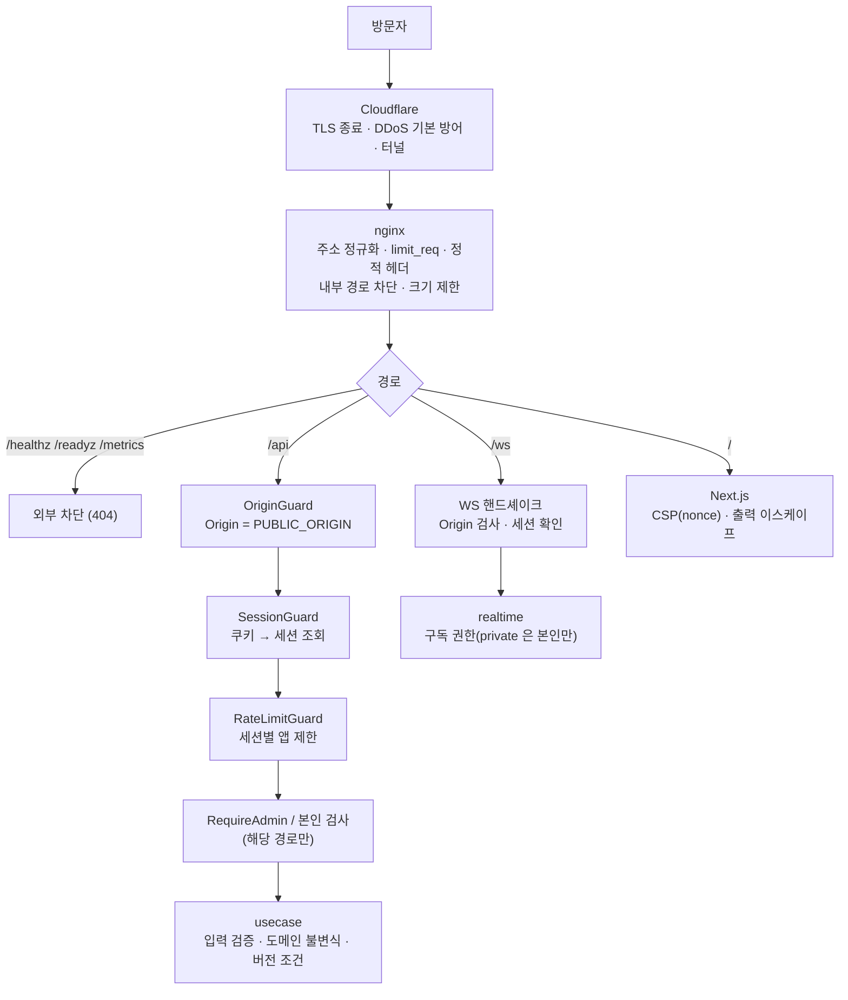
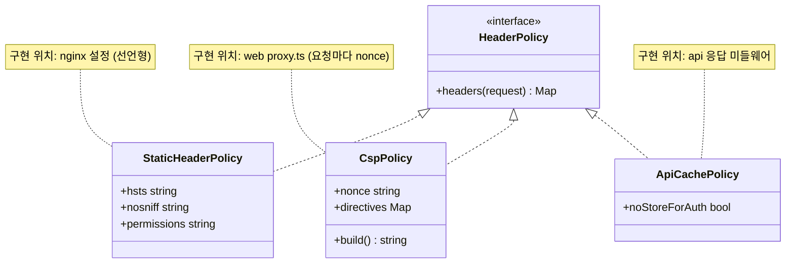
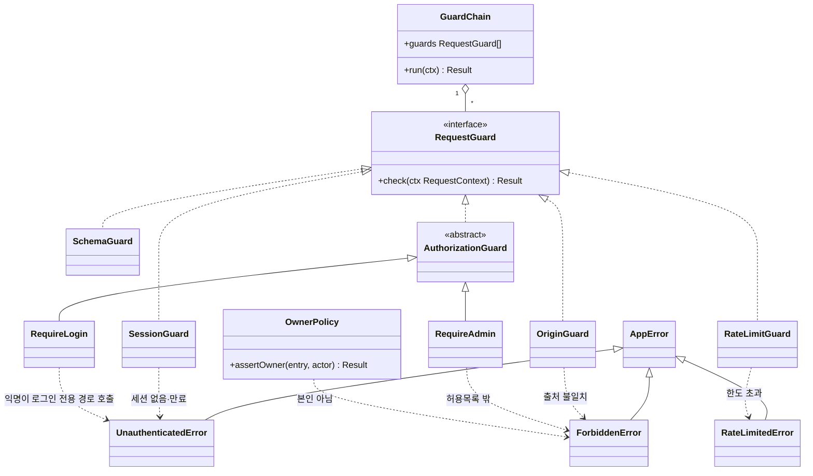
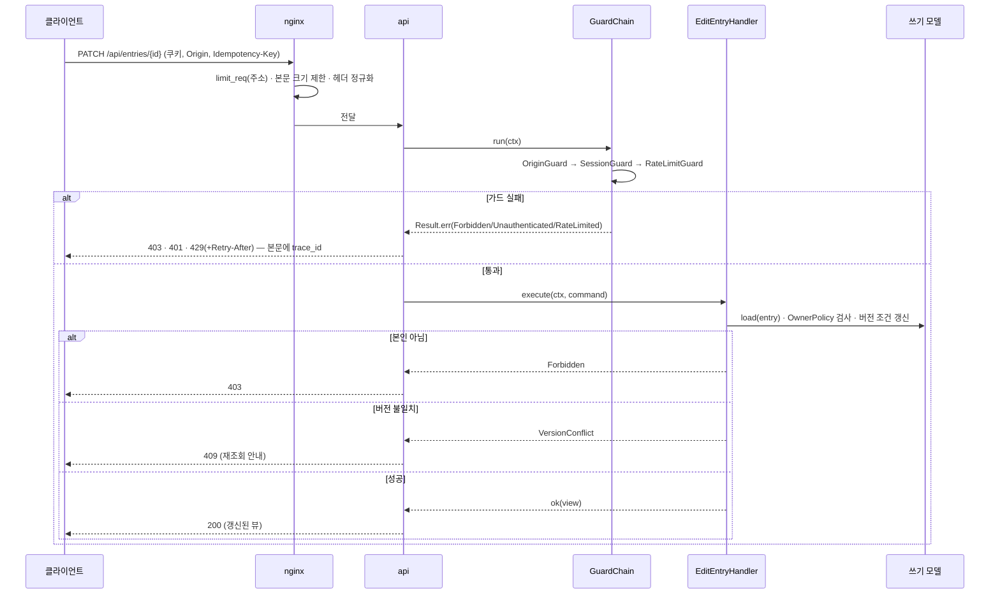

# 10. 보안

공개 사이트의 보안 방침을 **어느 계층이 무엇을 책임지는지**로 고정한다.
근거: ADR-008(신원·악용·보관) · ADR-007(관측, 내부 전용 엔드포인트) · ADR-021(동시성, 재시도 안전) · ADR-022(OAuth 직접 구현, 관문 G7) · ADR-023(IP 미저장) · [00](00-system-overview.md)(오류 체계) · [01](01-repository-structure.md)(`SecretString`).

> 다이어그램 해당 여부 — 순서도: 요청 경로 보안 계층(§1) / 시퀀스: 쓰기 요청 가드 평가(§4.2) / 클래스: 가드 체인(§4.1), 헤더 정책(§2.2) / 상속 구조: 가드 인터페이스 구현·오류 매핑(§4.1).
> 로그인 흐름과 세션의 상세는 [06](06-auth.md) 이 정본이고, 여기서는 정책의 경계값(쿠키 속성·CSRF 방어 원칙)만 정한다.

---

## 1. 요청 경로의 보안 계층

가드 순서는 [03 §8.2](03-api-contract.md) 와 같다: **Origin → Session → RateLimit → (Schema) → Authorization**. 출처가 틀린 쓰기 요청을 세션 조회 전에 거절한다.

방어는 겹쳐서 둔다: **프록시가 막지 못한 것을 앱이, 앱이 놓친 것을 DB 제약이 막는다**(예: 길이 상한은 앱 `EntryBody` + DB `CHECK` 2배, ADR-023).

## 2. 보안 헤더

### 2.1 정책 표

| 헤더 | 값 | 설정 주체 | 비고 |
|---|---|---|---|
| `Content-Security-Policy` | 아래 표 | **web(Next `proxy.ts`)** | 요청마다 nonce 를 만들어야 해서 앱이 설정 (nginx 는 정적 값만) |
| `Strict-Transport-Security` | `max-age=15552000; includeSubDomains` | nginx | 6개월. `preload` 는 쓰지 않는다(되돌리기 어려움). Oracle 경로는 TLS 종료가 nginx, 집 PC 경로는 Cloudflare 엣지 |
| `X-Content-Type-Options` | `nosniff` | nginx | |
| `Referrer-Policy` | `strict-origin-when-cross-origin` | nginx | |
| `Permissions-Policy` | `camera=(), microphone=(), geolocation=(), payment=(), usb=()` | nginx | 사이트가 쓰지 않는 기능 전부 차단 |
| `Cross-Origin-Opener-Policy` | `same-origin` | nginx | |
| `X-Frame-Options` | `DENY` | nginx | 구형 브라우저 보조. 실제 방어는 CSP `frame-ancestors` |
| `Cache-Control` | `/api/*`: `no-store` (인증 응답 포함) / 정적 에셋: 해시 파일명 + `immutable` | api / nginx | |
| `Server` · `X-Powered-By` | 제거 | nginx / Next(`poweredByHeader: false`) | 버전 노출 최소화 |

### 2.2 CSP 지시어

| 지시어 | 값 | 이유 |
|---|---|---|
| `default-src` | `'self'` | 기본 차단 |
| `script-src` | `'self' 'nonce-<요청별>' 'strict-dynamic'` | 인라인 스크립트는 nonce 가 있는 것만. Next 의 nonce 지원 동작은 G3 에서 확인 |
| `style-src` | `'self'` (+ 필요 시 `'nonce-<요청별>'`) | Tailwind 는 정적 CSS. 인라인 스타일이 필요해지면 nonce 로 해결하고 `'unsafe-inline'` 은 쓰지 않는다. Next 가 요구하는지 **미확인(G3)** |
| `img-src` | `'self' data:` + **CI 배지 호스트 1개** | 외부 이미지는 CI 상태 배지(FR-003)뿐이다. 호스트는 `site.ciBadgeUrl`([12](12-content.md) §1.1)에서 빌드 시 뽑아 넣고, 변수가 `null` 이면 이 값을 넣지 않는다. 배지의 실제 호스트·리다이렉트(예: GitHub Actions 배지가 다른 호스트로 넘기는지)는 **미확인** — 구현 시 브라우저 콘솔 위반 보고로 확정. 아바타는 쓰지 않는다 |
| `font-src` | `'self'` | 폰트는 자체 호스팅 |
| `connect-src` | `'self' wss://<PUBLIC_ORIGIN 의 호스트>` | REST 와 WebSocket. 개발은 `ws://localhost:8080` |
| `frame-src` | Grafana 공개 대시보드 출처 1개(`site.metricsEmbedUrl` 의 출처, [12](12-content.md) §1.1) | G6 로 확정. 임베드가 안 되면 링크로 대체해 이 값을 제거 |
| `frame-ancestors` | `'none'` | 클릭재킹 방지 |
| `base-uri` | `'self'` | |
| `form-action` | `'self'` | |
| `object-src` | `'none'` | |
| `upgrade-insecure-requests` | 포함 (운영) | |

- 처음에는 **`Content-Security-Policy-Report-Only`** 로 켜서 위반 수를 본 뒤 강제로 전환한다. 보고 수신 엔드포인트는 만들지 않고 브라우저 콘솔로 확인한다(범위 절감).
- **글은 텍스트로만 렌더한다**(HTML·마크다운 해석 없음, ADR-008). CSP 는 이 규칙이 뚫렸을 때의 2차 방어선이다.

세 정책은 서로 다른 프로세스에 산다. 위 인터페이스는 **책임 분리를 설명하는 모델**이며 코드에서 공유하는 타입은 아니다.

## 3. 쿠키·CORS·CSRF

### 3.1 쿠키

| 쿠키 | 이름 | 속성 | 수명 |
|---|---|---|---|
| 세션 | `__Host-sid` (개발 http: `sid`) | `HttpOnly; Secure; SameSite=Lax; Path=/`, **`Domain` 없음** | 서버 세션 7일에 맞춤(ADR-008). 슬라이딩 갱신 여부는 06 |
| OAuth 임시 | `__Secure-oauth` (개발: `oauth`; `Path=/api/auth` 이므로 `__Host-` 가 아니라 `__Secure-`) | `HttpOnly; Secure; SameSite=Lax; Path=/api/auth` | 10분. state·PKCE verifier 보관 (06) |

- `__Host-` 접두는 `Secure`·`Path=/`·`Domain` 없음을 브라우저가 강제한다. 개발 환경(http)은 `SESSION_COOKIE_NAME`·`COOKIE_SECURE` 환경변수로 낮춘다(01 §8.2).
- 쿠키 값은 **무작위 토큰**이고 서버에는 **해시만** 저장한다(`identity.session`, tech-stack.md §3). 값 자체는 어떤 로그에도 남기지 않는다.
- `SameSite=Lax` 는 OAuth 콜백(GitHub → 우리, 최상위 GET 이동)이 쿠키를 싣고 오도록 필요하다. `Strict` 는 쓰지 않는다.

### 3.2 CORS

**없다.** 모든 접근이 `PUBLIC_ORIGIN` 한 출처로 들어온다(개발도 proxy `:8080` 경유, 02 §1). api 는 `Access-Control-Allow-*` 헤더를 내지 않고, 다른 출처의 브라우저 요청은 브라우저가 막는다. 서버 측에서는 `OriginGuard` 가 한 번 더 확인한다.

### 3.3 CSRF 방어 (원칙)

변경 요청(`POST`·`PUT`·`PATCH`·`DELETE`)에 다음을 **모두** 적용한다.

1. `SameSite=Lax` 쿠키 (교차 사이트 POST 에 쿠키가 실리지 않음)
2. `OriginGuard`: `Origin` 헤더가 있으면 `PUBLIC_ORIGIN` 과 일치해야 한다. 없으면 `Referer` 로 폴백, 둘 다 없으면 거부 → `ForbiddenError`(`origin_mismatch`)
3. 본문은 `application/json` 만 받는다 (폼 전송 차단)
4. `Idempotency-Key` 헤더 필수 ([03](03-api-contract.md)) — 단순 폼으로는 보낼 수 없는 사용자 지정 헤더라 추가 방어가 된다
5. 로그아웃·로그인 시작은 GET 이 상태를 바꾸지 않도록 설계(로그인 시작 GET 은 상태 변경 없음, 로그아웃은 POST). **예외: `POST /api/auth/logout` 은 `Idempotency-Key` 면제**([03](03-api-contract.md) §1)라 4번 방어가 빠지고 1·2·3번 **3중**으로 막는다

WebSocket 핸드셰이크는 브라우저가 CORS 를 적용하지 않으므로 **서버가 `Origin` 을 직접 검사**한다(교차 사이트 WebSocket 하이재킹 방지). 허용 출처는 `PUBLIC_ORIGIN` 하나.

## 4. 가드와 권한

### 4.1 클래스 구조 (가드 체인, 오류 매핑)

- 가드는 **엔트리포인트(api, ws-gateway) 계층**이다. 규칙이 아니라 "누구의 요청인가"만 판정한다.
- **소유자 검사(`OwnerPolicy`)는 도메인 서비스**(`service/`)다. 가드가 아니라 usecase 안에서 실행한다 — 규칙이 엔트리포인트에 새는 것을 막는다(ADR-019). `RequireAdmin` 가 허용목록(`ADMIN_GITHUB_IDS`)을 보는 것은 "신원의 속성"이므로 가드이고, "이 글을 고칠 수 있는가"는 도메인 규칙이다.
- 오류 클래스는 [00](00-system-overview.md) §4.3 의 것을 그대로 쓴다.

### 4.2 쓰기 요청 가드 시퀀스 (글 수정)

익명 글은 수정·삭제 불가이므로 `OwnerPolicy` 가 `actor` 가 로그인 사용자이면서 `author_user_id` 와 같을 때만 통과시킨다(AC-004, AC-005).

## 5. 시크릿 관리·회전

저장 위치와 로딩은 [02](02-dev-environment.md) §5 가 정본이다. 여기서는 정책과 회전만 정한다.

| 비밀 | 회전 주기 | 절차 | 노출 시 |
|---|---|---|---|
| `GITHUB_CLIENT_SECRET` | 연 1회 또는 노출 의심 시 | GitHub 에서 새 secret 생성 → `secrets/` 교체 → api 재기동 → 구 secret 폐기 | 즉시 폐기·교체. 기존 세션은 영향 없음(세션은 우리 것) |
| DB 비밀번호 | 연 1회 | 새 비밀번호 설정 → `secrets/database_url` 교체 → 앱 재기동 | 즉시 교체 |
| Cloudflare Tunnel 토큰 | 노출 시 | 터널 재생성 후 토큰 교체 | 즉시 |
| `FIELD_KEYS` (필드 암호화 키링, api·worker) | 연 1회 또는 노출 시 | 새 키 추가 → `active` 변경 → `worker rotate-field-keys` 로 재암호화 → 잔여 0 확인 후 옛 키 제거. **키링 백업은 백업 개인키와 별도로 보관**(분실 시 `note` 복구 불가, ADR-026) |
| `OAUTH_STATE_SECRET` (OAuth 임시 쿠키 서명 키, api 필수) | 연 1회 또는 노출 시 | 새 값 생성 → `secrets/oauth_state_secret` 교체(저장 위치는 [02](02-dev-environment.md) §5) → api 재기동. 진행 중인 로그인 시도(10분 쿠키)만 실패한다 | 즉시 교체 |
| `DISCORD_WEBHOOK_URL` (Grafana 경보 연락처, **grafana 컨테이너 전용**) | 노출 시 | Discord 에서 웹훅 **삭제 후 재생성** → `secrets/discord_webhook` 교체 → grafana 재기동. URL 자체가 자격이라 `SecretString`·로그 마스킹(`https://discord.com/api/webhooks/…` 패턴 → `[redacted]`) 대상 | 즉시(웹훅 삭제) |
| Grafana 관리자 비밀번호 | 연 1회 | 환경 파일 교체 후 재기동 | 즉시 |
| 백업 암호화 키 | 키 분실·노출 시만 | 새 키로 이후 백업 암호화. 기존 덤프는 구 키가 있어야 복호화되므로 **구 키를 보관** | 새 키 발급, 외부 보관분 재암호화 |
| 세션 토큰 | 7일 만료(자동) | 만료·로그아웃 시 서버에서 폐기(ADR-008) | 사용자 단위 전체 폐기 가능 |

- 비밀은 `SecretString` 으로만 다루고(01 §7.1) 로그·오류 메시지·지표 레이블·`/metrics` 에 들어가지 않는다.
- 저장소 비밀 유출 방지: `.env`·`secrets/` 무시 + 커밋 전 검사(시크릿 스캔은 CI 에서 `gitleaks` 류 도구 후보 — **도구 선택은 미확인**, 구현 시 비교).
- **로그·상태 디렉터리 권한**: `PF_LOG_DIR`(기본 `/var/log/pf`)·`STATUS_DIR` 는 `pf:pf` **0750**, 아카이브 파일은 **0640**. 외부 업로드·백업에서 제외한다(ADR-027).
- **docker 그룹 = root 동급 (로컬 입증, 2026-11-04)**: 개발 머신에서 현재 사용자(`docker` 그룹)가 `docker run -v /:/h:ro` 로 호스트 루트를 마운트하자 컨테이너 안에서 **root 권한으로** `/h/etc/shadow`(640 root:shadow)·`/h/root`(700)의 메타데이터가 보였다(내용은 읽지 않음). 읽기 전용이 아니면 쓰기도 같은 경로로 가능하다고 판단한다(쓰기는 시험하지 않음).
- **docker 그룹 주의**: `docker` 그룹 구성원은 사실상 root 와 동급이다. systemd 유닛 사용자 `pf` 는 쉘 로그인을 막고(`nologin`) 유닛으로만 실행하며, 호스트에서 `docker` 그룹 구성원을 최소화한다. 호스트가 rootless Docker 면 `pf` 유닛을 사용자 단위로 둔다(F17 §16.1.1).

**docker 그룹 없이 로그를 읽는 대안 (결정은 S8-1 호스트 실측 후)**

| 방법 | 근거 | 장점 | 단점 |
|---|---|---|---|
| json-file 로그 직접 읽기 | **로컬 확인**: `/var/lib/docker` 710 root, `*-json.log` 640 root:root | 소켓 불필요 | 경로 전체에 권한을 줘야 하고 컨테이너가 새로 생길 때마다 초기화 — 비현실적 |
| 읽기 전용 소켓 프록시 | 일반 지식(미확인) | `docker logs` 와 같은 API, 생성·삭제 차단 | 프록시 컨테이너가 루트급 소켓을 쥠, 설정 오류 위험 |
| journald 로그 드라이버 | 일반 지식(미확인) | `systemd-journal` 그룹으로 읽기 가능 | 드라이버 변경 시 20m×10 회전 설계 재측정 |
| 수집기(Alloy 등) | 일반 지식(미확인) | 아카이브 스크립트가 소켓을 안 만짐 | 구성요소 증가, 수집기 자체가 소켓/경로 권한 필요 |
| rootless Docker | **로컬 확인**: 이 머신은 `docker-ce-rootless-extras`·`/etc/subuid`·`systemd --user`(linger)·비특권 userns 충족, **`uidmap`(newuidmap/newgidmap) 하나만 없음 — 설치에 sudo 필요** | pf 전용 데몬이라 호스트 root 와 분리 | 포트/네트워크 제약, 이 호스트 미시험 |
- 로그 금지 목록: 접속 IP, 글 본문, 세션 토큰, OAuth 코드·토큰, `Authorization`/`Cookie` 헤더(ADR-023, 00 §5).

## 6. 의존성·공급망

| 항목 | 방침 |
|---|---|
| 잠금 파일 | `bun.lock` 커밋, CI 는 `--frozen-lockfile` |
| 설치 스크립트 | Bun 은 의존성의 lifecycle 스크립트를 기본 실행하지 않는다. 필요한 패키지만 `trustedDependencies` 에 명시하고 사유를 주석으로 남긴다 |
| 취약점 점검 | CI `bun audit`(사용 가능 여부 **미확인**) + 주 1회 `schedule.yml`. 릴리스 전에는 `supply-chain-audit` 스킬 기준으로 직접 의존성 전체를 점검 |
| 갱신 | Dependabot(GitHub 무료)로 npm·GitHub Actions·Docker 베이스를 주 1회 PR. 자동 머지는 하지 않는다 |
| 버전 고정 | Drizzle 0.45.x 고정, 이미지는 메이저(+마이너) 태그 (tech-stack.md §12). Actions 는 커밋 SHA 고정(09) |
| 신규 의존성 | 추가 시 유지 보수 상태(최근 릴리스·deprecated 여부)를 PR 설명에 적는다. Arctic 이 deprecated 라 직접 구현으로 간 사례가 기준(ADR-022) |
| 이미지 | 베이스는 `-alpine`/`slim`, 비루트 사용자로 실행, 읽기 전용 루트 파일시스템과 불필요한 capability 제거는 **구현 시 시험**(Bun 호환 **미확인**) |

## 7. nginx 와 앱의 책임 분담

| 관심사 | nginx | 앱 | 비고 |
|---|---|---|---|
| TLS | Oracle 경로에서 종료 / 집 PC 경로는 Cloudflare 가 종료 | — | 인증서 자동화는 G7 |
| 클라이언트 주소 | `CF-Connecting-IP` 를 **정규화해 단일 헤더로 전달**, 클라이언트가 보낸 같은 이름 헤더는 폐기 (G1·G7) | 정규화된 헤더만 신뢰, **저장·로깅하지 않음** | ADR-023 |
| 속도 제한 | `limit_req`: 주소별 (메모리) | 세션별 (`RateLimitGuard`) | 이중. 둘 다 주소를 영속 저장하지 않는다 |
| 본문 크기 제한 | `client_max_body_size` (작게, 글 500자 기준 여유) | 스키마 검증(길이) | |
| 정적 보안 헤더 | 설정 (§2.1) | CSP 는 web | |
| 내부 경로 차단 | `/healthz` `/readyz` `/metrics` → 외부 404 | 해당 경로는 내부 포트에서만 응답 | ADR-007 |
| WebSocket | `Upgrade` 전달, 유휴 타임아웃 | `Origin` 검증, 세션 확인, 송신 큐 상한, 구독 권한 | G2 |
| 정적 폴백 | `error_page 502/503/504` → 정적 페이지 | — | ADR-023 |
| 입력 검증 | 형식 수준 아님 | **전부** (스키마 + 도메인 불변식 + DB `CHECK`) | |
| 인증·권한 | 없음 | 가드 + 도메인 정책 | 프록시는 신원을 모른다 |
| 로그 | 액세스 로그에서 **주소 필드 제외** | 구조화 로그, 비밀·본문 제외 | |

## 8. 위협 모델 (STRIDE 요약)

| 범주 | 위협 | 대응 | 근거 |
|---|---|---|---|
| **S**poofing 신원 도용 | 세션 쿠키 탈취 | HttpOnly·Secure·`__Host-`, 토큰 해시 저장, 7일 만료, CSP 로 XSS 억제 | §3, ADR-008 |
| | OAuth 로그인 CSRF·코드 가로채기 | `state`(+ PKCE S256 은 GitHub 지원 확인 후, 미지원이면 `state` 만), 임시 쿠키 10분 | 06 |
| | 접속 주소 위조(헤더 주입) | 프록시가 클라이언트 헤더 폐기·정규화 | G1·G7 |
| **T**ampering 변조 | 남의 글 수정·삭제 | 로그인 + `OwnerPolicy` + 버전 조건 갱신 | AC-004·005, ADR-021 |
| | 이벤트 위조·중복 처리 | 내부 경로만, inbox 중복 제거, 토큰 fencing | ADR-020·021 |
| | 교차 사이트 요청 | §3.3 CSRF 방어, WS `Origin` 검사 | |
| **R**epudiation 부인 | 관리자 조치 부인 | `moderation_action` 이력(누가·언제·무엇) | database-schema.md |
| **I**nformation disclosure 정보 노출 | 타인의 글·세션 식별자가 시각화로 노출 | 서버에서 가공한 요약만 전송(클라이언트 필터링 금지), private 채널은 본인만 | AC-009, ADR-008 |
| | 접속 주소·본문·토큰이 로그·지표에 남음 | 저장 금지, 지표 레이블 규칙, 마스킹 | ADR-023, ADR-007 |
| | 내부 엔드포인트 노출 | 프록시에서 외부 차단 | ADR-007 |
| | 오류 메시지로 내부 정보 유출 | 500 은 일반 메시지, 세부는 로그의 `trace_id` | 00 §6.2 |
| **D**enial of service 서비스 거부 | 스팸·글 폭주 | nginx 주소별 + 앱 세션별 제한, 길이 제한, 관리자 쓰기 잠금 스위치 | ADR-008·023 |
| | WebSocket 연결 폭주·느린 소비자 | 최대 연결 수, 연결별 송신 큐 상한 후 종료, 재접속 지터 | G2, ADR-014·022 |
| | 재접속 폭풍 | 클라이언트 백오프 + 지터, 서버 복구 처리량 상한 | ADR-014 |
| | 무거운 쿼리 | 커서 페이지네이션 상한, 조회는 읽기 모델만 | 03 |
| **E**levation of privilege 권한 상승 | 일반 사용자가 숨김·신고 처리 | `RequireAdmin`(숫자 ID 허용목록) + 서버 재검사 | AC-006 |
| | 허용목록 우회(이름 변경으로 탈취) | 로그인 이름이 아니라 **GitHub 숫자 ID** 로 비교 | 01 §8.2 |
| | XSS | 텍스트만 렌더, CSP, 입력 정규화 | ADR-008, §2 |

잔여 위험(수용): 접속 주소를 저장하지 않으므로 **사후 주소 차단 불가**(ADR-023 에서 수용). 집 PC 단일 장애점은 정적 폴백으로 완화(ADR-023).

## 9. 미결

| 항목 | 결정 시점 |
|---|---|
| Next 의 nonce CSP 동작, `style-src` 인라인 필요 여부 | 관문 G3 |
| Grafana 임베드 출처(`frame-src`) | 관문 G6 |
| `CF-Connecting-IP` 부착, 헤더 정규화 설정 | 관문 G1·G7 |
| 시크릿 스캔 도구, `bun audit` 가용성 | 구현 단계 0 |
| 컨테이너 비루트·읽기 전용 FS 의 Bun 호환 | 이미지 작성 시 시험 |
| 세션 슬라이딩 갱신 여부 | [06](06-auth.md) |
