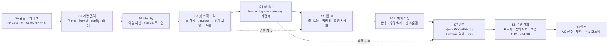
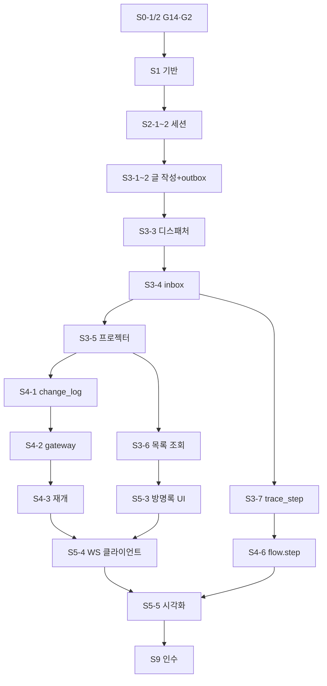
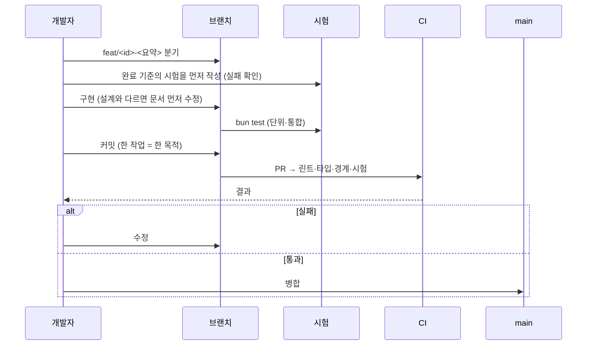

# 11. M1 구현 계획

M1(사이트 셸 + 방명록·이모지 + 이벤트 시각화 + WebSocket + 지표 + 정적 폴백)을 **작업 단위·순서·완료 기준**으로 나눈다.
입력: [spec](../../specs/portfolio-site.spec.md)(FR·AC), 설계 문서 00~12, 관문 G1~G14([tech-stack.md](../domains/tech-stack.md) §11, ADR-023).

> 다이어그램 해당 여부 — 순서도(의존 그래프)·시퀀스(작업 한 건의 절차)·간트형 단계도를 쓴다. **클래스·상속 구조는 해당 없음**: 이 문서는 코드가 아니라 작업 순서를 다룬다(코드 구조는 00·01).

## 1. 원칙

| 원칙 | 내용 |
|---|---|
| 수직 조각 | 층(DB→API→UI)별로 쌓지 않고, **기능 하나를 끝까지 통과**시킨 뒤 다음으로 간다. 첫 조각 = "익명 글 작성이 outbox→읽기 모델→화면까지" |
| 관문 먼저 | 설계를 바꿀 수 있는 G14(구 G1)·G2 를 맨 앞에서 실행으로 통과시킨다 |
| 완료 = 검증 | 각 작업의 완료 기준은 **실행 가능한 검사**(시험·명령)로 쓴다. "구현했다"는 완료가 아니다 |
| 작게 합친다 | 작업은 PR 한 개에 담길 크기(대략 하루 이내). 큰 작업은 쪼갠다 |
| 회귀 가드 | 버그를 고칠 때 "고치기 전엔 실패하는" 시험을 먼저 둔다(08) |
| 문서 동기 | 설계와 다르게 구현해야 하면 **코드 전에 문서·ADR 을 고친다** |

## 2. 단계 지도

점선은 병행 가능 구간이다. 1인 개발이면 순서대로 간다.

## 3. S0 — 관문 스파이크

목표: **설계를 뒤집을 수 있는 불확실성을 실행으로 지운다.** 결과는 ADR-022/023 에 추가하고, 스파이크 코드는 `spikes/` 에 두거나 버린다(제품 코드가 아니다).

| 작업 | 관문 | 완료 기준(검사) | 실패 시 |
|---|---|---|---|
| S0-1 Funnel 경로 | **G14** (구 G1 폐기) | `tailscale funnel` 로 노출한 에코 서버에 WebSocket 연결·메시지 왕복 성공, 유휴 타임아웃·하트비트 주기·대역폭 체감·**클라이언트 IP 확보 여부**·재시작 후 주소 유지·인증서 갱신을 기록한다(design/02 §7) | SSE 대체 설계(ADR-003 후속) / IP 미확보 시 속도 제한을 세션/계정 기준으로만 |
| S0-2 Bun WS 안정성 | **G2** | 목표 연결 수에서 **소크(수 시간) 메모리 비증가**, 재접속 복구, 앱 레벨 송신 큐 상한이 느린 소비자를 끊음(`4408`), Elysia 라우트 옵션 vs `Bun.serve` 지연 비교 | WS 부분만 `Bun.serve`, 또는 Go 교체 |
| S0-3 Next on Bun | **G3** | 빌드·`standalone` 실행·SSR·`next-intl`·이미지 최적화 정상 | web 만 Node 22 |
| S0-4 DB 드라이버 | **G4** | Drizzle 호환·트랜잭션·`LISTEN/NOTIFY` 전용 연결·`SKIP LOCKED` 경쟁 시험 통과 | 후보 교체 |
| S0-5 지표·로깅 | **G5** | `/metrics` 에 요청 수·지연·적체 지표, 식별자 레이블 없음 | 후보 교체 |
| S0-6 nginx | **G7** | `nginx -V` 에 `realip`, 클라이언트 주소 헤더 정규화, TLS 방식 결정 | 모듈 포함 이미지 |
| S0-7 마이그레이션 | **G10** | `generate --custom` raw SQL 로 부분 인덱스·어드바이저리 락 객체 생성, 빈 DB 에서 재현 | SQL 직접 관리 |

- 순서: **S0-1·S0-2 먼저**(설계를 바꿀 수 있는 크기), 나머지는 병렬.
- 소크(S0-2)는 오래 걸리므로 **먼저 띄워 두고** S1 을 진행한다. 결과는 S4 시작 전에 필요하다.
- G9(선택)는 **S1-6**(CI 시험 DB 환경 결정)에서, G6 은 S7-3, G8 은 S8-5, G11 은 S8-3, G12 는 S8-4 에서 처리한다.

## 4. 작업 목록

각 작업: **ID · 내용 · 의존 · 완료 기준 · 연결 요구**. 검증 등급은 [08](08-test-strategy.md) 표기(L1~L3).

### S1 — 기반 골격
| ID | 내용 | 의존 | 완료 기준 |
|---|---|---|---|
| S1-1 | 저장소 골격(01 §1), Bun 워크스페이스, `tsconfig`, Biome, `.env.example` | S0 | `bun install && bun run check` 통과, AC-032 |
| S1-2 | `packages/kernel`: `Result`, `AppError` 계층, `AggregateRoot`, `DomainEvent`, 포트 인터페이스 | S1-1 | 오류 계층·`Result` 단위 시험(L2), 오류→HTTP 매핑 표 시험 |
| S1-3 | `packages/config`: 환경변수 스키마·검증·`_FILE` 지원 | S1-1 | 필수 누락 시 기동 실패 시험, 비밀값이 로그에 안 나옴 |
| S1-4 | `packages/db`: 풀·`UnitOfWork`·마이그레이션 실행기, 첫 마이그레이션(스키마 생성) | S0-4, S0-7 | 빈 DB 에서 마이그레이션 재현, 롤백 없이 순방향만, AC-023 |
| S1-5 | `.dependency-cruiser.cjs` **B1~B10** 규칙(B10 = `@pf/infra` 격리), `check-purity`(B9 + 시간·난수) | S1-1 | 위반 샘플이 CI 에서 실패하는 시험 |
| S1-6 | CI 골격: PR 검사(린트·타입·경계·단위·통합·`bun audit --audit-level=high --prod`) + **G9 확인**(Testcontainers on Bun; 불가하면 compose `postgres` 서비스로 시험 DB 확정) | S1-5 | PR 에서 초록, 의도적 위반 PR 에서 빨강, 시험 DB 방식 결정 기록 |
| S1-14 | `AuditWriter` 포트(kernel)·`PostgresAuditWriter`·`DetailValidator`·`events.audit_log` 마이그레이션(추가 전용, 인덱스 3종)·`classification.ts` 등급 등록 | S1-4, S1-8 | 행위 롤백 시 감사 행도 사라지는 통합 시험, 금지 키 거부 시험 | ADR-027, EV-14, AC-020, FR-090 |
| S1-15 | 비밀 스캔: CI `secret-scan` 잡(도구 선택·검출 시험, 후보 gitleaks 는 미확인) + `.githooks/pre-commit` 안내, `.gitignore`(`.env`·`secrets/`·`incidents/`) 점검 | S1-6 | 시험용 비밀 패턴이 CI 에서 검출되어 PR 실패, 정상 PR 은 통과 | ADR-028, AC-027, FR-110 |
| S1-13 | 컬럼 보호 등급 맵(`classification.ts`)과 `check:classification` — 테이블 추가 때마다 갱신 | S1-4, S1-5 | 분류 없는 컬럼을 추가하면 CI 실패, ENC 컬럼은 FieldCipher 경로만 | ADR-026, AC-024, FR-100 |
| S1-12 | `FieldCipher` 포트 + AES-256-GCM 구현(`packages/infra/crypto`), 키링 로더·키 ID 선택, 단위 시험(왕복·AAD 불일치·변조·iv 중복·회전 멱등) | S1-3, S1-8 | 시험 통과, `pg_dump` 에 평문 센티널 부재 | ADR-026, AC-018, AC-034, FR-025, FR-101, FR-102 |
| S1-8 | `packages/kernel/ports`(`RateLimiter`·`PresenceCounter`·`KeyValueCache`·`EventTransport`) + `packages/infra` 메모리/Postgres 어댑터 + 포트 계약 시험 스위트 | S1-2 | 두 어댑터가 같은 계약 스위트 통과, `usecase` 가 `@pf/infra` 를 임포트하면 B10 으로 CI 실패 | ADR-024 |
| S1-7 | 로컬 compose(02): postgres, 개발 모드 기동 + **조립 루트·생명주기 골격**(기동 순서·종료 순서, `ShutdownCoordinator`) + 시드/CLI 프레임(`db:seed`, `worker <cmd>`) | S1-4 | `bun run dev` 로 api·worker 기동, api `/readyz` 성공, SIGTERM 시 종료 순서대로 정리 |
| S1-9 | `packages/protocol`: TypeBox 스키마(REST·WS·이벤트)·상수(`ENTRY_BODY_MAX_CHARS` 등)·`gen:schema`(JSON Schema 내보내기)·골든 JSON(`packages/protocol/golden/`) 골격 | S1-1 | `gen:schema --check` 통과, 골든 왕복 시험(L2), 별도 `@sinclair/typebox` 0.34 사용(`typebox` 1.x 금지) |
| S1-10 | `packages/testkit`: `FakeClock`·`FakeIdGenerator`·`TestDb`·`FaultInjector`(`failAt`/`delayAt`/`Gate`)·하니스(Unit/Module/Chaos/Api/Gateway) | S1-4 | 하니스로 빈 시험이 돌고, 주입 지점 상수 목록이 F16 §13.6 과 일치 |
| S1-11 | 관측 기반: 구조화 로그·`trace_id` 전파·마스킹, `/healthz`(전 앱)·`/readyz`(api·ws-gateway·web; **worker 는 `/healthz` 만**) | S1-7 | 로그에 IP·본문·토큰 없음(시험), DB 중단 시 api readyz 503·healthz 200 |

### S2 — identity
| ID | 내용 | 의존 | 완료 기준 | 요구 |
|---|---|---|---|---|
| S2-1 | `identity` 도메인·포트·어댑터: 세션 발급/조회/폐기, 토큰 해시 | S1 | 토큰 원문이 DB 에 없음(시험), 만료·`last_seen_at` 1시간 갱신 | FR-010 |
| S2-2 | `GET /api/me` (익명 세션 발급), 쿠키 속성 | S2-1 | 쿠키 없음→발급, 있음→유지, 속성 일치 시험 | FR-010 |
| S2-3 | GitHub OAuth(PKCE+state), 콜백 검증, 세션 회전 | S2-2 | 콜백 검증 순서도(06 §3.2)의 모든 분기 시험, `returnTo` 오픈 리다이렉트 차단 | FR-011 |
| S2-4 | 관리자 허용목록 판정, `RequireAdmin` | S2-3 | 숫자 ID 허용목록 시험 | FR-012 |
| S2-5 | 가드 체인(Origin·Session·RateLimit·Schema·Authorization) | S2-2 | 03 §7.1 순서도 분기별 시험 | FR-024 일부 |
| S2-6 | `RevokeSessions` usecase + `worker admin revoke-sessions`(`--all`\|`--user`\|`--session`, `--dry-run`, `--yes`), 감사 `admin.sessions_revoked` | S2-1, S1-14 | 폐기 후 기존 쿠키가 새 익명 세션으로 처리, private `4401`, 롤백 시 감사 행 없음, 멱등 | ADR-028, ID-11, AC-022, FR-013 |

### S3 — 첫 수직 조각 (가장 중요)
| ID | 내용 | 의존 | 완료 기준 | 요구 |
|---|---|---|---|---|
| S3-1 | `guestbook` 도메인(`Entry`, `EntryBody`…)·값 객체 불변식 | S2 | 경계값(500/501자, 10/11줄, NFC) 단위 시험 | FR-020, FR-024 |
| S3-2 | `request_key`(멱등) + `PostEntry` 명령 + outbox 기록 한 트랜잭션 | S3-1 | **AC-002**: 중간 실패 시 글·outbox 둘 다 없음. 같은 키 재요청 = 같은 응답 | FR-020, AC-002, AC-033, FR-028 |
| S3-3 | `events` 디스패처: 선점(CAS)·임대·reaper·advisory 락 단일 활성 | S3-2, S0-4 | **AC-015**: N 워커 경쟁에서 한 건당 한 주체. 임대 만료 후 늦은 완료 거절 | FR-030, FR-033 |
| S3-4 | inbox 수신·선점·처리(`MessageRunner`), 재시도·`dead` | S3-3 | **AC-003**: 같은 이벤트 재전달해도 효과 1회 | FR-031, FR-032 |
| S3-5 | `GuestbookProjector` + `entry_view`(`last_seq` 검사) | S3-4 | **AC-017** 순서 역전·재전달 시 결과 동일 | FR-035 |
| S3-6 | `GET /api/entries` 커서 조회 (읽기 모델만) | S3-5 | 구조 시험: 조회 usecase 가 쓰기 포트를 주입받지 못함(타입/경계 규칙) | FR-035 |
| S3-7 | `trace_step` 기록(`written/outboxed/dispatched/received/processed`) | S3-4 | 한 글 작성에 대해 단계가 순서대로 남음 | FR-040 |

**S3 완료 = AC-001 의 서버 쪽 전부**(글 작성 → 이벤트 → 읽기 모델 → 목록 조회). 이 시점에 UI 없이 `curl`/통합 시험으로 흐름이 증명된다.

### S4 — 실시간
| ID | 내용 | 의존 | 완료 기준 | 요구 |
|---|---|---|---|---|
| S4-1 | `realtime-broadcaster`: `change_log` 기록 + `NOTIFY` | S3-5 | 채널 seq 연속·유일(채널 카운터 행), 이벤트 재전달에도 중복 행 없음 | FR-050 |
| S4-2 | ws-gateway 골격: **`/ws/public`**(Origin 검사, `hello`/`welcome`) | S4-1, S0-2 | 04 §7.1 시퀀스 통합 시험 | FR-050 |
| S4-3 | 재개: replay / snapshot 분기, `change_log` 보관 정리(realtime 이 등록하는 `RetentionRule`) | S4-2 | 건너뜀·이력 부족·처음 접속 3경로 시험 (**AC-008** 서버 쪽) | FR-051, AC-008 |
| S4-4 | 송신 큐·`4408`·`bye` 우아한 종료 | S4-2 | 느린 소비자 격리(다른 연결 무영향), SIGTERM→`bye`→`1001` | FR-051, ADR-014 |
| S4-5 | 공개 채널 변환(`ownerKey`·`userId` 제거) | S4-2 | **AC-009** 구조 시험: 공개 메시지 스키마에 식별자 필드 없음 | FR-041 |
| S4-6 | **`/ws/private`**: 세션 쿠키 필수(익명 포함), 세션 캐시, `PrivateRouter`, `flow.step` 전송(세션 소유자만), 세션당 연결 수 제한(`4409`), 회전 시 `4401` | S4-2, S3-7 | 타 세션이 받지 못함. 쿠키 없으면 업그레이드 401. 익명 세션도 자기 흐름 수신. 로그인 후 이전 세션 연결이 닫힘 | FR-040, AC-031 |
| S4-7 | `flow_counter` 주기 집계 + `flow.summary` | S3-7 | 개수만 노출, 식별자 없음 | FR-041 |

### S5 — 웹 UI
| ID | 내용 | 의존 | 완료 기준 | 요구 |
|---|---|---|---|---|
| S5-1 | Next 셸, `next-intl`(ko/en), 레이아웃, 다크/라이트, 디자인 토큰, **CSP(요청별 nonce, `proxy.ts`)** | S0-3, S1 | 두 로케일 전환·유지, 누락 키 검사 통과, CSP 위반 없음(10 §2) | FR-004 |
| S5-2 | 자기소개·아키텍처·저장소 링크/배지·**개인정보 안내(`/privacy`)** 페이지(정적) + **`content:check`**(사이트 변수 스키마, 릴리스는 `CONTENT_STRICT=1`) | S5-1 | 정적 빌드 산출, 콘텐츠 슬롯(12), 변수 비면 경고·릴리스에서 실패. 검색·공유 메타(robots·sitemap·OG)와 오류 화면(404·403·500·점검)은 S5-1·S5-2 에 포함해 만든다(design/14) | FR-001~003, FR-080, FR-120, FR-121, AC-037, AC-038 |
| S5-3 | 방명록 목록·작성 폼, 낙관적 갱신, 오류 표시 | S3-6, S5-1 | 작성→즉시 표시→WS 병합 시 중복 없음 | FR-020 |
| S5-4 | WS 클라이언트(`ConnectionManager`: public 즉시·private 은 세션 확인 후, 연결별 독립 재접속, `SeqTracker`, `StoreBridge`) | S4-3, S5-3 | 연결 끊김→복구 시 누락 없음(통합 E2E, **AC-008**) | FR-050, FR-051, AC-008 |
| S5-5 | 흐름 시각화(내 흐름 상세 + 익명 요약) | S4-6, S4-7, S5-4 | 작성 후 단계가 순서대로 애니메이션, 접근성 대체 텍스트 | FR-040, FR-041 |
| S5-6 | 접근성·반응형 점검 | S5-5 | axe 자동 검사 위반 0(AA), 키보드만으로 작성 가능 | AC-036 |

### S6 — 나머지 기능
| ID | 내용 | 의존 | 완료 기준 | 요구 |
|---|---|---|---|---|
| S6-1 | 반응 PUT/DELETE, 유일 키 중복 심판, `reaction.changed(count)`, `my_reaction` | S3 | 같은 반응 동시 2회 → 1건. 총개수 덮어쓰기 | FR-021 |
| S6-2 | 수정/삭제(로그인+본인), `version` 조건 갱신, 409 + 최신 뷰 | S2-3, S3 | **AC-005**, **AC-016**(동시 수정 한 건만), **AC-004**(익명 403) | FR-022, FR-034 |
| S6-9 | 감사 조회 `GET /api/admin/audit`·`worker audit:list`·보관 규칙(`auth` 7일·`admin`/`system` 90일), 감사 호출을 ID-06·07, GB-07~10·27, CLI 에 연결 | S6-3, S1-14 | 비관리자 403·키셋 조회·보관 경계 시험, 각 행위가 같은 tx 에서 기록됨 | ADR-027, EV-15, AC-029, AC-020, FR-090, FR-091, FR-093 |
| S6-10 | 보관 정지: `worker retention:pause\|resume`, `status/retention/pause.json`, `RetentionRunner`·`PurgeExpiredSessions`·`archive-logs.sh` 의 정지 준수, 24시간 자동 해제, 경보 `RetentionPaused` | S6-6, S8-7 | 정지 중 삭제 없음, TTL 후 자동 해제, 감사 `retention_paused` | ADR-028, EV-16, AC-026, FR-038 |
| S6-8 | 신고 메모 암호화 저장 + `GetReportNote`(관리자) + `rotate-field-keys` CLI | S6-3, S1-12 | 덤프·로그·이벤트에 평문 부재, 회전 후 모든 행이 새 키로 복호화 | ADR-026, AC-018, AC-034, FR-025, FR-026, FR-101 |
| S6-3 | 신고·관리자 숨김/해제·`report_queue`·조치 이력 | S2-4, S3 | **AC-006**: 숨김 즉시 공개 목록에서 제외, 이력 남음 | FR-023 |
| S6-4 | 속도 제한(세션) + nginx `limit_req` 설정 + **쓰기 잠금**(`SetWriteLock`·`WriteLockPolicy`, `POST /api/admin/write-lock`, `worker admin write-lock on\|off`) | S2-5, S0-6 | **AC-007**: 초과 시 429 + `Retry-After`. 잠금 중 쓰기는 503 `write_locked` + `Retry-After`, 읽기·WS 정상 | FR-024, ADR-008, AC-019, FR-027 |
| S6-5 | 읽기 모델 재구성(`rebuild`, 그림자 교체) | S3-5 | **AC-017**: 재구성 중 쓰기가 들어와도 최종 결과가 정본과 일치 | ADR-023, FR-036 |
| S6-6 | 보관 정리(모듈별 `RetentionRule` 등록: 세션·이벤트·`request_key`·`change_log`·`dead`)·익명화(`AnonymizeSessionData`) | S3 | **AC-011**: 7일 경과 데이터 삭제, 글 보존, 작성자 링크 익명화 | FR-080, FR-080, FR-093 |
| S6-7 | `dead` 재투입 CLI(`worker dead-requeue`) | S3-4 | `dead → new` 전이, 시도 횟수 초기화, 사유 기록 | ADR-023, AC-030, FR-037 |

### S7 — 관측
| ID | 내용 | 의존 | 완료 기준 | 요구 |
|---|---|---|---|---|
| S7-1 | 지표 노출(요청·지연·오류·outbox 적체·WS 연결 수·큐 길이) | S0-5, S4 | `/metrics` 에 명세 지표, 레이블에 식별자 없음 | FR-060 |
| S7-2 | Prometheus·Grafana 프로비저닝, 대시보드 JSON | S7-1 | compose 에서 대시보드가 자동 로드 | FR-060 |
| S7-3 | Public dashboards 임베드 | S7-2 | **G6**: 사이트에서 편집·탐색 UI 없이 보임(로컬 실측 통과: `GF_SECURITY_ALLOW_EMBEDDING=true`, iframe `sandbox="allow-scripts allow-same-origin"`, `frame-src` 에 Grafana 공개 출처 1개). **후퇴안 없음** — 실패하면 임베드를 포기하고 링크·스크린샷으로 대체(익명 Viewer 는 임의 PromQL 이 열려 부적합) | FR-061, AC-012 |
| S7-4 | 운영 지표 페이지(웹) | S7-3, S5 | 임베드 + 폴백 안내 | FR-061 |
| S7-5 | `StatusFileCollector`(OB-16)와 상태 파일 규약(`status/<job>/last_run.json`: job·started_at·finished_at·ok·detail·version·last_success_at, 원자적 rename) — 스크립트 3종이 같은 쓰기 헬퍼를 쓴다 | S7-1, S1-11 | 파일 없음/오래됨/`ok=false` 를 구분해 `pf_ops_*` 노출, 깨진 파일은 `pf_collector_errors_total` | ADR-027, AC-025, FR-062 |
| S7-6 | Grafana 경보 규칙·Discord 연락처·정책 프로비저닝(OB-17), `rules/pf.yml` 식 정본과 `promtool test rules`, 경보 임계값 표(F17 §17) | S7-2, S7-5 | **G**(미검증 항목): 시험 알림 1건이 Discord 에 도착, `$__file{}` 시크릿 확장 확인, 개발 모드에서 규칙 미로드 · **실측 반영 확인**: 시크릿 파일/환경변수 누락 시 프로비저닝 전체 실패 동작 점검, 시험 알림은 새 API 경로(`/apis/notifications.alerting.grafana.app/v1beta1/…/receivers/{base64url 이름}/test`), 카운터 선초기화로 첫 건 유실 없음, 정본 규칙에 `\|` 이스케이프 없음 | ADR-027, AC-025, FR-063 |

### S8 — 운영 경화
| ID | 내용 | 의존 | 완료 기준 | 요구 |
|---|---|---|---|---|
| S8-1 | 라이브 compose + nginx(realip·정규화·**정적 보안 헤더**; CSP 는 web 이 설정 — S5-1) + Tailscale Funnel 노출(호스트 `tailscaled`, 평문 로컬 포트로 프록시) + 쓰기 잠금 운영 런북(OB-13) | S0-1, S0-6 | 외부에서 HTTPS·WSS 동작, 주소 헤더 위조 무시 시험 · **호스트 확인**: 실제 `pf` 사용자로 아카이브/백업이 `PF_LOG_DIR`·`STATUS_DIR` 에 쓰기 가능, systemd 유닛 `ReadWritePaths` 절대 경로 치환 후 `systemd-analyze verify` 경고 0, docker 그룹 대안(소켓 프록시/journald/rootless) 중 결정 | AC-014 일부 |
| S8-2 | 정적 폴백 1단계(nginx, `build:fallback` 산출) | S5-2, S8-1 | 앱 컨테이너 중지 시 소개·아키텍처 페이지 제공, 데모 영역 '점검 중' | FR-070, **AC-010** |
| S8-3 | 별도 주소 정적 호스팅 + 수동 전환 대체 페이지·런북 | S8-2 | **G11**: 호스트 다운에도 별도 주소에서 정적 페이지 응답, 앱 주소 링크·복구 안내 포함, 카드 요건 확인(design/16). (G13 Worker 절체는 도메인 확보 시 후속, 보류) | FR-070, **FR-122**, **AC-039** |
| S8-4 | 백업(`pg_dump` 일/주) + 복구 시험 + 외부 보관 | S8-1 | **G12**: 빈 DB 복원 후 무결성 검사 통과, 절차 문서화 | ADR-023, AC-028, FR-081, FR-102 |
| S8-5 | k3d + Gateway API + Envoy Gateway 매니페스트 | S8-1 | **G8**: `/api`·`/ws`·`/` 라우팅, 롤링 배포 중 재접속 복구 (ADR-002 검증, AC-014 가 아님) | ADR-002 |
| S8-7 | 로그 아카이브(`archive-logs.sh`)·조회(`logq.sh`)·nginx 접근 로그 형식(`pf_json`, `$uri`·`rid`)·컨테이너 로깅 옵션(20m×10)·**systemd 유닛 3종**(`infra/systemd`: archive-logs 03:10, backup 03:30, pull-deploy 5분, `Persistent=true`)·`install-systemd.sh`·`PF_LOG_DIR`/`STATUS_DIR` 권한·`pf_log_*` 지표·경보 | S8-1 | 접근 로그에 쿼리·IP 부재, 7일 지난 아카이브 삭제, `rid`↔`req_id` 연결, 24시간 미성공 경보 | ADR-027, OB-15, AC-021, FR-092, FR-093 |
| S8-8 | 비밀 회전·사고 대응 리허설: design/13 §10 체크리스트 전 항목 실행(구 비밀 거부·새 비밀 동작·소요 시간 기록), 증거 보존 명령 실제 실행, 런북 수정 | S8-1, S7-6, S2-6, S6-10 | 체크리스트 9개 항목 통과, 막힌 단계는 13 에 반영 | ADR-028, AC-035, FR-111 |
| S8-6 | 이미지 빌드·GHCR·pull 배포 + 릴리스 게이트(`CONTENT_STRICT=1 content:check`) | S1-6, S8-1 | 태그 푸시 → 호스트가 새 이미지로 교체(09), worker 는 `/healthz`·나머지는 `/readyz` 게이트 | — |

### S9 — 인수
| ID | 내용 | 완료 기준 |
|---|---|---|
| S9-1 | AC-001~038 전수 실행 | 매트릭스(08)의 모든 행이 초록 또는 사유 기록 |
| S9-2 | 성능(**AC-013**) | Funnel 경유 API p95 300ms, 첫 화면 LCP 2.5s, 동시 50. 측정 환경·반복·결과를 기록 |
| S9-3 | 소크·재접속·롤링 | WS 장시간 안정, 배포 중 끊김 후 자동 복구 |
| S9-4 | 집 PC 단일 호스트(**AC-014**) | 집 PC(Compose, 백엔드+web)에서 AC-001·008·010 통과. Oracle 은 카드 없음으로 미추진(spec A-029) |
| S9-5 | 문서 정합 | ADR 상태·tech-stack 버전·README 로드맵 갱신 |

## 5. 의존 그래프 (핵심 경로)

**임계 경로**: S0(G14·G2) → S1 → S3 전부 → S4 → S5-4/5. S6·S7 은 임계 경로 밖이라 일정에 여유가 있다.

## 6. 작업 한 건의 진행 절차

## 7. 마일스톤 체크포인트

| 체크포인트 | 시점 | 확인 |
|---|---|---|
| **C0** | S0 종료 | G1·G2 통과(또는 대안 결정). ADR-022 갱신 |
| **C1** | S3 종료 | `curl` 로 글 작성 → 목록에 보임, 이벤트가 inbox 를 거쳐 처리됨, AC-001(서버)·002·003·015·017. 기반 AC: AC-020(감사 원자성)·022(세션 폐기)·023(쓰기는 트랜잭션)·024(컬럼 등급)·027(비밀 스캔)·032(라이선스)·033(멱등) |
| **C2** | S5 종료 | 브라우저에서 작성 → 실시간 반영 → 흐름 시각화. 연결 끊김 복구. AC-031(public/private 분리 연결). AC-036(접근성)·AC-037(검색·공유·오류 화면)·AC-038(개인정보 안내) |
| **C3** | S7 종료 | 지표 대시보드 임베드. **S1~S7 에서 다루는 AC**(AC-001~009·011~013·015~020·022~027·029~034·036~038) 초록. AC-010·014·021·028·035 는 S8 이후 |
| **C4** | S9 종료 | 인수 전체, 이중 호스팅, 성능 기록. M1 완료 선언 |

### 7.1 층별 구현 순서 (공개 게이트는 A·B·C 모두 완료)

명세의 출시 층 라벨을 작업에 대응시킨 구현 순서 표다(A 먼저, 이어 B, 이어 C). 사용자 결정(2026-11-05)으로 **공개는 A·B·C 모두 완료한 뒤 한 번에** 한다(spec A-030 분리안 기각).

| 층 | 작업 | AC | 구현 순서 |
|---|---|---|---|
| **A 핵심 데모** | S0 · S1-1~S1-11 · S2-1~S2-5 · S3 · S4 · S5 · S6-1~S6-3 · S6-4(속도 제한) · S7-1~S7-4 · S8-1 · S8-2 · S8-3 · S8-5 · S8-6 | AC-001~016 · AC-023 · AC-031~033 · AC-036~038 (AC-013 성능·AC-014 이중 호스팅 포함) | 1순위 (공개 게이트 구성) |
| **B 운영 성숙도** | S1-12(암호화 포트) · S1-14 · S6-4(쓰기 잠금) · S6-5 · S6-6 · S6-7 · S6-8(신고 메모 암호화·열람) · S6-9 · S8-4(백업·복구) · S8-7 | AC-017(읽기 모델 재구성) · AC-018~021 · AC-028(복구) · AC-029 · AC-030 | 2순위 (공개 게이트 구성) |
| **C 후순위** | S1-13 · S1-15 · S2-6 · S6-10 · S7-5 · S7-6 · S8-8, 그리고 S6-8 의 키 회전 CLI(FR-101)·S8-4 의 백업 키 분리(FR-102) | AC-022·024·025·026·027·034·035 | 3순위 (공개 게이트 구성) |

AC-022(세션 폐기)·AC-024(컬럼 등급)·AC-027(비밀 스캔) 등 C 층 AC 도 **모두 M1 공개 전에 충족**한다. S1-15(비밀 스캔)와 S1-13(컬럼 등급 검사)은 CI 기반이라 **일찍 넣는 편이 값싸다** — 층 라벨은 우선순위일 뿐 작업 순서를 강제하지 않는다.

## 8. 위험과 대응

| 위험 | 신호 | 대응 |
|---|---|---|
| G2 실패(Bun WS) | 소크에서 메모리 증가, 4408 처리 지연 | WS 만 `Bun.serve` → 그래도 실패면 Go 교체(프로토콜은 그대로) |
| G14 실패(Funnel WS) | Funnel 경유 WS 끊김 | SSE/폴링 대체, 04 의 재개 규칙은 그대로 재사용 |
| Funnel 대역폭 한도(비공개)·베타 정책 변경 | G14 ③ 체감 측정에서 지연·끊김, 정책 공지 | 자산·페이로드 축소, 도메인 확보 시 노출 경로 재검토(ADR-003) |
| 클라이언트 IP 미확인 | G14 ④ 에서 IP 헤더 없음 | 속도 제한을 세션/계정 기준으로, `/api/me` 세션 발급에 전역 상한(제안) |
| 자동 절체 없음 | 중단 중 앱 주소 연결 오류 | README·프로필에 두 주소 병기, 업타임 알림, 런북(design/16 §4.1) |
| 범위 팽창 | S5 가 길어짐 | 시각화는 "내 흐름 상세"를 먼저, 익명 요약은 단순 막대로 |
| 동시성 시험의 비결정성 | 가끔 실패 | 대기 지점 주입·가짜 시계로 결정적으로(08) |
| 단독 개발의 검토 부재 | — | 단계 끝마다 `/check` 손코딩 리뷰 |

## 9. 미결

| 항목 | 결정 시점 |
|---|---|
| 일정(주 단위) 추정 | S0 결과 후 |
| `spikes/` 코드의 보관 여부(저장소 포함 vs 폐기) | S0 시작 시 |
| E2E 도구 선정 | S5 시작 시 |
