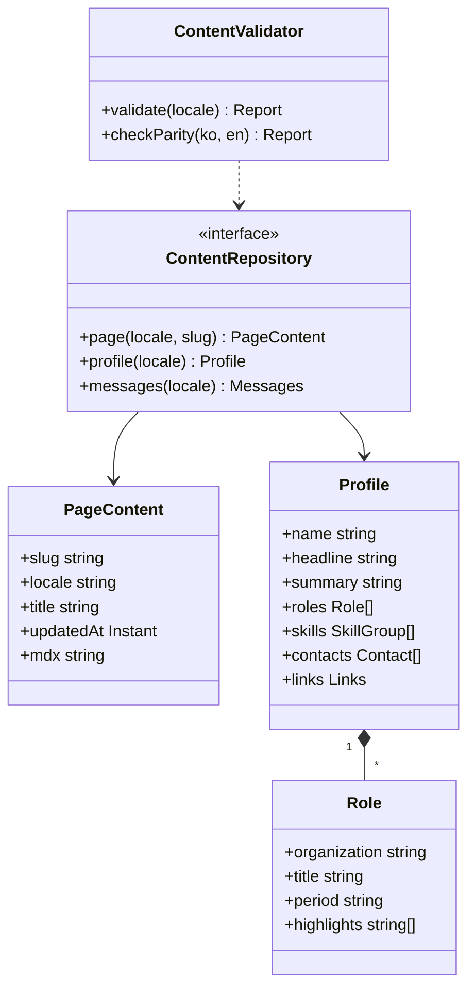
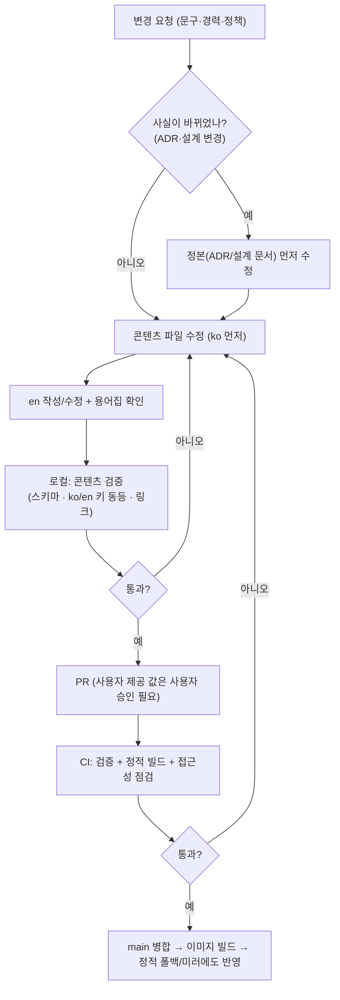

# 12. 콘텐츠 설계

사이트에 들어가는 **문구의 구조·작성 규칙·갱신 절차**. 실제 문구(경력·연락처·소개글)는 **사용자가 제공**한다. 이 문서는 지어내지 않고 **빈 슬롯과 형식·분량·톤**만 정한다(명세 A-004).
화면 배치는 [07](07-frontend.md), 개인정보 처리 사실은 ADR-008·ADR-023·[06](06-auth.md)이 정본이다. 문구가 그 사실과 어긋나면 **문구를 고친다**.

## 1. 콘텐츠 종류와 위치

| 종류 | 예 | 형식 | 위치(가정, **미확인**) |
|---|---|---|---|
| UI 문자열 | 버튼·라벨·오류 | JSON (ICU) | `apps/web/src/messages/{ko,en}.json` |
| 서술형 페이지 | 자기소개, 아키텍처 설명, 개인정보 | MDX(로케일별 파일) | `apps/web/content/{ko,en}/{about,architecture,privacy}.mdx` |
| 구조화 데이터 | 경력 항목, 연락처 | YAML/JSON → 타입 검증 | `apps/web/content/data/profile.{ko,en}.yaml` |
| 다이어그램 | 아키텍처 그림 | mermaid 소스를 빌드 시 SVG 로 | `apps/web/content/diagrams/*.mmd` |

- 위 경로는 [01](01-repository-structure.md) 확정 시 맞춘다(미확인).
- 서술형은 **로케일마다 별도 파일**로 둔다(문장 단위 번역 키로 쪼개지 않는다). UI 문자열만 키-값이다.

### 1.1 사이트 변수 (`apps/web/content/data/site-vars.yaml`)

나중에 사용자가 채울 값은 **한 파일의 변수**로 모은다. 코드·문구에 값을 직접 쓰지 않고 이 변수만 참조한다. 스키마(TypeBox)는 `apps/web/content/site-vars.schema.ts`.

| 변수 | 타입 | 기본 | 비었을 때(`null`) | 릴리스 필수 |
|---|---|---|---|---|
| `contact.emailVisible` | boolean | `false` | 이메일을 표시하지 않음 | 예(결정 필요) |
| `contact.email` | string \| null | `null` | `emailVisible` 이 true 인데 null 이면 릴리스 빌드 실패 | `emailVisible` 일 때 |
| `contact.links.github` · `linkedin` · `blog` | url \| null | `null` | 해당 링크 숨김 | 아니오 |
| `privacy.operatorName` | string \| null | `null` | 개인정보 안내의 운영자 줄 숨김 | 예 |
| `privacy.deletionContact` | string \| null | `null` | 삭제 요청 항이 "문의 수단 준비 중" 자리표시 | 예 |
| `privacy.deletionResponseDays` | int \| null | `null` | 처리 기한 문장을 넣지 않음 | 아니오 |
| `privacy.cookieBanner` | boolean | `false` | — | 예(결정 필요) |
| `site.repoUrl` | url | (저장소) | — | 예 |
| `site.ciBadgeUrl` | url \| null | `null` | 배지 숨김. **값이 있으면 그 호스트가 CSP `img-src` 에 들어간다**([10](10-security.md) §2.2) | 아니오 |
| `site.metricsEmbedUrl` | url \| null | `null` | 운영 지표 페이지가 임베드 대신 안내·링크를 보임. 값이 있으면 그 출처가 CSP `frame-src` 에 들어간다. Grafana 공개 대시보드 URL(프로비저닝으로 만들 수 없으면 수동 발급, G6) | 아니오 |

- `profile.{ko,en}.yaml` 의 개인 정보(이름·소개·경력)도 같은 규칙이다: 비어 있으면 자리표시, 릴리스 빌드에서만 실패.
- `privacy.cookieBanner` 는 쓰는 쿠키가 모두 **필수(세션·로그인 임시)** 라 기본 `false` 다. 추적·광고 쿠키를 도입하면 `true` 로 바꾸고 동의 UI 를 추가해야 한다.
- 검사 명령: `bun run content:check`(경고 목록) / `CONTENT_STRICT=1 bun run content:check`(릴리스, 비어 있으면 실패). 릴리스 워크플로가 후자를 돌린다([09](09-ci-cd.md)).
- 변수는 **비밀이 아니다**(공개 페이지에 나간다). 비밀은 환경변수·시크릿([10](10-security.md)).

## 2. 자기소개 페이지 (`/about`) — 슬롯 구조

실제 값은 모두 **[사용자 제공 필요]** 이고 §1.1 의 **변수로 비워 둔다**. 값이 비어 있어도 개발·미리보기 빌드는 통과하고(해당 요소는 숨김 또는 자리표시), **릴리스 빌드(`CONTENT_STRICT=1`)만** 필수 변수가 비면 실패한다.

### 2.1 프로필 데이터 스키마

| 필드 | 타입 | 필수 | 제약·가이드 |
|---|---|---|---|
| `name` | string | 예 | [사용자 제공 필요] 표기 이름(ko/en 각각) |
| `headline` | string | 예 | 한 줄 소개, 60자 이내 |
| `summary` | string | 예 | 3~5문장, 200~400자. 사실만, 형용사 남발 금지 |
| `roles[]` | list | 예 | 아래 경력 항목 |
| `skills[]` | list | 선택 | 그룹(언어·데이터·인프라…) 3~5개, 항목은 이름만 |
| `projects[]` | list | 선택 | 이 사이트 외 프로젝트 요약(제목·기간·한 줄·링크) |
| `contacts[]` | list | 예 | 종류(`email`/`github`/`linkedin`/…), 값, 공개 여부 |
| `links.repo` | url | 예 | 공개 GitHub 저장소 (FR-003) |
| `links.ciBadge` | url | 예 | CI 상태 배지 URL (FR-003) |

### 2.2 경력 항목(`roles[]`)

| 필드 | 가이드 |
|---|---|
| `organization` | [사용자 제공 필요] |
| `title` | [사용자 제공 필요] |
| `period` | `YYYY-MM ~ YYYY-MM \| 현재` |
| `highlights[]` | 항목당 1문장, 2~4개. **무엇을 했고 결과가 무엇인지**(가능하면 수치). 수치는 사용자가 제공한 것만 |
| `stack[]` | 선택. 사용 기술 이름 |

### 2.3 톤·분량

| 항목 | 규칙 |
|---|---|
| 톤 | 담백한 서술체(ko: `~했습니다`/`~합니다`, en: 과거형 능동태). 과장·최상급 금지 |
| 1인칭 | ko 는 주어 생략, en 은 "I" 허용 |
| 분량 | 자기소개 본문 화면 2스크롤 이내. 경력은 최신순 |
| 연락처 | 이메일은 **스크랩 방지** 표기(예: 링크 클릭 시 노출) 여부를 사용자가 결정 — 미결 |
| 사실성 | 사용자가 제공하지 않은 경력·수치·소속은 **절대 채우지 않는다** |

## 3. 아키텍처 페이지 (`/architecture`) — 문단 구성

이 사이트가 곧 작품이므로, **데모와 문서가 서로를 가리키는 구조**로 쓴다. 분량은 화면 4~6스크롤, 각 절은 한 가지 주장만 한다.

| 순서 | 절 | 내용 | 연결 |
|---|---|---|---|
| 1 | 이 사이트가 무엇인가 | 목적(백엔드 역량을 보여주는 사이트), 한 문단 | 홈 |
| 2 | 전체 구성 | 컨테이너 그림(web·api·ws-gateway·worker·postgres·관측), 한 단락 설명 | 00 §2 의 그림을 쉬운 말로 재작성 |
| 3 | 글 하나가 지나가는 길 | outbox → inbox → 프로젝터 → WebSocket 흐름 5단계(05 §2.2 단계 이름과 동일) | 흐름 데모 `/flow` 로 이동 버튼 |
| 4 | 일관성과 동시성 | 한 트랜잭션 기록, 상태 선점(CAS), 낙관적 버전, 멱등 키 — 각 한 문장 + "왜" | 해당 ADR 링크 |
| 5 | 실시간과 재접속 | seq·재개·백프레셔(느린 소비자 차단) | 방명록·흐름 데모 |
| 6 | 스택을 이렇게 골랐다 | Bun/Elysia/Next/Postgres 등 선택 이유와 **포기한 것**(트레이드오프) | tech-stack, ADR-022 |
| 7 | 호스팅 | 집 PC + Cloudflare Tunnel, 무료·무카드, Compose 라이브 / k3d 검증, 폴백 2단계 | 운영 지표 `/metrics` |
| 8 | 한계와 다음 | 알려진 한계(단일 노드, 백업 범위 등), 실서비스라면 어떻게 다르게 할지 | ADR "실서비스라면" 절 요약 |

작성 규칙: ① 사실의 정본은 ADR·설계 문서이며 페이지는 **그것을 쉽게 푼 것**이다 ② 문서와 다르게 쓰지 않는다(갱신 시 같이 고침, §7) ③ 약어 첫 등장 시 풀어 쓴다(outbox 등은 용어집 §6).

## 4. 개인정보 안내 (`/privacy`) — 문구 구조

사실 정본: ADR-008(신원·악용·보관), ADR-023 §3(IP 미저장)·§9, [06](06-auth.md).

| 절 | 담을 내용(사실) | 금지 |
|---|---|---|
| 1. 한눈에 | 이 사이트는 포트폴리오 데모이며 수집을 최소로 한다는 3줄 요약 | 법적 효력을 단정하는 문구 |
| 2. 수집하는 것 | ① **세션 쿠키**(익명/로그인 식별, 7일) ② **GitHub 로그인 시 공개 프로필의 숫자 ID·로그인명·아바타 URL**(스코프 없음, 이메일 미수집) ③ **방명록 글·표시 이름·반응** ④ 서비스 운영 지표(**식별자 없는 집계**) | 수집하지 않는 것을 수집한다고 쓰기/그 반대 |
| 3. 수집하지 않는 것 | **IP 주소를 DB·로그·지표에 저장하지 않음**(속도 제한은 메모리에서만), 이메일, 광고·분석 추적기 없음, **CI 배지 이미지(GitHub 등) 외에는 외부 자원 요청 없음**(폰트·스크립트 자체 호스팅; 배지를 켜면 배지 호스트로 브라우저 요청이 나감) | 검증 안 된 단정 — 구현 후 확인된 것만 |
| 4. 보관 기간 | 세션·이벤트 로그·outbox 이력: **7일** 후 삭제 / 방명록 글·반응: **보관**(숨김 포함) / 실패 격리 기록: 30일 / 백업: 일별 7개·주별 4개 보관(암호화, 외부 저장소는 G12 결과에 따라) | 백업 위치를 확정 전에 단정 |
| 5. 익명화 | 세션이 삭제되면 글의 작성자 세션 연결이 끊기고 반응 행위자 값은 무작위 값으로 바뀌어 **집계만 남음** | |
| 6. 공개 범위 | 방명록 글은 누구에게나 보임. 흐름 시각화에서 **다른 방문자는 내용·식별자 없이 개수만** | |
| 7. 삭제·정정 요청 | 로그인 사용자는 본인 글을 직접 수정·삭제. 그 외(익명 글 삭제 등)는 **[사용자 제공 필요: 연락 수단]** 로 요청 → 관리자가 숨김/삭제. 처리 목표 기간은 [사용자 결정 필요] | 처리 기한을 지키지 못할 약속 |
| 8. 제3자 | GitHub(로그인 시), Cloudflare(전송 경유) 두 곳만 | |
| 9. 변경 이력 | 날짜별 변경 요약 | |

- 이 페이지는 **정적 폴백 대상**이다([07](07-frontend.md) §8).
- 법무 검토를 받은 문서가 아니다. 페이지 상단에 "포트폴리오 데모의 안내문"임을 밝히고 법적 자문을 대체하지 않는다고 적는다. 실서비스라면 보존 기간을 법무와 정한다(ADR-008).

### 4.1 쿠키 고지

| 쿠키 | 목적 | 기간 | 동의 필요 여부 |
|---|---|---|---|
| `__Host-sid` | 세션(익명/로그인) | 7일 | 서비스 제공에 필수 |
| `__Secure-oauth` | 로그인 진행 중 상태 | 10분 | 필수 |
| `NEXT_LOCALE` | 언어 선택 | 1년 | 기능성 |
| `theme` | 테마 선택 | 1년 | 기능성 |

- 추적·광고 쿠키가 없으므로 **동의 배너를 두지 않고** 이 표와 안내만 제공한다. 이 판단의 법적 타당성은 사용자가 확인한다 — **[사용자 결정 필요]**.
- 쿠키 이름·기간은 06 과 같아야 한다(변경 시 동시 갱신).

## 5. 번역 규칙 (ko/en)

| 규칙 | 내용 |
|---|---|
| 정본 언어 | 서술형은 **ko 를 먼저 쓰고 en 을 작성**한다(사용자 모국어 기준). 의미가 같으면 문장 구조는 달라도 된다 |
| 동등성 | 두 언어가 **같은 사실**을 담는다. 한쪽에만 있는 수치·링크 금지(구조화 데이터는 키 집합 동일을 CI 가 검사) |
| 용어 | §6 용어집의 표기만 쓴다. 새 용어는 용어집에 먼저 추가 |
| 고유명사 | 제품·기술 이름은 원문(Postgres, WebSocket). 한글 병기는 첫 등장에서만 |
| 숫자·날짜 | ko `2026-11-04`/`2026년 11월`, en `Nov 2026`. 단위는 숫자 뒤 공백(`500 chars`) |
| 오류 문구 | 비난하지 않는 문장, 다음 행동 제시("잠시 후 다시 시도해 주세요") |
| 기계번역 | 초안으로만 사용 가능, **사람이 검수한 뒤** 반영 |

## 6. 용어집

| 개념 | ko | en | 비고 |
|---|---|---|---|
| outbox | 아웃박스 | outbox | 첫 등장에 "발행 대기함" 풀이 |
| inbox | 인박스 | inbox | "수신함" 풀이 |
| projection / read model | 읽기 모델 | read model | |
| command / query | 명령 / 조회 | command / query | |
| idempotent | 멱등 | idempotent | "여러 번 해도 결과가 같은" 풀이 |
| optimistic locking | 낙관적 잠금(버전 검사) | optimistic locking | |
| lease | 임대 | lease | |
| dead-letter | 격리(dead) | dead-letter | UI 에서는 "격리됨" |
| trace | 흐름(추적) | trace | UI 에서는 "흐름" |
| guestbook | 방명록 | guestbook | |
| reaction | 반응 | reaction | |
| session (anonymous) | 익명 세션 | anonymous session | |
| backpressure | 백프레셔(과부하 제어) | backpressure | |
| snapshot / replay | 스냅샷 / 재생 | snapshot / replay | |

## 7. 클래스 구조 — 콘텐츠 모델

콘텐츠는 빌드 시 **타입 검증**을 거쳐 화면 컴포넌트에 주입된다.

상속 구조: 해당 없음 — 콘텐츠 모델은 값 타입의 합성이며 다형 계층이 없다. (페이지 컴포넌트 구조는 [07 §10](07-frontend.md))

## 8. 순서도 — 콘텐츠 갱신과 번역

## 9. 갱신 절차(요약)

| 단계 | 규칙 |
|---|---|
| 정본 우선 | 아키텍처·개인정보 페이지의 사실은 ADR/설계가 정본. 정책이 바뀌면(예: IP 저장) **먼저 ADR 을 고치고** 페이지를 맞춘다 |
| 사용자 값 | 경력·연락처·소개는 사용자가 제공·승인한 값만. 에이전트/기여자는 임의로 채우지 않는다 |
| 검증 | 스키마(필수 슬롯 비어 있으면 실패), ko/en 구조 동등, 링크 유효, 용어집 위반(선택) |
| 날짜 | 서술형 페이지는 `updatedAt` 을 프런트매터에 두고 화면에 표시 |
| 폴백 | 정적 폴백 대상 페이지(홈·자기소개·아키텍처·개인정보)는 변경 시 정적 미러도 재배포됨을 확인([09](09-ci-cd.md)) |

## 10. 미결

| 항목 | 결정 주체·시점 |
|---|---|
| 자기소개의 모든 실제 문구(이름·경력·연락처·소개글·프로젝트) | **사용자 제공** — 구현 중/출시 전 |
| 이메일 노출 방식, 삭제 요청 연락 수단·처리 목표 기간 | 사용자 결정 |
| 쿠키 동의 배너 불요 판단의 타당성 | 사용자 확인 |
| `apps/web/content` 경로 | 01 §1 에 반영됨(확정) |
| 개인정보 문구 중 "CI 배지 외 외부 자원 없음", "백업 외부 저장소" | 구현 후 사실 확인(G12 포함) |
