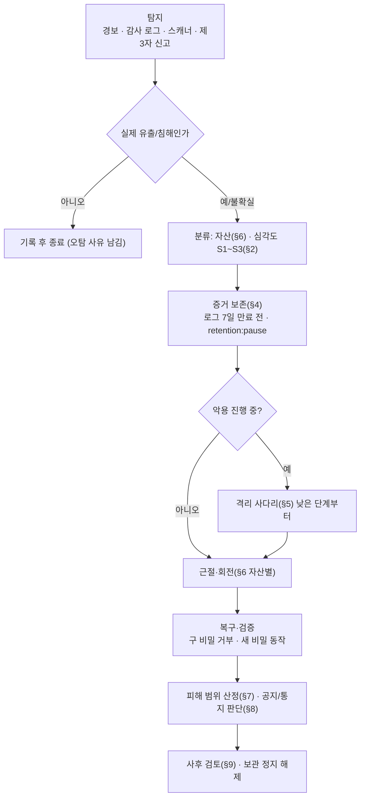
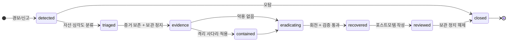
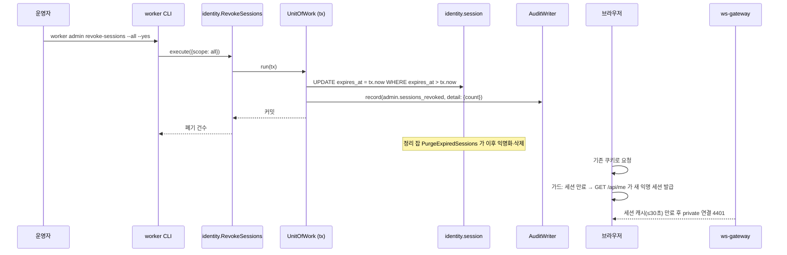
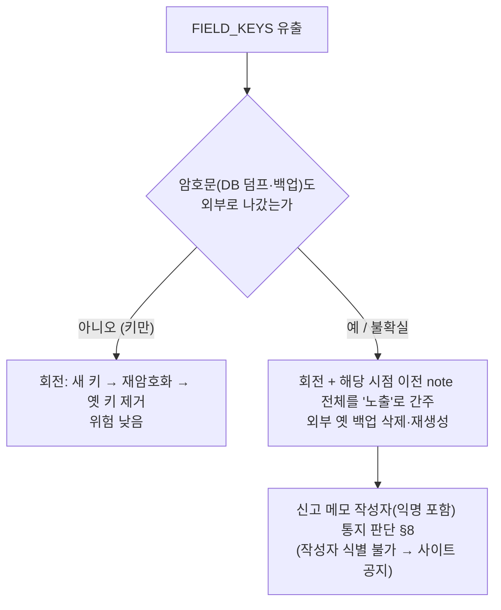
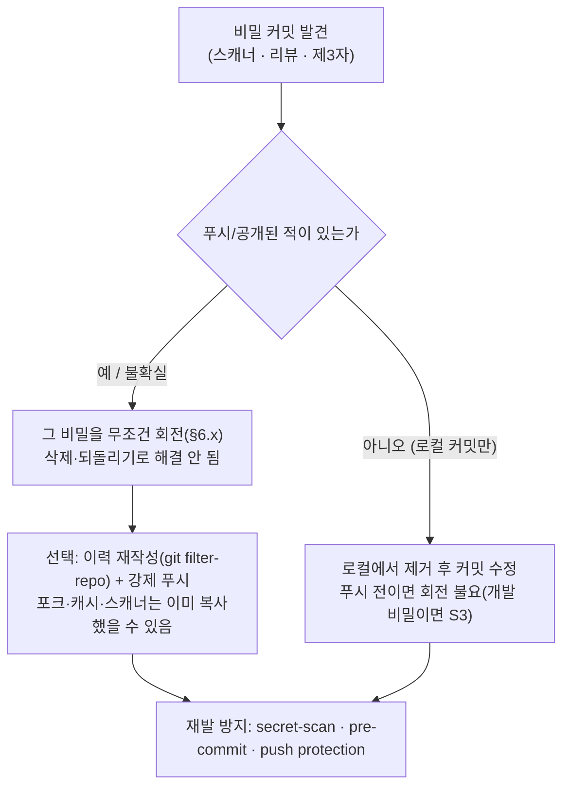

# 13. 보안사고 대응 (유출·침해 런북)

비밀·데이터·계정이 유출됐거나 침해가 의심될 때 **무엇을 어떤 순서로 하는가**의 정본. 원칙과 결정은 [ADR-028](../adr/ADR-028-incident-response.md), 데이터 분류는 [ADR-026](../adr/ADR-026-data-protection.md), 감사·로그는 [ADR-027](../adr/ADR-027-server-logs.md), 평상시 회전 정책은 [10](10-security.md) §5, 저장 위치는 [02](02-dev-environment.md) §5.

> 다이어그램 해당 여부 — 순서도(분류·저장소 커밋 판정)·상태(사고 수명)·시퀀스(세션 폐기·FIELD_KEYS 유출)를 쓴다. **클래스·상속 구조는 해당 없음**: 절차 문서다(`RevokeSessions` 의 클래스는 [F10](features/10-identity.md) ID-11, 보관 정지는 [F13](features/13-events-pipeline.md)).
> 명령·스크립트 예시는 모두 **제안/미검증**이다(S8-8 리허설에서 실제로 돌려 확인한다).

---

## 1. 범위·용어·역할

| 항목 | 내용 |
|---|---|
| 범위 | 비밀 유출, DB 덤프·백업 유출, 계정 탈취(GitHub·Cloudflare·관리자), 공급망 변조, 저장소 비밀 커밋 |
| 범위 밖 | 가용성 장애(→ F17 경보), 일반 버그, 서비스 거부 공격 대응(M1 비목표) |
| 역할 | **운영자 1인**(탐지·판단·조치·기록을 모두 한다). 온콜 없음 → 목표 시간은 "깨어 있을 때 즉시, 늦어도 24시간"을 기준으로 한다 |
| 탐지 채널 | Discord 경보(F17 §17: `LoginFailedSpike`, `pf_log_redactions_total` 급증 등), 감사 로그(`worker audit:list`), 비밀 스캐너 알림, 제3자 신고 |
| 용어 | **회전**=구 비밀을 폐기하고 새 비밀로 교체. **격리**=악용을 막는 임시 조치. **증거 보존**=로그·감사·DB 스냅샷을 인시던트 폴더에 복사 |

## 2. 심각도와 목표 시간

| 단계 | 판정 기준(예) | 목표(제안) |
|---|---|---|
| **S1** | 비밀 키·DB 덤프·백업 개인키·관리자 계정이 외부에 노출됐거나 악용 정황(원치 않는 숨김, 의심스러운 `report_note_read`, 낯선 로그인 패턴) | 즉시 **증거 보존 → 격리**, **24시간 내 회전 완료** |
| **S2** | 노출 가능성은 높지만 악용 정황 없음(저장소에 비밀 커밋, 웹훅 URL 노출, 개발 `.env` 유출) | 증거 보존 후 24시간 내 회전 |
| **S3** | 저위험(의존성 취약점 공지, 시도 흔적, 마스킹 발동 증가, 개발 전용 비밀) | 1주 내 조치 |

판정이 애매하면 **한 단계 높게** 시작하고, 조사 결과로 내린다.

## 3. 공통 절차





타임라인(§4.3)은 `detected` 부터 닫을 때까지 **조치마다 한 줄**씩 적는다.

## 4. 증거 보존 (격리보다 먼저)

앱·접근 로그는 7일, 정리 잡은 계속 돈다(ADR-027). **지우기 전에 복사하고 정리를 멈춘다.**

### 4.1 순서

| 단계 | 조치 | 비고 |
|---|---|---|
| 1 | 보관 정지: `worker retention:pause --reason "<인시던트 id>"` | 감사 `system.retention_paused`. **24시간 뒤 자동 해제**(F13), 경보 `RetentionPaused`. 정지 중에는 `PurgeExpiredSessions`·`archive-logs.sh` 의 삭제도 건너뛴다 |
| 2 | 인시던트 폴더 생성 | `incidents/<YYYY-MM-DD>-<id>/` 권한 **0700**, 소유 `pf`. **외부 업로드·백업 제외** |
| 3 | 로그 복사 | 아카이브 디렉터리 전체 + 현재 컨테이너 로그 |
| 4 | 감사 로그 내보내기 | `worker audit:list --since <t0 - 7d> --json` (읽기 전용, 감사 기록 없음) |
| 5 | DB 스냅샷 | `pg_dump` 를 `age` 로 암호화해 폴더에 저장 |
| 6 | 타임라인 파일 시작 | §4.3 양식 |

### 4.2 명령 예시 (제안/미검증)

```bash
INC=incidents/$(date +%F)-<id>
install -d -m 0700 "$INC" "$INC/logs"
cp -a "$PF_LOG_DIR"/archive/. "$INC/logs/"                 # 일 아카이브(최대 7일)
for s in api ws-gateway worker web proxy; do
  docker logs --timestamps "pf-$s" > "$INC/logs/live-$s.log" 2>&1   # 순서 보존 한계는 F17 §16.1.0
done
worker audit:list --since 14d --json > "$INC/audit.jsonl"
pg_dump -Fc --schema=identity --schema=guestbook --schema=events \
  | age -r "$BACKUP_AGE_RECIPIENT" > "$INC/db.dump.age"
worker retention:pause --reason "$(basename "$INC")"
```

- 로그를 **삭제하거나 편집하지 않는다.** 인시던트 폴더는 사고가 닫히고 포스트모템이 끝난 뒤 보관 기간(제안 90일)이 지나면 삭제한다.
- 복사본에 평문 비밀이 들어 있을 수 있다(침해 시 비밀이 로그에 샜을 가능성). 폴더 접근 권한이 곧 보호다.

### 4.3 타임라인 양식

```
# 인시던트 <id> — <한 줄 제목>
- 심각도: S? / 자산: <§6 항목> / 상태: detected|triaged|evidence|contained|eradicating|recovered|reviewed|closed
| 시각(KST) | 행위자 | 조치/관찰 | 근거(로그 경로·감사 id) |
|---|---|---|---|
| 2026-..-.. 09:12 | 운영자 | 탐지: Discord LoginFailedSpike | 알림 링크 |
| ... | | 증거 보존 완료 | incidents/... |
```

## 5. 격리 — 비상 스위치 사다리

**낮은 단계부터 필요한 만큼만** 올린다. 위로 갈수록 사용자 영향이 크다.

| 단계 | 스위치 | 실행 | 사용자 영향 | 되돌리기 | 기록 |
|---|---|---|---|---|---|
| 1 | **쓰기 잠금** | `worker admin write-lock on --reason "<공지 문구>"` 또는 `POST /api/admin/write-lock` | 글 작성·수정·반응 추가·신고가 `503 write_locked`. 읽기·삭제·반응 취소·로그인은 유지. **`reason` 이 사용자에게 공지로 보인다**(§8) | `... off` | 감사 `admin.write_lock_changed` |
| 2 | **세션 전체 폐기** | `worker admin revoke-sessions --all` | 로그인 사용자는 재로그인, 익명은 새 익명 세션(본인 글 표시 상실, 익명 글은 원래 수정 불가). private 연결 `4401` | **되돌릴 수 없음**(폐기된 세션은 복원 안 함) | 감사 `admin.sessions_revoked`(대상 수) |
| 3 | **관리자 권한 회수** | `ADMIN_GITHUB_IDS` 에서 해당 id 제거 → 재배포 | 해당 계정의 숨김·신고 처리·메모 열람·쓰기 잠금 불가(전원 제거 시 관리 기능 전체 중단) | id 복구 후 재배포 | 설정 변경이라 앱 감사 아님 → **타임라인에 수동 기록**(커밋 id) |
| 4 | **정적 폴백 전환** | `docker compose stop web api ws-gateway` | 데모·로그인 중단, 소개·아키텍처는 nginx 정적 페이지로 유지(FR-070) | `docker compose start ...` | 앱 중단이라 기록 없음 → 타임라인 |
| 5 | **Tunnel 중지** | `docker compose stop cloudflared` | **사이트 전체 오프라인**(Cloudflare 정적 미러가 구성돼 있으면 정적 페이지만 응답할 수 있음 — G11 미확인) | `start cloudflared` | 타임라인 |



- 위험 명령(`--all`)은 확인 문구 또는 `--yes`(F16 §11)와 `--dry-run` 을 쓴다.
- 3단계(관리자 회수)는 **설정 파일 변경 + 재배포**라 5분 이상 걸릴 수 있다. 급하면 먼저 1단계(쓰기 잠금)와 2단계(세션 폐기)로 막는다. 그 사용자의 세션만 끊으려면 `--user <id>`.

## 6. 자산별 런북

각 항목: 유출 영향 / 탐지 신호 / 즉시 조치 / 회전 절차 / 검증 / 후속·통지 판단. 비밀 파일 위치는 02 §5, 평상시 회전 정책은 10 §5.

### 6.1 세션 토큰 (대량)

| 항목 | 내용 |
|---|---|
| 영향 | 계정·익명 세션 탈취. 토큰은 해시만 저장하므로 DB 덤프만으로는 복구 불가 — 노출은 **쿠키 탈취·XSS·로그 유출** 경로 |
| 탐지 | 같은 세션의 이상 행동, 감사 `auth.*` 급증, `pf_log_redactions_total` 급증 |
| 즉시 | 증거 보존 → `revoke-sessions --all`(사용자 단위면 `--user`) |
| 회전 | 세션은 폐기 즉시 효력. 원인(XSS·로그)을 찾아 제거 |
| 검증 | 구 쿠키로 요청 → 새 익명 세션 발급(인증 안 됨), private 연결 `4401` |
| 후속 | 원인 제거 확인 후 종료. 개인정보 영향 없음(S2~S3) |

### 6.2 `OAUTH_STATE_SECRET` (OAuth 임시 쿠키 서명 키)

| 항목 | 내용 |
|---|---|
| 영향 | 로그인 시작 쿠키(state·PKCE verifier) 위조 → 로그인 CSRF 가능성 |
| 즉시 | 새 값 생성: `head -c 32 /dev/urandom | base64 -w0 > secrets/oauth_state_secret.new` |
| 회전 | `mv` 로 교체 → api 재기동. **진행 중(10분 이내) 로그인만 실패**한다 |
| 검증 | 구 키로 서명한 쿠키가 콜백에서 `oauth_state_invalid`, 새 로그인 성공 |
| 후속 | 위조 로그인 정황은 감사 `auth.login_failed`(reason `state_invalid`) 로 확인 |

### 6.3 GitHub OAuth client secret

| 항목 | 내용 |
|---|---|
| 영향 | 공격자가 이 앱으로 인가 코드를 교환할 수 있음(사용자 토큰 탈취 가능성 — 스코프 없음이라 영향 제한) |
| 즉시 | GitHub OAuth 앱 설정에서 새 secret 생성 |
| 회전 | `secrets/github_client_secret` 교체 → api 재기동 → GitHub 에서 구 secret 삭제. 기존 세션은 영향 없음 |
| 검증 | 로그인 한 번 성공, 구 secret 으로 토큰 교환 실패 |
| 후속 | 앱 설정(콜백 URL·소유자) 변조 여부 점검, 이 계정의 2FA 확인 |

### 6.4 DB 비밀번호

| 항목 | 내용 |
|---|---|
| 영향 | **DB 전체 접근**(쓰기 모델·읽기 모델·감사). 가장 넓은 영향 → 기본 S1 |
| 탐지 | 낯선 접속(호스트 포트가 열려 있다면 접속 로그), 이상 쿼리 |
| 즉시 | 증거 보존(`pg_stat_activity`·Postgres 로그) → 쓰기 잠금 |
| 회전 | 1) `ALTER ROLE pf PASSWORD '<새>'` 2) `secrets/database_url` 교체 3) 앱 재기동(우아한 종료) 4) 구 세션 정리: `SELECT pg_terminate_backend(pid) FROM pg_stat_activity WHERE usename='pf' AND pid <> pg_backend_pid()` (제안) |
| 검증 | 구 비밀번호로 `psql` 접속 거부, 앱 `/readyz` 정상 |
| 후속 | **DB 덤프 유출 가능성으로 간주**(§6.12 영향표). 호스트 포트 노출 여부 점검(10 §2) |

### 6.5 `FIELD_KEYS` (필드 암호화 키링)

| 항목 | 내용 |
|---|---|
| 영향 | `report.note_enc` 복호화 가능. **과거 백업·덤프도 같은 키로 복호화된다** — 재암호화만으로는 이미 가져간 암호문을 되돌릴 수 없다 |
| 탐지 | 시크릿 파일 접근 이력, 저장소·로그에 키링 노출, 호스트 침해 |
| 즉시 | 증거 보존, 키링 파일 권한 확인 |
| 회전 | 새 키 추가 → `active` 변경 → `worker rotate-field-keys` 재암호화 → 잔여 0 확인 → **옛 키 삭제**(10 §5). **외부·로컬의 옛 백업은 옛 키로 복호화 가능**하므로 삭제 또는 새 키로 재생성(백업 키쌍 교체와 함께, §6.6) |
| 검증 | 신규 암호문이 새 키 ID, 옛 키로 만든 암호문은 키링에서 제거 후 복호화 불가 |



**후속**: 신고 메모는 ≤200자 자유 텍스트로 개인정보가 들어갔을 수 있다. 작성자가 가명 식별자(`reporter_key`)뿐이라 개별 통지가 어려울 수 있어 사이트 공지로 대체할지 판단한다.

### 6.6 백업 age 개인키

| 항목 | 내용 |
|---|---|
| 영향 | 그 키로 암호화된 **모든 과거 백업**(외부 저장소 포함)이 복호화된다 |
| 탐지 | 개인키 보관 매체(오프라인 사본) 분실·침해 |
| 즉시 | 외부 저장소 접근을 막고(계정 비밀번호·토큰 회전), 어떤 백업이 있는지 목록 확보 |
| 회전 | 1) 새 `age` 키쌍 생성(오프라인) 2) 서버의 `BACKUP_AGE_RECIPIENT` 를 새 공개키로 교체 3) **즉시 새 전체 백업**과 복구 시험 4) **옛 키로 암호화된 외부 백업 삭제**, 로컬 옛 백업도 새 백업 검증 뒤 삭제 |
| 검증 | 새 백업이 새 개인키로 복호화·복원됨, 옛 개인키로는 새 백업이 열리지 않음 |
| 후속 | **외부로 나간 과거 백업은 노출로 간주**(§6.12 영향표). 개인키는 서버에 두지 않는다는 원칙(ADR-026)이 유지되는지 확인 |

### 6.7 Discord 웹훅 URL

| 항목 | 내용 |
|---|---|
| 영향 | 경보 채널에 **위조 메시지**를 보낼 수 있음(운영 정보 노출은 없음, 신뢰 훼손) |
| 회전 | Discord 에서 웹훅 **삭제 후 재생성** → 시크릿 파일 교체 → grafana 재기동 |
| 검증 | 구 URL 에 `curl` 시 404, 새 URL 로 시험 알림 도착 |
| 후속 | 위조 메시지가 실제 경보로 오인되지 않았는지 타임라인 대조. 심각도 S3 |

### 6.8 Cloudflare Tunnel 토큰

| 항목 | 내용 |
|---|---|
| 영향 | 공격자가 같은 터널에 커넥터를 붙여 **트래픽을 가로채거나 응답을 위조**할 가능성 |
| 즉시 | 격리 5단계(cloudflared 중지) 고려 |
| 회전 | Cloudflare 대시보드에서 토큰 갱신(또는 터널 삭제 후 재생성 — 토큰 갱신 방식은 **미확인**) → `secrets/tunnel_token` 교체 → cloudflared 재시작 |
| 검증 | 구 토큰 커넥터 연결 거부(대시보드의 커넥터 목록에 구 커넥터가 없음), 사이트 정상 |
| 후속 | Cloudflare 계정 2FA·세션·API 토큰 점검. 변조된 응답이 나갔을 가능성이 있으면 §8 공지 |

### 6.9 관리자 GitHub 계정 탈취

| 항목 | 내용 |
|---|---|
| 영향 | 숨김·해제, 신고 처리, **신고 메모 열람**, 쓰기 잠금 변경이 가능. DB·서버 접근은 아님 |
| 탐지 | 감사 `admin.*` 의 낯선 시각·패턴, 이상한 로그인 알림(GitHub) |
| 즉시 | 격리 3단계: `ADMIN_GITHUB_IDS` 에서 제거 → 재배포. 그 전에 쓰기 잠금과 `revoke-sessions --user <id>` |
| 피해 범위 | §7 쿼리: 탈취 기간의 `admin.*` 조치 목록, `report_note_read` 대상 신고 id |
| 회전·복구 | GitHub: 비밀번호 변경, 2FA 확인, 인가된 OAuth 앱·PAT·SSH 키 폐기. 이 계정이 OAuth 앱 소유자면 §6.3(client secret) 도 회전. 부당하게 **숨김된 글은 `unhide`**, 해제된 글은 재숨김은 사건 후 판단 |
| 검증 | 해당 id 로 로그인해도 `isAdmin=false`, 감사에 새 `admin.*` 없음 |
| 후속 | 열람된 신고 메모의 작성자 통지 판단(§8). 재발 방지: 관리자 계정 보안 키(FIDO2) 권장 |

### 6.10 저장소에 비밀 커밋

저장소가 **공개**라 푸시 즉시 노출된 것으로 본다.



| 항목 | 내용 |
|---|---|
| 규칙 | **삭제 커밋은 해결이 아니다** — 이력에 남고, 포크·캐시에 복사됐을 수 있다. 회전이 먼저, 이력 정리는 선택 |
| 회전 대상 | 노출된 비밀 종류에 따라 §6.2~6.8 의 해당 절 |
| 이력 정리 | 강제 푸시는 되돌릴 수 없는 작업이라 **운영자가 직접 판단·실행**(자동화하지 않는다) |
| 후속 | 어떻게 커밋됐는지(`.gitignore`·경로 실수) 원인 수정, 스캐너 규칙 추가 |

### 6.11 공급망 사고 (의존성·이미지·Actions 변조)

| 항목 | 내용 |
|---|---|
| 영향 | 악성 코드가 빌드·실행 환경에서 돌았다면 **마운트된 모든 비밀이 노출**됐다고 본다 |
| 탐지 | `bun audit`(주간 `schedule.yml`), 잠금 파일(`bun.lock`) 예상 밖 변경, 의존성 보안 공지, 이상 아웃바운드 연결 |
| 즉시 | 배포 동결(pull-deploy 타이머 중지), 증거 보존, 직전 정상 이미지 태그로 **롤백**(pull-deploy 이전 태그) |
| 점검 | `git diff <정상>..HEAD -- bun.lock`, 새로 들어온 패키지의 설치 스크립트 유무, Actions 워크플로 변경 이력. Bun 의 설치 스크립트 기본 정책은 **미확인** |
| 회전 | 악성 코드가 서버에서 실행됐다면 **전체 비밀 회전**(§6.2~6.8, 6.13) — S1 |
| 검증 | 깨끗한 캐시로 이미지 재빌드, 해시가 정상 릴리스와 대조됨(방법은 미확인) |
| 후속 | 해당 패키지 고정·제거, 공급망 점검(`supply-chain-audit` 스킬) 재실행 |

### 6.12 DB 덤프·백업 유출

**포함 데이터별 영향** (ADR-026 분류와 같은 기준):

| 포함 데이터 | 유출 영향 | 비고 |
|---|---|---|
| 방명록 본문·표시 이름·반응 | 없음 | 원래 공개 |
| `github_id`·`login`·`display_name` | 낮음 | GitHub 공개 프로필, 이 사이트 이용 사실이 연결됨 |
| `session.token_hash` | 낮음 | 해시만 — 토큰 복구 불가. 만료 전 세션은 `revoke-sessions --all` 로 무효화 |
| `report.note_enc` | **키링 유출 여부에 달림** | 키링이 함께 나가지 않았다면 안전. 함께 나갔으면 §6.5 |
| `reporter_key`·`actor_key` 등 가명 식별자 | 낮음 | 7일 후 익명화 |
| outbox/inbox `payload` | 없음 | 공개 데이터(note 미포함) |
| `audit_log` | 낮음~중간 | 관리자 행위 이력(관리자 `user_id`) |
| IP·이메일·토큰 원문 | 없음 | 저장하지 않음 |

**즉시**: 어느 덤프가 어디로 나갔는지(로컬/외부, 날짜)를 확정 → `revoke-sessions --all` → 키링·백업 키쌍 상태에 따라 §6.5·§6.6.
**판단**: 위 표의 "낮음" 이상 항목이 있는 덤프면 §8 공지를 판단한다.

### 6.13 GHCR·배포 토큰, Grafana 관리자 비밀번호

| 자산 | 영향 | 회전 |
|---|---|---|
| 호스트의 GHCR pull 토큰(읽기 전용 PAT) | 비공개 이미지 가져오기(공개 이미지면 영향 거의 없음) | GitHub 에서 토큰 폐기·재발급 → 호스트 `docker login` 자격 교체(`pf` 사용자 홈) |
| CI 의 `GITHUB_TOKEN` | 실행 단위로 자동 만료 | 해당 없음(워크플로 권한 `contents: read` 최소화 점검) |
| Grafana 관리자 비밀번호 | 대시보드·경보 규칙·연락처(웹훅 URL) 변경 | 환경 파일 교체 후 재기동. 변조 시 §6.7 도 점검 |
| SSH 키(Oracle 호스트 사용 시) | 호스트 접근 | 키 교체, `authorized_keys` 점검, 전체 비밀 회전 고려(호스트 침해 취급) |

## 7. 피해 범위 산정

읽기 전용으로 조회한다(`SET TRANSACTION READ ONLY`). 앱 코드의 쓰기 규칙(ADR-025)과 별개로, 사고 조사는 **읽기 전용 접속**(제안: `pf_readonly` 역할)을 쓴다. 아래는 형식 예시다(**제안/미검증**).

| 질문 | 방법 |
|---|---|
| 탈취 기간에 관리자가 무엇을 했나 | `worker audit:list --category admin --since <t0> --json` 또는 `SELECT at, action, target_type, target_id, outcome FROM events.audit_log WHERE category='admin' AND at >= :t0 ORDER BY at;` |
| 신고 메모를 열람한 건 | `... WHERE action='report_note_read' AND at >= :t0` → `target_id`(신고 id) 목록 |
| 숨김/해제된 글 | `SELECT target_id, at FROM events.audit_log WHERE action IN ('entry_hidden','entry_unhidden') AND at >= :t0;` (본문은 조회하지 않아도 된다) |
| 로그인 이상 | `SELECT date_trunc('hour', at) h, reason_code, count(*) FROM events.audit_log WHERE action='login_failed' AND at >= :t0 GROUP BY 1,2;` |
| 영향받은 세션 수 | `SELECT count(*) FROM identity.session WHERE expires_at > now();` |
| 쓰기 잠금 변경 이력 | `... WHERE action='write_lock_changed'` |
| 유출된 신고 메모 수 | `SELECT count(*) FROM guestbook.report WHERE note_enc IS NOT NULL AND created_at BETWEEN :a AND :b;` (쓰기 스키마 읽기 — 사고 조사 한정 예외, 결과는 개수만 기록) |
| 접근 흔적 | 인시던트 폴더의 접근 로그에서 `uri`·`status`·`rt` 로 추적(IP 는 원래 없음 — ADR-023, 그래서 공격자 식별이 어렵다는 한계를 기록) |

- 앱 로그에 IP·본문이 없으므로 **"누가"보다 "무엇이 영향받았나"** 에 집중한다.
- 결과(개수·id 목록)만 타임라인에 적고 개인정보 내용은 옮기지 않는다.

## 8. 커뮤니케이션

| 대상 | 수단 | 비고 |
|---|---|---|
| 내부 기록 | 타임라인 파일(§4.3) | 모든 조치를 한 줄씩 |
| 사용자(즉시·런타임) | **`write_lock.reason`** — 쓰기 잠금의 사유 문구가 사용자 화면에 공지로 보인다(F11 GB-10) | 재배포 불필요. 길이 ≤200자 |
| 사용자(빌드 시점) | **`site.securityNotice`**(site-vars 제안, 12 §1.1) — 배너 문구 | 빌드 시점 값이라 **재배포가 필요**하다(수 분). null 이면 배너 없음 |
| 법적 통지 | **법무 검토 필요 — 미확인** | 개인정보 유출 통지·신고 의무(예: 한국 개인정보 보호법)가 이 사이트의 수집 범위에 적용되는지, 기한·기준이 무엇인지는 **확인하지 못했다.** 단정하지 않는다. 설계는 판단에 필요한 사실(§7: 무엇이, 몇 건, 언제 유출됐나)을 빠르게 뽑는 데까지 책임진다 |

**공지 문구 템플릿** (사실만, 추측·변명 없이)

```
[ko]
보안 점검 중입니다. {date} {time} 경 {what} 이(가) 외부에 노출되었을 가능성을 확인했습니다.
영향 범위: {scope}. 조치: {actions}. 글 작성이 일시적으로 제한됩니다.
문의: {contact}

[en]
Security notice. On {date} {time} we found that {what} may have been exposed.
Affected: {scope}. Actions taken: {actions}. Posting is temporarily limited.
Contact: {contact}
```

- `{contact}` 는 `privacy.deletionContact` 변수(12 §1.1)를 재사용한다.
- 영향이 확인되지 않은 단계에서는 "가능성"으로만 쓰고, 확정된 사실만 단정한다.

## 9. 사후 검토

닫기 전에 `docs/incidents/YYYY-MM-DD-제목.md` 를 쓴다(저장소에 올릴 때는 **비밀·개인정보를 제거한 버전**만).

```
# 포스트모템 — <제목>
- 요약(3줄) / 심각도 / 기간(탐지~복구) / 영향 범위(수치)
## 타임라인 (KST)
## 원인 (직접 원인 · 근본 원인)
## 잘 된 것 / 안 된 것
## 조치 (회전한 비밀 · 변경한 설정 · 코드 수정)
## 재발 방지 (작업 항목, 담당, 기한)
## 문서 변경 (런북 · ADR 갱신 여부)
```

| 규칙 | 내용 |
|---|---|
| 제거 대상 | 비밀 값, 토큰, 웹훅 URL, 신고 메모 내용, 세션·사용자 식별자 |
| 후속 | 런북에 틀린 곳이 있었으면 이 문서(13)를 고치고, 결정이 바뀌면 ADR-028 을 갱신한다 |
| 마무리 | `worker retention:resume`(또는 24시간 자동 해제), 인시던트 폴더 보관 기간(제안 90일) 후 삭제 |

## 10. 예방과 리허설

| 장치 | 내용 | 상태 |
|---|---|---|
| 비밀 스캔(CI) | PR 검사에 `secret-scan` 잡([09](09-ci-cd.md) §2). 도구 후보 `gitleaks` | **도구 선택·동작 미확인**(S1-15) |
| pre-commit | 커밋 전 스캔 훅(`.githooks/pre-commit` + `git config core.hooksPath .githooks`) | 제안, 도구 미확인 |
| GitHub 비밀 스캔·푸시 보호 | 공개 저장소에서 제공되는 기능 | **무료 여부·동작 미확인** |
| `.gitignore` | `.env`, `secrets/`, `incidents/` | 필수 |
| 분기별 회전 리허설 | 아래 체크리스트 | S8-8 |

**회전 리허설 체크리스트** (분기 1회, 개발/스테이징 값으로 먼저, 운영은 연 1회 이상 실제 회전)

| 비밀 | 회전 | 구 비밀 거부 확인 | 새 비밀 동작 확인 | 소요 | 기록 |
|---|---|---|---|---|---|
| `OAUTH_STATE_SECRET` | ☐ | 구 쿠키 콜백 실패 | 로그인 성공 | | |
| GitHub client secret | ☐ | 구 secret 교환 실패 | 로그인 성공 | | |
| DB 비밀번호 | ☐ | 구 비번 접속 거부 | `/readyz` 정상 | | |
| `FIELD_KEYS` | ☐ | 옛 키 제거 후 복호화 불가 | 신규 암호문 정상, 재암호화 0건 잔여 | | |
| 백업 age 키쌍 | ☐ | 옛 개인키로 새 백업 안 열림 | 새 백업 복원 성공 | | |
| Discord 웹훅 | ☐ | 구 URL 404 | 시험 알림 도착 | | |
| Tunnel 토큰 | ☐ | 구 커넥터 거부 | 사이트 정상 | | |
| `revoke-sessions` | ☐ | 구 쿠키가 새 익명 세션 | private `4401` | | |
| `retention:pause` | ☐ | 정지 중 삭제 안 함 | 24시간 자동 해제 | | |

리허설에서 막히거나 오래 걸린 단계는 이 문서를 고친다.

## 11. 미결

| 항목 | 결정 시점 |
|---|---|
| 비밀 스캔 도구(gitleaks 등)와 GitHub 비밀 스캔·푸시 보호의 무료 범위 | S1-15 |
| Cloudflare Tunnel 토큰 갱신 방식(갱신 vs 재생성) | S0-1 / S8-1 |
| Bun 의 의존성 설치 스크립트 기본 정책 | 구현 초기 |
| 읽기 전용 조사 역할(`pf_readonly`)을 둘지 | S8-1 |
| 법적 통지 의무의 적용 여부·기한 | **법무 검토** |
| 이미지 해시 대조(공급망 검증) 방법 | S8 |
| 인시던트 폴더·포스트모템 보관 기간(제안 90일) | 첫 실제 사고 후 |
| `site.securityNotice` 배너를 F15 레이아웃(WB-01) 어디에 둘지 | 프론트 구현 시 |
