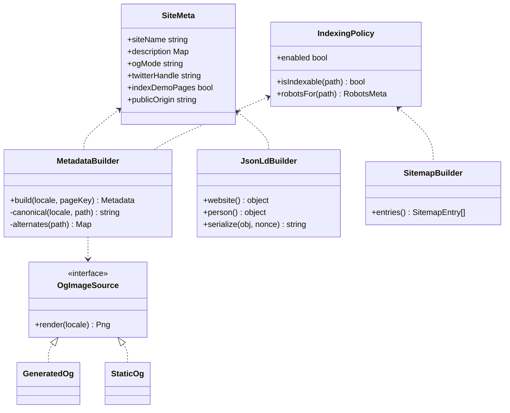
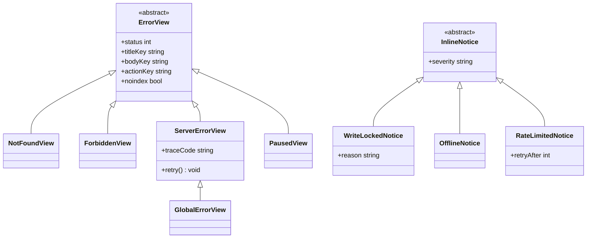
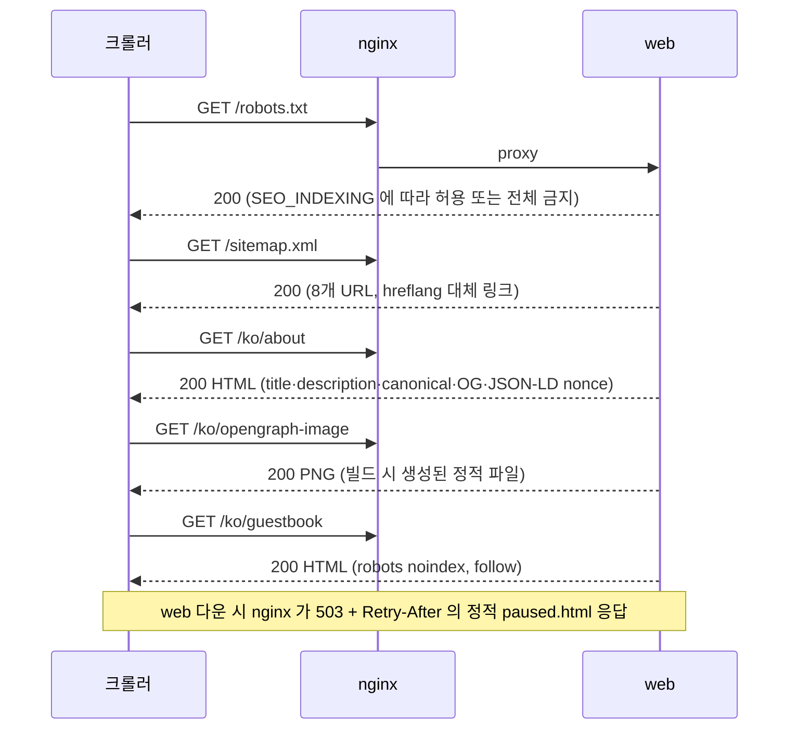
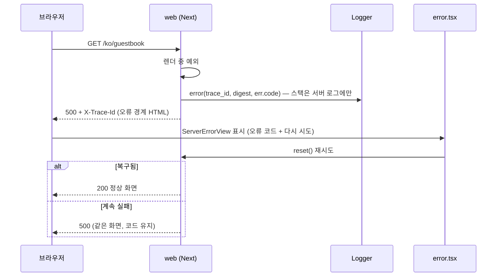
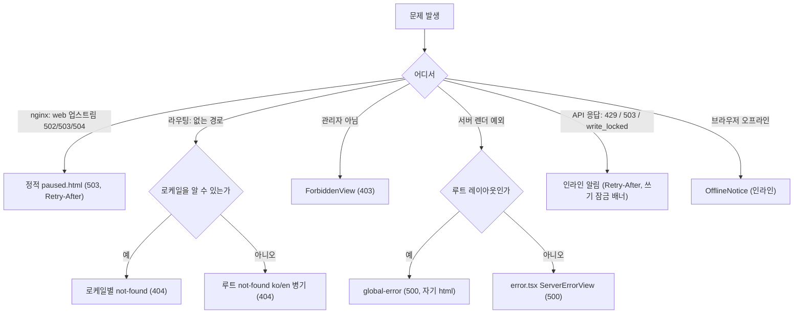

# 14. SEO · 공유 미리보기 · 오류 화면

채용 담당자는 링크를 **메신저·메일·이력서에 붙여 넣어** 사이트에 들어온다. 그래서 (1) 검색·공유에서 보이는 모습(메타데이터)과 (2) 문제가 생겼을 때 보이는 모습(오류 화면)이 첫인상이다.
화면 구조는 [07](07-frontend.md), 콘텐츠 변수는 [12](12-content.md), 헤더·CSP는 [10](10-security.md), 정적 폴백은 [F17 §10](features/17-ops-observability.md), 쓰기 잠금은 [F11](features/11-guestbook-write.md), 오류 체계는 [00 §4.3](00-system-overview.md).

> 다이어그램 해당 여부 — 클래스(메타데이터 빌더, 오류 화면 계층), 상속(오류 뷰), 시퀀스(크롤러 요청, 오류 경계), 순서도(오류 종류별 화면 결정) 모두 있다. 스니펫과 파일명은 **제안/미검증**이다(Next 16 App Router + Bun, G3).

---

## 1. 색인 정책

공개 포트폴리오이므로 **소개·아키텍처·개인정보만 색인**한다. 사용자 글이 쌓이는 데모 화면은 스팸·개인정보 위험이 있어 색인하지 않는다(링크는 따라가게 둔다).

| 경로 | 색인 | 방법 | 이유 |
|---|---|---|---|
| `/[locale]` · `/about` · `/architecture` · `/privacy` | **허용** | sitemap 포함, 정상 메타 | 사이트의 얼굴 |
| `/[locale]/guestbook` · `/flow` · `/metrics` | 금지(링크는 허용) | 메타 `robots: noindex, follow` | 사용자 생성 콘텐츠·실시간 상태, 내용이 시시각각 변함 |
| `/[locale]/admin/**` · `/login` | 금지 | 메타 `noindex, nofollow` + `robots.txt` Disallow | 관리·로그인. **Disallow 는 보안 수단이 아니다**(경로가 공개된다). 접근 통제는 서버 판정(06 §5) |
| `/api/**` · `/ws/**` · `/healthz` 등 | 금지 | `robots.txt` Disallow + nginx `X-Robots-Tag: noindex`(F17 에 추가 요청) | 기계용 |
| 오류 화면(404·403·500·점검) | 금지 | 메타 `noindex` + 올바른 상태 코드 | 오류가 색인되지 않게 |
| 개발·미리보기 환경 | **전체 금지** | `SEO_INDEXING=off`(기본)이면 robots 전체 Disallow + 모든 페이지 `noindex` | 실수로 개발 서버가 색인되는 것을 막음 |

- 운영에서만 `SEO_INDEXING=on`(환경변수, web 전용, 기본 `off`). 값은 01 §8 에 추가 요청(보고).
- `site.seo.indexDemoPages`(site-vars, 기본 `false`)를 `true` 로 두면 데모 화면도 색인한다(사용자가 정함, 12 §1.1).

### 1.1 robots.txt (`app/robots.ts`)

```text
# SEO_INDEXING=on 일 때
User-agent: *
Allow: /ko
Allow: /en
Disallow: /api/
Disallow: /ws/
Disallow: /ko/admin
Disallow: /en/admin
Disallow: /ko/login
Disallow: /en/login
Sitemap: <PUBLIC_ORIGIN>/sitemap.xml

# SEO_INDEXING=off 일 때
User-agent: *
Disallow: /
```

- 데모 화면(`guestbook` 등)은 **Disallow 하지 않는다.** 막으면 크롤러가 `noindex` 를 읽지 못해 URL만 색인되는 경우가 있다.

### 1.2 sitemap (`app/sitemap.ts`)

- 색인 대상 4개 경로 × 2 로케일 = **8개 URL**. 각 항목에 `alternates.languages`(`ko`, `en`, `x-default`)를 넣는다(`x-default` → `/en`).
- `lastModified` 는 빌드 시각이 아니라 **콘텐츠 파일의 수정 시각**(MDX frontmatter `updated`, 없으면 생략). 값이 없으면 필드를 넣지 않는다(거짓 신선도 방지).
- 절대 URL 은 `PUBLIC_ORIGIN` 으로 만든다. 빌드 시 `PUBLIC_ORIGIN` 이 없으면 **빌드를 실패**시킨다(상대 URL sitemap 방지).

## 2. 페이지 메타데이터

`generateMetadata` 를 `lib/seo/metadata.ts` 한 곳의 빌더로 감싼다. 페이지는 키만 넘기고 문구는 `messages`/MDX frontmatter 에서 온다.

| 항목 | 규칙 |
|---|---|
| `metadataBase` | `new URL(PUBLIC_ORIGIN)` — 모든 상대 URL 의 기준 |
| `title` | 템플릿 `"%s · {site.seo.siteName}"`, 홈은 `siteName` 단독. 60자 이내 |
| `description` | 로케일별 `site.seo.description.{ko,en}` 또는 페이지 frontmatter. 70~160자 |
| `alternates.canonical` | `/{locale}/{path}` 절대 URL (쿼리 제외) |
| `alternates.languages` | `ko`, `en`, `x-default`(→ `/en`) |
| `openGraph` | `type: website`, `siteName`, `locale`(`ko_KR`/`en_US`), `alternateLocale`, `url`, `title`, `description`, `images` |
| `twitter` | `card: summary_large_image`, `title`, `description`, `images`. `creator` 는 `site.seo.twitterHandle`(null 이면 생략) |
| `robots` | §1 표에 따라 페이지별 |
| `<html lang>` | 로케일(`ko` / `en`). 루트 `not-found`/`global-error` 는 2개 언어 병기이므로 `lang="ko"` + 본문에 `lang="en"` 구간 표기 |
| 값이 `null` | 해당 필드 생략(빈 문자열을 넣지 않는다) |

문구 자체(사이트 이름, 소개 문장)는 **사용자 제공**이다([12](12-content.md) 체크리스트). 이 문서는 구조만 정한다.

## 3. 공유 미리보기 이미지 (OG)

| 항목 | 규칙 |
|---|---|
| 크기·형식 | 1200 × 630 PNG, 로케일별 1장(`/ko/opengraph-image`, `/en/opengraph-image`) |
| 내용 | 사이트 이름 + 한 줄 소개 + (선택) 소유자 사진/로고. **외부 서비스·외부 폰트 없음** |
| 생성 시점 | **빌드 시 정적 생성**(요청마다 만들지 않는다) → 크롤러 응답 지연 없음, 서버 CPU 무영향 |
| 소재 | `site.seo.ogImage.mode`: `generated`(이름·소개로 템플릿 렌더) / `static`(사용자가 준 `og-ko.png`·`og-en.png`) |
| 대체 텍스트 | `og:image:alt` 에 사이트 이름 + 소개 |

생성 방식 후보(**미검증**, G3 와 함께 확인):

| 후보 | 장점 | 위험 |
|---|---|---|
| ① Next `opengraph-image.tsx`(`ImageResponse`) | 프레임워크 내장, 정적 최적화 | Bun 에서 실행되는지 미확인(WASM 렌더러), 폰트 파일 번들 필요 |
| ② Playwright 로 HTML 템플릿 스크린샷 | **이 환경에서 Bun + Chromium 동작 확인됨**(도구 실측) | CI 에 브라우저 설치(약 150MB) 필요, 빌드가 무거워짐 |
| ③ 사용자 제공 정적 PNG | 가장 단순·확실 | 소유자가 디자인해야 함 |

권장: **③ 을 기본**(M1), ① 을 G3 에서 확인해 되면 `generated` 모드로 전환. ② 는 ① 이 실패할 때의 대안이다.
생성된 이미지에 소유자 이름·사진이 들어가므로 콘텐츠 라이선스(저작권 유보) 대상이다([CONTENT-LICENSE.md](../../CONTENT-LICENSE.md)).

### 3.1 favicon·아이콘

| 파일 | 규칙 |
|---|---|
| `app/icon.svg` | 기본 favicon(벡터, 라이트/다크 `prefers-color-scheme` 대응 가능) |
| `app/favicon.ico` | 32×32 호환용 |
| `app/apple-icon.png` | 180×180 |
| manifest | M1 에서는 만들지 않는다(PWA 아님, 서비스 워커 없음) |

## 4. 구조화 데이터 (JSON-LD)

최소만 둔다. 홈·about 에 `WebSite` 와 `Person` 한 블록.

```json
{ "@context": "https://schema.org",
  "@graph": [
    { "@type": "WebSite", "name": "<siteName>", "url": "<PUBLIC_ORIGIN>", "inLanguage": ["ko", "en"] },
    { "@type": "Person", "name": "<profile.name>", "url": "<PUBLIC_ORIGIN>/<locale>/about",
      "sameAs": ["<contact.links.github>", "<contact.links.linkedin>"] }
  ] }
```

- 값이 `null` 인 필드(`sameAs` 항목 등)는 **빼고**, 이메일은 **절대 넣지 않는다**(개인정보 최소화).
- `<script type="application/ld+json">` 은 CSP 때문에 요청별 **nonce** 를 붙인다(10 §2.2). 직렬화 시 `<` 를 `<` 로 이스케이프한다.
- 소유자 이름은 콘텐츠 변수에서 오며 비어 있으면 `Person` 블록 전체를 생략한다.

## 5. 오류 화면

### 5.1 종류와 상태 코드

| 상황 | 화면 | HTTP | 주요 헤더 | 색인 |
|---|---|---|---|---|
| 없는 경로(로케일 안) | `[locale]/not-found.tsx` | 404 | `Cache-Control: no-store` | noindex |
| 없는 경로(로케일 모름·루트) | 루트 `not-found.tsx`(**ko/en 병기**) | 404 | 위와 동일 | noindex |
| 관리자 아닌데 `/admin` | `ForbiddenView` | **403** | `no-store` | noindex |
| 서버 렌더 중 예외 | `[locale]/error.tsx`(오류 경계) | 500 | `X-Trace-Id` | noindex |
| 루트 레이아웃 실패 | `global-error.tsx`(**자기 `<html>`**, 의존성 없는 ko/en 병기) | 500 | 위와 동일 | noindex |
| 쓰기 잠금 중 | 화면 전체가 아니라 **방명록의 알림 배너** + 작성 폼 비활성 | 정상(200) | — | — |
| API 429 / 503 / 네트워크 끊김 | 화면 전체가 아니라 **인라인 오류**(토스트/배너, 07 §7.5) | — | — | — |
| web 다운(nginx 폴백) | 정적 `paused.html`(ko/en 병기) | **503** | `Retry-After: 300`, `X-Fallback: 1`, `X-Robots-Tag: noindex` | noindex |
| 호스트·Tunnel 다운 | Cloudflare 오류 화면 또는 정적 미러(G11) | 5xx | — | 우리 통제 밖 |
| 오프라인(브라우저) | 인라인 `OfflineNotice`(서비스 워커 없음, 오프라인 페이지 없음) | — | — | — |

- 오류 화면에는 **상태 코드를 그대로** 쓴다(404 를 200 으로 돌려주는 "soft 404" 금지).
- 403 은 `/admin` 의 서버 판정(06 §5) 결과다. 존재를 숨기고 싶으면 404 로 바꿀 수 있으나 07 의 결정(403 화면)을 따른다.

### 5.2 문구 구조 (ko/en, 키는 `errors.*`)

각 화면은 **제목 · 한 줄 설명 · 다음 행동 · (500) 추적 코드**의 네 요소만 갖는다. 문구는 짧고 비난하지 않으며, 내부 정보(스택·SQL)를 노출하지 않는다.

| 키 | ko (예시, 확정 문구는 사용자 승인) | en (example) |
|---|---|---|
| `errors.notFound.title` | 페이지를 찾을 수 없어요 | Page not found |
| `errors.notFound.body` | 주소가 바뀌었거나 없는 페이지예요. | The address may have changed, or the page doesn't exist. |
| `errors.notFound.action` | 홈으로 가기 | Go to home |
| `errors.forbidden.title` | 접근할 수 없어요 | You can't access this page |
| `errors.forbidden.body` | 이 페이지는 관리자만 볼 수 있어요. | This page is for the site owner only. |
| `errors.server.title` | 문제가 생겼어요 | Something went wrong |
| `errors.server.body` | 잠시 뒤 다시 시도해 주세요. 계속되면 아래 코드를 알려 주세요. | Please try again in a moment. If it keeps happening, share the code below. |
| `errors.server.action` | 다시 시도 | Try again |
| `errors.server.trace` | 오류 코드 | Error code |
| `errors.paused.title` | 지금은 데모를 쉬고 있어요 | The live demo is paused |
| `errors.paused.body` | 소개와 아키텍처 글은 그대로 볼 수 있어요. | You can still read the about and architecture pages. |
| `errors.writeLocked.body` | 지금은 글을 쓸 수 없어요. 읽기는 가능해요. (사유가 있으면 이어서 표시) | Writing is temporarily disabled. Reading still works. |
| `errors.offline.body` | 인터넷 연결이 끊긴 것 같아요. | You seem to be offline. |

- `errors.paused` 는 nginx 정적 폴백(F17 §10)과 **같은 문구 소스**를 쓰도록 빌드가 messages 에서 뽑는다(문구가 두 벌로 갈라지지 않게).
- 쓰기 잠금의 **사유**(`write_lock.reason`)를 사용자에게 보이려면 `GET /api/me` 가 `writeLockReason` 을 내려줘야 한다. 03 에는 현재 `writeLocked` 만 있다 → **03 변경 요청**(보고).
- 오류 코드(`trace_id`)는 응답 헤더 `X-Trace-Id` 와 같은 값이며, 로그의 `trace_id` 로 서버 로그를 찾을 수 있다(F17 OB-04).

### 5.3 오류 경계의 동작

| 단계 | 내용 |
|---|---|
| 서버 오류 | Next 가 오류 `digest` 를 만들고 서버 로그에 기록 → 우리 `Logger` 에 `trace_id`/`digest`, `err.code` 로 남김(스택은 서버 로그에만) |
| 화면 | `digest`(없으면 `trace_id`)를 "오류 코드"로 표시, 복사 버튼, `reset()` 으로 재시도 |
| 클라이언트 오류 | 브라우저 콘솔에만 남기고 서버로 보고하지 않는다(M1, 외부 오류 수집 서비스 없음). 후속 과제로 `/api/client-errors` 를 검토 |
| 민감 정보 | 메시지에 요청 본문·토큰·쿼리를 넣지 않는다. 개발 모드에서도 오류 화면에 스택 노출 금지(콘솔만) |

## 6. Next 파일 구성 (제안)

```
apps/web/src/app/
├─ robots.ts                  # §1.1
├─ sitemap.ts                 # §1.2
├─ icon.svg  favicon.ico  apple-icon.png
├─ global-error.tsx           # 루트 레이아웃 실패. 자기 <html>, 의존성 없음
├─ not-found.tsx              # 로케일 모를 때 (ko/en 병기)
└─ [locale]/
   ├─ layout.tsx              # <html lang>, 메타 기본값(generateMetadata), JSON-LD(홈/about)
   ├─ page.tsx  about/  architecture/  privacy/      # 색인 대상
   ├─ guestbook/  flow/  metrics/                     # metadata.robots = noindex, follow
   ├─ admin/  login/                                  # noindex, nofollow
   ├─ not-found.tsx  error.tsx
   └─ opengraph-image.tsx     # 또는 정적 PNG (§3)
apps/web/src/lib/seo/
├─ site.ts                    # site-vars → SiteMeta
├─ metadata.ts                # MetadataBuilder
├─ jsonld.ts                  # JsonLdBuilder (null 생략, < 이스케이프)
└─ indexing.ts                # SEO_INDEXING + 경로별 색인 정책 (RobotsPolicy)
```

## 7. 다이어그램

### 7.1 구성 (클래스)



### 7.2 오류 화면 계층 (상속)



`ErrorView` 는 화면 전체를 대체하고 `InlineNotice` 는 화면 안의 알림이다. 07 의 오류 표시 판정(§7.5)과 같은 기준으로 둘 중 하나를 고른다.

### 7.3 크롤러 요청



### 7.4 서버 오류 → 오류 경계 → 로그와 화면



### 7.5 오류 종류별 화면 결정



## 8. 다른 보호·성능 장치와의 상호작용

| 주제 | 규칙 |
|---|---|
| CSP | OG·favicon 은 `'self'`. JSON-LD 인라인 스크립트는 nonce. 외부 폰트·CDN 없음. 크롤러는 CSP 를 적용하지 않으므로 OG 이미지 응답은 `Cache-Control: public, max-age=86400` 로 둔다 |
| 개인정보 | JSON-LD·OG·sitemap 에 이메일·IP·세션 정보 없음. `contact.emailVisible=false` 이면 어디에도 이메일이 나오지 않음 |
| nginx 폴백 | 폴백 정적 페이지도 같은 `<title>`·canonical·hreflang 을 가진 **정적 HTML** 이다(빌드가 같은 메타 빌더를 쓴다). 503 응답이라 색인되지 않는다 |
| 성능(LCP 2.5s) | 색인 페이지는 정적/ISR, 메타는 `<head>` 의 텍스트 몇 줄, JSON-LD 는 1KB 미만, OG 이미지는 본문 로딩과 무관. 오류 화면은 JS 의존이 없다(`global-error`) |
| 접근성 | 오류 제목 `<h1>` 에 포커스 이동, 동적 오류(재시도 실패)는 `role="alert"`, 오류 코드는 선택·복사 가능하고 `aria-label` 제공, 색에만 의존하지 않음, `prefers-reduced-motion` 에서 애니메이션 없음 |
| 로케일 | `Accept-Language` 에 따른 `/` 리다이렉트는 `307`, `Vary: Accept-Language`. 크롤러는 `x-default` → `/en` 으로 안내 |

## 9. 시험 (08 연결)

| 시험 | 기대값 | 등급 |
|---|---|---|
| `GET /robots.txt` 운영/비운영 | 운영: 허용 + sitemap, 비운영: 전체 금지 | L2 |
| `GET /sitemap.xml` | 8개 URL, 각 항목에 ko·en·x-default | L2 |
| 색인 대상 4개 경로 | `<title>`, `description`, canonical, hreflang, OG, `twitter:card` 존재 | L2 |
| 데모·관리·로그인 | `noindex` 메타 | L2 |
| JSON-LD | 유효 JSON, `null` 필드 없음, 이메일 없음, `<` 이스케이프 | L2 |
| 없는 경로 / 로케일 모름 | 404 + 올바른 화면, `noindex` | L3 |
| 일부러 던진 서버 예외 | 500, `X-Trace-Id`, 화면에 코드, 스택 없음, 서버 로그에 `trace_id` | L3 |
| web 중지 | nginx 가 503 `paused.html`, `Retry-After` | L3 |
| 접근성 | 오류 화면 axe 검사 위반 0, 키보드만으로 재시도 | L3 |
| OG 이미지 | 1200×630 PNG, 로케일별 | L2 |

## 10. 다른 문서에 대한 요청 (이 문서가 요구하는 변경)

| 대상 | 요청 |
|---|---|
| 01 §8 | 환경변수 `SEO_INDEXING`(`on`/`off`, web 전용, 기본 `off`) 추가 |
| 03 §4.3 | `Me` 에 `writeLockReason?: string` 추가(쓰기 잠금 사유 표시용) |
| F17 | nginx `/api/` 응답에 `X-Robots-Tag: noindex`, 폴백 `paused.html` 문구를 messages 에서 생성 |
| 12 §1.1 | `site.seo.*` 변수(이 변경에 반영됨) |

## 11. 미결

| 항목 | 결정 시점 |
|---|---|
| OG 이미지 생성 방식(① ② ③) | G3 확인 후 |
| `forbidden()` 같은 Next 상태 코드 API 가 Next 16 + Bun 에서 동작하는지 | G3 |
| 클라이언트 오류 수집 엔드포인트(`/api/client-errors`) | M1 이후 |
| 확정 문구(제목·설명·사이트 이름) | 사용자 제공 |
