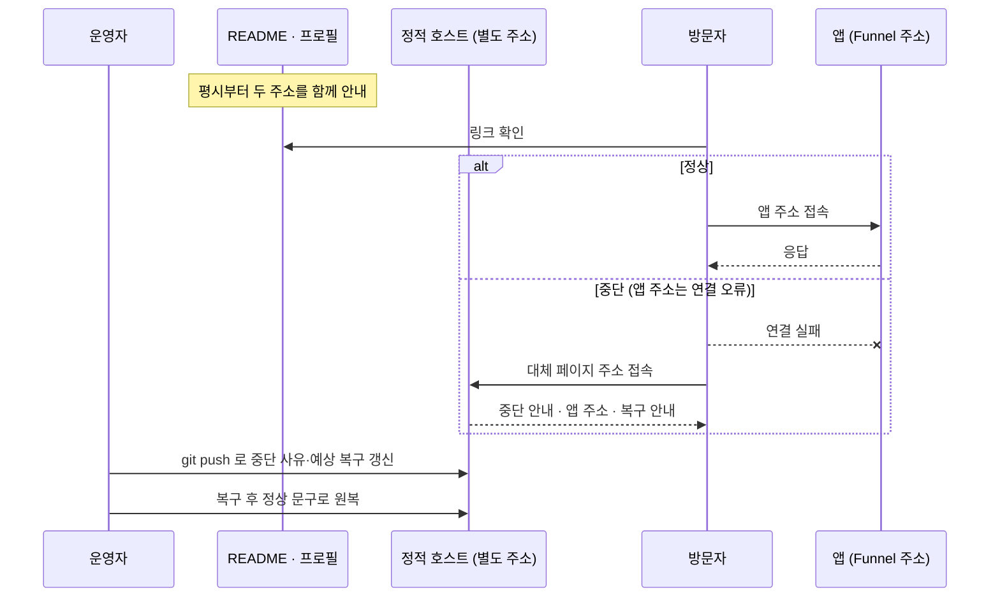

# 16. 서버 중단 시 정적 대체 페이지 (FR-122, 수동 전환, 관문 G13 보류)

집 PC 한 대가 백엔드(api·ws-gateway·worker)와 Next.js(web)를 모두 돌리고 **Tailscale Funnel** 로 노출한다(ADR-003, 사용자 결정 2026-11-05: 신용카드가 없어 Oracle Cloud 는 쓰지 않고, 도메인을 구입하지 않아 Cloudflare Tunnel 대신 Funnel 을 쓴다 — A-035). 그래서 **PC 가 꺼지거나 정전·회선이 끊기거나 Funnel 이 끊기면 사이트 전체가 멈춘다(단일 장애점, 수용).** 이 문서는 그때 방문자에게 **무엇을 어떻게 보여 줄지**를 정한다.

1단계 폴백(nginx `error_page`, [F17 §10](features/17-ops-observability.md))은 **호스트가 살아 있을 때만** 동작한다. 이 문서는 2단계(F17 §11, ADR-023 §7)의 구체 설계다. **전체가 미검증이며 상태는 Proposed 다.**

> **개정(2026-11-05, 도메인 없음 결정).** 앱 주소가 `<호스트>.<tailnet 이름>.ts.net`(`*.ts.net` 하위만 가능) 이라 같은 주소 앞에 Cloudflare Worker 를 둘 수 없다. 그래서 **자동 절체(A안, Worker)는 불가**이고 **수동 전환(B안)을 채택**한다. A안은 도메인을 확보했을 때의 후속으로 §2 에 이력을 남긴다. **자동 절체가 없으므로 중단 중 앱 주소로 오는 접속자는 연결 오류 화면을 볼 수 있다 — 수용 위험이다(§4).**

## 1. 범위와 원칙

| 항목 | 내용 |
|---|---|
| 덮는 장애 | PC 전원·정전, 회선 단절, `tailscaled`·Funnel 중지, nginx 포함 호스트 전체 다운 — **단, 별도 주소의 대체 페이지를 본 사람에게만** (앱 주소 접속자는 못 덮는다) |
| 못 덮는 장애 | Tailscale 자체 장애·Funnel 정책 변경(통제 밖), 사람이 안내를 갱신하기 전의 시간차 |
| 내용 | 안내 문구, 스크린샷, 데모 영상 링크, GitHub 링크, 중단 사유, 복구 안내, **앱 주소 링크**. **사이트 기능은 없다** |
| 기술 | 순수 HTML/CSS(JS 없음이 기본, 선택). ko/en 병기, 접근성 기준 동일(WCAG 2.2 AA, 07·15), **쿠키·추적·외부 요청 없음** |
| 호스팅 | **별도 주소**의 무료 정적 호스팅. **GitHub Pages 로 정했다**(사용자 결정 2026-11-14; Cloudflare Pages 는 카드 요건 미확인으로 보류). 임의 응답 헤더를 못 줘서 CSP 는 meta 태그로 대체하고, 대체 페이지 빌드는 앱 저장소와 분리한다(§3.6, S8-3 에서 G11 로 검증) |

Cloudflare Pages 무료 한도(공식 문서, 2026-09-05 갱신 기준): 월 빌드 500회, 사이트당 파일 20,000개, 파일당 25 MiB. 이 페이지는 파일이 수십 개 이하라 한도 안이다(계산). **Pages·GitHub Pages 가입 시 신용카드 요건은 공식 근거를 확인하지 못했다 — 가입 화면에서 확인 필요.** 카드가 요구되면 그 호스트는 채택하지 않는다.

## 2. 절체 방식 비교

| 안 | 방식 | 장점 | 단점·미확인 | 상태 |
|---|---|---|---|---|
| **A. Worker 절체** | 같은 도메인 앞에 Cloudflare Worker(무료 플랜)를 둔다. 원본에 `fetch` 하고 실패하면 정적 자산을 응답 | **자동**, 같은 주소 유지, 복구 시 즉시 정상 복귀 | **도메인이 있어야 한다.** `*.ts.net` 주소에는 붙일 수 없다 | **불가 — 도메인 확보 시 후속**(이력 보존) |
| **B. 수동 전환** | 앱 주소와 별개로 **항상 살아 있는 대체 페이지 주소**를 두고, README·프로필에 두 주소를 함께 안내한다. 장애 시 사람이 대체 페이지의 중단 안내를 갱신한다 | 도메인 불필요, 구성 단순, 외부 한도 무관 | **사람이 장애를 알아야 하고** 갱신 지연이 있다. 앱 주소 접속자는 연결 오류를 본다. 자동 아님 | **채택** |

**채택: B.** 도메인을 구입하지 않는다는 결정(A-035)의 직접 귀결이다. 개인 포트폴리오라 운영자가 항상 대기하지 않으므로 지연은 남는다 — 외부 업타임 점검(§4)으로 감지만 앞당긴다.

### 2.1 A안 이력 (도메인 확보 시 후속, 현재 미채택)

도메인을 확보하면 같은 도메인 앞의 Worker 가 원본(`fetch`) 실패 시 정적 대체 페이지를 `503` + `Retry-After` 로 응답하는 방식을 다시 검토한다. 당시 설계의 요점만 보존한다.

- 실패 판정: 원본이 직접 만든 응답에 `X-Pf-Origin: 1` 을 붙여(nginx `add_header ... always`) 쓰기 잠금 503·nginx 1단계 폴백(`X-Fallback: 1`)·API 4xx/5xx 를 덮어쓰지 않는다. 헤더 없는 5xx·예외·타임아웃(초기값 8초, 미측정)만 원본 장애로 본다.
- 요청별: HTML 내비게이션은 대체 페이지(503 + `Retry-After: 300`), WS 업그레이드는 대체 불가(본문 없는 503), `/api/*`·`robots.txt`·`sitemap.xml` 은 본문 없는 503.
- 응답 헤더: `Cache-Control: no-store`, `X-Fallback: 2`, `X-Robots-Tag: noindex`, 별도 CSP.
- Worker 무료 한도(일 100,000 요청), 터널 단절 시 Worker 가 받는 응답 형태, 한도 초과 시 실패 방식은 **미확인**이었다.
- 이 시험이 관문 G13 이었다. **G13 은 도메인 확보 후에만 의미가 있어 보류한다**(§5).

## 3. 설계 항목 (B안)



### 3.1 안내 방식

- README 상단과 GitHub 프로필·포트폴리오 표기에 **앱 주소와 대체 페이지 주소를 나란히** 둔다. 평시에도 대체 페이지는 응답하며 "정상 운영 중" 상태 문구와 앱 주소 링크를 보인다.
- 앱 주소(`*.ts.net`)는 사용자가 이름을 고를 수 없는 형식이다(A-035). 포트폴리오 표기용 짧은 링크 서비스 등은 후속 검토이고 지금 정하지 않는다.
- 대체 페이지 주소는 **앱 주소와 독립**이어야 한다(같은 PC·같은 Funnel 에 두지 않는다).

### 3.2 상태 문구

대체 페이지는 세 상태 중 하나의 문구를 보인다: ① 정상 ② 점검·중단(사유: 정전·회선·점검 중 하나, 기본 문구는 "서버 중단") ③ 복구 중. 상태는 **빌드 시점 값**(site-vars)이라 사람이 갱신한다. 자동 감지·자동 전환은 없다.

### 3.3 헤더·CSP·캐시

- 호스트가 임의 응답 헤더를 지원하면(Cloudflare Pages `_headers` 등) `default-src 'none'; style-src 'self'; img-src 'self'; base-uri 'none'; form-action 'none'; frame-ancestors 'none'`, `X-Content-Type-Options: nosniff`, `Referrer-Policy: no-referrer` 를 건다. 지원하지 않는 호스트(GitHub Pages 는 사용자 지정 헤더 지원 여부 **미확인**)는 `<meta>` 로 가능한 것만 건다(`frame-ancestors` 는 meta 로 불가). 이 차이가 호스트 선택의 기준 중 하나다.
- 노인덱스: `<meta name="robots" content="noindex">`. **상태 코드는 200 이다** — 별도 주소에서 정적 호스트가 직접 응답하기 때문이며 `503` + `Retry-After` 는 쓸 수 없다(A안과의 차이).
- 영상은 **임베드하지 않고 링크만** 둔다. 외부 링크는 `rel="noopener noreferrer"`.

### 3.4 SEO

앱 주소가 연결 오류일 때 검색엔진이 그것을 일시 장애로 취급해 색인을 유지하는지는 **미확인**이다(5xx 와 달리 연결 실패는 응답 코드가 없다). 대체 페이지는 색인 대상이 아니다. 장애가 길어지면 색인에 영향이 있을 수 있음을 수용한다.

### 3.5 대체 페이지 구성

```
infra/outage-page/
├─ index.html         # ko/en 병기, lang 속성 구분, 상태 문구 3종
├─ outage.css
├─ img/               # 스크린샷 (대체 텍스트 필수)
└─ _headers           # 지원하는 호스트에서만(CSP 등)
```

- 내용: ① 현재 상태 ② **중단 사유**와 예상 복구 안내 ③ **앱 주소 링크** ④ 스크린샷 ⑤ 데모 영상 링크 ⑥ GitHub 저장소 링크 ⑦ 문의처(사이트 변수, 미설정이면 자리표시).
- 빌드: `bun run build:outage`(제안) — `build:fallback`(F17 §10)과 문구 소스(`errors.*`, site-vars)를 공유한다.
- PC 가 죽은 상태에서 갱신해야 하므로 **다른 기기에서 `git push` → 정적 호스트 배포**가 가능해야 한다.

### 3.6 호스팅 후보와 주의 (확정 아님)

| 후보 | 장점 | 주의 |
|---|---|---|
| Cloudflare Pages (`*.pages.dev`) | 사용자 지정 응답 헤더(`_headers`), 무료 한도 명시 | 가입 시 카드 요건 미확인 |
| GitHub Pages | 이미 쓰는 GitHub 계정 | 이 저장소는 비공개이고 에이전트 파이프라인 산출물(`.claude/`, 런 디렉토리)도 공개하지 않는 것이 기존 결정이다. 쓴다면 **대체 페이지 빌드 결과만 담는 별도 저장소(또는 별도 배포 위치)** 여야 하고, 이 저장소를 공개 전환하거나 설계 문서를 올리지 않는다. 사용자 지정 헤더 미지원 가능성. 무료 사용 조건은 약관에서 확인 필요 |

선택은 구현 시 가입 화면·약관 확인 뒤에 정한다.

## 4. 위험·모니터링·런북

- 위험 표: [P0 §12.1](phases/00-platform-evolution.md) 의 "집 PC 중단/정전/회선 단절", "자동 절체 없음" 행 참조. 수용 가정은 spec A-033·A-035.
- **수용 위험: 자동 절체가 없다.** 앱 주소로 직접 들어온 접속자는 중단 중 연결 오류를 보고, 대체 페이지가 있는 줄 모를 수 있다. 완화는 README·프로필에 두 주소를 함께 적는 것뿐이다.
- 완화에 **무정전 재시작 절차**가 포함된다: 호스트 부팅 시 `docker.service`·compose 자동 기동(systemd `enable`), 컨테이너 `restart: unless-stopped`, `tailscaled` 와 Funnel 설정이 재시작 후 유지되는지(G14 ④, **미확인**), BIOS 의 "전원 복구 시 자동 켜기"(PC 설정, 미확인). 재시작 후 순서·확인은 13 의 런북에 둔다.
- **같은 PC 의 Grafana 는 PC 가 죽으면 같이 죽는다.** 그래서 가용성 감시는 **외부**가 필요하다: 무료 외부 업타임 점검 서비스를 후보로 둔다(**서비스 이름·무료 조건·카드 요건은 검증 필요**). 점검 대상은 앱 주소의 `/healthz` 이며 알림은 기존 Discord 웹훅(FR-063)으로 보낸다. 대체 페이지 자체의 응답도 점검 대상에 넣는다. 이 점검은 **카드 불요 조건을 가진 관문(G11 ②, tech-stack)** 으로 검증한다 — 점검이 없으면 PC 중단은 운영자가 우연히 알 때까지 드러나지 않는다.

### 4.1 런북 — 서버 중단 시 안내 갱신

| 순서 | 행동 | 확인 |
|---|---|---|
| 1 | 알림(Discord)·직접 확인으로 중단 인지. 앱 주소 `/healthz` 무응답, 대체 페이지는 응답 | 대체 페이지가 응답한다 |
| 2 | 다른 기기에서 `infra/outage-page` 의 상태를 "점검·중단"으로 바꾸고 사유·예상 복구를 적어 `git push` | 정적 호스트에 배포됨 |
| 3 | 필요하면 README 상단에 중단 안내 한 줄을 추가 | README 렌더 확인 |
| 4 | 복구: PC·회선·`tailscaled`·Funnel·compose 기동 순서를 13 의 런북대로 확인 | 앱 주소 `/healthz` 200, WS 연결 |
| 5 | 대체 페이지를 "정상"으로 원복하고 README 안내 한 줄을 지운다 | 두 주소 모두 정상 문구 |

## 5. 관문 G13 — 보류

| ID | 대상 | 상태 |
|---|---|---|
| **G13** | Worker 절체(A안) | **보류 — 도메인 확보 후에만 의미가 있다.** 통과 기준(① 원본 중지 시 HTML 이 503 + `Retry-After` + 대체 페이지 ② WS 업그레이드 통과·단절 시 거절 ③ 원본이 만든 503 비덮어쓰기 ④ 일 100,000 요청 한도 ⑤ 가입 카드 불요)은 이력으로 보존한다 |

- B안에는 새 관문을 만들지 않는다. 확인할 것은 정적 호스트 가입의 카드 요건·약관(spec A-034)과 대체 페이지가 별도 주소에서 응답하는 것(AC-039)뿐이다.
- Funnel 자체의 검증은 **관문 G14**(tech-stack §11)에 있다.
- G11(정적 미러 호스팅)은 이 정적 호스트와 같은 시험에서 함께 본다.
- 번호계 주의: 이 G13·G14 는 [tech-stack §11](../domains/tech-stack.md) 관문 번호계다. [phases/00](phases/00-platform-evolution.md) §1.4 의 G1~G15 는 별개의 공백 번호(예: G14 = KataGo 스파이크)다.

## 6. 개인정보·비용

대체 페이지는 **개인정보를 수집·저장하지 않는다**(쿠키·추적·방문 기록 없음). 정적 호스트가 접속 로그를 남기는지는 호스트 정책에 달렸고 **미확인**이다. 비용은 무료 한도 안에서 0원이다(카드 요건은 가입 화면에서 확인).

## 7. 시험 (AC-039, L2~L3 / L4 실환경)

| 시험 | 등급 |
|---|---|
| 빌드 산출물이 앱 주소 링크·복구 안내·GitHub 링크를 포함하고 쿠키·외부 요청 0 | L2 |
| 대체 페이지 axe 위반 0, 키보드 탐색 | L2~L3 |
| 실제 정적 호스트에 배포한 대체 페이지가 앱 중단 중에도 응답 | L4 |
