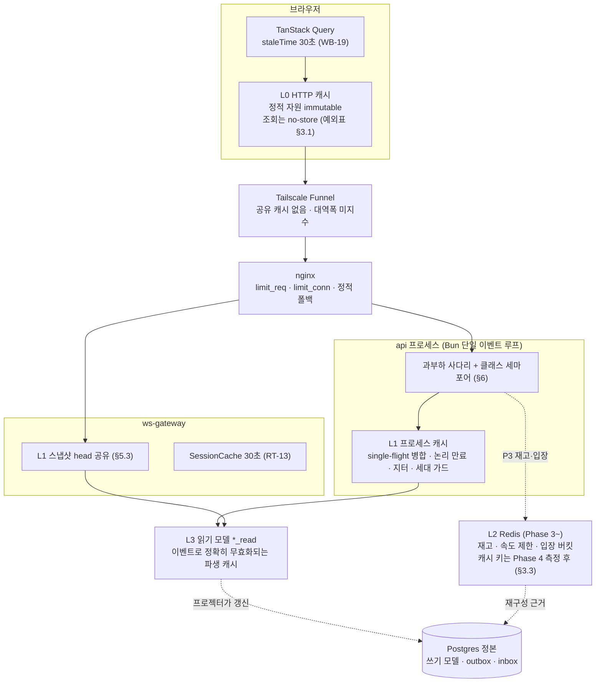
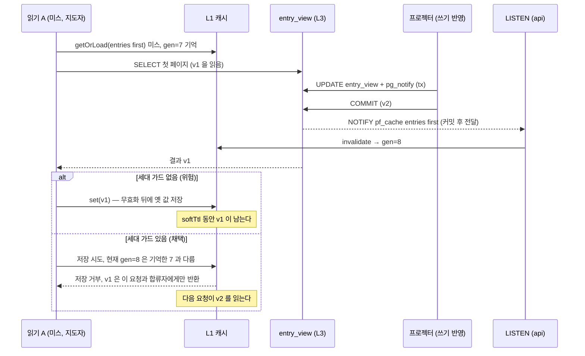
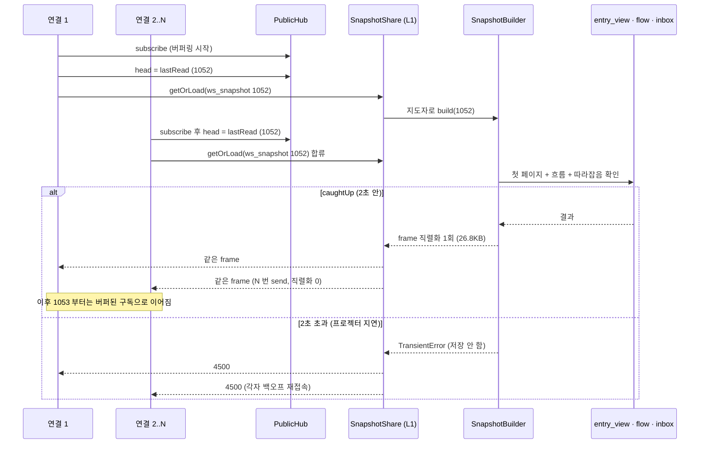
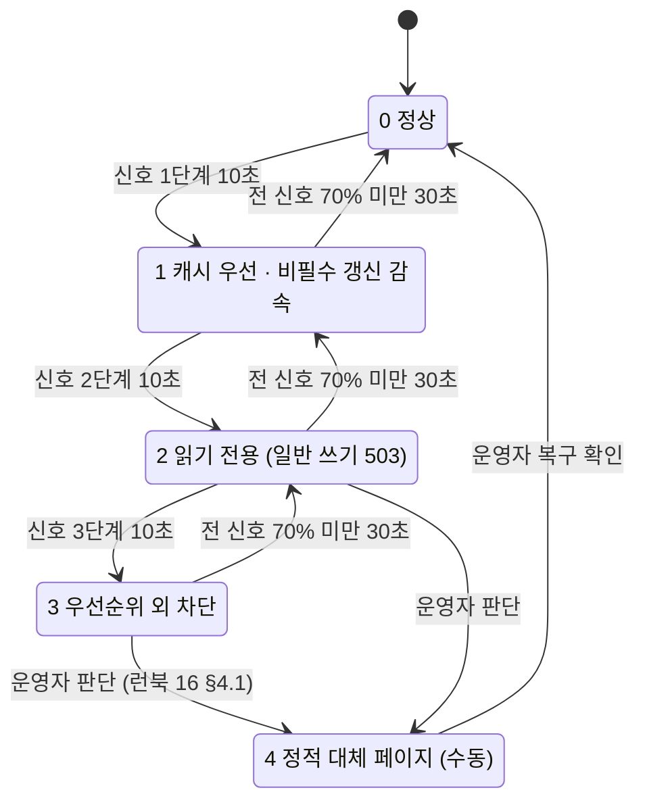

# 18. 핫 캐시와 동시접속 몰림 대응 (Hot Cache & Surge Control)

> 상태: **확정(Accepted, 2026-11-06)** — 결정 기록은 [ADR-049](../adr/ADR-049-hot-cache-and-surge-control.md). 사용자 결정 HC-1~HC-11 은 §12 에 확정 표기했다(HC-5 만 권장안과 다르게 **카운터 열 도입** — 해석과 설계는 §4.4). 임계값·용량 수치는 여전히 **제안값**이며 측정(S9-6 등)으로 확정한다 — 확정된 것은 구조·순서·선택지이지 숫자가 아니다.
> 새 FR/AC 를 만들지 않는다(예외: 2026-11-10 사용자 결정으로 동시 접속자 상한 50 을 FR-123·AC-040 으로 명세에 올렸다 — ADR-051 결정 5). 합격선은 기존 **AC-013**(동시 50, API p95 ≤ 300ms, LCP ≤ 2.5s)과 **G14 ⑦**(원점 p95 ≤ 300ms·종단 p95 ≤ 800ms·WS 접속 성공률 ≥ 99%, 제안값, [tech-stack §11](../domains/tech-stack.md))을 인용하고, 시험 항목은 [08 §9.1](08-test-strategy.md) 에 추가한다.
> **숫자 표기 규칙**: 근거 없는 값은 전부 **제안**이다. 계산은 입력을 **가정**으로 밝히고, 측정치는 **개발 PC 측정(i5-12400·WSL2·Bun 1.4.4, 2026-11-06) — 호스트 재측정 필요**로 적는다. 라이브 호스트(Xeon Bronze 3204, 6코어 1.9GHz·터보·HT 없음, [ADR-033](../adr/ADR-033-resource-budget-and-deploy-units.md))는 코어당 성능이 개발 PC 의 **약 1/2~1/3(가정: 클럭 비 4.4/1.9 ≈ 2.3 + 세대 차)** 이므로 CPU 시간 수치는 그만큼 늘려 읽는다.

입력 문서: [ADR-024](../adr/ADR-024-redis-seam.md)(Redis 이음새·장애 거동) · [ADR-038](../adr/ADR-038-stock-reservation-and-redis-role.md)(재고 두 게이트) · [ADR-031](../adr/ADR-031-event-transport-streams.md)(전달 계층) · [ADR-021](../adr/ADR-021-concurrency-control.md)(동시성) · [ADR-033](../adr/ADR-033-resource-budget-and-deploy-units.md)(자원 예산) · [03](03-api-contract.md) §1·§1.1 · [F14](features/14-realtime.md) · [F15](features/15-web.md) §4.1·WB-19 · [F12](features/12-guestbook-read.md) §7.1 · [F11](features/11-guestbook-write.md) §3.5 · [F16](features/16-cross-cutting.md) §8.2 · [F17](features/17-ops-observability.md) §0.3·§9.2·§15·§17 · [08](08-test-strategy.md) §9 · [P2](phases/02-commerce.md) §4 · [P0](phases/00-platform-evolution.md) §5·§6.8·§12 · [16](16-outage-fallback-page.md).

---

## 1. 목적·범위·원칙

**목적.** 링크 공유로 수백 명이 한꺼번에 들어오는 순간, 배포·Funnel 단절 직후의 재접속 폭풍, 타임딜 오픈 순간에 **정본(Postgres)과 돈·재고 불변식을 지키면서 사이트가 '느려지되 무너지지 않게'** 한다. 면접 질문 "몰림을 어떻게 다뤘는가"에 대한 답이 이 문서다.

**범위.** 읽기 표면의 캐시 계층(L0~L3), 스탬피드·핫 키 방어, 실시간 팬아웃 몰림, 과부하 사다리(admission control·load shedding), 자원 격리(bulkhead)·타임아웃·회로 차단·재시도, 타임딜 몰림, 용량 모델, 의존 장애별 열화, 관측·시험, 단계 배치. **범위 밖**: 캡차·가상 대기열(U19 로 미도입), Redis Streams 채택(U9, 측정 미달 시에만), CDN 도입(Funnel 에 없음).

| 원칙 | 내용 |
|---|---|
| **용량으로 이기지 않고 단계적 열화로 진다** | 집 PC 한 대·대역폭 미지수인 Funnel 에서 몰림을 '처리량 증설'로 막을 수단이 없다. 대신 **무엇을 먼저 포기할지**를 미리 정해 둔다(§6 사다리). 몰림 순간 사용자는 "쓰기 잠시 불가·약간 늦은 목록"을 보고, "사이트 다운"은 보지 않는다 |
| **정본 보호가 최우선** | 캐시·열화가 어떤 경우에도 Postgres 의 불변식(초과 판매 0, 원장 균형, 멱등)을 건드리지 않는다. 틀리면 안 되는 값(권한·잔액·재고 확정·세션 폐기)은 **캐시하지 않는다**(§2.2) |
| **측정 없이 캐시를 넣지 않는다** | §8 계산상 현재 규모에서는 **어느 캐시도 용량상 '필요'하지 않다.** 그래서 M1 은 **보존 0초의 요청 병합(single-flight)** 과 결정적으로 반복되는 몰림(배포마다 오는 재접속)의 **스냅샷 공유**만 켜고, 보존(TTL) 캐시는 **열화 모드의 동작**으로 둔다. 상시 캐시로 바꾸려면 S9-6 측정이 근거를 줘야 한다 |
| **기다리는 동안 자원을 쥐지 않는다** | 풀 고갈의 원인은 부하가 아니라 '대기 중에 DB 연결을 쥐고 있는 요청'이다(§6.3 계산). 대기는 메모리(세마포어 큐)에서, 상한과 시간 제한을 붙여 한다 |
| **거절은 빠르고 정직하게** | 넘치는 요청은 **오래 기다리게 하지 않고** `503`/`429` + `Retry-After`(지터)로 즉시 돌려보낸다. 대기열·번호표를 흉내 내지 않는다(U19) |
| **열화는 readyz 를 떨어뜨리지 않는다** | 과부하 단계는 `/readyz` 실패 사유가 아니다. 과부하로 인스턴스를 빼면 남은 쪽에 몰려 연쇄 장애가 된다 |

**우선순위 클래스** — 열화 시 **아래에서부터** 포기한다(§6.2 단계별 동작표의 기준).

| 클래스 | 포함 | 보호 수준 | 이유 |
|---|---|---|---|
| **C0 운영 생존** | `/healthz`·`/readyz`·`/metrics`(내부) | 절대 차단 안 함 | 판정 수단이 죽으면 복구가 늦어진다. 요청 비용이 거의 0 |
| **C1 진행 중 약속** | OAuth 콜백, 결제 확정·웹훅 수신·환불, 관리자 운영 조작(쓰기 잠금·숨김) | 자동 차단 안 함(4단계 수동만) | 이미 시작된 상태 전이를 끊으면 보상·대사 비용이 커진다(ADR-039·040) |
| **C2 일반 쓰기** | 글·반응·신고·프로필, 타임딜 예약(입장 버킷 통과분) | 2단계에서 거절 | 쓰기 1건은 tx + outbox + 프로젝터 + 브로드캐스터 + 연결 수만큼의 팬아웃으로 **증폭**된다 |
| **C3 읽기** | 목록·흐름·딜 조회(캐시 적중은 거의 무료, 미스는 원본 비용) | 적중은 끝까지, 미스는 3단계에서 거절 | 몰려온 방문자는 '읽으러' 왔다 — 포트폴리오의 청중이다 |
| **C4 신규 WS 업그레이드** | `/ws/public`·`/ws/private`·`/ws/room` 새 연결 | 2단계에서 익명 축소, 3단계 거절 | 기존 연결은 유지하고 새 연결만 막는다(스냅샷 비용은 새 연결에서 나온다) |
| **C5 익명 세션 발급** | 쿠키 없는 `GET /api/me` | 1단계 PoW, 2단계 이상 거절 | 세션 없이도 공개 읽기·`/ws/public` 은 된다. 발급은 쓰기 직전까지 미뤄도 손해가 작다 |

---

## 2. 핫 데이터 목록과 분류표

### 2.1 읽기 표면 전수

부하 형태: **R** = 읽기 폭주, **W** = 쓰기 폭주, **C** = 연결 폭주. 계층은 §3 의 L0~L3. "병합" = single-flight(보존 0초), "보존" = TTL 캐시.

| 표면 | 변경 빈도 | 허용 신선도 | 틀린 값의 비용 | 몰릴 때 부하 형태 | 캐시 여부와 계층 | 무효화 방식 | 비고 |
|---|---|---|---|---|---|---|---|
| 방명록 첫 페이지 (`GET /api/entries`, 커서 없음) | 쓰기마다(사람 속도, 초당 수 건 이하 가정) | 공개 부분 2초(제안) — WS 스냅샷이 곧 덮어쓴다 | 낮음: 새 글이 2초 늦게 보임. 본인 글은 클라이언트 병합 규칙이 보정([F12 §10](features/12-guestbook-read.md)) | R (SSR + API + 스냅샷이 같은 질의) | **L1 병합(상시)** + **L1 보존(1단계 이상)**, 그 아래 L3 `entry_view` | 세대 카운터 + TTL 안전망(§4.1) | **공개 부분만** 캐시한다. `myReactions/isMine/canEdit` 는 보조 질의(행위자별, [F12 §7.1](features/12-guestbook-read.md) 2단계 조회)로 매번 채운다 |
| 방명록 커서 페이지 | 낮음(과거 글) | 같음 | 낮음 | R (스크레이핑) | 캐시 안 함 | — | 키 공간이 크고 적중률이 낮다. 키셋 질의가 이미 O(limit) |
| 반응 카운트 (`entry_view.reactions`) | 한 글에 몰리면 초당 수십~수백 | 1초 안팎 | 낮음(표시용). 정본은 쓰기 모델 `reaction` 행, 이벤트 `count` 의 출처는 같은 tx 의 카운터 열 `reaction_count.count`(HC-5) | **W** (한 글 행에 경합) | 읽기는 첫 페이지 캐시에 포함. **쓰기 경합은 캐시 문제가 아니다** | 이벤트가 총개수를 싣고 덮어쓴다(GB-24, 변경 없음) | §4.4 에서 쓰기 경로로 설계 — 카운터 열은 **쓰기 모델**에 둔다(읽기 모델 증분이 아니다) |
| 흐름 요약 (`GET /api/flow/summary`, `flow.summary` 푸시) | 5초 집계 | 5초 | 낮음(개수만) | R | push 는 이미 5초 1회 질의(RT-14). REST 는 **L1 보존 5초(1단계 이상)** | TTL | 브라우저는 `staleTime` 30초(WB-19) |
| 흐름 트레이스 (`GET /api/flow/trace/{traceId}`) | 작성 직후 수 초 | 실시간 | 중간(남의 흐름 노출 금지) | R (본인만) | **캐시 안 함** | — | 소유자 판정(`ownerKey`)이 매 요청 필요. 없는 id 스캔은 PK 조회라 싸다 — 음수 캐시 불필요 |
| 메트릭 임베드 (Grafana 공개 대시보드, 다른 출처 8443) | 15초 스크레이프 | 1분 | 낮음 | **R (방문자 × 패널 × 새로고침)** | 우리 캐시 밖. **열화: 1단계 이상에서 iframe 대신 정적 안내**(§6.2, HC-11 확정) | — | 300명 × 패널 10 × 30초 새로고침 = 초당 100 질의(가정)가 Prometheus·Grafana 로 간다. Grafana 의 질의 결과 캐시 기능 유무는 **미확인** — 대시보드 최소 새로고침 간격을 1분 이상으로 고정(제안) |
| 세션 검증 (REST) | 로그인·회전·폐기 | **0초** | 높음(폐기된 세션으로 쓰기) | R (모든 요청) | **캐시 안 함** — PK 조회 1회 | — | 쓰기 경로의 세션·쓰기 잠금 판정은 tx 안에서 한다 |
| 세션 검증 (WS 업그레이드·연결 유지) | 같음 | 30초(이미 확정, RT-13) | 중간: 폐기 반영이 최대 30초 늦다(ADR-024 표에 기록된 한계) | C | 기존 `SessionCache`(gateway L1, TTL 30초·음성 5초) **유지** | 30초 재검증, `NOTIFY session_revoked` 는 미결(06 §9) | 새로 늘리지 않는다 |
| `/api/me` | 로그인·프로필·쓰기 잠금 | 0초 | 중간(`writeLocked`·`isAdmin` 표시) | R + **세션 발급 폭주** | **캐시 안 함** | — | 발급 방어는 전역 토큰버킷 + PoW(F17 §9.2, RT-15 ⑥). 열화 시 발급 지연(C5) |
| 소개·아키텍처·개인정보 페이지 | 배포 시 | 배포 단위 | 낮음 | R | **HTML 은 캐시 불가**(요청별 nonce CSP, G3) — 렌더 비용은 SSR 행 참고 | — | 정적 폴백 산출물(F17 §10)이 4단계의 대체물 |
| SSR 페이지 (방명록 등) | 요청마다(개인화) | — | 중간(개인 필드) | R (CPU: React 렌더) | HTML 캐시 안 함(`private, no-store`, F15 §4.1). SSR 의 **API prefetch 가 L1 병합의 혜택**을 받는다 | — | prefetch 실패는 빈 상태로 렌더(F15 §4.1 실패 격리) — 3단계에서는 prefetch 를 생략(§6.2) |
| 정적 자원 (`/_next/static/*`·폰트·이미지) | 배포 시(해시 파일명) | 영구 | 없음 | R (**대역폭** — Funnel 미지수) | **L0 브라우저 장기 캐시**(이미 규칙, 03 §1) | 파일명 해시 | 공유 캐시 없음(Funnel 에 CDN 없음) → 첫 방문 전송량이 몰림의 주 비용(§8) |
| WS 스냅샷 (`snapshot { entries, flow, head }`) | head 가 바뀔 때 | **head 단위 정확**(따라잡음 계약) | 높음: 뒤처진 스냅샷은 영구 누락(RT-05) | **C** (재접속 폭풍) | **L1 head 공유**(§5.3) | head 가 키 — 무효화 불필요 | `caughtUp=true` 로 만든 것만 공유. 2초 대기 후 4500 계약 유지 |
| presence 수 | 연결 open/close | 5초 | 낮음(근사 표시) | C | 이미 메모리 근사(RT-09). Phase 4 Redis 합산(§5.6) | — | 규칙 판정에 쓰지 않는다(P0 §6.9) |
| (P3) 딜 목록 | 딜 게시·상태 전이 | 1초 | 낮음~중간(오픈 상태 표시) | R (오픈 직전 새로고침) | **L1 병합 + 보존 1초**, L3 `deal_view` | TTL + **시간 경계 만료**(§7.3) | 상태 판정의 정본은 `reserve` 결과 |
| (P3) 딜 상세 | 같음 | 1초 | 같음 | R (오픈 순간 최대) | 같음 + **음수 캐시 10초**(없는 id) | 같음 | 오픈 시각 `opens_at` 에서 강제 만료 |
| (P3) 잔여 재고 표시 | 예약·만료·확정마다 | 수 초(`remaining_approx`, P2 §10.9) | 중간(기대를 오도) | R | 표시값은 근사 — **구간 표시**(§7.3, HC-6 확정) | `deal.state` 휘발성 ≤1회/초(P2 §17) | 정확한 판정은 Redis `reserve` + PG CHECK |
| (P3) 입장 토큰 버킷 | 초당 리필 | — | 중간(통과량) | **W** (오픈 순간) | 캐시 대상 아님 — Redis `INCR` 윈도우(P2 §4.8) | — | §7.1 |
| (P3) 상품 카탈로그 | 드묾 | 30초(제안) | 중간: **가격**은 돈이다 | R | L1 보존 30초(제안) | TTL | 표시 가격은 참고이고, 구매 화면은 견적(ADR-041)을 정본에서 다시 받는다 |
| (P3) 품절 플래그 | 품절 시 1회 | 1초(P2 §4.8 확정) | 낮음 | R+W | 기존 api 프로세스 1초 캐시 **유지** | TTL | 품절 후 Redis 호출을 줄이는 단축 |

### 2.2 캐시하지 않는 것 (그리고 이유)

| 값 | 이유 | 대신 |
|---|---|---|
| **권한**(관리자 허용목록·`canEdit`·소유자 판정) | 틀린 값 = 권한 상승. 무효화 경로(로그아웃·역할 변경)가 여러 곳 | 요청마다 판정(허용목록은 설정 상수라 원래 메모리, 소유는 행 비교) |
| **잔액**(포인트·USDC 모의 원장) | 틀리면 이중 지출. 정본이 복식 원장(ADR-037·040) | 원장 tx 안에서 읽고 잠근다 |
| **재고 확정 수량·예약 판정** | 초과 판매 0 이 근거(ADR-038 하드 게이트) | Redis Lua(빠른 게이트) + PG CHECK(하드 게이트). 표시값만 근사 |
| **세션 폐기 판정(REST)** | 폐기 직후 쓰기가 통과하면 사고 대응(ADR-028)이 무력해진다 | PK 조회. WS 쪽 30초는 기존 수용 한계(RT-13) |
| **멱등 키 결과** | 정합성 근거가 DB tx(ADR-024 "옮기지 않는다") | `request_key` 표 |
| **결제 상태·웹훅 처리 결과** | 대사·환불 판정의 정본 | payment `version` CAS, inbox `claim_token` |
| **쓰기 잠금 상태(`write_lock`)** | 잠금 직후 쓰기가 새면 스팸 대응이 늦다 | tx 안 단일 행 읽기(F17 §15) |
| **흐름 트레이스·`/api/me`** | 개인 데이터, 키 공간이 세션 수만큼 | 원본 질의(싸다) |

---

## 3. 계층 구조

| 계층 | 왜 필요한가 | 없으면 무엇이 깨지는가 | M1 최소 집합 | 이후로 미룸 |
|---|---|---|---|---|
| **L0 브라우저/HTTP** | 정적 자원의 재전송을 없애 Funnel 대역폭을 아낀다 | 재방문·페이지 이동마다 수백 KB 재전송 | 기존 규칙 그대로(정적 immutable, 조회 no-store) + §3.1 예외표 확정(공개 조회에 공유 캐시 헤더 허용 없음, HC-3) | 딜 조회 짧은 캐시 헤더는 **Phase 3 에서 재검토**(HC-3). ETag/조건부 요청은 **미도입**(HC-4 확정) |
| **L1 프로세스** | 같은 질의의 동시 실행을 하나로 합치고(스탬피드), 열화 시 원본 없이 응답 | 몰림 순간 같은 첫 페이지 질의가 연결 수만큼 원본에 가서 풀을 점유(§4.1 측정: 300 요청 → 원본 256회) | `SingleFlightCache` 유틸, 공개 첫 페이지 **병합(보존 0초)**, 1단계 이상 **보존 2초**, 스냅샷 head 공유 | 상시 보존(측정 근거가 생기면), 딜·카탈로그(P3) |
| **L2 Redis** | 여러 프로세스가 공유해야 하는 휘발 상태(재고 빠른 게이트·공유 속도 제한·presence 합산) | P3 재고 폭주를 PG 가 직접 받음, P4 레플리카 간 한도 불일치 | **없음**(ADR-024: M1 Redis 제외) | P3: 재고·입장 버킷·품절 — **캐시 키는 Phase 3 에 두지 않는다**. L2 캐시 키는 **Phase 4 측정 후** 판정(HC-9 확정) |
| **L3 읽기 모델** | 이미 '파생 캐시'다 — 이벤트로 정확히 갱신되고(GB-23·24) 재구성 가능(GB-26). 지연은 `pf_projection_lag_seconds` | CQRS 가 없으면 조회가 쓰기 모델 잠금과 경쟁 | 기존 | — |

### 3.1 L0 — `Cache-Control` 규칙과 예외표

현재 규칙([03 §1](03-api-contract.md) "캐시"): 조회는 `no-store`, 정적 자원만 길게. **Funnel 에는 CDN 이 없으므로 `public` 헤더가 이득을 주는 곳은 '같은 브라우저의 재요청'뿐이다**(공유 캐시가 없다). 이 사실이 예외의 범위를 좁힌다.

| 대상 | 헤더(제안) | 근거 | 상태 |
|---|---|---|---|
| `/_next/static/*`(해시 파일명) | `public, max-age=31536000, immutable` | 내용이 바뀌면 이름이 바뀐다 | 기존 규칙의 구체화 |
| 폰트·해시된 이미지 | 같음 | 같음 | 같음 |
| 해시 없는 공개 이미지(OG 등) | `public, max-age=3600` | 배포 주기보다 짧게 | 제안 |
| SSR HTML 전부 | `private, no-store` | 요청별 nonce CSP(G3), 개인화 | 기존 유지 |
| `GET /api/entries` | `no-store` **유지** | 개인 필드가 섞인다. 공개 부분만 따로 캐시하려면 응답을 둘로 쪼개야 하고, 그 이득(브라우저 재요청 절감)은 `staleTime` 30초가 이미 준다 | 유지(HC-3 확정) — ETag 미도입(HC-4 확정) |
| `GET /api/flow/summary` | `no-store` 유지(서버 L1 로 충분) | 브라우저 캐시 이득 < 규칙 예외 비용 | 유지 |
| `GET /api/me`·`/api/auth/*`·관리자 조회 | `no-store` | 세션·`Set-Cookie` | 기존 유지 |
| (P3) `GET /api/deals`·`/api/deals/{id}` | M1 범위 밖. Phase 3 재검토 후보: `public, max-age=1, stale-while-revalidate=4` | 비개인화. 오픈 직전 같은 탭의 연타 새로고침을 1초 흡수 | **Phase 3 착수 재검토**(HC-3 확정: M1 은 허용 없음) — 채택 전까지 `no-store` |
| 정적 폴백·대체 페이지 | `no-store`(16 §3.3) | 장애 안내가 복구 후 남지 않게 | 기존 유지 |

### 3.2 L1 — 프로세스 내 캐시 (`SingleFlightCache`)

`KeyValueCache` 포트(ADR-024)의 M1 메모리 어댑터를 **병합·논리 만료·세대 가드**가 있는 구현으로 둔다. 포트 시그니처는 바꾸지 않고 `getOrLoad` 를 추가한다(제안).

| 항목 | 규칙(제안) |
|---|---|
| 연산 | `getOrLoad(key, loader, { softTtlMs, hardTtlMs, jitter, timeoutMs, retain })`. `retain=false` 면 **병합만**(완료 즉시 버림, 보존 0초) |
| 병합 | 키별 진행 중 `Promise` 하나. 뒤에 온 호출은 같은 `Promise` 를 기다린다(`pf_cache_requests_total{result="joined"}`) |
| 논리 만료 | `softTtl` 이 지나면 **이전 값을 즉시 돌려주고** 백그라운드로 한 번만 갱신(stale-while-revalidate). `hardTtl` 이 지나면 값 사용 금지 |
| 지터 | `softTtl × (1 ± 0.2)` 로 만료 시각을 흩뜨린다(키가 적어 효과는 작지만, 배포 직후 같은 시각에 채워진 키들의 동시 만료를 막는다) |
| 원본 실패 | 읽기 실패는 **미스**로 취급하고 **실패를 캐시하지 않는다**. 단 `stale-if-error`: 공개·비결정적 표면(첫 페이지·흐름 요약·딜 목록 표시)은 `hardTtl` 안의 이전 값을 돌려준다(§9) |
| 시간 제한 | 진행 중 `Promise` 에 `AbortSignal.timeout(timeoutMs)`(제안 1초). 지도자가 멈춰도 추종자가 무한히 기다리지 않는다 |
| 세대 가드 | 키별 `generation`. 무효화는 `generation++`. 지도자는 시작 시 세대를 기억하고, **끝났을 때 세대가 바뀌었으면 결과를 돌려주되 저장하지 않는다**(§4.3 경쟁 완화) |
| 상한 | 키 수·바이트 상한(LRU). 첫 페이지는 키 1개, 스냅샷은 최근 head 2개, 딜 상세는 1,000개(제안) |
| 키 | `<용도>:v<스키마 버전>:<범위>:<식별자>` — 예 `entries:v1:public:first`, `ws_snapshot:v1:public:<head>`, `deal:v1:public:<dealId>`. 범위(`public`/행위자)는 **키에 반드시 넣는다**(개인 값이 공개 키로 새지 않게) |

**Bun 단일 스레드 이벤트 루프에서의 구현 포인트와 한계**

- 병합에 락이 필요 없다 — `Map.get`→`Map.set` 사이에 다른 코드가 끼지 않는다(같은 동기 블록). 대신 **지도자의 동기 CPU 작업이 루프 전체를 막는다**: 직렬화 비용을 재 두었다 — 스냅샷 26.8KB 의 `JSON.stringify`+바이트 계산 **34.5µs**, 첫 페이지 24.9KB **29.0µs**(개발 PC 측정, 호스트 재측정 필요). 무시할 수준이지만 페이지를 키우면 다시 잰다.
- 같은 프로세스 클라이언트로 잰 **병합 효과**(개발 PC, 원본 = 풀 10 세마포어 + 8ms 지연 흉내, 같은 키 콜드 동시 요청):

| 동시 요청 | 방식 | 원본 호출 | 풀 최대 대기 | p95 |
|---|---|---|---|---|
| 300 | 캐시 없음 | 300 | 203ms | 236ms |
| 300 | TTL 캐시, 병합 없음(만료 순간) | **256** | 196ms | 203ms |
| 300 | 병합 | **1** | 0ms | 13~14ms |

  "TTL 캐시만 있고 병합이 없으면 만료 순간에 캐시가 없는 것과 거의 같다"가 수치로 보인다. 이 결과가 **보존보다 병합을 먼저** 넣는 근거다.
- Bun.serve 가 미리 직렬화된 25KB 를 돌려주는 하한 비용은 요청당 CPU 약 **14µs**(약 5만 rps), 요청마다 `stringify` 하면 약 **49µs**(약 2.2만 rps)였다(개발 PC, 같은 호스트 부하 생성기, nginx·Elysia 라우팅·가드·DB 미포함 — **상대 비교용**).
- **다중 프로세스(Phase 4 api 레플리카)의 한계**: 프로세스마다 병합하므로 원본 호출은 최대 레플리카 수만큼, 프로세스 간 불일치는 최대 `softTtl`. 무효화 신호(§4.1 의 `NOTIFY`)는 각 프로세스가 받아야 하고, 못 받으면 TTL 이 안전망이다. 공유 L2 캐시는 Phase 4 측정 후 판정한다(HC-9 확정).

### 3.3 L2 — Redis (Phase 3 이후)

| 항목 | 규칙 |
|---|---|
| Phase 3 에 둘 키 | **재고**(P2 §4.2 `{deal:<id>}:*`), **속도 제한** `pf:rl:*`, **입장 버킷** `pf:rl:deal_entry:*`(§7.1), 품절은 재고 `meta.state`. **캐시 키는 두지 않는다** |
| 키 네이밍 | `pf:<용도>:v<버전>:<범위>:<식별자>`(P0 §5.2 접두 규칙 + 버전·범위). 캐시를 도입하면 `pf:cache:v1:public:entries:first` 꼴 |
| **키 이름 정합 확인** | P2 §4.2 는 `{deal:<id>}:avail`, ADR-031·P0 §5.2 는 `pf:stock:` 접두를 요구한다. Redis 해시 태그는 **첫 `{…}` 안만** 슬롯 계산에 쓰므로 `pf:stock:{deal:<id>}:avail` 로 써도 같은 슬롯이다 — 이 표기로 맞출 것을 **제안**한다(HC 결정 항목이 아니다 — P2 §4.2 는 Phase 3 착수 재검토 때 반영, 여기서는 고치지 않는다) |
| TTL 정책 | 스트림 외 모든 키 TTL 필수(P0 §5.2). 캐시 키는 `hardTtl` 과 같게, 속도 제한 키는 창 길이 × 2 |
| **`noeviction` 과 캐시 키의 충돌** | 단일 인스턴스(`maxmemory 256mb`, `noeviction`, P0 §5.2)에 캐시 키를 넣으면, 캐시가 메모리를 채운 순간 **모든 쓰기 명령이 OOM 오류**가 된다 — 재고 `reserve` Lua 도 실패해 fail-closed(구매 중단)가 된다. **캐시 때문에 구매가 멈추는** 역전이다. `volatile-lru` 로 바꾸면 TTL 이 있는 재고 키까지 축출 대상이 되어 `UNAVAILABLE`+재구성이 잦아진다. 그래서 ① Phase 3 은 캐시 키를 넣지 않고 ② Phase 4 에 필요해지면 **별도 인스턴스(`allkeys-lru`)** 또는 앱 강제 예산(키 수·바이트 상한 + `used_memory/maxmemory ≥ 0.7` 이면 캐시 쓰기 중단)을 고른다. 별도 인스턴스는 ADR-033 의 "컨테이너 증가는 Redis 1개" 와 충돌한다. **HC-9 확정(2026-11-06)**: ① Phase 3 은 캐시 키를 두지 않는다 ② Phase 4 에서 측정으로 필요가 보이면 그때 별도 인스턴스와 앱 예산 중에서 고른다(별도 인스턴스면 ADR-033 변경을 함께 결정) |
| 장애 시 | ADR-024 표 그대로(§9). 캐시 읽기 실패는 미스, 캐시 쓰기 실패는 기록(`pf_cache_invalidation_failures_total`)만 하고 요청은 성공 |

### 3.4 L3 — 읽기 모델은 이미 파생 캐시다

`guestbook_read.entry_view`·`deal_read.deal_view` 등 `*_read` 는 **이벤트로 정확히 무효화되는 캐시**다: 순번 가드로 순서 역전·재전달에 안전하고(F12 §3.1), 언제든 정본에서 다시 만들 수 있다(GB-26). L1 은 이 위에 **짧은 시간 축의 병합**만 더한다. L1 의 신선도 = (L3 프로젝션 지연) + (L1 `softTtl`). 1단계 이상에서 첫 페이지 신선도는 "프로젝션 지연 + 2초"로 읽는다.

---

## 4. 스탬피드·핫 키 방어

### 4.1 단일 핫 키 — 방명록 첫 페이지

- **만료 순간**: 병합이 있으면 만료 직후 첫 요청만 원본으로 가고 나머지는 합류한다(§3.2 측정). 보존 모드에서는 논리 만료로 **만료 순간에도 이전 값을 즉시 돌려준다** — 원본은 백그라운드 1회.
- **무효화 신호**: guestbook 프로젝터가 `entry_view` 를 바꾸는 tx 안에서 `pg_notify('pf_cache', 'entries:first')` 를 부른다(제안). **`NOTIFY` 는 커밋될 때만 전달되므로 "원본 커밋 먼저, 그다음 무효화" 순서가 DB 가 보장한다.** api 의 LISTEN 전용 연결(G4 실측 통과, 재구독 자동)이 받으면 `generation++`.
- **신호 유실**: LISTEN 연결이 끊긴 동안의 신호는 사라진다 → 재구독 직후 **모든 키 세대를 올린다**(전체 무효화). 그 사이 최악 신선도는 `softTtl`(TTL 안전망). 재구독 횟수는 기존 `pf_notify_reconnects_total`.
- **M1 기본(보존 0초)에서는 무효화 신호가 필요 없다** — 저장된 값이 없기 때문이다. 신호는 보존 모드가 켜질 때만 의미가 있고, 신호를 구현하지 않고 TTL 만으로 운영하는 것도 허용한다(1단계 이상의 신선도 2초를 받아들이는 경우).

### 4.2 대량 무효화와 예열 — 배포 직후

배포 직후 api 프로세스는 빈 L1 로 뜬다. 병합이 있으므로 '콜드 스탬피드'는 키당 원본 1회로 끝나지만, **재접속 폭풍(§5)과 SSR prefetch 가 같은 수 초에 겹친다.**

| 단계 | 동작(제안) |
|---|---|
| 기동 | `/readyz` 성공 **직전**에 첫 페이지·흐름 요약을 한 번 읽어 채운다(예열). 실패해도 readyz 를 막지 않는다(캐시는 정본이 아니다) |
| 전체 비우기 | 키를 지우지 않고 **스키마 버전(`v1`→`v2`)을 올린다** — 옛 키는 LRU·TTL 로 사라진다. 직렬화 형식이 바뀐 배포에서만 필요 |
| 재접속과의 겹침 | gateway `bye.reconnectAfterMs` 분산(RT-11) + 업그레이드 admission(§5.2) 이 스냅샷 생성 시점을 흩뜨린다 |

### 4.3 쓰기 후 무효화 순서와 읽기-쓰기 경쟁

고전적 경쟁: 미스난 읽기가 **옛 값을 읽은 뒤** 쓰기가 커밋·무효화하고, 그 다음에 읽기가 옛 값을 캐시에 넣으면 TTL 이 끝날 때까지 옛 값이 남는다.

- 세대 가드 이후에도 남는 창: **합류자들이 v1 을 받는 것**. 이는 각자 원본을 직접 읽었어도 같은 경쟁에 놓였을 결과라 읽기 모델의 결과적 일관성 계약 안이다.
- 무효화 실패(LISTEN 끊김·NOTIFY 페이로드 오류)는 `pf_cache_invalidation_failures_total{resource,reason}` 로 센다. 적중률만 보면 이 실패가 안 보인다.
- 시험(08 §9.1 SG-3): `FaultInjector.Gate` 로 "읽기 결과 도착 전에 무효화"를 강제하고, 세대 가드를 끈 변형이 **옛 값을 저장하는지**(가드 검증)와 켠 변형이 저장하지 않는지를 함께 본다.

### 4.4 핫 로우 쓰기 경합 — 반응 카운트는 캐시 문제가 아니다 (HC-5: 카운터 열 확정)

한 글에 반응이 몰릴 때의 병목은 **읽기가 아니라 쓰기 경로**다. 반응 명령은 `entry` 행을 `FOR NO KEY UPDATE` 로 잠그고 **변경 후 총개수**를 구해 이벤트에 싣는다(F11 §3.5). 이 잠금이 "집합체별 `seq` 순서 = 커밋 순서"(F13 §3.3)를 만들어 프로젝터의 덮어쓰기(GB-24)를 안전하게 한다 — **이것이 정본 불변식이다.** HC-5 결정(2026-11-06, **사용자 변경** — 권장은 ①이었다)으로 총개수를 구하는 방법이 `count(*)` 에서 **같은 tx 의 카운터 열 증감**으로 바뀐다. 글 행 잠금·이벤트 계약·프로젝터는 바뀌지 않는다.

#### 4.4.1 HC-5 해석 — 카운터 열을 어디에 두는가

사실 확인 먼저: **읽기 모델에는 지금도 `COUNT` 가 없다.** `entry_view.reactions` 는 이미 이모지별 개수를 담은 jsonb 카운터이고, 프로젝터는 이벤트가 싣고 온 `count` 로 **덮어쓴다**(F12 §5.2, 증감 아님). `count(*)` 가 도는 곳은 **쓰기 tx 안**(F11 GB-04 3단계·GB-05)과 쓰기 모델 조립(F11 §5 `summarize`, F12 GB-22 충돌 뷰), 재구성 스냅샷(GB-26)이다. 그래서 두 후보는 이렇게 갈린다.

| 판정 축 | (a) 쓰기 모델 카운터 — 반응 추가/취소와 같은 tx 에서 증감 | (b) 읽기 모델 `entry_view.reactions` 를 프로젝터가 증분(±1) |
|---|---|---|
| 무엇을 바꾸나 | 쓰기 tx 의 `SELECT count(*)` → 카운터 행 증감 `RETURNING count` | 프로젝터의 덮어쓰기 → `+1/−1` |
| 핫 로우 잠금 보유 시간 | `count(*)`(글의 반응 행 수 n 에 비례 — PK 앞부분이 `entry_id` 라 **다른 이모지 행까지 훑고**, 막 넣은 행은 가시성 지도가 서지 않아 힙 확인이 붙는다) → O(1) 갱신 1건 | **바뀌지 않는다** — 경합 위치(쓰기 tx 의 글 행 잠금)를 건드리지 않는다 |
| `seq` = 커밋 순서 | 유지(글 행 잠금 유지) | 유지 |
| 필드별 순번 가드(`reaction_seq`) | 그대로 | **양립 불가** — 역전된 이벤트를 가드가 버리면 그 델타가 영구 유실된다(§4.4.6: 2,000/2,000 회 최종값 틀림) |
| 재전달 | 영향 없음(프로젝터는 덮어쓰기) | inbox 중복 제거가 **정확히 한 번**이어야 한다. 중복 제거 없이 재전달되면 이중 계산(2,000/2,000) |
| 그림자 재구성(GB-26) | 그대로 — 스냅샷 `reaction_seq[*] = fence`, 이후 가드 | **깨진다** — fence 이하 미처리 백로그가 `next` 에도 적용되어 이중 계산(2,000/2,000). 증분에는 '스냅샷에 이미 반영됨'을 판정할 가드가 없다 |
| 이벤트 계약 `count` | 그대로(값의 출처만 바뀜) | `count` 를 버리고 `op` 에 의존 — 05 의 "증감이 아니라 총개수" 원칙과 충돌 |
| CQRS(ADR-018) | 읽기 모델은 여전히 이벤트로만 갱신. 카운터는 **쓰기 모델 집합체의 내부 상태** | 경계는 지키지만 위 셋을 잃는다 |
| 판정 | **채택** | **기각** — 사용자가 고른 이유(핫 로우)를 풀지 못하면서 불변식 셋을 해친다 |

→ **사용자 선택의 해석**: HC-5 ② "카운터 열" 은 이 문서 이전 판 §4.4 표의 마지막 행("`count(*)` → 같은 tx 의 카운터 열 갱신 — 보유 시간 단축, 불변식 유지, 측정 후 선택지")을 **측정을 기다리지 않고 지금 채택**한 것으로 읽는다. 위치는 (a) 이고, 아래 형태로 **기존 불변식과 모순이 없다**. 글 단위 세마포어(①의 '상한')는 집계 방식이 아니라 풀 점유 대책이므로 **함께 유지**한다(§4.4.5) — ①과 ②는 배타가 아니었고 HC-5 가 고른 것은 '집계 방식' 이다. 이 해석(위치 (a)·세마포어 유지)이 의도와 다르면 S6-1 착수 전에 정정한다.

#### 4.4.2 위치 — 글 행의 열이 아니라 (글, 이모지) 행

| 후보 | 판정 | 이유 |
|---|---|---|
| `guestbook.entry.reaction_counts jsonb` | 기각 | 반응마다 본문(최대 약 2KB)을 실은 글 튜플 전체를 새 판으로 쓴다. 글 행의 `version`·`updated_at` 은 낙관적 버전(ADR-021)과 03 계약의 `version` 이라 **반응이 건드리면 안 되는데**, 같은 행 UPDATE 는 ORM 의 자동 `updated_at` 같은 실수로 그 의미를 깨기 쉽다 |
| **`guestbook.reaction_count (entry_id, emoji, count)`** | **채택** | 튜플이 작고(HOT 갱신), 글 행은 잠그기만 하고 쓰지 않는 현행(F11 GB-04 "`version` 은 바꾸지 않는다")이 그대로다. `count` 열이 곧 'HC-5 카운터 열' 이다 |

스키마 정본은 [database-schema §4-2](../domains/database-schema.md), SQL·동시성 정본은 [F11 §3.6](features/11-guestbook-write.md).

#### 4.4.3 불변식과의 대조 (모순 없음의 근거)

| 기존 불변식·규칙 | (a) 에서 | 근거 |
|---|---|---|
| **I-R1 카운터 = 행 수**(이 결정이 더하는 불변식): 모든 커밋 시점에 `reaction_count.count` = (글, 이모지)의 `reaction` 행 수 | 성립 | 반응 행 수를 바꾸는 경로는 GB-04·05 뿐이고, 둘 다 **같은 tx 에서, 행이 실제로 바뀐 경우에만**(`INSERT … RETURNING` 1행·`DELETE … RETURNING` 1행) 카운터를 ±1 한다. 행 수를 바꾸지 않는 경로(세션 정리의 `actor_key → purged:`, 글 숨김·삭제)는 카운터도 건드리지 않는다 |
| 집합체별 `seq` = 커밋 순서 | 유지 | 글 행 `FOR NO KEY UPDATE` 를 **그대로 먼저** 잡는다. 카운터 행 잠금은 언제나 그 뒤라 대기가 생기지 않는다(같은 글의 쓰기는 이미 직렬화) |
| 멱등(`Idempotency-Key`·유일 키 심판, ADR-014·021) | 유지 | 재생은 `request_key` 가 막고 동시 중복은 PK 가 막는다. 카운터는 **행 변화에 조건부**라 중복 요청을 두 번 세지 않는다(조건 없이 +1 하는 변형은 5,000/5,000 회 불일치 — 회귀 가드) |
| 삭제(묘비)·숨김·되돌림 | 유지 | 반응 행이 남으므로 카운터도 남는다(I-R1). 숨김·삭제 글은 GB-04·05 가 404 라 카운터가 멈추고, `unhide` 는 남은 값 그대로 다시 보인다. 읽기 모델 묘비(`reactions = {}`)는 GB-23 이 그대로 한다 |
| 트랜잭션 outbox | 유지 | 반응 행·카운터·outbox 추가가 **한 tx**. 이벤트 `count` = 카운터의 `RETURNING count` |
| 모든 쓰기는 tx, 어댑터는 `UnitOfWork` 핸들만 | 유지 | 카운터 쓰기는 `ReactionRepository` 가 같은 tx 핸들로 한다 |
| CQRS — 읽기 모델은 명령이 쓰지 않는다(ADR-018 #4) | 유지 | 카운터는 `guestbook`(쓰기) 스키마의 집합체 상태다. 같은 형태의 선례: `chat.room.last_seq`, `deal.stock` 수량 — 쓰기 모델 안에서 tx 로 유지되는 파생 수치다. 공개 목록은 여전히 `entry_view` 만 읽는다 |
| 낙관적 버전(`entry.version`) | 영향 없음 | 글 행을 쓰지 않는다 |

#### 4.4.4 정합 점검·복구·재구성·이벤트

- **대사(정합 점검)**: 기존 점검 잡([database-schema §10](../domains/database-schema.md))에 한 줄을 더한다 — `reaction_count` 와 `reaction` 행 수를 **한 문장(한 스냅샷)** 으로 대조한다. 두 값은 같은 tx 에서만 바뀌므로 어떤 스냅샷도 '둘 다 반영' 이거나 '둘 다 미반영' 이라 진행 중 tx 때문에 오탐이 나지 않는다(잠금 불필요). 결과는 기존 `pf_projection_drift{projection="reaction_count"}` 로 내고 경보는 기존 `ProjectionDrift` 를 쓴다(새 지표·경보 없음 — 레이블 값 하나 추가).
- **복구**: `worker repair reaction-count [--entry <id>] [--dry-run]`(F16 §11.2). 글마다 **글 행 `FOR NO KEY UPDATE` → `reaction` 재집계 → 카운터 덮어쓰기**를 짧은 tx 로 한다(쓰기 경로와 같은 잠금 순서). 이벤트는 내지 않는다 — 고친 뒤 `entry_view` 가 틀려 있으면 `worker rebuild entry_view` 로 맞춘다. **순서는 카운터 수리 → 재구성**이다(거꾸로 하면 이후 이벤트가 틀린 `count` 를 다시 싣는다).
- **재구성(GB-26)**: 스냅샷은 카운터가 아니라 **정본인 `reaction` 행을 집계**한다(카운터의 어긋남을 읽기 모델로 옮기지 않기 위해). `RebuildVerifier` 는 기존 비교에 더해 **I-R1**을 확인하고, 어긋나면 교체하지 않고 중단한다(교체해도 다음 이벤트가 틀린 값으로 덮어쓴다).
- **이벤트 영향**: `reaction.changed` v1 의 모양·의미는 바뀌지 않는다(`count` = 변경 후 총개수). 바뀌는 것은 생산자 내부의 값 출처뿐이라 05·04·프로젝터·브로드캐스터 수정이 없다.

#### 4.4.5 처리량과 글 단위 상한

| 안 | 처리량 | 정본 불변식 | 판정 |
|---|---|---|---|
| **글 행 잠금 직렬화 + 같은 tx 카운터 열 + 글 단위 동시 실행 상한(bulkhead)** | 글당 `1 / 잠금 보유 시간` — 보유 2/5/10ms(가정) → 약 500/200/100 tps. 카운터는 보유 시간의 O(n) 항을 없앤다 | 유지(`seq` = 커밋 순서, I-R1) | **확정(HC-5 ②)** |
| (이전 권장 ①) 글 행 잠금 + `count(*)` + 상한 | 위에서 `count(*)` 비용만큼 낮음 | 유지 | 대체됨 |
| 낙관적 버전(`WHERE version=$n`, 충돌 시 재시도) | 경합 시 재시도 폭주(ADR-021 이 "낙관적 버전만" 을 기각한 이유) | `seq` 순서 보장이 사라져 GB-24 의 덮어쓰기 근거가 약해짐 | 기각 |
| 카운터 샤딩(`reaction_count(entry,emoji,shard)`) | 샤드 수배 | 이벤트가 싣는 "총개수"를 한 tx 에서 정확히 셀 수 없게 됨 → 이벤트 계약(`count`) 변경 필요 | 기각(이 규모에 과함) |
| 배치 집계(N ms 마다 총개수 이벤트) | 높음 | 이벤트 계약 변경, 쓰기 응답의 `count` 가 즉시값이 아니게 됨 | 기각(대신 **팬아웃 쪽 합치기**로 같은 효과 — §5.4) |
| 읽기 모델 증분(§4.4.1 (b)) | 쓰기 경로 그대로 | 순번 가드·재구성과 충돌 | 기각 |

- **카운터의 이득은 작을 수 있다(정직하게).** 잠금 보유 시간의 큰 몫은 커밋(WAL flush)이고, 반응 행이 수십~수백인 글에서 `count(*)` 는 그보다 작을 수 있다. 행이 적을 때는 카운터 갱신 1건(튜플·WAL 추가)이 오히려 약간 비쌀 수도 있다. 이득은 '반응 수천 건 + 막 넣은 행(가시성 지도 미설정)' 인 바이럴 글에서 생긴다 — **수치는 미측정**이고 SG-6 이 두 방식의 잠금 보유 시간을 함께 잰다.
- 카운터 행은 반응마다 죽은 튜플을 하나 만든다(HOT 갱신 가정). 한 글 150건/초면 그 행 하나에 초당 150 판이 쌓이고, 오래 열린 tx 가 있으면 정리가 막혀 부푼다 — `fillfactor` 를 낮추고(제안 50) 기존 `pf_db_oldest_xact_age_seconds` 를 본다.

**왜 상한이 여전히 필요한가(계산).** 카운터는 보유 시간을 줄일 뿐 '기다리며 연결을 쥐는' 문제를 없애지 않는다. 300 세션이 `write.react` 버스트(capacity 10)를 한꺼번에 쓰면 3,000건, 지속 150건/초다(03 §1.1, 가정: 전원 동시). 잠금 보유 5ms 면 3,000건 직렬 처리에 15초 — 그 동안 **대기 중인 요청이 각자 DB 연결을 쥐고 행 잠금을 기다리면 api 풀 10 개가 즉시 고갈**되어 같은 글과 무관한 목록 조회까지 멈춘다(동시 300건만으로도 보유 2/5/10ms 에서 풀 10 이 약 0.6/1.5/3초 동안 가득 찬다 — 계산). 그래서:

- `AddReaction`/`RemoveReaction` 은 **글 단위 메모리 세마포어**(동시 1, 대기열 32, 대기 1초 — 제안)를 **연결 획득 전에** 통과한다. 행 잠금 대기가 DB 가 아니라 메모리에서 일어난다.
- 대기열이 차거나 1초를 넘으면 `503 overloaded` + `Retry-After: 1~2`(지터). 클라이언트는 낙관적 갱신을 그 항목만 되돌린다(WB-19 `onError`).
- 다중 프로세스(P4)에서는 프로세스당 1 이라 글 행 잠금 대기자가 최대 레플리카 수 — 여전히 상한이 있다.
- 획득 순서(§6.3)는 **클래스 세마포어 → 글 단위 세마포어 → 풀 연결 → tx(글 행 → 반응 행 → 카운터 행 → outbox)** 로 고정한다. 카운터 행을 잡는 다른 경로(복구 CLI)도 글 행을 먼저 잡는다.

#### 4.4.6 정수 시뮬레이션 (2026-11-06, SQL 없음 — 저장소 밖 일회성 스크립트)

잠금·커밋 순서와 프로젝터 거동만 정수로 흉내 낸 모델이다. **DB 의 실제 잠금 보유 시간은 재지 않았다**(SG-6 몫).

| 모델 | 시행 | 결과 |
|---|---|---|
| (a) 글 행 잠금 직렬화 + 행 변화 조건부 ±1, 동시 300 요청(행위자 60·이모지 2, 추가·취소 무작위) | 2,000 | 매 커밋 `카운터 ≠ 행 수` **0건** |
| (a) 의 이벤트를 무작위 순서 + 30% 재전달로 덮어쓰기 프로젝터(이모지별 순번 가드)에 | 2,000 | 최종 `reactions ≠ 행 수` **0건** |
| (b) 증분 + 순번 가드, 무작위 순서 | 2,000 | 2,000건 틀림(역전된 델타를 가드가 버림) |
| (b) 증분, 가드 없음, 정확히 한 번(inbox 중복 제거) | 2,000 | 0건 — 덧셈은 순서와 무관 |
| (b) 증분, 가드 없음, 중복 제거 없는 재전달 | 2,000 | 2,000건 틀림 |
| (b) 증분 + 그림자 재구성(fence 이하 백로그 5건 이중 적용) | 2,000 | 2,000건 틀림 |
| 글 행 잠금 **없이** 카운터 행 잠금만, `seq` 를 카운터 갱신 **전에** 할당 | 5,000 | 4,401건에서 프로젝터 최종값 틀림(`seq` ≠ 커밋 순서) |
| 같은 조건, 카운터 갱신 **후에** `seq` 할당 | 5,000 | 0건 — 카운터 행 잠금이 직렬화를 대신한다. 그래도 글 행 잠금을 뺄 수 없다: 같은 집합체(`entry.id`)의 수정·숨김과의 순서(F13 §3.3)는 카운터 행이 묶지 못한다 |
| 조건 없는 +1(이미 눌린 행위자의 재요청) | 5,000 | 5,000건 불일치 |

결론: (a) 는 **'글 행 → 반응 행 → 카운터 → outbox' 잠금 순서**와 **'행 변화 조건부 증감'** 두 규칙만 지키면 불변식을 보존한다. (b) 는 '정확히 한 번 + 재구성에서 이중 적용 없음' 이라는, 현 설계에 없는 전제를 요구한다.

---

## 5. 실시간 팬아웃 몰림

### 5.1 재접속 폭풍 — 두 종류

| 종류 | 원인 | 서버가 아는가 | 분산 수단 |
|---|---|---|---|
| 계획된 재접속 | ws-gateway 재배포 | 예 | `bye { reconnectAfterMs = random(0, clamp(N×10ms, 1s, 10s)) }`(RT-11) — 400 연결이면 0~4초, 평균 도착률 **100/초** |
| 계획 외 재접속 | Funnel 단절·호스트 네트워크 순단·프로세스 강제 종료 | 아니오(`1006`) | 클라이언트 지수 백오프 250ms→30초 + 지터 ±50%(RT-06·WB-20) + **서버 업그레이드 admission**(§5.2) |

재접속 폭풍 시뮬레이션(가정: 400 클라이언트가 동시에 끊김, 서버 D 초 다운 후 초당 U 건 수락, 초과는 503 → 다음 백오프):

| 다운 | 서버 수락 상한 U | 지터 | 첫 1초 시도 수 | 복구 후 99% 재연결까지 |
|---|---|---|---|---|
| 5초 | 50/초 | ±50% | 767 | 15.3초 |
| 5초 | 50/초 | **없음** | 800 | **176.8초** |
| 5초 | 1,000/초 | ±50% | 767 | 5.6초 |
| 20초 | 50/초 | ±50% | 767 | 22.1초 |
| 60초 | 50/초 | ±50% | 767 | 41초 |

- **지터 없는 백오프 + 서버 상한 = 최악의 조합**: 모두가 같은 순간에 재시도해 상한만큼만 들어가고 나머지가 함께 다음 백오프로 밀린다(177초). 현행 클라이언트 규칙(±50%)을 **바꾸지 않는다** — 'random(0, base)' 형 전체 지터로 바꾼 변형은 이 조건에서 오히려 느렸다(14~27초).
- 첫 1초 시도 수(약 770)는 대부분 **서버가 죽어 있는 동안** nginx 가 즉시 502 로 돌려주는 값싼 요청이다. 문제는 복구 순간의 스냅샷 생성이고, 그것은 §5.3 이 푼다.

```mermaid
gantt
    title 재배포 직후 재접속 폭풍 (400 연결, 제안값)
    dateFormat X
    axisFormat %S초
    section ws-gateway
    draining (readyz 503, 신규 업그레이드 503) :a1, 0, 1
    bye 송신 후 close 1001 :a2, 1, 2
    새 프로세스 기동·LISTEN·예열 :a3, 2, 5
    section 클라이언트
    reconnectAfterMs 분산 0~4초 :b1, 2, 6
    백오프 재시도 (503 받은 연결) :b2, 5, 12
    section 서버 보호
    업그레이드 admission 100/초 버스트 100 :c1, 5, 10
    스냅샷 head 공유 (head 당 1회 생성) :c2, 5, 12
```

### 5.2 서버 측 업그레이드 속도 제한과 admission

| 층 | 규칙(제안) | 역할 |
|---|---|---|
| nginx `pf_wsup` | IP 확보: 주소당 30r/분·burst 20(현행). **IP 미확보: 상수 키 100r/s·burst 200** | 거친 절대 상한. **주의(계산)**: 미확보 상태에서 현행 값(30r/분·burst 20)을 전역 키에 그대로 두면 400 연결 재접속의 마지막 수락까지 **760초(12.7분)** 가 걸린다. 전역 50r/s·burst 100 이면 6초, 100r/s·burst 100 이면 3초. F17 §9.2 의 "§9.1 보다 크게" 를 이 값으로 구체화(S6-4 에서 확정) |
| gateway `UpgradeAdmission`(신규) | 토큰 버킷 `WS_UPGRADE_RATE` 100/초·burst 100(제안 — `bye` 분산의 평균 도착률 100/초에 맞춤). 초과 시 **HTTP 503 + `Retry-After: 1~3`(지터)** | 스냅샷 생성 속도를 실제 처리 능력에 묶는다 |
| gateway `ConnectionLimiter`(RT-15) | 전역 `WS_MAX_CONNECTIONS` 400(익명 300 / 로그인 예약 100), 초과 시 **HTTP 503**(업그레이드 전), 세션당 private 3(`4409`) | 기존 그대로. 전역 상한 초과 거절은 **새 close 코드를 만들지 않는다** — 업그레이드 전이라 HTTP 503 이 정확하다 |
| 과부하 사다리(§6) | 2단계: 익명 신규 업그레이드 상한을 절반으로, 3단계: 신규 업그레이드 전부 503(기존 연결 유지) | 열화 |

클라이언트는 업그레이드 단계의 503 을 `1006` 과 같이 백오프 대상으로 다룬다(WB-20 의 기존 분기와 같다 — 코드 분기 금지 규칙 유지).

### 5.3 resume 대 snapshot 비용과 head 단위 스냅샷 공유

| 경로 | 서버 비용(한 연결) | 조건(RT-04) |
|---|---|---|
| resume(replay) | `change_log` 범위 읽기 1회 + 배치 송신(50건/128KB, 드레인 맞춤) | `head - resume ≤ 1000` 이고 보관 범위 안 |
| snapshot | head·최근 event_id 읽기 + 첫 페이지 + 흐름 윈도우 + 따라잡음(`inbox`) 확인 = **질의 약 4회** + 직렬화 1회(26.8KB, 34.5µs) | 그 외 |

계획된 재배포는 대부분 짧은 단절이라 resume 이 많지만, 첫 방문·오래된 탭·4408 반복(스냅샷 강제)은 snapshot 이다. **같은 head 를 보는 연결들은 같은 스냅샷을 받는다** — 공개 메시지에 개인 필드가 없기 때문이다(D8, AC-009).

| 설계 항목 | 규칙(제안) |
|---|---|
| 키 | `ws_snapshot:v1:public:<head>` — head 가 다르면 다른 키. 최근 2개만 보존 |
| head 출처 | **구독 등록 직후 같은 동기 블록에서 읽은 `PublicHub.lastRead`**. 허브는 `lastRead` 이후의 변경을 모든 구독자에게 팬아웃하므로, 구독이 먼저 등록돼 있으면 `lastRead+1` 부터 누락이 없다. 이렇게 하면 head 질의도 없어진다. 이 순서(구독 → lastRead 읽기)를 바꾸면 누락이 생기므로 **회귀 시험으로 고정**(SG-5) |
| 따라잡음 | 지도자가 한 번 판정한다. 대기 2초 후 실패면 **공유 결과도 실패**(4500) — 스냅샷 계약(뒤처진 스냅샷 금지)을 그대로 유지 |
| 생성 동시성 | 서로 다른 head 의 생성은 동시 2개(제안 세마포어). 같은 head 는 병합 |
| 계산된 이득 | 400 연결 재접속이 0~4초 창에 몰릴 때 질의 수: 개별 생성 **1,600회** → 공유 **8회(쓰기 0.2/초)·36회(2/초)·164회(10/초)**(가정: 창 4초 동안 서로 다른 head 수 = 쓰기율×4+1). 직렬화 CPU 는 개별 13.8ms → 공유 0.035ms(개발 PC) — **이득의 대부분은 직렬화가 아니라 DB 왕복과 풀 점유다** |

### 5.4 브로드캐스트 병합(coalescing)

현행 합치기(D6, RT-06)는 **연결 큐에 쌓인 뒤**(혼잡 시)에만 같은 `coalesceKey` 를 합친다. 몰림 순간 반응이 한 글에 몰리면 큐가 비어 있는 빠른 연결은 변경마다 메시지를 받는다.

| 항목 | 규칙(제안) |
|---|---|
| 허브 단계 병합 창 | `reaction.updated`(글·이모지별 총개수)를 **100ms 창**에서 마지막 값만 보내고 합친 seq 는 `sk` 에 싣는다(D6 의 `sk` 규약 재사용 — `SeqTracker` 가 공백으로 오인하지 않음) |
| 열화 시 | 1단계 이상에서 창 500ms, `flow.summary`·`presence` 주기 5초 → 15초 |
| 대상 아님 | 글 생성·수정·숨김(사용자 행위의 순서가 의미), `flow.step`(private, 본인 흐름) |
| 계산 | 글 하나에 반응 150건/초(§4.4 지속 상한)가 연결 400 에 퍼지면 송신 60,000회/초 → 100ms 창이면 글·이모지당 10회/초 × 400 = 4,000회/초(이모지 1종 가정) |

### 5.5 느린 소비자 격리와 전역 상한 초과

- 느린 소비자는 기존 `SendQueue`(64건/256KB, 초과 시 그 연결만 `4408`)로 격리한다. 재생은 큐를 거치지 않는다(RT-06). **바꾸지 않는다.**
- 전역 상한 초과·admission 거절은 **업그레이드 전 HTTP 503 + `Retry-After`**. 이미 열린 연결을 과부하로 끊는 일은 3단계에서도 하지 않는다(끊으면 재접속이 또 스냅샷 비용을 만든다). 예외는 4단계(수동)와 RT-11 의 우아한 종료뿐.

### 5.6 presence 집계 근사

- M1: gateway 메모리 합(RT-09), 바뀐 때만 5초 1회 푸시. 몰림 순간에도 비용은 상수(타이머 1개).
- Phase 4(레플리카 ≥ 2): 인스턴스별 `pf:pres:v1:site:<instanceId>` = 연결 수(TTL 15초, 5초마다 갱신), 합은 알려진 인스턴스 키의 `MGET` 합(제안). 인스턴스가 죽으면 TTL 로 자연히 빠진다. 장애 시 마지막 값 유지/숨김(ADR-024).
- 표시: 정확한 수보다 근사 — 100 이상은 10 단위 반올림(제안, 표시 규칙만).

### 5.7 룸(`/ws/room`)별 팬아웃 비용 상한

| 항목 | 값 | 근거 |
|---|---|---|
| 룸별 연결 상한 | 관전·채팅 각 200(제안, P0 §6.8) | 기존 |
| 룸별 송신 메시지율 상한 | 10건/초(제안) — 초과분은 허브 병합(시간 표시·타이핑 표시) 또는 `room.error { code: rate_limited }` | 신규 제안 |
| 룸 하나의 송신 상한 | 200 연결 × 10건/초 = **2,000 send/초** | 계산 |
| 전체 송신 예산 | 400 연결 × 10건/초 = 4,000 send/초(가정) | 개발 PC 실측 "5k 연결·초당 10건에서 p99 27ms"(= 5만 send/초, F14 §3.6) 대비 여유 — 호스트에서 1/2~1/3 로 줄여도 여유가 있다고 **추정**(실측 필요) |

---

## 6. 과부하 제어 사다리 (admission control & load shedding)

### 6.1 신호와 단계

각 앱 프로세스가 **자기 신호로 자기 단계를 정한다**(M1 단일 인스턴스, 조율 없음). Bun 은 단일 이벤트 루프라 **CPU 포화는 이벤트 루프 지연으로 나타난다** — 프로세스가 cgroup CPU 를 직접 보지 않고 루프 지연을 CPU 대리 신호로 쓴다.

| 신호 | 측정 | 1단계 진입(제안) | 2단계 | 3단계 |
|---|---|---|---|---|
| 이벤트 루프 지연 p99(1초 창) | `pf_loop_lag_seconds` 자체 계측(setInterval 드리프트) | > 50ms | > 150ms | > 500ms |
| DB 풀 대기 p95 | `pf_pool_wait_seconds` | > 50ms | > 200ms 또는 대기자 ≥ 풀 크기 | 획득 시간 초과 > 1건/초 |
| 처리 중 요청 수 | `pf_admission_inflight` | > 64 | > 128 | > 256 |
| api p95(10초 EWMA) | 미들웨어 | > 300ms(AC-013 선) | > 1s | > 3s |
| 송신 큐 초과(gateway) | `pf_ws_queue_overflow_total` 증가율 | > 1/초 | > 5/초 | — |

- **진입**: 한 신호라도 10초 지속(제안). **해제**: 모든 신호가 진입 임계의 70% 아래로 30초 지속하면 **한 단계씩** 내려간다(히스테리시스 — 진동 방지).
- **그림자 모드로 시작(HC-1 확정, 2026-11-06)**: 진입 방식은 **자동**(신호·히스테리시스)이되, 임계값이 측정 없이 정한 제안값이므로 첫 배포는 단계를 **계산·기록만 하고 동작하지 않는다**(`OVERLOAD_MODE=shadow` 기본). 그림자 모드에서도 `pf_admission_level` 은 기록되므로 '집행했다면 언제 몇 단계였는가'가 그래프로 남는다. S9-6 에서 몰림 시나리오로 임계를 확정한 뒤 `enforce` 로 바꾸고, 그 전환과 근거 수치를 S9-6 기록에 남긴다. 수동 쓰기 잠금(OB-13)은 그대로 병행 수단이다.
- 4단계는 자동이 아니다 — 사람이 정적 대체 페이지로 전환한다([16](16-outage-fallback-page.md) §4.1). 앱 컨테이너가 죽으면 nginx 1단계 폴백(F17 §10)은 이미 자동이다.

### 6.2 단계별 동작표

| 클래스 \ 단계 | 0 정상 | 1 캐시 우선 | 2 읽기 전용 | 3 우선순위 외 차단 | 4 대체 페이지(수동) |
|---|---|---|---|---|---|
| C0 운영 생존 | 정상 | 정상 | 정상 | 정상 | (앱은 내부에서 정상) |
| C1 진행 중 약속 | 정상 | 정상 | 정상(예약 풀 2) | 정상(예약 풀 2) | 차단(외부 경로가 대체 페이지) |
| C2 일반 쓰기 | 정상 | 정상, 반응 핫 키 상한 유지 | **`503 overloaded` + `Retry-After` 10~30초(지터)** | 같음 | 차단 |
| C3 읽기 — 캐시 적중 | 병합만 | **보존 켬**(첫 페이지 soft 2s/hard 30s, 흐름 5s) | 보존 + `stale-if-error` | 보존된 값만 | — |
| C3 읽기 — 캐시 미스/비캐시 | 정상 | 정상 | 읽기 세마포어 6 → 3 | **`503 overloaded`**(공개 첫 페이지·흐름은 보존 값이 있으면 그것) | — |
| C4 신규 WS 업그레이드 | admission 100/초 | 같음 | 익명 슬롯 300 → 150 | **신규 전부 503**, 기존 연결 유지 | — |
| C5 익명 세션 발급 | 전역 버킷 | **PoW 요구 시작**(버킷 상태와 무관) | `503 overloaded`(기존 세션 영향 없음) | 같음 | — |
| 비필수 갱신 | 정상 | `flow.summary`·presence 15초, 반응 병합 창 500ms | 같음 | 같음 | — |
| SSR | 정상 | 정상 | prefetch 시간 제한 1.5s → 0.5s | **prefetch 생략**(빈 상태 렌더, 클라이언트가 보존 값으로 채움) | — |
| 메트릭 임베드 | iframe | **정적 안내 + 링크**(HC-11 확정. 웹이 단계를 아는 수단은 `/api/me` 응답의 단계 힌트 — 필드 모양은 제안) | 같음 | 같음 | — |

- **응답 코드(HC-2 확정)**: 2·3단계 거절과 핫 키·대기열 거절은 새 wire 코드 **`overloaded`(503 + `Retry-After`)** 다([03 §2](03-api-contract.md) 코드 보강에 추가). 기존 `write_locked`(관리자가 켠 잠금, `Retry-After: 60`, F17 §15)와 **원인·문구·재시도 간격이 다르므로** 재사용하지 않는다. 클라이언트는 `overloaded` 를 받으면 쓰기를 자동 재시도하지 않고 "지금 방문자가 많아 잠시 쓰기를 멈췄습니다. N초 후 다시 시도해 주세요" 를 보여 준다(WB-17 오류 UX 에 한 줄 반영 요청).
- 세션 없이도 공개 읽기·`/ws/public` 은 된다 — C5 를 막아도 몰려온 방문자는 **읽기 방문자로서 사이트를 본다.** 세션은 첫 쓰기 시도 때 다시 요청한다.

### 6.3 자원 격리 (bulkhead) — DB 풀

현재: 앱(api·gateway·worker)별 `DATABASE_POOL_MAX` 기본 10([01](01-repository-structure.md)). **물리 풀을 쪼개지 않고, 한 풀 위에 클래스별 허용량(세마포어)을 둔다**(HC-10 확정). 허용량 수치는 제안값이다.

| 허용량(api, 풀 10, 제안) | 값 | 대기열 상한 | 대기 상한 | 근거 |
|---|---|---|---|---|
| C1 예약 | 2 (다른 클래스가 못 씀) | 16 | 2s | 결제 확정·OAuth 콜백이 몰림 중에도 연결을 얻게 |
| C2 쓰기 | ≤ 4 | 32 | 1s | 쓰기 tx 는 짧다(수 ms, 가정) |
| C3 읽기 | ≤ 6 (2단계 3) | 64 | 0.5s | C2+C3 ≤ 8 = 10 − C1 예약 |
| 풀 획득 시간 제한 | 1s | — | — | 넘으면 `503 unavailable`(F16 §8.8 "풀 고갈 → 503") |

**크기 계산(M/M/c, 가정).** 질의 서비스 시간 S, 풀 c:

| S | c | λ(질의/초) | 이용률 ρ | 대기 확률 | 평균 대기 |
|---|---|---|---|---|---|
| 4ms | 6 | 500 | 0.33 | 0.02 | ≈ 0ms |
| 4ms | 6 | 800 | 0.53 | 0.13 | 0.2ms |
| 10ms | 6 | 500 | 0.83 | 0.59 | 5.9ms |
| 10ms | 6 | 800 | 1.33 | 1.00 | **포화** |
| 10ms | 10 | 800 | 0.80 | 0.41 | 2.0ms |

§8 의 링크 공유 시나리오는 동적 요청 약 90 rps(가정) — S=4ms 면 필요한 연결은 λ·S ≈ 0.36 개다. **풀이 고갈되는 것은 부하가 아니라 보유 시간이 부풀 때다**: 행 잠금 대기로 보유가 `lock_timeout` 2초까지 늘면 필요한 연결 = 90 × 2 = **180개**. 그래서 상한은 '풀 크기'가 아니라 **'기다리는 곳'**(메모리 세마포어)에 둔다.

**풀 고갈 교착 방지**

| 규칙 | 이유 |
|---|---|
| 한 요청은 **연결을 최대 1개** 쥔다. 잠금을 쥔 채 다른 연결을 요청하지 않는다 | 풀이 작을 때 잠금 보유 요청끼리 연결을 기다리는 교착 — P4 채팅이 같은 이유로 "잠금 중 다른 커넥션 금지"를 두고 **풀 크기 2 에서 동시 전송 3건** 시험(CH-AC16)을 둔 것과 같다 |
| 클래스 세마포어 → 핫 키 세마포어 → 풀 연결 → tx, **이 순서로만** 얻는다 | 획득 순서 고정(락 순서 R9~R11 과 같은 원칙). 시험: 풀 크기 2·클래스 허용량 1 에서 반응 3건 + 읽기 3건이 교착 없이 끝난다(SG-8) |
| 물리 풀 분할을 하지 않는다 | 풀 사이 중첩 획득(읽기 풀을 쥐고 쓰기 풀 대기)이 새 교착 경로가 된다 |

**동시 실행 상한(usecase 별 세마포어, 제안)**: `AddReaction`/`RemoveReaction` 글 단위 1(§4.4), 스냅샷 생성 2(§5.3), `ListEntries` 원본은 병합으로 키당 1, (P3) `ReserveStock` 은 입장 버킷이 앞단(§7.1), `ConfirmPurchase` 딜 단위 4(제안 — `stock` 행 잠금 경합 대기를 메모리로).

**요청 대기열 상한**: 처리 중 요청 256(제안, 3단계 임계) 초과는 즉시 503. 대기 시간 상한은 위 표 — **큐잉 지연이 무한히 늘지 않게** 모든 대기에 상한과 시간 제한이 있다.

### 6.4 타임아웃 예산 전파

안쪽이 바깥보다 **항상 짧아야** 한다 — 바깥이 먼저 끊으면 안쪽 작업이 쓸모없이 계속 돈다.

| 층 | 값 | 출처 |
|---|---|---|
| 브라우저 fetch(WB-19) | 10s(제안) | 신규 제안 |
| nginx `proxy_read_timeout`(`/api/`) | 30s | F17 §9.1(기존) |
| web SSR → api prefetch | 1.5s(제안), 2단계 0.5s | 실패 시 빈 상태 렌더(F15 §4.1) |
| api 요청 마감(`deadline`) | 8s(제안) | 핸들러 제한 10s(F17 주석) 안쪽 |
| 클래스 세마포어 대기 | 0.5~2s | §6.3 |
| 풀 획득 | 1s | §6.3 |
| tx `statement_timeout` | `min(5s, 남은 마감 − 100ms)` 를 `SET LOCAL` | F16 §8.2 의 5s 를 마감에 맞춰 줄인다(역할 기본 10s 는 안전망, F17 §16.2.1) |
| `lock_timeout` | 2s | F16 §8.2·03 §3(기존) |
| Redis 명령 | 캐시·속도 제한 100ms, 재고 Lua 250ms(제안) | 재고는 시간 초과도 fail-closed |
| 외부 PG(결제사) API | ADR-039 의 값을 따른다(이 문서에서 정하지 않음) | — |

### 6.5 회로 차단기

| 의존 | 열림 조건(제안) | 열린 동안 | 반개방 | 복구 |
|---|---|---|---|---|
| Redis(속도 제한·presence) | 10초 창에서 호출 ≥ 20 이고 실패 ≥ 50%, 또는 연속 5회 실패 | **fail-open**(ADR-024) — 메모리 버킷 폴백, nginx 제한 유지 | 5초 후 1건 시험 | 시험 성공 3회 연속이면 닫힘 |
| Redis(재고 Lua) | 같음 | **fail-closed**(ADR-038) — `503 unavailable`, 구매 화면에 "재고 확인 중" | 같음 | 재구성 잡이 `open` 으로 되돌린 뒤 |
| Redis(입장 버킷) | 같음 | 프로세스 메모리 버킷 폴백(P0 §5.1). 재고가 fail-closed 면 어차피 구매 불가 | 같음 | 같음 |
| Postgres | 차단기 대신 **풀 획득 시간 제한 + readyz**(F17 §5) | 503 `unavailable`, 공개 읽기는 `stale-if-error` | — | 자동 재연결 |
| 결제사 API(나가는 호출) | 30초 창 연속 5회 실패 | 새 결제 시작만 503, **웹훅 수신(C1)은 차단하지 않는다**(inbox 저장만이라 싸다) | 30초 후 1건 | 대사 잡(ADR-039)이 빈틈을 메운다 |
| GitHub OAuth | 5분 3회 실패(`GitHubUnavailable` 경보와 같은 선) | 로그인 버튼에 "일시 불가" | 60초 후 1건 | — |

### 6.6 재시도 정책 — 재시도 폭풍 방지

| 규칙 | 내용 |
|---|---|
| 한 층에서만 재시도한다 | 서버는 하위 503 을 받아 재시도하지 않는다(요청 안 중첩 재시도 금지). DB 의 `40001`/`40P01` 즉시 재시도 2회(F16 §8.2)만 예외 |
| 지수 백오프 + 지터 | 클라이언트 `Retry-After` 를 하한으로, 그 위에 ±50% 지터 |
| 재시도 예산 | 나가는 호출(결제사·GitHub)은 프로세스당 재시도 비율 ≤ 10%(토큰 버킷). 소진 시 재시도 없이 실패(`pf_retry_budget_exhausted_total`) |
| 멱등 키 의존 | 쓰기 재시도는 `Idempotency-Key` 가 있을 때만(03 §3 — 모든 쓰기가 이미 필수). `overloaded` 는 자동 재시도하지 않는다 |
| TanStack Query | 현행 `UnavailableApiError` 만 2회(WB-19) 유지 + **`Retry-After` 존중**(제안). `overloaded` 는 읽기 1회까지 |

### 6.7 nginx 와 앱의 역할 분담 (IP 확보/미확보)

| 항목 | nginx | 앱 | IP 미확보 시 대체 |
|---|---|---|---|
| 목적 | 거친 절대 상한, 앱에 닿기 전 차단(값싼 거절) | 정밀 판정(세션·클래스·핫 키·단계) | — |
| 쓰기 | `pf_write` 주소당 5r/s | 세션 버킷(03 §1.1) + C2 허용량 | nginx 전역 키 50r/s·burst 100(제안) — 몰림 쓰기 약 30건/초(가정: 300명 × 10초에 1건)를 넘게 |
| 읽기 | `pf_read` 주소당 20r/s | 앱 제한 없음(현행) | nginx 전역 150r/s·burst 300(제안, 동적 요청 약 90 rps 의 여유) + **앱 세션 단위 읽기 버킷 `read.session` 10r/s·burst 30, 세션 없는 읽기 전역 `read.nosession` 50r/s(값은 제안)** — **HC-8 확정: G14 ④ 에서 IP 미확보로 판정될 때만 신설**한다(IP 확보면 만들지 않는다). 전역 키 하나를 스크레이퍼가 다 쓰면 실제 방문자까지 429 가 되기 때문이다 |
| 세션 발급 | `pf_me` 주소당 30r/분 | — | 전역 토큰버킷 + PoW(F17 §9.2, 기존) |
| WS | `pf_wsup`·`limit_conn` | admission·`ConnectionLimiter` | §5.2 |
| 정적 자원 | 제한 제외(기존) | — | 같음 |

---

## 7. 타임딜(Phase 3) 몰림 설계

정본은 [P2 §4](phases/02-commerce.md)·ADR-038 이다. 이 절은 **몰림 관점의 보강**이며 P2 와 다른 결정을 만들지 않는다(다른 것은 §12 의 결정 항목으로만 둔다).

### 7.1 입장 토큰 — P2 §4.8 과의 정합

P2 §4.8 의 "입장 토큰"은 **`reserve` 앞의 토큰 버킷(Redis `INCR` 윈도우)** 이다 — 개별 사용자에게 발급되는 서명된 증표가 아니다(U19: 입장 토큰 + 속도 제한만). 이 문서는 그 버킷을 다음처럼 구체화한다.

| 항목 | 규칙(제안) |
|---|---|
| 키 | `pf:rl:v1:deal_entry:{deal:<id>}:<epochSec>` — `INCR` 후 처음이면 `EXPIRE 2`. 값 > N 이면 거절 |
| 통과량 N | 200/초(P2 §4.8 제안값, k6 로 PG 쓰기 한계 측정 후 확정) |
| 순서 | 로그인 확인 → 세션 `write.purchase`(10/분, burst 3) → **입장 버킷** → `reserve.lua` → PG 예약 영속 |
| 거절 응답 | `429 rate_limited`, `details.retryAfterSeconds` = 1~3초(서버 지터), `Retry-After` 동일 |
| Redis 장애 | 프로세스 메모리 버킷 폴백(P0 §5.1) — 단 재고가 fail-closed 이면 의미가 없다 |
| 지표 | 기존 `pf_admission_rejected_total`(P2 §18) **그대로**. 과부하 사다리의 거절은 이름 충돌을 피해 `pf_shed_total` 로 센다(§10) |

**서명된 입장 증표(선택지 B — HC-7 확정: 미도입, 버킷만)**: 기각한 안의 기록이다. 버킷 통과 시 `HMAC(dealId, 세션 해시, 만료 15초, nonce)` 를 발급하고 `reserve` 가 `SET pf:rl:v1:adm_used:<nonce> 1 NX PX 30000` 으로 1회 소비하는 2단계 방식. 이점은 '구매 화면 진입'과 '예약'을 분리하는 것뿐인데, `reserve` 자체가 멱등·한도·속도 제한을 이미 갖고 있어 **봇 방어력이 늘지 않고 왕복만 는다.** 시간대별 번호를 붙이면 그것은 가상 대기열이다(U19 범위 밖).

**대기열 없이 정직한 대기 안내 UX**

| 상황 | 화면(제안) |
|---|---|
| 429(입장 버킷) | "지금 구매 요청이 몰리고 있습니다. **3초 후 자동으로 다시 시도합니다**" + 카운트다운. 순번·예상 대기 순위를 표시하지 않는다(대기열이 없으므로 거짓이 된다) |
| 자동 재시도 | 최대 5회(서버 `retryAfterSeconds` + ±50% 지터), 이후 "다시 시도" 버튼 |
| 품절 | `409 sold_out` 즉시 — "품절되었습니다. 결제되지 않은 예약이 풀리면 다시 열립니다"(§7.4) |
| 재고 확인 중(Redis fail-closed) | `503 unavailable` — "재고를 다시 확인하는 중입니다. 잠시 후 시도해 주세요" |

### 7.2 오픈 순간의 읽기 폭주

- `GET /api/deals/{id}`·목록은 `deal_view`(L3) 위 **L1 병합 + 보존 1초**(§2.1). 상세의 음수 캐시 10초(없는 id 스캔, uuid 형식 검사 통과분만).
- **시간 경계 만료**: 캐시 항목의 만료 = `min(지금 + softTtl, opens_at, closes_at)`. 오픈 시각을 지나서 '오픈 전' 상태가 보이는 일을 1초 TTL 로도 만들지 않는다. 클라이언트 카운트다운은 응답의 `serverTime`(P2 §17 `deal.state`)을 기준으로 한다.
- 오픈 직전 대기 화면은 REST 를 반복하지 않고 WS `deal.state`(휘발성, 딜당 ≤ 1회/초 합치기)로 상태를 받는다(P2 §4.8 "오픈 전").

### 7.3 남은 수량 표시 — 정본을 해치지 않는 근사

`deal_view.remaining_approx` 는 이미 근사(수 초 지연)다. 만료 복원으로 **수량이 다시 늘어나기도** 하므로 숫자를 그대로 보여 주면 "방금 0 이었는데 3 이 됐다" 같은 혼란이 생긴다. **구간으로 표시한다**(HC-6 확정, 2026-11-06). 숫자는 화면에 내지 않는다. 경계 비율은 제안값이다.

| 구간 | 조건(`remaining_approx / total`, 경계는 제안) |
|---|---|
| 여유 있음 | ≥ 50% |
| 절반 이하 | 10% 이상 50% 미만 |
| 얼마 남지 않음 | 0 초과 10% 미만 |
| 품절(취소분 대기) | 0 |

- 정확한 판정은 언제나 `reserve` 결과(빠른 게이트) + PG CHECK(하드 게이트)다. 표시는 약속이 아니다.

### 7.4 재고 Lua 핫 키 처리량과 예약 만료 대량 발생

| 항목 | 값 | 출처 |
|---|---|---|
| Redis `reserve` | 약 4만~5만 건/초(단일 연결 파이프라인) | P2 §4.9 참고치(로컬, 합격선 아님) |
| 입장 버킷 N | 200/초 | P2 §4.8 제안 |
| Redis 여유 | 약 200배 → **Redis 는 병목이 아니다** | 계산 |
| PG `stock` 핫 로우 확정 | 약 590 tps(성공 연속, `stock` 행만) | ADR-038 |
| 전체 확정 경로 | **미측정**(결제·에스크로·원장·주문 포함) | ADR-038 — 병목 후보는 여기 |
| 재고 100 의 이론 품절 시간 | 100 / 200 = 0.5초(전원 결제 진행 가정) | 계산 |

- 확정은 오픈 순간이 아니라 **예약 TTL(포인트 60초·카드 10분, P2 §4.11) 동안 퍼져서** 온다. 포인트 100건이 60초에 고르게 확정되면 약 2 tps — 590 tps 대비 작다. 그래서 오픈 순간의 병목은 확정이 아니라 **입장·예약의 쓰기(PG 예약 영속 tx)** 이고, N 은 그 한계로 정한다.
- **만료 대량 발생**: 같은 초에 만든 예약 100건이 함께 만료되면 `ExpireReservationsJob` 이 같은 초에 처리한다. 순서 규칙(PG CAS 커밋 → `release.lua`, ADR-038 결정 4)을 지키며 **배치 50건·1초 주기(제안)** 로 묶어 복원 물결을 흩뜨린다. 복원은 `stock.changed` → `deal.state`(≤1회/초 합치기)로 알려 "취소분이 풀렸습니다" 를 보여 준다. TTL 자체에 지터를 넣지 않는다(사용자에게 보이는 결제 시간이 줄어든다).
- **결제 단계 동시성**: 확정 tx 의 락 순서(R9, `reservation → deal.stock → …`)와 `ConfirmPurchase` 딜 단위 세마포어 4(§6.3, 제안)로 `stock` 행 대기를 메모리로 옮긴다. 확정은 C1 이라 과부하 사다리가 거절하지 않는다.

### 7.5 Redis 장애·재시작 시 fail-closed 구간의 사용자 경험

| 구간 | 서버 | 사용자에게 보이는 것 |
|---|---|---|
| 장애 감지 ~ 재구성 시작 | `reserve` → `UNAVAILABLE`, 차단기 열림 | "재고를 다시 확인하는 중입니다"(503, `Retry-After` 5~10초 지터) |
| 재구성(`rebuilding`) | PG 기준으로 키 재작성(P2 §4.5) | 같음. 딜 상세·목록 읽기는 PG 읽기 모델로 계속 |
| 재구성 완료 | `open` 복귀 | 자동 재시도가 성공. 유실 시점 PG 영속 전이던 예약은 사라진다(응답을 못 받은 구매자에게만, ADR-038) |
| 이미 예약한 사람 | PG 에 예약이 있으므로 결제·확정은 진행(하드 게이트가 판정) | 결제 화면 유지 |

---

## 8. 용량 모델

**모든 입력은 가정(실측 필요)** 이다. 목적은 "어디가 먼저 터지는가"의 순서를 정하는 것이지 수치를 약속하는 것이 아니다(ADR-013).

| 입력(가정) | 값 |
|---|---|
| 사이트용 코어 | 4(KataGo 합류 후 `cpuset 0-3`, ADR-033) — 그 전에는 6 |
| 목표 이용률 | 70% |
| 요청당 CPU(api 동적, nginx·DB 제외) | 0.5~4ms(개발 PC 하한 14~49µs 에 라우팅·가드·DB 드라이버·로그를 더한 범위, **호스트 실측 필요**) |
| 첫 방문 요청 | HTML 1 · `/api/me` 1 · `/api/entries` 1 · WS 업그레이드 2 · 정적 자원 25 |
| 첫 방문 전송량 | 300KB~1.2MB(JS·폰트·이미지 포함, 측정 필요) |

**Little 의 법칙**(L = λW): 동적 요청 90 rps(300명이 10초에 도착)·응답 50ms 면 처리 중 요청 4.5 — 300ms 로 늘어도 27. CPU 상한 = 코어 × 이용률 / 요청당 CPU = 4 × 0.7 / 4ms ≈ **700 rps**(비관) ~ 5,600 rps(낙관). **CPU 는 몰림 300명에서 병목이 아니다.**

| 몰림 | 동적 요청 | 정적 요청 | 필요 대역폭(첫 방문 600KB 가정) |
|---|---|---|---|
| 300명이 60초에 고르게 | 15 rps | 125 rps | 약 24 Mbps |
| 300명이 10초에 | 90 rps | 750 rps | **약 144 Mbps**(300KB 면 72, 1.2MB 면 288) |

→ **먼저 터지는 것은 Funnel 대역폭(비공개 한도)일 가능성이 가장 높다.** 그 다음이 '대기하며 자원을 쥐는' 지점(풀·행 잠금), 그 다음이 CPU 다. 대역폭은 앱이 열화로 줄일 수 있는 몫이 작으므로(정적 자원은 이미 브라우저 캐시) **첫 방문 전송량 자체를 줄이는 것**(번들 분할 F15 §7, 이미지 크기)이 대역폭 대응의 본체다.

**측정 계획**

| 단계 | 무엇을 | 도구 |
|---|---|---|
| S0-0/S0-2 | 호스트에서 Bun 요청당 CPU·직렬화·WS 업그레이드 비용 재측정(이 문서 개발 PC 값과 같은 방식) | Bun 스크립트 |
| S0-1(G14 ③⑦) | Funnel 처리량 체감·종단 지연 | k6 + 한국 클라이언트 |
| S6-4 | IP 미확보 전역 키 값(§6.7) | k6 단일 소스 |
| S9-6 | 몰림 시나리오 SG-1~SG-9(08 §9.1), 사다리 임계 확정(그림자 → 집행) | k6 + 카오스 |

### 8.1 시나리오 표

| 시나리오 | 예상 병목 | 기대 열화 단계 | 사용자에게 보이는 것 | 관측 신호 | 복구 |
|---|---|---|---|---|---|
| (a) 링크 공유 300명 동시 접속 | Funnel 대역폭 → 첫 페이지·스냅샷 동시 질의 | 0~1 | 첫 화면이 늦게 뜨고(LCP), 목록은 최대 2초 늦은 값 | `pf_http_request_duration_seconds`, `pf_cache_requests_total{result}`, 종단 지연(k6) | 몰림이 지나면 히스테리시스로 0 |
| (b) 재배포 직후 WS 재접속 폭풍(400 상한) | 스냅샷 생성(질의 4회 × 연결) | 0~1(admission 이 흡수) | 연결 배너가 수 초 "재연결 중" → 자동 복구 | `pf_ws_resume_total{mode}`, `pf_cache_requests_total{resource="ws_snapshot"}`, `pf_shed_total{class="ws_upgrade"}` | 99% 재연결 수 초(§5.1 표) |
| (c) 타임딜 오픈 순간 | 입장·예약 쓰기(PG 예약 영속) | 0~1(입장 버킷이 앞단) | 429 → 자동 재시도 카운트다운, 품절 즉시 안내 | `pf_admission_rejected_total`, `pf_purchase_confirm_total{result}` | 품절 후 단축(1초 캐시) |
| (d) Redis 장애 | 재고 fail-closed | 0(읽기 정상) | 구매만 "재고 확인 중" | `pf_breaker_state{resource="redis"}`, `pf_redis_stock_missing_total` | 재구성 후 `open` |
| (e) Funnel 대역폭 포화 | 외부 경로 | 서버는 0(원점 지표는 정상) | 전부 느림·끊김 | 원점 p95 정상 + 종단 p95 악화(G14 ⑦ 분리 기록), WS `1006` 증가 | 자산 축소(ADR-003). 앱이 할 수 있는 것은 적다 — **그 사실을 대시보드에 보이게** 하는 것이 대응 |
| (f) 봇 스캔·스크래핑 | (IP 미확보 시) 전역 읽기 키 소진 | 0~1 | 정상 방문자는 세션 버킷으로 보호(HC-8) | `pf_rate_limited_total`, `pf_shed_total{reason}` | 쓰기 잠금(OB-13)은 쓰기 스팸일 때만 |
| (g) DB 느려짐(락 대기) | 풀 점유 시간 증가 | 1→2 | 쓰기 일시 거절(`overloaded`), 읽기는 보존 값 | `pf_pool_wait_seconds`, `pf_db_oldest_xact_age_seconds`, `pf_loop_lag_seconds` | 원인 tx 제거, 히스테리시스 |

---

## 9. 의존 장애별 열화 매트릭스

[ADR-024 장애 표](../adr/ADR-024-redis-seam.md)와 대조했다. **모순은 없고 한 군데 보강이 필요하다**: ADR-024 는 `KeyValueCache` 장애 시 "캐시 우회(DB 직접)" 라고 적었는데, 몰림 중에 우회하면 **캐시 장애가 원본 장애로 번진다.** 보강 제안: "우회하되 **L1 병합과 원본 동시 실행 상한은 유지**한다"(L2 가 죽어도 L1 은 프로세스 안에 있다). ADR-024 의 결정을 바꾸는 것이 아니라 거동을 구체화하는 것이며, ADR-024 에는 참조 한 줄만 둔다.

| 장애 | 읽기 | 쓰기 | 실시간 | 보이는 것 | ADR-024 대조 |
|---|---|---|---|---|---|
| **Redis**(P3~) | 정상(L1·PG) | 일반 쓰기 정상, 속도 제한 fail-open(메모리 폴백) | 정상(presence 마지막 값) | 구매만 "재고 확인 중" | 일치(RateLimiter fail-open, Presence 유지, StockReservation 거부, KeyValueCache 우회 + 위 보강) |
| **Postgres** | 공개 첫 페이지·흐름 요약은 `hardTtl`(30초) 안에서 `stale-if-error`, 그 외 503 | 503 `unavailable` + `Retry-After` | 기존 연결 유지, 새 스냅샷은 4500(백오프) | "일시적으로 읽기만 가능" → 30초 뒤 오류 화면 | (해당 없음) 08 §7.5 와 일치 |
| **Funnel** | 외부 도달 불가 | 같음 | `1006` → 백오프 | 연결 오류 → 운영자가 대체 페이지(16) | 해당 없음(수용된 단일 장애점, P0 §12.1) |
| **worker 정지**(프로젝터 지연) | 읽기 모델이 멈춘 값으로 정상 응답 | 쓰기 성공(outbox 적체) — 화면 반영 안 됨 | 새 스냅샷은 따라잡음 실패 → 4500. 공유가 있으므로 head 당 판정 1회 | 내 글이 목록에 안 뜸(클라이언트 병합이 대기 표시) | EventTransport "outbox 에 쌓이고 대기"와 일치 |
| **ws-gateway 재시작** | 정상 | 정상 | `bye` 분산 → resume/snapshot(공유) | 배너 수 초 | 해당 없음(RT-11) |
| **api 재배포**(단일 인스턴스) | nginx `@api_unavailable` 503 수 초, SSR prefetch 실패 → 빈 상태 렌더 | 503 → 멱등 키로 재시도 안전 | 영향 없음(gateway 별도) | 쓰기 버튼 잠시 실패 | 해당 없음 |

---

## 10. 관측과 시험

### 10.1 지표 (규약: F17 §0.3 — `pf_` 접두, 단위 접미, 레이블 허용목록)

| 이름 | 종류 | 레이블 | 의미 | 경보 후보 |
|---|---|---|---|---|
| `pf_cache_requests_total` | C | `app`,`resource`,`result`(`hit`·`stale`·`miss`·`joined`·`bypass`) | 적중/미스/**스탬피드 결합(`joined`)** | — |
| `pf_cache_invalidation_failures_total` | C | `app`,`resource`,`reason` | 무효화 실패(신호 유실·저장 거부 아님) | 10분 증가 > 0 |
| `pf_cache_entries` / `pf_cache_bytes` | G | `app`,`resource` | 키 수·바이트(상한 대비) | — |
| `pf_cache_origin_inflight` | G | `app`,`resource` | 원본 동시 실행 수(병합이 1 로 묶는지) | — |
| `pf_cache_origin_duration_seconds` | H | `app`,`resource`,`outcome` | 원본 부하 | — |
| `pf_admission_level` | G | `app` | 과부하 단계 0~3(4 는 수동이라 앱 밖) | ≥ 2 (1분) |
| `pf_admission_level_changes_total` | C | `app`,`to` | 단계 전이(진동 감지) | — |
| `pf_admission_inflight` | G | `app`,`class` | 클래스별 처리 중 | — |
| `pf_admission_wait_seconds` | H | `app`,`class` | 세마포어 대기 시간 | — |
| `pf_shed_total` | C | `app`,`class`,`reason` | 열화로 거절한 수(`reason`: `level`·`queue_full`·`wait_timeout`·`hot_key`) | 지속 > 1/초 (10분) |
| `pf_pool_wait_seconds` | H | `app`,`resource`(풀 이름) | DB 풀 획득 대기 | p95 > 0.2s (5분) |
| `pf_loop_lag_seconds` | H | `app` | 이벤트 루프 지연(자체 계측) | p99 > 0.2s (5분) |
| `pf_breaker_state` | G | `app`,`resource` | 0 닫힘·1 반개방·2 열림 | = 2 (1분) |
| `pf_breaker_transitions_total` | C | `app`,`resource`,`to` | 차단기 전이 | — |
| `pf_retry_budget_exhausted_total` | C | `app`,`resource` | 재시도 예산 소진 | — |

- 이름 조정: 요청 메모의 `pf_loop_lag_ms` 는 단위 접미 규칙(`_seconds`)에 맞춰 `pf_loop_lag_seconds` 로 둔다. prom-client 기본 `nodejs_eventloop_lag_*` 가 Bun 에서 일부 동작하지만(F17 §4.1) 사다리 판정은 **프로세스 안에서 즉시** 읽어야 하므로 자체 계측을 쓴다.
- **레이블 허용목록 추가 요청: `class`**(C0~C5 여섯 값의 작은 열거형). `pf_admission_rejected_total` 은 P2 §18 의 입장 버킷 지표로 **그대로 두고**, 사다리 거절은 `pf_shed_total` 로 센다(이름 충돌 회피).
- **적중률만 보지 않는다**: 대시보드에 적중률과 함께 무효화 실패 수·원본 동시 실행·키 수를 같은 패널 묶음에 둔다.
- **반응 카운터(HC-5)는 새 지표를 만들지 않는다**: 대사 결과는 기존 `pf_projection_drift` 에 `projection="reaction_count"` 값으로 내고(F17 OB 지표표의 기존 레이블), 경보는 기존 `ProjectionDrift` 다(§4.4.4).

### 10.2 경보 (F17 §17 에 추가할 행, 임계는 트래픽 미측정 추정)

| 경보 | 식 | for | 심각도 | 의미 |
|---|---|---|---|---|
| OverloadDegraded | `max(pf_admission_level) >= 2` | 1m | warn | 읽기 전용 이상 열화 |
| OverloadCritical | `max(pf_admission_level) >= 3` | 1m | critical | 우선순위 외 차단 — 4단계(수동) 판단 시점 |
| CacheInvalidationFailing | `increase(pf_cache_invalidation_failures_total[10m]) > 0` | 0 | warn | 보존 캐시가 옛 값을 들고 있을 수 있음 |
| PoolWaitHigh | `histogram_quantile(0.95, sum by (le, app) (rate(pf_pool_wait_seconds_bucket[5m]))) > 0.2` | 5m | warn | 풀 대기(보유 시간 부풀음) |
| LoopLagHigh | `histogram_quantile(0.99, sum by (le, app) (rate(pf_loop_lag_seconds_bucket[5m]))) > 0.2` | 5m | warn | CPU 포화 대리 신호 |
| BreakerOpen | `max by (resource) (pf_breaker_state) == 2` | 1m | warn | 의존 장애 |
| ShedSustained | `sum(rate(pf_shed_total[5m])) > 1` | 10m | warn | 열화가 길게 지속 |

### 10.3 대시보드 패널 (F17 §8.2 에 추가)

| 대시보드 | 패널 | PromQL 예시 |
|---|---|---|
| api(공개) | 열화 단계 | `max(pf_admission_level)` |
| api(공개) | 클래스별 거절 | `sum by (class) (rate(pf_shed_total[5m]))` |
| realtime(공개) | 스냅샷 공유율 | `sum by (result) (rate(pf_cache_requests_total{resource="ws_snapshot"}[5m]))` |
| ops(비공개) | 캐시 적중·결합·무효화 실패 | `sum by (resource, result) (rate(pf_cache_requests_total[5m]))`, `increase(pf_cache_invalidation_failures_total[1h])` |
| ops(비공개) | 풀 대기·루프 지연 | 위 경보 식 |

공개 대시보드에 열화 단계가 보이는 것 자체가 포트폴리오의 볼거리다 — "몰림 때 사이트가 스스로 쓰기를 멈췄다가 돌아왔다"가 그래프로 남는다.

### 10.4 시험 (SG-1~SG-9 — 목록의 정본은 [08 §9.1](08-test-strategy.md))

합격선은 기존 **AC-013**·**G14 ⑦**(제안값)을 인용하고, 아래의 새 숫자는 **제안**이다. 아래 표는 08 §9.1 과 같은 항목에 설계 근거를 붙인 것이다 — 항목을 바꿀 때는 08 을 먼저 고친다.

| ID | 시나리오 | 등급 | 합격 기준(제안) | 회귀 가드(고치기 전엔 실패) |
|---|---|---|---|---|
| SG-1 | 콜드 키 동시 300 요청(첫 페이지) | L2(메모리 원본) | 원본 호출 1 | 병합을 끈 변형에서 원본 > 1 |
| SG-2 | 보존 모드 만료 순간 동시 300 | L2 | 원본 ≤ 1, 대기 없이 이전 값 또는 새 값으로 응답 | 논리 만료를 끈 변형에서 대기 발생 |
| SG-3 | 읽기-쓰기 경쟁(§4.3 인터리빙, `FaultInjector.Gate`) | L3 | 무효화 뒤 옛 값 저장 0 | 세대 가드를 끈 변형이 옛 값을 저장 |
| SG-4 | 재접속 폭풍 400(재배포·`kill -9` 둘) | L3 | 99% 재연결 ≤ 30초(제안), 누락·중복 0(AC-008), WS 접속 성공률 ≥ 99%(G14 ⑦) | 지터를 끈 클라이언트 변형이 상한에 갇힘 |
| SG-5 | 스냅샷 head 공유 + 구독 순서 | L3 | 같은 head 생성 1회, `head+1` 부터 누락 0 | 구독 → `lastRead` 순서를 뒤집은 변형이 누락을 검출 |
| SG-6 | 반응 핫 키(한 글에 300 세션 버스트, 추가·취소·같은 행위자 재요청 혼합) + 카운터 열(HC-5) | L3 | 다른 글 목록 p95 가 AC-013 안, 풀 대기 ≤ 1s, 종료 후 **모든 (글, 이모지)에서 `reaction_count.count` = `reaction` 행 수**(I-R1), 이모지별 이벤트를 `seq` 순으로 늘어놓으면 `count` 가 ±1 씩만 변하고 마지막 값 = 카운터, 교착 0. 잠금 보유 시간을 `count(*)` 방식과 함께 기록(측정) | 글 단위 세마포어 끔 → 풀 고갈 / 카운터 증감을 행 변화 조건 없이 → I-R1 위반 / 글 행 잠금을 빼고 outbox 추가를 카운터 갱신 앞으로 → `seq` 순 `count` 가 ±1 을 벗어남 |
| SG-7 | 과부하 사다리(그림자 → 집행) — 루프 지연·풀 대기 주입 | L3 | 단계 진입·해제가 히스테리시스대로, C0·C1 거절 0 | 히스테리시스를 끈 변형이 진동 |
| SG-8 | 교착 — 풀 2·클래스 허용량 1 에서 반응 3 + 읽기 3 | L3 | 전부 종료(교착 0) | 획득 순서를 뒤집은 변형이 시간 초과 |
| SG-9 | 링크 공유 300명(Funnel 경유) | L4 | 원점 p95 ≤ 300ms·종단 p95 ≤ 800ms(G14 ⑦), 5xx < 1%(08 §9 보조) | — (측정 기록) |

카오스(08 §7 에 연결): Redis 강제 종료 중 타임딜(P2 L6 재사용), PG `pg_sleep`·행 잠금 보유 주입(SG-6·SG-7), worker 정지 + 재접속 폭풍(따라잡음 실패가 head 당 1회로 묶이는지).

---

## 11. 단계 배치

| 시점 | 무엇을 | 구현 작업(제안 번호) |
|---|---|---|
| **M1** | `SingleFlightCache` 유틸(병합·논리 만료·세대 가드·지표) + 스냅샷 head 공유 + `UpgradeAdmission`(100/초) + 허브 반응 병합 창 — 유틸의 첫 사용처가 gateway 라 S4 에 둔다 | **S4-8** |
| M1 | 공개 첫 페이지 병합(보존 0초)·1단계 보존·`stale-if-error`·(선택) `NOTIFY` 세대 무효화·기동 예열 | **S6-11** |
| M1 | 반응 카운터 열 `guestbook.reaction_count`(HC-5) — 쓰기 tx 조건부 증감, 응답·충돌 뷰가 카운터를 읽음, 대사 한 줄(`projection="reaction_count"`), `worker repair reaction-count`, 재구성 검증에 I-R1 추가 | S6-1 보강(기존 작업의 범위·완료 기준 확장) |
| M1 | 과부하 사다리 0~3(그림자 모드로 시작, HC-1) + 클래스 세마포어(한 풀, HC-10) + 풀 대기 상한 + 반응 글 단위 세마포어 + `overloaded` 코드(HC-2) + 타임아웃 예산 정렬 — **설계는 이 전체이고, M1 에서 구현하는 범위는 아래 ‘구현 범위 단계화’ 표가 정한다** | **S6-12** |
| M1 | 지표·경보·대시보드 패널(§10) + 1단계 이상 메트릭 iframe → 정적 안내(HC-11) | **S7-7** |
| M1 | IP 미확보 전역 키 값 확정(§6.7) + G14 ④ 미확보 판정 시에만 앱 읽기 버킷 신설(HC-8) | S6-4 에 포함(기존 작업의 완료 기준 보강) |
| M1 | 몰림 시나리오 SG-1~SG-9, 사다리 임계 확정 후 집행 모드 | **S9-6** |
| **Phase 3** | 딜 목록·상세 L1(시간 경계 만료·음수 캐시), 입장 버킷 키 구체화(§7.1 — 버킷만, 서명 증표 없음 HC-7), 구간 표시(HC-6), 딜 조회 캐시 헤더 재검토(HC-3), `ConfirmPurchase` 딜 단위 세마포어, Redis 차단기. **Redis 캐시 키는 두지 않는다**(HC-9) | P2 CT-14(`AdmissionController`)와 딜 조회 작업에 합류 |
| **Phase 4**(레플리카 ≥ 2) | 공유 속도 제한·presence(Redis), L1 무효화 `NOTIFY` 필수화, **측정 후** L2 캐시 판정(HC-9), 사다리의 인스턴스 간 조율 여부 재평가 | P0 §10 운영 확장 |

**구현 범위 단계화 (사용자 결정 2026-11-06, ADR-049)** — 설계(사다리 0~4)는 그대로 유지하고, **구현**을 측정으로 필요가 확인된 만큼만 나눈다.

| 단계 | 구현 범위 | 조건 |
|---|---|---|
| M1 (구현함) | single-flight(병합), 타임아웃 예산 정렬, `503 overloaded` 응답 | 즉시 — 이 셋만 M1 구현 범위 |
| 이후 (구현 보류) | 그림자 모드 자동 진입, 우선순위 클래스 C0~C5 집행, 클래스 세마포어·풀 대기 상한, 회로 차단, 사다리 1~3 자동 집행 | S9-6 측정 이후 **측정으로 필요가 확인될 때** 개별로 구현 |

위 표는 구현 범위만 바꾼다. 위 단계 배치 표의 M1 행과 S6-12 의 완료 기준 중 ‘이후’ 항목은 필요가 확인되기 전까지 구현하지 않는다(설계 정본으로는 남는다).

**위험**

| 위험 | 영향 | 대응 |
|---|---|---|
| 제안 임계로 사다리가 정상 트래픽에서 쓰기를 막음 | 정상 사용자 거절 | 그림자 모드로 시작, S9-6 측정 후 집행(HC-1) |
| 보존 캐시가 옛 값을 오래 들고 있음 | 신선도 위반 | 세대 가드 + TTL 안전망 + `CacheInvalidationFailing` 경보 |
| 열화 동작이 평소 안 쓰여 썩음 | 정작 몰림 때 버그 | SG-7 을 CI L3 에 상시 포함(단계 강제 주입) |
| 대역폭(Funnel)이 먼저 터짐 | 서버 보호가 의미 없어짐 | 첫 방문 전송량 축소가 본체(§8), 원점/종단 분리 지표로 '서버 탓이 아님'을 보인다 |
| 클래스 세마포어·풀·잠금 조합의 새 교착 | 요청 정지 | 획득 순서 고정 + SG-8 |
| 반응 카운터가 행 수와 어긋남(HC-5, 버그·수작업 SQL) | 이벤트 `count` 와 읽기 모델이 틀린 값을 따라감 | 행 변화 조건부 증감 + 대사(`ProjectionDrift`) + `repair reaction-count` → `rebuild` 순서, 재구성 검증이 I-R1 위반 시 교체 중단 |

---

## 12. 결정 사항과 미결

**사용자 결정 — 확정(2026-11-06)**. 구분: **[권장수용]** = 권장안을 그대로 받음, **[사용자 변경]** = 권장안과 다른 선택. 확정은 선택지(구조)에 대한 것이고, 표 안의 수치는 여전히 제안값이다.

| ID | 결정 | 선택지 | 확정(2026-11-06) | 구분 | 근거 | 영향 |
|---|---|---|---|---|---|---|
| HC-1 | 읽기 전용 모드(2단계) 진입 방식 | ① 자동(신호·히스테리시스) ② 수동만(OB-13 쓰기 잠금) ③ 자동이되 그림자 모드로 시작 | **③ 자동이되 그림자 모드로 시작** — S9-6 측정 후 `enforce` | [권장수용] | 임계가 측정 전 값이라 바로 집행하면 오판 위험, 수동만이면 1인 운영에서 늦다 | §6.1, S6-12·S9-6 |
| HC-2 | 열화 거절 응답 코드 | ① 새 `overloaded`(503) ② `write_locked` 재사용 | **① `overloaded`(503 + `Retry-After`) 신설** | [권장수용] | 원인(자동·일시)·문구·재시도 간격이 다르다 | 03 §2 코드 보강(반영함), WB-17 |
| HC-3 | 공개 읽기 엔드포인트에 공유 가능 캐시 헤더 허용 | ① 허용 안 함(현행 `no-store`) ② P3 딜 조회만 `public, max-age=1, swr=4` ③ 방명록 첫 페이지까지 | **M1 은 ①(현행 `no-store` 유지), Phase 3 에서 ② 딜 조회만 재검토** | [권장수용] | CDN 이 없어 이득은 같은 브라우저 재요청뿐, 개인 필드 혼입 위험 | §3.1 예외표, 03 §1 |
| HC-4 | `/api/entries` ETag·조건부 요청 | 도입 / 미도입 | **미도입** | [권장수용] | 개인 필드 때문에 ETag 계산에 보조 질의가 필요해 서버 절감이 거의 없고, 대역폭 절감은 `staleTime` 이 준다 | — |
| HC-5 | 반응 카운트 집계 방식 | ① 현행(`count(*)`) + 글 단위 상한 ② 카운터 열 ③ 샤딩 ④ 배치 | **② 카운터 열 도입** — 위치는 **쓰기 모델** `guestbook.reaction_count.count`, 반응 추가/취소와 같은 tx 에서 행 변화 조건부 증감. 글 행 잠금·글 단위 세마포어는 유지 | **[사용자 변경]**(권장 ①) | 이 위치에서는 정본 불변식(`seq` = 커밋 순서)·멱등·outbox·CQRS 와 모순이 없다. 읽기 모델 증분(b)은 순번 가드·재구성과 충돌해 기각 — 해석과 근거 §4.4.1~§4.4.6 | §4.4, F11 §3.6·GB-04·05, F12 GB-22·26, database-schema §4-2·§10, S6-1·S6-12, SG-6 |
| HC-6 | 남은 수량 표시 | ① 근사 숫자 ② 구간 ③ 표시 안 함 | **② 구간** | [권장수용] | 만료 복원으로 숫자가 다시 늘어나는 혼란, 표시는 약속이 아님 | §7.3, P2 딜 화면 |
| HC-7 | 서명된 입장 증표 | ① 버킷만(P2 §4.8 현행) ② 서명 증표 2단계 | **① 버킷만(미도입)** | [권장수용] | `reserve` 가 이미 멱등·한도를 가짐, 증표는 왕복만 늘림(U19 범위 유지) | §7.1, P3 |
| HC-8 | IP 미확보 시 앱 읽기 버킷(`read.session`·`read.nosession`) 신설 | 신설 / 안 함 | **G14 ④ 에서 IP 미확보로 판정되면 신설**(확보면 만들지 않음) | [권장수용] | 전역 읽기 키 하나를 스크레이퍼가 다 쓰면 실제 방문자까지 429 | §6.7, 03 §1.1(조건부 규칙) |
| HC-9 | Redis 캐시 키(L2) | ① P3 미도입, P4 측정 후 ② P4 별도 `allkeys-lru` 인스턴스(ADR-033 변경) ③ 공유 인스턴스 + 앱 예산 | **① Phase 3 미도입, Phase 4 측정 후 판정** | [권장수용] | `noeviction` 에서 캐시가 재고를 멈추게 하는 역전(§3.3) | §3.3, ADR-033·P0 §5.2(변경 없음) |
| HC-10 | DB 풀 격리 방식 | ① 한 풀 + 클래스 허용량 ② 물리 풀 분할 | **① 한 풀 + 클래스별 허용량** | [권장수용] | 풀 간 중첩 획득이 새 교착 경로, 연결 수도 늘어남 | §6.3, S6-12 |
| HC-11 | 1단계 이상에서 메트릭 iframe → 정적 안내 | 도입 / 안 함 | **도입** | [권장수용] | 방문자 × 패널 × 새로고침 질의가 Prometheus·Grafana 로 직행 | §6.2, WB-13(F15)·OB-06(F17), S7-7 |

**HC-5 를 다시 확인할 점(사용자)**: ① 위치를 (a) 쓰기 모델로 읽은 해석 ② '카운터 열' 이 글 단위 세마포어를 대체하지 않고 함께 간다는 해석 ③ 이득이 반응 수가 큰 글에서만 생긴다는 사실(§4.4.5) — 셋 중 하나라도 의도와 다르면 S6-1 착수 전에 정정한다.

**미결(결정이 아니라 측정·확인 대기)**

| 항목 | 언제 |
|---|---|
| 사다리 임계값·히스테리시스 시간 | S9-6 |
| 요청당 CPU·직렬화 비용(호스트) | S0-0/S0-2 재측정 |
| Funnel 처리량 체감·첫 방문 전송량 | S0-1(G14 ③⑦), F15 §7 번들 예산 |
| IP 미확보 전역 키 값(`pf_wsup`·`pf_read`·`pf_write`) | S6-4 |
| 입장 버킷 N·`ConfirmPurchase` 세마포어 값 | P3 k6 L1·L10 |
| Grafana 공개 대시보드 질의 캐시 기능 유무 | S7-3(G6 재실측과 함께) |
| P2 §4.2 키 접두(`pf:stock:`) 정합 | P3 착수 설계 재검토(P0 §12.5) |
