# F10. identity 모듈 상세 설계 (ID-01 ~ ID-11)

`modules/identity` 의 **모든 기능**을 클래스·시퀀스·순서도 수준으로 정의한다. 기능 ID·트리거·접근 테이블의 정본은 [F00 카탈로그](00-feature-catalog.md) §1, 계약은 [03 API](../03-api-contract.md)·[06 인증](../06-auth.md), 기반 클래스·오류 체계는 [00](../00-system-overview.md) §4, 정책 근거는 ADR-008(신원)·ADR-021(동시성)·ADR-023(보관·IP 미저장)이다.

> 쓰기 스키마는 `identity`(`user_account`, `session`, `request_key`) 하나이고 **읽기 스키마가 없다**(`identity_read` 없음, 이벤트 발행도 없다). 세션 조회는 매 요청에 일어나므로 §2.3 의 "인증 조회 예외"로 쓰기 테이블을 읽기 전용 포트로 읽는다(architecture.md §5 `GET /api/me` 설명과 같은 예외).

## 0. 기능 색인

| ID | 기능 | 절 | 종류 |
|---|---|---|---|
| ID-01 | 익명 세션 발급 | §4 | 명령 |
| ID-02 | 세션 해석 | §5 | 조회(인증 조회 예외) |
| ID-03 | 세션 갱신(슬라이딩) | §6 | 명령(최선 노력) |
| ID-04 | 내 정보 조회 | §7 | 조회 |
| ID-05 | GitHub 로그인 시작 | §8 | 명령(상태 없음) |
| ID-06 | GitHub 로그인 완료 | §9 | 명령 |
| ID-07 | 로그아웃 | §10 | 명령 |
| ID-08 | 표시 이름 변경 | §11 | 명령 |
| ID-09 | 관리자 판정 | §12 | 순수 정책 |
| ID-10 | 만료 세션 정리·익명화 | §13 | 잡(worker, 모듈 간 오케스트레이션) |
| ID-11 | 세션 폐기(사고 대응) | §13.1 | 명령(worker CLI, 관리 작업) |

---

## 1. 모듈 아키텍처

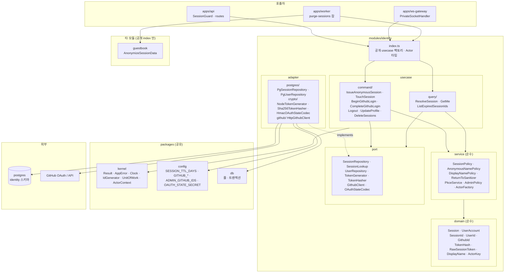

- 어댑터 조립은 `apps/*/src/compose/` 에서만 한다(B6). `domain`·`service` 는 I/O·시간·난수를 직접 부르지 않고 `Clock`·`IdGenerator`·`TokenGenerator` 포트가 준 값을 쓴다.
- **타 모듈에 대한 의존은 없다.** 정리 작업(ID-10)이 guestbook 데이터 익명화를 필요로 하지만, 그 오케스트레이션은 identity 가 guestbook 을 임포트하지 않도록 **worker 잡이** 두 모듈의 공개 usecase 를 차례로 부른다(순환 금지 B5, 모듈 경계 B4).

---

## 2. 통합 클래스 다이어그램

### 2.1 도메인·서비스

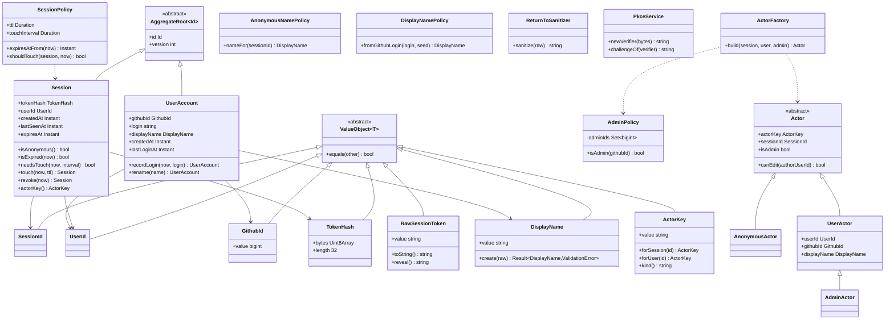

- `Session`·`UserAccount` 는 불변 객체처럼 다룬다(메서드는 새 값을 돌려준다). `AggregateRoot.version` 은 identity 에서 **쓰지 않는다**(낙관적 버전 대상이 아니다, §3.5).
- `RawSessionToken` 은 **어디에도 저장·로그하지 않는다.** `toString()` 은 `***` 로 마스킹하고 쿠키 설정 순간에만 `reveal()` 한다.
- `Actor` 계층은 00 §4 의 `ActorContext`(kernel)를 구현하는 identity 쪽 런타임 표현이다. 다른 모듈은 `ActorContext` 인터페이스만 본다.

### 2.2 포트와 어댑터

```mermaid
classDiagram
    class SessionLookup {
        <<interface>>
        +findByTokenHash(hash) Session
        +findWithUserByTokenHash(hash) SessionWithUser
        +listExpiredIds(now, limit) SessionId[]
    }
    class SessionRepository {
        <<interface>>
        +insert(session) void
        +touchIfStale(id, now, newExpiry, interval) bool
        +expireNow(id, now) bool
        +deleteByIds(ids) int
    }
    class UserRepository {
        <<interface>>
        +upsertByGithubId(profile, now, newId, defaultName) UserAccount
        +findById(id) UserAccount
        +updateDisplayName(id, name) UserAccount
    }
    class TokenGenerator {
        <<interface>>
        +newToken() RawSessionToken
        +newOpaque(bytes) string
    }
    class TokenHasher {
        <<interface>>
        +hash(raw) TokenHash
    }
    class GithubClient {
        <<interface>>
        +exchange(code, verifier) AccessToken
        +fetchProfile(token) GithubProfile
    }
    class OAuthStateCodec {
        <<interface>>
        +seal(payload) string
        +open(cookieValue, now) Result~OAuthStatePayload,OAuthStateError~
    }
    class PgSessionRepository
    class PgUserRepository
    class NodeTokenGenerator
    class Sha256TokenHasher
    class HttpGithubClient
    class HmacOAuthStateCodec {
        -secret bytes
        -algorithm HMAC-SHA256
    }
    SessionLookup <|.. PgSessionRepository
    SessionRepository <|.. PgSessionRepository
    UserRepository <|.. PgUserRepository
    TokenGenerator <|.. NodeTokenGenerator
    TokenHasher <|.. Sha256TokenHasher
    GithubClient <|.. HttpGithubClient
    OAuthStateCodec <|.. HmacOAuthStateCodec

    class SessionWithUser {
        +session Session
        +user UserAccount
    }
    class GithubProfile {
        +id bigint
        +login string
        +avatarUrl string
    }
    class AccessToken {
        +value string
    }
    class OAuthStatePayload {
        +state string
        +verifier string
        +returnTo string
        +exp int
    }
    SessionLookup ..> SessionWithUser
    GithubClient ..> GithubProfile
    GithubClient ..> AccessToken
    OAuthStateCodec ..> OAuthStatePayload
```

- `SessionLookup`(읽기 전용)과 `SessionRepository`(쓰기)를 **다른 인터페이스로 갈라** 조회 usecase 가 쓰기 포트를 주입받지 못하게 한다(B3). 구현 클래스는 하나가 둘을 모두 구현할 수 있다.
- `AccessToken` 은 `exchange` 반환 직후 `fetchProfile` 한 번에만 쓰고 폐기한다(저장·로그 금지).

### 2.3 usecase 와 "인증 조회 예외"

```mermaid
classDiagram
    class CommandHandler~C,R~ {
        <<interface>>
        +execute(ctx, input) Result
    }
    class QueryHandler~Q,R~ {
        <<interface>>
        +execute(ctx, input) Result
    }
    class IssueAnonymousSession
    class TouchSession
    class BeginGithubLogin
    class CompleteGithubLogin
    class Logout
    class UpdateProfile
    class DeleteSessions
    class ResolveSession
    class GetMe
    class ListExpiredSessionIds
    CommandHandler <|.. IssueAnonymousSession
    CommandHandler <|.. TouchSession
    CommandHandler <|.. BeginGithubLogin
    CommandHandler <|.. CompleteGithubLogin
    CommandHandler <|.. Logout
    CommandHandler <|.. UpdateProfile
    CommandHandler <|.. DeleteSessions
    QueryHandler <|.. ResolveSession
    QueryHandler <|.. GetMe
    QueryHandler <|.. ListExpiredSessionIds

    class UnitOfWork {
        <<interface>>
    }
    IssueAnonymousSession ..> SessionRepository
    IssueAnonymousSession ..> TokenGenerator
    IssueAnonymousSession ..> TokenHasher
    IssueAnonymousSession ..> SessionPolicy
    TouchSession ..> SessionRepository
    TouchSession ..> SessionPolicy
    BeginGithubLogin ..> OAuthStateCodec
    BeginGithubLogin ..> PkceService
    BeginGithubLogin ..> ReturnToSanitizer
    CompleteGithubLogin ..> OAuthStateCodec
    CompleteGithubLogin ..> GithubClient
    CompleteGithubLogin ..> UserRepository
    CompleteGithubLogin ..> SessionRepository
    CompleteGithubLogin ..> UnitOfWork
    CompleteGithubLogin ..> DisplayNamePolicy
    Logout ..> SessionRepository
    UpdateProfile ..> UserRepository
    DeleteSessions ..> SessionRepository
    ResolveSession ..> SessionLookup
    ResolveSession ..> TokenHasher
    ResolveSession ..> AdminPolicy
    ResolveSession ..> ActorFactory
    GetMe ..> AnonymousNamePolicy
    GetMe ..> AdminPolicy
    ListExpiredSessionIds ..> SessionLookup
```

**인증 조회 예외** (정리): identity 는 읽기 모델이 없고, 세션 확인은 가드·gateway 에서 요청마다 일어나 이벤트 반영 지연을 허용할 수 없다. 그래서 `ResolveSession`·`GetMe`·`ListExpiredSessionIds` 는 `QueryHandler` 이면서 쓰기 스키마를 읽지만, **`SessionLookup`(읽기 전용 인터페이스)만 주입**받는다. 쓰기 포트(`SessionRepository`, `UserRepository`)는 주입받지 못하므로 B3 규칙(조회가 쓰기 포트를 못 쓴다)은 그대로 성립한다. `TouchSession` 처럼 읽기 도중 필요한 쓰기는 **호출자(가드)가 별도 명령으로** 부른다.

### 2.4 오류 상속 (identity 전용 코드)

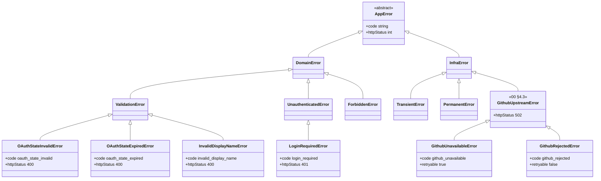

- `GithubUnavailableError`·`GithubRejectedError` 는 00 §4.3 의 `GithubUpstreamError`(502) 하위 클래스다. `TransientError`=503 과 달리 **502** 를 쓴다(상류 응답 실패라는 06 §3.2 순서도의 의미를 유지). 와이어 코드에는 모듈 접두사를 붙이지 않는다(00 §5).

---

## 3. 공통 설계

### 3.1 토큰과 해시

| 항목 | 규칙 |
|---|---|
| 원문 토큰 | 32 바이트 CSPRNG(`crypto.getRandomValues`) → base64url, 패딩 없음 → **43자** |
| 저장 | `session.token_hash bytea` = SHA-256(원문 UTF-8 바이트) 32 바이트, `UNIQUE NOT NULL` |
| 조회 | 쿠키 원문을 형식 검사(길이 43, base64url 문자만) → 해시 → `WHERE token_hash = $1`. 형식이 틀리면 **DB 를 조회하지 않고** 부재로 처리 |
| 해시에 솔트·키 없음 | 토큰이 이미 256 비트 난수라 사전·무지개 표 공격이 성립하지 않는다. 느린 해시(bcrypt 등)는 쓰지 않는다 |
| 상수 시간 비교 | **DB 동등 조회에는 필요 없다**(공격자가 해시 접두를 통제할 수 없고 인덱스 탐색 시간으로 원문을 복원할 수 없다). 앱이 두 비밀 값을 직접 비교하는 곳(OAuth `state` 비교, 쿠키 서명 MAC 비교)에서는 `timingSafeEqual` 을 쓴다. Bun 에서의 동작은 **미확인(G4/G5 스파이크에서 함께 확인)** |
| 로그 | 원문·해시 모두 로그에 남기지 않는다. `RawSessionToken.toString()` 마스킹 |

### 3.2 쿠키 설정 (06 §2, 10 §3.1)

| 이름 | 값 | 속성 |
|---|---|---|
| 세션 | 운영 `__Host-sid` / 개발 `sid` (`SESSION_COOKIE_NAME`) | `HttpOnly; Secure(운영); SameSite=Lax; Path=/; Max-Age=SESSION_TTL_DAYS`(`Domain` 없음) |
| OAuth 임시 | 운영 `__Secure-oauth` / 개발 `oauth` | `HttpOnly; Secure(운영); SameSite=Lax; Path=/api/auth; Max-Age=600` |

쿠키 직렬화는 엔트리포인트(`apps/api`)의 책임이고 usecase 는 `{ cookie: { name, value, maxAge } }` **값만** 돌려준다(HTTP 를 모른다).

### 3.3 세션 상태

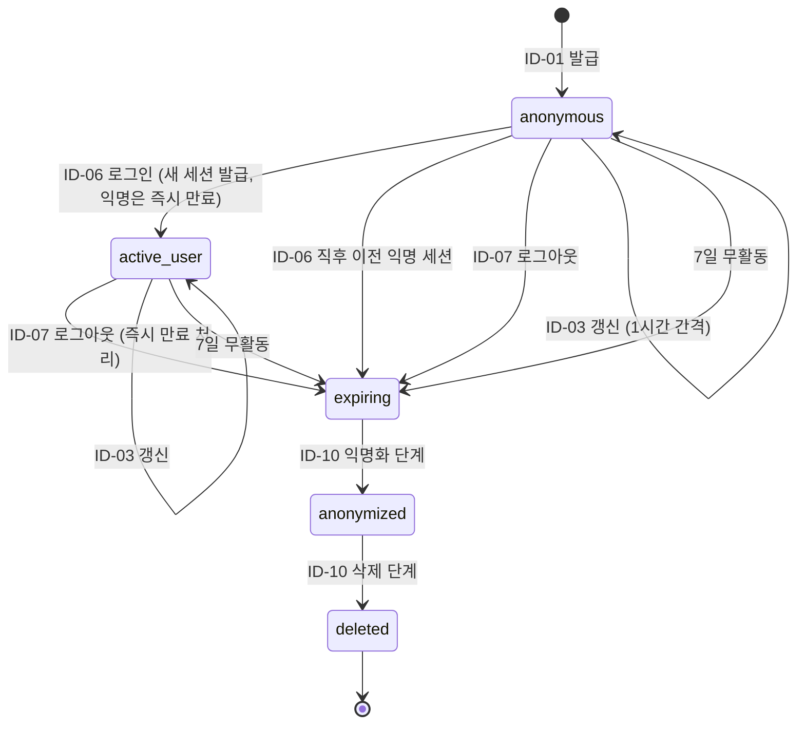

- `expiring` 은 **별도 컬럼이 아니라** `expires_at <= now` 로 판정되는 상태다(ID-02 는 만료 세션을 부재로 취급).
- **폐기 = 즉시 만료**: 로그아웃·로그인 회전은 행을 지우지 않고 `expires_at = now` 로 만든다. 그러면 삭제와 익명화가 항상 ID-10 한 경로를 지나므로 "세션이 사라졌는데 글의 `author_session_id` 가 남는" 틈이 없다. 06 §2·§8 의 "행 삭제" 표현과 다르므로 수정 요청 대상이다(§16).

### 3.4 접근 테이블 요약

| 테이블 | 읽는 기능 | 쓰는 기능 |
|---|---|---|
| `identity.session` | ID-02, 04, 10(목록) | ID-01, 03, 06, 07, 10(삭제) |
| `identity.user_account` | ID-02(로그인 세션), 04 | ID-06, 08 |
| `identity.request_key` | (CM-02 가 읽음) | ID-08 의 멱등 기록(CM-02) |

### 3.5 동시성 규칙 (ADR-021)

- 세션 행은 **낙관적 `version` 을 쓰지 않는다**. 모든 갱신이 **단일 조건부 UPDATE** 로 끝나는 멱등 연산이기 때문이다(`touchIfStale`, `expireNow`).
- 중복을 판정하는 것은 **유일 키**다: `session.token_hash`, `user_account.github_id`.
- 외부 호출(GitHub)은 **트랜잭션 밖**에서 한다(ID-06).

---

## 4. ID-01 익명 세션 발급

| 항목 | 내용 |
|---|---|
| 목적 | 로그인 없이 즉시 쓸 수 있는 세션을 발급한다(FR-010) |
| 트리거 | `GET /api/me` 가 쿠키 없음/무효/만료 세션으로 호출됨(`SessionGuard` 가 부재로 판정) |
| 사전 조건 | 세션 쿠키가 없거나, 있어도 ID-02 가 부재로 판정 |
| 사후 조건 | `session` 에 익명 행 1건(`user_id NULL`, `expires_at = now+7d`), 응답에 `Set-Cookie` |
| 접근 테이블 | `identity.session` W |

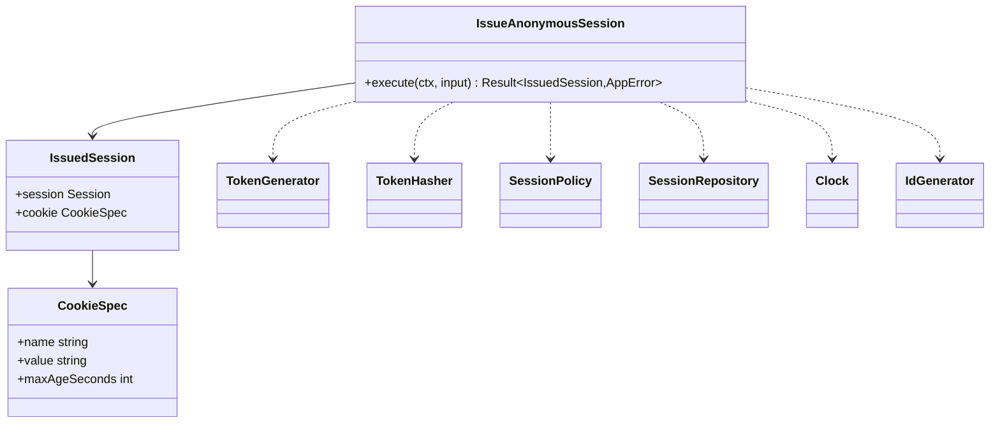

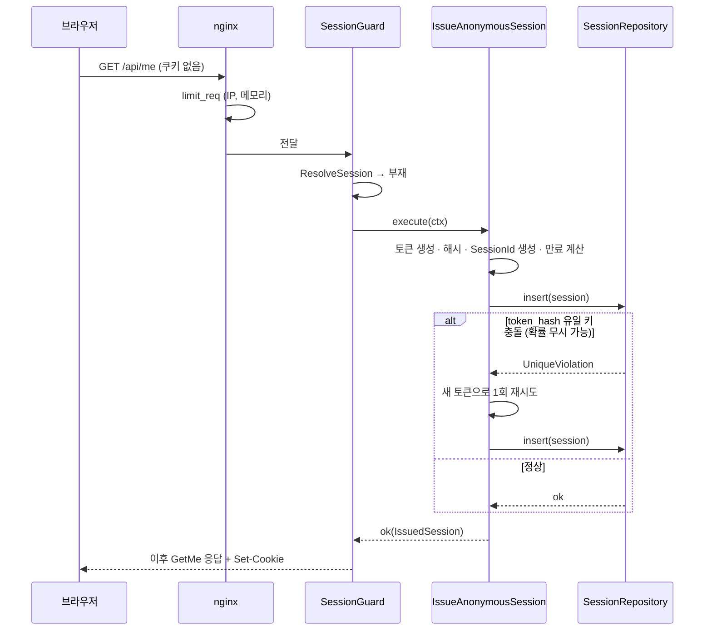

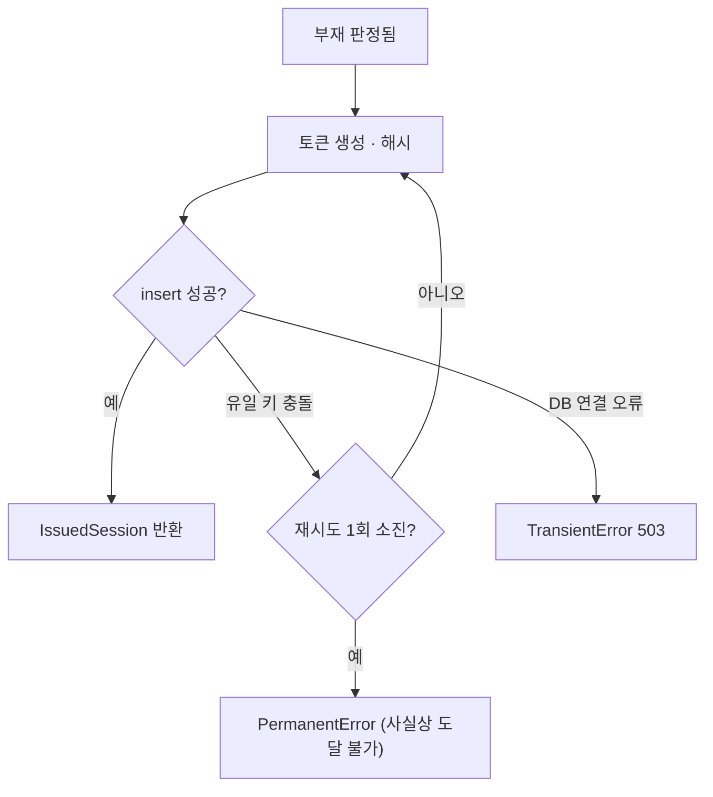

- **경합**: 같은 브라우저의 여러 탭이 동시에 `GET /api/me` 를 보내면 세션이 둘 이상 발급되고 마지막 `Set-Cookie` 가 이긴다. 앞선 세션은 고아로 남아 7일 뒤 ID-10 이 정리한다. 막지 않는다(무해, 비용은 행 몇 개). 남용(대량 발급)은 nginx `limit_req` 와 `identity_sessions_issued_total` 급증 경보로 본다.
- 이 흐름은 **멱등 키 대상이 아니다**(`GET`).

| 오류 | 클래스 | HTTP | 코드 |
|---|---|---|---|
| DB 일시 장애 | `TransientError` | 503 | `unavailable` |
| 재시도 후에도 충돌 | `PermanentError` | 500 | `internal` |

지표: `identity_sessions_issued_total{kind="anonymous"}`. 로그: `usecase=IssueAnonymousSession`, `outcome`, `trace_id`(세션 식별자·토큰은 남기지 않는다).
시험: 단위 L2(만료 계산, 토큰 형식 43자), 통합 L3(행 생성·`token_hash` 유일, 원문이 DB 어디에도 없음 — AC 관련 FR-010), 계약(쿠키 속성).

---

## 5. ID-02 세션 해석

| 항목 | 내용 |
|---|---|
| 목적 | 쿠키 원문을 `Actor` 로 바꾼다. 가드와 gateway private 업그레이드가 공유 |
| 트리거 | 모든 REST 요청(`SessionGuard`), `/ws/private` 업그레이드(RT-07) |
| 사전 조건 | 쿠키 원문(없을 수 있음) |
| 사후 조건 | `Ok(ResolvedActor)` 또는 `Ok(null)`(부재·만료). **부재는 오류가 아니다**(발급 여부는 호출자가 정한다) |
| 접근 테이블 | `session` R, `user_account` R(로그인 세션) |

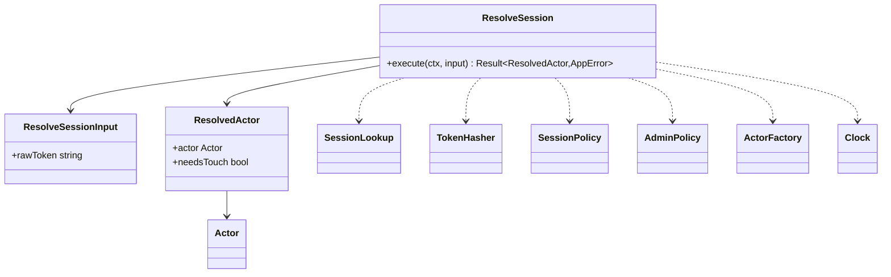

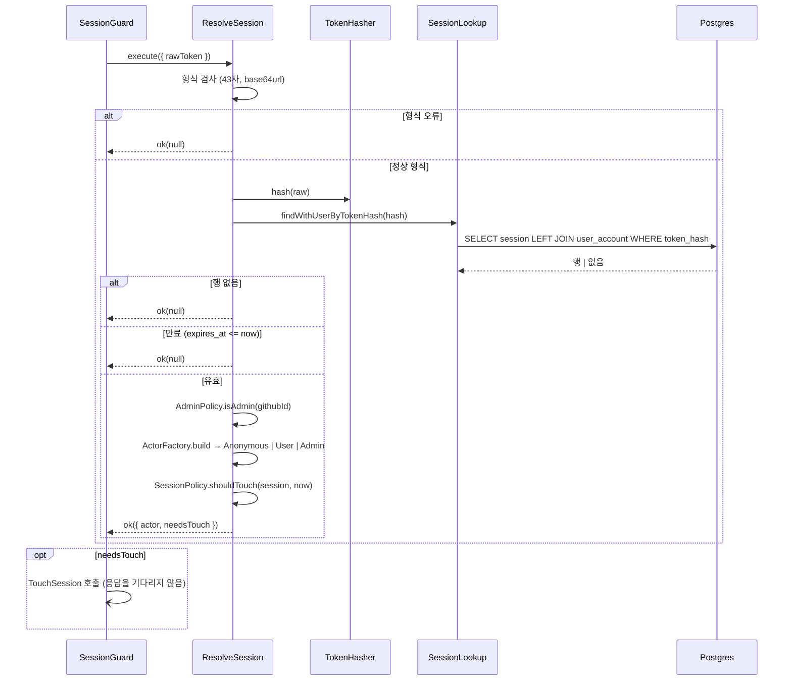

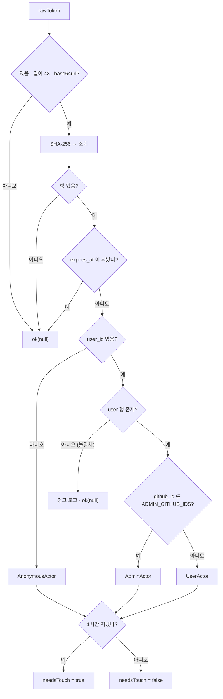

- `session.user_id` 는 같은 스키마 FK 라 사용자 행이 없는 경우는 비정상이다(수동 삭제 등). 보안상 안전한 쪽(부재 처리)으로 떨어뜨리고 경고 로그를 남긴다.
- gateway 는 이 usecase 결과를 `KeyValueCache`(`SessionCache`, 30초)에 담는다(RT-13). 그래서 폐기·회전 반영 지연은 최대 30초(06 §6).

| 오류 | 클래스 | HTTP | 코드 |
|---|---|---|---|
| DB 일시 장애 | `TransientError` | 503 | `unavailable` |

(부재·만료는 오류가 아니라 `ok(null)` 이며, 인증이 필요한 라우트의 `RequireLogin` 가드가 `401 unauthenticated` 로 바꾼다.)

지표: `identity_session_resolve_total{result="hit|miss|expired|malformed"}`. 로그: `outcome` 만(토큰·세션 id 없음).
시험: 단위 L2(형식 검사, 만료 경계 `expires_at == now`, Admin 판정 조합), 통합 L3(실제 행 조회), 구조 시험(조회 usecase 가 `SessionRepository` 를 주입받지 못함 — B3).

---

## 6. ID-03 세션 갱신 (슬라이딩)

| 항목 | 내용 |
|---|---|
| 목적 | 활동 중인 세션의 만료를 연장하되 **쓰기를 1시간에 한 번으로** 제한한다 |
| 트리거 | `SessionGuard` 가 `needsTouch=true` 를 받았을 때(응답을 막지 않고 후속 비동기) |
| 사전 조건 | 유효 세션, `last_seen_at <= now - 1h` |
| 사후 조건 | `last_seen_at = now`, `expires_at = now + 7d`. 이미 다른 요청이 갱신했으면 0행 갱신(성공으로 본다) |
| 접근 테이블 | `session` W |

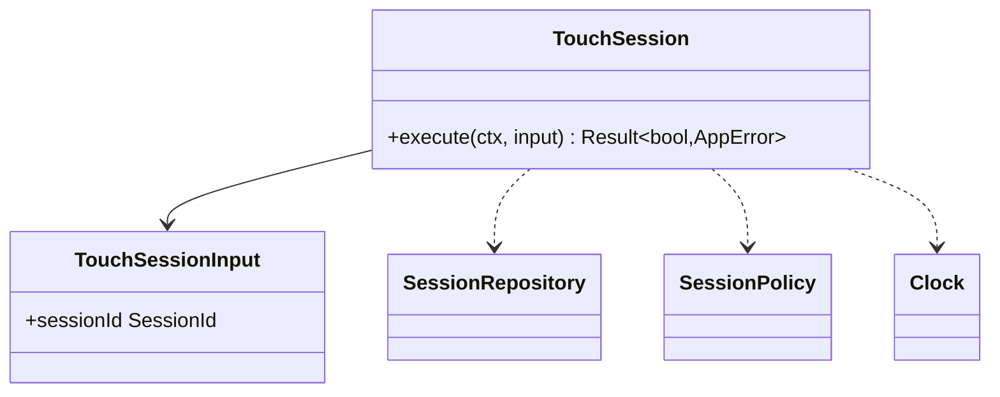

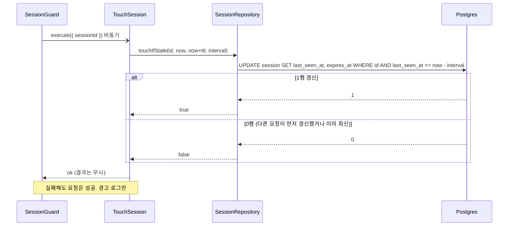

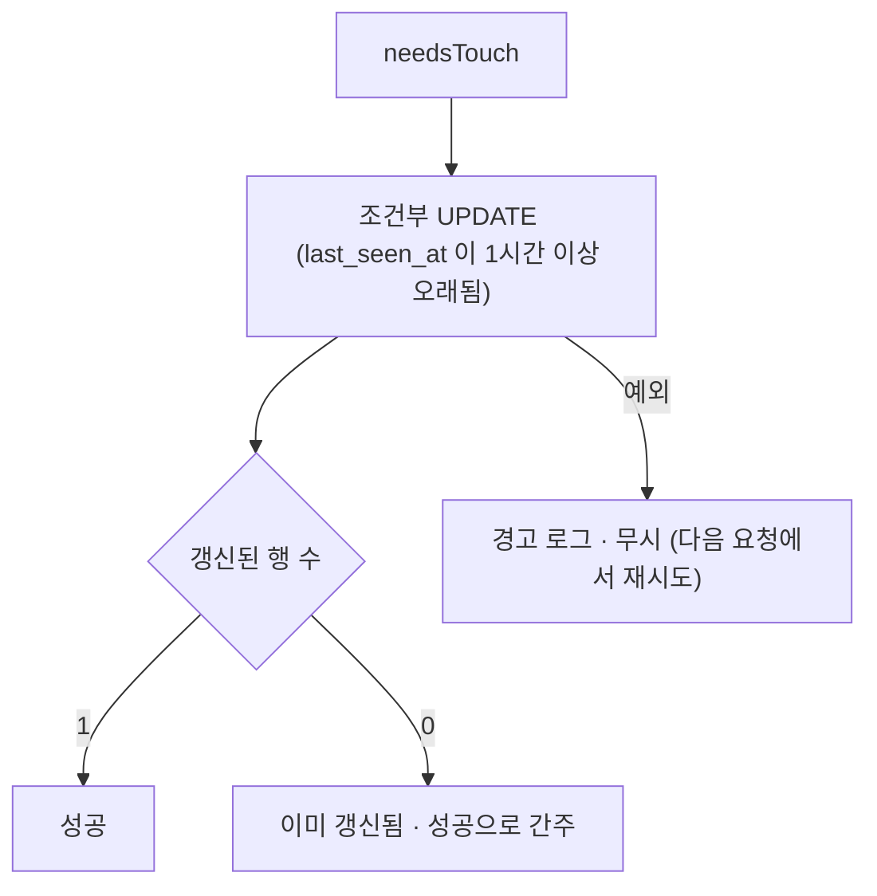

- **동시성**: 같은 세션을 여러 요청이 동시에 갱신해도 조건부 UPDATE 한 문장이 알아서 한 건만 반영한다. 낙관적 버전·잠금이 필요 없다(§3.5).
- 만료된 행에는 갱신하지 않는다(`AND expires_at > now` 조건을 함께 둔다 — 죽은 세션을 되살리지 않는다).

| 오류 | 처리 |
|---|---|
| DB 오류 | 요청 실패로 만들지 않는다. 경고 로그, 지표 `identity_touch_total{result="error"}` |

시험: 통합 L3(1시간 경계 전/후, 동시 두 갱신에서 `expires_at` 가 한 번만 증가, 만료 세션 갱신 거부).

---

## 7. ID-04 내 정보 조회

| 항목 | 내용 |
|---|---|
| 목적 | 현재 행위자 정보를 돌려준다. 익명 세션은 ID-01 이 먼저 발급한다 |
| 트리거 | `GET /api/me` |
| 사전 조건 | `SessionGuard` 가 `Actor` 를 만든 상태(없으면 ID-01 후 진행) |
| 사후 조건 | `MeView = { kind, userId?, displayName, isAdmin, locale? }`. 응답 `Me`(03 §4.3)의 `writeLocked` 는 **라우트 조립부**가 `guestbook.GetWriteLockState`(F11 GB-11)를 호출해 덧붙인다 — identity 는 guestbook 테이블을 읽지 않는다 |
| 접근 테이블 | 가드가 읽은 `Actor` 를 쓰므로 **추가 조회 없음**(표시 이름은 `Actor`/`UserAccount` 에 이미 있음) |

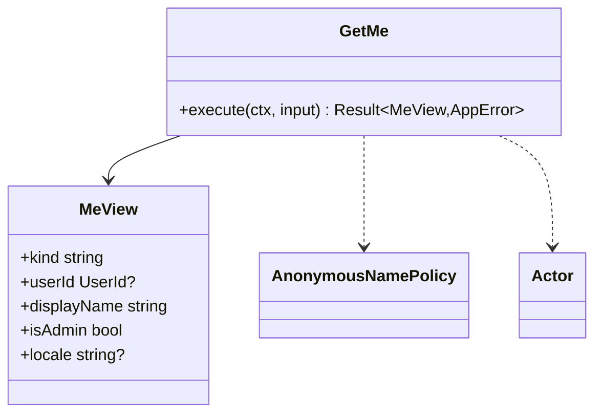

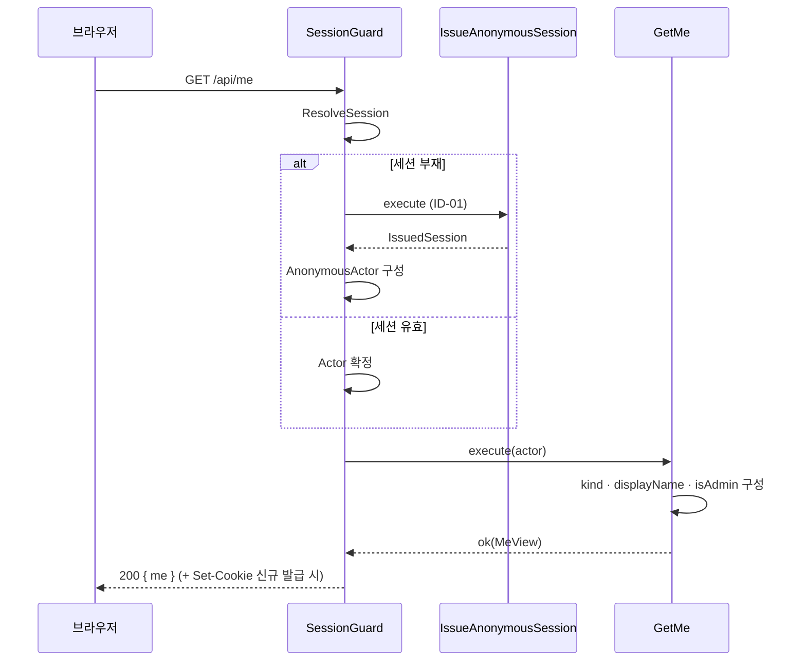

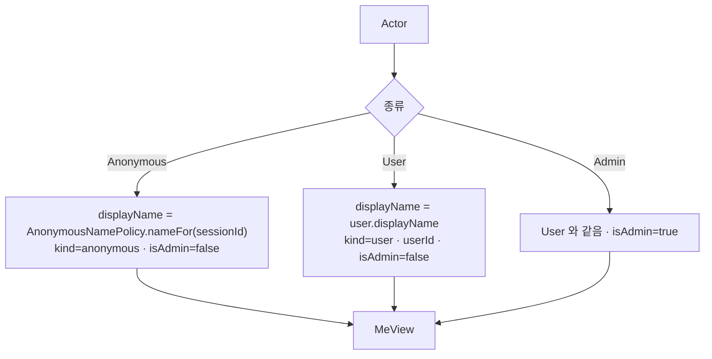

- 익명 표시 이름은 `손님-` + `SHA-256(sessionId 바이트)` 의 16진 앞 4자리(03 의 "세션 해시 4자리"). 영어 로케일 접두(`Guest-`)는 **미결**이다.
- `locale` 은 쿠키/헤더의 선호 로케일을 되돌려 주는 선택 필드이며 저장하지 않는다(확정 필요: 12 와 07 에서 사용 방식 확인 — 미확인).
- 이 응답에는 **민감값이 없다**(세션 id·토큰·GitHub id 미포함). `userId` 는 우리 내부 uuid 다.

오류: 인증 오류 없음(항상 200). `TransientError` 503 만.
지표: `http_requests_total{route="/api/me"}` 는 OB-01 소관. 시험: 단위 L2(이름 규칙 결정성), 계약(응답 스키마 골든 JSON), E2E(첫 진입 → 세션 발급 → 응답).

---

## 8. ID-05 GitHub 로그인 시작

| 항목 | 내용 |
|---|---|
| 목적 | 상태·PKCE 값을 만들어 서명 쿠키에 담고 GitHub 인가 화면으로 보낸다 |
| 트리거 | `GET /api/auth/github?returnTo=…` |
| 사전 조건 | 없음(익명이든 로그인이든). 이미 로그인된 사용자도 재로그인 가능 |
| 사후 조건 | `302` → GitHub, `Set-Cookie: __Secure-oauth`(10분). **DB 쓰기 없음** |
| 접근 테이블 | 없음 |

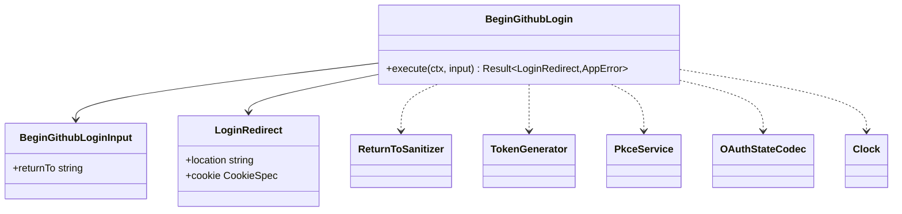

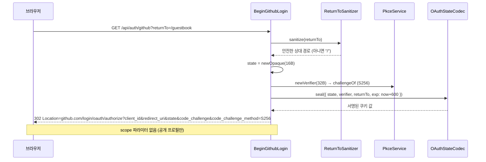

```mermaid
flowchart TD
    A["returnTo 입력"] --> B{"비어 있음?"}
    B -- "예" --> R["returnTo = /"]
    B -- "아니오" --> C{"/ 로 시작?"}
    C -- "아니오" --> R
    C -- "예" --> D{"// 또는 /\\ 로 시작? · 제어문자 · 길이 2048 초과?"}
    D -- "예" --> R
    D -- "아니오" --> E["그대로 사용"]
    R --> F["state · verifier 생성 → 쿠키 봉인 → 302"]
    E --> F
```

**OAuth 상태 쿠키 코덱 (`HmacOAuthStateCodec`)**

| 항목 | 규칙 |
|---|---|
| 형식 | `base64url(payloadJson) + "." + base64url(HMAC-SHA256(secret, payloadBytes))` |
| 페이로드 | `{ "s": state, "v": verifier, "r": returnTo, "e": expiresAtEpochSeconds }` (키 이름은 쿠키 길이를 줄이려 한 글자) |
| 키 | `OAUTH_STATE_SECRET`(32 바이트 이상 권장, 비밀). **01 의 환경변수 표에 없다 — 추가 필요**(§16) |
| 검증(`open`) | ① 점(.) 으로 분리 ② MAC 재계산 후 `timingSafeEqual` ③ JSON 파싱 ④ `e > now` 아니면 `OAuthStateExpiredError` ⑤ 서명 불일치·형식 오류는 `OAuthStateInvalidError` |
| 비밀성 | 페이로드는 암호화하지 않는다(서명만). `verifier` 는 쿠키(HttpOnly, 같은 사이트)에 있어 스크립트가 못 읽는다. 쿠키 자체가 노출되는 위협 모델(로컬 악성 소프트웨어)은 범위 밖 |
| PKCE | `challenge = base64url(SHA-256(verifier))`, 방식 `S256`. **GitHub OAuth App 의 PKCE S256 지원은 공식 문서로 확인됨(2026-11-05; `plain` 미지원, 토큰 교환에 `code_verifier` 필요)** |

```mermaid
classDiagram
    class OAuthStateCodec {
        <<interface>>
        +seal(payload) string
        +open(value, now) Result
    }
    class HmacOAuthStateCodec {
        -secret bytes
        +seal(payload) string
        +open(value, now) Result
        -mac(bytes) bytes
    }
    class OAuthStatePayload {
        +state string
        +verifier string
        +returnTo string
        +exp int
    }
    OAuthStateCodec <|.. HmacOAuthStateCodec
    HmacOAuthStateCodec ..> OAuthStatePayload
```

| 오류 | 클래스 | HTTP | 코드 |
|---|---|---|---|
| (없음 — `returnTo` 가 나쁘면 `/` 로 대체) | | | |

지표: `identity_login_started_total`. 로그: `usecase=BeginGithubLogin`, `outcome`(returnTo 값은 남기지 않는다).
시험: 단위 L2(`ReturnToSanitizer` 오픈 리다이렉트 표본 — `//evil.com`, `/\\evil.com`, `https://…`, 제어문자, 긴 입력), 코덱 왕복·변조·만료(L2), 계약(리다이렉트 URL 파라미터, 쿠키 속성).

---

## 9. ID-06 GitHub 로그인 완료

| 항목 | 내용 |
|---|---|
| 목적 | 콜백을 검증하고 GitHub 신원으로 사용자 행과 **새 세션**을 만든다 |
| 트리거 | `GET /api/auth/github/callback?code&state` (또는 `error=…`) |
| 사전 조건 | OAuth 임시 쿠키 존재 |
| 사후 조건 | `user_account` upsert, 새 로그인 세션 1건, 이전 세션(익명) 즉시 만료 처리, 임시 쿠키 삭제, `302` → 안전한 `returnTo` |
| 접근 테이블 | `user_account` W, `session` W(삽입, 이전 세션 만료 처리), `events.audit_log` W(`AuditWriter`, ADR-027) |

```mermaid
classDiagram
    class CompleteGithubLogin {
        +execute(ctx, input) Result~LoginDone,AppError~
    }
    class CompleteGithubLoginInput {
        +code string
        +state string
        +error string
        +stateCookie string
        +previousSessionId SessionId
    }
    class LoginDone {
        +redirectTo string
        +sessionCookie CookieSpec
        +clearOauthCookie CookieSpec
    }
    CompleteGithubLogin --> CompleteGithubLoginInput
    CompleteGithubLogin --> LoginDone
    CompleteGithubLogin ..> OAuthStateCodec
    CompleteGithubLogin ..> GithubClient
    CompleteGithubLogin ..> UserRepository
    CompleteGithubLogin ..> SessionRepository
    CompleteGithubLogin ..> TokenGenerator
    CompleteGithubLogin ..> TokenHasher
    CompleteGithubLogin ..> DisplayNamePolicy
    CompleteGithubLogin ..> SessionPolicy
    CompleteGithubLogin ..> UnitOfWork
    CompleteGithubLogin ..> Clock
    CompleteGithubLogin ..> IdGenerator
```

```mermaid
sequenceDiagram
    participant B as 브라우저
    participant U as CompleteGithubLogin
    participant C as OAuthStateCodec
    participant GH as GitHub
    participant T as UnitOfWork
    participant DB as Postgres
    B->>U: GET callback (code, state, 쿠키)
    U->>C: open(쿠키, now)
    alt 쿠키 없음·변조·만료
        C-->>U: OAuthStateInvalid/Expired
        U-->>B: 400 로그인 실패 화면
    else 정상
        U->>U: state 일치 비교 (timingSafeEqual)
        alt 불일치
            U-->>B: 400 로그인 실패 화면
        else 일치
            U->>GH: POST /login/oauth/access_token (code, verifier, client_secret)
            alt 오류·시간 초과
                GH-->>U: 실패
                U-->>B: 502 재시도 안내
            else 성공
                GH-->>U: access_token
                U->>GH: GET /user (Bearer)
                GH-->>U: id, login, avatar_url
                Note over U: access_token 즉시 폐기 (저장 안 함)
                U->>T: run(tx)
                T->>DB: upsert user_account (github_id 유일) → 행
                T->>DB: insert 새 session (user_id 설정)
                T->>DB: 이전 세션 expireNow
                T-->>U: 커밋
                U-->>B: 302 returnTo + Set-Cookie 새 세션 + 임시 쿠키 삭제
            end
        end
    end
```

```mermaid
flowchart TD
    A["callback"] --> E{"error 파라미터?"}
    E -- "있음" --> X1["302 returnTo (또는 /) + 안내 플래그, 로그인 안 됨"]
    E -- "없음" --> S{"쿠키 open 성공?"}
    S -- "아니오" --> X2["400 OAuthStateInvalid / Expired"]
    S -- "예" --> M{"state 일치?"}
    M -- "아니오" --> X2
    M -- "예" --> T{"토큰 교환 성공?"}
    T -- "일시 오류" --> X3["502 GithubUnavailable"]
    T -- "거절 (잘못된 코드)" --> X4["502 GithubRejected"]
    T -- "성공" --> U{"GET /user 성공?"}
    U -- "아니오" --> X3
    U -- "예" --> V["트랜잭션: upsert user · 새 세션 · 이전 세션 만료"]
    V --> W{"커밋 성공?"}
    W -- "아니오" --> X5["503 TransientError (사용자는 재시도)"]
    W -- "예" --> Z["302 + 쿠키 교체"]
```

- **트랜잭션 밖 외부 호출**(ADR-021): GitHub 호출이 끝난 뒤에야 트랜잭션을 연다. 트랜잭션 안은 DB 문장 3개뿐이다.
- **upsert**: `INSERT … ON CONFLICT (github_id) DO UPDATE SET login = EXCLUDED.login, last_login_at = $now RETURNING *`. **유일 키(`github_id`)가 중복 가입을 심판**하므로 같은 사용자가 두 탭에서 동시에 첫 로그인해도 한 행만 생긴다. 기존 사용자의 `display_name` 은 덮어쓰지 않는다(ID-08 로 바꾼 이름 보존).
- **첫 표시 이름**: `DisplayNamePolicy.fromGithubLogin(login, seed)` — 로그인 이름을 NFC 정규화 후 20자로 자르고, 2자 미만이면 `user-` + 임의 4자(seed 는 새 `UserId`). 로그인 이름이 정책에 맞지 않는 문자를 가지면(제어문자 등) 같은 대체 규칙을 쓴다.
- **세션 회전**: 새 토큰으로 새 행을 만들고 이전 세션은 `expireNow`(§3.3). `previousSessionId` 는 가드가 해석한 현재 세션(익명 또는 다른 계정 로그인) — 없으면 건너뛴다. **이전 익명 글은 계정에 귀속하지 않는다**(ADR-008 기본값).
- **이중 콜백**(더블 클릭·새로 고침): GitHub 코드는 1회용이라 두 번째 교환이 `GithubRejected` 로 실패한다. 첫 번째가 이미 로그인을 마쳤으므로 사용자는 새로 고침으로 정상 상태가 된다(별도 처리 없음, 안내 화면에서 재시도 링크).
- `access_token` 을 DB·로그·메트릭에 남기지 않는다. `GithubClient` 가 반환한 값을 `fetchProfile` 직후 변수에서 버린다.

| 오류 | 클래스 | HTTP | 코드 |
|---|---|---|---|
| 쿠키 없음/서명 불일치/`state` 불일치 | `OAuthStateInvalidError` | 400 | `oauth_state_invalid` |
| 쿠키 만료(10분 초과) | `OAuthStateExpiredError` | 400 | `oauth_state_expired` |
| GitHub 일시 오류·시간 초과 | `GithubUnavailableError` | 502 | `github_unavailable` |
| GitHub 가 코드를 거절 | `GithubRejectedError` | 502 | `github_rejected` |
| DB 일시 장애 | `TransientError` | 503 | `unavailable` |

사용자 거부(`error=access_denied`)는 오류가 아니라 정상 분기(리다이렉트 + 안내)다.

**감사 기록 (ADR-027, EV-14)**
- 성공: 사용자·세션 쓰기와 **같은 tx** 에서 `AuditWriter.record(category=auth, action=login_succeeded, actor_role=user, actor_key=user:<id>, outcome=success)`. 로그인 사용자 이름·`github_id` 는 `detail` 에 넣지 않는다.
- 실패: 세션이 만들어지지 않는 경로이므로 **별도 짧은 tx** 로 `action=login_failed, outcome=failed|denied, actor_role=anonymous` 를 기록한다. `reason_code` 는 `state_invalid` · `state_expired` · `github_rejected` · `github_unavailable`(위 오류 표와 1:1). 사용자 거부(`access_denied`)는 `outcome=denied, reason_code=user_denied`.
- 실패 기록의 `actor_key` 는 이전 익명 세션 키(있으면), IP·`code`·`state` 는 남기지 않는다.
지표: `identity_login_total{result="success|denied|state_invalid|state_expired|github_error|db_error"}`, `identity_github_call_duration_seconds{call="token|user"}`. 로그: `outcome`, 오류 코드(GitHub 응답 본문·토큰·login 은 남기지 않는다).
시험: 단위 L2(분기 전부 — 06 §3.2 순서도 표), 통합 L3(`GithubClient` 대역으로 성공·거절·시간 초과, 동시 첫 로그인 두 요청 → `user_account` 1건, 회전 후 이전 세션이 `ID-02` 에서 부재), L4(실제 GitHub 로그인은 릴리스 후 수동).

---

## 10. ID-07 로그아웃

| 항목 | 내용 |
|---|---|
| 목적 | 현재 세션을 끝낸다 |
| 트리거 | `POST /api/auth/logout` |
| 사전 조건 | 없음(세션이 없어도 호출 가능) |
| 사후 조건 | 현재 세션 `expires_at = now`(즉시 만료), 쿠키 삭제(`Max-Age=0`). 응답 `200 {}` |
| 접근 테이블 | `session` W, `events.audit_log` W(`auth.logout`, 같은 tx, ADR-027) |

```mermaid
classDiagram
    class Logout {
        +execute(ctx, input) Result~LogoutDone,AppError~
    }
    class LogoutDone {
        +clearCookie CookieSpec
    }
    Logout --> LogoutDone
    Logout ..> SessionRepository
    Logout ..> Clock
```

```mermaid
sequenceDiagram
    participant B as 브라우저
    participant G as 가드 체인 (Origin · Session)
    participant L as Logout
    participant R as SessionRepository
    B->>G: POST /api/auth/logout (Origin, 쿠키)
    G->>G: OriginGuard (불일치면 403)
    G->>G: ResolveSession
    G->>L: execute({ sessionId? })
    alt 세션 있음
        L->>R: expireNow(id, now)
        R-->>L: true | false (이미 만료)
    else 세션 없음
        L->>L: 할 일 없음
    end
    L-->>G: ok(clearCookie)
    G-->>B: 200 {} + Set-Cookie Max-Age=0
    Note over B,G: 이후 GET /api/me 가 새 익명 세션을 발급
```

```mermaid
flowchart TD
    A["POST logout"] --> B{"Origin 일치?"}
    B -- "아니오" --> X["403 origin_mismatch"]
    B -- "예" --> C{"세션 해석됨?"}
    C -- "예" --> D["expireNow"]
    C -- "아니오" --> E["건너뜀"]
    D --> F["쿠키 삭제 200"]
    E --> F
```

- **멱등**: 몇 번을 불러도 같은 결과(`200`). 03 §1 에 따라 **로그아웃은 `Idempotency-Key` 면제**이므로 CSRF 방어는 `SameSite=Lax` + `OriginGuard` + JSON 전용 3중이다(10 §3.3).
- gateway private 연결은 세션 캐시 30초 안에 `4401` 로 닫힌다(04 §4). 즉시 닫기(`NOTIFY session_revoked`)는 미결(06 §9).

오류: 없음(항상 200). `TransientError` 503 만.
지표: `identity_logout_total{had_session="true|false"}`. 시험: 통합 L3(로그아웃 직후 ID-02 가 부재, 두 번 호출해도 200), E2E(로그아웃 → 새 익명 세션).

---

## 11. ID-08 표시 이름 변경

| 항목 | 내용 |
|---|---|
| 목적 | 로그인 사용자가 표시 이름을 바꾼다 |
| 트리거 | `PUT /api/me/profile` `{ displayName }` |
| 사전 조건 | 로그인 세션(`RequireLogin`), `Idempotency-Key` |
| 사후 조건 | `user_account.display_name` 갱신. **이미 쓴 글의 이름은 바뀌지 않는다**(이벤트에 발행 시점 값이 박제됨 — 05 §2) |
| 접근 테이블 | `user_account` W, `request_key` W(CM-02) |

```mermaid
classDiagram
    class UpdateProfile {
        +execute(ctx, input) Result~MeView,AppError~
    }
    class UpdateProfileInput {
        +displayName string
    }
    UpdateProfile --> UpdateProfileInput
    UpdateProfile ..> DisplayName
    UpdateProfile ..> UserRepository
    UpdateProfile ..> UnitOfWork
```

```mermaid
sequenceDiagram
    participant B as 브라우저
    participant G as 가드 체인
    participant I as 멱등 처리 (CM-02)
    participant U as UpdateProfile
    participant R as UserRepository
    B->>G: PUT /api/me/profile (Idempotency-Key, Origin)
    G->>G: Session · Origin · RateLimit · Schema · RequireLogin
    G->>I: 키 선점/재생 판정
    alt 같은 키 완료됨
        I-->>B: 저장된 응답 재생
    else 신규
        I->>U: execute(actor, { displayName })
        U->>U: DisplayName.create (NFC · 2~20자 · 제어문자 거부)
        alt 형식 오류
            U-->>B: 400 InvalidDisplayName
        else 정상
            U->>R: updateDisplayName(userId, name)
            R-->>U: UserAccount
            U-->>I: ok(MeView)
            I-->>B: 200 { me } (응답 저장)
        end
    end
```

```mermaid
flowchart TD
    A["PUT profile"] --> B{"로그인 사용자?"}
    B -- "아니오" --> X1["401 login_required"]
    B -- "예" --> C{"Idempotency-Key 재생?"}
    C -- "예" --> R["저장된 응답"]
    C -- "아니오" --> D{"displayName 유효?<br/>NFC · 2~20자 · 제어문자 없음 · 연속 공백 없음"}
    D -- "아니오" --> X2["400 invalid_display_name"]
    D -- "예" --> E["UPDATE display_name"]
    E --> F["200 MeView"]
```

- 마지막 쓰기가 이긴다(낙관적 버전 불필요 — 값 하나 덮어쓰기이고 동시 변경의 충돌이 사용자에게 의미 없다).
- 금칙어·중복 이름 검사는 하지 않는다(이름은 유일하지 않다. 신원은 `user_id`).

| 오류 | 클래스 | HTTP | 코드 |
|---|---|---|---|
| 비로그인 | `LoginRequiredError` | 401 | `login_required` |
| 이름 규칙 위반 | `InvalidDisplayNameError` | 400 | `invalid_display_name` |
| 속도 제한 | `RateLimitedError` | 429 | `rate_limited` |

지표: `identity_profile_update_total{result}`. 시험: 단위 L2(이름 규칙 경계 1/2/20/21자, NFC 결합 문자, 제어문자), 통합 L3(같은 키 재요청이 같은 응답, 이미 쓴 글 이름 불변), 계약(요청·응답 스키마).

---

## 12. ID-09 관리자 판정

| 항목 | 내용 |
|---|---|
| 목적 | 로그인 사용자가 관리자인지 **요청마다** 판정한다(DB 에 플래그 없음) |
| 트리거 | ID-02 가 `Actor` 를 만들 때, ID-04 가 `isAdmin` 을 채울 때, `RequireAdmin` 가드 |
| 사전 조건 | 로그인 세션의 `github_id` |
| 사후 조건 | `isAdmin: bool` |
| 접근 테이블 | 없음(설정 `ADMIN_GITHUB_IDS`) |

```mermaid
classDiagram
    class AdminPolicy {
        -adminIds Set~bigint~
        +isAdmin(githubId) bool
    }
    class AuthorizationGuard {
        <<abstract>>
        #allows(actor, resource) bool
    }
    class RequireLogin
    class RequireAdmin
    AuthorizationGuard <|-- RequireLogin
    AuthorizationGuard <|-- RequireAdmin
    RequireAdmin ..> Actor
    AdminPolicy ..> GithubId
```

```mermaid
sequenceDiagram
    participant C as 설정 로더
    participant P as AdminPolicy
    participant R as ResolveSession
    participant G as RequireAdmin
    C->>P: 기동 시 ADMIN_GITHUB_IDS 파싱 → Set
    R->>P: isAdmin(githubId)
    P-->>R: true | false
    R-->>G: Actor (AdminActor 이면 통과)
    alt AdminActor 아님
        G-->>G: ForbiddenError 403 forbidden
    end
```

```mermaid
flowchart TD
    A["Actor"] --> B{"UserActor?"}
    B -- "아니오 (익명)" --> N["관리자 아님 → 403"]
    B -- "예" --> C{"github_id ∈ 허용목록?"}
    C -- "예" --> Y["AdminActor 통과"]
    C -- "아니오" --> N
```

- 허용목록은 **숫자 GitHub ID**(로그인 이름은 바뀔 수 있다). 비어 있으면 아무도 관리자가 아니다. 허용목록을 바꾸려면 재시작이 필요하다(설정은 기동 시 한 번 로드 — 핫 리로드 없음). 권한 회수는 설정 변경 + 재시작이면 끝이고, DB 조작으로는 권한 상승이 불가능하다.
- `AdminActor` 는 저장 객체가 아니라 **런타임 표현**이다(`UserActor` 를 상속).
- 관리 조치의 감사는 guestbook 의 `moderation_action`(행위자 userId 포함) 이 맡는다.

오류: `ForbiddenError` 403 `forbidden`(가드가 던짐). 지표: `identity_admin_denied_total`(관리 경로에서 거절된 횟수; 레이블 없음).
시험: 단위 L2(허용목록 파싱 — 공백·빈 값·비숫자 거부는 설정 로더 시험, 판정 참/거짓), 통합 L3(관리자 경로에 일반 사용자 403 — AC-006).

---

## 13. ID-10 만료 세션 정리·익명화

| 항목 | 내용 |
|---|---|
| 목적 | 만료된 세션을 지우되, 그 세션이 남긴 글·반응의 **작성자 연결을 먼저 끊는다**(AC-011, ADR-008·023) |
| 트리거 | worker 주기 잡 `purge-sessions` (주기·배치 크기는 설정, 제안: 10분 / 500 — 미확인) |
| 사전 조건 | `expires_at <= now` 인 세션이 존재 |
| 사후 조건 | 해당 세션 행 삭제, `guestbook.entry.author_session_id = NULL`, 해당 세션의 `reaction.actor_key` 무작위 값으로 교체, `guestbook_read.entry_view.author_actor_key = NULL`, `my_reaction` 해당 행 삭제 |
| 접근 테이블 | `identity.session` R/D (identity 가 수행) · `guestbook.entry`·`guestbook.reaction` W, `guestbook_read.entry_view`·`my_reaction` W (**guestbook 의 공개 usecase `AnonymizeSessionData` 가 수행**, 읽기 모델 직접 쓰기 예외 — database-schema §9) |
| 소유·등록 | 잡 `PurgeExpiredSessions` 는 **identity 가 소유**하고 worker 조립부(`apps/worker/src/compose`)가 등록한다. events 의 `RetentionRunner` 규칙이 아니다(F13 §3.9) |

**모듈 경계 처리**: identity 는 guestbook 을 임포트하지 못하고(순환·B4), guestbook 은 이미 identity 의 `ResolveSession` 을 쓴다. 그래서 오케스트레이션을 `apps/worker/src/jobs/purge-sessions.ts` 가 맡는다. 앱 계층은 두 모듈의 공개 API 를 모두 부를 수 있다. 필요한 공개 usecase:

| 모듈 | usecase | 설명 |
|---|---|---|
| identity | `ListExpiredSessionIds(limit)` (조회) | 만료 세션 id 배치 |
| guestbook | `AnonymizeSessionData(sessionIds)` (명령, **F11 §16.1**) | 아래 ①②는 쓰기 모델 한 트랜잭션, ③④는 읽기 모델 별도 트랜잭션 |
| identity | `DeleteSessions(ids)` (명령) | 행 삭제 |

```mermaid
classDiagram
    class PurgeExpiredSessions {
        <<worker>>
        +runOnce() PurgeReport
    }
    class PurgeReport {
        +sessions int
        +entriesAnonymized int
        +reactionsScrambled int
        +myReactionsDeleted int
    }
    class ListExpiredSessionIds
    class DeleteSessions
    class AnonymizeSessionData {
        <<guestbook 공개 usecase>>
    }
    class AdvisoryLeader {
        +tryAcquire(key) bool
        +release(key) void
    }
    PurgeExpiredSessions --> PurgeReport
    PurgeExpiredSessions ..> ListExpiredSessionIds
    PurgeExpiredSessions ..> AnonymizeSessionData
    PurgeExpiredSessions ..> DeleteSessions
    PurgeExpiredSessions ..> AdvisoryLeader
    PurgeExpiredSessions ..> Clock
```

```mermaid
sequenceDiagram
    participant J as PurgeExpiredSessions (worker)
    participant L as AdvisoryLeader
    participant I1 as identity.ListExpiredSessionIds
    participant GB as guestbook.AnonymizeSessionData
    participant I2 as identity.DeleteSessions
    participant DB as Postgres
    loop 주기마다
        J->>L: tryAcquire(retention-sessions)
        alt 이미 다른 워커가 수행 중
            L-->>J: false
            J->>J: 이번 주기 건너뜀
        else 획득
            J->>I1: execute(limit)
            I1->>DB: SELECT id FROM session WHERE expires_at <= now LIMIT n
            I1-->>J: sessionIds
            alt 비어 있음
                J->>L: release
            else 있음
                J->>GB: execute(sessionIds)
                Note over GB,DB: 쓰기 모델 tx: ① entry.author_session_id NULL ② reaction.actor_key 무작위 교체 / 읽기 모델 tx: ③ entry_view.author_actor_key NULL ④ my_reaction 삭제
                GB-->>J: 각 건수
                J->>I2: execute(sessionIds)
                I2->>DB: DELETE FROM session WHERE id = ANY AND expires_at <= now
                I2-->>J: 삭제 수
                J->>L: release
            end
        end
    end
```

```mermaid
flowchart TD
    A["주기 도래"] --> B{"어드바이저리 락 획득?"}
    B -- "아니오" --> Z["건너뜀"]
    B -- "예" --> C["만료 세션 id 배치 조회"]
    C --> D{"한 건 이상?"}
    D -- "아니오" --> R["락 해제 · 종료"]
    D -- "예" --> E["guestbook.AnonymizeSessionData (쓰기 모델 tx → 읽기 모델 tx)"]
    E --> F{"성공?"}
    F -- "아니오" --> G["삭제하지 않음 · 경고 · 다음 주기에 재시도 (멱등)"]
    F -- "예" --> H["identity.DeleteSessions (expires_at 재확인)"]
    H --> I{"배치가 가득 찼나?"}
    I -- "예" --> C
    I -- "아니오" --> R
```

**익명화 순서와 이유** (`AnonymizeSessionData`: ①② 쓰기 모델 트랜잭션, ③④ 읽기 모델 트랜잭션 — 스키마가 다른 두 영역이라 분리, 전부 멱등)

| 순서 | 대상 | 변경 | 이유 |
|---|---|---|---|
| ① | `guestbook.entry` | `author_session_id = NULL WHERE author_session_id = ANY(ids)` | 글은 보관하되 작성 세션과의 연결을 끊는다(개인정보 최소, ADR-008) |
| ② | `guestbook.reaction` | `actor_key = 'purged:' \|\| 새 uuid` 를 **행마다** 부여 `WHERE actor_key = 'session:' \|\| id` | 집계(개수)는 유지하되 행위자 식별을 불가능하게 한다. 행마다 다른 값이라 유일 키 `(entry_id, actor_key, emoji)` 충돌이 없다. `purged:` 접두 형식은 **제안**(database-schema 는 "무작위 값"만 정의) |
| ③ | `guestbook_read.entry_view` | `author_actor_key = NULL WHERE author_actor_key = 'session:' \|\| id` | 읽기 모델의 `isMine` 근거를 지운다(재구성해도 ①로 같은 결과) |
| ④ | `guestbook_read.my_reaction` | `DELETE WHERE actor_key = 'session:' \|\| id` | 읽기 모델의 눌림 표시는 세션과 함께 사라진다(만료된 세션의 `myReactions` 를 볼 사람이 없다) |
| 마지막 | `identity.session` | 삭제(별도 usecase, 앞 단계 성공 후) | 앞 단계가 끝나기 전에 지우면 다음 주기에 익명화할 대상을 잃는다 |

- **순서 불변식**: ①~④ 가 커밋되기 전에 세션 행을 지우지 않는다. 중간에 죽으면 세션 행이 남아 다음 주기에 같은 id 를 다시 처리한다. 각 단계가 멱등(이미 NULL·이미 교체된 값은 조건에 안 맞음)이라 재실행이 안전하다.
- `entry_view.author_actor_key` NULL(③)과 `my_reaction` 삭제(④)는 읽기 모델을 이벤트가 아닌 **직접 쓰는 예외**다(database-schema §9 예외 ①). 보관 정책 때문이며, `last_seq` 규칙과 충돌하지 않는다(삭제만 한다). 이 예외를 database-schema §5-1 과 F12 에 명시해야 한다(§16).
- 사이트의 사용자가 로그인 회전으로 만료시킨 익명 세션도 같은 경로로 정리된다(§3.3).
- **동시성**: 어드바이저리 락(ADR-021 "싱글톤은 락")으로 한 워커만 수행한다. 락을 놓쳐 두 워커가 겹쳐도 단계가 멱등이고 삭제 조건에 `expires_at <= now` 를 다시 걸어 활성 세션을 지우지 않는다.

| 오류 | 처리 |
|---|---|
| 익명화 실패(DB 오류) | 세션 삭제 건너뜀, 다음 주기 재시도, 지표 `pf_job_last_success_timestamp_seconds{job="purge_sessions"}` 정체(F17 §경보) |
| 배치 반복 폭주 | 한 주기에 최대 반복 수 제한(설정, 미확인) |

지표(F17 이름 규약): `pf_job_duration_seconds{job="purge_sessions"}`, `pf_job_last_success_timestamp_seconds{job="purge_sessions"}`. 처리 건수용 `pf_anonymized_rows_total{table}`(`entry`·`reaction`·`entry_view`·`my_reaction`)는 F17 카탈로그에 **추가 요청**. 로그: 건수만(세션 id 목록 미기록).
시험: 통합 L3(만료 세션 → ①~④ 후 삭제, 활성 세션은 보존, AC-011), 장애 시험(익명화 후 삭제 전에 프로세스 중단 → 재실행으로 최종 상태 동일), 동시 두 잡 인스턴스(락 + 멱등), 프라이버시(삭제 후 `reaction.actor_key` 로 원래 세션을 역추적할 수 없음 — 08 §8).

---

## 13.1 ID-11 세션 폐기 — `RevokeSessions` (ADR-028)

**목적** 보안사고 때 세션을 즉시 무효화한다(대량 토큰 유출, 관리자 계정 탈취 — [design/13](../13-incident-response.md) §5·§6.1·§6.9). 행을 지우지 않고 `expires_at = now` 로 만들어, 삭제·익명화는 항상 ID-10 한 경로를 지나게 한다.

**트리거** `worker admin revoke-sessions --all | --user <userId> | --session <sessionId>` (운영자 CLI, F16 §11). HTTP 엔드포인트는 만들지 않는다(공격 표면 최소화).

| 구분 | 내용 |
|---|---|
| 사전 조건 | 운영 호스트에서 CLI 실행 권한, DB 접근. `--all` 은 확인 문구 또는 `--yes` 필요, `--dry-run` 으로 대상 수 미리 확인 |
| 사후 조건 | 대상 세션 `expires_at = tx.now`, 감사 `admin.sessions_revoked`(`detail: {scope, count}`) 가 **같은 트랜잭션**에 남음. 이후 요청은 `ResolveSession` 이 `null` → 익명 세션 재발급. private 연결은 세션 캐시(≤30초) 만료 후 `4401` |
| 접근 테이블 | `identity.session` W(`UPDATE … SET expires_at = :now WHERE expires_at > :now AND <범위>`), `events.audit_log` W(`AuditWriter`) |
| 멱등성 | 이미 만료된 세션은 건드리지 않아(`expires_at > :now` 조건) 반복 실행해도 같다. 건수만 0 |

```mermaid
classDiagram
    class RevokeSessions {
        +execute(ctx, input RevokeInput) Result~RevokeResult~
    }
    class RevokeInput {
        +scope RevokeScope
        +dryRun bool
    }
    class RevokeScope {
        <<abstract>>
    }
    class AllSessions
    class UserSessions {
        +userId UserId
    }
    class OneSession {
        +sessionId SessionId
    }
    class RevokeResult {
        +count int
    }
    class SessionRepository {
        <<interface>>
        +expireWhere(scope, now) int
        +countActive(scope, now) int
    }
    class AuditWriter {
        <<interface>>
    }
    RevokeScope <|-- AllSessions
    RevokeScope <|-- UserSessions
    RevokeScope <|-- OneSession
    RevokeInput --> RevokeScope
    RevokeSessions ..> SessionRepository
    RevokeSessions ..> AuditWriter
    RevokeSessions ..> RevokeInput
    RevokeSessions ..> RevokeResult
```

```mermaid
sequenceDiagram
    participant O as 운영자
    participant C as worker CLI
    participant U as RevokeSessions
    participant T as UnitOfWork
    participant S as session
    participant A as AuditWriter
    O->>C: revoke-sessions --user U1
    C->>U: execute({scope: UserSessions(U1)})
    U->>T: run(tx)
    T->>S: expireWhere(scope, tx.now)
    S-->>T: count
    alt 실패(DB 오류)
        T-->>U: 롤백 (감사 행도 없음)
        U-->>C: TransientError → 종료 코드 비0
    else 성공
        T->>A: record(admin.sessions_revoked, {scope, count})
        T-->>U: 커밋
        U-->>C: count
    end
```

```mermaid
flowchart TD
    A["입력 검증"] --> B{"범위 지정이 정확히 하나인가"}
    B -- "아니오" --> E["ValidationError (종료 코드 비0)"]
    B -- "예" --> C{"--all 인가"}
    C -- "예" --> D{"--yes 또는 확인 문구 입력?"}
    D -- "아니오" --> X["중단 (아무것도 바꾸지 않음)"]
    D -- "예" --> F
    C -- "아니오" --> F{"--dry-run 인가"}
    F -- "예" --> G["대상 수만 출력"]
    F -- "아니오" --> H["uow.run: expireWhere + 감사 기록"]
    H --> I["건수 출력, 타임라인 기록 안내"]
```

| 오류 | 클래스·코드 | 처리 |
|---|---|---|
| 범위 없음/중복 | `ValidationError` · `validation_failed` | 사용법 출력, 종료 코드 2 |
| 사용자·세션이 없음 | 오류 아님 — `count = 0` | 경고 출력 |
| DB 일시 오류 | `TransientError` · `unavailable` | 롤백, 재실행 안내 |

**지표·로그** `pf_audit_records_total{category="admin",action="sessions_revoked",outcome}`. 로그에는 범위 종류와 건수만(사용자·세션 id 는 PSD 라 로그에 남기지 않는다).
**시험(08 §2.0e)** 폐기 후 기존 쿠키 요청이 새 익명 세션으로 처리되고 private 연결이 `4401`, `--dry-run` 이 아무것도 바꾸지 않음, 이미 만료된 세션 재폐기 멱등, 트랜잭션 롤백 시 감사 행 부재.

## 14. 보안 점검 요약 (identity)

| 위협 | 방어 | 관련 절 |
|---|---|---|
| 세션 토큰 탈취 후 재사용 | `HttpOnly`/`Secure`/`SameSite=Lax`, 7일 슬라이딩, 로그아웃 즉시 만료 | §3.2, ID-07 |
| DB 유출 시 토큰 노출 | 해시만 저장(256 비트 난수의 SHA-256) | §3.1 |
| 세션 고정 | 로그인 시 새 토큰 발급, 이전 세션 만료 | ID-06 |
| 로그인 CSRF·코드 가로채기 | `state` + 서명 쿠키(10분) + PKCE S256(GitHub 지원 확인됨) | ID-05·06 |
| 오픈 리다이렉트 | `ReturnToSanitizer`(같은 출처 상대 경로만) | ID-05 |
| 관리자 권한 상승 | DB 플래그 없음, 숫자 ID 허용목록(설정) | ID-09 |
| 세션 남용(대량 발급) | nginx `limit_req`, 발급 급증 경보 | ID-01 |
| 타이밍 공격 | 앱 내 비밀 비교는 `timingSafeEqual` | §3.1 |
| 개인정보 | IP 미저장(ADR-023), 이메일 미수집, GitHub 토큰 미저장, 만료 시 익명화 | ID-06·10 |

## 15. 시험 매트릭스 (08 연결)

| 시험 | 대상 | 계층·등급 | 위치(제안) |
|---|---|---|---|
| 값 객체·정책 단위 | `DisplayName`, `SessionPolicy`, `ReturnToSanitizer`, `PkceService`, `AnonymousNamePolicy`, `AdminPolicy` | 단위 L2 | `modules/identity/test/unit/` |
| 코덱 왕복·변조·만료 | `HmacOAuthStateCodec` | 단위 L2 | 위와 같음 |
| 세션 수명 | 발급·해석·갱신·만료 경계 | 모듈 통합 L3 | `modules/identity/test/integration/session.test.ts` |
| 로그인 흐름 | 콜백 분기 전부(`GithubClient` 대역) | 모듈 통합 L3 | `.../login.test.ts` |
| 동시 첫 로그인 | `github_id` 유일 키 | 동시성 L3 (08 §5 방식) | `.../login-race.test.ts` |
| 정리·익명화 | ID-10 순서·멱등·중단 복구 | 장애 시험 L3 | `apps/worker/test/purge-sessions.test.ts` |
| 세션 폐기 | ID-11 범위별 폐기·`--dry-run`·멱등·롤백 시 감사 행 부재 | 모듈 통합 L3 | `modules/identity/test/integration/revoke-sessions.test.ts` |
| 구조 | 조회 usecase 가 쓰기 포트 불가, usecase 가 어댑터 임포트 불가 | 정적 L1 | dependency-cruiser B3·B6 |
| 계약 | `GET /api/me` 응답, 쿠키 속성, 리다이렉트 | 계약 L2 | `packages/protocol/test/` |
| E2E | 첫 진입 세션 발급, 로그인(대역 GitHub), 로그아웃 | E2E L3, 실제 GitHub L4 | `tests/e2e/` |

연결 AC: AC-004(익명 수정 403 — 행위자 종류 판정), AC-005(로그인 수정·삭제 — `canEdit`), AC-006(관리자만 숨김), AC-011(보관·익명화), AC-009(프라이버시 — 식별자 비노출).

## 16. 미결과 수정 요청

**미결**

| 항목 | 결정 시점 |
|---|---|
| 영어 로케일의 익명 이름 접두(`Guest-`) | 07 구현 시 |
| `GetMe.locale` 의 출처·저장 여부 | 07/12 확인 |
| 정리 잡 주기·배치 크기·최대 반복 수 | 측정 후 |
| `scope` 없는 요청의 응답 필드(PKCE 지원은 확인됨, 2026-11-05) | 구현 초기(G 관문 아님, 교체 가능) |
| ~~`timingSafeEqual` 의 Bun 동작~~ | **확인됨(2026-11-04 실측)**: Bun 1.4.4 에서 동작하며 **길이가 다른 버퍼는 예외**(`ERR_CRYPTO_TIMING_SAFE_EQUAL_LENGTH`)를 던진다 → 비교 전에 길이를 확인하거나 양쪽을 해시한 뒤 비교한다. uuid v7 은 `Bun.randomUUIDv7()` 내장 |
| `purged:` 접두 형식 확정 | F11 `AnonymizeSessionData` 설계 시 |

**수정 요청 (다른 문서)** — 아래는 작성 시점의 이력이다. 반영 완료(2026-11-04)이며 충돌 시 정본 문서가 우선한다.
1. 01 환경변수 표에 `OAUTH_STATE_SECRET`(비밀, api 필수) 추가 — ID-05 쿠키 서명 키.
2. 06 §2·§8 의 "폐기 = 행 삭제"를 "즉시 만료 처리 후 ID-10 이 익명화·삭제"로 정정(§3.3 의 이유).
3. 00 §4.3 오류 표에 상류(GitHub) 오류 행 추가: `UpstreamError`(502, `github_unavailable`/`github_rejected`).
4. database-schema §5-1/§9 와 F12 에 "보관 정리가 `my_reaction` 을 이벤트 없이 삭제하는 예외"를 명시하고, F11 에 `guestbook.AnonymizeSessionData` usecase 추가.
5. F00 ID-10 의 접근 테이블(guestbook W)을 "worker 잡이 guestbook 공개 usecase 를 호출"로 보완하고 `ListExpiredSessionIds`·`DeleteSessions`·`TouchSession` 을 usecase 목록에 반영.
