# F11. guestbook 쓰기 (GB-01 ~ GB-11)

`guestbook` 모듈의 **명령(쓰기) 쪽** 상세 설계. 카탈로그 [F00](00-feature-catalog.md) 의 GB-01~GB-11 과 CM-02(멱등 키)를 한 문서에 담는다.
기반 클래스·오류 체계는 [00](../00-system-overview.md), 엔드포인트 계약은 [03](../03-api-contract.md), 이벤트는 [05](../05-event-catalog.md), 행위자·권한은 [06](../06-auth.md), 시험은 [08](../08-test-strategy.md).
근거 ADR: 005(outbox) · 008(신원·악용) · 018(CQRS) · 019(계층) · 021(동시성) · 023(운영 정책).

> **읽는 법.** §1~§5 는 모든 명령이 공유하는 구조(아키텍처·도메인 모델·표준 9단계·읽기-내-쓰기), §6 이후는 기능별 절이다.
> 조회·프로젝션은 [F12](12-guestbook-read.md), 디스패처·inbox 는 [F13](13-events-pipeline.md) 이 다룬다. 이 문서의 명령은 **쓰기 모델과 outbox 까지만** 건드린다.

---

## 1. 모듈 아키텍처 (쓰기 쪽)

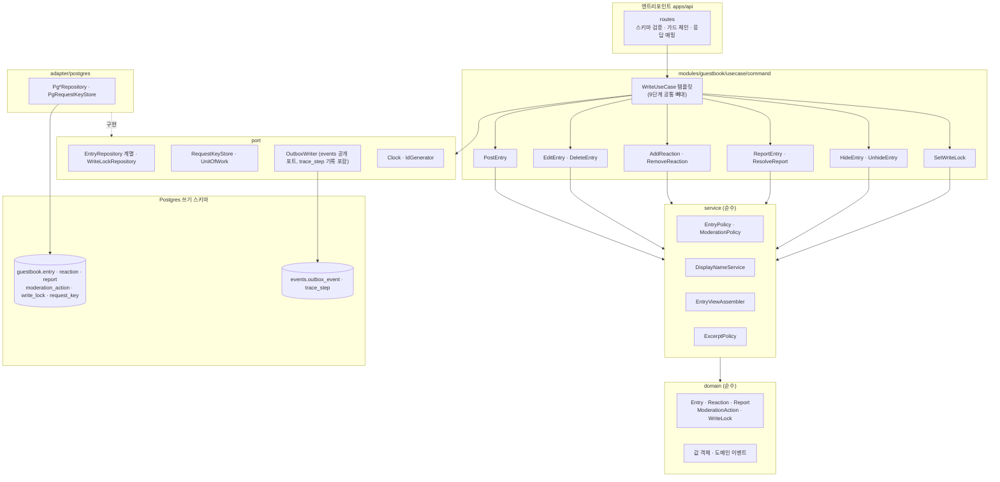

- 읽기 모델(`guestbook_read.*`)은 **어디에서도 읽지 않는다**(CQRS 구조 강제, B3). 응답에 필요한 뷰는 쓰기 모델에서 조립한다(§5).
- `OutboxWriter` 는 `events` 모듈이 공개한 포트다(`trace_step` 기록은 그 구현 내부)(모듈 지도, architecture.md §4). 구현 어댑터는 같은 Postgres 연결(=같은 트랜잭션)을 받는다.

---

## 2. 표준 명령 파이프라인 (9단계)

모든 명령(GB-01~GB-10)은 같은 뼈대를 따른다. 뼈대는 `WriteUseCase`(템플릿 메서드)이고 구체 명령은 **단계 일부만 재정의**한다.

| # | 단계 | 담당 | 실패 시 |
|---|---|---|---|
| (0) | 스키마 검증·세션·Origin·세션 속도 제한 | **가드 체인**(usecase 밖, design/03 §8) | 400/401/403/429 |
| 1 | 요청 키 선점 `RequestKeyStore.claim` | 템플릿 | 재생(성공 응답 재현) / 422 / 409 |
| 2 | 권한 `authorize` | 구체 명령 | 403 |
| 3 | 쓰기 잠금 `WriteLockPolicy.assertOpen` (잠금 대상 명령만) | 템플릿 | 503 `write_locked` |
| 4 | 로드 (필요 시 행 잠금) | 구체 명령 | 404 |
| 5 | 도메인 규칙 적용 | 도메인 객체 | 400/409 |
| 6 | 저장 — 신규 `insert` / 조건부 `saveIfVersion` / 유일 키 | 구체 명령 | 409 |
| 7 | outbox 이벤트 추가 `OutboxWriter.append(events, ctx)` — **내부에서 `trace_step`(written → outboxed)과 `pg_notify` 까지 처리**(F13 EV-01) | 템플릿 | (트랜잭션 롤백) |
| 7a | **감사 기록(해당 usecase 만)** `AuditWriter.record(tx, entry)` — GB-07·08·09·10(그리고 GB-27). 일반 사용자 행위(글·반응·신고)는 기록하지 않는다(ADR-027) | 구체 명령 | (트랜잭션 롤백 — 감사 행도 사라진다) |
| 8 | 응답 뷰 생성 (읽기-내-쓰기, §5) | 구체 명령 | (롤백) |
| 9 | 요청 키에 **성공 응답 기록** `RequestKeyStore.complete` | 템플릿 | (롤백) |

**트랜잭션 경계**: 1~9(7a 포함)은 **하나의 트랜잭션**(`UnitOfWork.run`)이다. 어느 단계든 실패하면 전부 롤백된다 — 글·outbox·단계 기록·요청 키가 함께 사라진다(AC-002).
`pg_notify('outbox_new')` 도 같은 트랜잭션 안에서 호출한다. Postgres 는 NOTIFY 를 **커밋 시점에** 전달하므로 롤백되면 신호도 나가지 않는다(EV-13).

### 2.1 규칙

| 규칙 | 내용 |
|---|---|
| 성공만 저장 | 요청 키에는 **2xx 응답만** 저장한다. 4xx/5xx 는 트랜잭션이 롤백되어 키가 남지 않고, 같은 키 재시도는 현재 상태로 다시 판정된다 |
| 순서 | 행 갱신/잠금(4~6) **이후에** outbox 추가(7). 같은 집합체의 이벤트 `seq` 순서가 커밋 순서와 일치하도록 한다(§3.5) |
| 시간·식별자 | `Clock`·`IdGenerator` 포트만 사용. 한 명령 안의 모든 시각은 **한 번 읽은 `now`** 를 공유한다 |
| 오류 | 던지지 않고 `Result.err(AppError)`. 예상 밖 예외는 `PermanentError` 로 감싸 500 |
| `traceId` | 가드가 요청마다 만든 `ctx.traceId`. 응답 본문과 `X-Trace-Id`, outbox, `trace_step` 이 같은 값 |
| `ownerKey` | `ctx.actor.actorKey` **그대로**(`session:<id>` / `user:<id>`, 05). 비공개 흐름 열람 권한. 공개 변환에서 제거 |

### 2.2 템플릿 클래스

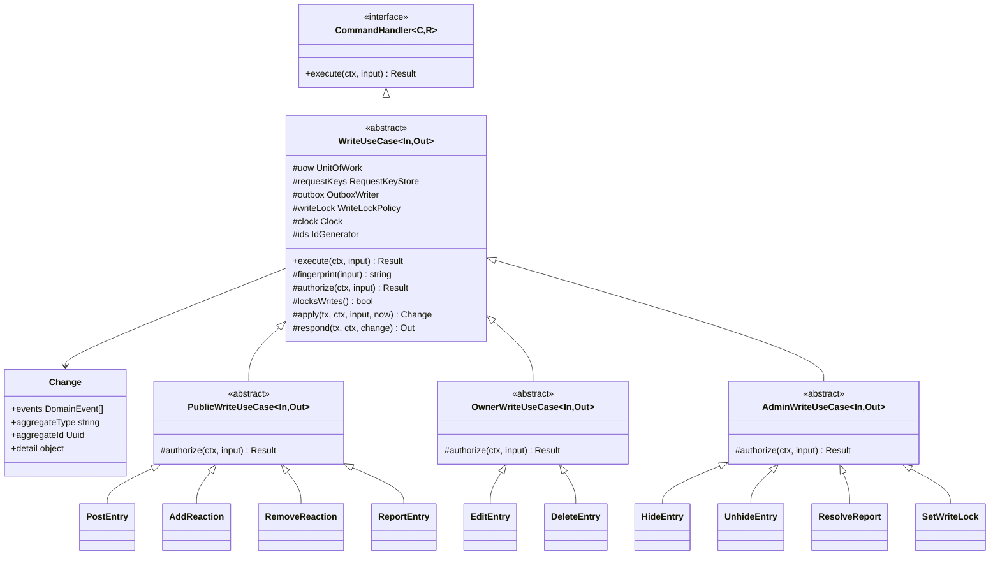

| 클래스 | 책임 |
|---|---|
| `PublicWriteUseCase` | `authorize` = 세션이 있으면 통과(익명 포함) |
| `OwnerWriteUseCase` | `authorize` = **로그인 사용자**여야 함(익명 → 403). 본인 소유 확인은 4단계 로드 후 도메인 정책이 한다 |
| `AdminWriteUseCase` | `authorize` = `ctx.actor.isAdmin` (아니면 403) |
| `locksWrites()` | `PostEntry`·`EditEntry`·`AddReaction`·`ReportEntry` 만 `true`. 삭제·취소·관리 명령은 잠금 중에도 허용(스팸 정리를 막지 않는다) |
| `fingerprint(input)` | 멱등 키 충돌 검사용. 정규화 입력 `메서드 + 경로 + 정규화된 입력 JSON`(키 순서 고정·공백 제거)을 **서버 비밀 키 HMAC-SHA256** 으로 서명한 `<kid>:<hex>`. 키 없는 SHA-256 은 방명록 본문 같은 저엔트로피 입력이 덤프에서 역산되므로 쓰지 않는다(database-schema `request_key`) |

---

## 3. 도메인 모델

### 3.1 클래스 다이어그램

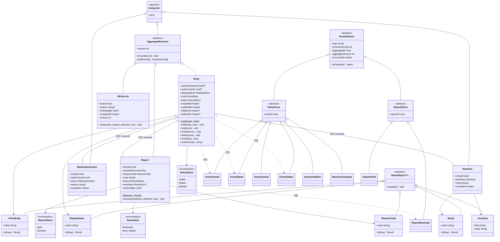

`ReactionChanged` 는 `Reaction` 이 아니라 **`Entry` 단위 이벤트**다(집합체 id = entryId, §3.5). `Reaction` 은 `AggregateRoot` 가 아니라 `Entity` 라서 이벤트를 스스로 기록하지 않고, 명령 usecase 가 `ReactionChanged` 를 만든다.

### 3.2 도메인 서비스·정책 (순수)

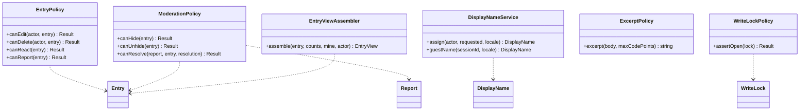

### 3.3 포트와 어댑터

```mermaid
classDiagram
    class WriteRepository~A~ {
        <<interface>>
        +load(id) A?
        +saveIfVersion(a, expected) bool
    }
    class EntryRepository {
        <<interface>>
        +insert(e) void
        +loadForUpdate(id) Entry?
        +saveIfVersion(e, expected) bool
        +loadCurrent(id) Entry?
    }
    class ReactionRepository {
        <<interface>>
        +insertIfAbsent(r) bool
        +deleteIfPresent(entryId, actor, emoji) bool
        +countOf(entryId, emoji) int
        +summarize(entryId, actor) ReactionSummary
    }
    class ReportRepository {
        <<interface>>
        +insertIfAbsent(r) bool
        +load(id) Report?
        +resolveIfOpen(id, resolution, adminId, now) bool
    }
    class ModerationActionRepository {
        <<interface>>
        +append(a) void
    }
    class WriteLockRepository {
        <<interface>>
        +get() WriteLock
        +set(lock) void
        +isLocked() bool
    }
    class RequestKeyStore {
        <<interface>>
        +claim(actor, key, hash) ClaimResult
        +complete(actor, key, status, body) void
    }
    class OutboxWriter {
        <<interface>>
        +append(events, ctx AppendContext) void
    }
    class AppendContext {
        +traceId Uuid
        +ownerKey string
    }
    class UnitOfWork {
        <<interface>>
        +run(fn) T
    }
    WriteRepository <|-- EntryRepository
    class PgEntryRepository
    class PgReactionRepository
    class PgReportRepository
    class PgModerationActionRepository
    class PgWriteLockRepository
    class PgRequestKeyStore
    class PgOutboxWriter
    class PgUnitOfWork
    EntryRepository <|.. PgEntryRepository
    ReactionRepository <|.. PgReactionRepository
    ReportRepository <|.. PgReportRepository
    ModerationActionRepository <|.. PgModerationActionRepository
    WriteLockRepository <|.. PgWriteLockRepository
    RequestKeyStore <|.. PgRequestKeyStore
    OutboxWriter <|.. PgOutboxWriter
    UnitOfWork <|.. PgUnitOfWork
```

- 모든 `Pg*` 어댑터는 **`UnitOfWork.run` 이 건네준 트랜잭션 핸들**로만 동작한다(별도 커넥션 금지). 그래야 9단계가 한 트랜잭션이다.
- `ClaimResult` = `{ kind: 'new' } | { kind: 'replay', status, body } | { kind: 'mismatch' }`.

### 3.4 값 객체 규칙 (ADR-023 길이 상한)

| 값 객체 | 규칙 | 위반 시 |
|---|---|---|
| `EntryBody` | NFC 정규화 → 앞뒤 공백 제거 → 1~**500** 코드포인트, 최대 **10줄**(개행 `\n` 기준 9개), 제어 문자(탭·개행 제외) 거부 | `ValidationError` `validation_failed` (`fields:[{path:'body', rule}]`) |
| `DisplayName` | NFC → 앞뒤 공백 제거 → 2~**20** 코드포인트, 제어 문자·연속 공백 2개 이상 거부 | 위와 동일 |
| `Emoji` | 고정 6종 `👍 ❤️ 🎉 😂 🤔 👀` 화이트리스트(`protocol` 상수). 변형 선택자 포함 정규형으로 비교 | `ValidationError` |
| `ReasonCode` | `spam` · `abuse` · `personal_info` · `off_topic` · `other` (03 §4.1 과 같은 `protocol` 상수) | `ValidationError` |
| `note`(신고 메모) | 0~200 코드포인트 | `ValidationError` |
| DB `CHECK` | 앱 상한의 **2배**(글 1000, 이름 40, 메모 400) — 앱 버그가 있어도 DB 가 막는 보조선(ADR-023) | `PermanentError` |

### 3.5 집합체 경계와 순서 보장

| 이벤트 | 집합체(`aggregate.id`) | 순서를 지키는 수단 |
|---|---|---|
| `entry.posted/edited/deleted/hidden/unhidden` | `entry.id` | `entry.version` 조건부 갱신이 행 잠금을 잡음 → 이후 outbox 추가 |
| `reaction.changed` | **`entry.id`** (반응 행이 아니라 글 단위) | 반응 명령도 `entry` 행을 `FOR NO KEY UPDATE` 로 잠그고 개수를 센 뒤 outbox 추가 |
| `report.filed/resolved` | `report.id` | 신고 행 단위. 프로젝터의 `report_queue.last_seq`(키 단위 가드)로 검사 |

**왜 반응이 `entry` 행을 잠그는가.** `reaction.changed` 는 변경 후 총개수(`count`)를 싣고 프로젝터는 이모지별 `reaction_seq[emoji]`(database-schema §5-1)로 오래된 이벤트를 버리고 `reactions[emoji] = count` 로 덮어쓴다. 같은 이모지의 두 반응이 **동시에** 커밋되면 `seq` 순서와 커밋 순서가 뒤바뀔 수 있고, 먼저 보이는 큰 `seq`(= 더 오래된 `count`)가 나중에 보이는 작은 `seq` 이벤트를 "오래된 것"으로 만들어 최신 개수가 영영 반영되지 않는다. 또 디스패처의 집합체 선두 규칙(F13 §3.3)도 `seq` 가 커밋 순서라는 가정에 선다.
글 행 잠금으로 **같은 글에 대한 모든 쓰기를 직렬화**하면 `seq` 순서 = 커밋 순서가 되어 이 문제가 사라진다. 비용은 같은 글에 대한 쓰기 대기뿐이며 이 사이트 규모에서는 무시할 수 있다.
→ 이 가정(집합체별 `seq` 순서 = 커밋 순서)은 [F13 §3.3](13-events-pipeline.md) 이 받아들여 명시했다(디스패처 선두 규칙·프로젝터 순번 가드와 호환).

---

## 4. 상태 다이어그램

### 4.1 Entry

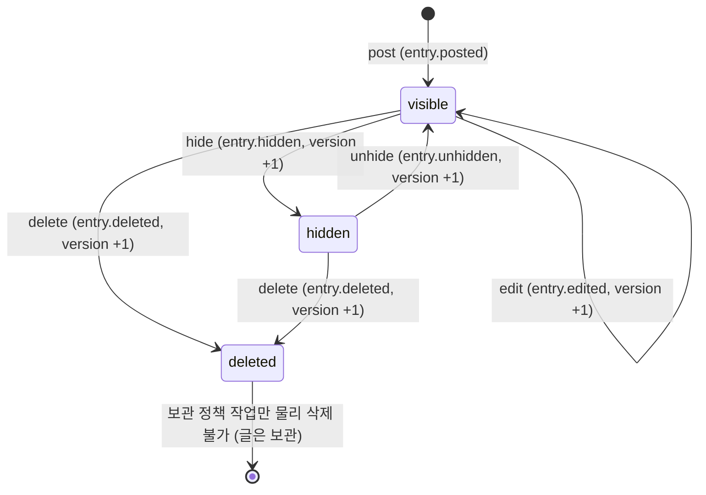

- `hidden` 은 관리자 조치, `deleted` 는 작성자(로그인) 조치다. `deleted` 는 종단 상태이며 되돌릴 수 없다.
- **숨김 글 수정 금지**: `hidden` 인 글을 작성자가 수정하려 하면 409 `entry_hidden`. 삭제는 허용한다.
- **삭제는 soft(tombstone)**: 행은 남기고 `status='deleted'`, `deleted_at` 설정, `body` 를 빈 문자열로 지운다(개인정보 최소화). 반응·신고 행은 FK 때문에 남지만 더는 집계·표시되지 않는다.

### 4.2 Report

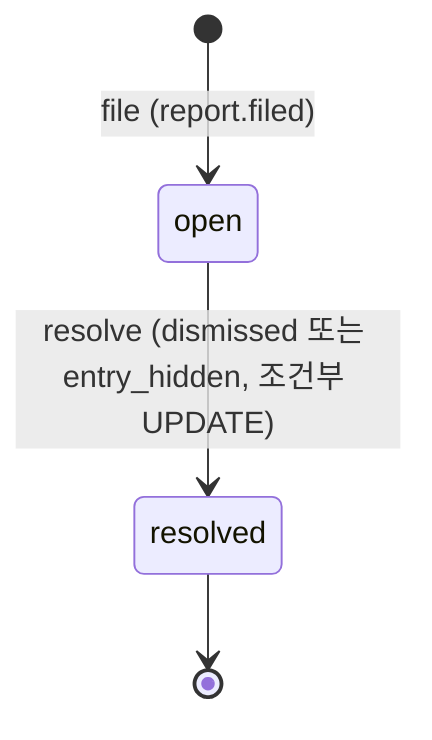

### 4.3 WriteLock

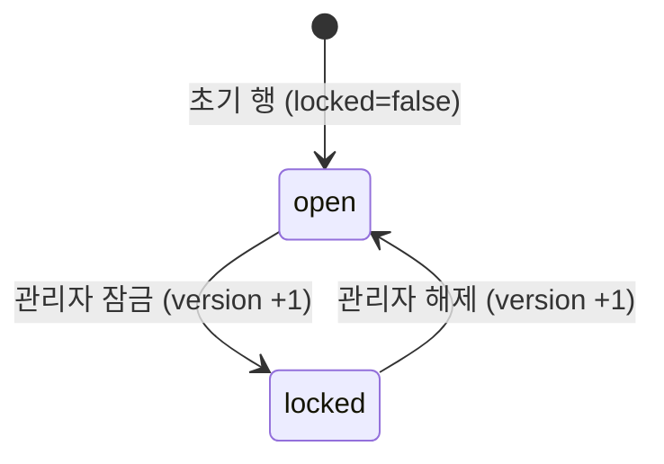

---

## 5. 읽기-내-쓰기: 응답에 `EntryView` 담기 (ADR-018)

명령 응답은 **읽기 모델(결과적 일관)이 아닌 쓰기 모델에서 조립**한다. 방금 쓴 것이 반드시 보이고 CQRS 경계(B3)도 지킨다.

| 응답 필드 | 출처 (같은 트랜잭션, 쓰기 모델) |
|---|---|
| `id, displayName, body, status, version, createdAt, updatedAt, authorKind` | 방금 저장한 `Entry` |
| `reactions` | `ReactionRepository.summarize(entryId, actor)` — `SELECT emoji, count(*) FROM reaction WHERE entry_id=$1 GROUP BY emoji` |
| `myReactions` | 같은 쿼리의 두 번째 결과: `WHERE entry_id=$1 AND actor_key=$2` |
| `isMine` | `entry.author_session_id = ctx.actor.sessionId` 또는 `entry.author_user_id = ctx.actor.userId` |
| `canEdit` | `ctx.actor.kind==='user'` 이고 `author_user_id == userId` 이고 `status==='visible'` |
| `traceId` | `ctx.traceId` |

- `PostEntry` 는 반응이 없으므로 `reactions: {}`, `myReactions: []` 로 쿼리를 생략한다.
- 이 응답은 곧 `request_key.response_body` 에 저장되어 재생된다. 재생된 뷰는 **원래 시점의 스냅샷**이며 이후 변경을 반영하지 않는다(클라이언트는 WS 메시지로 갱신).
- 클라이언트는 응답 뷰를 즉시 표시하고, 같은 `id` 의 `entry.created` WS 메시지가 오면 교체한다([04](../04-ws-protocol.md) §5).

---

## 6. 공통 보조 기능

### 6.1 멱등 키 처리 (CM-02) — `RequestKeyStore`

테이블 `guestbook.request_key` (`actor_key`, `key` PK, `request_hash`, `status`, `response_status`, `response_body`, `created_at`; 보관 24시간).

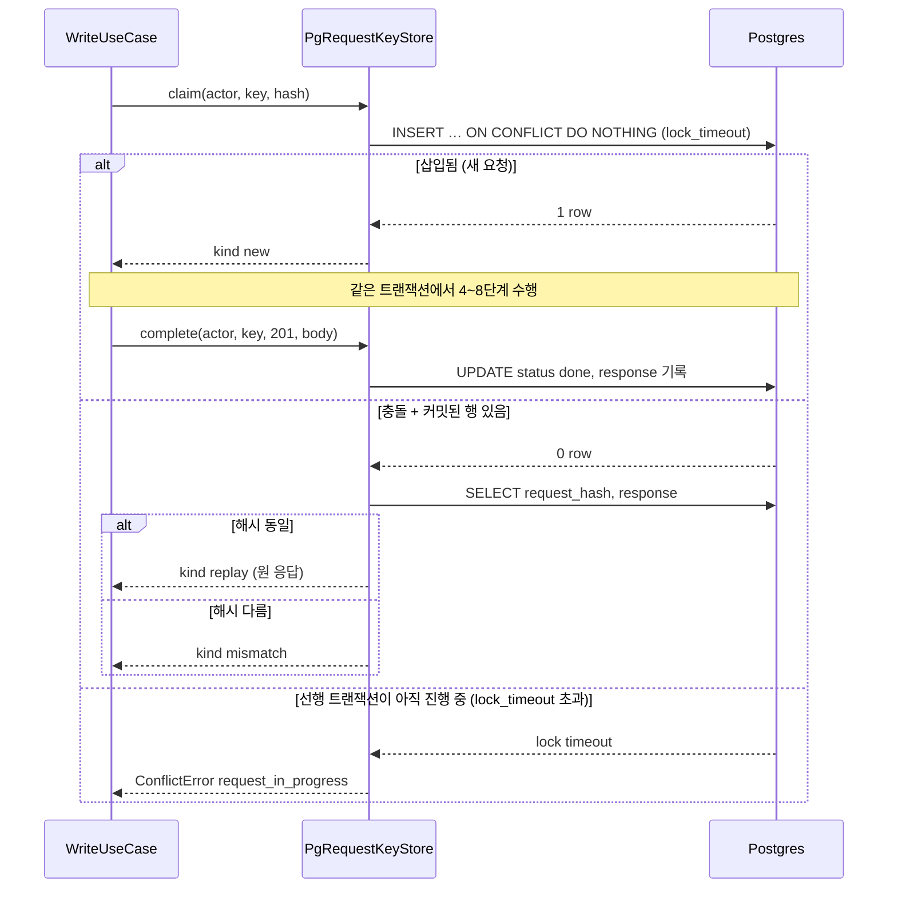

| 상황 | 결과 |
|---|---|
| 새 키 | 진행, 성공 시 응답 저장 |
| 같은 키 + 같은 요청 + 이미 성공 | **원 응답 재생**, 헤더 `Idempotency-Replayed: true`, **쓰기·이벤트 없음** |
| 같은 키 + 다른 요청 | 422 `idempotency_key_reuse` |
| 같은 키 동시 요청 | 먼저 온 트랜잭션이 끝날 때까지 두 번째 `INSERT` 가 **대기**(유일 인덱스). 끝나면 위 두 경우로 분기. 대기가 `lock_timeout`(초기 **2초**, 미확인)을 넘으면 409 `request_in_progress` + `Retry-After: 1` |
| 선행 요청이 실패(롤백) | 키 행이 없으므로 두 번째 요청이 새 요청으로 진행 |

- 영속 행의 `status` 는 사실상 항상 `done` 이다(`in_progress` 는 한 트랜잭션 안에서만 존재). 컬럼은 진단용으로 두되 읽는 쪽은 `done` 만 신뢰한다.
- 키 범위는 `(actor_key, key)` 이므로 다른 행위자가 같은 uuid 를 써도 충돌하지 않는다.
- `request_hash` 는 `fingerprint()` 결과(HMAC `<kid>:<hex>`)다. 키 회전은 현재+직전 키 2개를 두고 비교는 행의 `kid` 로 재계산한다(직전 키는 행 보관 24시간+1시간 뒤 폐기). 비밀 키는 DB·백업에 없고 `request_key` 는 백업 제외 대상이다. `Idempotency-Key` 가 없으면 가드가 400 으로 막는다(usecase 는 키가 있다고 가정).

### 6.2 속도 제한 등급 (AC-007)

가드 체인의 `RateLimitGuard` 가 라우트별 **등급**으로 판정한다(usecase 밖). **수치는 제안이며 미확인**(가정 A-011, 구현 시 측정).

| 등급 | 적용 명령 | 제안 한도(세션당) |
|---|---|---|
| `write.entry` | GB-01 | 5건/분, 30건/시간 |
| `write.react` | GB-04, GB-05 | 30건/분 |
| `write.report` | GB-06 | 5건/분 |
| `write.owner` | GB-02, GB-03 | 20건/분 |
| `write.admin` | GB-07~GB-10 | 60건/분 |

초과 시 `RateLimitedError` → 429 + `Retry-After`. IP 기준 제한은 nginx `limit_req` 가 별도로 건다.

### 6.3 공통 지표·로그

| 구분 | 이름 | 레이블 / 필드 |
|---|---|---|
| 지표 | `guestbook_command_total` | `usecase`, `result`(`ok`/`replay`/`error`), `code` |
| 지표 | `guestbook_command_duration_seconds` (히스토그램) | `usecase` |
| 지표 | `guestbook_idempotent_replay_total` | `usecase` |
| 지표 | `guestbook_version_conflict_total` | `usecase` |
| 지표 | `guestbook_write_lock_state` (게이지 0/1) | — |
| 로그 | 구조화 JSON | `trace_id`, `module=guestbook`, `usecase`, `result`, `error_code`, `entry_id`(uuid 만), `duration_ms` |

**금지**: 글 본문·표시 이름·`actorKey`·세션/토큰·IP 를 로그나 레이블에 남기지 않는다. `entry_id` 는 로그에만 허용하고 **지표 레이블에는 쓰지 않는다**(ADR-007).

---

## 7. GB-01 글 작성 — `PostEntry`

**목적** 방문자(익명 포함)가 방명록 글을 남긴다. 글 저장과 `entry.posted` outbox 기록이 한 트랜잭션이다(FR-020, AC-001·002).
**트리거** `POST /api/entries` · 인증 익명 허용 · 속도 등급 `write.entry` · 입력 `{ displayName?, body }`.

| 사전 조건 | 사후 조건 |
|---|---|
| 세션 유효, CSRF/Origin 통과, 쓰기 잠금 열림 | `entry`(visible, version 1)·`outbox_event(entry.posted)`·`trace_step(written, outboxed)`·`request_key(done)` 가 **모두 존재하거나 모두 없음** |

| 접근 테이블 | 동작 |
|---|---|
| `guestbook.request_key` | W |
| `guestbook.write_lock` | R |
| `guestbook.entry` | W (insert) |
| `events.outbox_event` | W |
| `events.trace_step` | W |

**표시 이름 규칙 (`DisplayNameService.assign`)**

| 행위자 | 요청 `displayName` | 결과 |
|---|---|---|
| 로그인 사용자 | 있어도 무시 | `ctx.actor.displayName`(프로필 이름) |
| 익명 | 있음 | 검증 후 사용(2~20자) |
| 익명 | 없음 | **`손님-xxxx`** (한국어 로케일) / `Guest-xxxx` (그 외) |

`xxxx` = `hex( SHA-256( sessionId + ":guest" ) )` 의 앞 4자 소문자. 같은 세션은 항상 같은 이름이고, 서로 다른 세션이 같은 값을 가질 수 있다(65,536 분의 1, 표시용이라 허용). 이름은 **작성 시점 스냅샷**으로 `entry.display_name` 에 저장되며 이후 프로필이 바뀌어도 과거 글은 바뀌지 않는다. 로케일은 `Accept-Language` 에서 읽는다(미확인: 그 외 로케일 접두 표기).

**클래스**

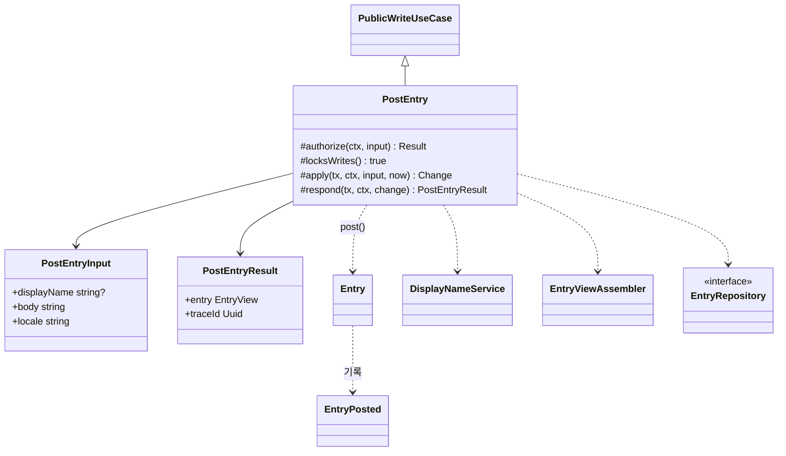

**시퀀스**

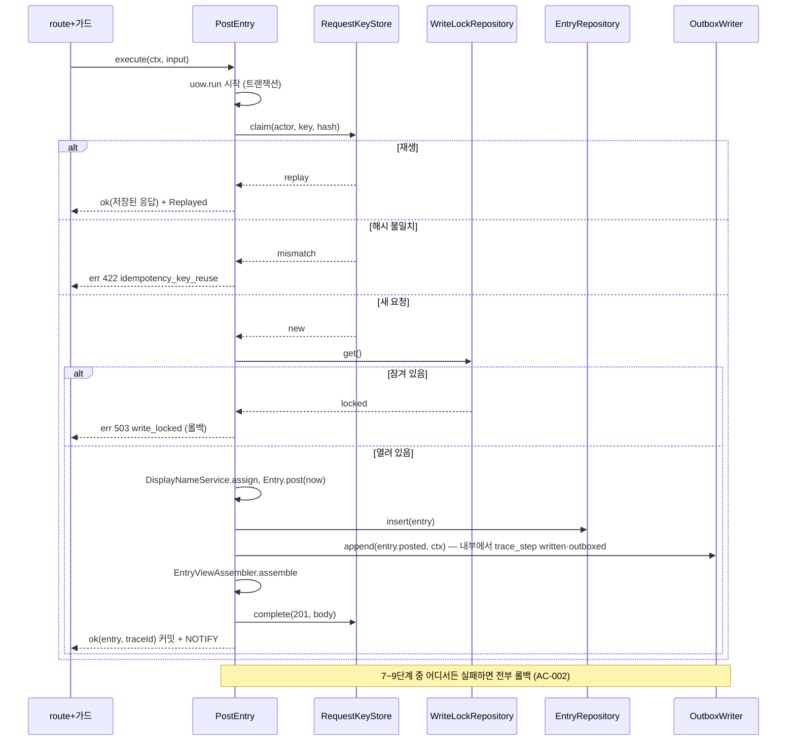

**순서도**

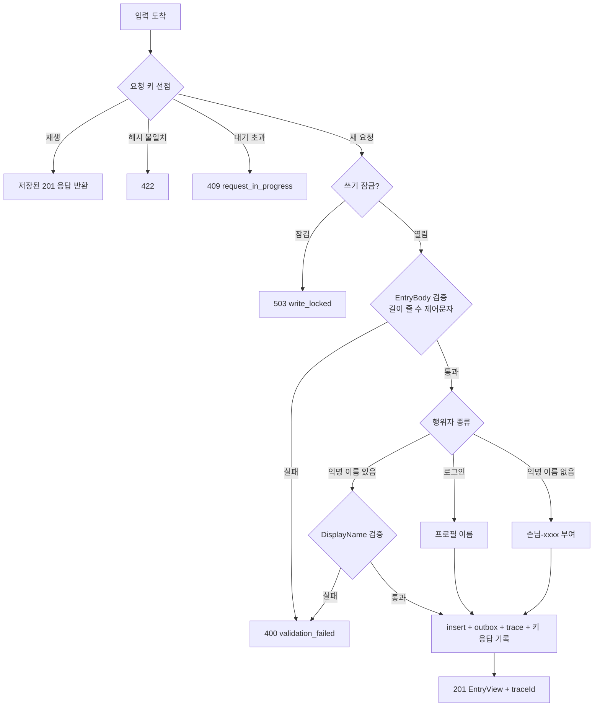

**오류**

| 조건 | AppError | HTTP | code |
|---|---|---|---|
| 본문/이름 검증 실패 | `ValidationError` | 400 | `validation_failed` |
| 키 재사용(다른 요청) | `DuplicateRequestError` 계열 | 422 | `idempotency_key_reuse` |
| 키 대기 초과 | `ConflictError` | 409 | `request_in_progress` |
| 쓰기 잠금 | `WriteLockedError`(`DomainError`) | 503 | `write_locked` |
| 속도 제한 | `RateLimitedError` | 429 | `rate_limited` |
| DB 일시 오류 | `TransientError` | 503 | `unavailable` |

**발행 이벤트 `entry.posted` v1**

```json
{ "entryId": "0192…", "displayName": "손님-3fa9", "body": "안녕하세요",
  "authorKind": "anonymous", "createdAt": "2026-11-04T09:00:00.123Z" }
```
로그인 사용자는 `authorKind: "user"` 와 `authorUserId` 가 추가된다(공개 변환에서 제거, 05 §2).

**지표/로그** 공통(§6.3) + `guestbook_entry_posted_total{author_kind}`. 본문 길이는 히스토그램 `guestbook_entry_body_length` 로만 남기고 본문은 남기지 않는다.

**시험**

| 시험 | 등급 | 위치 | 기대값 |
|---|---|---|---|
| 원자성(AC-002) | L3 | `modules/guestbook/test/integration/post-entry.atomic.test.ts` | `faults.failAt('guestbook.post_entry.after_outbox')`(08 §3.1) 로 예외를 주입 → `entry`·`outbox_event`·`trace_step`·`request_key` 모두 0행 |
| 멱등 재생 | L3 | `…/post-entry.idempotent.test.ts` | 같은 키 2회 → 응답 동일, `entry` 1행, `outbox_event` 1행 |
| 같은 키 동시 2요청 | L3 | 위 파일 | 한쪽만 쓰기, 다른 쪽은 재생 또는 409 |
| 같은 키 다른 본문 | L2 | 위 파일 | 422 |
| 본문 경계값 | L2 | `…/entry-body.test.ts` | 500/501자, 10/11줄, NFC 결합 문자, 제어 문자 |
| 이름 자동 부여 | L2 | `…/display-name.test.ts` | 같은 세션 항상 같은 값, 형식 `손님-` + 4 hex |
| 쓰기 잠금 | L3 | `…/write-lock.test.ts` | 잠금 시 503, 쓰기 없음 |
| 속도 제한(AC-007) | L3 | `apps/api/test/rate-limit.test.ts` | 6번째 요청 429 + `Retry-After` |

---

## 8. GB-02 글 수정 — `EditEntry`

**목적** 로그인한 작성자가 본인 글 본문을 고친다. 동시 수정은 `version` 조건부 갱신으로 한 건만 반영한다(FR-022·034, AC-005·016).
**트리거** `PATCH /api/entries/{id}` · 인증 **로그인+본인** · 등급 `write.owner` · 입력 `{ body, expectedVersion }`.

| 사전 조건 | 사후 조건 |
|---|---|
| 로그인 사용자, 글이 `visible`, `author_user_id == userId`, `expectedVersion == entry.version`, 잠금 열림 | `entry.body` 갱신·`version`+1·`updated_at`, `entry.edited` outbox, 응답에 새 뷰 |

| 접근 테이블 | 동작 |
|---|---|
| `request_key`, `write_lock` | W, R |
| `entry` | R(`loadForUpdate`), W(조건부 UPDATE) |
| `reaction` | R(응답 뷰 집계) |
| `outbox_event`, `trace_step` | W |

**조건부 갱신 SQL 의 의미**: `UPDATE entry SET body=$b, updated_at=$now, version=version+1 WHERE id=$id AND version=$expected AND status='visible' AND author_user_id=$uid`. 갱신 행이 0 이면 **원인을 진단**해 오류를 고른다: 글 없음/삭제됨 → 404, `hidden` → 409 `entry_hidden`, 소유자 다름 → 403, 그 외(버전 불일치) → 409 `version_conflict` + `details.current`(최신 뷰, `LoadEntryForConflict`).

**클래스**

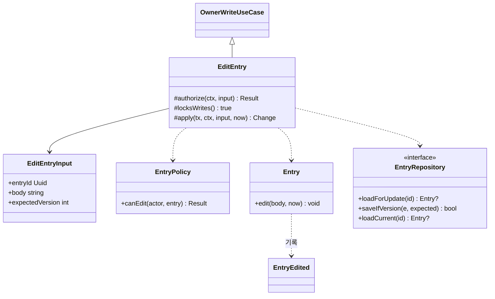

**시퀀스**

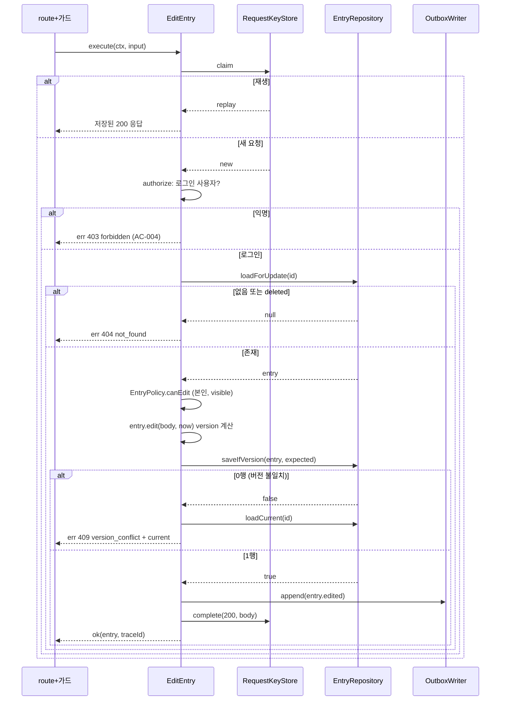

**순서도**

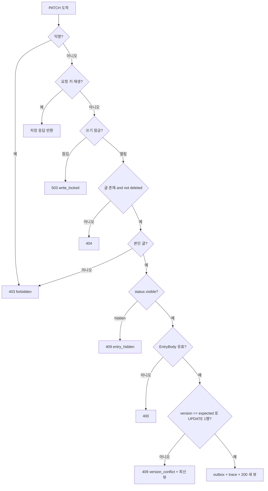

**오류**

| 조건 | AppError | HTTP | code |
|---|---|---|---|
| 익명/타인 | `ForbiddenError` | 403 | `forbidden` |
| 글 없음·삭제됨 | `NotFoundError` | 404 | `not_found` |
| 숨김 글 | `ConflictError` | 409 | `entry_hidden` |
| 버전 불일치 | `VersionConflictError` | 409 | `version_conflict` (`details.current`) |
| 검증 실패 | `ValidationError` | 400 | `validation_failed` |
| 쓰기 잠금 | `WriteLockedError` | 503 | `write_locked` |

**발행 이벤트 `entry.edited` v1**: `{ "entryId": "…", "body": "수정된 본문", "updatedAt": "…" }` (본문 전체 — 프로젝터 단순화, 05 §9 미결의 "전체 권장").

**지표/로그** 공통 + `guestbook_version_conflict_total{usecase="edit-entry"}`. 충돌 로그에는 `expected`/`actual` 버전 숫자만 남긴다.

**시험**

| 시험 | 등급 | 위치 | 기대값 |
|---|---|---|---|
| 익명 수정(AC-004) | L3 | `…/edit-entry.authz.test.ts` | 403, 변경 없음 |
| 로그인 본인 수정(AC-005) | L3 | `…/edit-entry.test.ts` | 200, `version` +1, `entry.edited` 1건 |
| 타인 글 수정 | L3 | 위 | 403 |
| 동시 수정(AC-016) | L3 | `…/edit-entry.concurrent.test.ts` | 같은 `expectedVersion` 두 요청 → 한 건 200, 다른 건 409 + `current` |
| 숨김 글 수정 | L3 | 위 | 409 `entry_hidden` |
| 되돌림 검증 | L3 | 위 | 조건 `version =` 을 제거하면 동시 시험이 실패한다(회귀 가드) |

---

## 9. GB-03 글 삭제 — `DeleteEntry`

**목적** 로그인한 작성자가 본인 글을 삭제한다. 물리 삭제가 아니라 **tombstone** 으로 바꾼다(FR-022, AC-005).
**트리거** `DELETE /api/entries/{id}` · **로그인+본인** · 등급 `write.owner` · 헤더 `If-Match: <version>` 필수.

| 사전 조건 | 사후 조건 |
|---|---|
| 로그인, 본인 글, 상태 `visible` 또는 `hidden`, `If-Match == version` | `status='deleted'`, `deleted_at`, `body=''`, `version`+1, `entry.deleted` outbox. 쓰기 잠금과 무관하게 허용 |

| 접근 테이블 | 동작 |
|---|---|
| `request_key` | W |
| `entry` | R(`loadForUpdate`), W(조건부 UPDATE) |
| `outbox_event`, `trace_step` | W |

**tombstone 의미**: 행·`id`·`display_name`·`created_at` 은 유지, 본문은 지운다. 이유 — ① 반응/신고/조치 이력의 참조 무결성 유지 ② 프로젝터가 재전달된 오래된 `entry.posted` 로 글을 되살리지 못하게 `entry_view` 의 `status_seq`·`content_seq` 를 가진 행을 남김 ③ 개인정보(본문) 최소 보관. 프로젝션 영향: `entry_view` 행은 `status='deleted'`, `body=''`, `reactions={}` 로 바뀌고 공개 목록 부분 인덱스(`status='visible'`)에서 빠진다. WS 에는 `entry.removed{reason:'deleted'}` 가 나간다([04](../04-ws-protocol.md) §3.2).

**클래스**

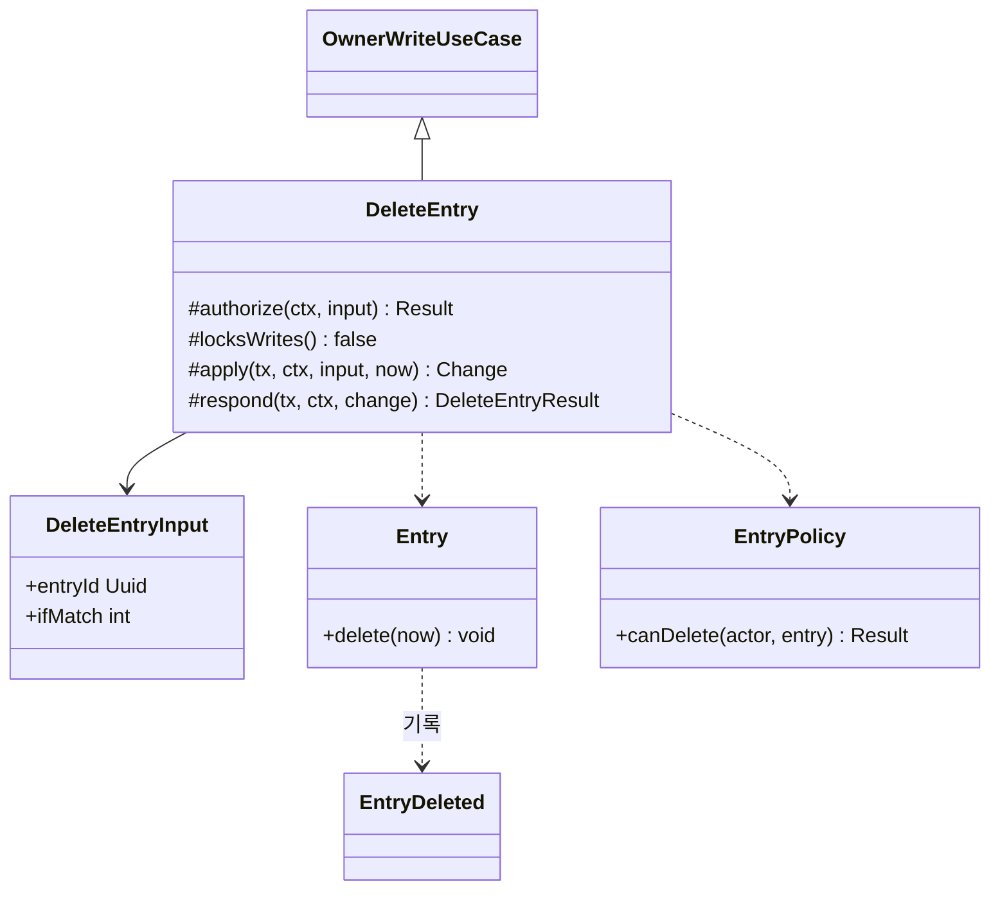

**시퀀스**

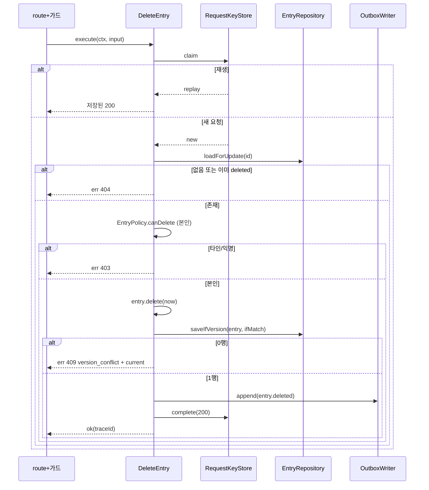

**순서도**

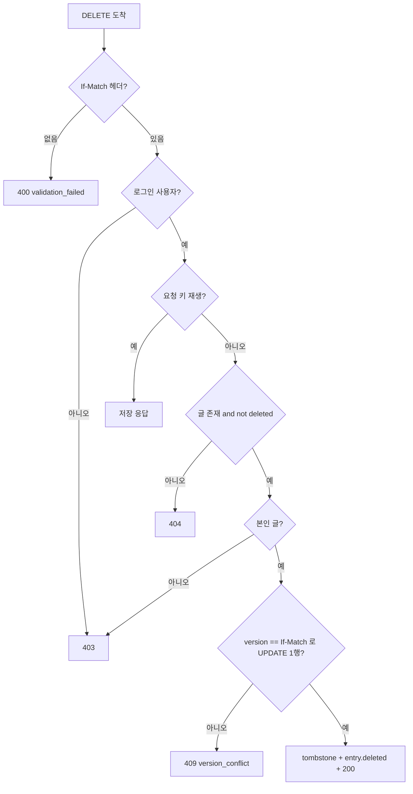

**오류**

| 조건 | AppError | HTTP | code |
|---|---|---|---|
| `If-Match` 없음/형식 오류 | `ValidationError` | 400 | `validation_failed` |
| 익명/타인 | `ForbiddenError` | 403 | `forbidden` |
| 없음/이미 삭제 | `NotFoundError` | 404 | `not_found` |
| 버전 불일치 | `VersionConflictError` | 409 | `version_conflict` |

**발행 이벤트 `entry.deleted` v1**: `{ "entryId": "…" }`.

**시험**

| 시험 | 등급 | 위치 | 기대값 |
|---|---|---|---|
| 본인 삭제(AC-005) | L3 | `…/delete-entry.test.ts` | 200, 행 존재·`status=deleted`·`body=''`, 이벤트 1건 |
| 익명/타인 삭제 | L3 | 위 | 403 |
| 재삭제(다른 키) | L3 | 위 | 404, 이벤트 추가 없음 |
| 같은 키 재시도 | L3 | 위 | 200 재생, 이벤트 1건 |
| 프로젝션 영향 | L3 | `…/projector.delete.test.ts` | 목록에서 제외, 재전달된 `entry.posted` 가 글을 되살리지 않음 |

---

## 10. GB-04 반응 추가 — `AddReaction`

**목적** 방문자가 글에 이모지 반응을 단다. 같은 (글, 행위자, 이모지)는 한 건뿐이다(FR-021).
**트리거** `PUT /api/entries/{id}/reactions/{emoji}` · 익명 허용 · 등급 `write.react` · 본문 없음.

| 사전 조건 | 사후 조건 |
|---|---|
| 세션 유효, 글이 `visible`, 이모지가 화이트리스트, 잠금 열림 | 새로 눌렀다면 `reaction` 1행 + `reaction.changed(op=added, count)` outbox. **이미 눌렀다면 변경·이벤트 없이 200** |

| 접근 테이블 | 동작 |
|---|---|
| `request_key`, `write_lock` | W, R |
| `entry` | R (`loadForUpdate`: `FOR NO KEY UPDATE`, 존재·가시성 확인과 직렬화) |
| `reaction` | W (`INSERT … ON CONFLICT DO NOTHING`), R(`count`) |
| `outbox_event`, `trace_step` | W (새로 눌렀을 때만) |

**유일 키 경합 처리**
1. `entry` 행을 `FOR NO KEY UPDATE` 로 잠근다 — 같은 글의 반응·수정·숨김이 직렬화된다(§3.5). `version` 은 바꾸지 않는다.
2. `INSERT INTO reaction … ON CONFLICT (entry_id, actor_key, emoji) DO NOTHING RETURNING 1`.
3. 1행이면 새로 누름 → `SELECT count(*) … WHERE entry_id AND emoji` 로 **변경 후 총개수**를 구해 이벤트에 싣는다.
4. 0행이면 이미 누른 상태 → 이벤트 없이 현재 `count` 만 읽어 `200 { count, mine:true }`. 두 요청이 정확히 동시에 와도 유일 제약과 행 잠금이 한 건만 쓰이게 한다(나머지는 이미 눌림 경로).
> `database-schema.md` 는 중복 시 "나머지 409" 라고 적었으나 계약([03](../03-api-contract.md) §4.2)은 **200 멱등**이다. 계약을 따른다(수정 요청).

**클래스**

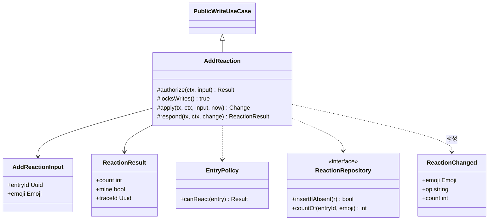

**시퀀스**

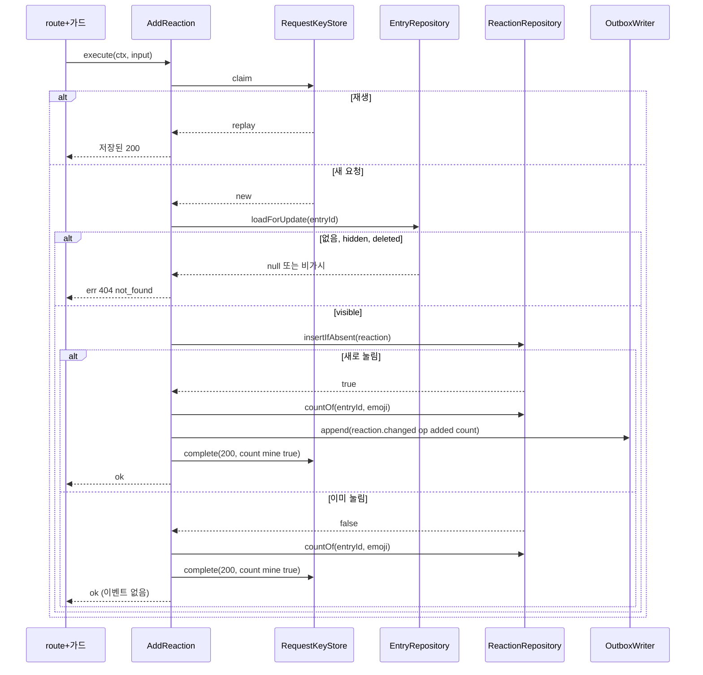

**순서도**

```mermaid
flowchart TD
    A["PUT 도착"] --> B{"Emoji 화이트리스트?"}
    B -- "아니오" --> E1["400 validation_failed"]
    B -- "예" --> C{"요청 키 재생?"}
    C -- "예" --> RP["저장 응답"]
    C -- "아니오" --> D{"쓰기 잠금?"}
    D -- "잠김" --> E2["503 write_locked"]
    D -- "열림" --> F["entry 행 잠금 FOR NO KEY UPDATE"]
    F --> G{"글 visible?"}
    G -- "아니오" --> E3["404"]
    G -- "예" --> H{"INSERT ON CONFLICT 1행?"}
    H -- "예 새로 누름" --> I["count 계산 + reaction.changed 기록"]
    H -- "아니오 이미 누름" --> J["count 읽기, 이벤트 없음"]
    I --> OK["200 count mine true"]
    J --> OK
```

**오류**

| 조건 | AppError | HTTP | code |
|---|---|---|---|
| 허용되지 않은 이모지 | `ValidationError` | 400 | `validation_failed` |
| 글 없음/숨김/삭제 | `NotFoundError` | 404 | `not_found` |
| 쓰기 잠금 | `WriteLockedError` | 503 | `write_locked` |
| 속도 제한 | `RateLimitedError` | 429 | `rate_limited` |

**발행 이벤트 `reaction.changed` v1**: `{ "entryId": "…", "emoji": "👍", "op": "added", "count": 3 }`. 행위자는 봉투 `ownerKey` 에만 있다(프로젝터의 `my_reaction` 갱신용).

**지표/로그** 공통 + `guestbook_reaction_total{op}`, `guestbook_reaction_dedup_total`(이미 눌림 경로).

**시험**

| 시험 | 등급 | 위치 | 기대값 |
|---|---|---|---|
| 동시 중복 추가 | L3 | `…/add-reaction.concurrent.test.ts` | 같은 행위자 N개 동시 요청 → `reaction` 1행, 이벤트 1건, 모두 200 |
| 다른 행위자 동시 추가 | L3 | 위 | 최종 `count` = 행위자 수, 마지막 이벤트의 `count` = 최종값, `seq` 순서 = 커밋 순서 |
| 숨김 글 반응 | L3 | `…/add-reaction.test.ts` | 404 |
| 같은 키 재시도 | L3 | 위 | 재생, 이벤트 1건 |
| 이모지 화이트리스트 | L2 | `…/emoji.test.ts` | 6종만 통과, 변형 선택자 정규화 |

---

## 11. GB-05 반응 취소 — `RemoveReaction`

**목적** 방문자가 자기 반응을 취소한다. 없는 반응을 취소해도 오류가 아니다(멱등).
**트리거** `DELETE /api/entries/{id}/reactions/{emoji}` · 익명 허용 · 등급 `write.react` · 잠금 **무관**.

| 사전 조건 | 사후 조건 |
|---|---|
| 세션 유효, 글이 `visible` | 있었다면 `reaction` 행 삭제 + `reaction.changed(op=removed, count)`. 없었다면 변경 없이 200 `{ count, mine:false }` |

| 접근 테이블 | 동작 |
|---|---|
| `request_key` | W |
| `entry` | R (`FOR NO KEY UPDATE`) |
| `reaction` | W (`DELETE … RETURNING`), R(`count`) |
| `outbox_event`, `trace_step` | W (삭제됐을 때만) |

**클래스**

```mermaid
classDiagram
    class RemoveReaction {
        #locksWrites() false
        #apply(tx, ctx, input, now) Change
    }
    class RemoveReactionInput {
        +entryId Uuid
        +emoji Emoji
    }
    class ReactionRepository {
        <<interface>>
        +deleteIfPresent(entryId, actor, emoji) bool
        +countOf(entryId, emoji) int
    }
    PublicWriteUseCase <|-- RemoveReaction
    RemoveReaction --> RemoveReactionInput
    RemoveReaction ..> ReactionRepository
    RemoveReaction ..> ReactionChanged : op removed
```

**시퀀스**

```mermaid
sequenceDiagram
    participant R as route+가드
    participant H as RemoveReaction
    participant K as RequestKeyStore
    participant E as EntryRepository
    participant X as ReactionRepository
    participant O as OutboxWriter
    R->>H: execute
    H->>K: claim
    alt 재생
        K-->>H: replay
        H-->>R: 저장된 200
    else 새 요청
        K-->>H: new
        H->>E: loadForUpdate(entryId)
        alt 비가시 또는 없음
            H-->>R: err 404
        else visible
            H->>X: deleteIfPresent(entry, actor, emoji)
            alt 삭제됨
                X-->>H: true
                H->>X: countOf
                H->>O: append(reaction.changed op removed count)
                H->>K: complete(200 mine false)
                H-->>R: ok
            else 없었음
                X-->>H: false
                H->>X: countOf
                H->>K: complete(200 mine false)
                H-->>R: ok (이벤트 없음)
            end
        end
    end
```

**순서도**

```mermaid
flowchart TD
    A["DELETE 도착"] --> B{"Emoji 유효?"}
    B -- "아니오" --> E1["400"]
    B -- "예" --> C{"요청 키 재생?"}
    C -- "예" --> RP["저장 응답"]
    C -- "아니오" --> D["entry 행 잠금"]
    D --> F{"글 visible?"}
    F -- "아니오" --> E2["404"]
    F -- "예" --> G{"DELETE 1행?"}
    G -- "예" --> H["count 계산 + reaction.changed removed"]
    G -- "아니오" --> I["count 읽기만"]
    H --> OK["200 mine false"]
    I --> OK
```

**오류**: 400 `validation_failed`, 404 `not_found`, 429 `rate_limited`. (쓰기 잠금 중에도 취소는 허용하므로 503 없음.)

**발행 이벤트**: `{ "entryId": "…", "emoji": "👍", "op": "removed", "count": 2 }` (`count` 는 취소 후 총개수, 0 가능).

**시험**: 취소 후 `count` 감소·이벤트 1건 / 없는 반응 취소 시 200·이벤트 0건 / 동시 취소 시 한 건만 이벤트 / 추가→취소→추가 순서의 `count` 단조성. (L3, `…/remove-reaction.test.ts`)

---

## 12. GB-06 신고 — `ReportEntry`

> **메모 암호화 (ADR-026)**: `note` 는 usecase 가 `FieldCipher.encrypt(note, "guestbook.report.note:<reportId>")` 로 암호화해 `report.note_enc` 에 저장한다(길이 ≤200 검사는 암호화 전). 이벤트(`report.filed`)·읽기 모델·로그에는 `note` 가 나가지 않는다. 관리자는 `GET /api/admin/reports/{id}/note`(GB-27 `GetReportNote`)로만 복호화된 값을 본다 — 관리자 권한 + `no-store`, 접근 로그에는 reportId 만.

**목적** 방문자가 부적절한 글을 신고한다. 같은 행위자가 같은 글을 다시 신고해도 중복 행을 만들지 않는다(FR-023).
**트리거** `POST /api/entries/{id}/reports` · 익명 허용 · 등급 `write.report` · 입력 `{ reasonCode, note? }` · 응답 `202`.

| 사전 조건 | 사후 조건 |
|---|---|
| 세션 유효, 글이 `visible`, `reasonCode` 유효, 잠금 열림 | `report`(open) 1행 + `report.filed` outbox. 이미 신고한 행위자라면 변경 없이 202 |

| 접근 테이블 | 동작 |
|---|---|
| `request_key`, `write_lock` | W, R |
| `entry` | R (본문 앞 80자 발췌용) |
| `report` | W (`INSERT … ON CONFLICT (entry_id, reporter_key) DO NOTHING`) |
| `outbox_event`, `trace_step` | W |

**클래스**

```mermaid
classDiagram
    class ReportEntry {
        #locksWrites() true
        #apply(tx, ctx, input, now) Change
    }
    class ReportEntryInput {
        +entryId Uuid
        +reasonCode ReasonCode
        +note string?
    }
    class Report {
        +file(args) Report$
    }
    class ReportFiled {
        +reportId Uuid
        +entryId Uuid
        +reasonCode string
        +excerpt string
    }
    class ExcerptPolicy {
        +excerpt(body, max) string
    }
    class ReportRepository {
        <<interface>>
        +insertIfAbsent(r) bool
    }
    PublicWriteUseCase <|-- ReportEntry
    ReportEntry --> ReportEntryInput
    ReportEntry ..> Report
    ReportEntry ..> ExcerptPolicy
    ReportEntry ..> ReportRepository
    Report ..> ReportFiled : 기록
```

**시퀀스**

```mermaid
sequenceDiagram
    participant R as route+가드
    participant H as ReportEntry
    participant K as RequestKeyStore
    participant E as EntryRepository
    participant P as ReportRepository
    participant O as OutboxWriter
    R->>H: execute
    H->>K: claim
    alt 재생
        K-->>H: replay
        H-->>R: 저장된 202
    else 새 요청
        K-->>H: new
        H->>E: loadCurrent(entryId)
        alt 없음, hidden, deleted
            H-->>R: err 404
        else visible
            H->>P: insertIfAbsent(report)
            alt 새 신고
                P-->>H: true
                H->>H: ExcerptPolicy.excerpt(body, 80)
                H->>O: append(report.filed)
                H->>K: complete(202)
                H-->>R: ok
            else 이미 신고함
                P-->>H: false
                H->>K: complete(202)
                H-->>R: ok (이벤트 없음)
            end
        end
    end
```

**순서도**

```mermaid
flowchart TD
    A["POST 도착"] --> B{"ReasonCode 유효 and note 200자 이하?"}
    B -- "아니오" --> E1["400"]
    B -- "예" --> C{"요청 키 재생?"}
    C -- "예" --> RP["저장 202"]
    C -- "아니오" --> D{"쓰기 잠금?"}
    D -- "잠김" --> E2["503"]
    D -- "열림" --> F{"글 visible?"}
    F -- "아니오" --> E3["404"]
    F -- "예" --> G{"INSERT 1행? (UNIQUE entry+reporter)"}
    G -- "예" --> H["report.filed 기록"]
    G -- "아니오" --> I["이미 신고됨, 이벤트 없음"]
    H --> OK["202"]
    I --> OK
```

**오류**: 400 `validation_failed`, 404 `not_found`, 503 `write_locked`, 429 `rate_limited`.

**발행 이벤트 `report.filed` v1**: `{ "reportId": "…", "entryId": "…", "reasonCode": "spam", "excerpt": "앞 80자…" }`. `note` 는 이벤트에 싣지 않고 `report.note` 에만 둔다(공개 경로와 분리). 발췌는 **관리자 큐 전용**이며 어떤 공개 채널로도 나가지 않는다(05 §2).

**시험**: 신고 기록(L3, `…/report-entry.test.ts`) / 같은 행위자 재신고 시 `report` 1행·이벤트 1건 / 숨김·삭제 글 신고 404 / 발췌 길이 80 코드포인트 / 속도 제한 429.

---

## 13. GB-07 숨김 / GB-08 숨김 해제 — `HideEntry` · `UnhideEntry`

> **감사 기록 (ADR-027, 7a)**: 상태 변경·`moderation_action`·outbox 와 **같은 tx** 에서 `AuditWriter.record(category=admin, action=entry_hidden | entry_unhidden, actor_role=admin, actor_key=user:<adminId>, target=entry:<id>, outcome=success, detail={version})`. 버전 충돌(409)로 롤백되면 감사 행도 없다. `reason`(관리자 입력 사유)은 `moderation_action` 에만 두고 감사 `detail` 에는 넣지 않는다.

**목적** 관리자가 글을 공개 목록에서 가리거나 되돌린다. 숨김은 삭제가 아니라 상태 변경이며 조치 이력이 남는다(FR-023, AC-006).
**트리거** `POST /api/admin/entries/{id}/hide` · `/unhide` · **관리자** · 등급 `write.admin` · 입력 `{ expectedVersion, reason? }`.

| 사전 조건 | 사후 조건 |
|---|---|
| 관리자, 숨김은 상태 `visible`·해제는 `hidden`, `expectedVersion == version` | `status` 변경·`version`+1·`hidden_at`, `moderation_action` 1행 추가, `entry.hidden`/`entry.unhidden` outbox. 쓰기 잠금과 무관하게 허용 |

| 접근 테이블 | 동작 |
|---|---|
| `request_key` | W |
| `entry` | R(`loadForUpdate`), W(조건부 UPDATE) |
| `moderation_action` | W (추가 전용) |
| `outbox_event`, `trace_step` | W |

두 명령은 같은 코드 경로를 공유하는 **한 클래스 쌍**이다(`ModerationUseCase` 기반). 차이는 허용 시작 상태와 도메인 메서드(`hide`/`unhide`), 이벤트 종류, 기록하는 `action` 값뿐이다.

**클래스**

```mermaid
classDiagram
    class ModerationUseCase~In,Out~ {
        <<abstract>>
        #kind ModerationKind
        #apply(tx, ctx, input, now) Change
    }
    class HideEntry {
        #kind hide
    }
    class UnhideEntry {
        #kind unhide
    }
    class ModerationInput {
        +entryId Uuid
        +expectedVersion int
        +reason string?
    }
    class ModerationPolicy {
        +canHide(entry) Result
        +canUnhide(entry) Result
    }
    class ModerationAction {
        +action ModerationKind
        +adminUserId Uuid
    }
    class ModerationActionRepository {
        <<interface>>
        +append(a) void
    }
    AdminWriteUseCase <|-- ModerationUseCase
    ModerationUseCase <|-- HideEntry
    ModerationUseCase <|-- UnhideEntry
    ModerationUseCase --> ModerationInput
    ModerationUseCase ..> ModerationPolicy
    ModerationUseCase ..> ModerationActionRepository
    ModerationUseCase ..> ModerationAction
```

**시퀀스**

```mermaid
sequenceDiagram
    participant R as route+가드
    participant H as HideEntry
    participant K as RequestKeyStore
    participant E as EntryRepository
    participant M as ModerationActionRepository
    participant O as OutboxWriter
    R->>H: execute
    H->>H: authorize: isAdmin?
    alt 관리자 아님
        H-->>R: err 403
    else 관리자
        H->>K: claim
        alt 재생
            K-->>H: replay
            H-->>R: 저장된 200
        else 새 요청
            K-->>H: new
            H->>E: loadForUpdate(id)
            alt 없음 또는 deleted
                H-->>R: err 404
            else 존재
                H->>H: ModerationPolicy.canHide (visible?)
                alt 이미 hidden
                    H-->>R: err 409 version_conflict + current
                else visible
                    H->>E: saveIfVersion(entry hidden, expected)
                    alt 0행
                        H->>E: loadCurrent
                        H-->>R: err 409 version_conflict + current
                    else 1행
                        H->>M: append(hide, adminId, reason)
                        H->>O: append(entry.hidden)
                        H->>K: complete(200)
                        H-->>R: ok(traceId)
                    end
                end
            end
        end
    end
```

**순서도**

```mermaid
flowchart TD
    A["POST hide 도착"] --> B{"isAdmin?"}
    B -- "아니오" --> E1["403"]
    B -- "예" --> C{"요청 키 재생?"}
    C -- "예" --> RP["저장 응답"]
    C -- "아니오" --> D{"글 존재 and not deleted"}
    D -- "아니오" --> E2["404"]
    D -- "예" --> F{"현재 status == visible"}
    F -- "아니오" --> E3["409 version_conflict<br/>(최신 상태를 알려 줌)"]
    F -- "예" --> G{"version == expected 로 UPDATE 1행?"}
    G -- "아니오" --> E3
    G -- "예" --> OK["moderation_action 추가 + entry.hidden + 200"]
```

해제(`unhide`)는 시작 상태가 `hidden` 이고 `entry.unhidden` 을 낸다는 점만 다르다.

**오류**

| 조건 | AppError | HTTP | code |
|---|---|---|---|
| 관리자 아님 | `ForbiddenError` | 403 | `forbidden` |
| 글 없음/삭제됨 | `NotFoundError` | 404 | `not_found` |
| 상태가 맞지 않음/버전 불일치 | `VersionConflictError` | 409 | `version_conflict` |
| `reason` 200자 초과 | `ValidationError` | 400 | `validation_failed` |

**발행 이벤트 v1**: `entry.hidden` / `entry.unhidden` → `{ "entryId": "…", "actionId": "…" }`. 프로젝터는 숨김 시 `entry_view.status='hidden'`(공개 목록에서 제외), WS 는 `entry.removed{reason:'hidden'}`, 해제 시 `entry.restored {entryId}` 로 알리고 클라이언트가 해당 글을 재조회해 되살린다(04 §3.2, F14 — 변환기는 DB 를 읽지 않아 전체 뷰를 만들 수 없다).

**지표/로그** 공통 + `guestbook_moderation_total{action}`. **감사 로그** `audit.moderation`: `trace_id`, `action`, `entry_id`, `admin_user_id`(uuid) — 사유 본문은 `moderation_action.reason` 에만 있고 로그에는 남기지 않는다.

**시험(AC-006)**

| 시험 | 등급 | 위치 | 기대값 |
|---|---|---|---|
| 일반 사용자 숨김 | L3 | `…/hide-entry.authz.test.ts` | 403, 변경 없음 |
| 관리자 숨김 | L3 | `…/hide-entry.test.ts` | 200, `status=hidden`, `version`+1, `moderation_action` 1행, `entry.hidden` 1건 |
| 동시 숨김 | L3 | `…/hide-entry.concurrent.test.ts` | 같은 `expectedVersion` 두 요청 → 한 건 200, 한 건 409 |
| 숨김 후 목록 제외 | L3 | `…/projector.hide.test.ts` | 공개 목록에서 즉시(프로젝션 후) 제외 |
| 해제 | L3 | `…/unhide-entry.test.ts` | 목록 복귀, 조치 이력 2행 |

---

## 14. GB-09 신고 처리 — `ResolveReport`

> **감사 기록 (ADR-027, 7a)**: `report` 상태 전이·outbox 와 같은 tx 에서 `AuditWriter.record(admin / report_resolved / report:<id>, detail={resolution})`. 이미 처리됨(409)이면 롤백되어 기록 없음.

**목적** 관리자가 신고를 `dismissed`(기각) 또는 `entry_hidden`(글을 숨겨서 처리)으로 닫는다. 동시 처리 시 한 명만 성공한다(FR-023).
**트리거** `POST /api/admin/reports/{id}/resolve` · **관리자** · 등급 `write.admin` · 입력 `{ resolution }`.

| 사전 조건 | 사후 조건 |
|---|---|
| 관리자, 신고가 `open`, `entry_hidden` 이면 대상 글이 현재 `hidden` | 신고 `status='resolved'`, `resolution`, `resolved_by`, `resolved_at`, `report.resolved` outbox |

| 접근 테이블 | 동작 |
|---|---|
| `request_key` | W |
| `report` | R, W (`UPDATE … WHERE id AND status='open'`) |
| `entry` | R (`entry_hidden` 검증) |
| `outbox_event`, `trace_step` | W |

**`entry_hidden` 의미**: 숨김과 신고 종결은 **별개 명령**이다. 관리자 화면은 먼저 `hide` 를 호출한 뒤 `resolve(entry_hidden)` 를 호출한다. `resolve(entry_hidden)` 는 글이 이미 `hidden` 일 때만 성공한다(없으면 409 `entry_not_hidden`). 명령 하나가 두 집합체를 바꾸지 않게 해 트랜잭션·이벤트 순서를 단순하게 둔다.

**클래스**

```mermaid
classDiagram
    class ResolveReport {
        #locksWrites() false
        #apply(tx, ctx, input, now) Change
    }
    class ResolveReportInput {
        +reportId Uuid
        +resolution Resolution
    }
    class ModerationPolicy {
        +canResolve(report, entry, resolution) Result
    }
    class Report {
        +resolve(resolution, adminId, now) void
    }
    class ReportResolved {
        +reportId Uuid
        +resolution string
    }
    class ReportRepository {
        <<interface>>
        +load(id) Report?
        +resolveIfOpen(id, resolution, adminId, now) bool
    }
    AdminWriteUseCase <|-- ResolveReport
    ResolveReport --> ResolveReportInput
    ResolveReport ..> ModerationPolicy
    ResolveReport ..> ReportRepository
    ResolveReport ..> Report
    Report ..> ReportResolved : 기록
```

**시퀀스**

```mermaid
sequenceDiagram
    participant R as route+가드
    participant H as ResolveReport
    participant K as RequestKeyStore
    participant P as ReportRepository
    participant E as EntryRepository
    participant O as OutboxWriter
    R->>H: execute
    H->>H: authorize: isAdmin?
    H->>K: claim
    alt 재생
        K-->>H: replay
        H-->>R: 저장된 200
    else 새 요청
        K-->>H: new
        H->>P: load(reportId)
        alt 없음
            H-->>R: err 404
        else 존재
            opt resolution이 entry_hidden
                H->>E: loadCurrent(report.entryId)
                H->>H: ModerationPolicy.canResolve (hidden?)
            end
            alt 글이 hidden 아님
                H-->>R: err 409 entry_not_hidden
            else 통과
                H->>P: resolveIfOpen(id, resolution, admin, now)
                alt 0행 (이미 처리됨)
                    P-->>H: false
                    H-->>R: err 409 conflict
                else 1행
                    P-->>H: true
                    H->>O: append(report.resolved)
                    H->>K: complete(200)
                    H-->>R: ok
                end
            end
        end
    end
```

**순서도**

```mermaid
flowchart TD
    A["POST resolve 도착"] --> B{"isAdmin?"}
    B -- "아니오" --> E1["403"]
    B -- "예" --> C{"요청 키 재생?"}
    C -- "예" --> RP["저장 응답"]
    C -- "아니오" --> D{"신고 존재?"}
    D -- "아니오" --> E2["404"]
    D -- "예" --> F{"resolution == entry_hidden"}
    F -- "예" --> G{"대상 글 hidden?"}
    G -- "아니오" --> E3["409 entry_not_hidden"]
    G -- "예" --> H
    F -- "아니오" --> H{"UPDATE WHERE status=open 1행?"}
    H -- "아니오" --> E4["409 conflict 이미 처리됨"]
    H -- "예" --> OK["report.resolved + 200"]
```

**오류**

| 조건 | AppError | HTTP | code |
|---|---|---|---|
| 관리자 아님 | `ForbiddenError` | 403 | `forbidden` |
| 신고 없음 | `NotFoundError` | 404 | `not_found` |
| 이미 처리됨 | `ConflictError` | 409 | `conflict` |
| 글이 숨김 상태 아님 | `ConflictError` | 409 | `entry_not_hidden` |
| resolution 값 오류 | `ValidationError` | 400 | `validation_failed` |

**발행 이벤트 `report.resolved` v1**: `{ "reportId": "…", "resolution": "dismissed" }`.

**시험**: 관리자 처리(L3, `…/resolve-report.test.ts`) / **동시 2 관리자 처리 → 한 건만 성공, 이벤트 1건**(L3, `…/resolve-report.concurrent.test.ts`) / 이미 처리된 신고 409 / `entry_hidden` 은 글이 hidden 아닐 때 409 / 일반 사용자 403.

---

## 15. GB-10 쓰기 잠금 스위치 — `SetWriteLock`

> **감사 기록 (ADR-027, 7a)**: `write_lock` 갱신과 같은 tx 에서 `AuditWriter.record(admin / write_lock_changed / write_lock:1, detail={locked, version})`. `reason` 텍스트는 `detail` 에 넣지 않는다(공개 표시용 문구는 `write_lock.reason`). 이 표가 별도 이력 테이블을 두지 않은 이유의 대체 수단이다.

**목적** 스팸 폭주 시 관리자가 새 글·수정·반응·신고를 일시 차단한다(ADR-008, FR-024 보조). 정리 작업(삭제·취소·숨김·신고 처리)은 막지 않는다.
**트리거** `POST /api/admin/write-lock` · **관리자** · 등급 `write.admin` · 입력 `{ locked, reason? }` · 응답 `{ writeLocked, changedAt }`(03 §4.2). **낙관적 버전 조건은 두지 않는다** — 스위치는 "원하는 상태로 설정"이라 마지막 요청이 이기며 같은 값 재설정은 멱등이다(관리자 1명).

| 사전 조건 | 사후 조건 |
|---|---|
| 관리자 | `write_lock` 을 요청 값으로 설정(`version`+1 은 진단용 카운터). **이벤트 없음** |

**`guestbook.write_lock` 구조 (신규, 단일 행)**

| 컬럼 | 타입 | 설명 |
|---|---|---|
| `id` | smallint | PK, `CHECK (id = 1)` — 항상 한 행 |
| `locked` | boolean | NOT NULL, 기본 false |
| `reason` | text | 길이 ≤ 200 (앱), 표시용 |
| `changed_by` | uuid | 관리자 `user_id` (FK 없음) |
| `changed_at` | timestamptz | |
| `version` | int | NOT NULL, 기본 1. 변경 횟수 카운터(진단용, 조건에 쓰지 않음) |

초기 행은 마이그레이션이 `INSERT` 한다(`locked=false`). 변경 이력 표는 두지 않고 **감사 로그 `audit.write_lock`** 으로 남긴다(`trace_id`, `locked`, `admin_user_id`, 이전/이후 `version`). 이력 테이블이 필요한지는 미확인.

| 접근 테이블 | 동작 |
|---|---|
| `request_key` | W |
| `write_lock` | W (`UPDATE … SET locked=$l, reason=$r, changed_by, changed_at, version=version+1 WHERE id=1`) |

**클라이언트가 상태를 아는 법**: 잠금 중 쓰기는 503 `write_locked` 로 거절되며, 입력창은 `GET /api/me` 의 `writeLocked` 로 비활성화한다(03 §4.3 에 반영됨 — 라우트 조립부가 `GetWriteLockState` 로 채운다). 이벤트는 만들지 않으므로 열려 있던 다른 탭은 다음 쓰기 시도나 `/api/me` 재조회에서 알게 된다.

**클래스**

```mermaid
classDiagram
    class SetWriteLock {
        #locksWrites() false
        #apply(tx, ctx, input, now) Change
        #respond(tx, ctx, change) WriteLockResult
    }
    class SetWriteLockInput {
        +locked bool
        +reason string?
    }
    class WriteLock {
        +set(locked, reason, adminId, now) void
    }
    class WriteLockRepository {
        <<interface>>
        +get() WriteLock
        +setIfVersion(lock, expected) bool
    }
    class WriteLockPolicy {
        +assertOpen(lock) Result
    }
    AdminWriteUseCase <|-- SetWriteLock
    SetWriteLock --> SetWriteLockInput
    SetWriteLock ..> WriteLock
    SetWriteLock ..> WriteLockRepository
    WriteLockPolicy ..> WriteLockRepository
```

**시퀀스**

```mermaid
sequenceDiagram
    participant R as route+가드
    participant H as SetWriteLock
    participant K as RequestKeyStore
    participant L as WriteLockRepository
    R->>H: execute
    H->>H: authorize: isAdmin?
    alt 관리자 아님
        H-->>R: err 403
    else 관리자
        H->>K: claim
        alt 재생
            K-->>H: replay
            H-->>R: 저장된 200
        else 새 요청
            K-->>H: new
            H->>L: get()
            H->>L: set(lock) — 요청 값으로 설정
            L-->>H: 갱신 완료
            H->>H: 감사 로그 audit.write_lock
            H->>K: complete(200)
            H-->>R: ok(writeLocked, changedAt)
        end
    end
```

**순서도**

```mermaid
flowchart TD
    A["POST write-lock 도착"] --> B{"isAdmin?"}
    B -- "아니오" --> E1["403"]
    B -- "예" --> C{"reason 200자 이하?"}
    C -- "아니오" --> E2["400"]
    C -- "예" --> D{"요청 키 재생?"}
    D -- "예" --> RP["저장 응답"]
    D -- "아니오" --> F["UPDATE write_lock SET … (요청 값으로 설정)"]
    F --> OK["200 writeLocked changedAt"]
```

**오류**: 403 `forbidden`, 400 `validation_failed`.

**지표**: F17 카탈로그의 `pf_write_locked_total{app}`(잠금으로 거절된 쓰기 수). 잠금 상태 게이지(`pf_write_lock_state`)와 변경 횟수는 F17 에 **추가 요청**. 잠금이 길어지면 알림 규칙으로 쓸 수 있다(OB-05).

**시험**: 관리자만 변경(L3, `…/set-write-lock.test.ts`) / 같은 값 재설정은 멱등 / 일반 사용자 403 / 변경 후 GB-11 이 즉시 반영(다음 요청부터).

---

## 16. GB-11 쓰기 잠금 검사 — `WriteLockPolicy`

**목적** 잠금 대상 명령(GB-01·02·04·06)이 3단계에서 잠금 상태를 확인하고, 잠겨 있으면 쓰기 없이 거절한다.
**트리거** 템플릿 3단계(`locksWrites() === true` 인 명령). 별도 엔드포인트 없음.

| 사전 조건 | 사후 조건 |
|---|---|
| 요청 키 선점 이후, 로드 이전 | 열림이면 통과(부수 효과 없음), 잠김이면 `WriteLockedError` → 트랜잭션 롤백 |

| 접근 테이블 | 동작 |
|---|---|
| `guestbook.write_lock` | R (PK 단일 행, 동일 트랜잭션의 `SELECT`) |

- 키 선점(1단계) 뒤에 검사하므로 잠금으로 거절돼 롤백되면 **요청 키도 남지 않는다**. 잠금 해제 후 같은 키로 재시도하면 정상 처리된다.
- 성능: 단일 행 PK 조회라 쓰기 1건당 1회의 가벼운 읽기다. M1 은 캐시하지 않는다(`KeyValueCache` 로 1초 캐시를 붙일 수 있으나 ADR-024 이음새 사용은 도입 기준 이후).
- **상태 조회 usecase `GetWriteLockState`** (query, guestbook 공개): `{ writeLocked, reason?, changedAt }` 를 돌려준다. `GET /api/me` 라우트 조립부가 identity 의 `GetMe` 결과에 `writeLocked` 를 덧붙이는 데 쓴다(F10 ID-04). 읽기 전용이며 `write_lock` 단일 행만 읽는다.
- 정책 객체는 순수하다: `assertOpen(lock) = lock.locked ? err(WriteLockedError(lock.reason)) : ok`.

**클래스**

```mermaid
classDiagram
    class WriteLockPolicy {
        +assertOpen(lock) Result
    }
    class WriteLockedError {
        +reason string?
        +httpStatus 503
        +code write_locked
    }
    class DomainError {
        <<abstract>>
    }
    class WriteUseCase {
        <<abstract>>
        #locksWrites() bool
    }
    class WriteLockRepository {
        <<interface>>
        +get() WriteLock
    }
    DomainError <|-- WriteLockedError
    WriteUseCase ..> WriteLockPolicy : 3단계
    WriteLockPolicy ..> WriteLockRepository
    WriteLockPolicy ..> WriteLockedError : 생성
```

**시퀀스**

```mermaid
sequenceDiagram
    participant H as WriteUseCase 템플릿
    participant P as WriteLockPolicy
    participant L as WriteLockRepository
    H->>H: locksWrites()?
    alt true
        H->>L: get()
        L-->>H: WriteLock
        H->>P: assertOpen(lock)
        alt locked
            P-->>H: err WriteLockedError
            H-->>H: 트랜잭션 롤백, 요청 키 남지 않음
        else open
            P-->>H: ok
            H->>H: 4단계로 진행
        end
    else false
        H->>H: 검사 생략
    end
```

**순서도**

```mermaid
flowchart TD
    A["3단계 진입"] --> B{"이 명령이 잠금 대상?"}
    B -- "아니오" --> N["통과"]
    B -- "예" --> C["write_lock 읽기"]
    C --> D{"locked?"}
    D -- "아니오" --> N
    D -- "예" --> E["503 write_locked<br/>롤백"]
```

**오류**: `WriteLockedError` — 503, code `write_locked`, 본문 `details.reason`(관리자가 적은 사유, 200자 이하), 헤더 `Retry-After: 60`(해제 시점은 모르므로 고정 힌트 — 00 §4.3·03 §2 와 같다).

**시험**

| 시험 | 등급 | 위치 | 기대값 |
|---|---|---|---|
| 잠금 대상 4명령 | L3 | `…/write-lock.test.ts` | 잠금 중 GB-01·02·04·06 모두 503, 쓰기·이벤트·요청 키 0 |
| 비대상 5명령 | L3 | 위 | 잠금 중에도 GB-03·05·07·08·09 정상 |
| 해제 후 같은 키 재시도 | L3 | 위 | 정상 처리 |
| 정책 순수 시험 | L2 | `…/write-lock-policy.test.ts` | 입력 `WriteLock` 만으로 결과 결정 |

---

## 16.0 GB-27 신고 메모 복호화 조회 — `GetReportNote` (감사 기록)

**목적** 관리자가 신고 상세에서 암호화된 메모를 필요할 때만 복호화해 본다(ADR-026). **조회지만 접근 사실을 감사에 남긴다**(ADR-027).

**트리거** `GET /api/admin/reports/{id}/note` · 관리자 전용 · 응답 `Cache-Control: no-store`.

| 접근 | 내용 |
|---|---|
| 읽기 | `guestbook.report.note_enc`(쓰기 모델, 명령 쪽 읽기 예외) |
| 쓰기 | `events.audit_log` 1행(`admin / report_note_read / report:<id>`, 같은 짧은 tx) — 조회 usecase 가 예외적으로 트랜잭션을 연다(ADR-025: 모든 쓰기는 tx) |

```mermaid
sequenceDiagram
    participant M as 관리자
    participant A as GetReportNote
    participant DB as 쓰기 모델
    participant C as FieldCipher
    participant W as AuditWriter
    M->>A: GET /api/admin/reports/:id/note
    A->>A: RequireAdmin
    A->>DB: tx 시작 → report.note_enc 조회
    alt 신고 없음
        DB-->>A: 없음
        A-->>M: 404 not_found (감사 기록 없음)
    else 있음
        A->>C: decrypt(note_enc, AAD guestbook.report.note:id)
        A->>W: record(tx, admin / report_note_read / report:id)
        A-->>M: 200 {note}
    end
    Note over A,W: 복호화 실패(PermanentError)면 롤백 — 열람이 일어나지 않았으므로 기록도 없음
```

```mermaid
flowchart TD
    A["요청"] --> B{"관리자?"}
    B -- "아니오" --> X["403"]
    B -- "예" --> C{"report 존재?"}
    C -- "아니오" --> Y["404"]
    C -- "예" --> D{"복호화 성공?"}
    D -- "아니오" --> E["PermanentError (지표 pf_field_decrypt_failures_total), 감사 없음"]
    D -- "예" --> F["감사 record → 200 {note}"]
```

## 16.1 GB-12 세션 데이터 익명화 — `AnonymizeSessionData`

**목적** 만료된 세션이 삭제되기 전에, 그 세션이 남긴 글·반응에서 행위자 연결을 끊는다(ADR-008, AC-011). `identity` 는 `guestbook` 을 임포트할 수 없으므로 worker 잡 `PurgeExpiredSessions`(ID-10)가 두 모듈의 공개 usecase 를 차례로 호출한다([F10](10-identity.md)).

**트리거** worker 잡 `PurgeExpiredSessions`(주기, identity 소유 — [F10](10-identity.md) ID-10). events 의 `RetentionRunner` 규칙이 아니다. **입력** 만료된 `sessionIds[]`(배치).

**접근 테이블** `guestbook.entry` W(`author_session_id → NULL`), `guestbook.reaction` W(`actor_key → purged:<uuid>`), `guestbook_read.entry_view` W(`author_actor_key → NULL`), `guestbook_read.my_reaction` D. 읽기 모델을 이벤트 없이 직접 쓰는 **유일한 예외**다(database-schema §9).

```mermaid
sequenceDiagram
    participant J as PurgeExpiredSessions (worker)
    participant I as identity.ListExpiredSessionIds
    participant G as guestbook.AnonymizeSessionData
    participant W as 쓰기 모델
    participant R as 읽기 모델
    participant D as identity.DeleteSessions
    J->>I: 만료 세션 배치 조회
    I-->>J: sessionIds
    J->>G: execute(sessionIds)
    G->>W: 쓰기 모델 tx 시작
    G->>W: entry.author_session_id = NULL
    G->>W: reaction.actor_key = purged 무작위 값 (행마다)
    G->>W: 커밋
    G->>R: 읽기 모델 tx 시작
    G->>R: entry_view.author_actor_key = NULL
    G->>R: my_reaction 삭제 (session 행위자)
    G->>R: 커밋
    G-->>J: 처리 건수
    J->>D: 세션 삭제 (익명화 성공 뒤에만)
```

```mermaid
flowchart TD
    A["배치 수신"] --> B{"비어 있는가"}
    B -- "예" --> Z["종료"]
    B -- "아니오" --> C["쓰기 모델 익명화 (한 트랜잭션)"]
    C --> D["읽기 모델 정리 (같은 배치, 별도 트랜잭션)"]
    D --> E{"둘 다 성공?"}
    E -- "예" --> F["호출자에게 성공 반환 → 세션 삭제 진행"]
    E -- "아니오" --> G["오류 반환 → 세션 삭제하지 않음 (다음 주기에 재시도, 멱등)"]
```

**멱등성** 같은 배치를 다시 실행해도 결과가 같다(이미 NULL/purged 인 행은 변경 없음). 세션 삭제는 익명화 성공 이후에만 하므로 중간 실패 시 연결 끊기 전에 세션이 사라지는 일이 없다.

**오류** `TransientError`(재시도). **지표** 처리 건수 `pf_anonymized_rows_total{table}`(F17 에 추가 요청), 실패 횟수(식별자 레이블 없음). **시험** AC-011: 7일 경과 세션의 글은 남고 작성자 링크가 끊긴다.

## 17. 시험 연결 요약 (08 매트릭스)

| AC | 이 문서의 기능 | 핵심 시험 |
|---|---|---|
| AC-002 원자성 | GB-01 | 중간 실패 주입 → 글·outbox·단계·키 전부 0행 |
| AC-004 익명 수정 불가 | GB-02 | 익명 PATCH → 403, 변경 없음 |
| AC-005 로그인 수정·삭제 | GB-02·03 | 본인 200, 타인 403, 삭제는 tombstone |
| AC-006 숨김 | GB-07·08 | 관리자만, 조치 이력, 공개 목록 제외 |
| AC-007 속도 제한 | 가드(§6.2) | 한도 초과 429 + `Retry-After` |
| AC-016 동시 수정 | GB-02·07 | 같은 `expectedVersion` → 한 건 성공 |
| (보조) 멱등 | 전 명령 | 같은 키 재생·불일치 422 |
| (보조) 반응 동시성 | GB-04·05 | 유일 키 + 행 잠금으로 한 건, `count` 일관 |

결정적 재현을 위한 **고장 주입 지점 이름**은 `<모듈>.<usecase>.<지점>` snake_case 이다(코드의 `faults.hit('…')` 훅, 08 §3.1): `guestbook.<usecase>.after_load`, `.after_save`, `.after_outbox`, `.before_commit`. 시험은 08 의 API 로 쓴다 — `failAt(point, nth)`, `delayAt(point)` → `Gate.reached`(Promise)·`release()`. 동시성 시험은 `after_load` 에서 `delayAt` 으로 두 트랜잭션을 정렬해 경합을 만든다.

**시험 파일 경로 규칙**: 위 표의 `…/` 는 `modules/guestbook/test/{unit,integration}/` 이다 — 순수 시험(L2: 값 객체·정책·프로젝터 순수 부분)은 `unit/`, DB 가 필요한 시험(L3)은 `integration/`. 가드·속도 제한은 `apps/api/test/`.

---

## 18. 미결

| 항목 | 결정 시점 |
|---|---|
| 세션 속도 제한 수치(§6.2) | 구현 시 측정(A-011) |
| 요청 키 `lock_timeout`(초기 2초) | 동시성 시험 후 |
| `ReasonCode` 최종 목록 | 구현 시 |
| 익명 이름의 비한국어 로케일 접두(`Guest-`) | 프론트 확정 시 |
| `write_lock` 변경 이력 테이블 필요 여부 | 운영 절차 확정 시 |
| 잠금 중 열려 있는 탭에 즉시 알리는 이벤트 | M1 이후(필요 시 `system.write_lock` 이벤트 신설) |

## 19. 수정 요청 (반영 완료 기록)

> 아래 요청은 2026-11-04 에 정본 문서에 반영되었다. 이력으로 남긴다.

1. **database-schema.md `entry`**: `status` 에 `deleted`, 컬럼 `deleted_at` 추가, `body` 의 길이 CHECK 를 `status='deleted' OR char_length(body) BETWEEN 1 AND 1000` 으로. `entry_view.status` 에도 `deleted` 허용. `report` 에 `reason_code`(+`note`), `resolution`, `resolved_by` 컬럼 추가(현재 `reason` 하나). 신규 `guestbook.write_lock` 표(§15) 추가. 반응 중복은 409 가 아니라 200 멱등으로 문구 수정.
2. **00 §4.3 / 03 §2**: `WriteLockedError`(DomainError, 503, `write_locked`) 와 `entry_hidden`·`entry_not_hidden`·`request_in_progress` 코드 추가. `Idempotency` 표의 `request_key.status` 는 영속 상태가 `done` 뿐임을 명시.
3. **03 §4.3 `/api/me`**: 응답에 `writeLocked: boolean` 추가, `ActorContext`(03 §8.1)·06 에 `displayName`(프로필 이름) 과 `sessionId` 추가(표시 이름 자동 부여·`isMine` 계산에 필요).
4. **F13(이벤트 파이프라인)**: 디스패처/프로젝터가 "집합체별 `seq` 순서 = 커밋 순서" 에 의존한다(§3.5). 반응 명령이 `entry` 행을 `FOR NO KEY UPDATE` 로 잠그는 규칙과 일치하는지, 그리고 `seq` 할당이 행 잠금 이후인지 확인 필요. 프로젝터는 `report_queue.last_seq` 를 신고 단위로 검사.
5. **05**: `entry.posted` 에 `authorUserId`(공개 변환에서 제거) 이미 반영됨 확인. `report.filed` 페이로드의 `excerpt` 와 `reasonCode` 는 있으나 `note` 는 이벤트에 싣지 않는다는 점을 05 §2 에 명시.
