# F12. guestbook 조회·프로젝션 상세 설계 (GB-20 ~ GB-26)

`guestbook` 모듈의 **읽기 쪽 전부**다: 조회 usecase(GB-20·21), 명령 쪽 보조 조회(GB-22), 이벤트로 읽기 모델을 채우는 프로젝터(GB-23·24·25), 읽기 모델 재구성(GB-26).
정본 이름·기반 클래스는 [00](../00-system-overview.md), 계약은 [03](../03-api-contract.md)·[05](../05-event-catalog.md), 기능 ID는 [F00](00-feature-catalog.md).
근거: ADR-018(CQRS), ADR-019(계층), ADR-020(inbox), ADR-021(동시성), ADR-023(재구성·보관).

> 이 문서가 [database-schema.md](../domains/database-schema.md) 와 다르게 요구하는 점(필드별 순번, `version`, `author_actor_key`, `present`, `deleted` 상태)은 §10 에 모았다. 구현 전에 스키마 문서를 먼저 고친다.

---

## 1. 모듈 아키텍처 (읽기 쪽)

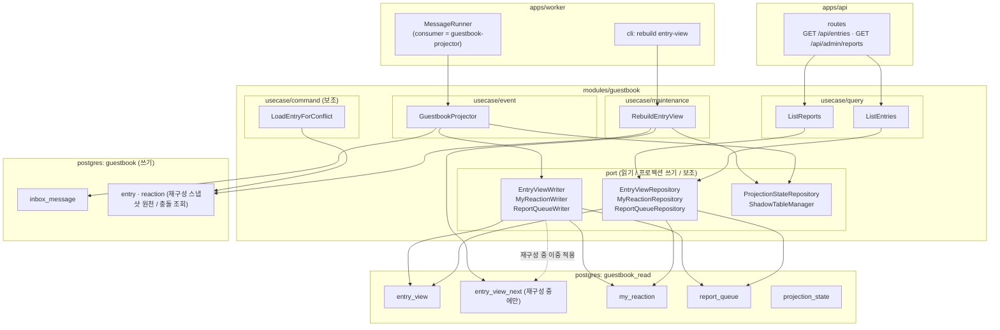

- **조회 usecase 는 읽기 포트만, 프로젝터는 읽기 모델 쓰기 포트만** 주입받는다(00 §4.2, 경계 규칙 B3). 읽기 모델의 쓰기 주체는 프로젝터와 재구성(그리고 §8 의 보관 정리) 뿐이다.
- `LoadEntryForConflict` 만 명령 쪽에 있다: 409 응답의 `details.current` 를 만들려면 **쓰기 모델의 최신 상태**가 필요하다(읽기 모델은 늦을 수 있다).
- `entry_view_next` 는 재구성 중에만 존재하는 임시 테이블이다(§9).

## 2. 통합 클래스 다이어그램

### 2.1 조회 쪽

```mermaid
classDiagram
    class QueryHandler~Q,R~ {
        <<interface>>
        +execute(ctx, input) Result
    }
    class ListEntries {
        +execute(ctx, ListEntriesQuery) Result
    }
    class ListReports {
        +execute(ctx, ListReportsQuery) Result
    }
    class LoadEntryForConflict {
        +execute(ctx, LoadConflictQuery) Result
    }
    class ListEntriesQuery {
        +limit int
        +cursor string
        +actor ActorContext
    }
    class ListReportsQuery {
        +status string
        +limit int
        +cursor string
    }
    class CursorCodec {
        +encode(entryId) string
        +decode(raw) Result
    }
    class CursorPage~T~ {
        +items T[]
        +nextCursor string
    }
    class ViewAssembler {
        +toEntryView(row, mine, actor) EntryView
        +toReportView(row) ReportView
        -isMine(row, actor) bool
        -canEdit(row, actor) bool
    }
    class ReadRepository~V~ {
        <<interface>>
    }
    class EntryViewRepository {
        <<interface>>
        +page(afterId, limit) EntryViewRow[]
    }
    class MyReactionRepository {
        <<interface>>
        +findForEntries(actorKey, entryIds) MyReactionRow[]
    }
    class ReportQueueRepository {
        <<interface>>
        +page(status, afterId, limit) ReportQueueRow[]
    }
    class EntryViewRow {
        +entryId Uuid
        +displayName string
        +body string
        +status string
        +authorKind string
        +authorActorKey string
        +reactions Map
        +version int
        +createdAt Instant
        +updatedAt Instant
    }
    class MyReactionRow {
        +entryId Uuid
        +emoji Emoji
    }
    class ReportQueueRow {
        +reportId Uuid
        +entryId Uuid
        +entryExcerpt string
        +reasonCode string
        +status string
        +createdAt Instant
    }
    class EntryReadPort {
        <<interface>>
        +findEntryForConflict(entryId) EntryConflictSnapshot
        +reactionsOf(entryId, actorKey) Emoji[]
    }
    QueryHandler <|.. ListEntries
    QueryHandler <|.. ListReports
    QueryHandler <|.. LoadEntryForConflict
    ListEntries ..> ListEntriesQuery
    ListEntries ..> CursorCodec
    ListEntries ..> ViewAssembler
    ListEntries ..> EntryViewRepository
    ListEntries ..> MyReactionRepository
    ListEntries ..> CursorPage
    ListReports ..> ListReportsQuery
    ListReports ..> CursorCodec
    ListReports ..> ReportQueueRepository
    ListReports ..> ViewAssembler
    LoadEntryForConflict ..> EntryReadPort
    LoadEntryForConflict ..> ViewAssembler
    ReadRepository <|-- EntryViewRepository
    ReadRepository <|-- MyReactionRepository
    ReadRepository <|-- ReportQueueRepository
    EntryViewRepository ..> EntryViewRow
    MyReactionRepository ..> MyReactionRow
    ReportQueueRepository ..> ReportQueueRow
```

- `LoadEntryForConflict` 는 이름상 query 지만 **명령 모듈의 쓰기 스키마를 읽는 예외**다. `EntryReadPort` 는 쓰기 포트 계열(`EntryRepository` 옆)에 두고, `usecase/query` 가 아니라 `usecase/command/support/` 에 둔다(경계 규칙 B3 에서 명령 쪽으로 분류). 이유: 읽기 모델은 최종적 일관성이라 "방금 누가 바꾼 최신 값"을 못 준다.
- `ViewAssembler` 는 순수 함수 묶음이다(시간·I/O 없음) → `service/` 에 둔다.

### 2.2 프로젝션 쪽

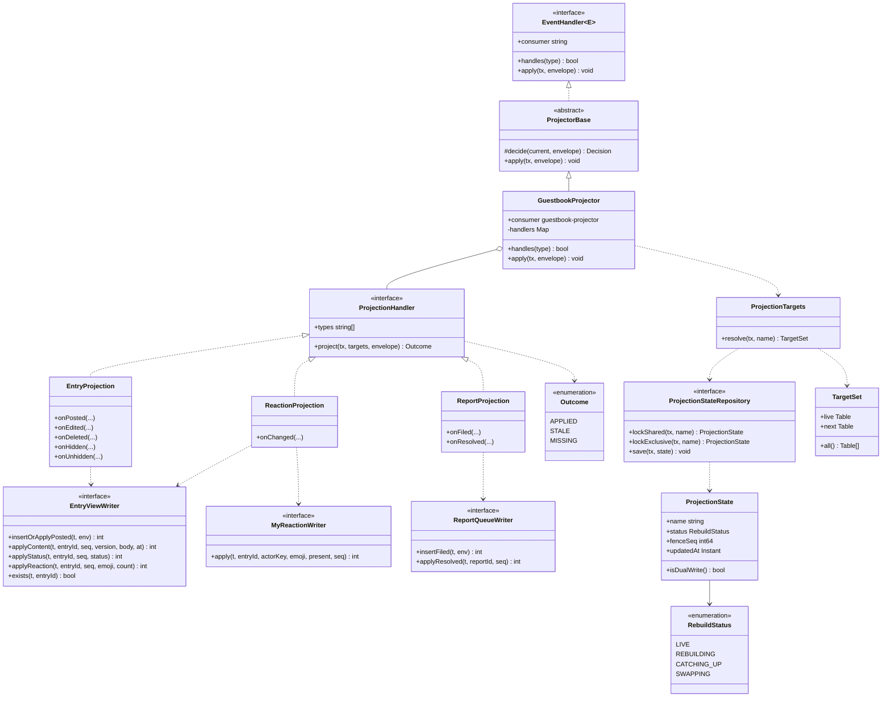

### 2.3 재구성 쪽

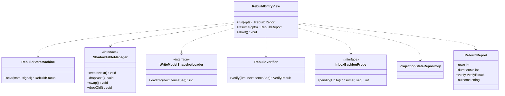

### 2.4 상속·구현 구조 한눈에

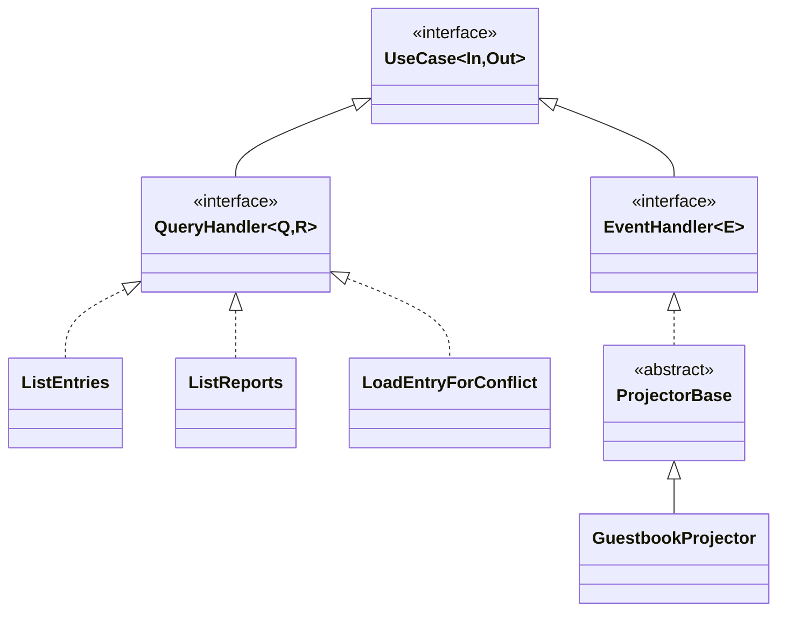

`RealtimeBroadcaster`([F14](14-realtime.md))도 `EventHandler` 지만 `ProjectorBase` 를 상속하지 않는다(읽기 모델이 아니라 `change_log` 를 채우며 순번 규칙이 다르다).

---

## 3. 공통 규약 (이 문서 전체에 적용)

### 3.1 필드별 순번 가드

`entry_view` 한 행에 서로 독립인 세 부분이 있다. **부분마다 따로 순번을 보관**하고 그 부분의 이벤트만 그 순번과 비교한다.

| 부분 | 컬럼 | 갱신 이벤트 | 가드 |
|---|---|---|---|
| 내용 | `display_name`, `body`, `updated_at`, `version`, `content_seq` | `entry.posted`, `entry.edited` | `content_seq < $seq` |
| 상태 | `status`, `status_seq` | `entry.posted`(초기), `entry.hidden`, `entry.unhidden`, `entry.deleted` | `status_seq < $seq` |
| 반응 | `reactions`(jsonb 개수), `reaction_seq`(jsonb 이모지별 순번) | `reaction.changed` | `COALESCE((reaction_seq ->> $emoji)::bigint, 0) < $seq` |

- **왜 행 하나의 `last_seq` 로는 안 되는가.** (초기 설계는 행마다 `last_seq` 하나였고, 현재 `database-schema.md` §5-1 은 필드별 순번을 정의한다.) 행 하나의 순번만 쓰면 병렬 워커가 `entry.hidden`(seq 11)을 먼저 처리한 뒤 `entry.edited`(seq 10)가 오면 10 < 11 이라 **본문 수정이 영영 버려진다**(다른 필드인데도). 반응도 같다. 부분별 순번이면 서로 방해하지 않는다.
- `last_seq` 컬럼은 남긴다: 진단용(`GREATEST` 로 유지)이며 가드에는 쓰지 않는다.
- 보조 테이블(`my_reaction`, `report_queue`)은 키 단위 가드: `my_reaction.last_seq`(키 = `entry_id, actor_key, emoji`), `report_queue.last_seq`(키 = `report_id`).

### 3.2 처리 결과 3종

프로젝터 핸들러는 항상 아래 셋 중 하나를 돌려주고, **셋 모두 inbox 를 `processed` 로 닫는다**(단 `MISSING` 은 다시 시도 — §4.4).

| `Outcome` | 의미 | inbox 처리 |
|---|---|---|
| `APPLIED` | 행이 바뀜(영향 행 1) | `processed` |
| `STALE` | 행은 있으나 가드 때문에 안 바뀜(영향 행 0 + 행 존재) | `processed` (정상, 재전달·역전) |
| `MISSING` | 대상 행이 아직 없음(선행 이벤트 미처리) | `TransientError(projection_dependency_missing)` → 백오프 재시도(ADR-023) |

`MISSING` 이 생기는 이유: 워커가 여러 개면 서로 다른 inbox 행을 동시에 집을 수 있어 **처리 순서가 seq 순서와 다를 수 있다.** `entry.posted` 가 아직 안 끝났는데 `reaction.changed` 가 먼저 오는 경우다. 선점은 `ORDER BY seq` 로 하므로 대부분 순서대로지만 보장은 아니다(ADR-021).

### 3.3 이중 적용 대상(`TargetSet`)

모든 쓰기 포트 호출은 `TargetSet.all()` 의 테이블 각각에 한다.
- 평상시: `[entry_view]`
- 재구성 중(`REBUILDING`/`CATCHING_UP`): `[entry_view, entry_view_next]`
- `SWAPPING` 구간은 `FOR UPDATE` 로 프로젝터가 대기(§9.4).

### 3.4 프로젝터 한 건의 트랜잭션 형태

러너(F13 T5)가 만든 트랜잭션 안에서 **완료 갱신을 먼저** 하고 핸들러가 이어서 돈다(임대를 잃었으면 효과 적용 전에 0행으로 알고 롤백, 갱신한 inbox 행의 잠금이 커밋까지 유지되어 reaper 와 경쟁하지 않는다).

```
BEGIN
  UPDATE inbox_message SET status='processed', processed_at=now()
   WHERE consumer=… AND message_id=… AND claim_token=$t                          -- ① 완료 갱신 먼저 (0행이면 LeaseLost → 롤백, 효과 미반영)
  SELECT status FROM projection_state WHERE name='entry_view' FOR SHARE         -- ② 이중 적용 여부 + 재구성과의 직렬화
  핸들러 SQL 들 (TargetSet 각 테이블)                                            -- ③ 읽기 모델 갱신
COMMIT
```

`FOR SHARE` 는 같은 줄에 대한 다른 `FOR SHARE` 와 충돌하지 않아 프로젝터끼리 막지 않는다. 재구성만 `FOR UPDATE`/`UPDATE` 로 모든 프로젝터를 잠시 기다리게 한다.

`MISSING`·오류가 나면 트랜잭션 전체가 롤백되어 ① 의 완료 표시도 되돌려진다(러너가 별도 트랜잭션 T6 으로 재시도를 예약).

### 3.5 락 순서와 재구성(RENAME)과의 교착 분석

| 주체 | 락 취득 순서 |
|---|---|
| 프로젝터(T5) | ① 자기 `inbox_message` 행(UPDATE) → ② `projection_state` 행(`FOR SHARE`) → ③ `entry_view`·`entry_view_next` 행들(UPDATE/INSERT) |
| 재구성 선점 | `projection_state` 행(`UPDATE`) — 진행 중인 `FOR SHARE` 보유 tx 가 끝날 때까지 대기, 즉시 커밋 |
| 재구성 스냅샷 | 일반 `SELECT`(락 없음, REPEATABLE READ) + `entry_view_next` 에 `INSERT`(이 테이블은 아직 아무도 읽지 않음) |
| 재구성 백로그 확인 | 일반 `SELECT count`(락 없음) — **`inbox_message` 행 잠금을 잡지 않는다** |
| 재구성 교체(§9.3-6) | ① `projection_state` 행(`FOR UPDATE`) → ② `entry_view`·`entry_view_next` 에 `ACCESS EXCLUSIVE`(RENAME) |

- **교착이 없는 이유**: 전체 락 순서가 `inbox 행 → projection_state → entry_view` 한 방향이다. 재구성은 inbox 행을 잡지 않고, 프로젝터는 `projection_state` 를 잡은 **뒤에만** `entry_view` 를 만진다. 따라서 재구성이 `projection_state` 의 `FOR UPDATE` 를 얻은 시점에 `entry_view` 락을 쥔 프로젝터는 없다(`FOR SHARE` 를 쥔 프로젝터는 모두 끝난 뒤에야 `FOR UPDATE` 가 허가된다). 이후 새 프로젝터는 `projection_state` 에서 대기하므로 `entry_view` 에 접근하지 못한다.
- **남는 대기 둘**: ⓐ RENAME 의 `ACCESS EXCLUSIVE` 는 진행 중인 `GET /api/entries` 읽기(`ACCESS SHARE`)가 끝날 때까지 기다리고, 그 사이 새 읽기는 그 뒤에 줄을 선다 → 교체 트랜잭션에 `SET LOCAL lock_timeout = '2s'`(제안)를 걸고, 초과하면 롤백 후 재시도(§9.5)해 읽기가 오래 막히지 않게 한다. ⓑ 교체 중(수 ms) 프로젝터는 ② 에서 대기하며 **자기 inbox 행 잠금과 임대를 쥐고 있다** — 임대 30초(ADR-023)에 비해 무시할 수 있는 시간이다.
- 임대를 잃은 늦은 러너가 ① 에서 0행을 받으면 ② 로 가지 않고 롤백하므로, 늦은 러너가 재구성 후의 테이블에 쓰는 일은 없다.

---

## 4. GB-23 — entry 계열 프로젝션

### 4.1 목적·트리거·조건

| 항목 | 내용 |
|---|---|
| 목적 | `entry.posted/edited/deleted/hidden/unhidden` 를 `guestbook_read.entry_view` 에 반영 |
| 트리거 | worker `MessageRunner` 가 `guestbook-projector` inbox 행을 선점해 `GuestbookProjector.apply` 호출 |
| 사전 조건 | inbox 행 `processing` + 유효한 `claim_token`, 스키마 검증 통과, `type`·`schemaVersion` 지원(05 §5) |
| 사후 조건 | 가드를 통과한 부분만 갱신, inbox `processed`, 같은 이벤트를 몇 번 처리해도 결과 동일(AC-003) |
| 접근 테이블 | R: `projection_state`(FOR SHARE) / W: `entry_view`(+`entry_view_next`), `inbox_message` |
| 요구 | FR-035, AC-003, AC-017 |

### 4.2 이벤트별 SQL 의미

`$seq` = 봉투 `seq`, `$v` = 봉투 `aggregate.version`(inbox 행의 `aggregate_version` 컬럼), `$actor` = 봉투 `ownerKey`(inbox 행의 `owner_key` 컬럼). 봉투 메타가 inbox 컬럼으로 저장되므로(database-schema §4-5) 핸들러는 inbox 행만으로 이 값들을 얻는다. 아래는 대상 테이블 하나에 대한 문장이며 `TargetSet` 만큼 반복한다.

**`entry.posted` — 행 생성(멱등)**

```sql
INSERT INTO guestbook_read.entry_view
  (entry_id, display_name, body, status, author_kind, author_actor_key,
   reactions, reaction_seq, version, created_at, updated_at,
   content_seq, status_seq, last_seq)
VALUES ($id, $name, $body, 'visible', $kind, $actor,
        '{}', '{}', $v, $created, $created, $seq, $seq, $seq)
ON CONFLICT (entry_id) DO NOTHING;
```
- 행이 이미 있으면(재전달, 또는 재구성 스냅샷이 먼저 만든 경우) **아무것도 안 한다.** 다른 필드는 자기 이벤트가 갱신한다. `rowcount = 0` 이면 `STALE`.
- `author_actor_key` 는 봉투 `ownerKey`(내부 형식 `session:<id>` / `user:<id>`, §11 이력 참조)에서 온다. 공개로는 나가지 않는다.

**`entry.edited` — 내용 갱신**

```sql
UPDATE guestbook_read.entry_view
   SET body = $body, updated_at = $at, version = GREATEST(version, $v),
       content_seq = $seq, last_seq = GREATEST(last_seq, $seq)
 WHERE entry_id = $id AND content_seq < $seq AND status <> 'deleted';
```
`rowcount = 1` → `APPLIED`. `0` → 행 존재 확인(`exists`): 있으면 `STALE`(오래된 이벤트이거나 **이미 삭제된 글** — 늦게 온 `edited` 가 본문을 되살리지 못한다), 없으면 `MISSING`.

**`entry.hidden` / `entry.unhidden` — 상태 갱신**

```sql
UPDATE guestbook_read.entry_view
   SET status = $newStatus, version = GREATEST(version, $v),
       status_seq = $seq, last_seq = GREATEST(last_seq, $seq)
 WHERE entry_id = $id AND status_seq < $seq AND status <> 'deleted';
```
`$newStatus` 는 `hidden` / `visible`. 삭제된 글은 숨김·해제 이벤트로 되살아나지 않는다. 판정은 편집과 같다(0행이면 존재 여부로 `STALE`/`MISSING`).

**`entry.deleted` — 본문·반응을 비우고 묘비로 남김**

```sql
UPDATE guestbook_read.entry_view
   SET status = 'deleted', body = '', reactions = '{}'::jsonb,
       version = GREATEST(version, $v),
       status_seq = $seq, last_seq = GREATEST(last_seq, $seq)
 WHERE entry_id = $id AND status_seq < $seq;
```
개인정보 최소화(ADR-008): 읽기 모델에서도 본문이 남지 않는다. 가드는 `status_seq` 하나이며, 이후 도착하는 `entry.edited`(위 `status <> 'deleted'`)·`reaction.changed`(§5.2)는 이 행에 효과를 내지 못한다. `reaction_seq`·`content_seq` 는 그대로 둔다(묘비가 가드 역할만 한다).

### 4.3 목록에 미치는 영향

| 상태 | 공개 목록(`GET /api/entries`) | WS 로 나가는 것(F14) | 신고 큐 |
|---|---|---|---|
| `visible` | 보임 | `entry.created`/`entry.updated` | — |
| `hidden` | 안 보임 (작성자 본인에게도) | `entry.removed(reason: hidden)` | 발췌(`entry_excerpt`) 유지 |
| `deleted` | 안 보임 | `entry.removed(reason: deleted)` | 유지(조치 이력용) |
| 숨김 해제 | 다시 보임 (`status_seq` 가 더 큰 `unhidden` 이 이김) | **`entry.restored {entryId}`**(04 §3.2 — 클라이언트가 해당 글을 재조회해 되살림) | — |

- `deleted` 는 **행을 지우지 않고** 상태로 둔다. 지우면 늦게 도착한 오래된 `entry.edited`/`unhidden` 이 `MISSING` 으로 오인되거나, 행 재생성 경로가 생겨 되살아날 위험이 있다. 물리 삭제는 보관 정리(§8)가 한다.
- 목록 쿼리의 부분 인덱스는 `status = 'visible'` 만 담아, `hidden`/`deleted` 가 쌓여도 목록 성능이 변하지 않는다.

### 4.4 시퀀스 — 정상, 오래된 이벤트, 재전달, 순서 역전

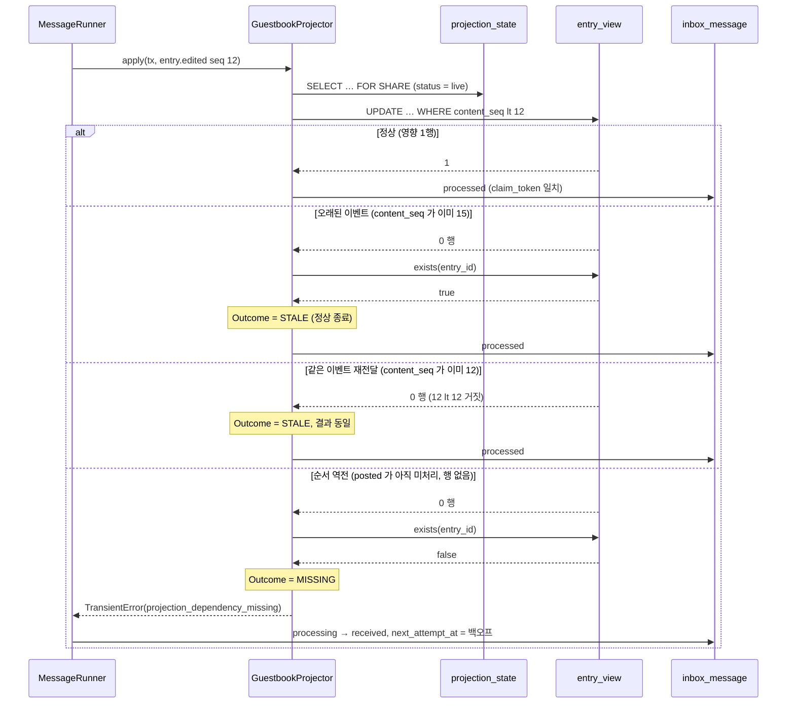

### 4.5 순서도 — 핸들러 공통 판정

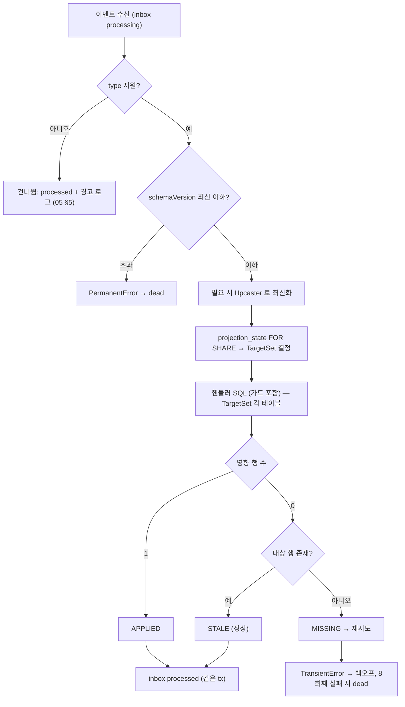

### 4.6 오류·지표·로그·시험

| 구분 | 내용 |
|---|---|
| 오류 | `MISSING` → `TransientError`(재시도, ADR-023 백오프 1s×2 상한 5분, 최대 8회 → `dead`). 스키마 불일치·알 수 없는 상위 버전 → `PermanentError`. 토큰 불일치(`LeaseLost`) → 롤백·결과 폐기 |
| 지표 | F17 카탈로그 이름: `pf_event_process_duration_seconds{consumer,type,outcome}`(`outcome` = ok / stale / error / dead), `pf_projection_stale_ignored_total{projection}`, `pf_projection_lag_seconds{projection}`. `missing` 건수 전용 지표는 F17 에 **추가 요청**(`pf_retry_total{kind,type}` 로 대체 가능) — 식별자 레이블 없음 |
| 로그 | `module=guestbook usecase=GuestbookProjector type outcome trace_id event_id seq` — **본문·표시 이름 금지** |
| 시험 | **AC-017**: 같은 이벤트 집합을 임의 순열로 처리해도 최종 `entry_view` 가 순서대로 처리한 결과와 같다(속성 기반, `MISSING` 재시도 포함). **AC-003**: 각 이벤트를 2회 연속 처리해도 행 동일. 단위: SQL 가드 경계(`content_seq == $seq`). 통합(L3): 워커 2개가 같은 inbox 를 경쟁해도 일치 |

---

## 5. GB-24 — 반응 프로젝션

### 5.1 목적·트리거·조건

| 항목 | 내용 |
|---|---|
| 목적 | `reaction.changed` 로 `entry_view.reactions`(이모지별 총개수)와 `my_reaction`(행위자별 눌림)을 갱신 |
| 트리거 | inbox `reaction.changed` |
| 사전 조건 | 대상 글 행이 있어야 함(없으면 `MISSING`). 봉투 `ownerKey` 로 행위자 식별 가능 |
| 사후 조건 | 개수는 **이벤트가 싣고 온 총개수로 덮어쓴다**(증감 아님) — 재전달·역전에서도 최종 값 동일 |
| 접근 테이블 | W: `entry_view.reactions/reaction_seq`, `my_reaction` |
| 요구 | FR-021, FR-035 |

### 5.2 SQL 의미

**개수 덮어쓰기** (이모지별 순번 가드):

```sql
UPDATE guestbook_read.entry_view
   SET reactions = CASE WHEN $count = 0
                        THEN reactions - $emoji
                        ELSE jsonb_set(reactions, ARRAY[$emoji], to_jsonb($count::int), true) END,
       reaction_seq = jsonb_set(reaction_seq, ARRAY[$emoji], to_jsonb($seq::bigint), true),
       last_seq = GREATEST(last_seq, $seq)
 WHERE entry_id = $id
   AND status <> 'deleted'
   AND COALESCE((reaction_seq ->> $emoji)::bigint, 0) < $seq;
```
- `count = 0` 이면 키를 제거(`{"👍": 0}` 를 남기지 않는다).
- 이모지 A 의 오래된 이벤트가 이모지 B 의 순번에 영향받지 않는다.
- 0행이면 글 행 존재 여부로 `STALE`/`MISSING` 판정(§4.4 와 동일). 삭제된 글(`status='deleted'`)은 `STALE` 이다.

**행위자별 눌림** (`op` 로 `present` 설정, 묘비 유지):

```sql
INSERT INTO guestbook_read.my_reaction (entry_id, actor_key, emoji, present, last_seq)
VALUES ($id, $actor, $emoji, ($op = 'added'), $seq)
ON CONFLICT (entry_id, actor_key, emoji) DO UPDATE
   SET present = EXCLUDED.present, last_seq = EXCLUDED.last_seq
 WHERE guestbook_read.my_reaction.last_seq < EXCLUDED.last_seq;
```
- **삭제하지 않고 `present=false` 묘비를 남긴다.** `removed`(seq 11) 뒤에 늦게 온 `added`(seq 10)가 행을 되살리지 못하게 하려는 것이다. 묘비는 세션 정리(ID-10)·보관(§8)에서 지운다.
- 조회는 `present = true` 만 쓴다.

**두 문장은 같은 트랜잭션**이다. 개수는 이벤트가 총개수를 싣고 오므로 `my_reaction` 과 서로 계산에 의존하지 않는다(어긋남이 있어도 개수 자체는 항상 쓰기 모델의 값).

### 5.3 시퀀스 — 정상 / 역전 / 재전달

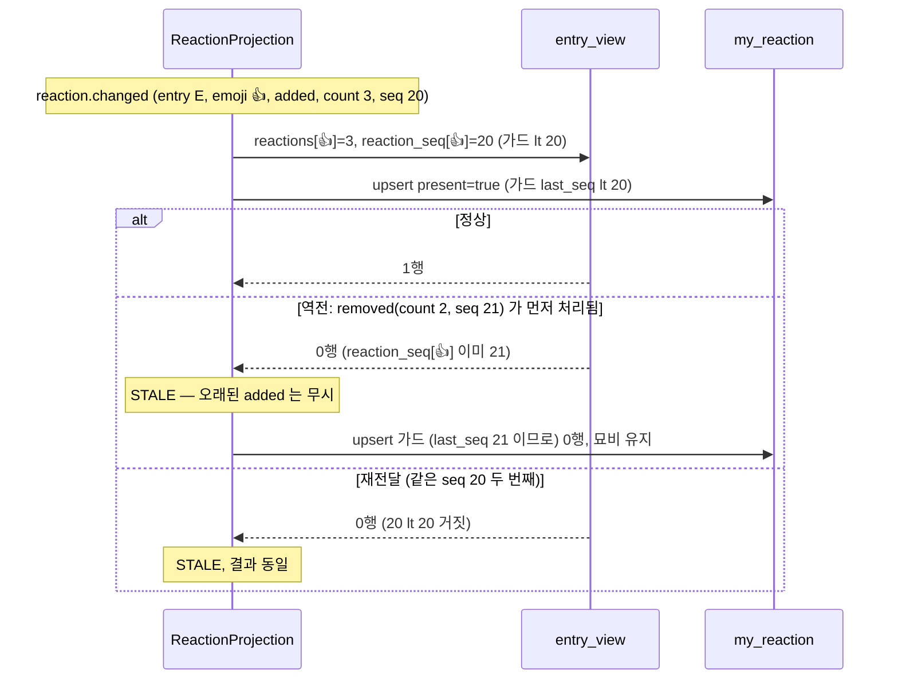

### 5.4 순서도

```mermaid
flowchart TD
    A["reaction.changed 수신"] --> B{"글 행 존재?"}
    B -- "아니오" --> MI["MISSING → TransientError 재시도"]
    B -- "예" --> C{"reaction_seq[emoji] lt seq ?"}
    C -- "아니오" --> ST["개수 갱신 생략 (STALE)"]
    C -- "예" --> D{"count = 0 ?"}
    D -- "예" --> E1["reactions 에서 emoji 키 제거"]
    D -- "아니오" --> E2["reactions[emoji] = count"]
    E1 --> F["reaction_seq[emoji] = seq"]
    E2 --> F
    ST --> G
    F --> G["my_reaction upsert (last_seq 가드, present = op = added)"]
    G --> OK["inbox processed"]
```

### 5.5 오류·지표·로그·시험

| 구분 | 내용 |
|---|---|
| 오류 | 글 행 없음 → `MISSING`. `ownerKey` 누락 → `PermanentError`(발행 버그) |
| 지표 | 4.6 공통(`pf_event_process_duration_seconds{type="reaction.changed"}`) |
| 로그 | 이모지·개수는 기록 가능, **행위자 키 금지** |
| 시험 | 단위: `count=0` 키 제거, 서로 다른 이모지 순번 독립. 속성 기반(AC-017): added/removed 임의 순열 후 최종 `reactions` = 마지막 seq 의 count. 묘비: removed 후 늦은 added 가 `present` 를 되돌리지 않음. 구조(AC-009): 어떤 응답 DTO 에도 `actor_key` 가 없다 |

---

## 6. GB-25 — 신고 프로젝션 (`report_queue`)

| 항목 | 내용 |
|---|---|
| 목적 | `report.filed` / `report.resolved` 로 관리자 신고 큐를 유지 |
| 트리거 | inbox `report.filed`, `report.resolved` |
| 접근 테이블 | W: `report_queue` |
| 요구 | FR-023 |

```sql
-- report.filed (멱등)
INSERT INTO guestbook_read.report_queue
  (report_id, entry_id, entry_excerpt, reason_code, status, created_at, last_seq)
VALUES ($rid, $eid, $excerpt, $reason, 'open', $at, $seq)
ON CONFLICT (report_id) DO NOTHING;

-- report.resolved (가드)
UPDATE guestbook_read.report_queue
   SET status = 'resolved', resolution = $resolution, last_seq = $seq
 WHERE report_id = $rid AND last_seq < $seq;
```
- `entry_excerpt` 는 **봉투에서 온 앞 80자**(05)이며 본문 전체를 복사하지 않는다. 작성 후 숨김·삭제돼도 큐에는 남는다(조치 이력).
- `resolved` 가 `filed` 보다 먼저 오면 행이 없어 `MISSING` → 재시도.
- 이 큐는 **공개 채널로 나가지 않는다**(05 §2).

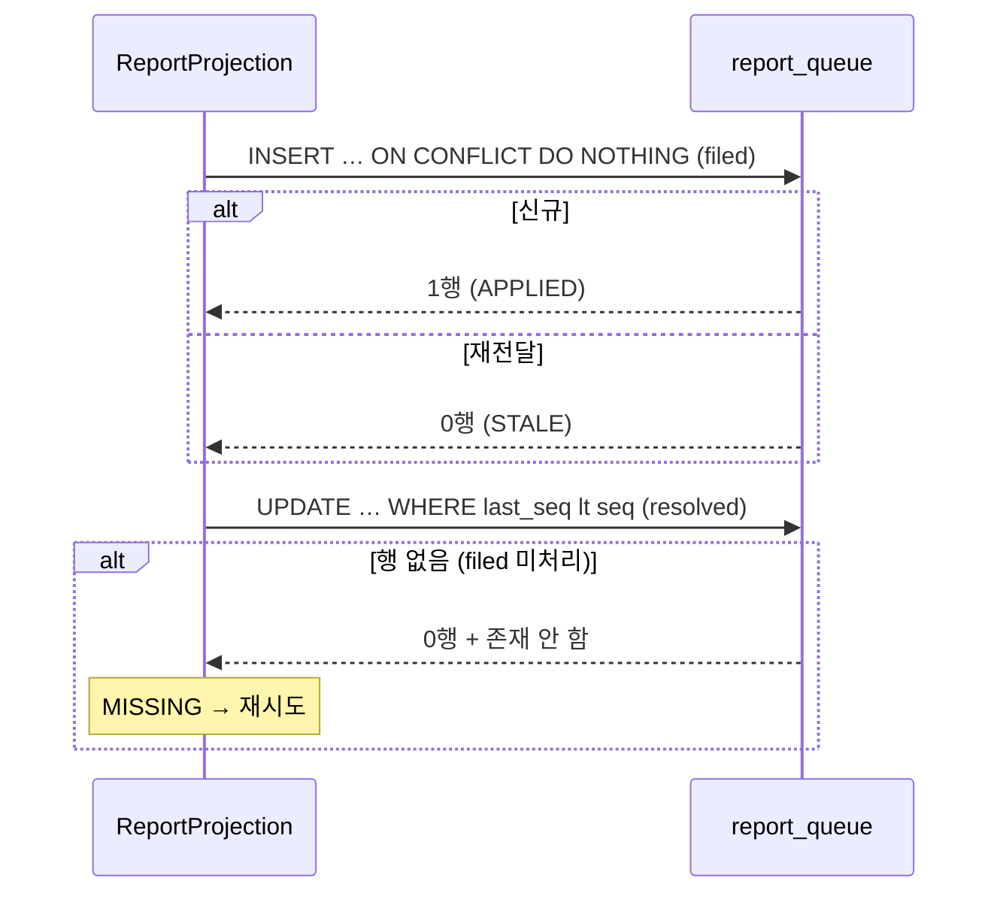

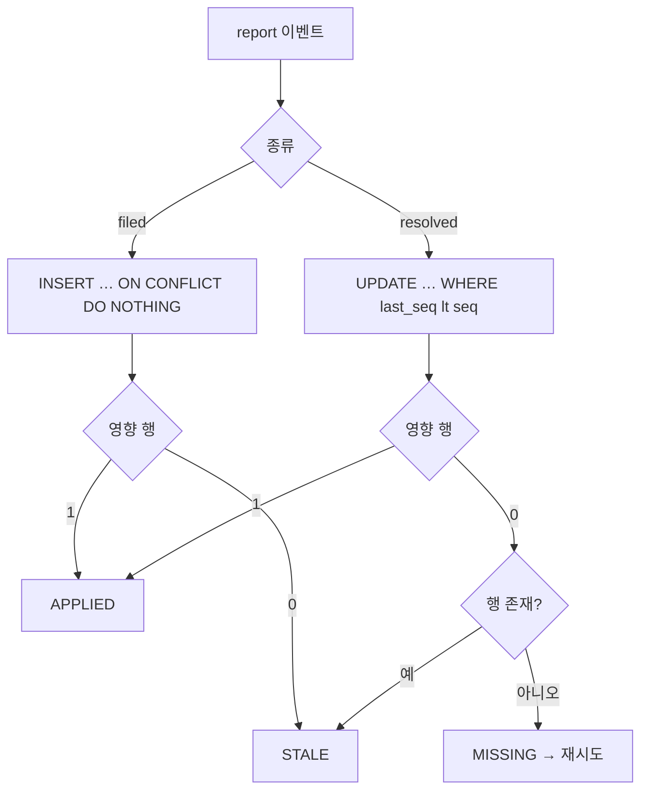

오류·지표·로그는 4.6 과 같다. 시험: `filed` 중복 전달 시 행 1개, `resolved`→`filed` 역전 후 재시도로 `resolved` 상태 수렴.

---

## 7. GB-20 / GB-21 / GB-22 — 조회 usecase

### 7.1 GB-20 글 목록 조회 (`ListEntries`)

| 항목 | 내용 |
|---|---|
| 목적 | 공개 글을 최신순 커서 페이지로 돌려준다(행위자별 `myReactions`/`isMine`/`canEdit` 포함) |
| 트리거 | `GET /api/entries?limit&cursor` — 브라우저, 또는 Next SSR(쿠키 없음) |
| 사전 조건 | `limit` 1~50(기본 20), `cursor` 가 있으면 유효. 행위자는 **선택**(SSR 첫 페이지는 없음) |
| 사후 조건 | 읽기 모델만 읽었다(쓰기 포트 미주입, B3). 응답에 `authorActorKey` 등 내부 필드 없음 |
| 접근 테이블 | R: `entry_view`, `my_reaction` |
| 요구 | FR-035, AC-009 |

**커서 인코딩.** 불투명 문자열이며 의미는 "이 id 보다 오래된 것"이다.

```
cursor = base64url( JSON.stringify({ "e": "<entryId uuid v7>" }) )
decode  : base64url 디코드 → JSON 파싱 → e 가 uuid 형식인지 검사. 실패 시 ValidationError(validation_failed, fields:[{path:"cursor"}])
```
- `entry_id` 는 uuid v7 이라 **시간 순서와 정렬 순서가 일치**한다 → `created_at` 정렬이 필요 없다.
- 버전 접두어(`v1.`)를 붙이지 않는다(필드 추가로 호환 확장; 호환이 깨지면 `/api/v2`).

**키셋 쿼리.**

```sql
SELECT entry_id, display_name, body, author_kind, author_actor_key,
       reactions, version, created_at, updated_at
  FROM guestbook_read.entry_view
 WHERE status = 'visible'
   AND ($after::uuid IS NULL OR entry_id < $after)
 ORDER BY entry_id DESC
 LIMIT $limit + 1;
```
- 인덱스: 부분 인덱스 `entry_view (entry_id DESC) WHERE status = 'visible'` — 필터와 정렬이 인덱스 하나로 끝난다.
- `LIMIT $limit + 1` 로 한 건 더 읽어 **다음 페이지 유무를 판정**한다. 초과분은 버리고 `nextCursor = encode(마지막 반환 항목 id)`; 초과분이 없으면 `null`.

**`myReactions` / `isMine` / `canEdit` 채우기 — 결정: 2단계 조회(JOIN 없음)**

| 안 | 장점 | 단점 |
|---|---|---|
| (a) `entry_view LEFT JOIN my_reaction … array_agg` 한 쿼리 | 왕복 1회 | 키셋 정렬과 집계가 섞여 계획이 복잡, 부분 인덱스 이점 약화, 익명(행위자 없음)도 같은 쿼리를 타야 함 |
| **(b) 페이지 쿼리 → 보조 쿼리 → 메모리 조립 (채택)** | 페이지 쿼리가 부분 인덱스만 타서 단순·빠름. 행위자가 없으면 보조 쿼리 **생략** | 왕복 2회(페이지당) |

보조 쿼리(기본키 `(entry_id, actor_key, emoji)` 의 앞 두 열로 탐색):

```sql
SELECT entry_id, emoji
  FROM guestbook_read.my_reaction
 WHERE actor_key = $actor AND entry_id = ANY($ids) AND present;
```
- `isMine = (row.authorActorKey == actor.actorKey)`, `canEdit = actor.kind == 'user' AND row.authorKind == 'user' AND row.authorActorKey == actor.actorKey`. 둘 다 `ViewAssembler` 가 메모리에서 계산하며 **응답에는 `authorActorKey` 를 싣지 않는다.**
- 로그인으로 세션이 회전되면 이전 익명 글은 `isMine=false`(ADR-008: 귀속 안 함) — 의도된 동작이다.
- 규모: 페이지 ≤ 50 이라 `ANY($ids)` 는 작다. 왕복 비용은 같은 호스트의 로컬 Postgres 라 무시할 만하다(부하 시험 AC-013 에서 측정 — **미확인**).

**클래스(기능 단위).** §2.1 의 `ListEntries`, `CursorCodec`, `ViewAssembler`, `EntryViewRepository`, `MyReactionRepository`.

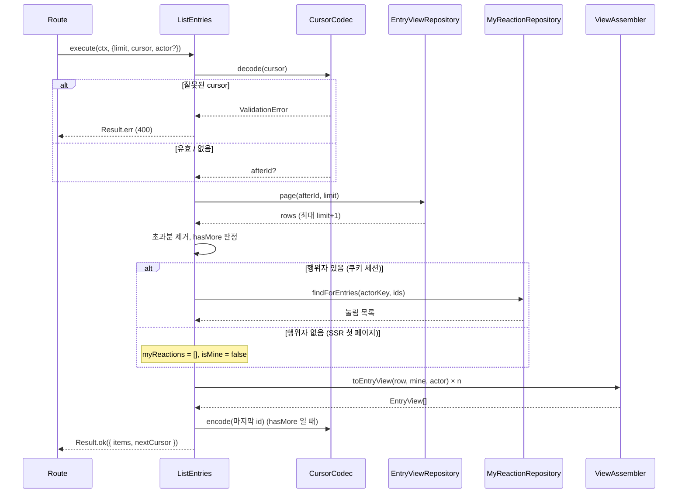

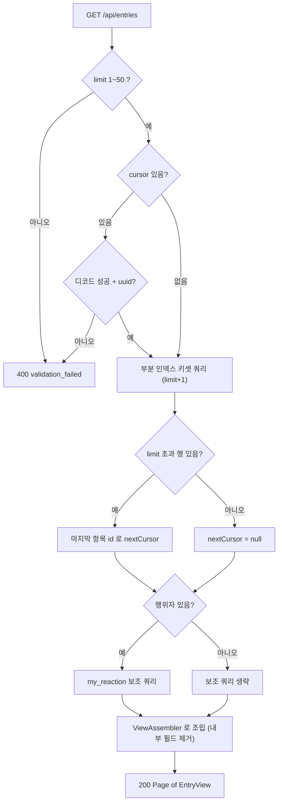

| 구분 | 내용 |
|---|---|
| 오류 | 잘못된 `cursor`/`limit` → 400. DB 일시 오류 → `TransientError`(503) |
| 지표 | 공통 HTTP 지표 `pf_http_request_duration_seconds{route="/api/entries"}`(F17). 페이지 크기 히스토그램은 필요 시 F17 에 추가 요청 |
| 로그 | `usecase=ListEntries limit hasCursor hasActor rows` — 커서·행위자 키 값 금지 |
| 시험 | 단위: `CursorCodec` 왕복·변조 거부, `ViewAssembler`(isMine/canEdit 표). 통합(L3): 페이지 경계(정확히 limit개, limit+1개), 새 글 삽입 중 페이지 안정성(키셋이라 중복·누락 없음), `hidden`/`deleted` 제외, 행위자 없음 경로. **AC-009**: 응답 JSON 키 집합이 `EntryView` 스키마와 정확히 같다(내부 필드 누출 없음). 구조: `ListEntries` 가 쓰기 포트를 주입받을 수 없다(B3) |

### 7.2 GB-21 신고 큐 조회 (`ListReports`)

| 항목 | 내용 |
|---|---|
| 목적 | 관리자에게 신고 목록을 최신순 커서 페이지로 제공 |
| 트리거 | `GET /api/admin/reports?status&limit&cursor` (`RequireAdmin` 통과 후) |
| 접근 테이블 | R: `report_queue` |
| 인덱스 | `report_queue (report_id DESC) WHERE status = 'open'` 부분 인덱스(기본 필터 `open`), `status=resolved` 는 `(status, report_id DESC)` |

- 커서는 GB-20 과 같은 `CursorCodec`(키 = `report_id`, uuid v7).
- 응답 `ReportView`: `reportId, entryId, entryExcerpt, reasonCode, status, createdAt`. **신고자 식별자는 큐에 없다**(저장하지 않음).

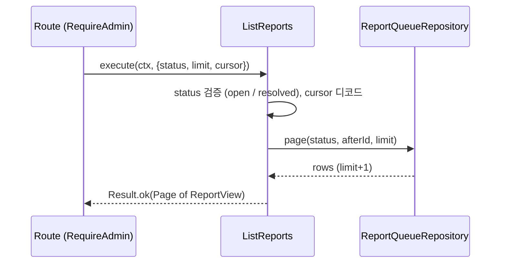

오류: 권한 없음은 가드 단계(403)에서 끝난다. 지표는 공통 HTTP 지표(`pf_http_*`, F17). 시험: 관리자 아님 → 403(usecase 도달 전), `resolved` 필터, 커서 경계.

### 7.3 GB-22 충돌 시 최신 뷰 (`LoadEntryForConflict`)

| 항목 | 내용 |
|---|---|
| 목적 | `EditEntry`/`DeleteEntry`/`HideEntry` 가 `version` 불일치(409)를 만들 때 `details.current` 에 담을 **최신** `EntryView` 를 쓰기 모델에서 조회 |
| 트리거 | 명령 usecase 의 조건부 갱신이 0행일 때 같은 트랜잭션(또는 직후)에서 호출 |
| 접근 테이블 | R: `guestbook.entry`, `guestbook.reaction`(행위자별 눌림) — **쓰기 스키마** |
| 사후 조건 | 삭제된 글이면 `NotFoundError`(404) — `409` 가 아니다 |

- 읽기 모델을 쓰지 않는 이유: 방금 다른 탭이 바꾼 값이 아직 투영되지 않았을 수 있고, 클라이언트는 이 값을 기준으로 **다시 편집**하기 때문이다.
- 조립은 같은 `ViewAssembler` 를 쓰되 `reactions`(총개수)는 쓰기 모델 `reaction` 을 집계한다(글 하나라 저렴).

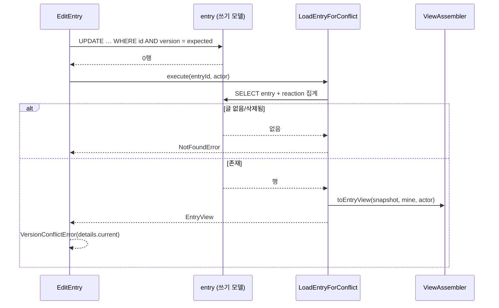

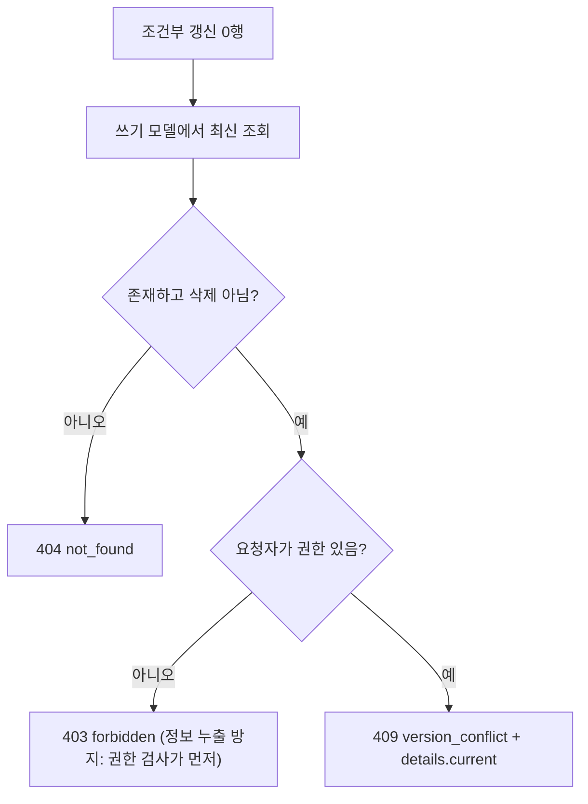

- 권한 검사(본인/관리자)는 이 조회 **전에** 명령 usecase 가 한다. 권한 없는 요청자에게 최신 본문을 돌려주지 않는다.
- 지표: `pf_version_conflicts_total{resource}`(F17, 명령 쪽에서 발생). 시험: AC-016(동시 수정 한 건만 성공, 나머지 409 + 최신 뷰), 삭제 후 수정 → 404.

### 7.4 `ReadPublicEntries` — realtime 스냅샷용 공개 조회 포트 (D18)

| 항목 | 내용 |
|---|---|
| 목적 | ws-gateway 의 `SnapshotBuilder`(RT-05)가 `guestbook_read` 를 **직접 읽지 않고** 모듈 공개 usecase 로 첫 페이지를 얻는다(모듈 경계, database-schema §9) |
| 소유 | guestbook (`query` usecase, `index` 로 공개). 소비: realtime |
| 입력 → 출력 | `{ limit }`(기본 20, 최대 50) → `PublicEntryView[]` — **개인 필드(`myReactions`·`isMine`·`canEdit`)가 없는 공개 형태**(04 §3.2) |
| 접근 테이블 | R: `entry_view` (`status='visible'`, `entry_id DESC`, 부분 인덱스) |
| 일관성 | 호출자(RT-05)가 먼저 `change_log` 의 `head` 를 읽고 그 뒤에 이 usecase 를 호출한다. 결과에 `head` 이후 변경이 일부 섞일 수 있으나, 이후 재생되는 변경은 모두 **덮어쓰기·id 교체 의미**라 중복 적용해도 같다(04 §5) |

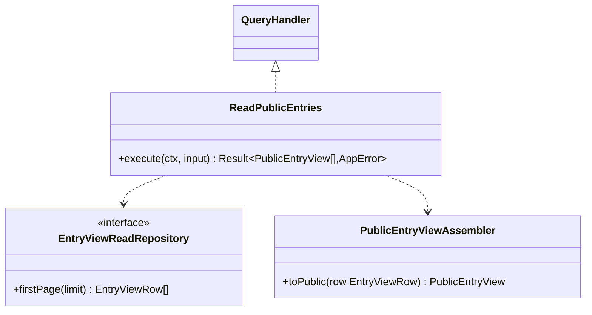

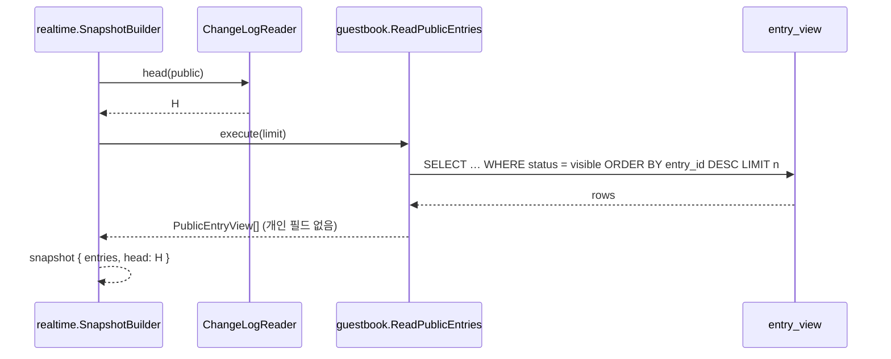

---

## 8. 보관 정리가 읽기 모델에 미치는 영향 (참조)

읽기 모델은 "이벤트로만 갱신"이 원칙이지만 **세션 정리 잡 `PurgeExpiredSessions`(ID-10)는 예외적 유지보수 쓰기 주체**다(database-schema §9 예외 ①). 보관 정리(EV-10)는 읽기 모델 행을 지우지 않는다(M1). 이 문서의 읽기 모델 관련 규칙:

| 대상 | 정리 내용 | 시점 |
|---|---|---|
| `my_reaction` | `session:` 행위자 행(묘비 포함) 삭제 | 세션 삭제 시 |
| `entry_view.author_actor_key` | `session:` 값을 NULL 로(익명화) | 세션 삭제 시 |
| `entry_view` (`deleted`) | **M1 에서는 물리 삭제 없음**(본문은 이미 비워진 묘비) | 후속 결정(제안: 30일) |
| `report_queue` (`resolved`) | **M1 에서는 삭제 없음** | 후속 결정(제안: 7일) |

이 유지보수 쓰기는 **가드(`*_seq`)와 무관**하며 프로젝터와 경쟁하지 않도록 `entry_id` 단위의 짧은 `UPDATE` 만 쓴다.

---

## 9. GB-26 — 읽기 모델 재구성 (`RebuildEntryView`)

### 9.1 목적·트리거·조건

| 항목 | 내용 |
|---|---|
| 목적 | 프로젝터 버그·스키마 변경으로 오염된 `entry_view` 를 **점검 모드 없이** 정본에서 다시 만든다(ADR-023) |
| 트리거 | `bun run worker rebuild entry_view [--dry-run]`(관리자 CLI, F16 §11.2 — 프로젝션 이름은 `entry_view`·`report_queue`·`flow_counter`). 기본 실행 환경은 worker 컨테이너 |
| 사전 조건 | `projection_state.status = live`, 같은 이름의 재구성이 진행 중이 아님(`UPDATE … WHERE status='live'` 로 선점) |
| 사후 조건 | `entry_view` 가 쓰기 모델과 일치, 읽기 중단 없음(교체는 밀리초 단위 잠금), 이전 테이블은 보관 후 삭제 |
| 접근 테이블 | R: `guestbook.entry`, `guestbook.reaction`(스냅샷) · W: `entry_view_next`, `projection_state`, `entry_view` 이름 교체 |
| 요구 | AC-017, ADR-023 |
| 범위 | 그림자 교체는 `entry_view` 하나이고 **`my_reaction` 은 같은 잡이 함께 채운다**(쓰기 모델 `reaction` 스냅샷 + 이후 이벤트 이중 적용). `report_queue` 는 쓰기 모델 `report` 스냅샷으로 자체 재구성(`worker rebuild report_queue`, 같은 알고리즘의 단순형), `flow_counter` 는 `trace_step` 재집계(이벤트 재생이 아님, database-schema §5-1) |

### 9.2 상태 기계

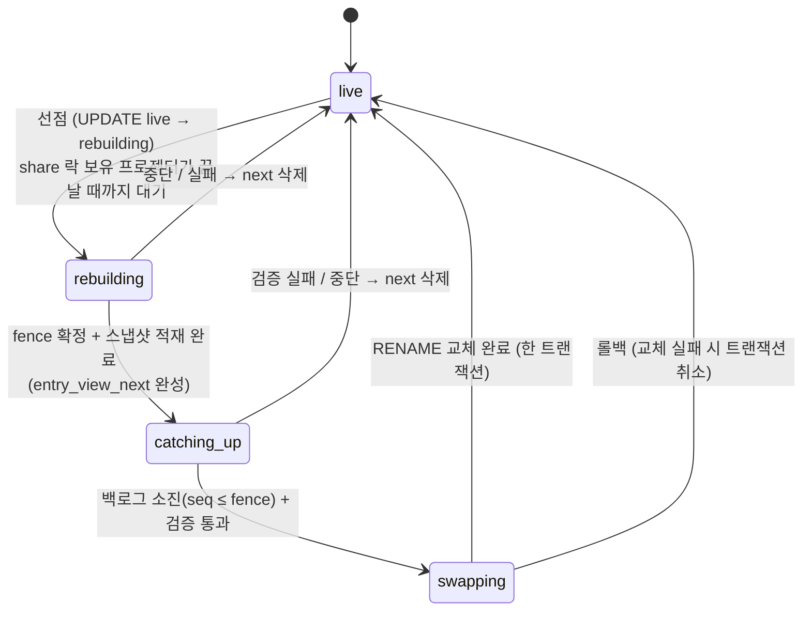

| 상태 | 프로젝터 거동 | 읽기(`GET /api/entries`) |
|---|---|---|
| `live` | `entry_view` 에만 적용 | `entry_view` |
| `rebuilding` | **`entry_view` 와 `entry_view_next` 양쪽에 적용** | `entry_view` (기존) |
| `catching_up` | 양쪽 적용 | `entry_view` |
| `swapping` | `projection_state` `FOR UPDATE` 로 **프로젝터 대기** | 이름 교체 순간 잠깐 대기(ms) |
| 교체 후 `live` | `entry_view`(새 테이블)에만 적용 | 새 `entry_view` |

### 9.3 알고리즘

```
rebuild(entry_view):
 1. 선점:   UPDATE projection_state SET status='rebuilding', updated_at=now()
            WHERE name='entry_view' AND status='live'
            -- 이 UPDATE 는 같은 행에 FOR SHARE 를 잡은 진행 중 프로젝터 트랜잭션이 끝날 때까지 기다린다.
            -- 이후 시작하는 프로젝터는 모두 'rebuilding' 을 보고 이중 적용을 한다.
 2. 준비:   CREATE TABLE guestbook_read.entry_view_next (LIKE guestbook_read.entry_view INCLUDING ALL)
 3. 스냅샷: BEGIN ISOLATION LEVEL REPEATABLE READ
              fence_seq = SELECT max(seq) FROM events.outbox_event
              INSERT INTO entry_view_next SELECT … FROM guestbook.entry e
                        LEFT JOIN (reaction 이모지별 집계) …
                        -- content_seq = status_seq = reaction_seq[*] = last_seq = fence_seq
              UPDATE projection_state SET fence_seq = $fence_seq
            COMMIT
            -- entry 와 outbox_event 는 같은 트랜잭션에서 쓰이므로 스냅샷 안에서
            -- "fence_seq 이하 이벤트의 효과 = 스냅샷 내용" 이 성립한다.
 4. 따라잡기: status='catching_up'
            -- 이벤트 처리는 계속 양쪽에 적용된다. 스냅샷에 이미 반영된 이벤트(seq ≤ fence)는
            -- next 에서 가드로 STALE, 이후 이벤트(seq > fence)는 next 에도 APPLIED.
            대기 조건: 프로젝터 inbox 중 seq ≤ fence_seq 인 미처리 건수 = 0
 5. 검증:   RebuildVerifier — next 의 visible 행 수·reactions 합계가 쓰기 모델 재계산과 같은지,
            샘플 N건의 내용 해시 비교. 불일치 → 중단(next 삭제, status=live, 경보)
 6. 교체:   BEGIN
              SET LOCAL lock_timeout = '2s'                                       -- 제안: 읽기가 오래 막히지 않게 (§3.5)
              SELECT … FROM projection_state WHERE name='entry_view' FOR UPDATE   -- 프로젝터 대기
              ALTER TABLE entry_view RENAME TO entry_view_old
              ALTER TABLE entry_view_next RENAME TO entry_view
              (인덱스·제약 이름도 같은 문장 묶음에서 교체)
              UPDATE projection_state SET status='live', updated_at=now()
            COMMIT
 7. 정리:   보관 시간(미확인, 제안 1시간) 뒤 entry_view_old 삭제
```

**양쪽 적용 규칙.**
1. 핸들러는 항상 `TargetSet` 의 **모든 테이블에 같은 문장**을 실행한다. 한쪽만 가드에 걸리는 것은 정상이다(스냅샷이 더 최신이면 STALE).
2. 어느 한쪽에서 `MISSING` 이 나면 **전체 `MISSING`**(재시도). 둘 중 한쪽에만 행이 없는 상태에서 `processed` 로 닫으면 안 된다. 단, `entry_view_next` 는 스냅샷 적재 전에는 비어 있으므로 `rebuilding` 단계 중 적재 완료 전 도착한 이벤트는 `next` 에 대해서는 **건너뛴다**(스냅샷이 이후에 반영) — 구현은 `next.snapshot_loaded` 플래그(`projection_state` 컬럼, 미확인)로 구분한다.
3. 프로젝터는 `projection_state` 의 상태만 믿는다. CLI 프로세스가 죽어도 상태가 남아 있으면 이중 적용이 계속되므로 **데이터는 안전**하다(§9.5).

### 9.4 시퀀스 — 재구성 중 쓰기가 들어오는 경우

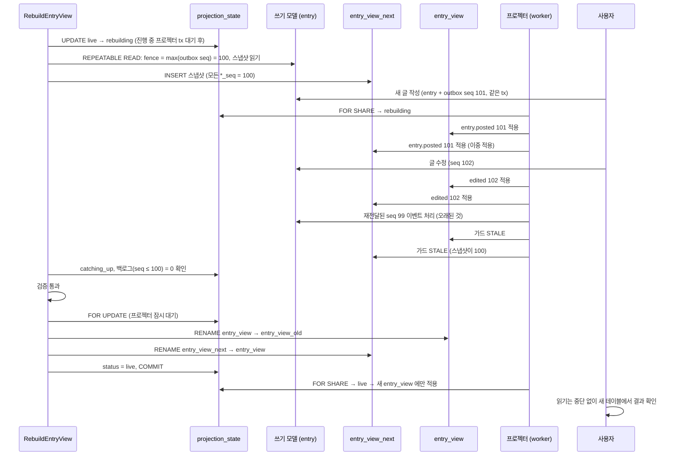

### 9.5 순서도 — 재구성 진행·중단

```mermaid
flowchart TD
    A["rebuild 시작"] --> B{"status = live ?"}
    B -- "아니오" --> X1["이미 진행 중: 종료 (resume / abort 안내)"]
    B -- "예" --> C["status = rebuilding (진행 중 프로젝터 tx 대기)"]
    C --> D["next 생성 + 스냅샷 적재, fence 기록"]
    D --> E{"적재 성공?"}
    E -- "아니오" --> AB["abort: next 삭제, status = live"]
    E -- "예" --> F["status = catching_up"]
    F --> G{"백로그(seq ≤ fence) = 0 ?"}
    G -- "아니오 (시간 초과)" --> AB
    G -- "예" --> H["검증"]
    H --> I{"일치?"}
    I -- "아니오" --> AB
    I -- "예" --> J["swapping: 짧은 FOR UPDATE + RENAME 교체"]
    J --> K{"교체 성공?"}
    K -- "아니오" --> RB["트랜잭션 롤백 → catching_up 유지 후 재시도 / abort"]
    K -- "예" --> L["status = live, old 보관 후 삭제"]
```

- **CLI 중단·크래시**: `updated_at` 가 일정 시간(미확인, 제안 10분) 갱신되지 않은 `rebuilding`/`catching_up` 은 `rebuild --resume`(스냅샷부터 재시작) 또는 `rebuild --abort`(next 삭제 + live 복귀)로 정리한다. 상태가 남아 있는 동안 프로젝터는 계속 이중 적용하므로 **읽기 모델은 항상 일관**하다.
- 재구성은 **한 번에 하나**(`UPDATE … WHERE status='live'` 가 직렬화).

### 9.6 오류·지표·로그·시험

| 구분 | 내용 |
|---|---|
| 오류 | 선점 실패 → 종료 코드 2 (이미 진행 중). 검증 불일치 → `abort` + 경보. 교체 트랜잭션 실패(`lock_timeout` 초과 포함) → 롤백, 상태 유지 후 재시도(§3.5) |
| 지표 | F17 의 `pf_job_duration_seconds{job="rebuild"}`, `pf_job_last_success_timestamp_seconds{job="rebuild"}`, `pf_projection_drift{projection}`. 재구성 상태 게이지(`pf_projection_rebuild_status{projection}`)와 처리 행 수는 F17 에 **추가 요청** |
| 로그 | 단계 전환마다 `name fence_seq rows durationMs outcome` — 행 내용 금지 |
| 시험 | **AC-017**(L3): 쓰기 부하(작성·수정·숨김·반응)를 흘리면서 `rebuild` → 완료 후 `entry_view` 가 쓰기 모델 재계산과 같음. 중단 지점별(적재 중·검증 후·교체 직전) 크래시 후 `--resume`/`--abort` 로 복구. 상태별 프로젝터 거동(이중 적용 / STALE) 단위 시험. 교체 중 읽기 쿼리가 오류 없이 대기 후 성공 |

---

## 10. 읽기-내-쓰기 병합 규칙 (클라이언트와의 계약)

쓰기 직후 목록 조회에는 새 글이 아직 없을 수 있다(결과적 일관성). 03·04·ADR-018 에 맞춰 아래로 고정한다. 구현은 [F15](15-web.md) 의 `StoreBridge`.

| 상황 | 규칙 |
|---|---|
| 명령 응답 | `201 { entry: EntryView }` — 클라이언트는 이것을 **즉시 목록 맨 앞에 넣는다**(낙관적 표시가 아니라 서버가 확정한 뷰) |
| 같은 글이 WS `entry.created` 로 도착 | `id` 로 **교체**(중복 삽입 금지). `PublicEntryView` 에는 개인 필드가 없으므로 `isMine`/`canEdit`/`myReactions` 는 **기존 값을 유지**한다 |
| 목록 REST 재조회가 그 글을 아직 포함하지 않음 | 로컬 항목을 **지우지 않는다**. 응답과 병합할 때 id 기준 합집합, 정렬은 `id DESC`(uuid v7) |
| 내용 충돌(WS 수정 vs REST 목록) | `version` 이 큰 쪽이 이긴다 |
| 반응 개수 충돌 | WS `reaction.updated` 는 총개수 덮어쓰기. REST 목록은 응답 시점 값. 서로 순서를 알 수 없으므로 **가장 최근에 수신한 쪽이 이기되**, 이후 WS 이벤트가 곧 수렴시킨다(최종 일관성) |
| 내 반응 상태(`mine`) | PUT/DELETE 응답의 `mine` 이 정본. WS `reaction.updated` 는 `mine` 을 바꾸지 않는다 |
| `entry.removed` 수신 | 로컬 목록에서 제거. 본인 글을 편집 중이면 편집 UI 를 닫고 안내 |
| 재접속 후 `snapshot` | 목록 전체를 교체하되 **내 개인 필드는 `GET /api/entries` 로 재채움**(스냅샷은 공개 형태) |

- 제안(**미확인**): 목록 응답에 `asOfSeq`(응답 시점 public 채널 head)를 실어 클라이언트가 그보다 작은 WS 메시지를 버릴 수 있게 하는 안. 그러나 `guestbook` 이 `realtime_read.change_log` 를 읽는 것은 모듈 경계 위반이라 지금은 채택하지 않았다. 반응 개수 경합이 실제 문제로 확인되면 재검토한다.

---

## 11. 스키마 수정 요청 (database-schema.md · 다른 설계 문서) — 반영 완료 이력

> 아래 5건은 2026-11-04 에 `database-schema.md`·05 에 모두 반영되었다(정본이 우선). 이력으로 남긴다.

| # | 대상 | 요청 | 이유 |
|---|---|---|---|
| 1 | `entry_view` | `last_seq` 하나 → **`content_seq`, `status_seq`, `reaction_seq`(jsonb)** 추가 (`last_seq` 는 진단용 유지) | 다른 필드 이벤트가 서로의 순번 때문에 버려지는 것을 방지(§3.1) |
| 2 | `entry_view` | `version`(int), `author_kind`, **`author_actor_key`(text, NULL 가능)** 추가, `status` 에 **`deleted`** 허용. `author_user_id` 는 `author_actor_key` 로 대체 | 03 의 `version`·`isMine`(익명 포함)·`canEdit` 계산, soft delete 보존(§4.3) |
| 3 | `my_reaction` | **`present boolean`** 추가(묘비), 기본키 `(entry_id, actor_key, emoji)` 유지 | 늦게 온 `added` 가 `removed` 를 되돌리지 못하게(§5.2) |
| 4 | 05 이벤트 카탈로그 | 봉투 `ownerKey` 형식을 `anon:<해시>` 가 아니라 **내부 행위자 키 `session:<id>` / `user:<id>`** 와 동일하게 통일(공개 변환에서 제거) — **05 에 반영됨** | 프로젝터가 `ownerKey` 를 그대로 `actor_key`·`author_actor_key` 로 쓰므로 형식이 둘이면 매핑 계층이 필요 |
| 5 | `projection_state` | `snapshot_loaded boolean`(또는 동등 컬럼) 추가 | 재구성 중 스냅샷 적재 전/후 이중 적용 판단(§9.3-2) |

스키마 문서가 정본이며, 마이그레이션은 그것을 따른다.

## 12. 미결

| 항목 | 결정 시점 |
|---|---|
| `entry_view_old` 보관 시간(제안 1시간), 재구성 중단 판정 시간(제안 10분) | 재구성 구현 시 |
| 검증 샘플 크기 N, 백로그 소진 시간 초과 값 | 구현 시, 측정 후 |
| `report_queue` 재구성의 상세 단계(단순형) | 구현 시 |
| `deleted` 행·`resolved` 신고 물리 삭제 | M1 은 하지 않음(후속) |
| 목록 쿼리의 실측 지연(2단계 조회) | AC-013 부하 시험 |
| `asOfSeq` 도입 여부 | 반응 경합이 문제로 드러날 때 |
