# F13. events 파이프라인 상세 설계 (EV-01 ~ EV-13)

명령 트랜잭션이 남긴 이벤트가 **outbox → 디스패처 → 모듈별 inbox → 러너 → 핸들러**를 지나 읽기 모델과 실시간으로 이어지는 길의 구현 수준 설계다.
정본 이름·기반 클래스는 [00](../00-system-overview.md), 봉투·이벤트 종류·상태 수명은 [05](../05-event-catalog.md), 기능 ID는 [F00](00-feature-catalog.md).
근거 ADR: [005](../../adr/ADR-005-outbox-idempotent-consumer.md)(outbox) · [006](../../adr/ADR-006-event-delivery-layer.md)(전달 계층) · [020](../../adr/ADR-020-inbox.md)(inbox) · [021](../../adr/ADR-021-concurrency-control.md)(선점·임대·펜싱) · [023](../../adr/ADR-023-operational-policies.md)(수치) · [024](../../adr/ADR-024-redis-seam.md)(포트 이음새).

> 값 표기: **ADR-023** 은 확정 수치, **제안** 은 이 문서가 처음 정한 초기값(설정으로 두고 측정 후 조정)이다.

## 0. 읽는 법

| 절 | 내용 |
|---|---|
| §1 | 파이프라인 아키텍처 다이어그램 |
| §2 | 통합 클래스 다이어그램 (저장·전달 / 실행 / 보관·조회) |
| §3 | 모든 기능이 공유하는 규약: 트랜잭션 경계, 선점 SQL, 순서 규칙, 구독 레지스트리, 시간 규칙, NOTIFY, 잡 주기, 추적 위치, 보관 표 |
| §4 | EV-01 ~ EV-13 기능별 상세 (클래스·시퀀스·순서도·오류·지표·시험) |
| §5 | 지표·로그 총괄, 시험 매트릭스, 스키마 반영 요청 |

## 1. 아키텍처

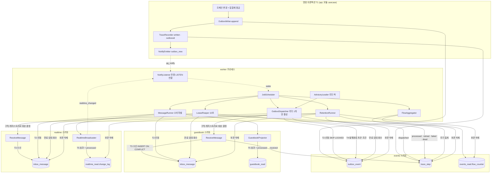

핵심 성질:

- **동기 구간은 T1 까지**다(API p95 목표 구간). 이후는 전부 비동기·재시도 가능이다.
- **정본은 항상 Postgres**다. NOTIFY 는 깨우기 신호일 뿐이라 놓쳐도 폴링이 따라잡는다.
- 전달은 **at-least-once**, 효과는 **inbox 유일 키 + 읽기 모델 필드별 순번(`*_seq`)** 으로 한 번이다(AC-003).

## 2. 통합 클래스 다이어그램

### 2.1 저장·전달 계층

```mermaid
classDiagram
    class EventRegistry {
        +register(type, version, schema) void
        +schemaOf(type, version) TSchema
        +latest(type) int
        +upcasters(type) Upcaster[]
    }
    class EventCodec {
        +encode(event DomainEvent, ctx TraceContext) EventEnvelope
        +decode(raw jsonb) EventEnvelope
    }
    class OutboxWriter {
        <<interface>>
        +append(tx, envelopes) void
    }
    class PostgresOutboxWriter
    class OutboxStore {
        <<interface>>
        +claimBatch(token, owner, limit, leaseSec) OutboxRow[]
        +markPublished(id, token) bool
        +markRetry(id, token, nextAt, err) bool
        +markDead(id, token, err) bool
        +requeueDead(ids) int
        +stats() OutboxStats
    }
    class InboxStore {
        <<interface>>
        +receive(tx, consumer, envelope) bool
        +claim(consumer, token, owner, limit, leaseSec) InboxRow[]
        +complete(tx, consumer, messageId, token) bool
        +fail(consumer, messageId, token, outcome) bool
        +requeueDead(consumer, ids) int
        +stats(consumer) InboxStats
    }
    class ClaimToken {
        <<valueobject>>
        +value Uuid
        +static newToken(ids IdGenerator) ClaimToken
    }
    class Subscription {
        +consumer string
        +moduleName string
        +types string[]
        +matches(type) bool
    }
    class SubscriptionRegistry {
        +register(sub Subscription) void
        +targetsFor(type) Subscription[]
    }
    class ReceiveMessage {
        <<interface>>
        +execute(ctx, envelope) Result
    }
    class EventTransport {
        <<interface>>
        +publish(envelope, targets) DeliveryResult
        +onWake(cb) void
    }
    class PostgresPollingTransport
    class MessageRunner {
        +runOnce(consumer) RunStats
        -handleOne(row) Outcome
    }
    class EventHandler {
        <<interface>>
        +consumer string
        +handles(type) bool
        +apply(tx, envelope) void
    }
    class RetryPolicy {
        +decide(attempts, error AppError) RetryDecision
        +nextDelay(attempts) ms
    }
    class ErrorClassifier {
        +classify(err unknown) AppError
    }
    class TraceRecorder {
        <<interface>>
        +record(tx, traceId, step, ownerKey, detail) void
    }

    EventCodec ..> EventRegistry
    OutboxWriter <|.. PostgresOutboxWriter
    PostgresOutboxWriter ..> EventCodec
    EventTransport <|.. PostgresPollingTransport
    PostgresPollingTransport ..> SubscriptionRegistry
    PostgresPollingTransport ..> ReceiveMessage
    SubscriptionRegistry "1" o-- "*" Subscription
    MessageRunner ..> InboxStore
    MessageRunner ..> EventHandler
    MessageRunner ..> RetryPolicy
    MessageRunner ..> ErrorClassifier
    MessageRunner ..> TraceRecorder
    MessageRunner ..> ClaimToken
    ReceiveMessage ..> InboxStore
```

### 2.2 실행 계층 (잡·리더·깨우기)

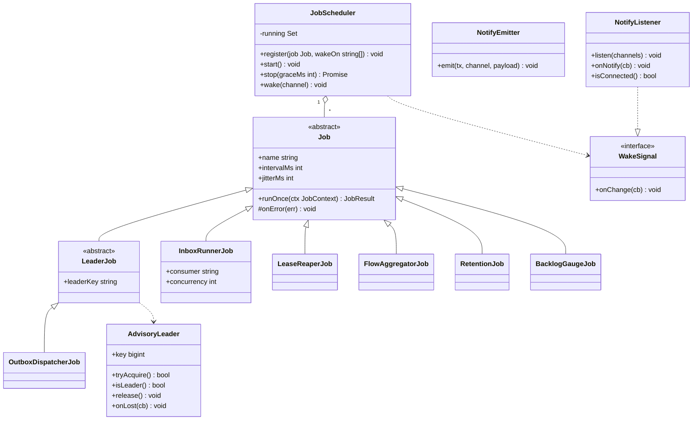

### 2.3 보관·조회 계층

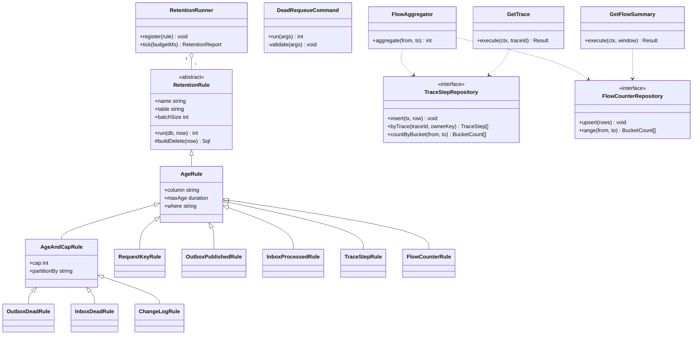

`ChangeLogRule`·`RequestKeyRule` 은 각각 realtime·guestbook 모듈이 **자기 규칙을 등록**한다(테이블 소유 모듈이 삭제 규칙을 소유, 실행은 `RetentionRunner` 한 곳).

## 3. 공통 규약

### 3.1 트랜잭션 경계

| 기호 | 이름 | 주체 | 내용 | 외부 호출 |
|---|---|---|---|---|
| **T1** | 명령 tx | api 명령 usecase | 도메인 변경 + `request_key` + `outbox_event` + `trace_step`(written·outboxed) + `pg_notify('outbox_new')` | 없음 |
| **T2** | 선점 tx | 디스패처·러너·reaper | 조건부 UPDATE 로 `processing` 전이, 곧바로 커밋(**행 잠금을 쥐고 일하지 않는다**) | 없음 |
| **T3** | 수신 tx | 구독 모듈 `ReceiveMessage` | `inbox_message` INSERT(충돌 무시) + `trace_step`(received) + `pg_notify('inbox_new')` | 없음 |
| **T4** | 발행완료 tx | 디스패처 | `outbox_event` 를 `published`(토큰 조건) + `trace_step`(dispatched) | 없음 |
| **T5** | 처리 tx | 러너 | **완료 갱신 먼저**(토큰 조건) → 핸들러 효과 → `trace_step`(processed) → 커밋 | 핸들러가 외부를 부르면 이 tx 밖에서 먼저(M1 핸들러는 외부 호출 없음) |
| **T6** | 실패 tx | 디스패처·러너 | 토큰 조건으로 재시도 예약 또는 `dead` + `trace_step`(failed·retried·dead) | 없음 |

- T3 와 T4 는 **다른 트랜잭션**이다(모듈 경계: 디스패처는 구독 모듈의 공개 usecase `ReceiveMessage` 만 호출, ADR-020). 둘 사이에서 죽으면 outbox 가 `processing` 으로 남고 임대 만료 후 재전달되며, inbox 유일 키가 중복을 흡수한다.
- T5 를 **완료 갱신 먼저** 두는 이유: ① 임대를 잃었으면 효과를 적용하기 전에 0행으로 알아채 롤백한다(효과가 반영되지 않음) ② 갱신한 행의 잠금이 커밋까지 유지되어 같은 순간 reaper 가 그 행을 회수할 수 없다.

### 3.2 선점·완료 SQL

설정 기호: `:token`(`ClaimToken`, 배치당 1개, 앱이 uuid v7 생성), `:owner`(`worker-<host>-<pid>`), `:lease`(초, ADR-023: 30), `:limit`(배치, ADR-023: 50).

**outbox 선점 (T2, 디스패처)** — 같은 집합체의 앞선 미발행 이벤트가 있으면 뒤 이벤트는 가져가지 않는다(§3.3).

```sql
WITH picked AS (
  SELECT o.id
    FROM events.outbox_event o
   WHERE o.status = 'new'
     AND o.next_attempt_at <= now()
     AND NOT EXISTS (                       -- 집합체 단위 선두 규칙
           SELECT 1 FROM events.outbox_event p
            WHERE p.aggregate_id = o.aggregate_id
              AND p.seq < o.seq
              AND p.status IN ('new', 'processing'))
   ORDER BY o.seq
   LIMIT :limit
   FOR UPDATE SKIP LOCKED
)
UPDATE events.outbox_event o
   SET status = 'processing',
       claim_token = :token,
       claimed_by = :owner,
       lease_until = now() + make_interval(secs => :lease),
       attempts = o.attempts + 1
  FROM picked
 WHERE o.id = picked.id
RETURNING o.id, o.seq, o.type, o.payload, o.aggregate_type, o.aggregate_id,
          o.trace_id, o.owner_key, o.attempts;
```

- `RETURNING` 순서는 보장되지 않으므로 앱이 `seq` 로 다시 정렬한다.
- 리더가 하나여도 **`SKIP LOCKED` 와 토큰은 유지**한다(리더 교체 순간의 겹침 방어, ADR-021 항목 8).

**outbox 발행완료 (T4)**

```sql
UPDATE events.outbox_event
   SET status = 'published', published_at = now(),
       claim_token = NULL, claimed_by = NULL, lease_until = NULL
 WHERE id = :id AND claim_token = :token AND status = 'processing';
-- 0행이면 LeaseLostError: 이미 회수됨(다른 주체가 처리). 결과를 버린다.
```

**inbox 선점 (T2, 러너)** — 소비자별·집합체별 선두 규칙. 테이블은 모듈 스키마(`guestbook.inbox_message`, `realtime.inbox_message`)마다 같은 모양이다.

```sql
WITH picked AS (
  SELECT c.consumer, c.message_id
    FROM <m>.inbox_message c
   WHERE c.consumer = :consumer
     AND c.status = 'received'
     AND c.next_attempt_at <= now()
     AND NOT EXISTS (
           SELECT 1 FROM <m>.inbox_message p
            WHERE p.consumer = c.consumer
              AND p.aggregate_id = c.aggregate_id
              AND p.seq < c.seq
              AND p.status IN ('received', 'processing'))
   ORDER BY c.seq
   LIMIT :limit
   FOR UPDATE SKIP LOCKED
)
UPDATE <m>.inbox_message i
   SET status = 'processing', claim_token = :token, claimed_by = :owner,
       lease_until = now() + make_interval(secs => :lease),
       attempts = i.attempts + 1
  FROM picked
 WHERE i.consumer = picked.consumer AND i.message_id = picked.message_id
RETURNING i.*;
```

**inbox 완료 (T5 의 첫 문장)**

```sql
UPDATE <m>.inbox_message
   SET status = 'processed', processed_at = now(),
       claim_token = NULL, claimed_by = NULL, lease_until = NULL
 WHERE consumer = :consumer AND message_id = :id
   AND claim_token = :token AND status = 'processing';
-- 0행 → LeaseLostError → 롤백(핸들러 효과 미적용)
```

**실패 (T6, 공통 모양)**

```sql
UPDATE <m>.inbox_message          -- outbox 는 'received' 대신 'new'
   SET status = CASE WHEN :permanent OR attempts >= :max_attempts THEN 'dead' ELSE 'received' END,
       next_attempt_at = CASE WHEN :permanent OR attempts >= :max_attempts
                              THEN next_attempt_at ELSE now() + make_interval(secs => :delay) END,
       claim_token = NULL, claimed_by = NULL, lease_until = NULL,
       last_error = left(:err, 500)
 WHERE consumer = :consumer AND message_id = :id
   AND claim_token = :token AND status = 'processing'
RETURNING status, attempts;
```

**임대 회수 (reaper)** — 테이블별 같은 문장.

```sql
WITH expired AS (
  SELECT id FROM events.outbox_event
   WHERE status = 'processing' AND lease_until < now()
   ORDER BY lease_until
   LIMIT 200
   FOR UPDATE SKIP LOCKED
)
UPDATE events.outbox_event o
   SET status = CASE WHEN o.attempts >= :max_attempts THEN 'dead' ELSE 'new' END,
       next_attempt_at = now(), claim_token = NULL, claimed_by = NULL, lease_until = NULL,
       last_error = 'lease_expired'
  FROM expired WHERE o.id = expired.id
RETURNING o.id, o.status;
```

### 3.3 순서 보장 범위

| 항목 | 규칙 |
|---|---|
| 보장하는 것 | **같은 집합체(`aggregate_id`)의 이벤트는 `seq` 순서대로** 전달·처리된다(선두 규칙 SQL). 재시도 중인 앞 이벤트가 있으면 뒤 이벤트는 기다린다 |
| 보장하지 않는 것 | 서로 다른 집합체 사이의 순서, 모듈 사이의 처리 완료 순서 |
| `dead` 의 영향 | `dead` 는 선두 규칙의 **차단 대상이 아니다**(운영자가 포기한 이벤트가 영구히 뒤를 막지 않게). 대신 프로젝터가 누락에 안전해야 한다(아래) |
| 쓰는 쪽 의무 | 이벤트를 `append` 하기 **전에** 그 집합체의 행 잠금(`SELECT … FOR UPDATE` / `FOR NO KEY UPDATE` 또는 `pg_advisory_xact_lock(hashtext(aggregate_id))`)을 잡는다. guestbook 의 반응 명령(F11)은 대상 `entry` 행에 `FOR NO KEY UPDATE` 를 잡고 그 **뒤에** outbox 를 append 한다 — 이 규칙이 받아들여진다. 그러면 같은 집합체에 대해 `seq` 순서 = 커밋 순서가 된다 |
| 반응 이벤트 | `reaction.changed` 의 집합체는 **글(`entryId`)** 이다. 이모지가 달라도 같은 글이면 글 행 잠금으로 직렬화해 `count`(변경 후 총개수)가 `seq` 와 같은 순서가 되게 한다 |
| 프로젝터 안전망 | 읽기 모델 필드별 순번(`content_seq` 등)보다 작은 `seq` 는 해당 필드만 무시(AC-017). 대상 행이 없는데 `entry.posted` 가 아닌 이벤트가 오면 `TransientError`(앞 이벤트가 아직 안 온 것으로 보고 재시도, 8회 후 `dead`) |
| 전역 `seq` 구멍 | 시퀀스는 롤백으로 구멍이 생기고 커밋 순서와 달라도 된다. **`seq` 는 비교용이지 연속 번호가 아니다** |

### 3.4 구독 레지스트리

`SubscriptionRegistry` 는 조립(`apps/worker/src/compose`)에서 모듈이 내보낸 `Subscription` 을 모아 만든다. 디스패처는 `targetsFor(type)` 로 대상을 정한다.

| 소비자(`consumer`) | 모듈 | 구독 `type` | 핸들러 |
|---|---|---|---|
| `guestbook-projector` | guestbook | `entry.*`, `reaction.changed`, `report.*` | `GuestbookProjector` |
| `realtime-broadcaster` | realtime | `entry.*`, `reaction.changed` | `RealtimeBroadcaster` |

- 구독 대상이 **0개인 이벤트**는 디스패처가 `ReceiveMessage` 를 호출하지 않고 T4 로 바로 `published` 처리한다(경고 로그 없음 — 정상 경로).
- 새 소비자는 `Subscription` 하나와 `EventHandler` 하나를 등록하면 된다(디스패처·러너 코드는 바뀌지 않는다).
- **한 이벤트가 둘 이상 소비자에게 가는 경우** 디스패처는 대상별 `ReceiveMessage` 를 모두 성공시킨 뒤에만 T4 를 호출한다. 하나라도 실패하면 이벤트 전체가 재시도되고, 이미 받은 쪽은 유일 키로 흡수한다.

### 3.5 시간 규칙 (임대·제한시간·회수)

| 이름 (설정 키) | 값 | 출처 | 규칙 |
|---|---|---|---|
| `lease_seconds` | 30 | ADR-023 | 임대 길이 ≥ 처리 p99 × 10 |
| `handler_timeout_seconds` | 10 | ADR-023 | **≤ lease/2**. 부팅 시 검증, 위반이면 기동 실패 |
| `reaper_interval_seconds` | 10 | ADR-023 | |
| `retry_base_seconds` / `retry_factor` / `retry_cap_seconds` | 1 / 2 / 300 | ADR-023 | 완전 지터: `delay = random(0, min(cap, base × factor^(attempts-1)))` |
| `max_attempts` | 8 | ADR-023 | `attempts` 는 **선점할 때** 증가 |
| `batch_size` | 50 | ADR-023 | 선점 배치 |
| `dispatch_poll_ms` | 1000 | 제안 | NOTIFY 보완 폴링 |
| `runner_poll_ms` | 1000 | 제안 | |
| `runner_concurrency` | 2 / 소비자 | 제안 | 워커 한 프로세스 안 병렬 처리 수 |
| `leader_retry_ms` | 5000 | 제안 | 리더가 아닐 때 락 재시도 |
| `leader_check_ms` | 5000 | 제안 | 리더가 락 연결 생존 확인 |

**핸들러 제한시간 구현**: `MessageRunner` 가 `AbortSignal.timeout(handler_timeout)` 를 핸들러와 포트에 넘기고, 시간 초과 시 tx 를 롤백하며 `TransientError('handler_timeout')` 로 분류한다. 임대 만료 직전에 끝나는 경우의 정합성은 **토큰 조건 완료**가 보장하므로 제한시간은 낭비를 줄이는 장치다. 설정 검증기는 `handler_timeout_seconds * 2 <= lease_seconds` 를 요구한다.

### 3.6 NOTIFY 규칙

| 채널 | 발신 | 수신 | 페이로드 | 용도 |
|---|---|---|---|---|
| `outbox_new` | T1 (`NotifyEmitter`) | worker 디스패처 | 빈 문자열 | outbox 에 새 행 |
| `inbox_new` | T3 | worker 러너 | 소비자 이름 | 해당 소비자 inbox 에 새 행 |
| `realtime_changed` | `RealtimeBroadcaster`(F14) | ws-gateway | 채널명 + 마지막 seq | `change_log` 에 새 행 |
| `trace_changed` | `TraceRecorder`(T1·T3·T4·T5·T6) | ws-gateway | `sha256(ownerKey)` 앞 8자(내부 라우팅 힌트) | private 라우팅 깨우기 |

규칙:

1. **깨우기 신호일 뿐이다.** 수신자는 반드시 DB 를 다시 읽는다(페이로드로 일하지 않는다).
2. 페이로드는 **200바이트 이하**(Postgres 한도 8000 보다 한참 작게), 개인 식별 정보·본문 금지. `trace_changed` 의 해시(`sha256(ownerKey)` 앞 8자)는 라우팅용 단축값일 뿐 ownerKey 원문이 아니다.
3. `pg_notify` 는 **커밋 시점에 전달**된다(롤백되면 신호도 사라진다). 같은 트랜잭션의 동일 채널·동일 페이로드는 Postgres 가 합친다.
4. 수신 쪽은 **50ms 디바운스**로 합친다(제안). 폭주 시 한 번의 읽기로 여러 행을 처리한다.
5. **보완 폴링**: 신호가 없어도 `dispatch_poll_ms`/`runner_poll_ms` 마다 한 번 읽는다. `NotifyListener` 가 재연결하면 즉시 한 번 읽는다.
6. LISTEN 은 **프로세스당 전용 연결 1개**를 쓴다(풀과 분리, 관문 G4). 연결 끊김은 지표 `pf_notify_connected` 로 노출한다.

### 3.7 잡 스케줄

`JobScheduler` 는 잡마다 **겹침 실행을 막고**(이전 실행이 안 끝났으면 건너뜀), `intervalMs ± jitterMs` 로 돌며, 지정한 NOTIFY 채널이 오면 즉시 `runOnce` 를 예약한다. 종료 시 `stop(graceMs)` 로 진행 중인 실행을 기다린다.

| 잡 | 클래스 | 주기 | 깨움 | 리더 전용 | 동시성 |
|---|---|---|---|---|---|
| 디스패처 | `OutboxDispatcherJob` | 1000ms 폴링(제안) | `outbox_new` | **예** (어드바이저리 락) | 1 |
| 러너 | `InboxRunnerJob`(소비자별) | 1000ms(제안) | `inbox_new` | 아니오 | 소비자당 2(제안), 프로세스 여러 개 가능 |
| reaper | `LeaseReaperJob` | **10s** (ADR-023) | — | 아니오 | 1/프로세스, `SKIP LOCKED` 로 안전 |
| 흐름 집계 | `FlowAggregatorJob` | 15s(제안) | — | 아니오 | `pg_try_advisory_xact_lock('pf.flow_agg')` 로 1개만 |
| 보관 정리 | `RetentionJob` | 10min(제안), `change_log` 규칙만 1min(제안) | — | 아니오 | 규칙별 `pg_try_advisory_xact_lock` |
| 적체 지표 | `BacklogGaugeJob` | 5s(제안) | — | 아니오 | 1/프로세스 |

### 3.8 `trace_step` 기록 위치

`TraceRecorder.record(tx, traceId, step, ownerKey, detail)` 는 **events 모듈이 공개하는 포트**다. 각 호출은 **그 단계를 일으키는 트랜잭션 안에서** 한 줄을 추가한다(별도 tx 없음 → 단계와 사실이 어긋나지 않는다).

| `step` | 기록 위치 | 트랜잭션 | `detail`(허용 키만) |
|---|---|---|---|
| `written` | 명령 usecase, 도메인 변경 직후 | T1 | `{ aggregate }` |
| `outboxed` | `OutboxWriter.append` 직후 | T1 | `{ type, seq? }` (seq 는 INSERT RETURNING 값) |
| `dispatched` | 디스패처, 발행완료 갱신과 함께 | T4 | `{ targets: n }` |
| `received` | 구독 모듈 `ReceiveMessage` | T3 | `{ consumer }` |
| `processed` | 러너, 완료와 같은 tx | T5 | `{ consumer, ms }` |
| `retried` | 재시도 예약 | T6 | `{ consumer?, attempt, delayMs }` |
| `failed` | 처리 실패 (재시도·dead 공통, 먼저 기록) | T6 | `{ consumer?, attempt, code }` |
| `dead` | `dead` 전이 | T6 | `{ consumer?, attempts, code }` |

- `detail` 은 **200바이트 이하, 허용 키 화이트리스트**(위 표). **본문·표시 이름·IP 금지**(AC-009, 코드 상수로 검사).
- `owner_key` 는 봉투의 `ownerKey` 를 그대로 복사한다. `ownerKey` 는 내부 행위자 키 그대로(`session:<sessionId>` 또는 `user:<userId>`, 05)이다. 별도 파생·비밀값은 없다.
- `trace_changed` NOTIFY 는 `record` 안에서 같은 tx 로 발신한다.

### 3.9 보관 규칙

보관 정책 정본은 [database-schema.md §9](../../domains/database-schema.md), 수치는 ADR-023 이다. `RetentionRunner.tick(budgetMs)` 가 규칙을 차례로 실행한다.

| 규칙 클래스 | 테이블 | 기준 컬럼 | 보관 | 조건 | 배치 삭제 크기 | 주기 |
|---|---|---|---|---|---|---|
| `OutboxPublishedRule` | `events.outbox_event` | `published_at` | 7일 | `status='published'` | 1000(제안) | 10min |
| `OutboxDeadRule` | `events.outbox_event` | `created_at` | 30일 + 상한 1만 건 | `status='dead'` | 500(제안) | 10min |
| `InboxProcessedRule` | `<m>.inbox_message` (모듈마다) | `processed_at` | 7일 | `status='processed'` | 1000(제안) | 10min |
| `InboxDeadRule` | `<m>.inbox_message` | `received_at` | 30일 + 상한 1만 건 | `status='dead'` | 500(제안) | 10min |
| `TraceStepRule` | `events.trace_step` | `at` | 7일 | — | 2000(제안) | 10min |
| `FlowCounterRule` | `events_read.flow_counter` | `bucket` | 7일 | — | 2000(제안) | 10min |
| `ChangeLogRule` | `realtime_read.change_log` | `created_at` | **1시간** 또는 **채널당 1만 행** 중 먼저 | 채널별 상한 | 1000(제안) | **1min**(제안) |
| `RequestKeyRule` | `guestbook.request_key`·`identity.request_key` | `created_at` | 24시간 | — | 1000(제안) | 10min |
| (ID-10) | `identity.session` 등 | `expires_at` | 만료 즉시 | | | F10 이 소유 |

삭제 방식(공통):

```sql
DELETE FROM events.trace_step
 WHERE ctid IN (SELECT ctid FROM events.trace_step WHERE at < now() - interval '7 days' LIMIT :batch);
-- 배치마다 50ms 쉬고(제안), 한 tick 의 총 시간 상한(budgetMs, 제안 20s)을 넘으면 다음 tick 으로 넘긴다
```

- **동시 실행 방지**: 규칙마다 `pg_try_advisory_xact_lock(hashtext('pf.retention.' || name))` — 못 잡으면 건너뛴다(다른 인스턴스가 실행 중).
- 상한형(`AgeAndCapRule`)은 `row_number() OVER (PARTITION BY <partitionBy> ORDER BY created_at DESC) > cap` 인 행을 지운다(`change_log` 는 `channel` 별, `dead` 는 테이블 단위).
- 읽기 모델·`flow_counter` 삭제는 쓰기 경로와 경합하지 않도록 **작은 배치**로만 지운다.

### 3.10 스키마 반영 요청

| 추가/확인 | 사유 |
|---|---|
| `<m>.inbox_message.aggregate_id` (uuid) 추가 + `(consumer, aggregate_id, seq)` 부분 인덱스(`status IN ('received','processing')`) | 집합체 단위 선두 규칙(§3.2). 현 §4-5 공통 형태에 없음 |
| `events.outbox_event.next_attempt_at` 기본값 `now()`, `(aggregate_id, seq)` 부분 인덱스 | 선점 문장의 조건·선두 규칙 |
| `events.trace_step` 에 `id bigint identity` 추가 + `(trace_id, id)` 인덱스 | 같은 `at` 안의 단계 순서 안정화 (GetTrace 정렬) |
| `inbox_message.next_attempt_at` 기본값 `now()` | 수신 직후 즉시 선점 가능 |

## 4. 기능별 상세

### EV-01 이벤트 기록 (outbox append)

| 항목 | 내용 |
|---|---|
| 목적 | 도메인 변경과 이벤트 기록을 **한 트랜잭션**으로 묶는다(이중 쓰기 제거, AC-002) |
| 트리거 | 명령 usecase(`PostEntry` 등)가 `AggregateRoot.pullEvents()` 결과를 넘겨 호출 |
| 사전 조건 | 같은 `tx` 안에서 집합체 잠금을 이미 잡았다(§3.3). 이벤트는 레지스트리에 등록된 `type`·`schemaVersion` |
| 사후 조건 | `outbox_event` 에 `status='new'` 행 N개, `trace_step`(written·outboxed), 커밋 시 `outbox_new` 신호 |
| 읽기/쓰기 | W: `outbox_event`, `trace_step` |

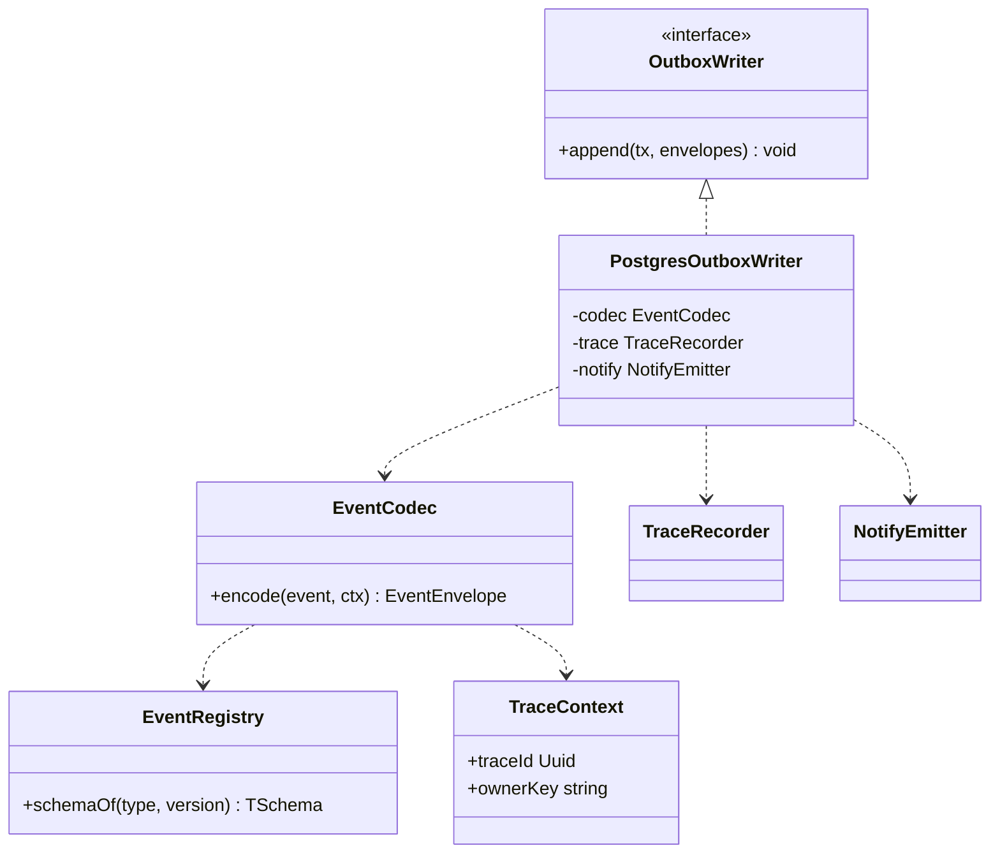

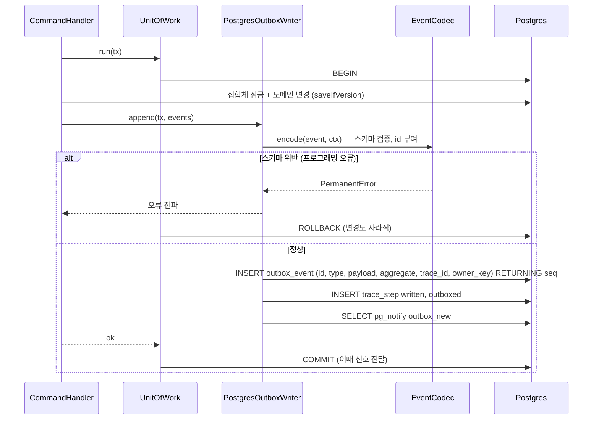

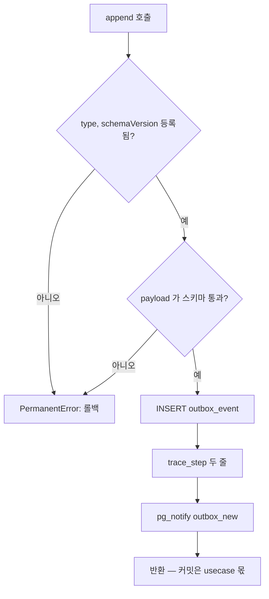

| 항목 | 내용 |
|---|---|
| 오류 | 스키마 위반/미등록 → `PermanentError`(전체 롤백, 500). DB 오류 → `TransientError`(503, 클라이언트가 같은 `Idempotency-Key` 로 재시도) |
| 지표/로그 | `pf_outbox_appended_total{type}`. 로그 `event_id, trace_id, type`(본문 없음) |
| 시험 | 08 §5 `outbox.append` 훅에서 예외 주입 → 글·outbox 모두 없음(**AC-002**). 골든 JSON 인코딩(05 §7). 명령이 잠금 없이 append 하면 경계 시험이 실패하도록 `AggregateLock` 사용 검사 |

### EV-02 디스패처 (리더 선출·선점·전달·발행완료)

| 항목 | 내용 |
|---|---|
| 목적 | outbox 의 `new` 이벤트를 `seq` 순서로 구독 모듈 inbox 에 전달하고 `published` 로 마감한다 |
| 트리거 | `outbox_new` 신호 또는 1000ms 폴링. **리더만** 실행 |
| 사전 조건 | 어드바이저리 락 보유(`AdvisoryLeader.isLeader()`) |
| 사후 조건 | 대상 이벤트가 `published`(모든 대상 inbox 에 `received` 존재) 또는 재시도 예약/`dead` |
| 읽기/쓰기 | RW: `outbox_event`. W: 각 모듈 `inbox_message`(ReceiveMessage 경유), `trace_step` |

**리더 락 규칙** (`AdvisoryLeader`)

| 상황 | 동작 |
|---|---|
| 시작 | 전용 연결에서 `SELECT pg_try_advisory_lock(:key)`; `key = hashtextextended('pf.outbox.dispatcher', 0)` |
| 획득 실패 | 대기자로 `leader_retry_ms` 마다 재시도. 디스패치하지 않음(`pf_leader{job="dispatcher"}=0`) |
| 유지 | 락은 **세션 수준**이라 연결이 살아 있는 동안 유지. `leader_check_ms` 마다 `SELECT 1` 로 생존 확인 |
| 상실(연결 끊김·확인 실패) | 즉시 `isLeader=false`: **새 선점을 중단**, 진행 중인 배치는 끝까지 처리(토큰·임대가 안전망), 락 재획득은 대기자 절차로 |
| 정상 종료 | 진행 중 배치를 마친 뒤 `pg_advisory_unlock` + 연결 종료 → 다른 인스턴스가 곧 획득 |

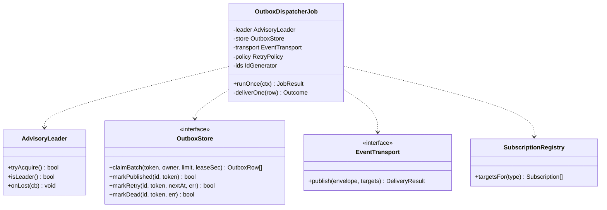

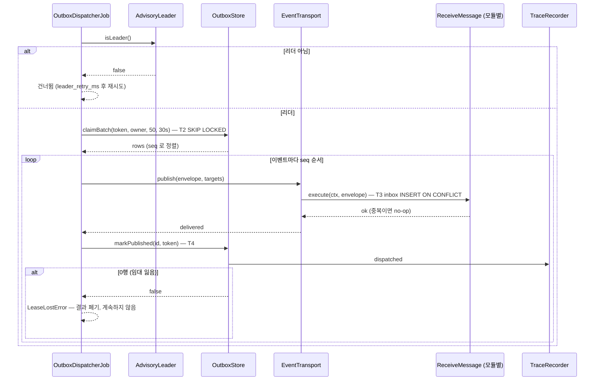

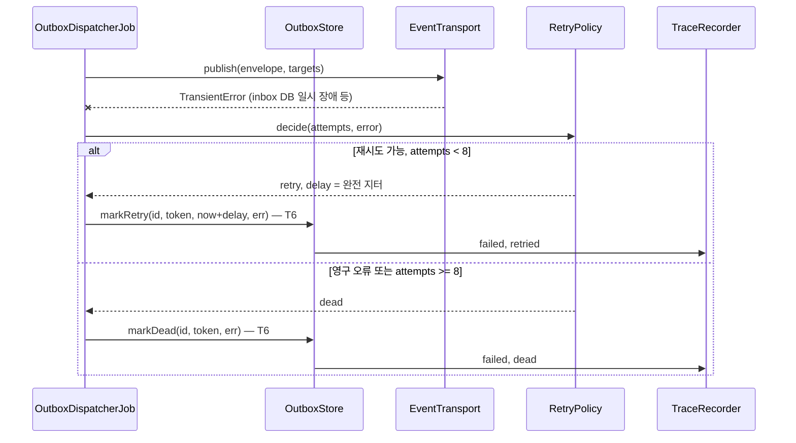

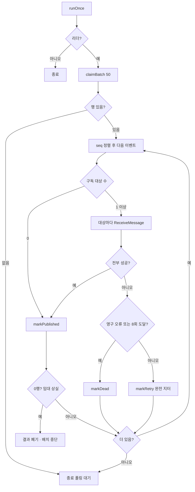

| 항목 | 내용 |
|---|---|
| 오류 | `TransientError` → 재시도, `PermanentError`(스키마 위반 등) → 즉시 `dead`, `LeaseLostError` → 폐기. 리더 상실은 오류가 아니라 정상 전환 |
| 지표/로그 | `pf_leader{job}`, `pf_dispatch_batch_size`, `pf_dispatch_published_total{type}`, `pf_message_attempts_total{consumer="dispatcher",outcome}`, `pf_outbox_pending`, `pf_outbox_oldest_age_seconds`. 로그 `event_id, trace_id, targets, attempt` |
| 시험 | 08 §5.6(단일 활성), §5.1(선점 경쟁), `outbox.afterClaim` 훅으로 전달 직전 정지 → 임대 만료 → 재전달 시 inbox 중복 흡수. 리더 락 연결 강제 종료 → 대기자 인수 |

### EV-03 메시지 수신 (`ReceiveMessage`)

| 항목 | 내용 |
|---|---|
| 목적 | 전달된 이벤트를 **받는 모듈의 inbox 에 저장하고 ack** 한다. 효과는 적용하지 않는다(ADR-020) |
| 트리거 | 디스패처(`EventTransport.publish`)가 구독 모듈의 공개 usecase 호출 |
| 사전 조건 | `envelope` 가 레지스트리 스키마를 통과 |
| 사후 조건 | `(consumer, message_id)` 행이 `received` 로 **하나만** 존재(중복 호출은 no-op) |
| 읽기/쓰기 | W: `<m>.inbox_message`, `trace_step` |

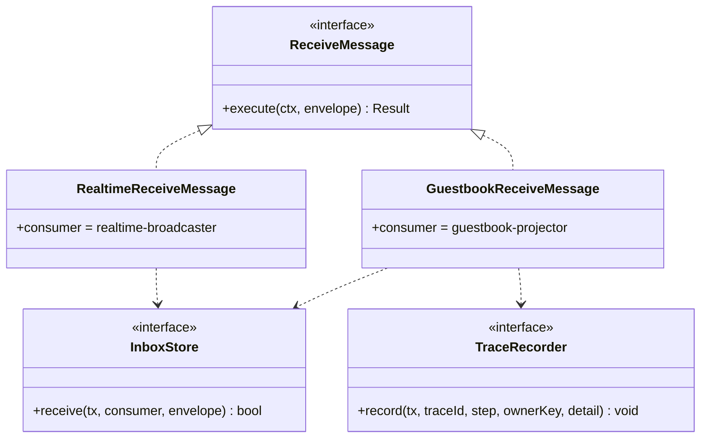

```sql
INSERT INTO <m>.inbox_message
  (consumer, message_id, source, type, seq, aggregate_id, payload, status, received_at, next_attempt_at)
VALUES (:consumer, :id, 'events', :type, :seq, :aggregate_id, :payload, 'received', now(), now())
ON CONFLICT (consumer, message_id) DO NOTHING
RETURNING message_id;   -- 반환 행이 없으면 중복
```

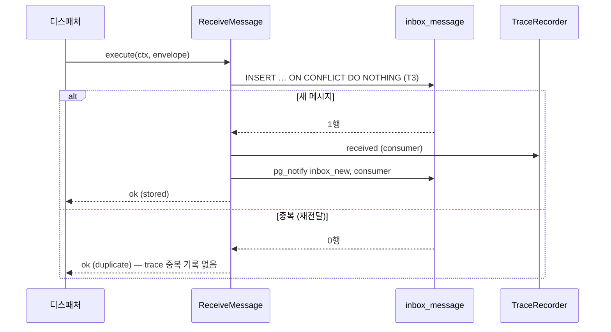

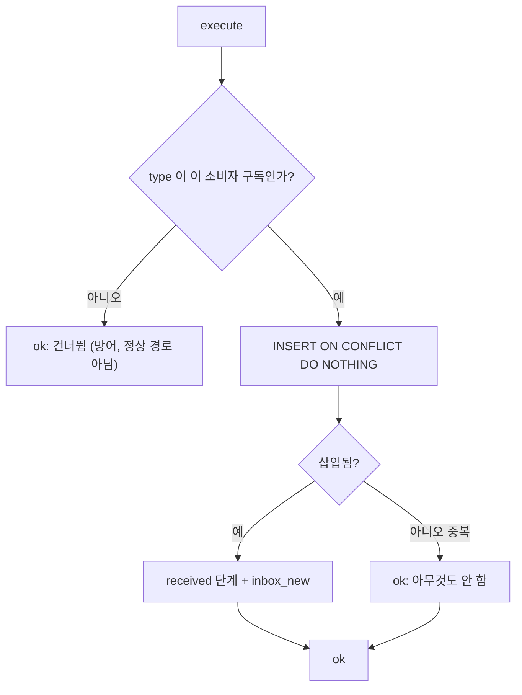

| 항목 | 내용 |
|---|---|
| 오류 | DB 일시 장애 → `TransientError`(디스패처가 재시도). 중복은 오류가 아니다 |
| 지표/로그 | `pf_inbox_received_total{consumer,duplicate}`. 로그 `consumer, message_id, duplicate` |
| 시험 | **AC-003**: 같은 `envelope` 를 N회 호출 → 행 1개, trace `received` 1줄. 동시 N 호출에서도 1개(유일 키가 심판) |

### EV-04 메시지 처리 러너 (선점·핸들러·완료)

| 항목 | 내용 |
|---|---|
| 목적 | inbox 의 `received` 를 선점해 `EventHandler.apply` 로 **효과를 한 번** 적용하고 `processed` 로 마감한다 |
| 트리거 | `inbox_new` 신호 또는 1000ms 폴링. 소비자별 `InboxRunnerJob`(동시성 2, 프로세스 여러 개 가능) |
| 사전 조건 | 핸들러가 등록돼 있고 `handles(type)` |
| 사후 조건 | `processed`(효과 1회 반영) / 재시도 예약 / `dead` / 임대 상실(효과 미반영) |
| 읽기/쓰기 | RW: `<m>.inbox_message` + 핸들러 대상(`entry_view`, `change_log` …), W: `trace_step` |

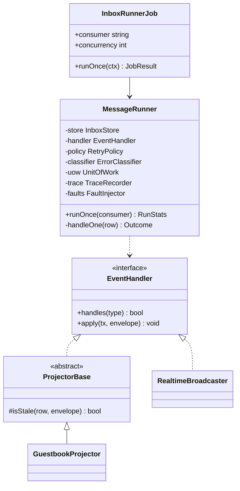

정상 경로와 경합:

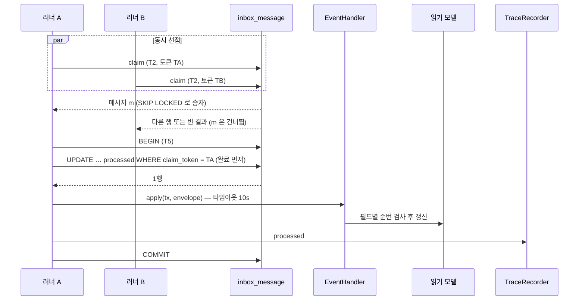

임대 만료 후 늦은 완료 거절 (**fencing, AC-015**):

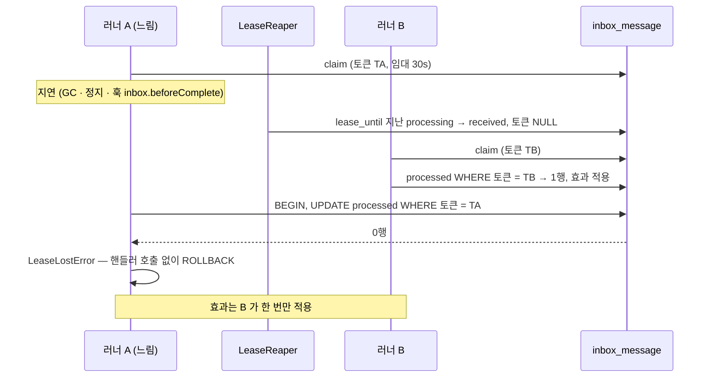

일시 오류 재시도 → `dead`:

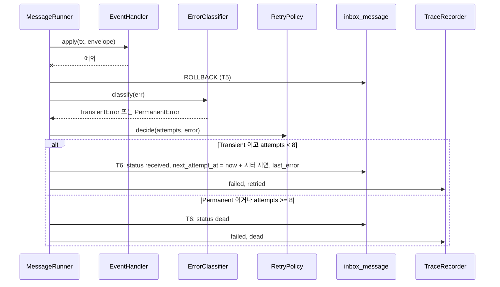

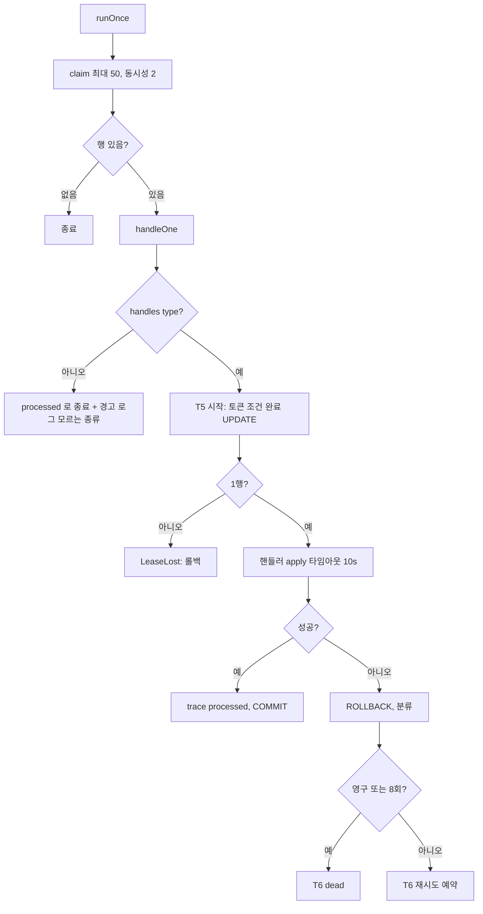

| 항목 | 내용 |
|---|---|
| 오류 분류 | `ErrorClassifier`: `ValidationError`(스키마)·`PermanentError`·버전 높음(05 §5) → 영구. `TransientError`·타임아웃·연결 오류 → 일시. 나머지 미분류 예외 → 일시(8회 후 `dead`) |
| 지표/로그 | `pf_message_handle_seconds{consumer,type}`, `pf_message_attempts_total{consumer,outcome}`(outcome: `processed`·`retried`·`dead`·`lease_lost`·`stale`·`skipped`), `pf_inbox_pending{consumer}`, `pf_inbox_oldest_age_seconds{consumer}`. 로그 `consumer, message_id, trace_id, attempt, outcome, ms` |
| 시험 | **AC-003**(재전달 효과 1회), **AC-015**(08 §5.1 선점 경쟁 N=8, §5.2 fencing: `inbox.beforeComplete` 훅 + `FakeClock` 으로 임대 건너뛰기), 08 §7.1(worker 중단 후 회복), §7.2(dead 이행), §7.3(처리 시간 규칙: `handler_timeout*2<=lease`) |

### EV-05 임대 회수 (reaper)

| 항목 | 내용 |
|---|---|
| 목적 | 죽거나 멈춘 주체가 쥔 `processing` 항목을 되돌려 다른 주체가 가져가게 한다 |
| 트리거 | 10초 주기, 프로세스마다 실행 가능 |
| 사전 조건 | 없음 |
| 사후 조건 | 만료된 `processing` → `new`/`received`(attempts < 8) 또는 `dead`(attempts ≥ 8), 토큰·임대 NULL |
| 읽기/쓰기 | RW: `outbox_event`, 모든 `<m>.inbox_message`; W: `trace_step`(retried / dead) |

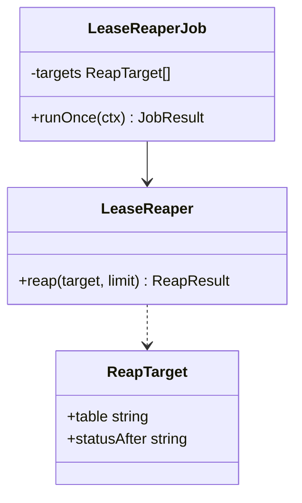

```mermaid
sequenceDiagram
    participant Rp as LeaseReaper
    participant DB as outbox / inbox
    participant TR as TraceRecorder
    Rp->>DB: 만료된 processing 200건 잠금 SKIP LOCKED
    DB-->>Rp: 후보 (다른 reaper 가 잡은 행은 제외)
    Rp->>DB: attempts < 8 이면 new/received, 아니면 dead (last_error = lease_expired)
    DB-->>Rp: 갱신된 행
    Rp->>TR: retried 또는 dead 기록
    Note over Rp,DB: 처리 중이던 주체는 늦게 완료를 시도해도 토큰이 달라 거절된다 (EV-04 fencing)
```

```mermaid
flowchart TD
    A["10초 tick"] --> B["대상 테이블 목록 순회"]
    B --> C["만료 processing 조회 200건"]
    C --> D{"있음?"}
    D -- "아니오" --> E["다음 테이블"]
    D -- "예" --> F{"attempts >= 8?"}
    F -- "예" --> G["dead"]
    F -- "아니오" --> H["new / received, next_attempt_at = now"]
    G --> I["trace + 지표"]
    H --> I
    I --> D
```

| 항목 | 내용 |
|---|---|
| 오류 | DB 일시 장애는 다음 tick 에 재시도(잡은 실패해도 스케줄러 유지) |
| 지표/로그 | `pf_lease_reclaimed_total{table,to}`(to: `retry`·`dead`). 급증하면 임대 설정/핸들러 지연 경보. 로그 `table, count` |
| 시험 | 08 §5.2·§7.1: 만료 후 회수 → 재처리, 회수된 행에 대한 이전 토큰의 완료 거절. 두 reaper 동시 실행에서도 중복 회수 없음 |

### EV-06 재시도·백오프·dead 전이

| 항목 | 내용 |
|---|---|
| 목적 | 실패를 **분류**하고 재시도 시각을 계산하며 `dead` 로 격리한다(FR-032) |
| 트리거 | EV-02·EV-04 실패 경로, EV-05 의 `attempts ≥ 8` 판정 |
| 사전 조건 | `attempts` 는 선점 시 증가돼 있음 |
| 사후 조건 | 재시도 예약(`next_attempt_at`) 또는 `dead` + `last_error`(500자 제한) |
| 읽기/쓰기 | W: `outbox_event`·`inbox_message`·`trace_step` |

```mermaid
classDiagram
    class RetryPolicy {
        -base int
        -factor int
        -cap int
        -maxAttempts int
        -rng Random
        +decide(attempts, error) RetryDecision
        +nextDelay(attempts) ms
    }
    class RetryDecision {
        <<union>>
        retry(delayMs)
        dead(reason)
    }
    class ErrorClassifier {
        +classify(err unknown) AppError
    }
    class AppError {
        <<abstract>>
        +retryable bool
    }
    class TransientError
    class PermanentError
    class LeaseLostError
    AppError <|-- TransientError
    AppError <|-- PermanentError
    TransientError <|-- LeaseLostError
    RetryPolicy ..> RetryDecision
    RetryPolicy ..> AppError
    ErrorClassifier ..> AppError
```

```mermaid
sequenceDiagram
    participant X as 실패 지점
    participant C as ErrorClassifier
    participant P as RetryPolicy
    participant S as Store
    X->>C: classify(err)
    C-->>X: AppError
    X->>P: decide(attempts, error)
    alt LeaseLostError
        P-->>X: 폐기 (갱신하지 않음)
    else Permanent
        P-->>X: dead(permanent)
    else Transient 이고 attempts < maxAttempts
        P-->>X: retry(delayMs)
    else attempts >= maxAttempts
        P-->>X: dead(max_attempts)
    end
    X->>S: 토큰 조건 갱신 (재시도 예약 / dead)
```

```mermaid
flowchart TD
    A["오류 발생"] --> B{"LeaseLostError?"}
    B -- "예" --> Z["갱신하지 않고 결과 폐기"]
    B -- "아니오" --> C{"retryable?"}
    C -- "아니오" --> D["dead permanent"]
    C -- "예" --> E{"attempts >= 8?"}
    E -- "예" --> F["dead max_attempts"]
    E -- "아니오" --> G["delay = random 0..min 300, 1 x 2^attempts-1"]
    G --> H["next_attempt_at = now + delay"]
```

백오프 상한 표(완전 지터의 **최댓값**, 실제 지연은 0 ~ 최댓값 균등):

| attempts | 1 | 2 | 3 | 4 | 5 | 6 | 7 | 8 |
|---|---|---|---|---|---|---|---|---|
| 최댓값(초) | 1 | 2 | 4 | 8 | 16 | 32 | 64 | 128 (그 뒤 dead) |

| 항목 | 내용 |
|---|---|
| 오류 | 분류 불가 예외는 일시로 취급해 8회 후 `dead` — 로그에 `classification=unknown` 을 남겨 규칙 보강 대상으로 삼는다 |
| 지표/로그 | `pf_message_attempts_total{outcome="retried"/"dead"}`, `pf_retry_delay_seconds`(히스토그램). 로그 `attempt, delayMs, code` |
| 시험 | `RetryPolicy` 단위 시험(난수 시드 고정): 지연 ≤ 상한, 8회째 dead, 영구 오류 즉시 dead. 통합: 08 §7.2 dead 이행 |

### EV-07 dead 재투입 (CLI)

| 항목 | 내용 |
|---|---|
| 목적 | 조사 후 `dead` 항목을 다시 처리 대기로 되돌린다(ADR-023: 관리 스크립트, 화면 없음) |
| 트리거 | `bun run worker dead-requeue --table outbox\|inbox --consumer <name> --id <uuid>... \| --since <ISO> [--dry-run]` |
| 사전 조건 | 운영자가 원인(예: 핸들러 버그 수정 배포)을 해결. DB 접근 가능한 환경 |
| 사후 조건 | 대상이 `new`/`received`, `attempts=0`, `next_attempt_at=now()`, `last_error` 는 보존 대신 `requeued:<사유>` 로 교체, 감사 로그 한 줄 |
| 읽기/쓰기 | RW: `outbox_event` 또는 `<m>.inbox_message`; W: `trace_step`(retried, detail `{requeued:true}`) |

```mermaid
classDiagram
    class DeadRequeueCommand {
        -outbox OutboxStore
        -inboxes Map
        -audit AuditLog
        +run(args) int
        -validate(args) void
    }
    class RequeueArgs {
        +table string
        +consumer string?
        +ids Uuid[]
        +since Instant?
        +dryRun bool
        +reason string
    }
    class AuditLog {
        <<interface>>
        +append(actor, action, detail) void
    }
    DeadRequeueCommand ..> RequeueArgs
    DeadRequeueCommand ..> OutboxStore
    DeadRequeueCommand ..> InboxStore
    DeadRequeueCommand ..> AuditLog
```

```mermaid
sequenceDiagram
    participant Op as 운영자
    participant CLI as DeadRequeueCommand
    participant DB as outbox / inbox
    participant TR as TraceRecorder
    Op->>CLI: dead-requeue --table inbox --consumer realtime-broadcaster --since … --reason fix
    CLI->>DB: SELECT dead 대상 (미리보기)
    alt --dry-run
        CLI-->>Op: 대상 N건 목록 출력, 변경 없음
    else 실행
        CLI->>DB: UPDATE status dead → received, attempts 0, next_attempt_at now (WHERE status = dead)
        DB-->>CLI: 갱신 M건
        CLI->>TR: retried (requeued)
        CLI-->>Op: M건 재투입, 종료 코드 0
    end
```

```mermaid
flowchart TD
    A["인자 검증"] --> B{"table, 조건 지정?"}
    B -- "아니오" --> E["오류 종료 2"]
    B -- "예" --> C["대상 dead 조회"]
    C --> D{"0건?"}
    D -- "예" --> F["종료 0 대상 없음"]
    D -- "아니오" --> G{"dry-run?"}
    G -- "예" --> H["목록만 출력"]
    G -- "아니오" --> I{"500건 초과?"}
    I -- "예" --> J["--force 없으면 거부"]
    I -- "아니오" --> K["UPDATE WHERE status = dead"]
    K --> L["trace + 감사 로그 + 결과 출력"]
```

| 항목 | 내용 |
|---|---|
| 오류 | 인자 오류 종료코드 2, 대상 없음 0, DB 오류 1. `WHERE status='dead'` 조건이라 이미 되돌려진 항목은 건너뜀(멱등) |
| 지표/로그 | `pf_dead_requeued_total{table}`. 감사 로그 `actor(os user), table, count, reason` |
| 시험 | 08 §7.2: dead 만들기 → 재투입 → 정상 처리 → `processed`. `--dry-run` 이 변경하지 않음. 500건 초과 거부 |

### EV-08 흐름 단계 기록 (`TraceRecorder`)

| 항목 | 내용 |
|---|---|
| 목적 | 한 이벤트(`traceId`)가 지나는 단계를 **사실과 같은 트랜잭션으로** 남겨 시각화(FR-040)와 집계(FR-041)의 입력을 만든다 |
| 트리거 | EV-01·02·03·04·05·06 의 각 단계(§3.8 표) |
| 사전 조건 | 호출자가 열린 `tx` 를 넘긴다 |
| 사후 조건 | `trace_step` 한 줄 추가(추가 전용), 커밋 시 `trace_changed` 신호 |
| 읽기/쓰기 | W: `events.trace_step` |

```mermaid
classDiagram
    class TraceRecorder {
        <<interface>>
        +record(tx, traceId, step, ownerKey, detail) void
    }
    class PostgresTraceRecorder {
        -notify NotifyEmitter
        -clock Clock
        -ids IdGenerator
    }
    class TraceStep {
        <<enumeration>>
        written
        outboxed
        dispatched
        received
        processed
        retried
        failed
        dead
    }
    class TraceDetailPolicy {
        +allowedKeys(step) string[]
        +sanitize(step, detail) object
    }
    TraceRecorder <|.. PostgresTraceRecorder
    PostgresTraceRecorder ..> TraceDetailPolicy
    PostgresTraceRecorder ..> TraceStep
```

```mermaid
sequenceDiagram
    participant X as 호출 단계
    participant R as PostgresTraceRecorder
    participant P as TraceDetailPolicy
    participant DB as trace_step
    X->>R: record(tx, traceId, step, ownerKey, detail)
    R->>P: sanitize(step, detail)
    P-->>R: 허용 키만, 200바이트 이하
    R->>DB: INSERT trace_step (trace_id, step, at, detail, owner_key) — 호출자의 tx
    R->>DB: pg_notify trace_changed, hash8(ownerKey)
    R-->>X: 반환
```

```mermaid
flowchart TD
    A["record 호출"] --> B{"허용된 step 값?"}
    B -- "아니오" --> E["PermanentError 프로그래밍 오류"]
    B -- "예" --> C["detail 화이트리스트 필터"]
    C --> D{"200바이트 이하?"}
    D -- "아니오" --> F["초과 키 제거 후 경고 로그"]
    D -- "예" --> G["INSERT + NOTIFY"]
    F --> G
```

| 항목 | 내용 |
|---|---|
| 오류 | 기록 실패는 호출자의 tx 를 실패시킨다(사실과 기록의 일치 우선) — 단 `retried`/`failed` 기록 실패는 재시도 갱신 자체를 막지 않도록 같은 tx 에서 `SAVEPOINT` 로 감싸 **기록만 건너뛰고 경고**한다(제안) |
| 지표/로그 | `pf_trace_steps_total{step}`. `detail` 은 로그에 남기지 않는다 |
| 시험 | 단계 순서 시험(한 글 작성 → written·outboxed·dispatched·received·processed 순). **AC-009**: 허용 키 밖 값이 들어가면 걸러짐, 본문 문자열이 `detail` 에 없음을 구조 검사 |

### EV-09 흐름 집계 (`FlowAggregator`)

| 항목 | 내용 |
|---|---|
| 목적 | `trace_step` 을 **분 단위 개수**로 집계해 다른 방문자에게는 식별자 없이 개수만 보이게 한다(FR-041, AC-009) |
| 트리거 | 15초 주기 (이벤트 구동이 아닌 **배치 프로젝션**) |
| 사전 조건 | `pg_try_advisory_xact_lock('pf.flow_agg')` 획득(한 인스턴스만) |
| 사후 조건 | 최근 3분 버킷이 현재 `trace_step` 기준 개수로 **덮어써짐**(멱등) |
| 읽기/쓰기 | R: `trace_step`; W: `events_read.flow_counter` |

```mermaid
classDiagram
    class FlowAggregatorJob {
        +runOnce(ctx) JobResult
    }
    class FlowAggregator {
        -steps TraceStepRepository
        -counters FlowCounterRepository
        -clock Clock
        +aggregate(from, to) int
    }
    class BucketCount {
        +bucket Instant
        +step string
        +count int
    }
    FlowAggregatorJob --> FlowAggregator
    FlowAggregator ..> TraceStepRepository
    FlowAggregator ..> FlowCounterRepository
    FlowAggregator ..> BucketCount
```

```sql
INSERT INTO events_read.flow_counter (bucket, step, count)
SELECT date_trunc('minute', at) AS bucket, step, count(*)
  FROM events.trace_step
 WHERE at >= :from AND at < :to
 GROUP BY 1, 2
ON CONFLICT (bucket, step) DO UPDATE SET count = EXCLUDED.count;
-- :from = 현재 분 - 2분(=최근 3개 버킷), :to = 현재 시각. 늦게 도착한 단계를 덮어쓰기로 흡수
```

```mermaid
sequenceDiagram
    participant J as FlowAggregatorJob
    participant DB as Postgres
    participant A as FlowAggregator
    J->>DB: pg_try_advisory_xact_lock(pf.flow_agg)
    alt 못 잡음
        DB-->>J: false
        J-->>J: 건너뜀
    else 잡음
        J->>A: aggregate(now-3min, now)
        A->>DB: SELECT bucket, step, count GROUP BY
        A->>DB: UPSERT flow_counter (덮어쓰기)
        A-->>J: 갱신 N행
    end
```

```mermaid
flowchart TD
    A["tick"] --> B{"락 획득?"}
    B -- "아니오" --> Z["건너뜀"]
    B -- "예" --> C["from = floor-minute now - 2m"]
    C --> D["GROUP BY 분, step"]
    D --> E["UPSERT 덮어쓰기"]
    E --> F["지표 갱신, 종료"]
```

- `flow_counter` 는 **개수만** 담는다(트레이스·소유자 정보 없음) → 구조적으로 개인 식별이 새지 않는다.
- 서버가 재시작해 공백이 생기면 최근 3분 외 구간은 채워지지 않는다(허용: 표시용 근사). 필요 시 `--backfill <분>` 옵션(미결).

| 항목 | 내용 |
|---|---|
| 오류 | 실패하면 다음 tick 이 같은 구간을 다시 덮어쓴다(자가 치유) |
| 지표/로그 | `pf_flow_agg_rows`, `pf_job_duration_seconds{job="flow_agg"}` |
| 시험 | 같은 구간 재집계해도 결과 동일(멱등). 늦은 `processed` 가 들어와도 다음 tick 에 반영. 두 인스턴스 동시 실행에서 한 쪽만 실행 |

### EV-10 보관 정리 (`RetentionRunner`)

| 항목 | 내용 |
|---|---|
| 목적 | §3.9 규칙대로 오래된 행을 **작은 배치**로 삭제해 디스크와 인덱스를 지킨다(FR-080, AC-011) |
| 트리거 | 10분 주기(`change_log` 규칙은 1분) |
| 사전 조건 | 규칙별 `pg_try_advisory_xact_lock` 획득 |
| 사후 조건 | 기준을 넘긴 행 삭제(상한형은 초과분 삭제). 삭제 건수를 지표로 남김 |
| 읽기/쓰기 | D: §3.9 표의 테이블 |

```mermaid
classDiagram
    class RetentionRunner {
        -rules RetentionRule[]
        +register(rule) void
        +tick(budgetMs) RetentionReport
    }
    class RetentionRule {
        <<abstract>>
        +name string
        +batchSize int
        +run(db, now) int
    }
    class AgeRule {
        +column string
        +maxAge duration
    }
    class AgeAndCapRule {
        +cap int
        +partitionBy string
    }
    class RetentionReport {
        +deleted Map
        +skipped string[]
        +elapsedMs int
    }
    RetentionRunner "1" o-- "*" RetentionRule
    RetentionRule <|-- AgeRule
    AgeRule <|-- AgeAndCapRule
    RetentionRunner ..> RetentionReport
```

```mermaid
sequenceDiagram
    participant J as RetentionJob
    participant R as RetentionRunner
    participant Ru as RetentionRule
    participant DB as Postgres
    J->>R: tick(budget 20s)
    loop 규칙마다
        R->>DB: pg_try_advisory_xact_lock(retention.name)
        alt 락 실패
            R-->>R: skipped 기록
        else 락 성공
            loop 배치 (예산 안에서)
                R->>Ru: run(db, now)
                Ru->>DB: DELETE … WHERE ctid IN (SELECT ctid … LIMIT batch)
                DB-->>Ru: 삭제 n
                Note over R: n < batch 이면 규칙 종료, 아니면 50ms 쉬고 반복
            end
        end
    end
    R-->>J: RetentionReport
```

```mermaid
flowchart TD
    A["tick"] --> B["규칙 순회"]
    B --> C{"락 획득?"}
    C -- "아니오" --> S["skipped"]
    C -- "예" --> D{"예산 남음?"}
    D -- "아니오" --> T["다음 tick 으로 이월"]
    D -- "예" --> E["배치 삭제"]
    E --> F{"삭제 수 == 배치 크기?"}
    F -- "예" --> G["50ms 대기"]
    G --> D
    F -- "아니오" --> H["규칙 종료"]
    H --> B
```

| 항목 | 내용 |
|---|---|
| 오류 | 규칙 하나의 실패가 다른 규칙을 막지 않는다(격리, 경고 로그 후 계속). 장시간 테이블 잠금 방지를 위해 배치 크기·예산을 둔다 |
| 지표/로그 | `pf_retention_deleted_total{rule}`, `pf_retention_skipped_total{rule}`, `pf_retention_lag_seconds{rule}`(가장 오래된 행의 초과 시간) |
| 시험 | **AC-011**: `FakeClock` 을 8일 뒤로 → 7일 초과 `published`·`processed`·`trace_step` 삭제, `dead` 는 30일까지 유지, 글은 보존. 상한형: 10,001건 → 1건 삭제. 동시 실행 안전 |

### EV-11 흐름 상세 조회 (`GetTrace`)

| 항목 | 내용 |
|---|---|
| 목적 | **본인의** 한 흐름(`traceId`) 단계 목록을 돌려준다(private 소켓을 놓쳤을 때의 보충, 04 §5) |
| 트리거 | `GET /api/flow/trace/{traceId}` |
| 사전 조건 | 행위자 컨텍스트(익명 포함). `traceId` 형식 uuid |
| 사후 조건 | 본인 `ownerKey` 와 일치할 때만 단계 목록. **불일치·없음은 동일하게 404**(존재 여부 비노출) |
| 읽기/쓰기 | R: `trace_step` |

```mermaid
classDiagram
    class GetTrace {
        -repo TraceStepRepository
        +execute(ctx, traceId) Result
    }
    class TraceView {
        +steps TraceStepView[]
    }
    class TraceStepView {
        +step string
        +at Instant
        +detail object?
    }
    GetTrace ..> TraceStepRepository
    GetTrace ..> TraceView
```

```mermaid
sequenceDiagram
    participant B as 브라우저
    participant A as api
    participant Q as GetTrace
    participant DB as trace_step
    B->>A: GET /api/flow/trace/{traceId}
    A->>Q: execute(ctx, traceId)
    Q->>Q: ownerKey = actor.actorKey
    Q->>DB: SELECT … WHERE trace_id = :id AND owner_key = :ownerKey ORDER BY at, id
    alt 행 없음 (없거나 남의 것)
        DB-->>Q: 빈 결과
        Q-->>A: NotFoundError
        A-->>B: 404
    else 있음
        DB-->>Q: steps
        Q-->>A: TraceView
        A-->>B: 200 { steps }
    end
```

```mermaid
flowchart TD
    A["요청"] --> B{"traceId 형식 uuid?"}
    B -- "아니오" --> E1["400 validation_failed"]
    B -- "예" --> C["ownerKey 계산"]
    C --> D["owner_key 일치 조건으로 조회"]
    D --> F{"1행 이상?"}
    F -- "아니오" --> E2["404"]
    F -- "예" --> G["200 단계 목록 시간순"]
```

| 항목 | 내용 |
|---|---|
| 오류 | 형식 → 400, 소유 불일치/없음 → 404 |
| 지표/로그 | HTTP 지표(OB-01)만. `traceId` 는 로그 허용, 지표 레이블 금지 |
| 시험 | **AC-009**: 다른 세션이 남의 `traceId` 를 조회 → 404(존재 응답과 구별 불가). 정렬 안정성(같은 `at` 의 단계가 `id` 순) |

### EV-12 흐름 요약 조회 (`GetFlowSummary`)

| 항목 | 내용 |
|---|---|
| 목적 | 전체 방문자 활동을 **개수만** 반환해 시각화의 "익명 요약"을 채운다 |
| 트리거 | `GET /api/flow/summary?window=5m\|1h`, 그리고 ws-gateway 의 스냅샷 구성(F14 RT-05) |
| 사전 조건 | 없음(익명 허용) |
| 사후 조건 | `{ buckets: [{ at, step, count }] }` — 식별자·내용 필드가 **구조적으로 없다** |
| 읽기/쓰기 | R: `events_read.flow_counter` |

```mermaid
classDiagram
    class GetFlowSummary {
        -repo FlowCounterRepository
        -clock Clock
        +execute(ctx, window) Result
    }
    class FlowWindow {
        <<enumeration>>
        m5
        h1
    }
    class FlowSummaryView {
        +buckets FlowBucket[]
    }
    class FlowBucket {
        +at Instant
        +step string
        +count int
    }
    GetFlowSummary ..> FlowCounterRepository
    GetFlowSummary ..> FlowWindow
    GetFlowSummary ..> FlowSummaryView
    FlowSummaryView "1" o-- "*" FlowBucket
```

```mermaid
sequenceDiagram
    participant B as 브라우저
    participant A as api
    participant Q as GetFlowSummary
    participant DB as flow_counter
    B->>A: GET /api/flow/summary?window=5m
    A->>Q: execute(ctx, window)
    Q->>DB: SELECT bucket, step, count WHERE bucket >= now - window ORDER BY bucket
    DB-->>Q: 행들 (최대 5×8 또는 60×8)
    Q-->>A: FlowSummaryView
    A-->>B: 200 (Cache-Control: no-store)
```

```mermaid
flowchart TD
    A["요청"] --> B{"window 값?"}
    B -- "5m 또는 1h" --> C["하한 시각 계산"]
    B -- "그 외" --> E["400"]
    C --> D["flow_counter 범위 조회"]
    D --> F["bucket,step 로 정렬해 반환"]
```

| 항목 | 내용 |
|---|---|
| 오류 | `window` 위반 400 |
| 지표/로그 | HTTP 지표만 |
| 시험 | **AC-009**: 응답 스키마에 `traceId`·`ownerKey` 필드가 없음(스키마 구조 검사). 빈 구간은 빈 배열 |

### EV-13 깨우기 신호 (`NotifyEmitter` / `NotifyListener`)

| 항목 | 내용 |
|---|---|
| 목적 | 폴링 지연 없이 일을 깨우되, **신호가 없어도 폴링이 보완**하게 한다(FR-030) |
| 트리거 | 발신: T1·T3·T4/T5 의 `pg_notify`. 수신: LISTEN 전용 연결 |
| 사전 조건 | 수신 프로세스마다 전용 연결 1개 |
| 사후 조건 | 해당 잡이 즉시 한 번 실행 예약(디바운스 50ms) |
| 읽기/쓰기 | 없음(Postgres NOTIFY) |

```mermaid
classDiagram
    class NotifyEmitter {
        +emit(tx, channel, payload) void
    }
    class NotifyListener {
        -conn PgConnection
        -backoff ReconnectPolicy
        +listen(channels) void
        +onNotify(cb) void
        +isConnected() bool
    }
    class WakeSignal {
        <<interface>>
        +onChange(cb) void
    }
    class Debouncer {
        +ms int
        +trigger(key) void
    }
    class JobScheduler {
        +wake(channel) void
    }
    NotifyListener ..|> WakeSignal
    NotifyListener ..> Debouncer
    NotifyListener ..> JobScheduler
```

```mermaid
sequenceDiagram
    participant U as T1 명령 tx
    participant PG as Postgres
    participant NL as NotifyListener
    participant D as Debouncer
    participant S as JobScheduler
    participant J as 디스패처 잡
    U->>PG: pg_notify outbox_new (tx 안)
    U->>PG: COMMIT
    PG-->>NL: NOTIFY outbox_new
    NL->>D: trigger(outbox_new)
    D->>S: 50ms 뒤 wake(outbox_new)
    S->>J: runOnce (즉시)
    Note over S,J: 신호를 잃어도 1000ms 폴링이 같은 일을 한다
```

```mermaid
flowchart TD
    A["NotifyListener 시작"] --> B["전용 연결 LISTEN 채널들"]
    B --> C{"연결 유지?"}
    C -- "예" --> D["NOTIFY 수신 → 디바운스 → wake"]
    D --> C
    C -- "끊김" --> E["백오프 재연결 1s 부터 2배 상한 30s"]
    E --> F["재연결 즉시 모든 잡 한 번 실행 (놓친 신호 보충)"]
    F --> B
```

| 항목 | 내용 |
|---|---|
| 오류 | 연결 끊김 → 재연결 + 즉시 보충 실행. LISTEN 불가(풀러 등) → 폴링만으로 계속 동작(지표로 가시화) |
| 지표/로그 | `pf_notify_connected`(0/1), `pf_notify_wakeups_total{channel,source}`(source: `notify`·`poll`), 재연결 횟수 |
| 시험 | 08 §5·G4: NOTIFY 차단 상태에서도 폴링으로 전달됨. 재연결 후 즉시 보충. 디바운스가 폭주 신호를 합침 |

## 5. 총괄

### 5.1 지표 목록 (레이블에 식별자 금지)

| 지표 | 종류 | 레이블 |
|---|---|---|
| `pf_outbox_appended_total` | counter | `type` |
| `pf_outbox_pending` / `pf_outbox_dead` | gauge | — |
| `pf_outbox_oldest_age_seconds` | gauge | — |
| `pf_inbox_received_total` | counter | `consumer`, `duplicate` |
| `pf_inbox_pending` / `pf_inbox_dead` | gauge | `consumer` |
| `pf_inbox_oldest_age_seconds` | gauge | `consumer` |
| `pf_dispatch_batch_size` | histogram | — |
| `pf_dispatch_published_total` | counter | `type` |
| `pf_message_handle_seconds` | histogram | `consumer`, `type` |
| `pf_message_attempts_total` | counter | `consumer`, `outcome` |
| `pf_event_end_to_end_seconds` | histogram | `consumer` (outbox `created_at` → 처리 완료) |
| `pf_lease_reclaimed_total` | counter | `table`, `to` |
| `pf_leader` | gauge | `job` |
| `pf_job_runs_total` / `pf_job_duration_seconds` | counter / histogram | `job`, `result` |
| `pf_retention_deleted_total` / `pf_retention_lag_seconds` | counter / gauge | `rule` |
| `pf_flow_agg_rows` | gauge | — |
| `pf_notify_connected` / `pf_notify_wakeups_total` | gauge / counter | `channel`, `source` |
| `pf_trace_steps_total` | counter | `step` |

(OB-02 가 이 목록을 도메인 지표로 노출한다. 대시보드 패널 구성은 F17.)

### 5.2 로그 필드

모든 로그: `ts, level, module="events", job, event_id?, trace_id?, consumer?, attempt?, outcome?, ms?`. **본문·표시 이름·IP·토큰은 남기지 않는다**(design/00 §5).

### 5.3 시험 매트릭스

| 시험 | 대상 | 근거(08) | 등급 |
|---|---|---|---|
| append 롤백 시 이벤트 없음 | EV-01 | §5 `outbox.append` 훅 / **AC-002** | L3 |
| 선점 경쟁 N=8 → 효과 1회 | EV-02·04 | §5.1 / **AC-015** | L3 |
| 임대 만료 후 늦은 완료 거절 | EV-04·05 | §5.2 / **AC-015** | L3 |
| 디스패처 단일 활성, 리더 인수 | EV-02 | §5.6 | L3 |
| 같은 envelope 중복 수신 | EV-03 | **AC-003** | L3 |
| 일시 오류 재시도 → dead → 재투입 | EV-06·07 | §7.2 | L3 |
| worker 중단 후 적체 회복 | EV-02·04 | §7.1 | L3 |
| 핸들러 제한시간 ≤ 임대/2 설정 검증 | EV-04 | §7.3 | L2 |
| 집합체 순서(재시도 중 앞 이벤트가 뒤를 막음) | EV-02·04 | 신규 시험 제안 | L3 |
| 보관 정리(7일/30일/상한) | EV-10 | **AC-011** | L3 |
| 흐름 집계 멱등 | EV-09 | 신규 | L3 |
| 흐름 요약·조회 프라이버시 | EV-11·12 | §8 / **AC-009** | L2·L3 |
| NOTIFY 유실 시 폴링 보완 | EV-13 | 신규 | L3 |

### 5.4 미결

| 항목 | 결정 시점 |
|---|---|
| `runner_concurrency`·`dispatch_poll_ms` 등 제안 값 조정 | 부하 시험(AC-013) 후 |
| 집계 백필 옵션(`--backfill`) 도입 여부 | 운영 중 공백이 문제될 때 |
| 프로젝터의 "대상 행 없음" 재시도(`TransientError`) 상한 | F12 상세 설계 시 |
