# F14. realtime 상세 설계 (RT-01 ~ RT-16)

`realtime` 모듈(worker 쪽 `realtime-broadcaster`)과 `apps/ws-gateway` 의 구현 수준 설계다.
정본 계약은 [04 WS 프로토콜](../04-ws-protocol.md), 이벤트는 [05](../05-event-catalog.md), 세션은 [06](../06-auth.md), 기능 ID 는 [F00](00-feature-catalog.md).
근거 ADR: 003(실시간) · 014(재접속·무중단) · 018(읽기 모델) · 022(ws-gateway 언어 측정) · 023(보관·알림) · 024(포트 이음새).

> 다이어그램 해당 여부 — 아키텍처·통합 클래스·기능별 클래스/시퀀스/순서도를 모두 둔다. 상속 구조는 `SocketHandler`·`SocketRuntime`·메시지 계층에서 쓴다.

## 0. 이 문서가 확정하는 것 (결정 요약)

| # | 결정 | 근거 |
|---|---|---|
| D1 | **seq 는 채널 카운터 행**(`UPDATE … RETURNING`)으로 부여한다. 트랜잭션이 끝날 때까지 행 잠금이 유지되므로 **seq 순서 = 커밋 순서**다 | §3.2 |
| D2 | `realtime-broadcaster` 는 소비자 락 없이 러너 여러 개가 돌 수 있다. **같은 집합체(글)의 이벤트 순서는 F13 의 집합체 선두 규칙이 보장**하고, 서로 다른 집합체 사이의 `change_log` 순서는 뒤바뀌어도 된다(클라이언트는 `entryId` 단위로 적용, `seq` 는 구멍 없는 채널 순번일 뿐) | §3.2, RT-01 |
| D3 | 휘발성 메시지(`presence`, `flow.summary`)는 **`seq` 가 없고 `change_log` 에도 쓰지 않는다**. 재개 시 최신값을 한 번 보낸다 | RT-09, RT-14 |
| D4 | ws-gateway 는 **`SocketRuntime` 인터페이스** 뒤에서 동작한다. Elysia 는 HTTP(`/healthz`·`/readyz`·`/metrics`)와 업그레이드 사전 검사에만 쓰고, WS 송수신·큐는 앱 코드가 관리한다. G2 에서 `ElysiaRuntime` 과 `BunServeRuntime` 중 하나를 확정한다 | §3.1, ADR-022 |
| D5 | private 의 `flow.step` 신호는 **NOTIFY + `trace_step.id` 커서 읽기 + 1초 폴링 보완** | §3.3 |
| D6 | 같은 `(entryId, emoji)` 의 대기 중 `reaction.updated` 는 합치되, 건너뛴 `seq` 를 남은 메시지의 **`sk`(skipped) 배열**로 알린다(04 수정 요청) | §3.4, RT-06 |
| D7 | 공개 메시지는 **순수 함수 `PublicMessageMapper`**(DB 접근 없음)가 만든다. 그래서 `entry.updated` 는 부분 갱신(`entryId`, `body`, `updatedAt`, `version`), 숨김 해제는 `entry.restored`(04 수정 요청) | RT-01, RT-16 |
| D8 | 같은 메시지는 **전체 구독자에게 한 번만 직렬화**해 같은 문자열을 보낸다 | §3.5 |
| D9 | 세션 검증 캐시 30초 + **연결별 30초 재검증**으로 회전·폐기 시 `4401` | RT-13 |
| D10 | 한 세션의 private 연결 상한 3 → 초과 시 가장 오래된 연결을 `4409`. 전역 상한(`WS_MAX_CONNECTIONS`)은 **미정** | RT-15 |

## 1. 아키텍처

### 1.1 컴포넌트와 데이터 경로

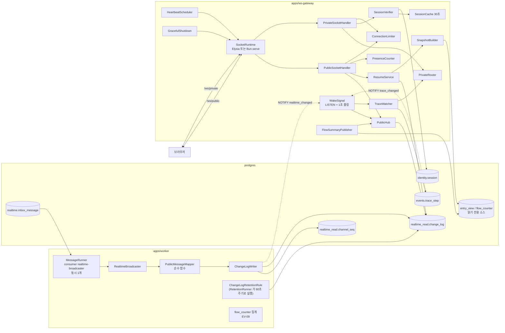

### 1.2 경로 요약

| 경로 | 흐름 | 일관성 |
|---|---|---|
| 공개 변경 | outbox → inbox → `RealtimeBroadcaster` → `change_log`(+NOTIFY) → `WakeSignal` → `PublicHub` → 각 연결 `SendQueue` | 결과적, 지연 목표 1초 이내(NOTIFY 경로) |
| 비공개 흐름 | `trace_step` 기록(EV-08) → NOTIFY → `TraceWatcher` → `PrivateRouter` → 해당 소유자의 연결 | best-effort, 놓치면 REST(`GET /api/flow/trace`)로 보충 |
| 재개 | `hello.resume` → `ResumeService` → `change_log` 재생 또는 스냅샷 | `change_log` 보관(1시간·1만 행) 안에서 재생 |
| 휘발성 | 타이머 → `PresenceCounter`/`FlowSummaryPublisher` → 허브 | 최신값만 의미 |

### 1.3 프로세스 경계

| 프로세스 | realtime 책임 | 쓰는 DB 객체 |
|---|---|---|
| `apps/worker` | broadcaster(소비자), 변경 이력 기록·정리 | `realtime.inbox_message` W, `channel_seq` W, `change_log` W/D |
| `apps/ws-gateway` | 소켓·허브·재개·스냅샷·private 라우팅 | `change_log` R, `entry_view`·`flow_counter` R(스냅샷), `trace_step` R(**events 공개 포트 `TraceReader`** 경유 — 테이블 직접 SQL 아님), `session` R(`ResolveSession` 경유) |
| `apps/api` | 관여하지 않음(세션 발급만 `/api/me`) | — |

ws-gateway 는 **쓰기 모델을 직접 쓰지 않는다.** 읽기 모델(`*_read`)과 세션 조회만 한다. `entry_view` 는 `guestbook` 모듈의 공개 조회 포트(`guestbook` index 의 `ReadPublicEntries`, F12 에 등록)로, `flow_counter` 는 `events` 모듈의 공개 포트 `FlowSummaryReader` 로, `trace_step` 은 `events` 의 공개 포트 `TraceReader`(`after(cursor,limit)`)로 읽고, SQL 을 realtime 모듈이 직접 짜지 않는다(모듈 경계, design/01 B4).

## 2. 통합 클래스 다이어그램

### 2.1 worker 쪽 (broadcaster)

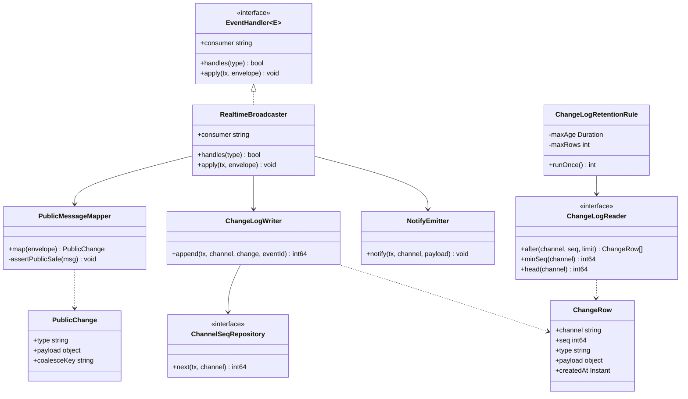

### 2.2 ws-gateway 쪽 (소켓·허브·세션)

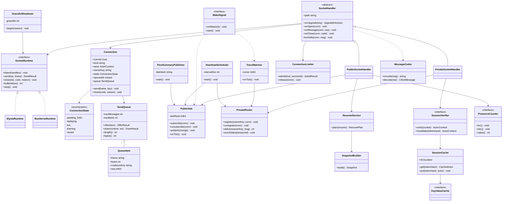

### 2.3 메시지 상속 구조 요약

04 §9.2 의 계층에 이 문서가 더하는 것만 적는다.

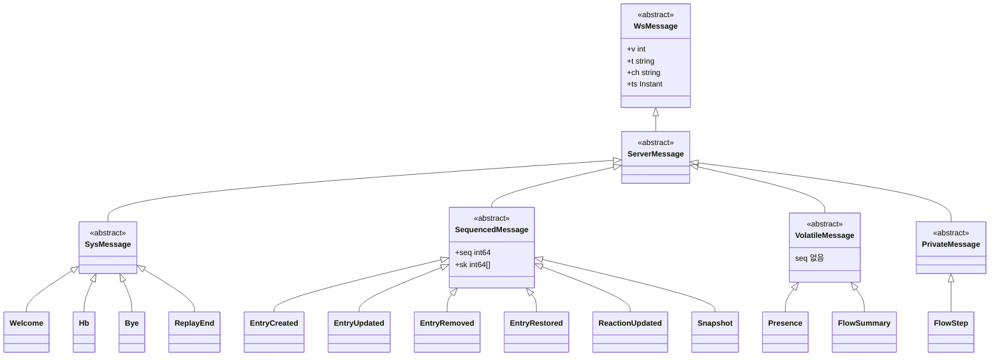

- 04 의 계층과 달리 **`Presence`·`FlowSummary` 를 `VolatileMessage`(순번 없음)로 옮겼다**(D3). 04 수정 요청.
- `Snapshot` 은 순번을 가진다(`seq` = `head`).

## 3. 핵심 설계 결정

### 3.1 서버 구현 구조: `SocketRuntime` 경계 (D4)

ADR-022 측정에서 Elysia 의 WebSocket 백프레셔 옵션은 **라우트 옵션으로 주면 무시**되고(0/10 종료, RSS 110~120MB), **최상위 옵션으로 주면 느린 연결은 끊기지만 정상 연결 p99 가 531~886ms 로 악화**됐다. 순수 `Bun.serve` 는 같은 정책에서 p99 0.5~0.7ms 였다. 그래서 **프레임워크가 주는 백프레셔 정책에 기대지 않고** 앱이 큐를 관리한다.

**G2 재시험(2026-11-04, 로컬)**: 앱 레벨 큐(`gw.ts` 방식)는 느린 연결 10/10 을 4408 로 격리했고 RSS 가 평탄(33MB)했다. `Bun.serve` 네이티브 `backpressureLimit`+`closeOnBackpressureLimit` 은 10/10 을 끊지만 **코드 1006** 으로만 끊어 4408 통지가 불가하고, Elysia 라우트 옵션은 여전히 0/10 이며 RSS 50→154MB 증가, Elysia 최상위 옵션은 10/10 을 1006 으로 끊었고 앞선 p99 531~886ms 악화는 이번 조건(100연결·초당 200건·1KB)에서 **재현되지 않았다**(이전 조건은 초당 2000건이라 같지 않음 → "해결"이 아니라 "이 부하에서는 안 보였다"로만 기록). 읽지 않는 연결은 close 프레임을 받지 못하므로 클라이언트는 4408 코드에 의존한 분기를 두지 않는다(04 §4). 결론은 그대로 **앱 레벨 큐 유지**다.

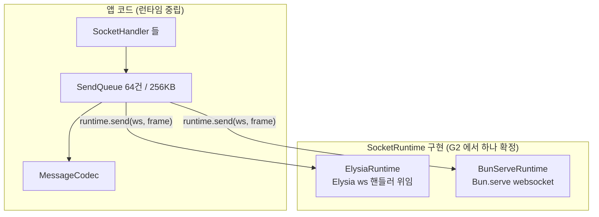

`SocketRuntime` 이 감추는 것과 앱이 갖는 것:

| 구분 | 내용 |
|---|---|
| 런타임이 하는 일 | 업그레이드, 프레임 송수신, 프로토콜 ping/pong, `idleTimeout`, `close` |
| 앱이 하는 일 | 큐 상한, 합치기, 직렬화, 하트비트 메시지, 연결 상태, 제한, 종료 순서 |
| 런타임 옵션 | `backpressureLimit`·`closeOnBackpressureLimit` 는 **안전망으로만** 최상위에 설정한다(앱 큐 상한 64건/256KB 보다 큰 값). 정책은 앱이 정한다 |
| Elysia 의 몫 | `/healthz`·`/readyz`·`/metrics` 라우팅, 업그레이드 사전 검사(Origin·세션·제한)까지. **송수신 루프에는 관여하지 않는다** |

```ts
// apps/ws-gateway/src/runtime/socket-runtime.ts (구조 예시)
type SendResult = 'sent' | 'buffered' | 'dropped';   // Bun ws.send: >0 → sent, -1 → buffered(백프레셔), 0 → dropped

interface SocketRuntime {
  listen(handlers: RuntimeHandlers): void;            // onUpgrade / onOpen / onMessage / onClose / onDrain
  send(ws: RuntimeSocket, frame: string): SendResult;
  close(ws: RuntimeSocket, code: number, reason: string): void;
  buffered(ws: RuntimeSocket): number;                // 런타임 쪽에 쌓인 바이트(모니터링용)
  stop(): void;
}
```

`ws.send` 반환값 처리:

| 반환 | 의미 | `SendQueue.drain` 동작 |
|---|---|---|
| 양수(바이트) | 전송 완료 | 다음 항목 계속 |
| `-1` | 전송은 큐잉됐으나 백프레셔 발생 | 이 항목은 보낸 것으로 간주, **`congested` 표시 후 드레인 중단**, 런타임의 `drain` 이벤트에서 재개 |
| `0` | 드롭(연결 문제) | 중단, 연결을 `4500` 후보로 표시(연속 3회면 닫음) |

선택 기준(G2 통과 후 확정): ① 정상 연결 팬아웃 p99, ② 느린 소비자 시험(`4408` 이 앱 큐로 동작), ③ 소크 메모리. 두 구현이 **같은 계약 시험 스위트**(design/08 §2.1 와 같은 방식)를 통과해야 한다. Elysia API(`ws` 훅 이름, 업그레이드 사전 검사 훅)의 세부는 **미확인**이라 `ElysiaRuntime` 구현 시 공식 문서로 확인한다.

### 3.2 `change_log.seq` 부여 방식 비교 (D1, D2)

요구: ① 채널별 단조 증가 ② **gateway 가 `seq > last` 로 읽을 때 중간 번호를 영영 건너뛰지 않는다**(번호 N+1 이 N 보다 먼저 커밋되어 보이면, `last=N+1` 을 본 gateway 가 N 을 놓친다).

| 방식 | 단조 | 커밋 순서 = seq 순서 | 구멍 | 평가 |
|---|---|---|---|---|
| Postgres `SEQUENCE` | 예 | **아니오** (nextval 은 트랜잭션 밖이라 늦게 커밋될 수 있음) | 롤백 시 생김 | 기각: 건너뜀 위험 |
| 채널 카운터 행 `UPDATE … SET last_seq = last_seq + 1 … RETURNING` | 예 | **예** (행 잠금이 커밋까지 유지 → 다음 쓰기는 대기) | 롤백 시 같이 롤백 → **구멍 없음** | **채택** |
| `pg_advisory_xact_lock(채널)` 후 `max(seq)+1` | 예 | 예 | 없음 | 동작은 같으나 읽기+계산 한 번 더, 카운터 행이 더 단순 |

채택안의 비용: 같은 채널의 쓰기가 직렬화된다. broadcaster 처리량은 글·반응 변경 빈도(초당 한 자릿수~수십)라 문제없다. 대신 **트랜잭션을 짧게** 유지한다(매핑·삽입·NOTIFY 만, 외부 호출 없음).

D2: 러너를 여러 개 돌려도 카운터 행 잠금 때문에 `seq` 는 안전하다. 이벤트 순서(outbox `seq`)와 `change_log` 순서는 **다른 집합체 사이에서는** 달라질 수 있지만(러너 A 가 이벤트 5, 러너 B 가 이벤트 4 를 처리하면 4 가 늦게 기록), 같은 글의 `posted → edited → hidden` 순서는 [F13](13-events-pipeline.md) 의 **집합체 선두 규칙**(앞 이벤트가 `processed` 가 아니면 같은 집합체의 뒤 이벤트를 선점하지 않는다)이 지킨다. 그래서 소비자 이름 어드바이저리 락은 두지 않는다 — 처리량과 복잡도 모두 이득이 없다.

```sql
-- realtime_read.channel_seq (채널당 1행, 마이그레이션에서 'public' 행 미리 삽입)
UPDATE realtime_read.channel_seq
   SET last_seq = last_seq + 1
 WHERE channel = $1
RETURNING last_seq;           -- 이 행 잠금이 트랜잭션 커밋까지 유지된다
```

### 3.3 private `flow.step` 신호: 폴링 vs NOTIFY (D5)

`trace_step` 은 추가 전용이고 쓰기 빈도가 높다(글 한 건에 5~8행).

| 방식 | 지연 | DB 부하 | 구현 | 평가 |
|---|---|---|---|---|
| 폴링만(예: 500ms) | 최대 500ms | 연결 수와 무관한 쿼리 1개/주기 | 단순 | 부하는 작지만 시각화 체감 지연 |
| NOTIFY 만 | 거의 0 | 낮음 | 단순 | 신호 유실(연결 끊김) 시 단계가 영영 안 옴 |
| **NOTIFY + 커서 읽기 + 1초 폴링 보완** | 거의 0, 유실 시 ≤1초 | 낮음 | public 과 같은 `WakeSignal` 재사용 | **채택** |

- 읽기 쿼리(events 의 공개 포트 `TraceReader.after(cursor, limit)` 가 실행하는 SQL): `SELECT … FROM events.trace_step WHERE id > $cursor ORDER BY id LIMIT 500` 을 전체에 대해 **한 번**만 하고, 메모리에서 `PrivateRouter` 에 등록된 `owner_key` 만 골라 전달한다. 연결별 쿼리는 없다.
- 커밋 순서 문제: `trace_step.id`(identity)는 커밋 순서와 다를 수 있어 **건너뜀이 가능**하다. 대응: 매 읽기에서 `id > cursor - 200` 으로 겹쳐 읽고, `PrivateRouter` 의 연결별 최근 `(traceId, step)` 집합으로 중복을 제거한다. 클라이언트도 `(traceId, step)` 으로 중복 제거한다(04 §5).
- 필요한 스키마: `trace_step.id bigint identity` (database-schema §4-3 에 반영됨). `NOTIFY trace_changed` 페이로드는 `sha256(ownerKey)` 앞 8자(내부 라우팅 힌트)이며 비워도 동작한다(깨우기 신호).

### 3.4 합치기와 `sk` (D6)

대기 중인 `reaction.updated` 중 키 `(entryId, emoji)` 가 같은 것은 **덮어쓰기 의미**라 최신 하나만 남겨도 최종 화면이 같다. 그런데 클라이언트는 `seq` 가 연속인지 검사하므로(04 §5), 지운 번호를 알려야 한다.

- 규칙: 나중 메시지가 앞선 대기 항목을 대체할 때, 대체된 항목들의 `seq` 를 새 메시지 봉투의 **`sk`(skipped) 배열**에 넣는다. `SeqTracker` 는 `sk` 의 번호를 "받은 것"으로 처리한다.
- 대체 가능한 것은 **아직 전송 전(큐에 있는)** 항목뿐이다. 이미 보낸 항목은 건드리지 않는다.
- 대체 시 큐 위치는 **새 메시지의 위치**(뒤쪽)를 따른다. 사이에 낀 다른 변경과의 순서는 `entryId`·`emoji` 가 달라 영향이 없다.
- `SendQueue` 는 `coalesceKey → 대기 항목` 맵을 유지한다(`entry.updated` 도 같은 글의 부분 갱신이 겹치면 `body` 최신으로 대체 가능하나, 순서 의존이 있어 **M1 은 `reaction.updated` 만** 합친다).
- 04 수정 요청: 봉투에 선택 필드 `sk`.

### 3.5 직렬화 재사용 (D8)

```ts
// PublicHub.publish — 핫패스
const frame = codec.encode(message);        // 한 번만 JSON.stringify
const bytes = Buffer.byteLength(frame);     // 한 번만 계산
for (const conn of subscribers) conn.queue.offer({ frame, bytes, coalesceKey, seq });
```

- 구독자별 필드 차이가 없도록 공개 메시지에 **개인 필드를 두지 않는다**(04 §3). 그래서 가능한 최적화다.
- 연결별로 달라지는 것은 `welcome`·`snapshot`·`hb` 뿐이고 이는 핫패스가 아니다.
- `ts` 는 허브가 메시지를 만든 시각(전송 시각이 아니라 한 번 고정)이다.

### 3.6 용량 산정

| 항목 | 값 | 출처·주의 |
|---|---|---|
| 목표 동시 방문자 | 50 | 명세 AC-013 |
| 탭당 소켓 | 최대 2(public + private) | 04 §1 |
| 예상 연결 수 | ≤ 100 (탭 1개 기준), 탭 여러 개면 ≤ 200 | |
| 연결당 메모리 증분 | Bun 순수 측정 **약 5.5KB**(1만 연결 유휴, RSS 89MB 중 기동분 36MB 제외) | ADR-022 측정. **한계**: 단시간, WSL2 loopback, 앱 큐·상태·세션 캐시 미포함 → 앱 객체 포함 시 수 배(가정 20~50KB)까지 열어 둔다 |
| 200 연결 메모리 | 5.5KB × 200 ≈ 1.1MB(측정치), 보수적 50KB × 200 ≈ 10MB | 둘 다 무시할 크기 |
| 팬아웃 비용 | 한 변경 × 100 연결 = `send` 100회, 직렬화 1회 | 측정 p99 5k 연결·초당 10건에서 27ms(Bun) |

용량은 병목이 아니다. 병목 후보는 **송신 큐 정책의 정확성**과 **장시간 안정성**(G2)이다.

---

## 4. 기능별 상세

각 기능: 목적 · 트리거 · 사전/사후 조건 · 접근 테이블(R/W) · 클래스 · 시퀀스(정상 + 실패) · 순서도 · 오류/종료 코드 · 지표/로그 · 시험.

### RT-01. 브로드캐스터 (inbox 소비 → change_log)

| 항목 | 내용 |
|---|---|
| 목적 | 도메인 이벤트를 **공개 변경**으로 바꿔 순번을 붙이고 이력에 남긴다 |
| 트리거 | `realtime.inbox_message` 의 `entry.*`·`reaction.changed` (소비자 `realtime-broadcaster`) |
| 사전 조건 | inbox 선점 성공(`claim_token`), 집합체 선두 규칙 통과(F13 §3.3, D2) |
| 사후 조건 | 매핑 대상이면 `change_log` 에 1행 + `NOTIFY`, inbox `processed` — **한 트랜잭션** |
| 접근 테이블 | `inbox_message` W, `channel_seq` W, `change_log` W |
| 이벤트→메시지 | `entry.posted→entry.created`, `entry.edited→entry.updated`, `entry.deleted→entry.removed(deleted)`, `entry.hidden→entry.removed(hidden)`, `entry.unhidden→entry.restored`, `reaction.changed→reaction.updated`, `report.*` 는 구독하지 않음 |

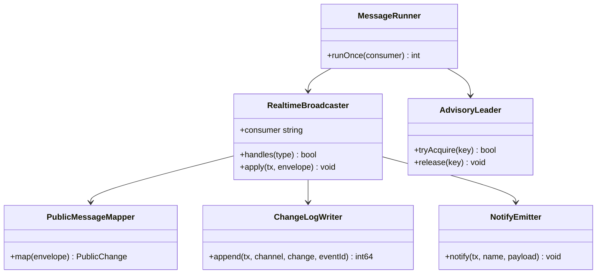

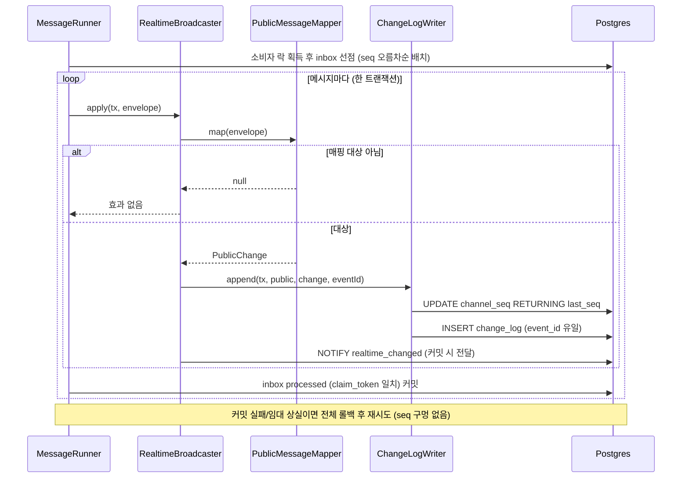

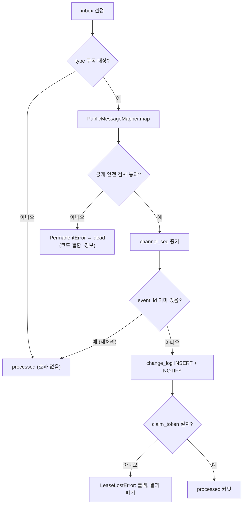

| 오류 | 처리 |
|---|---|
| 모르는 `schemaVersion` | `dead` (05 §5) |
| 매핑 안전 검사 실패 | `PermanentError` → `dead`, 알림 지표 |
| DB 일시 오류 | `TransientError` → 재시도(ADR-023 백오프) |
| `LeaseLostError` | 롤백, 다른 러너가 이어서 처리 |

지표/로그: `pf_realtime_broadcast_total{type}`, `pf_realtime_broadcast_lag_seconds`(이벤트 `occurredAt` → 기록 시각), 로그 `module=realtime usecase=broadcast event_type, change_seq`(본문·식별자 없음).
시험: AC-008 전제(순번 연속), AC-003 형태(같은 이벤트 재전달 시 `change_log` 중복 없음), 동시 러너 2개에서도 이벤트 순서 유지(08 §5 동시성).

### RT-02. change_log 순번 부여와 정리

| 항목 | 내용 |
|---|---|
| 목적 | 채널별 단조 `seq` 부여(D1), 이력 보관 제한(1시간·채널당 1만 행) |
| 트리거 | RT-01(쓰기), `RetentionRunner`(F13 EV-10)가 실행하는 realtime 소유 `ChangeLogRetentionRule`, 60초 주기(삭제) |
| 사전 조건 | `channel_seq` 에 채널 행이 있음(마이그레이션이 `public` 삽입) |
| 사후 조건 | 쓰기: 연속·구멍 없는 seq / 정리: `minSeq` 증가 |
| 접근 테이블 | `channel_seq` W, `change_log` W/D |

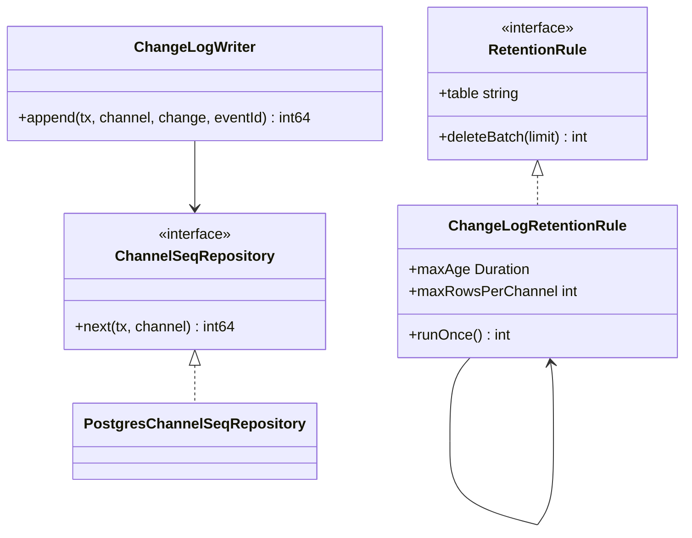

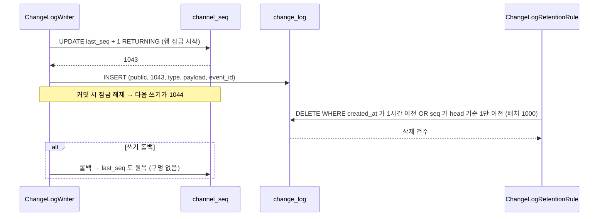

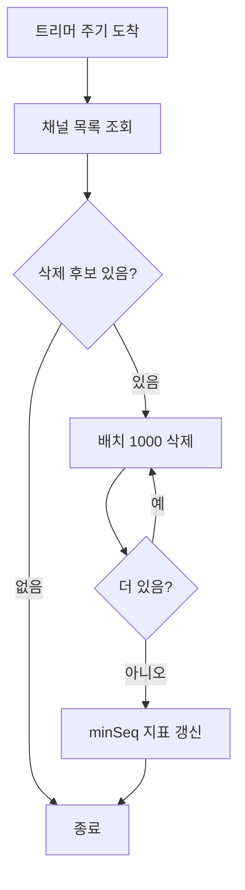

오류: 트리머 실패는 다음 주기에 재시도(삭제는 멱등). 지표: `pf_changelog_head{channel}`, `pf_changelog_min_seq{channel}`, `pf_changelog_rows{channel}`, `retention_deleted_total{table}`.
시험: 쓰기 롤백 시 seq 재사용(구멍 없음), 동시 쓰기 100건의 seq 가 연속·유일, 정리 후 `minSeq` 가 보관 규칙과 일치.

### RT-03. public 소켓 (업그레이드·hello·welcome·live)

| 항목 | 내용 |
|---|---|
| 목적 | 최초 진입 방문자에게 공개 변경 스트림을 연결한다 |
| 트리거 | `GET /ws/public` (Upgrade) |
| 사전 조건 | `Origin` 허용목록 일치, 전역 연결 수 미초과, 서버가 draining 이 아님 |
| 사후 조건 | `live` 상태로 `PublicHub` 구독, 접속자 수 +1 |
| 접근 테이블 | 없음(재개 시 `change_log` R, RT-04) |

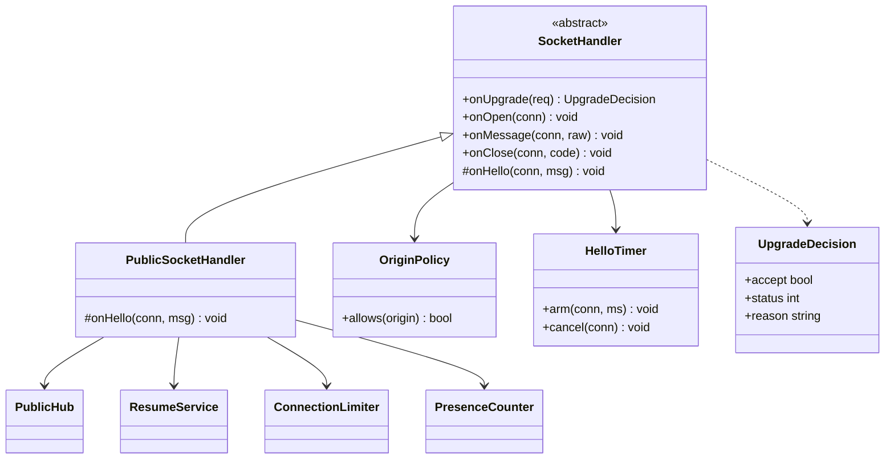

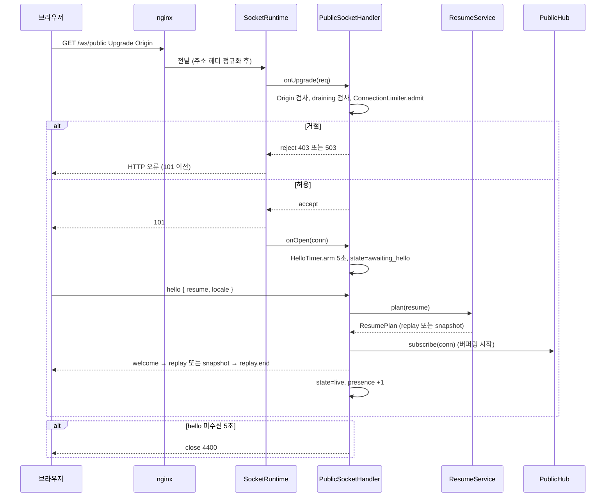

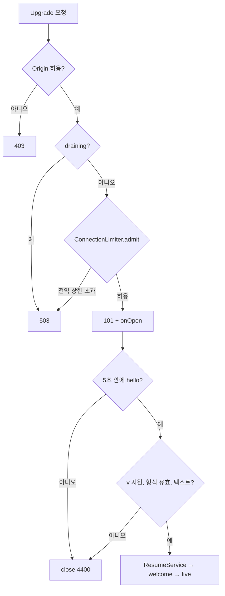

| 종료/응답 | 조건 |
|---|---|
| HTTP 403 | Origin 불일치 |
| HTTP 503 | draining / 전역 상한 |
| `4400` | hello 없음·형식 오류·바이너리·버전 불일치 |
| `4429` | 클라이언트 메시지 초당 10건 초과 |

지표/로그: `pf_ws_connections{channel="public"}` 게이지, `pf_ws_connects_total`, `pf_ws_disconnects_total{channel,code}`, 로그 `connId`(무작위, 세션과 무관), **IP 기록 없음**.
시험: 04 §7.1 시퀀스 통합 시험, hello 지연·형식 오류 종료 코드, Origin 거절(08 §6).

### RT-04. 재개 (replay / snapshot 판단)

| 항목 | 내용 |
|---|---|
| 목적 | 놓친 변경을 복구한다(AC-008) |
| 트리거 | RT-03 의 `hello.resume` |
| 사전 조건 | `change_log` 에 `minSeq`·`head` 가 있음 |
| 사후 조건 | 연결이 `head` 이후부터 연속 수신 상태로 전환 |
| 접근 테이블 | `change_log` R |

판정 규칙(`resume` = 클라이언트가 마지막으로 처리한 seq):

| 조건 | 결과 |
|---|---|
| `resume` 없음 | `snapshot` |
| `resume > head` (클라이언트가 서버보다 앞섬: DB 복원 등) | `snapshot` |
| `resume < minSeq - 1` (이력 보관 밖) | `snapshot` |
| `head - resume > 1000` (재생이 스냅샷보다 비쌈) | `snapshot` |
| 그 외 | `replay` (`resume+1 … head`) |

```mermaid
classDiagram
    class ResumeService {
        +plan(resume) ResumePlan
    }
    class ResumePlan {
        <<abstract>>
        +mode string
    }
    class ReplayPlan {
        +fromSeq int64
        +toSeq int64
    }
    class SnapshotPlan
    class ChangeLogReader {
        <<interface>>
        +after(channel, seq, limit) ChangeRow[]
        +minSeq(channel) int64
        +head(channel) int64
    }
    class ReplayStreamer {
        +stream(conn, plan) int
    }
    ResumePlan <|-- ReplayPlan
    ResumePlan <|-- SnapshotPlan
    ResumeService --> ChangeLogReader
    ResumeService ..> ResumePlan
    ReplayStreamer ..> ReplayPlan
    ReplayStreamer --> ChangeLogReader
```

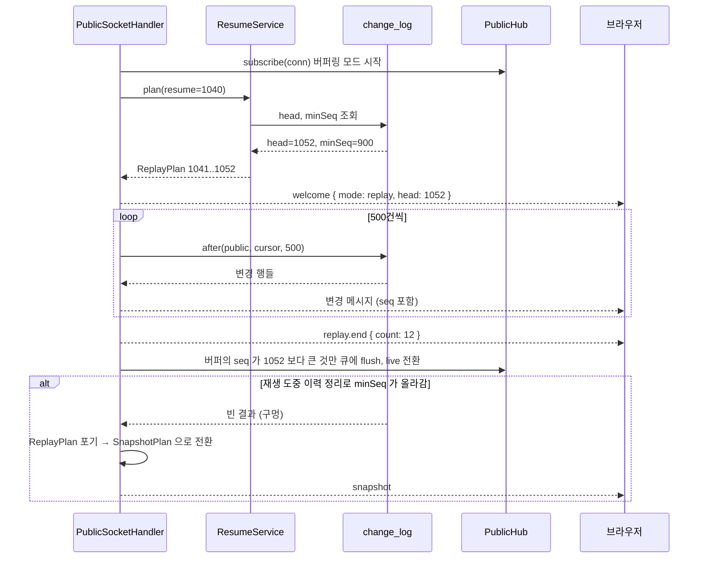

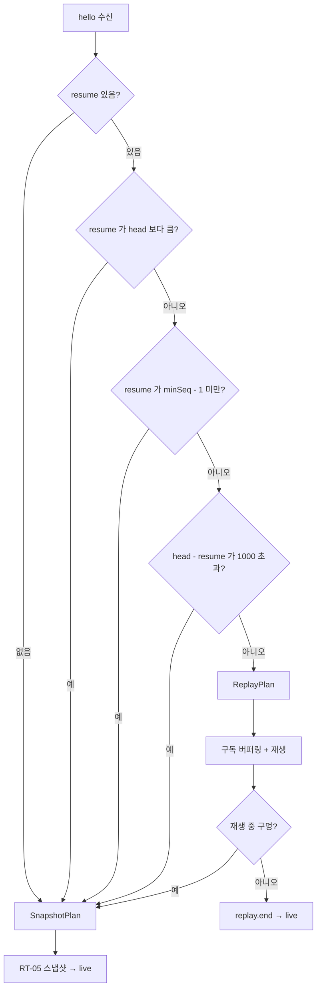

핵심 불변식: **구독(버퍼링)을 먼저 시작하고 나서 재생을 읽는다.** 반대 순서면 그 사이 변경이 사라진다. 버퍼의 중복(seq ≤ 재생 끝)은 버린다.
지표: `pf_ws_resume_total{mode="replay|snapshot", reason}`, `pf_ws_replay_messages` 히스토그램. 시험: AC-008 — 건너뜀·이력 부족·처음 접속 3경로, 재생 중 정리, `resume > head`.

### RT-05. 스냅샷 구성

| 항목 | 내용 |
|---|---|
| 목적 | 재개할 수 없는 연결에 전체 상태를 준다 |
| 트리거 | `SnapshotPlan` |
| 사후 조건 | `snapshot { entries, flow, head }` 전송 후 `head+1` 부터 수신 |
| 접근 | `change_log.head` R, `entry_view` R(guestbook 공개 조회 포트), `flow_counter` R |

순서(레이스 방지): ① `head` 를 먼저 읽는다 ② 그 뒤에 `entry_view` 첫 페이지(20건, 공개 필드만)와 `flow_counter` 최근 5분을 읽는다. 읽기 모델이 `head` 보다 앞선 상태일 수 있으나, 이후 오는 변경은 **덮어쓰기/중복 안전**(`id` 기준 병합, `reaction.updated` 는 총개수)이라 결과가 같다.

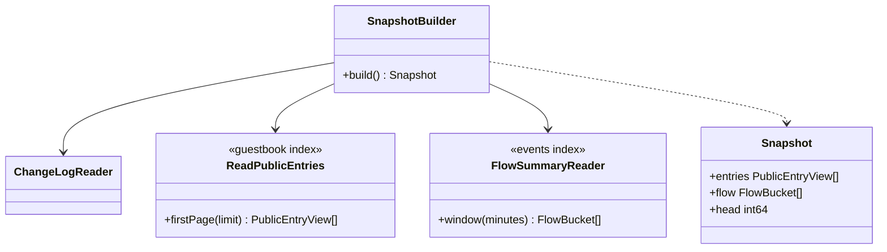

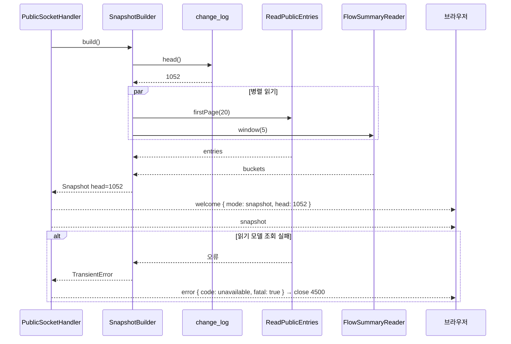

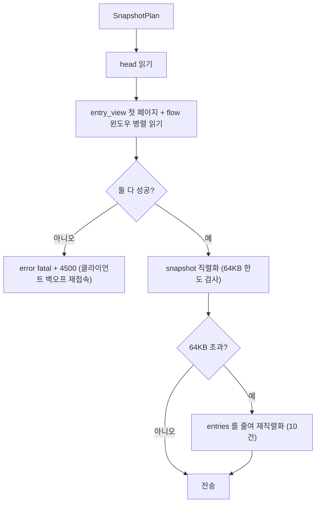

지표: `pf_ws_snapshot_build_seconds`, `pf_ws_snapshot_bytes`. 시험: 스냅샷 직후 `head+1` 부터 이어짐(중복·누락 없음), 스냅샷에 개인 필드(`isMine` 등) 없음(AC-009).

### RT-06. 팬아웃·송신 큐·합치기·4408

| 항목 | 내용 |
|---|---|
| 목적 | 변경을 모든 public 구독자에게 보내되 **느린 연결이 서버와 다른 연결을 막지 않게** 한다 |
| 트리거 | `WakeSignal`(NOTIFY 또는 1초 폴링) → `PublicHub.onTick` |
| 사전 조건 | 구독 연결이 `live`(또는 `replaying` 이면 버퍼링) |
| 사후 조건 | 각 연결 큐에 적재 후 드레인. 상한 초과 연결은 `4408` 로 종료 |
| 접근 테이블 | `change_log` R |

큐 규칙: 연결당 **64건 또는 256KB** 중 먼저 닿는 쪽이 상한. 초과(`offer` 실패) 시 해당 연결만 `4408` 종료 — 클라이언트는 즉시 재접속하며 `resume` 으로 복구한다.

```mermaid
classDiagram
    class PublicHub {
        +subscribe(conn) void
        +unsubscribe(conn) void
        +onTick() void
        +publish(change) void
        -lastRead int64
        -readInFlight bool
    }
    class SendQueue {
        -items Deque
        -byKey Map
        -maxMessages int
        -maxBytes int
        +offer(item) OfferResult
        +drain(runtime, ws) DrainResult
    }
    class QueueItem {
        +frame string
        +bytes int
        +coalesceKey string
        +seq int64
    }
    class OfferResult {
        <<enumeration>>
        accepted
        coalesced
        overflow
    }
    class Connection {
        +send(frame, key) void
        +close(code, reason) void
    }
    class SocketRuntime {
        <<interface>>
        +send(ws, frame) SendResult
    }
    PublicHub --> Connection
    Connection --> SendQueue
    SendQueue "1" o-- "*" QueueItem
    SendQueue ..> OfferResult
    SendQueue --> SocketRuntime
```

```mermaid
sequenceDiagram
    participant W as WakeSignal
    participant U as PublicHub
    participant L as change_log
    participant Q as SendQueue (연결별)
    participant R as SocketRuntime
    participant C as 브라우저
    W->>U: wake (NOTIFY 또는 폴링)
    U->>U: readInFlight 이면 dirty 표시 후 반환 (단일 비행)
    U->>L: after(public, lastRead, 500)
    L-->>U: 변경 행들
    loop 행마다
        U->>U: frame = encode 1회
        U->>Q: 모든 구독 연결에 offer(frame)
    end
    Q->>R: drain: send(ws, frame)
    R-->>Q: sent / buffered / dropped
    R->>C: 프레임 전달
    alt offer overflow (64건 또는 256KB 초과)
        Q-->>U: overflow
        U->>C: close 4408
        Note over C: 즉시 재접속 + resume
    end
    alt send 가 buffered(-1)
        Q->>Q: congested 표시, 드레인 중단
        R-->>Q: drain 이벤트 시 재개
    end
```

```mermaid
flowchart TD
    A["변경 1건 도착"] --> B["frame = JSON 직렬화 1회"]
    B --> C["구독 연결마다 offer"]
    C --> D{"coalesceKey 가 같은 대기 항목 있음?"}
    D -- "예" --> E["대기 항목 제거, 새 항목 sk 에 제거한 seq 추가"]
    D -- "아니오" --> F{"큐 64건 또는 256KB 초과?"}
    E --> F
    F -- "예" --> G["4408 종료 (이 연결만)"]
    F -- "아니오" --> H["큐에 적재"]
    H --> I{"congested?"}
    I -- "예" --> J["drain 이벤트까지 대기"]
    I -- "아니오" --> K["send 반복"]
    K --> L{"반환값"}
    L -- "sent" --> K
    L -- "buffered -1" --> J
    L -- "dropped 0" --> M["연속 3회면 4500 종료"]
```

| 코드 | 의미 |
|---|---|
| `4408` | 느린 소비자 — 클라이언트 즉시 재접속 + `resume`. 클라이언트는 이 코드를 못 받고 `1006` 으로 보는 것이 일반적이다(G2 실측), 코드 분기 금지 |
| `4500` | 전송 반복 실패 |

지표: `pf_ws_send_queue_length` 히스토그램, `pf_ws_send_queue_bytes`, `pf_ws_queue_overflow_total`, `pf_ws_coalesced_total`, `pf_ws_messages_sent_total{channel,type}`, `pf_ws_fanout_seconds`(읽기→모든 큐 적재).
시험(08 §6): 느린 소비자 격리(다른 연결 p99 영향 없음), **앱 큐가 4408 을 내림**(Elysia 옵션 무시 회귀 방지), 합치기 후 클라이언트 `SeqTracker` 가 gap 으로 오인하지 않음, 팬아웃 직렬화 1회 검증(스파이).

### RT-07. private 소켓

| 항목 | 내용 |
|---|---|
| 목적 | 세션 소유자에게만 자기 흐름 상세를 보낸다(FR-040) |
| 트리거 | `GET /ws/private` |
| 사전 조건 | 세션 쿠키 유효(익명 세션 포함), Origin 허용, 세션당 3개 이하(초과분은 가장 오래된 것을 밀어냄) |
| 사후 조건 | `ownerKey` 로 `PrivateRouter` 에 등록 |
| 접근 테이블 | `session` R (`identity.ResolveSession` 경유) |

```mermaid
classDiagram
    class SocketHandler {
        <<abstract>>
    }
    class PrivateSocketHandler {
        #onHello(conn, msg) void
        +onUpgrade(req) UpgradeDecision
    }
    class SessionVerifier {
        <<interface>>
        +verify(cookie) ActorContext
    }
    class ResolveSessionAdapter
    class OwnerKeyDeriver {
        +of(actor) string
    }
    class PrivateRouter {
        +register(ownerKey, conn) void
        +unregister(conn) void
    }
    SocketHandler <|-- PrivateSocketHandler
    SessionVerifier <|.. ResolveSessionAdapter
    PrivateSocketHandler --> SessionVerifier
    PrivateSocketHandler --> OwnerKeyDeriver
    PrivateSocketHandler --> PrivateRouter
    PrivateSocketHandler --> ConnectionLimiter
```

`ownerKey` 는 파생하지 않는다: 연결의 `ActorContext.actorKey`(익명 `session:<sessionId>`, 로그인 `user:<userId>`)를 **그대로** 쓰며, 05 의 봉투 `ownerKey`·`trace_step.owner_key` 와 같은 값이다. `trace_changed` NOTIFY 에는 원문이 아니라 `sha256(ownerKey)` 앞 8자(내부 라우팅 힌트)만 싣고, 수신자는 신호로 일하지 않고 `trace_step` 을 다시 읽는다.

```mermaid
sequenceDiagram
    participant C as 브라우저
    participant H as PrivateSocketHandler
    participant V as SessionVerifier
    participant K as SessionCache
    participant I as identity.ResolveSession
    participant P as PrivateRouter
    C->>H: GET /ws/private Upgrade Cookie Origin
    H->>H: Origin 검사, 쿠키 파싱
    H->>V: verify(cookie)
    V->>K: get(tokenHash)
    alt 캐시 적중
        K-->>V: Actor
    else 미스
        V->>I: execute(rawToken)
        I-->>V: Actor 또는 null
        V->>K: put (null 은 5초 음성 캐시)
    end
    alt 세션 없음/만료
        H-->>C: HTTP 401 (101 이전)
    else 유효
        H->>H: ConnectionLimiter.admit(private, sessionId)
        H-->>C: 101
        C->>H: hello { locale }
        H->>P: register(ownerKey, conn) (세션 4번째면 가장 오래된 연결 4409)
        H-->>C: welcome { actorKind }
    end
```

```mermaid
flowchart TD
    A["Upgrade /ws/private"] --> B{"Origin 허용?"}
    B -- "아니오" --> X1["403"]
    B -- "예" --> C{"세션 쿠키 있음?"}
    C -- "없음" --> X2["401"]
    C -- "있음" --> D["SessionVerifier.verify"]
    D --> E{"유효?"}
    E -- "아니오" --> X2
    E -- "예" --> F{"draining 또는 전역 상한?"}
    F -- "예" --> X3["503"]
    F -- "아니오" --> G["101"]
    G --> H{"hello 5초 안?"}
    H -- "아니오" --> X4["4400"]
    H -- "예" --> I["register + welcome"]
```

| 코드 | 의미 |
|---|---|
| HTTP 401 | 세션 없음/만료(101 이전) |
| `4401` | 연결 도중 세션 폐기·회전 감지(RT-13) |
| `4409` | 세션당 연결 수 초과로 밀려남 |

지표: `pf_ws_connections{channel="private"}`, `pf_ws_session_cache_total{result="hit|miss|negative"}`. 로그: `connId`, `actorKind` — 세션 ID·토큰·`ownerKey` 원문 기록 금지.
시험(08 §6.x): 쿠키 없이 401, 익명 세션 수신, 서로 다른 세션 분리, 4번째 연결 → 가장 오래된 `4409`.

### RT-08. private 라우팅 (`flow.step`)

| 항목 | 내용 |
|---|---|
| 목적 | `trace_step` 의 새 행을 소유자의 연결에만 전달한다 |
| 트리거 | `WakeSignal`(NOTIFY `trace_changed` 또는 1초 폴링) → `TraceWatcher.onTick` |
| 사후 조건 | 등록된 `ownerKey` 의 연결마다 `flow.step` 1회(중복 제거) |
| 접근 테이블 | `trace_step` R (`id` 커서, §7 요청) |

```mermaid
classDiagram
    class TraceWatcher {
        +onTick() void
        -cursor int64
        -overlap int
    }
    class TraceReader {
        <<interface>>
        +after(id, limit) TraceRow[]
    }
    class PrivateRouter {
        -byOwner Map
        +register(ownerKey, conn) void
        +deliver(ownerKey, msg) int
        +hasOwner(ownerKey) bool
    }
    class RecentStepSet {
        +seen(connId, traceId, step) bool
    }
    class FlowStepMapper {
        +map(row) FlowStep
    }
    TraceWatcher --> TraceReader
    TraceWatcher --> PrivateRouter
    TraceWatcher --> FlowStepMapper
    PrivateRouter --> RecentStepSet
```

```mermaid
sequenceDiagram
    participant D as trace_step
    participant W as WakeSignal
    participant T as TraceWatcher
    participant R as PrivateRouter
    participant Q as Connection SendQueue
    participant C as 브라우저
    D->>W: NOTIFY trace_changed (커밋 시)
    W->>T: wake
    T->>D: SELECT id 가 cursor - 200 보다 큰 행 LIMIT 500
    D-->>T: 행들
    loop 행마다
        T->>R: hasOwner(owner_key)
        alt 연결 없음
            R-->>T: false (건너뜀)
        else 연결 있음
            T->>R: deliver(ownerKey, flow.step)
            R->>R: RecentStepSet 로 중복 제거
            R->>Q: 해당 소유자의 모든 연결에 offer
            Q-->>C: flow.step
        end
    end
    T->>T: cursor = 처리한 최대 id
```

```mermaid
flowchart TD
    A["wake"] --> B{"읽기 진행 중?"}
    B -- "예" --> C["dirty 표시, 반환"]
    B -- "아니오" --> D["trace_step 읽기 (겹침 200)"]
    D --> E{"행 있음?"}
    E -- "없음" --> Z["종료"]
    E -- "있음" --> F{"owner_key 에 등록 연결 있음?"}
    F -- "아니오" --> G["건너뜀"]
    F -- "예" --> H{"이미 보낸 (traceId, step)?"}
    H -- "예" --> G
    H -- "아니오" --> I["flow.step 전달"]
    G --> J{"더 있음?"}
    I --> J
    J -- "예" --> F
    J -- "아니오" --> K{"dirty?"}
    K -- "예" --> D
    K -- "아니오" --> Z
```

개인정보: `detail` 에는 본문이 없다(database-schema §4-3). `flow.step` 에 `ownerKey`·세션·IP 를 싣지 않는다. 전달은 **서버에서 소유자 필터링**한다(클라이언트 필터링 금지, AC-009).
지표: `pf_flow_step_delivered_total`, `pf_trace_watch_lag_seconds`. 시험: 타 세션이 받지 못함, 겹침 읽기에서 중복 없음, 커밋 순서 뒤집힘(id 건너뜀) 시나리오에서 단계 누락 없음.

### RT-09. 접속자 수

| 항목 | 내용 |
|---|---|
| 목적 | public 연결 수(탭 단위 근사)를 표시한다 |
| 트리거 | public 연결 open/close, 5초 주기 푸시 |
| 포트 | `PresenceCounter`(ADR-024) — M1 메모리 어댑터, 다중 인스턴스 합산은 Redis 도입 시 |
| 규칙 | `presence` 는 **휘발성**(`seq` 없음, `change_log` 에 쓰지 않음). 값이 바뀐 때만 5초 간격으로 한 번 푸시, 새 연결에는 `welcome` 직후 현재 값 1회 |

```mermaid
classDiagram
    class PresenceCounter {
        <<interface>>
        +inc() void
        +dec() void
        +value() int
    }
    class MemoryPresenceCounter {
        -count int
    }
    class PresencePublisher {
        +start() void
        -last int
    }
    PresenceCounter <|.. MemoryPresenceCounter
    PresencePublisher --> PresenceCounter
    PresencePublisher --> PublicHub
    PublicSocketHandler --> PresenceCounter
```

```mermaid
sequenceDiagram
    participant H as PublicSocketHandler
    participant P as PresenceCounter
    participant B as PresencePublisher
    participant U as PublicHub
    participant C as 브라우저들
    H->>P: inc() (live 전환 시)
    loop 5초마다
        B->>P: value()
        alt 직전 값과 다름
            B->>U: publish(presence { count })
            U-->>C: presence (seq 없음)
        else 같음
            B->>B: 건너뜀
        end
    end
    H->>P: dec() (close 시, 중복 호출 방지 플래그)
```

```mermaid
flowchart TD
    A["5초 타이머"] --> B["value 읽기"]
    B --> C{"직전 푸시 값과 같음?"}
    C -- "예" --> Z["종료"]
    C -- "아니오" --> D["presence 메시지 생성 (seq 없음)"]
    D --> E["허브가 전체에 한 번 직렬화해 전송"]
    E --> F["last 갱신"]
```

주의: 값은 **연결 수이지 사람 수가 아니다**(새로고침·재접속 순간 변동). 표시는 "대략"으로 한다. 지표: `ws_presence`(게이지, 레이블 없음). 시험: open/close 짝 맞음(중복 close 에서 음수 안 됨), 값 불변이면 푸시 안 함.

### RT-10. 하트비트·유휴 종료

| 항목 | 내용 |
|---|---|
| 목적 | 끊어진 연결을 감지하고 클라이언트에게 채널 머리 번호를 알려 누락을 감지하게 한다 |
| 규칙 | 서버가 **25초마다 `hb`**(public 은 `{head}`, private 은 `{}`), 프로토콜 ping/pong 은 60초 간격, 무응답 `idleTimeout` 120초(런타임 설정, G2에서 확인) |
| 큐 상호작용 | `hb` 는 큐에 넣되 **혼잡(congested) 연결에는 건너뛴다**(이미 느림) |

```mermaid
classDiagram
    class HeartbeatScheduler {
        +start() void
        +stop() void
        -intervalSec int
    }
    class HeadProvider {
        <<interface>>
        +head() int64
    }
    class Connection {
        +send(frame, key) void
        +congested bool
    }
    HeartbeatScheduler --> PublicHub
    HeartbeatScheduler --> PrivateRouter
    HeartbeatScheduler --> HeadProvider
    PublicHub --> Connection
```

```mermaid
sequenceDiagram
    participant T as HeartbeatScheduler
    participant U as PublicHub
    participant P as PrivateRouter
    participant C as 브라우저
    loop 25초마다
        T->>U: head (캐시된 lastRead)
        T->>U: 모든 live 연결에 hb { head }
        T->>P: 모든 private 연결에 hb {}
        U-->>C: hb
    end
    C->>C: hb.head 가 마지막 seq 보다 크면 누락 → 재연결 + resume
    Note over C,U: 런타임이 60초마다 ping, 120초 무응답이면 연결 종료
```

```mermaid
flowchart TD
    A["25초 타이머"] --> B["연결 순회"]
    B --> C{"state 가 live?"}
    C -- "아니오" --> B
    C -- "예" --> D{"congested?"}
    D -- "예" --> B
    D -- "아니오" --> E["hb 적재"]
    E --> B
```

시험: hb 의 `head` 가 클라이언트 gap 감지에 쓰임(통합), 혼잡 연결에 hb 안 쌓임, 유휴 120초 종료(시계 주입).

### RT-11. 우아한 종료 (bye)

| 항목 | 내용 |
|---|---|
| 목적 | 배포·재시작 때 연결을 정돈해 **짧은 단절 후 복구**하게 한다(ADR-014) |
| 트리거 | `SIGTERM` |
| 순서 | ① `draining=true` → `/readyz` 실패(오케스트레이터가 트래픽 제외) ② 신규 업그레이드 `503` ③ 모든 연결에 `bye { reason:'deploy', reconnectAfterMs }`(연결 수에 따라 지터 범위 확대) ④ `close 1001` ⑤ 유예(기본 25초, compose `stop_grace_period` 30초) 내 닫히지 않은 연결 강제 종료 ⑥ 타이머·LISTEN 연결 정리 후 종료 |
| 지터 | `reconnectAfterMs = random(0, clamp(N × 10ms, 1s, 10s))` — 재접속 폭주 분산 |

```mermaid
classDiagram
    class GracefulShutdown {
        +begin(reason) void
        -graceMs int
        -spread(n) int
    }
    class ReadinessState {
        +draining bool
        +setDraining() void
    }
    class RuntimeLifecycle {
        <<interface>>
        +stopAccepting() void
        +stop() void
    }
    GracefulShutdown --> ReadinessState
    GracefulShutdown --> PublicHub
    GracefulShutdown --> PrivateRouter
    GracefulShutdown --> RuntimeLifecycle
    GracefulShutdown --> HeartbeatScheduler
```

```mermaid
sequenceDiagram
    participant O as 오케스트레이터
    participant G as GracefulShutdown
    participant S as ReadinessState
    participant C as 브라우저들
    participant R as SocketRuntime
    O->>G: SIGTERM
    G->>S: setDraining (readyz 실패)
    G->>R: stopAccepting (신규 업그레이드 503)
    loop 모든 연결
        G-->>C: bye { reason: deploy, reconnectAfterMs: 지터 }
        G-->>C: close 1001
    end
    C->>C: reconnectAfterMs 후 새 인스턴스에 hello + resume
    alt 유예 시간 초과
        G->>R: 남은 연결 강제 종료
    end
    G->>R: stop (await 없이 호출했던 stop 의 완료 대기, 타임아웃 포함)
    G-->>O: 종료 코드 0
```

```mermaid
flowchart TD
    A["SIGTERM"] --> B["draining=true, readyz 503"]
    B --> C["신규 업그레이드 거부"]
    C --> D["모든 연결에 bye + 지터"]
    D --> E["close 1001"]
    E --> F{"유예 안에 모두 닫힘?"}
    F -- "예" --> G["정리 후 종료"]
    F -- "아니오" --> H["강제 종료 후 정리"]
    H --> G
```

**실측 주의(Bun 1.4.4, 1000연결에서도 재현)**: `await server.stop()` 은 열린 WebSocket 이 있으면 **영원히 끝나지 않는다**(5초 후에도 연결 1000개 잔존). 회피 순서는 1000연결에서 10~14ms 에 전량 정상 종료했다. 종료 순서는 ① `stop()` 을 **await 없이** 호출(신규 수락 중단) → ② 각 소켓에 `bye` 후 `close(1001)` → ③ 유예 시간(타임아웃) 안에 모두 닫히기를 기다린 뒤 `stop()` 의 완료를 기다림. 타임아웃 후 `stop(true)` 강제 종료 경로는 미확인(G2). 지표: `pf_ws_shutdown_connections`(종료 시점 연결 수), `pf_ws_shutdown_forced_total`. 시험(08 §6): SIGTERM → `bye` → `1001` → 클라이언트가 새 인스턴스로 `resume`, 강제 종료 경로, 유예 시간 주입.

### RT-12. 깨우기 신호 수신 (LISTEN + 폴링)

| 항목 | 내용 |
|---|---|
| 목적 | 변경 직후 지연 없이 읽되, **신호 유실에도 1초 안에 따라잡게** 한다 |
| 구성 | 전용 LISTEN 연결 1개(Bun.sql — G4 실측에서 연결 종료·서버 재시작 모두 자동 재구독 확인) — `realtime_changed`, `trace_changed` 구독. 1초 폴링 타이머 |
| 동작 | 신호/타이머 → `onWake()` → 단일 비행: 읽는 중이면 `dirty` 표시, 끝나면 한 번 더 |
| 재연결 | LISTEN 연결이 끊기면 백오프 재연결 후 **즉시 한 번 읽는다**(그 사이 신호 유실 보상) |
| 읽기 범위 | `seq > lastRead` 를 500건씩 반복. NOTIFY 페이로드의 seq 는 힌트일 뿐 신뢰하지 않는다 |

```mermaid
classDiagram
    class WakeSignal {
        <<interface>>
        +onWake(cb) void
        +start() void
        +stop() void
    }
    class PgWakeSignal {
        -listenConn Connection
        -pollTimer Timer
    }
    class SingleFlight {
        +run(fn) void
        -inFlight bool
        -dirty bool
    }
    class NotifyListener {
        +subscribe(names) void
        +onNotify(cb) void
    }
    WakeSignal <|.. PgWakeSignal
    PgWakeSignal --> NotifyListener
    PgWakeSignal --> SingleFlight
    PublicHub ..> WakeSignal
    TraceWatcher ..> WakeSignal
```

```mermaid
sequenceDiagram
    participant N as NotifyListener
    participant W as PgWakeSignal
    participant F as SingleFlight
    participant U as PublicHub
    N->>W: realtime_changed 수신
    W->>F: run(onTick)
    F->>U: onTick()
    U-->>F: 완료
    alt 처리 중 다른 신호 도착
        W->>F: run(onTick)
        F->>F: dirty=true
        F->>U: 끝난 직후 onTick 재실행
    end
    Note over W: 1초 타이머도 같은 run() 호출 (신호 유실 보완)
    alt LISTEN 연결 끊김
        N-->>W: error
        W->>N: 백오프 재연결 + 재구독
        W->>F: run(onTick) 즉시 한 번
    end
```

```mermaid
flowchart TD
    A["신호 또는 1초 타이머"] --> B{"읽기 진행 중?"}
    B -- "예" --> C["dirty=true"]
    B -- "아니오" --> D["onTick 실행"]
    D --> E{"dirty?"}
    E -- "예" --> F["dirty=false, 다시 실행"]
    F --> D
    E -- "아니오" --> Z["대기"]
```

지표: `pf_ws_wake_total{source="notify|poll"}`, `pf_notify_reconnects_total`. 시험: NOTIFY 를 막아도 1초 안에 전달(AC-008 보조), 연결 끊김 후 보상 읽기, 단일 비행(동시 두 읽기 없음).

### RT-13. 세션 검증 캐시와 재검증

| 항목 | 내용 |
|---|---|
| 목적 | private 업그레이드마다 DB 를 치지 않고, 회전·폐기를 늦어도 30초 안에 반영한다 |
| 구성 | `SessionCache` = `KeyValueCache`(ADR-024, M1 메모리) 위의 얇은 층. 키 `tokenHash`, 값 `{actor, sessionExpiresAt}`, TTL 30초, 음성(없음) 캐시 5초 |
| 연결별 재검증 | 30초마다 **고유 `tokenHash` 단위로 묶어** `ResolveSession` 을 호출(연결 수가 아니라 세션 수만큼). 결과가 무효·다른 사용자면 해당 세션의 모든 private 연결을 `4401` 로 종료 |
| 즉시 반영(선택) | 로그아웃/회전 usecase 가 `NOTIFY session_revoked`(tokenHash) 를 보내면 캐시를 즉시 비운다 — 미결(06 §9) |

```mermaid
classDiagram
    class SessionVerifier {
        <<interface>>
        +verify(cookie) ActorContext
        +revalidate(tokenHash) ActorContext
    }
    class CachingSessionVerifier {
        -cache SessionCache
    }
    class SessionCache {
        +get(tokenHash) CachedActor
        +put(tokenHash, actor) void
        +evict(tokenHash) void
    }
    class SessionRevalidator {
        +start() void
        -intervalSec int
    }
    class ResolveSession {
        <<identity usecase>>
        +execute(rawToken) ActorContext
    }
    SessionVerifier <|.. CachingSessionVerifier
    CachingSessionVerifier --> SessionCache
    CachingSessionVerifier --> ResolveSession
    SessionRevalidator --> CachingSessionVerifier
    SessionRevalidator --> PrivateRouter
```

```mermaid
sequenceDiagram
    participant T as SessionRevalidator
    participant P as PrivateRouter
    participant V as CachingSessionVerifier
    participant I as identity.ResolveSession
    participant C as 브라우저
    loop 30초마다
        T->>P: 등록된 세션(tokenHash) 목록
        T->>V: 세션마다 revalidate(tokenHash) (캐시 우회)
        V->>I: execute
        alt 세션 유효
            I-->>V: Actor
        else 폐기/회전/만료
            I-->>V: null
            V-->>T: invalid
            T->>P: 해당 세션의 모든 연결 close 4401
            P-->>C: close 4401
            Note over C: /api/me 로 새 세션 확인 후 private 재연결
        end
    end
```

```mermaid
flowchart TD
    A["private 업그레이드"] --> B["tokenHash 계산"]
    B --> C{"캐시 적중?"}
    C -- "예 (유효)" --> OK["허용"]
    C -- "예 (음성)" --> NO["401"]
    C -- "아니오" --> D["ResolveSession"]
    D --> E{"유효?"}
    E -- "예" --> F["30초 캐시 후 허용"]
    E -- "아니오" --> G["5초 음성 캐시 후 401"]
    F --> OK
```

참고: 세션 `last_seen_at` 갱신(ID-03)은 소켓 업그레이드로 인한 쓰기 폭주를 막기 위해 **gateway 가 하지 않는다**(`ResolveSession` 에 `touch=false` 옵션).
지표: `pf_ws_session_cache_total{result}`, `pf_ws_session_revalidate_closed_total`. 시험: 로그인 후 이전 익명 세션의 private 이 30초 이내 `4401`, 캐시 적중 시 DB 호출 없음, 음성 캐시 5초.

### RT-14. 흐름 요약 주기 푸시

| 항목 | 내용 |
|---|---|
| 목적 | **다른 방문자 활동의 개수**만 모두에게 주기적으로 보여 준다(FR-041) |
| 트리거 | 5초 타이머(연결 수와 무관하게 쿼리 1회) |
| 사후 조건 | 이전과 달라진 경우에만 `flow.summary` 1회 푸시(휘발성, `seq` 없음) |
| 접근 | `flow_counter` R (events 공개 조회 포트 `FlowSummaryReader`) |

```mermaid
classDiagram
    class FlowSummaryPublisher {
        +start() void
        -lastHash string
        -windowMinutes int
    }
    class FlowSummaryReader {
        <<events index>>
        +window(minutes) FlowBucket[]
    }
    class FlowBucket {
        +at Instant
        +step string
        +count int
    }
    FlowSummaryPublisher --> FlowSummaryReader
    FlowSummaryPublisher --> PublicHub
    FlowSummaryReader ..> FlowBucket
```

```mermaid
sequenceDiagram
    participant T as FlowSummaryPublisher
    participant R as FlowSummaryReader
    participant D as flow_counter
    participant U as PublicHub
    participant C as 브라우저들
    loop 5초마다
        T->>R: window(5)
        R->>D: 최근 5분 분 단위 버킷
        D-->>R: 버킷들
        R-->>T: FlowBucket[]
        T->>T: 해시 계산
        alt 직전과 다름
            T->>U: publish(flow.summary { buckets })
            U-->>C: flow.summary (한 번 직렬화)
        else 같음
            T->>T: 건너뜀
        end
    end
    alt 조회 실패
        R-->>T: 오류
        T->>T: 로그 + 다음 주기 재시도 (연결은 유지)
    end
```

```mermaid
flowchart TD
    A["5초 타이머"] --> B["flow_counter 최근 5분 읽기"]
    B --> C{"성공?"}
    C -- "아니오" --> D["경고 로그, 다음 주기"]
    C -- "예" --> E{"해시가 직전과 같음?"}
    E -- "예" --> Z["종료"]
    E -- "아니오" --> F["flow.summary 생성 (식별자 필드 없음)"]
    F --> G["허브가 한 번 직렬화해 전송"]
```

프라이버시: 메시지에는 `at`·`step`·`count` 만 있다. 스키마가 `additionalProperties:false` 라 식별자 필드가 들어갈 수 없다(AC-009). 지표: `pf_flow_summary_push_total`. 시험: 값 불변이면 푸시 없음, 스냅샷의 `flow` 와 동일 형식.

### RT-15. 연결 수 제한

| 항목 | 내용 |
|---|---|
| 목적 | 자원 고갈과 한 세션의 연결 남발을 막는다 |
| 규칙 | ① **세션당 private 3개** — 4번째 연결이 열리면 가장 오래된 연결을 `4409` 로 종료(새 연결 우선) ② **전역 상한 `WS_MAX_CONNECTIONS`: 미정**(G2 소크 후 확정, 업그레이드 시 `503`) ③ **접속 주소당 동시 연결**은 nginx `limit_conn`(gateway 는 IP 를 보지 않는다) ④ 클라이언트 메시지 초당 10건 → `4429` |

```mermaid
classDiagram
    class ConnectionLimiter {
        +admit(kind, sessionId) AdmitResult
        +release(conn) void
        -global int
        -perSession Map
    }
    class AdmitResult {
        <<enumeration>>
        admitted
        evict_oldest
        rejected_global
    }
    class ClientRateLimiter {
        +hit(conn) bool
    }
    ConnectionLimiter ..> AdmitResult
    SocketHandler --> ConnectionLimiter
    SocketHandler --> ClientRateLimiter
    ConnectionLimiter --> PrivateRouter
```

```mermaid
sequenceDiagram
    participant H as PrivateSocketHandler
    participant L as ConnectionLimiter
    participant P as PrivateRouter
    participant O as 가장 오래된 연결
    H->>L: admit(private, sessionId)
    alt 전역 상한 초과
        L-->>H: rejected_global
        H-->>H: HTTP 503
    else 세션 3개 이미 사용
        L-->>H: evict_oldest
        H->>P: evictOldest(sessionId)
        P->>O: close 4409
        H-->>H: 새 연결 허용
    else 여유
        L-->>H: admitted
    end
```

```mermaid
flowchart TD
    A["업그레이드"] --> B{"kind"}
    B -- "public" --> C{"전역 상한 미만?"}
    C -- "아니오" --> X["503"]
    C -- "예" --> OK["허용"]
    B -- "private" --> D{"전역 상한 미만?"}
    D -- "아니오" --> X
    D -- "예" --> E{"세션 연결 3개 이상?"}
    E -- "예" --> F["가장 오래된 연결 4409 후 허용"]
    E -- "아니오" --> OK
```

주의: 탭이 둘이어도 public 은 탭마다 하나씩 열린다(상한 없음, 전역/nginx 에 의존). 지표: `pf_ws_limit_rejected_total{reason}`, `pf_ws_evicted_total`. 시험: 세션당 4번째 연결, 전역 상한 503, 해제 후 카운트 복원.

### RT-16. 공개 변환 (식별자 제거)

| 항목 | 내용 |
|---|---|
| 목적 | 공개 채널로 나가는 모든 메시지에서 식별자·내부 정보를 **구조적으로** 제거한다(AC-009) |
| 위치 | `PublicMessageMapper`(RT-01 의 일부, 순수 함수) — worker 에서 변환하고 gateway 는 **이미 공개용인 payload 만** `change_log` 에서 읽는다 |
| 원칙 | ① 허용 목록(allowlist) 방식: 출력 객체를 필드별로 **명시적으로 구성**한다(입력 복사 후 삭제 금지) ② 출력 스키마는 `additionalProperties:false` ③ 최종 `assertPublicSafe` 가 금지 키를 한 번 더 검사 |
| 금지 키 | `ownerKey`, `userId`, `authorUserId`, `sessionId`, `actorKey`, `ip`, `token` 계열, `traceId`(공개 메시지에는 불필요) |

변환표:

| 입력 이벤트 | 출력 메시지 | 출력 필드(허용 목록) |
|---|---|---|
| `entry.posted` | `entry.created` | `entry{ id, displayName, body, authorKind, status:'visible', reactions:{}, version, createdAt, updatedAt }` |
| `entry.edited` | `entry.updated` | `entryId`, `body`, `updatedAt`, `version` |
| `entry.deleted` | `entry.removed` | `entryId`, `reason:'deleted'` |
| `entry.hidden` | `entry.removed` | `entryId`, `reason:'hidden'` |
| `entry.unhidden` | `entry.restored` | `entryId` (클라이언트가 목록을 다시 가져옴) |
| `reaction.changed` | `reaction.updated` | `entryId`, `emoji`, `count` (`op`·행위자 제거) |

```mermaid
classDiagram
    class PublicMessageMapper {
        +map(envelope) PublicChange
        -assertPublicSafe(msg) void
    }
    class EntryCreatedMapper
    class EntryUpdatedMapper
    class EntryRemovedMapper
    class EntryRestoredMapper
    class ReactionUpdatedMapper
    class TypeMapper {
        <<interface>>
        +from string
        +build(envelope) PublicChange
    }
    class ForbiddenKeys {
        +keys string[]
        +scan(obj) string[]
    }
    TypeMapper <|.. EntryCreatedMapper
    TypeMapper <|.. EntryUpdatedMapper
    TypeMapper <|.. EntryRemovedMapper
    TypeMapper <|.. EntryRestoredMapper
    TypeMapper <|.. ReactionUpdatedMapper
    PublicMessageMapper --> TypeMapper
    PublicMessageMapper --> ForbiddenKeys
```

```mermaid
sequenceDiagram
    participant B as RealtimeBroadcaster
    participant M as PublicMessageMapper
    participant T as TypeMapper
    participant F as ForbiddenKeys
    B->>M: map(envelope)
    M->>M: type 으로 TypeMapper 선택
    alt 알 수 없는 type
        M-->>B: null (구독 대상 아님)
    else
        M->>T: build(envelope) (필드 명시 구성)
        T-->>M: PublicChange
        M->>F: scan(change.payload)
        alt 금지 키 발견
            F-->>M: 키 목록
            M-->>B: PermanentError (코드 결함, dead)
        else 통과
            M-->>B: PublicChange
        end
    end
```

```mermaid
flowchart TD
    A["envelope"] --> B{"type 매핑 있음?"}
    B -- "아니오" --> N["null"]
    B -- "예" --> C["허용 목록 필드로 새 객체 구성"]
    C --> D["출력 TypeBox 스키마 검증 (additionalProperties false)"]
    D --> E{"통과?"}
    E -- "아니오" --> X["PermanentError"]
    E -- "예" --> F["ForbiddenKeys 재귀 검사"]
    F --> G{"금지 키 없음?"}
    G -- "아니오" --> X
    G -- "예" --> OK["PublicChange"]
```

시험(AC-009, 08 §8): ① 모든 입력 이벤트 골든에 `ownerKey` 등 금지 값을 심어도 출력에 나타나지 않음 ② 출력 스키마에 금지 키가 정의돼 있지 않음(`packages/protocol/test/public-privacy.test.ts`) ③ 스냅샷·`flow.summary` 에도 같은 검사.

---

## 5. 지표 총괄 (레이블에 식별자 금지)

| 지표 | 종류 | 레이블 |
|---|---|---|
| `pf_ws_connections` | 게이지 | `channel` |
| `pf_ws_connects_total` / `pf_ws_disconnects_total` | 카운터 | `channel`, `code` |
| `pf_ws_messages_sent_total` | 카운터 | `channel`, `type` |
| `pf_ws_send_queue_length` / `pf_ws_send_queue_bytes` | 히스토그램 | — |
| `pf_ws_queue_overflow_total` | 카운터 | `channel` |
| `pf_ws_coalesced_total` | 카운터 | — |
| `pf_ws_fanout_seconds` | 히스토그램 | — |
| `pf_ws_resume_total` | 카운터 | `mode`, `reason` |
| `pf_ws_snapshot_build_seconds` / `pf_ws_snapshot_bytes` | 히스토그램 | — |
| `pf_ws_session_cache_total` | 카운터 | `result`(`hit`,`miss`,`negative`) |
| `pf_ws_session_revalidate_closed_total` | 카운터 | — |
| `pf_presence_connections` | 게이지 | — |
| `pf_ws_limit_rejected_total` / `pf_ws_evicted_total` | 카운터 | `reason` |
| `pf_ws_shutdown_connections` / `pf_ws_shutdown_forced_total` | 게이지/카운터 | — |
| `pf_realtime_broadcast_total` | 카운터 | `type` |
| `pf_realtime_broadcast_lag_seconds` | 히스토그램 | — |
| `pf_changelog_head` / `_min_seq` / `_rows` | 게이지 | `channel` |
| `pf_ws_wake_total` | 카운터 | `source` |
| `pf_notify_reconnects_total` | 카운터 | — |
| `pf_flow_step_delivered_total` | 카운터 | — |
| `pf_trace_watch_lag_seconds` | 히스토그램 | — |

로그 공통 필드: `module=realtime`, `connId`(연결마다 새로 만든 무작위 uuid), `channel`, `code`. **IP·세션 ID·토큰·`ownerKey`·본문은 기록하지 않는다.**

## 6. 시험 총괄 (design/08 연결)

| 영역 | 시험 | 등급 | 위치 |
|---|---|---|---|
| 재개 3경로 | AC-008: 건너뜀·이력 부족·처음 접속, 재생 중 정리, `resume > head` | L3 | `apps/ws-gateway/test/resume.test.ts` |
| 프라이버시 | AC-009: 입력에 금지 값을 심어도 공개 출력에 없음, 스키마에 금지 키 없음 | L2·L3 | `packages/protocol/test/public-privacy.test.ts`, `apps/ws-gateway/test/privacy.test.ts` |
| 백프레셔 | 느린 소비자 → 앱 큐가 `4408`, 다른 연결 p99 무영향, 합치기+`sk` | L3 | `apps/ws-gateway/test/backpressure.test.ts` |
| 우아한 종료 | SIGTERM → `bye` → `1001` → 재개, 강제 종료 | L3 | `apps/ws-gateway/test/shutdown.test.ts` |
| 분리 연결 | 08 §6.x 7행(private 401·익명 수신·세션 분리·`4401`·`4409`·독립 재접속) | L3 | `apps/ws-gateway/test/private.test.ts` |
| 순번 | 동시 쓰기에서 seq 연속·유일, 롤백 시 구멍 없음, 소비자 락으로 순서 유지 | L3 | `modules/realtime/test/change-log.test.ts` |
| 깨우기 | NOTIFY 차단 시 1초 폴링, 연결 끊김 후 보상 읽기 | L3 | `apps/ws-gateway/test/wake.test.ts` |
| 런타임 계약 | `SocketRuntime` 두 구현이 같은 스위트 통과(G2 확정 근거) | L3 | `apps/ws-gateway/test/contract/runtime.contract.ts` |
| 소크 | 수 시간 메모리 비증가, 재접속 복구 | L3→L4 | k6 + 장시간(G2) |

## 7. 스키마·계약 변경 요청

| 대상 | 요청 | 사유 |
|---|---|---|
| database-schema §5-3 | `realtime_read.channel_seq (channel pk, last_seq bigint)` 신설 | D1 |
| database-schema §5-3 | `change_log.event_id uuid` + **`UNIQUE (event_id)`** 단독 (한 이벤트는 한 채널에만 나간다; database-schema §5-3 정본) | 재처리 시 중복 방지 |
| database-schema §4-3 | `events.trace_step.id bigint identity` (+ 인덱스) | 커서 읽기(D5) |
| 04 §2 | 봉투에 선택 필드 `sk: int64[]` | D6 합치기 |
| 04 §3.2·§9.2 | `Presence`·`FlowSummary` 를 `VolatileMessage`(순번 없음)로, `entry.updated` 를 부분 갱신 `{entryId, body, updatedAt, version}` 으로, `entry.restored {entryId}` 추가 | D3, D7 |
| 05 §2 | `entry.unhidden` 이 공개 변환에서 `entry.restored` 가 됨을 소비자 매트릭스에 표기 | D7 |

## 8. 미결

| 항목 | 결정 시점 |
|---|---|
| `ElysiaRuntime` vs `BunServeRuntime` 확정 | G2 로컬 재시험으로 어느 쪽이든 앱 큐가 필요함은 확정. 런타임 선택은 팬아웃 p99 비교 후(Elysia 최상위 옵션 악화는 재현 안 됨 — 결론 유보). 지연 측정 시 서버 타임스탬프는 `Date.now()` |
| `WS_MAX_CONNECTIONS` 전역 상한 값 | 초기값 400(탭당 소켓 2 × 동시 접속 50~100 의 2배 여유, 01 §8.3). G2 22분 소크는 1000연결에서 평탄(RSS +0.45MB/h)했고 수 시간 소크는 미실행 |
| Elysia `ws` 훅·업그레이드 사전 검사 API 세부 | `ElysiaRuntime` 구현 시 공식 문서 확인(미확인) |
| 연결당 메모리 실측(앱 큐·상태 포함) | 구현 후 측정(현재 5.5KB 는 순수 Bun 유휴 측정치) |
| 로그아웃 즉시 반영(`NOTIFY session_revoked`) | WS 구현 시 |
| 탭 간 소켓 공유(SharedWorker) | G2 결과 후 |
| `entry.updated` 도 합칠지 | M1 이후(순서 의존 검토) |
