# F15. 웹(apps/web) 기능 상세 설계

[F00](00-feature-catalog.md) 의 **WB-01~WB-21** 을 구현 수준으로 심화한다. 화면·토큰·접근성·키 규칙의 개요는 [07](../07-frontend.md), 콘텐츠 슬롯은 [12](../12-content.md), 계약은 [03](../03-api-contract.md)·[04](../04-ws-protocol.md)·[05](../05-event-catalog.md)·[06](../06-auth.md)를 **그대로** 따른다. 07 의 표를 반복하지 않고, 07 이 정하지 않은 **알고리즘·상태 전이·컴포넌트 인터페이스·실패 경로**를 채운다.
근거: ADR-003(실시간·폴백), ADR-004/022(Next 16 on Bun, 관문 G3), ADR-018(읽기-내-쓰기), 명세 FR-001~004·011·020~023·040·041·050·051·061·070, AC-008·009·010.

> 용어: **서버 컴포넌트(RSC)** = Next 서버에서만 실행, **클라이언트 섬(island)** = `'use client'` 컴포넌트. **PendingEntry** = 낙관적 임시 카드, **ServerEntry** = 서버 확정 카드(07 §10.3).

## 1. 웹 아키텍처

### 1.1 서버/클라이언트 경계와 데이터 경로

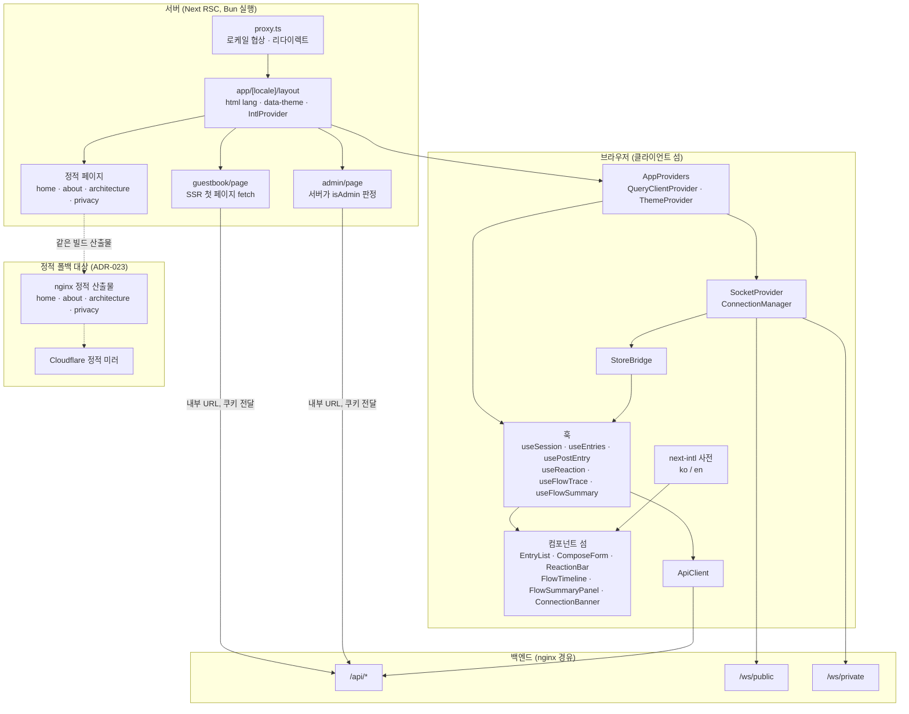

- **정적 4개 페이지는 API 호출 없이 빌드**된다. 로그인 표시 같은 동적 요소는 클라이언트 섬이 `/api/me` 로 늦게 채운다(실패하면 조용히 비로그인 상태로 둔다).
- 서버 컴포넌트의 `fetch` 는 컨테이너 내부 주소(`API_INTERNAL_URL`, 환경변수 — 이름은 [01](../01-repository-structure.md) 의 web 스키마와 맞춘다, **미확인**)로 보내고 브라우저의 쿠키를 그대로 전달한다. 브라우저 쪽 `ApiClient` 는 상대 경로 `/api/...`(같은 출처, CORS 없음).
- WS 는 클라이언트 전용이다(SSR 중 연결하지 않는다).

### 1.2 소스 레이아웃 (01 §1 의 `apps/web` 구체화)

```
apps/web/
├─ src/
│  ├─ proxy.ts                         # next-intl 로케일 협상 (Next 16 의 proxy)
│  ├─ app/[locale]/
│  │  ├─ layout.tsx                    # html lang, data-theme, IntlProvider, <AppProviders>
│  │  ├─ page.tsx                      # 홈 (정적)
│  │  ├─ about/page.tsx · architecture/page.tsx · privacy/page.tsx   # 정적
│  │  ├─ guestbook/page.tsx            # SSR 첫 페이지 + 클라이언트 섬
│  │  ├─ flow/page.tsx · metrics/page.tsx · login/page.tsx
│  │  ├─ admin/page.tsx                # 서버 판정
│  │  ├─ error.tsx · not-found.tsx
│  ├─ components/{shell,guestbook,flow,admin,common}/
│  ├─ hooks/                           # use-*.ts
│  ├─ lib/
│  │  ├─ api/{client.ts, errors.ts, keys.ts, ssr.ts}
│  │  ├─ ws/{connection-manager.ts, socket-client.ts, public-socket-client.ts,
│  │  │      private-socket-client.ts, reconnect-policy.ts, seq-tracker.ts,
│  │  │      message-router.ts, store-bridge.ts}
│  │  ├─ flow/{flow-model.ts, flow-track-store.ts, summary-transform.ts}
│  │  ├─ i18n/{error-messages.ts, format.ts}
│  │  └─ config/static-pages.ts        # staticPages (ADR-023 §7, 한 곳)
│  ├─ messages/{ko,en}.json
│  └─ styles/tokens.css
├─ content/                            # MDX·프로필·다이어그램 (12)
└─ test/                               # 컴포넌트·훅 시험 (08)
```

`apps/web` 은 `@pf/protocol` 외 `@pf/*` 를 임포트하지 않는다(경계 규칙 B8). 이모지 목록·길이 상한(글 500자·10줄, 이름 2~20자)·메시지 타입은 모두 `@pf/protocol` 에서 가져와 **서버와 같은 검증 코드**를 쓴다.

## 2. 컴포넌트 트리

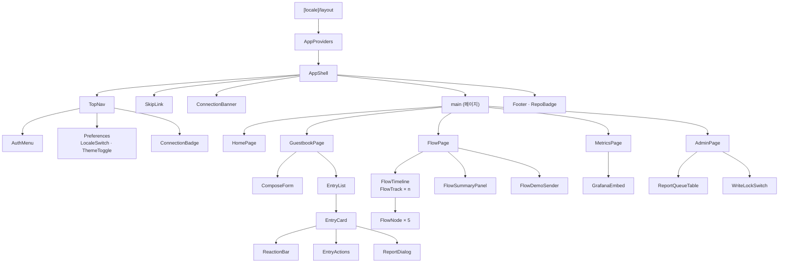

## 3. 통합 클래스·타입 다이어그램

React 컴포넌트는 합성이다. 상속은 **오류 계층·소켓 클라이언트·화면 모델**에만 쓴다. 클래스 3개 도식으로 나눈다.

### 3.1 API 계층 (ApiClient · 오류 계층 · 훅)

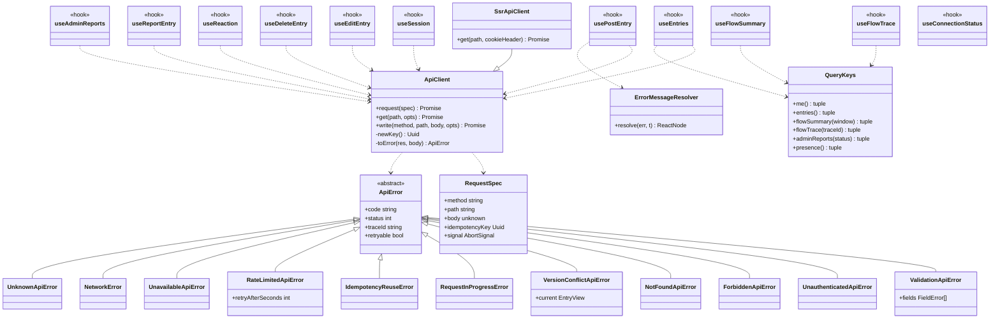

### 3.2 실시간 계층 (소켓 클라이언트 상속 · StoreBridge)

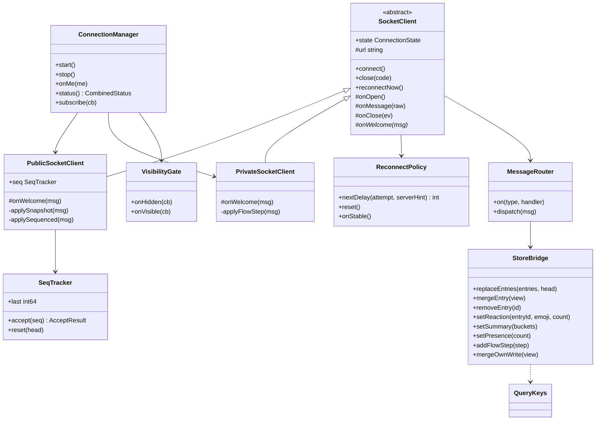

### 3.3 흐름 시각화·화면 모델·i18n

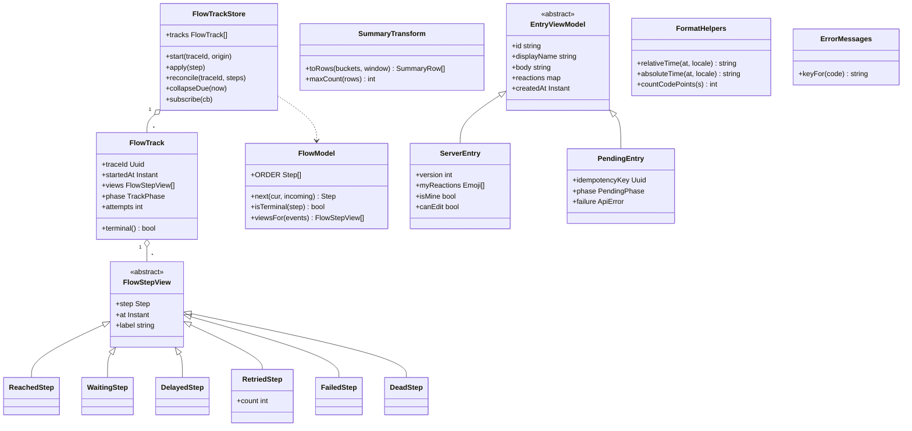

`FlowTrackStore`·`FlowModel` 은 **UI 프레임워크와 무관한 순수 TS** 로 둔다(컴포넌트 없이 단위 시험 가능, 08 §단위).

## 4. 횡단 규칙

### 4.1 SSR 첫 페이지 하이드레이션

| 단계 | 규칙 |
|---|---|
| 서버 | `guestbook/page.tsx`(RSC)가 `SsrApiClient.get('/api/entries?limit=20', cookie)` → `QueryClient.prefetchInfiniteQuery(['entries'])` → `dehydrate` → `<HydrationBoundary>` |
| 실패 격리 | prefetch 가 던져도 **페이지를 막지 않는다**(try/catch → 빈 상태로 렌더, 클라이언트가 곧바로 재조회). `console.error` 에 `traceId` 만 |
| 클라이언트 | `useEntries` 가 하이드레이션된 데이터를 사용하고 `staleTime` 30초 안에는 재요청하지 않는다 |
| 개인 필드 | SSR 시점에는 서버가 쿠키로 행위자를 알기 때문에 `myReactions/isMine/canEdit` 이 이미 채워진다(쿠키가 없으면 익명 기본값). 세션이 막 발급되는 첫 방문은 SSR 에서 익명 기본값이고, 클라이언트 `['me']` 확정 후 **재조회 1회**로 보정한다 |
| 캐시 금지 | SSR 응답은 개인화되므로 `Cache-Control: private, no-store` (정적 4개 페이지만 ISR) |

### 4.2 로케일 전환과 캐시

- 로케일은 경로 접두(`/ko`, `/en`)다. **전환은 전체 이동**(`next-intl` `Link` + `locale` → 레이아웃의 `[locale]` 세그먼트가 바뀌어 `AppProviders` 가 재마운트된다).
- 따라서 `QueryClient` 와 두 소켓이 재생성된다. 비용은 `['me']`·`['entries']` 재요청과 소켓 재접속뿐이라 **캐시 보존 장치를 만들지 않는다**(단순함 우선).
- 서버가 돌려주는 오류 `message` 는 `Accept-Language` 에 따라 달라지지만 클라이언트는 `errors.<code>` 사전을 쓰므로 캐시 키에 로케일을 넣지 않는다.
- 전환 직전의 **입력 중 글**은 `sessionStorage` 임시 보관(§WB-06)으로 보존한다.

### 4.3 정적 폴백에서의 웹

| 상황 | 동작 |
|---|---|
| nginx 가 앱 컨테이너 부재(502/503/504)를 감지 | 빌드 시 만든 정적 산출물(home·about·architecture·privacy, 두 로케일)을 응답한다 |
| 정적 페이지의 데모 링크 | 정적 HTML 안에서는 링크가 살아 있어 보이지만 클릭하면 nginx `error_page` 가 **"점검 중" 정적 페이지**로 대체한다(WB-17) |
| 정적 페이지 안의 클라이언트 섬 | `BackendStatus` 가 `/api/me` 실패를 감지하면 데모 CTA 옆에 "점검 중" 칩을 붙인다(WB-17). 실패해도 페이지는 깨지지 않는다 |
| 정적 미러(2단계) | 같은 산출물. 클라이언트 섬은 `/api/me` 가 안 되므로 위와 같이 동작한다 |

### 4.4 시간·식별자·난수

컴포넌트·훅은 `Date.now()`·`crypto.randomUUID()` 를 직접 쓰지 않고 `lib/runtime.ts` 의 `clock()`·`newId()` 를 거친다(시험에서 주입, 08 `FakeClock`·`FakeIdGenerator` 의 웹 대응).

### 4.5 지표(웹 vitals) 수집 여부

M1 에서는 **서버로 수집하지 않는다.** 이유: 수집 엔드포인트가 03 에 없고, 개인정보 최소 원칙(ADR-008)과 지표 레이블 규칙(ADR-007)을 따라 별도 결정이 필요하다. LCP/INP/CLS 는 Lighthouse CI(PR) 로 측정한다(07 §9). 클라이언트 수집이 필요해지면 ADR 로 결정한다 — **미확인**.

---

## 5. 기능별 상세 (WB-01 ~ WB-21)

각 절의 **시험** 열은 [08](../08-test-strategy.md) 의 계층(단위 L2 / 컴포넌트·계약 L2~L3 / E2E L3)을 가리킨다. 컴포넌트 시험 도구와 E2E 도구는 08 이 미결로 두었으므로 여기서도 **미확인**으로 둔다(구현 시작 시 G3 결과와 함께 선정).

### WB-01 앱 셸·레이아웃·로케일 라우팅 (S5-1)

| 항목 | 내용 |
|---|---|
| 목적 | 모든 페이지에 공통 뼈대(내비·스킵 링크·연결 배지·푸터)와 로케일·테마·Provider 를 제공한다 |
| 컴포넌트 | `proxy.ts`, `[locale]/layout.tsx`, `AppProviders`, `AppShell`, `TopNav`, `SkipLink`, `Footer` |
| 상태 | 서버: 로케일(경로), 테마(쿠키 `theme`). 클라이언트: 없음(Provider 가 보유) |
| 데이터 | 로케일 사전(`messages/{ko,en}.json`), 쿠키 `NEXT_LOCALE`·`theme` |

로케일 협상(`proxy.ts`, next-intl `localePrefix: 'always'`):

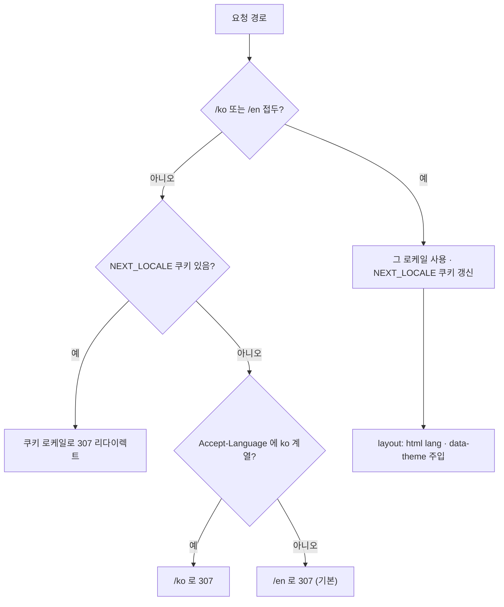

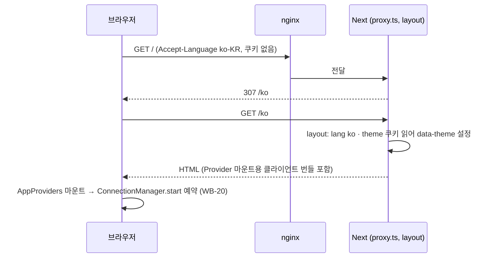

- `html` 에 `lang`·`data-theme` 를 **서버가 쓴다**(테마 깜빡임 방지). 쿠키 `theme` 가 없으면 `data-theme` 를 비우고 CSS `prefers-color-scheme` 로 결정한다.
- `SkipLink` 는 첫 탭 포커스 대상이며 `main#content` 로 이동한다. 헤더가 고정이면 `scroll-margin-top` 으로 포커스가 가려지지 않게 한다.
- **접근성**: 랜드마크 `header/nav/main/footer`, 언어 전환 링크에 `lang`·`hreflang`. **지표**: 없음. **시험**: `/` 협상 3분기(쿠키/Accept-Language/기본) 단위, E2E 로케일 유지.

### WB-02 홈 (S5-2)

| 항목 | 내용 |
|---|---|
| 목적 | 한 줄 소개와 데모 4개(흐름·실시간·지표·아키텍처)로의 진입점 |
| 경로·렌더링 | `/[locale]`, 정적(ISR 1h) — 정적 폴백 **포함** |
| 컴포넌트 | `HomePage`, `HeroSection`, `DemoCard × 4`, `RepoBadge`(WB-21) |
| 데이터 | 사전과 `site-vars`(저장소 링크). **API 호출 없음** |
| 지연 채움 | `AuthMenu`·`ConnectionBadge`·`BackendStatus` 섬만 클라이언트에서 채운다 |

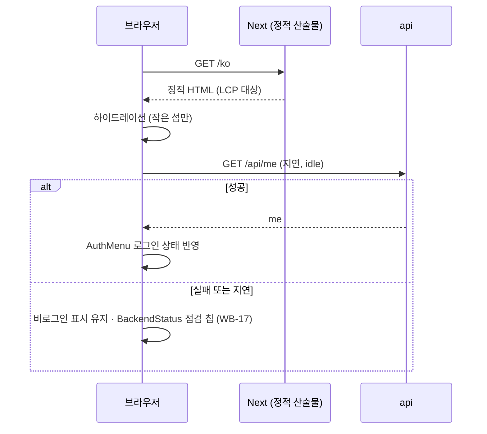

분기가 없는 정적 화면이라 순서도는 생략한다(분기는 WB-17 의 `BackendStatus`). **접근성**: 제목 계층 `h1` 1개, 카드는 링크 전체가 포커스 대상. **시험**: 정적 빌드가 API 없이 성공하는지(빌드 시험), axe.

### WB-03 자기소개 (S5-2)

| 항목 | 내용 |
|---|---|
| 경로 | `/[locale]/about`, 정적 |
| 컴포넌트 | `AboutPage`, `ProfileHeader`, `RoleList`, `SkillGroups`, `ContactSection` |
| 데이터 | `apps/web/content/{ko,en}/about.mdx` + `content/data/profile.{ko,en}.yaml` + `site-vars.yaml`([12 §1.1](../12-content.md)) |

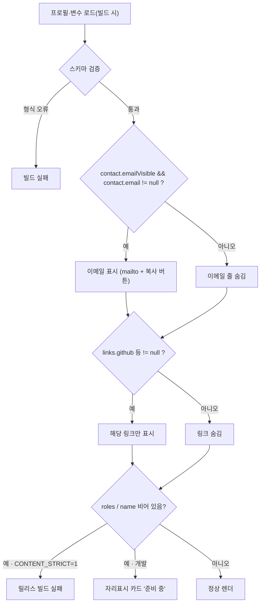

- 이메일은 스팸 수집을 줄이려고 HTML 에 `user [at] domain` 형태로 난독화하지 않고 **클릭 시 복사**를 우선한다(접근성 버튼). 최종 방식은 `emailVisible` 결정과 함께 **미확인**.
- **접근성**: `<address>` 영역, 링크 텍스트에 목적을 쓴다("GitHub 프로필"). **시험**: 변수 null 조합 3종(이메일 on/off, links 일부, 릴리스 엄격) 단위.

### WB-04 아키텍처 설명 (S5-2)

| 항목 | 내용 |
|---|---|
| 경로 | `/[locale]/architecture`, 정적 |
| 컴포넌트 | `ArchitecturePage`, `MdxSection`, `DiagramFigure`, `DemoLinkCard` |
| 데이터 | `content/{ko,en}/architecture.mdx`, `content/diagrams/*.mmd` → 빌드 시 SVG([12 §3](../12-content.md)) |

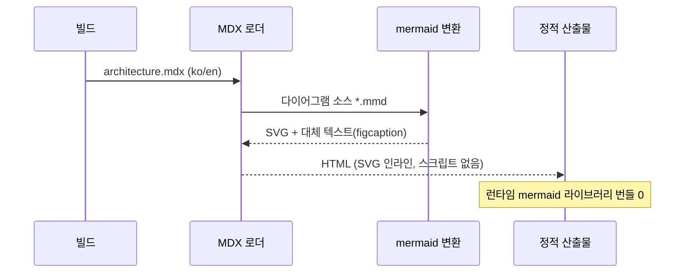

- 다이어그램은 **빌드 시 SVG 로 고정**한다(번들 크기·CSP·폴백 동작 보장). 각 그림에는 텍스트 대체(`figcaption`)를 둔다.
- 데모 링크 카드는 정적 폴백 중에도 보이지만 클릭 시 WB-17 의 점검 페이지가 뜬다. **시험**: 빌드 산출물에 mermaid 런타임 스크립트가 없는지 검사.

### WB-05 방명록 목록 (S5-3)

| 항목 | 내용 |
|---|---|
| 경로 | `/[locale]/guestbook`, 동적(SSR 첫 페이지, §4.1) |
| 컴포넌트 | `GuestbookPage`(RSC) → `EntryList`(섬) → `EntryCard`, `NewEntriesChip`, `EmptyState`, `ListSkeleton` |
| 훅 | `useEntries()`(무한 쿼리), `useEntryStream()`(WS 신규 글 버퍼) |
| 상태 | Query `['entries']`(서버 상태), UI: `bufferedNew: EntryId[]`, `isAtTop`, `sentinelVisible` |
| 데이터 | `GET /api/entries?limit=20&cursor=`, WS `snapshot`·`entry.*`·`reaction.updated` |

```
┌ 방명록 ────────────────────────────── ● 연결됨 · 접속 12 ┐
│ [ComposeForm]                                              │
│        ┌─ 새 글 2개 보기 ─┐   ← 스크롤이 위가 아닐 때만 표시     │
│ [EntryCard] [EntryCard] …                                  │
│ ── 더 불러오는 중… (sentinel) ──                              │
└────────────────────────────────────────────────────────────┘
```

신규 글 처리 규칙(스크롤 위치를 빼앗지 않는다):

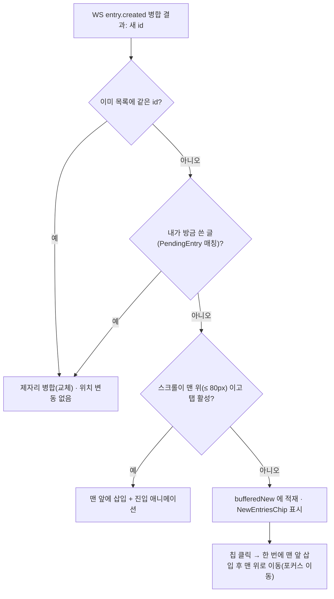

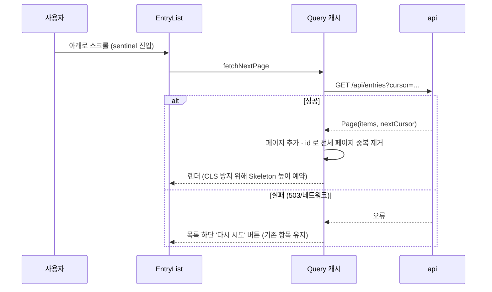

- **중복 제거**: 무한 쿼리의 모든 페이지를 평탄화할 때 `id` 기준 Map 으로 한 번 거르고, 정렬은 `id` 내림차순(uuid v7 = 시간순, 03 §5)을 유지한다. 새 글이 앞에 들어가 페이지 경계가 밀려도 커서(`entryId` 기준 키셋)는 변하지 않는다.
- 숨김/삭제(`entry.removed`)는 목록에서 제거하되, 사용자가 읽는 중이면 `aria-live` 로 알리지 않는다(요약만: "글 1개가 삭제되었습니다"는 내가 한 동작일 때만).
- **접근성**: 목록은 `role="feed"` + 각 카드 `article`. 신규 글은 `polite` 영역에 "새 글 N개" 만. 칩은 `button`. **지표**: 없음. **시험**: 컴포넌트(버퍼/즉시 삽입 분기, 중복 제거), E2E 2탭 실시간(AC-008).

### WB-06 글 작성 폼 (S5-3)

| 항목 | 내용 |
|---|---|
| 컴포넌트 | `ComposeForm`(react-hook-form), `NameField`, `BodyField`, `CharCounter`, `SubmitButton`, `AnonymousNotice` |
| 훅 | `usePostEntry()`, `useDraft()`(sessionStorage) |
| 상태 | 폼 값, `phase`: `idle`→`sending`→`idle`/`failed`, `retryAfterUntil`, `idempotencyKey` |
| 쓰기 잠금 | `Me.writeLocked` 가 true 이면 `SubmitButton` 을 비활성화하고 "점검 중" 안내를 보인다. 서버가 `503 write_locked`(+`Retry-After: 60`)를 돌려주면 같은 안내로 전환(07 §7.5) |
| 검증 | 클라이언트도 서버와 **같은 TypeBox 스키마**(`@pf/protocol`)로 검증: 글 1~500자(코드포인트, NFC), 최대 10줄, 이름 2~20자·제어문자 거부 |

```
 이름 [손님-a3f9      ]  2~20자
 [                                                    ]  123/500
 ※ 익명 글은 수정·삭제할 수 없습니다.  [GitHub로 로그인]  [남기기]
```

낙관적 갱신·재시도 알고리즘(작성):

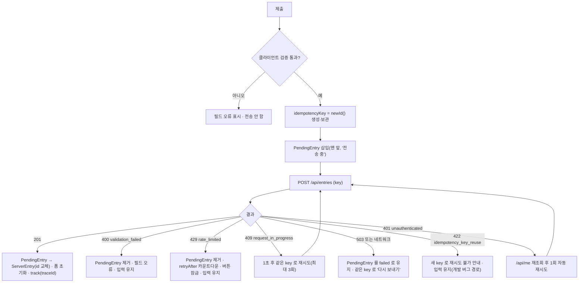

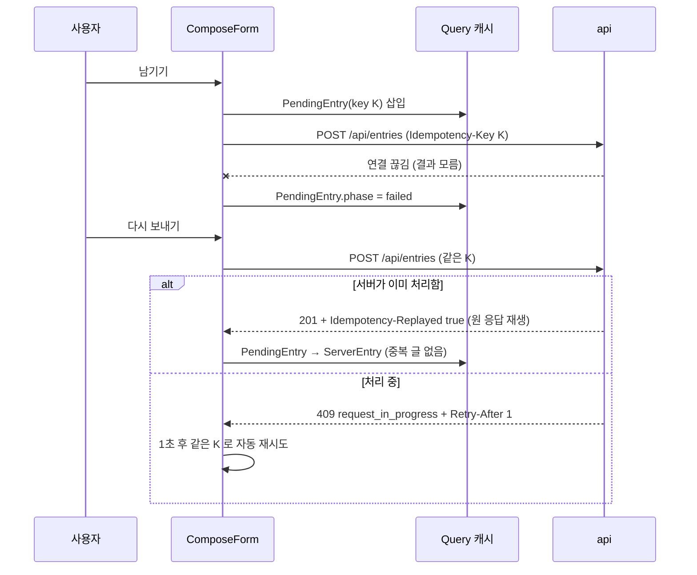

- **초안 보관**: 입력 중 내용은 `sessionStorage['draft.guestbook']` 에 디바운스(300ms) 저장하고 전송 성공 시 삭제한다. 탭/세션 종료 시 사라지며 서버에 보내지 않는다(개인정보 최소).
- `Idempotency-Key` 는 **한 번의 "의도"당 하나**다. 같은 의도의 재시도는 키를 재사용하고, 사용자가 본문을 고쳐 다시 제출하면 새 키를 쓴다.
- 이름 칸이 비어 있으면 서버가 `손님-xxxx` 를 부여한다. 로그인 사용자는 프로필 이름이 기본값이고 이름 칸을 읽기 전용으로 둔다.
- **접근성**: 라벨 연결, 오류는 `aria-describedby`, 카운터는 `aria-live="off"` 이고 450자 도달 시 1회 `polite` 안내. 제출 중에는 버튼 `aria-busy`. **시험**: 컴포넌트(검증 경계 500/501자·10/11줄, NFC 결합 문자), 훅(재시도·키 재사용), E2E(AC-001).

### WB-07 반응 막대 (S6-1)

| 항목 | 내용 |
|---|---|
| 컴포넌트 | `ReactionBar`, `ReactionButton × 6` (👍 ❤️ 🎉 😂 🤔 👀) |
| 훅 | `useReaction()` — 엔트리·이모지별 **직렬화 큐** |
| 상태 | 서버 확정값(`reactions[emoji]`, `myReactions`), 로컬 의도 `desired: boolean`, `inflight: boolean` |
| 데이터 | `PUT/DELETE /api/entries/{id}/reactions/{emoji}`(멱등), WS `reaction.updated`(총개수 덮어쓰기) |

연타 직렬화 알고리즘(엔트리·이모지 쌍마다 독립):

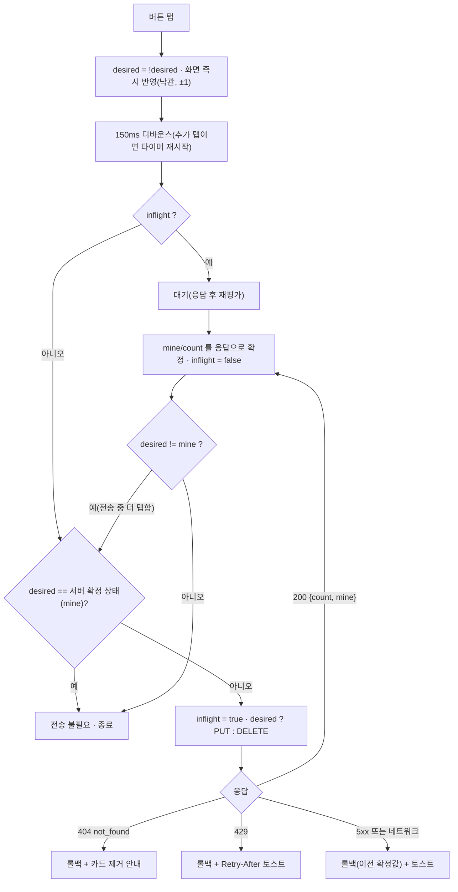

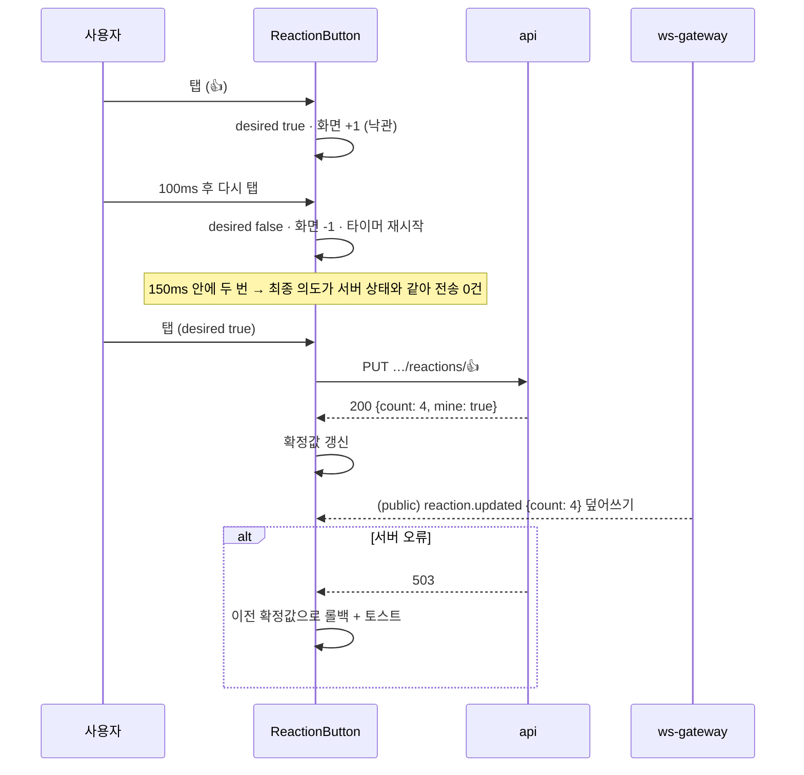

- **개수는 항상 총개수 덮어쓰기**다(WS `count`, 응답 `count`). 응답과 WS 가 엇갈려 도착해도 둘 다 "변경 후 총개수"이므로 마지막 도착값이 화면 값이 된다. 순간적 역전은 다음 WS 메시지로 수렴한다(허용, 다음 메시지가 곧 오기 때문).
- `myReactions` 는 **응답의 `mine`** 으로만 바꾸고 WS 로는 바꾸지 않는다(WS 는 개인 필드를 싣지 않는다, 04 §3.2).
- **접근성**: 각 버튼 `aria-pressed`, `aria-label` = `guestbook.reaction.*` + 현재 개수, 개수는 텍스트 병기. 전송 중에도 버튼은 활성 유지(포커스 이탈 방지). **시험**: 훅 단위(직렬화·디바운스·롤백, 가짜 시계), 동시 클릭 E2E.

### WB-08 본인 글 수정·삭제 (S6-2)

| 항목 | 내용 |
|---|---|
| 컴포넌트 | `EntryActions`, `EditInline`, `DeleteConfirmDialog`, `ConflictNotice` |
| 노출 조건 | `entry.canEdit === true` 일 때만 버튼 표시(서버가 계산, 익명 글은 항상 false) |
| 훅 | `useEditEntry()`, `useDeleteEntry()` |
| 데이터 | `PATCH /api/entries/{id}` `{body, expectedVersion}`, `DELETE` + `If-Match: version` |

수정 흐름(낙관 반영 안 함 — 버전 충돌 가능, 07 §7.4):

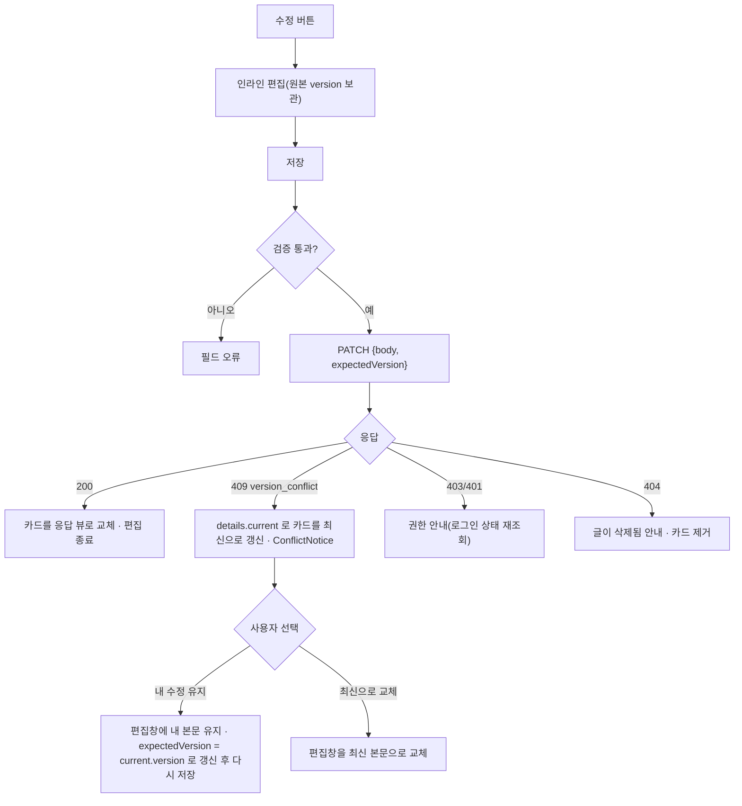

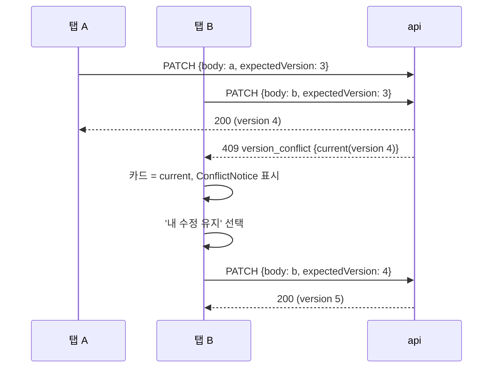

- 삭제: 확인 다이얼로그(포커스 트랩, 취소 시 호출 버튼으로 복귀) → 응답 대기 → 성공 시 제거. 409 이면 최신 뷰로 갱신하고 다시 확인을 요구한다.
- WS `entry.updated` 가 **편집 중인 글**에 도착하면 편집을 닫지 않고 `ConflictNotice` 만 띄운다(**입력 보존**). `entry.removed` 가 도착하면 **안내 후 편집을 종료**한다(삭제된 글은 저장해도 404).
- **접근성**: 다이얼로그 `role="alertdialog"`, 충돌 안내 `role="status"`. **시험**: 컴포넌트(409 두 선택지), E2E 2탭 동시 수정(AC-016), 익명 글에 버튼 미노출(AC-004).

### WB-09 신고 다이얼로그 (S6-3)

| 항목 | 내용 |
|---|---|
| 컴포넌트 | `ReportDialog`(`Dialog`), `ReasonSelect`, `NoteField` |
| 입력 | `reasonCode`(확정, 03 §4.1: `spam` `abuse` `personal_info` `off_topic` `other`; UI 라벨은 i18n 키 `report.reason.<code>`), `note`(선택, 200자) |
| 데이터 | `POST /api/entries/{id}/reports` → `202` |

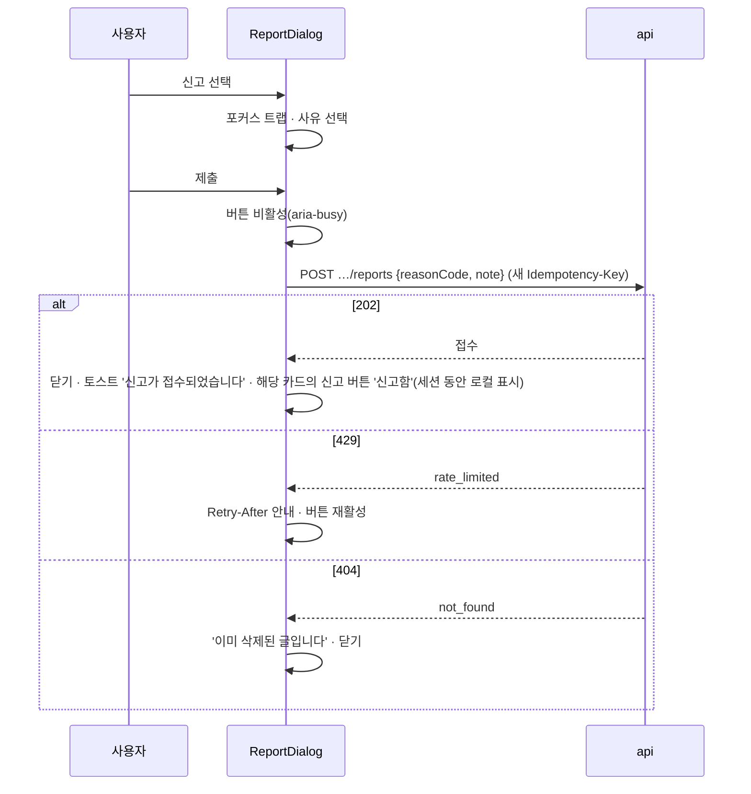

분기가 단순해(성공/429/404/그 외 일반 오류) 별도 순서도는 생략한다. 같은 글에 대한 중복 신고 방지는 서버 규칙이 없으므로 **클라이언트가 세션 중 한 번만 허용**하는 표시를 둔다(새로고침 후에는 다시 가능 — 서버 규칙 부재, **미확인**). **접근성**: `Dialog` 포커스 트랩·복귀, `Esc` 닫기, 오류는 필드 연결. **시험**: 컴포넌트(상태 4종).

### WB-10 내 흐름 시각화 (S5-5)

| 항목 | 내용 |
|---|---|
| 경로·컴포넌트 | `/[locale]/flow` → `FlowPage` → `FlowDemoSender`, `FlowTimeline` → `FlowTrack × n` → `FlowNode × 5`. 방명록 화면에서도 작성 직후 작은 `FlowTrackInline` 으로 같은 `FlowTrackStore` 를 구독한다 |
| 순수 로직 | `lib/flow/flow-model.ts`, `flow-track-store.ts` (UI 무관) |
| 입력 | WS `private` `flow.step`(`traceId`, `step`, `at`, `detail?`), REST `GET /api/flow/trace/{traceId}` 보충 |
| 시작 조건 | **내가 보낸 쓰기 응답의 `traceId`** 로만 트랙을 만든다. 모르는 `traceId` 의 `flow.step` 은 무시(07 §7.2) |

#### 상태 모델 (트랙 단위)

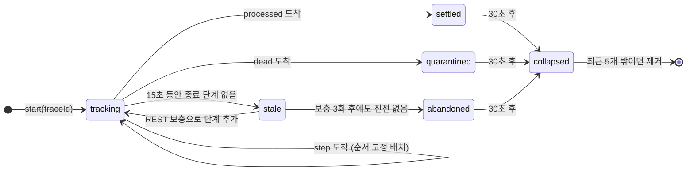

#### 단계 적용 알고리즘 (`FlowModel.next`)

- 단계 서열: `written(0) < outboxed(1) < dispatched(2) < received(3) < processed(4)`. 예외 단계 `retried`/`failed`/`dead` 는 서열 밖의 **수식 상태**다.
- 도착 순서와 상관없이 노드 위치는 서열로 고정한다. 더 높은 서열이 먼저 도착하면 **낮은 서열은 "도착(추정)"으로 채우고** 시각 `at` 은 비운다(`—`).
- `retried` 는 직전 서열 노드에 `RetriedStep(count)` 배지를 붙이고 노드를 진행 중으로 되돌린다. `failed` 후 `dead` 가 오면 마지막 노드를 격리로 닫는다.
- 같은 `(traceId, step, at)` 의 재수신은 무시한다(재접속 중복 안전).

```mermaid
flowchart TD
    IN["flow.step 수신"] --> K{"traceId 가 내 트랙?"}
    K -- "아니오" --> IGN["무시"]
    K -- "예" --> DUP{"같은 (step, at) 이미 있음?"}
    DUP -- "예" --> IGN
    DUP -- "아니오" --> T{"step 종류"}
    T -- "서열 단계" --> FILL["낮은 서열 빈 노드를 추정 도착으로 채움 → 해당 노드 완료 → 다음 노드 대기"]
    T -- "retried" --> RET["해당 노드에 재시도 n회 배지 · 진행 중으로"]
    T -- "failed" --> FAIL["노드 실패(✕)"]
    T -- "dead" --> DEAD["노드 격리(▣) · 트랙 quarantined"]
    FILL --> TERM{"processed ?"}
    TERM -- "예" --> SET["트랙 settled · 30초 후 접힘"]
    TERM -- "아니오" --> WAIT["5초 타이머 재시작(지연 표시용)"]
```

#### 시퀀스 — 정상 + 실패 경로

```mermaid
sequenceDiagram
    participant U as 사용자
    participant D as FlowDemoSender
    participant A as api
    participant S as FlowTrackStore
    participant V as PrivateSocketClient
    participant R as REST trace 조회
    U->>D: 보내기
    D->>A: POST /api/entries
    A-->>D: 201 {entry, traceId}
    D->>S: start(traceId)
    V-->>S: flow.step written, outboxed, dispatched ...
    alt private 연결이 live
        V-->>S: received, processed
        S->>S: 트랙 settled
    else private 이 끊겨 있음 또는 5초 지연
        S->>S: DelayedStep 표시(아이콘+텍스트)
        loop 최대 15회, 1초 간격, 종료 단계 도착 시 중단
            S->>R: GET /api/flow/trace/{traceId}
            R-->>S: steps[]
            S->>S: reconcile(traceId, steps)
        end
        alt 15회 후에도 종료 단계 없음
            S->>S: abandoned · '서버에서 처리 중일 수 있습니다' 안내
        end
    end
```

#### `FlowDemoSender` (제안)

흐름 화면의 "보내기" 는 **기존 `POST /api/entries`** 로 미리 정한 문구(`[데모] …`, 사전 키 `flow.demo.preset.*`)를 글로 올린다. 즉 방명록에 실제 글이 하나 생긴다. 별도 "데모 전용 이벤트" 엔드포인트는 카탈로그에 없다 — **수정 요청 참조**.

- **와이어프레임**은 07 §2.3 과 같다. `< md` 에서는 세로 트랙(노드가 위→아래), 단계 이름은 노드 옆에 항상 텍스트로 표기한다.
- **애니메이션**: 노드 사이 연결선이 채워지는 전이 150~300ms. `prefers-reduced-motion: reduce` 이면 즉시 전환하고 진행 중 표시는 펄스 대신 **정적 반원(◐) + "진행 중" 텍스트**로 대체한다.
- **접근성**: 노드 `aria-label="{단계명}: {상태}, {시각}"`, 트랙 `role="img"` 요약 문장("글 작성 흐름: 5단계 중 3단계 완료"). 단계 변경은 `aria-live="polite"` 영역에 **트랙 요약 한 줄만** 갱신(노드마다 알리지 않는다). 색만으로 구분하지 않는다(07 §3.2).
- **지표**: 없음. **시험**: `FlowModel` 단위(순서 역전·누락·재시도·dead, 08 단위), 컴포넌트(reduced-motion 분기), E2E(AC-001 화면 쪽: 작성 후 5단계가 순서대로 채워짐).

### WB-11 전체 익명 요약 (S5-5)

| 항목 | 내용 |
|---|---|
| 컴포넌트 | `FlowSummaryPanel`, `SummaryBars`, `SummaryTable`(표 보기 토글), `WindowTabs`(5분/1시간), `PrivacyNote` |
| 훅 | `useFlowSummary(window)` |
| 데이터 | 첫 화면: `snapshot.flow` 또는 `GET /api/flow/summary?window=`. 갱신: WS `flow.summary`(`buckets`) |
| 프라이버시 | 서버가 가공한 **개수만** 받는다(식별자 필드 자체가 스키마에 없음, AC-009). "다른 방문자의 내용·식별자는 보이지 않습니다" 문구 고정 |

#### 데이터 변환 (`SummaryTransform.toRows`)

입력: `buckets: [{ at, step, count }]`(분 단위 버킷). 출력: 단계별 합계 행.

1. `window=5m` → 현재 시각 기준 최근 5분(5 버킷), `1h` → 60 버킷의 버킷만 남긴다(`at` 필터).
2. `step` 별로 `count` 를 합산한다. 서열 단계 5개는 항상 행으로 만들고(0 이어도 표시), `retried`/`failed`/`dead` 는 **합계 > 0 일 때만** 행을 만든다(단 `dead` 는 0 이어도 항상 표시 — 격리 0건이 곧 정상이라는 신호).
3. 막대 길이 = `count / max(count)`(상대 비율), 숫자는 항상 텍스트로 병기한다. `max = 0` 이면 막대 없음.
4. 행 순서는 단계 서열 → 예외 단계.

```mermaid
flowchart TD
    A["첫 렌더"] --> S{"snapshot.flow 있음?"}
    S -- "예" --> U["그 값으로 5m 창 채움"]
    S -- "아니오" --> F["GET /api/flow/summary?window=5m"]
    U --> L["flow.summary 수신 대기(5m 덮어쓰기)"]
    F --> L
    L --> T{"창 탭 전환?"}
    T -- "1h 선택" --> P["WS 는 5m 만 푸시 → 1h 는 REST 조회 + 30초마다 갱신"]
    T -- "5m 로 복귀" --> L
    P --> E{"조회 실패?"}
    E -- "예" --> ERR["이전 값 유지 + '갱신 실패' 보조 문구"]
    E -- "아니오" --> RENDER["rows 재계산·렌더"]
```

```mermaid
sequenceDiagram
    participant C as FlowSummaryPanel
    participant Q as Query 캐시
    participant G as PublicSocketClient
    participant A as api
    C->>Q: 키 flow,summary,5m 구독
    G-->>Q: snapshot.flow (최초) → 캐시 채움
    G-->>Q: flow.summary buckets → 5m 키 덮어쓰기
    Q-->>C: rows 재계산 (변경분만 재렌더)
    C->>Q: 1h 탭 선택 → 키 flow,summary,1h
    Q->>A: GET /api/flow/summary?window=1h (staleTime 30초)
    A-->>Q: buckets
```

- 04 의 `flow.summary` 본문(`{buckets}`)에는 창 정보가 없다 → 푸시는 **기본 창(5분)** 만이라는 가정이다(수정 요청 참조).
- **접근성**: 막대 그래픽은 `aria-hidden`, 의미는 표(`<table>`, 열: 단계/건수)로 제공하고 "표로 보기" 토글을 기본 제공. 갱신은 `aria-live` 에 알리지 않는다(빈번). **시험**: `SummaryTransform` 단위(창 필터·합산·0행 규칙), 구조 시험(AC-009: 이 컴포넌트가 받는 타입에 식별자 필드가 없음).

### WB-12 연결 상태 배너 (S5-4)

| 항목 | 내용 |
|---|---|
| 컴포넌트 | `ConnectionBadge`(내비, 항상), `ConnectionBanner`(문제 있을 때만, `Alert`) |
| 훅 | `useConnectionStatus()` → `CombinedStatus` (`public`, `private`, `online`) |
| 입력 | `ConnectionManager.status()` 구독, `navigator.onLine`, 마지막 `hb` 수신 시각 |

public/private 상태 조합별 표시(상태 값: `connecting` `live` `unstable` `backoff` `stopped` `idle`=세션 대기):

| public | private | 배지 | 배너 | 비고 |
|---|---|---|---|---|
| live | live | ● 연결됨 | 없음 | 정상 |
| live | idle/connecting | ● 연결됨 | 없음 | 세션 확인 중, 내 흐름만 잠시 대기 |
| live | backoff | ◐ 일부 연결 | "내 흐름 상세 연결이 끊겼습니다. 자동 재연결 중" (status) | 흐름 화면에서만 배너, 그 외 화면은 배지만 |
| live | stopped(4401 반복) | ◐ 일부 연결 | "로그인 상태를 확인하는 중" 후 `/api/me` 재조회 | 세션 회전 직후 |
| connecting | any | ◐ 연결 중 | "연결 중…" (status) | 최초 진입 직후 3초 이내는 배너 숨김(깜빡임 방지) |
| backoff | any | ⟳ 재연결 대기 | "실시간 갱신이 멈췄습니다. n초 후 재시도 [지금 시도]" (status) | 목록은 마지막 상태 유지, REST 동작 |
| unstable(hb 지연) | any | ◐ 불안정 | "연결이 불안정합니다" (status) | 마지막 hb 이후 **50초**(주기 25초의 2배) 초과 |
| idle(숨김 탭 5분 후 의도적 닫음) | idle | ○ 일시 중지 | 없음 (탭 복귀 시 자동 재연결, public 은 `resume`) | 종단 `stopped` 가 아님 |
| stopped(4409) | any(private) | ◐ 일부 연결 | "다른 탭에서 열려 있습니다. 이 탭은 내 흐름을 받지 않습니다" (status) | 재접속하지 않음. 다른 탭이 유효 |
| stopped(4400) | any | ✕ 비활성 | "실시간이 비활성입니다. 새로고침해 주세요" (**alert**) | 클라이언트 버그/버전 불일치 |
| any | any, `online=false` | ○ 오프라인 | "오프라인입니다" 로 문구 교체 | `online` 이 우선 |

```mermaid
flowchart TD
    S["CombinedStatus 변경"] --> O{"online == false ?"}
    O -- "예" --> OFF["배지 오프라인 · 배너 '오프라인입니다'"]
    O -- "아니오" --> P{"public 상태"}
    P -- "stopped" --> A["alert 배너(새로고침 안내)"]
    P -- "backoff" --> B["status 배너(카운트다운 + 지금 시도)"]
    P -- "connecting" --> C{"최초 진입 3초 이내?"}
    C -- "예" --> N["배너 없음"]
    C -- "아니오" --> CB["status 배너 '연결 중'"]
    P -- "live" --> V{"private 상태"}
    V -- "live 또는 idle" --> OK["배지 연결됨 · 배너 없음"]
    V -- "backoff/stopped" --> PB["일부 연결 배너(흐름 화면에서만)"]
```

```mermaid
sequenceDiagram
    participant G as ws-gateway
    participant M as ConnectionManager
    participant H as useConnectionStatus
    participant U as 사용자
    G-->>M: close 1001 (bye 선행)
    M->>H: public backoff, 대기 n초
    H->>U: 배너 '실시간 갱신이 멈췄습니다 …' (status 낭독)
    U->>H: [지금 시도]
    H->>M: reconnectNow()
    M->>G: Upgrade + hello resume
    G-->>M: welcome (replay 또는 snapshot)
    M->>H: public live
    H->>U: 배너 제거 · 변경이 많았으면 토스트 1회
```

- **접근성**: 배너는 `role="status"`(심각한 것만 `alert`), 카운트다운 숫자는 매초 낭독하지 않는다(처음과 시도 시점에만 갱신). 배지는 색+아이콘+텍스트. **시험**: 상태 조합 표 전체를 표 구동 컴포넌트 시험으로(08 재접속 시험과 연결), E2E 서버 재시작.

### WB-13 운영 지표 페이지 (S7-4)

| 항목 | 내용 |
|---|---|
| 경로·컴포넌트 | `/[locale]/metrics`(정적 셸) → `MetricsPage`, `GrafanaEmbed`, `MetricsFallback`, `MetricsExplainer` |
| 데이터 | Grafana Public dashboards URL(사이트 변수 **`site.metricsEmbedUrl`**, 12 §1.1; 비어 있으면 안내·링크. 임베드 동작은 G6) |
| 정적 폴백 | 제외("점검 중") |

iframe 요건(관문 G6 에서 실측으로 확정, 아래는 **현재 가정**):

| 항목 | 값 |
|---|---|
| `sandbox` | `allow-scripts allow-same-origin` (Grafana 앱 실행에 필요). `allow-forms`·`allow-popups`·`allow-top-navigation` 은 주지 않는다 |
| `referrerpolicy` | `no-referrer` |
| `loading` | `lazy`, 높이 고정(예: 720px)으로 CLS 방지 |
| CSP `frame-src` | Grafana 공개 대시보드 출처(같은 출처 경로 프록시면 `'self'`, 별도 호스트면 해당 출처) — [10](../10-security.md) 헤더 표에 반영 필요(수정 요청) |
| Grafana 쪽 | `allow_embedding`(설정), 공개 대시보드 편집·탐색 UI 비노출 확인(G6) |

```mermaid
flowchart TD
    M["페이지 진입"] --> CFG{"site.metricsEmbedUrl 설정됨?"}
    CFG -- "아니오" --> FB1["MetricsFallback: '지표 화면 준비 중'"]
    CFG -- "예" --> PRB["HEAD 로 사전 확인(같은 출처 프록시 경로일 때)"]
    PRB --> OK{"2xx ?"}
    OK -- "아니오" --> FB2["MetricsFallback: 점검 안내 + 설명 링크"]
    OK -- "예" --> MNT["iframe 마운트"]
    MNT --> T{"8초 안에 load 이벤트?"}
    T -- "예" --> SHOW["표시 · 하단 Explainer"]
    T -- "아니오" --> FB3["MetricsFallback + '새 탭에서 열기' 링크"]
```

```mermaid
sequenceDiagram
    participant B as 브라우저
    participant X as nginx
    participant G as Grafana
    B->>X: GET /ko/metrics (정적 셸)
    X-->>B: HTML
    B->>X: HEAD 공개 대시보드 URL
    X->>G: 전달
    alt 정상
        G-->>X: 200
        X-->>B: 200
        B->>B: iframe 마운트(sandbox, lazy)
        B->>X: GET 대시보드
        X-->>B: 대시보드 (읽기 전용)
    else 오류 또는 타임아웃
        X-->>B: 5xx 또는 무응답
        B->>B: MetricsFallback 표시
    end
```

- iframe 의 HTTP 오류는 `onerror` 로 잡히지 않으므로 **사전 HEAD 확인 + 로드 타임아웃** 두 가지를 쓴다(별도 호스트면 CORS 때문에 HEAD 불가 → 타임아웃만, **미확인**).
- `MetricsExplainer`: "지표 레이블에 식별자를 쓰지 않습니다"(ADR-007) 설명과 지표 목록 링크.
- **접근성**: iframe `title` 필수("운영 지표 대시보드, 읽기 전용"), 대안으로 요약 표 링크. **지표**: 없음. **시험**: 컴포넌트(3분기 폴백), E2E G6 통과 시 임베드에 편집 UI 없음 확인(수동 체크리스트 병행).

### WB-14 관리자 신고 큐 (S6-3)

| 항목 | 내용 |
|---|---|
| 경로·컴포넌트 | `/[locale]/admin` → `AdminPage`(RSC 가드) → `ReportQueueTable`, `ReportRow`, `StatusFilter`, `WriteLockSwitch` |
| 서버 판정 | RSC 가 `SsrApiClient.get('/api/me')` 로 `isAdmin` 확인. 아니면 **403 화면**을 렌더(클라이언트 숨김이 아님, 06 §5). 내비에도 노출하지 않는다 |
| 훅 | `useAdminReports(status)`, `useHideEntry()`, `useResolveReport()`, `useWriteLock()` |
| 데이터 | `GET /api/admin/reports`, `POST /api/admin/entries/{id}/hide|unhide`, `POST /api/admin/reports/{id}/resolve`, `POST /api/admin/write-lock` |

```mermaid
sequenceDiagram
    participant B as 브라우저
    participant N as Next (RSC)
    participant A as api
    B->>N: GET /ko/admin (쿠키)
    N->>A: GET /api/me
    alt isAdmin
        A-->>N: me.isAdmin true
        N->>A: GET /api/admin/reports?status=open (prefetch)
        A-->>N: Page(ReportView)
        N-->>B: HTML + 하이드레이션 데이터
    else 관리자 아님
        A-->>N: me.isAdmin false
        N-->>B: 403 화면 (데이터 조회 안 함)
    end
    B->>A: POST /api/admin/entries/{id}/hide {expectedVersion}
    alt 200
        A-->>B: traceId
        B->>B: 행 상태 '처리 중' → 큐 무효화(재조회)
    else 409 version_conflict
        A-->>B: details.current
        B->>B: 최신 상태(이미 숨김/수정됨)로 행 갱신 · 재확인 요구
    end
```

```mermaid
flowchart TD
    R["신고 행 작업 선택"] --> K{"작업"}
    K -- "숨김" --> H["확인 다이얼로그"]
    H --> HP["POST hide {expectedVersion = 행의 entryVersion}"]
    K -- "기각" --> D["POST resolve {resolution: dismissed}"]
    K -- "숨김 해제" --> U["POST unhide {expectedVersion}"]
    HP --> RES{"응답"}
    D --> RES
    U --> RES
    RES -- "200" --> INV["['admin','reports'] 무효화 · 토스트"]
    RES -- "409" --> RE["최신 상태 반영 · 이미 처리됨이면 안내"]
    RES -- "403" --> NA["권한 없음 · 세션 재확인"]
```

- **쓰기 잠금 스위치**: 낙관 반영 없이 응답 후 상태 반영, 변경 직후 `이유`(선택) 입력. 현재 상태는 `GET /api/me` 의 `Me.writeLocked` 로 읽는다(03 §4.3, 별도 읽기 경로 불필요). 응답은 `{ writeLocked, changedAt }`.
- `ReportView` 에 **`entryVersion`** 이 있어야 숨김 요청이 `expectedVersion` 을 보낼 수 있다(03 §4.3 의 `ReportView` 가 미정의 — 수정 요청).
- **접근성**: 표 `caption`, 행 작업은 `button` + 대상 글 발췌를 `aria-label` 에 포함. **시험**: RSC 가드(비관리자 403), 컴포넌트(409 갱신), E2E AC-006(숨김 즉시 공개 목록에서 제외).

### WB-15 로그인·로그아웃·프로필 UI (S5-3)

| 항목 | 내용 |
|---|---|
| 컴포넌트 | `AuthMenu`(내비 드롭다운), `LoginButton`, `ProfileDialog`, `UserBadge` |
| 훅 | `useSession()`(`['me']`), `useUpdateProfile()`, `useLogout()` |
| 상태 | `me.kind`: `anonymous` \| `user`, `me.isAdmin` — 서버가 계산한 값만 쓴다 |
| 데이터 | `GET /api/me`, `GET /api/auth/github?returnTo=`, `POST /api/auth/logout`, `PUT /api/me/profile` |

`AuthMenu` 표시: 익명 → "손님-xxxx" + [GitHub로 로그인]. 로그인 → 표시 이름 + [프로필][로그아웃](+ 관리자면 [관리자]).

```mermaid
sequenceDiagram
    participant U as 사용자
    participant M as AuthMenu
    participant A as api
    participant GH as GitHub
    participant C as ConnectionManager
    U->>M: GitHub로 로그인
    M->>M: 현재 경로 + 초안은 sessionStorage 에 보관
    M->>A: 이동(전체 페이지) GET /api/auth/github?returnTo=/ko/guestbook
    A-->>GH: 302 인가 요청
    GH-->>A: 콜백 code, state
    A-->>M: 302 returnTo + Set-Cookie(새 세션)
    Note over M,C: 전체 이동이므로 앱이 새로 시작 · 두 소켓이 새로 연결 · 이전 익명 private 은 서버가 4401 로 닫음
    M->>A: GET /api/me
    A-->>M: kind user
    U->>M: 로그아웃
    M->>A: POST /api/auth/logout
    A-->>M: 204 (세션 삭제, 쿠키 만료)
    M->>M: ['me'] 무효화 · ['entries'] 무효화(개인 필드 재계산)
    M->>A: GET /api/me (새 익명 세션 발급)
    A-->>M: kind anonymous
    M->>C: onMe(me) → private 소켓 재연결(새 세션)
```

```mermaid
flowchart TD
    L["로그인 클릭"] --> RT["returnTo = 현재 pathname + search (같은 출처 상대 경로만)"]
    RT --> NAV["location.assign('/api/auth/github?returnTo=…')"]
    NAV --> OK{"콜백 결과"}
    OK -- "성공" --> BACK["returnTo 로 복귀 · me 확정"]
    OK -- "사용자 거부/오류" --> ERR["returnTo 로 복귀 + 쿼리 loginError → 토스트 '로그인되지 않았습니다'"]
    BACK --> DR{"sessionStorage 에 초안?"}
    DR -- "예" --> RES["작성 폼에 초안 복원"]
    DR -- "아니오" --> END["끝"]
    ERR --> DR
```

- 로그인은 **fetch 가 아니라 전체 페이지 이동**이다(쿠키 설정·리다이렉트 체인). 클라이언트는 `returnTo` 에 `/` 로 시작하고 `//` 가 아닌 경로만 넣는다(서버도 검증, 06 §3.2).
- 프로필 이름 변경은 `PUT /api/me/profile {displayName}`(2~20자, 폼 검증은 글과 같은 스키마). 성공하면 `['me']` 를 갱신하고, **과거 글의 표시 이름은 바뀌지 않는다**(05 §2 설명)를 다이얼로그에 안내한다.
- 로그아웃/로그인 직후 `['entries']` 를 무효화해 `isMine/canEdit/myReactions` 를 재계산한다.
- **접근성**: 드롭다운 `DropdownMenu`(방향키), 로그인 상태 변경은 `polite` 로 알림. **시험**: 컴포넌트(상태별 메뉴), E2E 로그인 흐름(모의 OAuth 서버는 08 미결), `returnTo` 검증 단위.

### WB-16 개인정보·쿠키 안내 (S5-2)

| 항목 | 내용 |
|---|---|
| 경로·렌더링 | `/[locale]/privacy`, 정적 — 정적 폴백 **포함** |
| 컴포넌트 | `PrivacyPage`, `CookieTable`, `RetentionTable`, `CookieNotice`(조건부) |
| 데이터 | `content/{ko,en}/privacy.mdx` + `site-vars.yaml`(`privacy.*`)([12 §4](../12-content.md)) |

```mermaid
flowchart TD
    B["빌드/렌더"] --> V{"privacy.cookieBanner == true ?"}
    V -- "아니오(기본)" --> N["배너 없음 · 페이지에 필수 쿠키만 사용함을 명시"]
    V -- "예" --> CN["CookieNotice 렌더 · 동의 저장(기능 쿠키 1개)"]
    N --> D{"privacy.deletionContact != null ?"}
    CN --> D
    D -- "예" --> SHOW["삭제 요청 연락 수단 표시"]
    D -- "아니오" --> PH["'문의 수단 준비 중' 자리표시"]
    SHOW --> R{"deletionResponseDays != null ?"}
    PH --> R
    R -- "예" --> DAYS["처리 기한 문장 표시"]
    R -- "아니오" --> ND["기한 문장 생략"]
```

- 쿠키 표는 06/10 과 맞춘다: 세션(`__Host-sid`, 7일), OAuth 임시(`__Secure-oauth`, 10분), 환경설정(`NEXT_LOCALE`·`theme`, 기능). 수집하지 않는 것(접속 주소 저장 안 함, ADR-023)을 명시한다.
- 이 화면은 **분기 대부분이 빌드 시점**이라 시퀀스는 생략한다. **접근성**: 표에 `caption`, 문서형 헤딩 계층. **시험**: 변수 조합별 렌더 단위, 쿠키 이름이 06/10 과 일치하는지 문서 대조 시험(수동).

### WB-17 오류·오프라인·폴백 UX (S8-2)

| 항목 | 내용 |
|---|---|
| 컴포넌트 | `error.tsx`(라우트), `not-found.tsx`, `IslandErrorBoundary`, `OfflineNotice`, `BackendStatus`, `MaintenanceCard` |
| 정적 점검 페이지 | nginx 가 데모 경로(`/guestbook`·`/flow`·`/metrics`·`/admin` 등) 오류 시 반환하는 정적 HTML(로케일별) — 산출물은 빌드가 같이 만든다(`staticPages` 와 함께 관리) |

계층:

| 층 | 처리 |
|---|---|
| 라우트 오류 | `error.tsx`: 일반 안내 + `reset()` 버튼 + `traceId`(있을 때만) 표시. 스택 노출 금지 |
| 섬 단위 | `IslandErrorBoundary`: 방명록 목록·흐름 패널 중 하나가 죽어도 나머지는 동작. 해당 영역만 "불러오지 못했습니다 [다시 시도]" |
| 오프라인 | `navigator.onLine=false` → `OfflineNotice`(상단 얇은 바). 쓰기 버튼은 비활성하지 않고 전송 시 네트워크 오류 경로(WB-06)로 처리 |
| 백엔드 다운 | `BackendStatus`: `['me']` 가 연속 3회 네트워크 오류/5xx(최근 60초)면 `backendDown=true` → 데모 CTA 에 "점검 중" 칩, 링크 `aria-disabled` |

```mermaid
flowchart TD
    Q["['me'] 결과"] --> OK{"성공?"}
    OK -- "예" --> RST["failCount = 0 · backendDown = false"]
    OK -- "아니오" --> T{"401/403/4xx?"}
    T -- "예" --> NF["백엔드 정상(권한 문제) · failCount 유지 0"]
    T -- "아니오(네트워크·5xx)" --> INC["failCount += 1 (60초 창)"]
    INC --> TH{"failCount ≥ 3 ?"}
    TH -- "예" --> DN["backendDown = true · 데모 CTA 점검 칩 · 30초 후 자동 재확인"]
    TH -- "아니오" --> WT["재시도 대기(Query 지수 백오프)"]
    DN --> RC{"재확인 성공?"}
    RC -- "예" --> RST
    RC -- "아니오" --> DN
```

```mermaid
sequenceDiagram
    participant B as 브라우저 (정적 홈)
    participant X as nginx
    participant A as api
    B->>X: GET /ko (앱 다운 → 정적 산출물)
    X-->>B: 정적 홈
    B->>X: GET /api/me
    X-->>B: 502 (upstream 없음)
    B->>B: failCount 증가 · 3회 후 점검 칩
    B->>X: GET /ko/guestbook (사용자가 클릭)
    X-->>B: 정적 점검 페이지 (error_page)
    Note over B,X: 앱 복구 후 BackendStatus 재확인 성공 → 칩 제거
```

- 정적 미러(2단계)에서는 `/api/me` 자체가 다른 출처에서 실패하므로 같은 경로로 점검 칩이 뜬다. **접근성**: `OfflineNotice` `role="status"`, 점검 칩은 텍스트("점검 중") 포함. **시험**: 컴포넌트(실패 카운트 창), E2E AC-010(앱 컨테이너 중지 시 정적 4페이지 응답 + 데모 점검 안내).

### WB-18 테마·언어 토글 (S5-1)

| 항목 | 내용 |
|---|---|
| 컴포넌트 | `Preferences`, `ThemeToggle`(시스템/라이트/다크), `LocaleSwitch` |
| 저장 | 쿠키 `theme`(`system|light|dark`, 1년, `SameSite=Lax`, 비 HttpOnly — 클라이언트가 쓴다), `NEXT_LOCALE`(next-intl 이 관리). 둘 다 **기능 쿠키**이며 개인정보와 무관 |

```mermaid
sequenceDiagram
    participant U as 사용자
    participant T as ThemeToggle
    participant D as html 요소
    participant L as LocaleSwitch
    participant N as Next
    U->>T: 다크 선택
    T->>D: data-theme = dark (즉시)
    T->>T: document.cookie theme=dark
    Note over D: 다음 요청부터 서버가 같은 값을 data-theme 에 써서 깜빡임 없음
    U->>L: English 선택
    L->>N: 같은 경로의 /en 로 이동 (전체 이동, §4.2)
    N-->>U: /en/… 렌더 · NEXT_LOCALE=en
```

분기가 단순하므로 순서도는 생략한다(시스템 선택이면 `data-theme` 를 제거하고 CSS `prefers-color-scheme` 를 따른다). **접근성**: 토글은 라디오 그룹(`aria-checked`), 언어 링크 `lang`·`hreflang`. **시험**: 단위(쿠키 값 → 속성), E2E 로케일·테마 유지.

### WB-19 API 클라이언트·쿼리 훅·낙관적 갱신 (S5-3)

| 항목 | 내용 |
|---|---|
| 모듈 | `lib/api/client.ts`(`ApiClient`), `errors.ts`(ApiError 계층), `keys.ts`(`QueryKeys`), `ssr.ts`(`SsrApiClient`), `hooks/use-*.ts` |
| 책임 | 헤더·키·타임아웃·오류 변환을 **한 곳**에서. 화면은 훅만 쓴다 |

#### 요청 규칙

| 항목 | 규칙 |
|---|---|
| 기준 | 브라우저: 상대 경로 `/api/...`, `credentials: 'same-origin'`. SSR: `API_INTERNAL_URL` + 전달받은 `Cookie` 헤더 |
| 헤더 | `Accept: application/json`, `Accept-Language: ko|en`(현재 로케일), 쓰기: `Content-Type: application/json` **고정**, `Idempotency-Key`(호출자가 넘기거나 `newKey()`), 로그인/로그아웃 제외 |
| 타임아웃 | `AbortController` 10초(쓰기도 동일, 시간 초과는 `NetworkError`) |
| 재시도 | `ApiClient` 자체는 재시도하지 않는다. 읽기는 Query(`UnavailableApiError`만 지수 백오프 2회), 쓰기는 호출 훅이 규칙적으로(`RequestInProgressError` 1초 ×3, `NetworkError`/503 은 사용자 재시도 버튼) |
| `traceId` | 응답 `X-Trace-Id` 를 `ApiError` 에 싣는다(`internal` 표시용) |
| 응답 파싱 | 2xx JSON → `@pf/protocol` 스키마로 **런타임 검증**(개발/시험에서 strict, 운영에서는 실패 시 `UnknownApiError` + 경고) |

#### 오류 변환

```mermaid
flowchart TD
    RES["fetch 결과"] --> NET{"응답 수신?"}
    NET -- "아니오(타임아웃·연결 실패)" --> NE["NetworkError"]
    NET -- "예" --> OK{"2xx ?"}
    OK -- "예" --> PARSE["스키마 검증 → 값 반환"]
    OK -- "아니오" --> BODY{"본문이 {error:{code}} 형식?"}
    BODY -- "아니오" --> UNK["status 로 분류: 5xx → UnavailableApiError, 그 외 UnknownApiError"]
    BODY -- "예" --> CODE{"error.code"}
    CODE -- "validation_failed" --> V["ValidationApiError(fields)"]
    CODE -- "unauthenticated" --> U1["UnauthenticatedApiError"]
    CODE -- "forbidden / origin_mismatch" --> F["ForbiddenApiError"]
    CODE -- "not_found" --> NF["NotFoundApiError"]
    CODE -- "version_conflict" --> VC["VersionConflictApiError(current)"]
    CODE -- "request_in_progress" --> RP["RequestInProgressError"]
    CODE -- "idempotency_key_reuse" --> KR["IdempotencyReuseError"]
    CODE -- "rate_limited" --> RL["RateLimitedApiError(Retry-After)"]
    CODE -- "unavailable" --> UA["UnavailableApiError"]
    CODE -- "internal 또는 그 외" --> UK["UnknownApiError"]
```

```mermaid
sequenceDiagram
    participant C as 컴포넌트
    participant H as usePostEntry
    participant K as ApiClient
    participant S as 서버
    C->>H: mutate(input)
    H->>H: key = newId() 보관 (의도당 1개)
    H->>K: write POST /api/entries (key)
    K->>S: fetch (타임아웃 10초)
    alt 정상
        S-->>K: 201 + X-Trace-Id
        K-->>H: 검증된 값
    else 서버 오류 503
        S-->>K: 503 unavailable
        K-->>H: UnavailableApiError(retryable)
        H->>H: 사용자 재시도 대기 (같은 key)
    else 요청 처리 중
        S-->>K: 409 request_in_progress
        K-->>H: RequestInProgressError
        H->>H: 1초 후 같은 key 로 재호출 (최대 3회)
    end
```

#### QueryClient 기본값

`staleTime` 30초(`['me']` 5분), `gcTime` 5분, `retry`: `UnavailableApiError` 만 2회(지수 백오프), 4xx 는 재시도 없음, `refetchOnWindowFocus`: `['me']` 와 `['entries']` 에 한해 true(가시성 복귀 시 보정), 뮤테이션 `retry: 0`. 쿼리 키는 `QueryKeys` 한 곳에서 만든다(문자열 리터럴 직접 사용 금지).

#### 낙관적 갱신 공통 패턴 (`onMutate`/`onError`/`onSettled`)

1. `onMutate`: `cancelQueries(키)` → 이전 스냅샷 저장 → 캐시를 낙관 값으로 갱신(`PendingEntry` 삽입 또는 카운트 ±1).
2. `onError`: 스냅샷으로 **그 항목만** 되돌린다(전체 캐시 복원 금지 — 그 사이 WS 로 들어온 다른 변경을 지우지 않기 위해). `PendingEntry` 는 제거 또는 `failed` 로 전환(작성), 반응은 이전 확정값으로 복원.
3. `onSuccess`: 응답 값으로 확정(임시 → 서버, 반응 `count/mine`).
4. `onSettled`: **무효화하지 않는다**(WS 가 최신화한다). 단 WS 가 `stopped` 상태이면 해당 키만 `invalidate`.

**시험**: `ApiClient`(오류 변환 표 전체, 헤더 규칙, 타임아웃) 단위, 훅 시험은 가짜 `ApiClient` 주입(08 계약 시험과 `@pf/protocol` 골든 JSON 으로 연결).

### WB-20 WS 클라이언트·ConnectionManager·StoreBridge (S5-4)

#### 수명주기

| 항목 | 규칙 |
|---|---|
| 시작 시점 | **사이트 최초 진입 시 public 연결**(04 §1) — 어느 페이지로 들어와도 `AppProviders` 마운트 후 `requestIdleCallback`(없으면 `setTimeout 0`)에서 `ConnectionManager.start()`. 번들은 동적 `import()` 로 분리해 LCP 를 해치지 않는다 |
| private | `['me']` 가 확정되어 세션이 있을 때(익명 포함) 연결. `me` 의 `kind` 또는 `userId` 가 바뀌면 기존 private 을 닫고 새로 연다 |
| 유지 | 클라이언트 라우팅에서는 유지(Provider 가 레이아웃에 있음). 로케일 전환은 전체 이동이라 재생성(§4.2) |
| 숨김 탭 | `VisibilityGate`: 숨겨진 지 5분 경과 시 두 소켓을 `close(1000)` 하고 `SeqTracker.last` 는 메모리에 보존. 다시 보이면 즉시 재연결해 `resume`(미확인: 5분 값은 구현 시 조정, 04 미결) |
| 온라인 복귀 | `online` 이벤트 시 대기 중 백오프를 취소하고 즉시 시도 |
| 정지 | `4400` 은 `stopped`(재접속 안 함, 배너 alert). `1000` 은 의도적 종료 |

```mermaid
sequenceDiagram
    participant P as AppProviders
    participant M as ConnectionManager
    participant Pu as PublicSocketClient
    participant Pr as PrivateSocketClient
    participant A as api
    participant G as ws-gateway
    participant Q as Query 캐시
    P->>M: 마운트 → idle 에 start()
    M->>Pu: connect()
    Pu->>G: Upgrade /ws/public
    G-->>Pu: 101
    Pu->>G: hello {resume: last 있으면 포함, locale}
    G-->>Pu: welcome {mode: snapshot}
    G-->>Pu: snapshot {entries, flow, head}
    Pu->>Q: replaceEntries (첫 페이지 통째 교체) · SeqTracker.reset(head)
    P->>A: useSession → GET /api/me
    A-->>P: me (세션 확정)
    P->>M: onMe(me)
    M->>Pr: connect()
    Pr->>G: Upgrade /ws/private (Cookie)
    G-->>Pr: 101
    Pr->>G: hello {locale}
    G-->>Pr: welcome {actorKind}
```

#### 공개 메시지 적용 (`PublicSocketClient` → `StoreBridge`)

```mermaid
flowchart TD
    MSG["메시지 수신"] --> V{"v 지원 · 스키마 유효?"}
    V -- "아니오" --> BAD["무시 + 경고 로그(4400 은 서버가 닫음)"]
    V -- "예" --> SEQ{"seq 가 있는 변경 메시지?"}
    SEQ -- "아니오(welcome·hb·presence·flow.summary·snapshot…)" --> SYS["시스템/비순번 처리<br/>(flow.summary 5m 키 덮어쓰기, presence 갱신 — SeqTracker 는 건드리지 않음)"]
    SEQ -- "예" --> ACC["SeqTracker.accept(seq)"]
    ACC --> R{"결과"}
    R -- "dup (seq ≤ last)" --> IGN["무시"]
    R -- "gap (seq > last+1)" --> GAP["적용 안 함 · reconnectNow(resume) · 배지 '동기화 중'"]
    R -- "ok" --> T{"type"}
    T -- "entry.created" --> C["StoreBridge.mergeEntry(id 병합·정렬 삽입)"]
    T -- "entry.updated" --> UPD["id 가 목록에 있으면 갱신, 없으면 무시"]
    T -- "entry.removed" --> RM["목록에서 제거"]
    T -- "entry.restored" --> RS["해당 글 재조회 후 id 순 정렬 삽입"]
    T -- "reaction.updated" --> RC["reactions[emoji] = count 덮어쓰기"]
    C --> LAST["last = seq"]
    UPD --> LAST
    RM --> LAST
    RC --> LAST
    RS --> LAST
```

적용 세부 규칙:

| 규칙 | 내용 |
|---|---|
| 삽입 위치 | `entry.created` 는 **`id` 내림차순 정렬 위치**에 넣는다(uuid v7 = 시간순). 가장 오래 불러온 항목보다 더 오래되고 `nextCursor` 가 남아 있으면 삽입하지 않는다(스크롤 시 서버에서 받음). 숨김 해제로 다시 나타난 오래된 글도 같은 규칙 |
| 병합 | 같은 `id` 가 있으면 서버 필드로 덮되 `myReactions`/`isMine`/`canEdit` 유지, `PendingEntry` 였다면 `ServerEntry` 로 승격 |
| 스냅샷 | `snapshot.entries` 는 첫 페이지 **한 번의 `setQueryData`** 로 교체하고 `SeqTracker.reset(head)`; 개인 필드는 기존 캐시의 같은 `id` 에서 이어받는다(없으면 기본값) |
| 리플레이 | `welcome.mode=replay` 동안 도착하는 메시지는 `replay.end` 까지 **메모리 큐**에 모아 한 번에 적용(React 19 자동 배치 + 단일 `setQueryData`), 끝나면 변경 건수가 10건 초과일 때 토스트 1회 |
| 개인 필드 | 서버가 보내지 않으므로 본인 쓰기 응답/조회(`GET /api/entries`)로만 채운다 |
| `presence` | `['presence']` 갱신. `hb` 는 상태 판정용 시각만 갱신 |
| 순번 없음 | `private` 메시지는 순번이 없으므로 `(traceId, step, at)` 으로 중복 제거(WB-10) |

```mermaid
sequenceDiagram
    participant G as ws-gateway
    participant Pu as PublicSocketClient
    participant S as SeqTracker
    participant B as StoreBridge
    G-->>Pu: entry.created seq 1041
    Pu->>S: accept(1041) → ok
    Pu->>B: mergeEntry
    G-->>Pu: reaction.updated seq 1043
    Pu->>S: accept(1043) → gap(1042 누락)
    Pu->>Pu: 적용 안 함 · close(1000) + reconnectNow
    Pu->>G: hello {resume: 1041}
    G-->>Pu: welcome {mode: replay} · seq 1042, 1043 … · replay.end
    Pu->>B: 큐에 모아 일괄 적용
    Pu->>S: last = 1043
```

```mermaid
flowchart TD
    VIS["visibilitychange"] --> H{"hidden ?"}
    H -- "예" --> TMR["5분 타이머 시작"]
    TMR --> EXP{"5분 경과 전에 다시 보임?"}
    EXP -- "예" --> CAN["타이머 취소"]
    EXP -- "아니오" --> CL["두 소켓 close(1000) · last 보존"]
    H -- "아니오(보임)" --> WAS{"소켓이 닫혀 있음?"}
    WAS -- "예" --> OP["즉시 재연결(public: resume) · private 재연결"]
    WAS -- "아니오" --> NOP["유지"]
```

- `StoreBridge` 는 **Query 캐시만** 건드린다. 컴포넌트는 캐시를 구독하므로 소켓 로직을 모른다.
- **지표**: 클라이언트 지표는 수집하지 않는다(§4.5). 개발 모드에서만 콘솔 요약.
- **시험**: `SeqTracker`·`ReconnectPolicy`·`MessageRouter` 단위(가짜 시계), `StoreBridge` 병합 규칙 표 구동 시험, 가짜 소켓 서버로 재접속 시험(08 §6), 분리 연결 시험 7행(08 §6.x)과 대응.

### WB-21 저장소 링크·CI 배지 (S5-2)

| 항목 | 내용 |
|---|---|
| 컴포넌트 | `RepoBadge`(푸터와 홈), `CiBadgeImage` |
| 데이터 | `site-vars.yaml` 의 `site.repoUrl`(필수), `site.ciBadgeUrl`(선택) |
| 정적 | 푸터·홈 정적 산출물에 포함 → 폴백에서도 보임 |

```mermaid
flowchart TD
    B["RepoBadge 렌더"] --> U{"site.repoUrl"}
    U --> L["저장소 링크 항상 표시"]
    L --> C{"site.ciBadgeUrl != null ?"}
    C -- "아니오" --> NB["배지 없이 링크만"]
    C -- "예" --> IMG["img(loading=lazy, referrerpolicy=no-referrer, 크기 고정)"]
    IMG --> E{"로드 실패?"}
    E -- "예" --> HID["이미지 숨김 · 링크 유지"]
    E -- "아니오" --> OK["표시 (alt: CI 상태)"]
```

분기가 이미지 로드 실패 하나뿐이라 시퀀스는 생략한다. 배지 이미지는 GitHub 로의 **외부 요청**이다 — 12 의 "외부 폰트·CDN 없음" 주장과 CSP `img-src` 에 영향이 있다(수정 요청). **접근성**: `alt="CI 상태: …"`, 링크 텍스트는 "GitHub 저장소 보기". **시험**: 컴포넌트(null/실패 분기), CSP 시험.

---

## 6. 시험 매핑 (08 연결)

| 기능 | 단위(L2) | 컴포넌트/계약(L2~L3) | E2E(L3) | 위치(제안) |
|---|---|---|---|---|
| WB-01 | 로케일 협상 | 레이아웃 속성 | 로케일 유지 | `apps/web/test/shell/` |
| WB-02~04 | — | 정적 빌드가 API 없이 성공, 산출물에 mermaid 런타임 없음 | AC-010 | `apps/web/test/static/` |
| WB-05 | 중복 제거·정렬 | 버퍼/즉시 삽입 분기 | AC-008 2탭 | `apps/web/test/guestbook/` |
| WB-06 | 검증 경계·키 재사용 | 낙관 임시 카드·재시도 | AC-001 | 동일 |
| WB-07 | 직렬화·디바운스·롤백 | 버튼 상태 | 동시 클릭 | 동일 |
| WB-08 | — | 409 두 선택지 | AC-004·005·016 | 동일 |
| WB-09 | — | 상태 4종 | — | 동일 |
| WB-10 | `FlowModel`·`FlowTrackStore` | reduced-motion 분기 | AC-001 화면 | `apps/web/test/flow/` |
| WB-11 | `SummaryTransform` | 식별자 필드 없음(AC-009 구조) | — | 동일 |
| WB-12 | 상태 조합 표 | 배너/배지 | 서버 재시작 | `apps/web/test/connection/` |
| WB-13 | — | 3분기 폴백 | G6 확인 | `apps/web/test/metrics/` |
| WB-14 | — | RSC 가드 403, 409 갱신 | AC-006 | `apps/web/test/admin/` |
| WB-15 | `returnTo` 검증 | 상태별 메뉴 | 로그인 흐름 | `apps/web/test/auth/` |
| WB-16 | 변수 조합 | 렌더 | — | `apps/web/test/static/` |
| WB-17 | 실패 카운트 창 | 계층별 경계 | AC-010 | `apps/web/test/errors/` |
| WB-18 | 쿠키 ↔ 속성 | 토글 | 유지 | `apps/web/test/shell/` |
| WB-19 | `ApiClient` 전 분기 | 훅(가짜 클라이언트) | — | `apps/web/test/api/` |
| WB-20 | `SeqTracker`·`ReconnectPolicy`·`StoreBridge` 규칙 표 | 가짜 소켓 서버 | 재접속·분리 연결 | `apps/web/test/ws/` |
| WB-21 | — | null/실패 분기, CSP | — | `apps/web/test/static/` |

공통: 컴포넌트 시험 도구와 E2E 도구는 **미확인**(08 미결, G3 이후). 접근성은 자동(axe) + 수동 키보드 체크리스트(07 §6).

## 7. 번들 분할 (성능 예산 지원)

| 청크 | 내용 | 로드 시점 |
|---|---|---|
| 초기(공통) | 셸, 내비, `AppProviders`, i18n 사전(해당 로케일) | 모든 페이지 |
| `ws` | `ConnectionManager`·소켓·`StoreBridge` | idle 에 동적 import (WB-20) |
| `guestbook` | `EntryList`·`ComposeForm`·`ReactionBar`·`EntryActions` | `/guestbook` |
| `flow` | `FlowTimeline`·`FlowModel`·`SummaryTransform` | `/flow` 및 방명록의 `FlowTrackInline` |
| `admin` | 관리자 표 | `/admin` |
| `metrics` | iframe 셸 | `/metrics` |

초기 JS 라우트별 ≤ 170KB(gzip) 목표(07 §9). `ws` 청크는 초기 예산에 포함하지 않는다(idle 로드).

## 8. 다른 문서에 대한 수정 요청 (반영 완료 기록)

> 아래 요청은 2026-11-04 에 정본(03·04·07·10·12)에 반영되었다. 이력으로 남긴다.

| # | 대상 | 내용 |
|---|---|---|
| 1 | **07 §9** | "WS 연결: 방명록/흐름 화면에서만 연결, 정적 페이지는 연결 안 함" 은 04 §1·사용자 결정("사이트 최초 진입 시 public 연결")과 충돌한다. 어느 페이지로 들어와도 idle 에 연결(번들 분리)로 고쳐야 한다. WB-20 이 후자를 따랐다 |
| 2 | **03 §4.3** | `ReportView` 미정의 — `entryVersion`(숨김 `expectedVersion` 용)과 `reasonCode` 열거(`spam` `abuse` `personal_info` `other` 제안)를 `@pf/protocol` 정본에 정의해야 한다. 또한 쓰기 잠금 상태 **조회 경로**(`GET /api/admin/write-lock`)가 없다 |
| 3 | **04 §3.2** | `flow.summary` 본문에 창(window) 정보가 없다 — 푸시는 5분 창 고정으로 정하거나 `window` 필드를 추가해야 한다(WB-11 은 5분 고정 가정). `welcome` 에 `replay.end` 이전 건수를 알려 주면 토스트 판정이 쉬워진다(선택) |
| 4 | **10 §헤더·CSP / 12 §개인정보** | CI 배지(WB-21)가 GitHub 로의 외부 이미지 요청이다: `img-src` 에 해당 호스트 허용 또는 배지를 빌드 시 고정 이미지로 대체하고, 12 의 "외부 폰트·CDN 없음" 문구를 정합시켜야 한다. Grafana 임베드용 `frame-src`(WB-13)도 CSP 표에 필요 |
| 5 | **카탈로그 F00 / 03** | 흐름 화면의 "보내기"(WB-10)가 방명록에 실제 글을 만든다. 데모 전용 이벤트(별도 `type`·엔드포인트)를 둘지, 현재처럼 글 작성으로 둘지 결정이 필요하다 — 두면 GB 기능과 05 카탈로그에 항목이 추가된다 |

## 9. 미결

| 항목 | 결정 시점 |
|---|---|
| 컴포넌트 시험 도구, E2E 도구(Bun 호환) | G3·08 미결 해소 시 |
| `API_INTERNAL_URL` 환경변수 이름과 web 스키마 반영 | 01 §8 과 맞춤 (Grafana·저장소 URL 은 사이트 변수 `site.metricsEmbedUrl`/`site.repoUrl`로 확정) |
| 웹 vitals 서버 수집 여부 | 별도 ADR(M1 은 수집 안 함) |
| 숨김 탭 연결 종료 시간(5분), `refetchOnWindowFocus` 대상 | 측정 후 |
| 이메일 표시 방식(복사 버튼/난독화) | `contact.emailVisible` 결정 후 |
| Grafana 임베드가 별도 호스트일 때의 사전 확인 방식 | G6 |
| 동일 글 중복 신고에 대한 서버 규칙 | GB-06 상세 설계 |
