# F16. 공통 기능 상세 설계 (CM-01 ~ CM-11)

모든 모듈과 앱이 공유하는 **가드·멱등·오류 매핑·설정·DB/트랜잭션·조립·보조 포트·CLI·프로토콜 스키마·시험 지원·시계/식별자**의 구현 수준 설계.
기능 ID 는 [F00](00-feature-catalog.md), 기반 클래스·오류 계층은 [00 §4](../00-system-overview.md), 저장소 위치는 [01](../01-repository-structure.md), 로컬 환경은 [02](../02-dev-environment.md), 계약은 [03](../03-api-contract.md), 보안은 [10](../10-security.md), 근거는 ADR-001·019·021·022·024.

> 다이어그램 해당 여부 — 아키텍처·클래스·시퀀스·순서도 모두 해당. **상속 구조**는 오류 계층·가드·어댑터·설정 소스·시험 대역에서 쓰고, 그 밖에는 인터페이스 구현만 있다(억지 상속 없음).

| 절 | 기능 | 위치 |
|---|---|---|
| §4 | CM-01 가드 체인 | `apps/api/src/routes`, `apps/ws-gateway/src/sockets` |
| §5 | CM-02 멱등 키 처리 | `packages/kernel` + 모듈 `adapter/postgres` |
| §6 | CM-03 오류 → HTTP 매핑 | `apps/api/src/error-to-response.ts` |
| §7 | CM-04 설정 로더 | `packages/config` |
| §8 | CM-05 DB 풀·UoW·마이그레이션 | `packages/db` |
| §9 | CM-06 조립 루트와 생명주기 | `apps/*/src/compose` |
| §10 | CM-07 보조 포트 구현 | `packages/kernel/ports` + `packages/infra` |
| §11 | CM-08 시드·관리 CLI | `scripts/`, `apps/worker/src/cli` |
| §12 | CM-09 프로토콜 스키마 | `packages/protocol` |
| §13 | CM-10 시험 지원 | `packages/testkit` |
| §14 | CM-11 시계·식별자 | `packages/kernel` |

---

## 1. 원칙

| 원칙 | 내용 |
|---|---|
| 규칙은 안쪽, 배선은 바깥 | 도메인 규칙은 `domain`/`service`, 가드·매핑·조립은 엔트리포인트(ADR-019). 가드는 "누구의 요청인가"만 판정한다 |
| 포트 뒤의 부수효과 | 시간·식별자·난수·캐시·속도 제한·전달은 포트로 주입한다(시험에서 결정적으로) |
| 의존성 주입은 수동 | 컨테이너(DI 프레임워크) 없이 **팩토리 함수**로 조립한다(§9.2) |
| 트랜잭션은 usecase 만 연다 | 열고 닫는 곳이 한 곳(UoW)이고, tx 안에서 외부 호출을 하지 않는다 |
| 실패는 값으로 | usecase 는 `Result<T, AppError>` 를 돌려준다. 예상 밖 예외만 `PermanentError` 로 감싼다 |
| 비밀은 새지 않는다 | `SecretString` 만 비밀을 담고, 로그·오류 직렬화에서 `***` |

---

## 2. 공통 계층 아키텍처

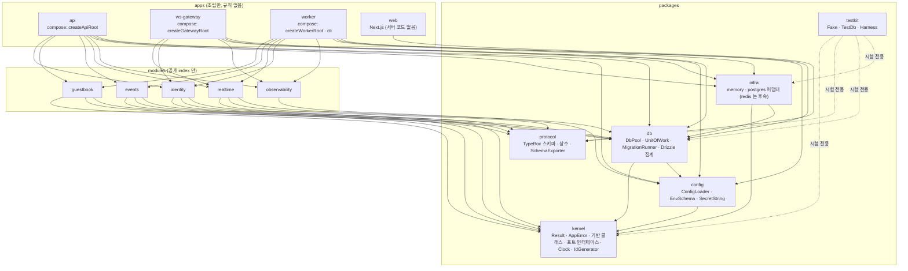

- `apps/*` 만 `@pf/infra` 구현을 임포트한다(경계 규칙 B10, design/01). 모듈은 **포트 인터페이스**(`kernel`)만 안다.
- `web` 은 `@pf/protocol` 외에는 임포트하지 않는다(B8).
- `testkit` 은 프로덕션 번들에 들어가지 않는다(`devDependencies` + 경계 검사).

---

## 3. 통합 클래스 다이어그램

### 3.1 Result 와 오류 계층 (상속 전체)

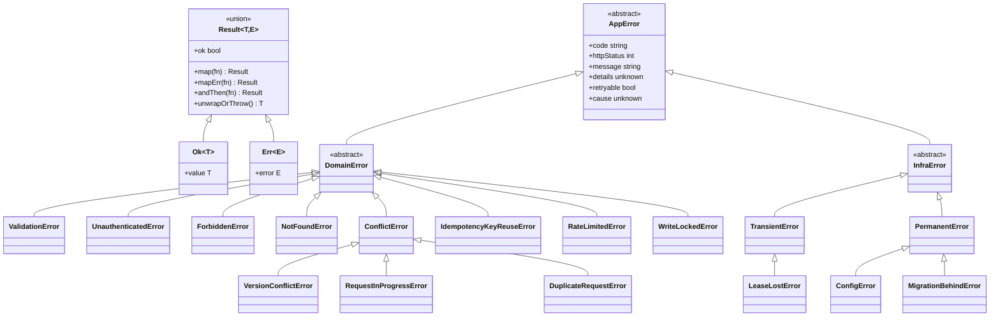

### 3.2 가드·멱등·오류 매핑

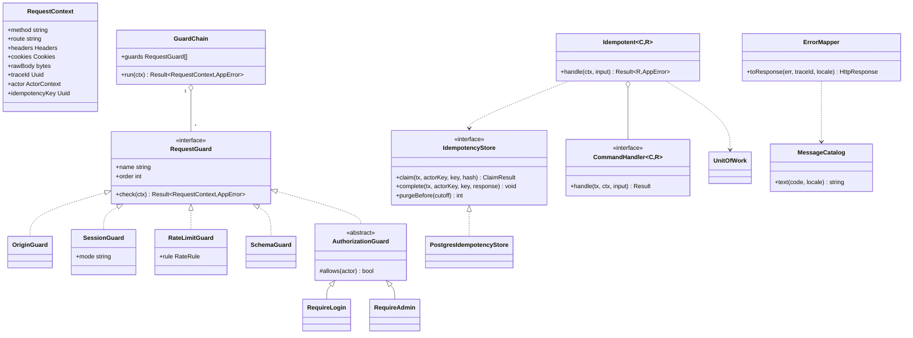

### 3.3 설정

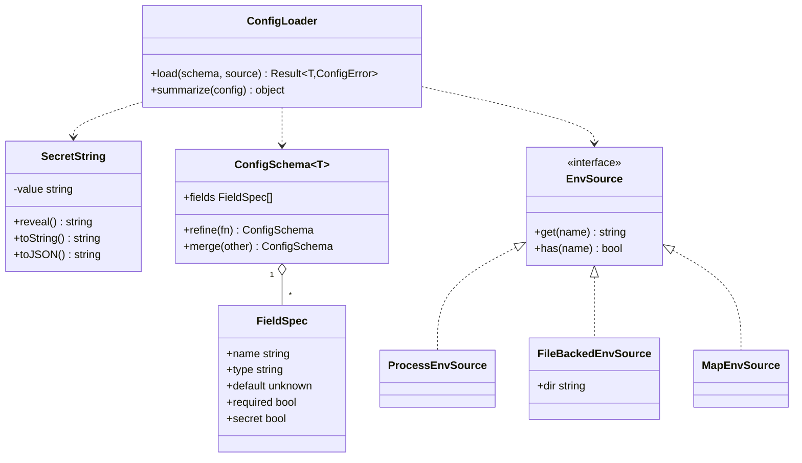

### 3.4 DB·트랜잭션·마이그레이션

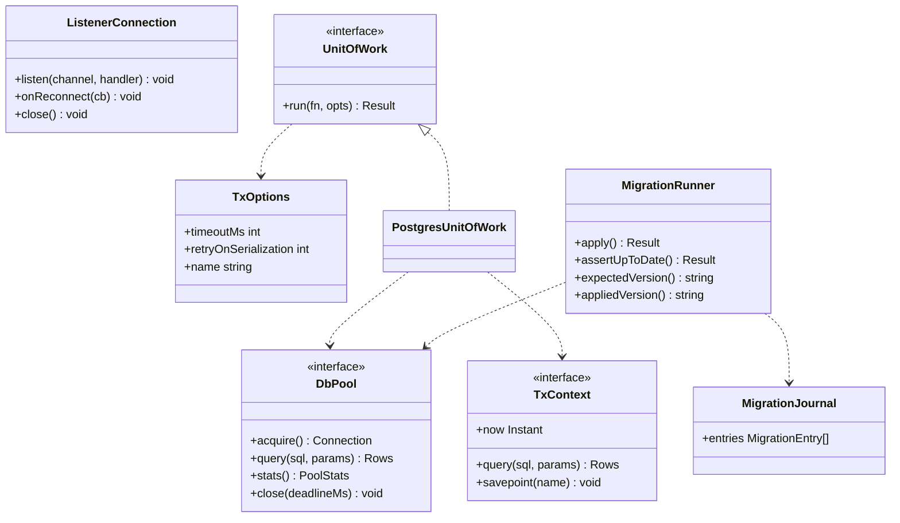

### 3.5 보조 포트와 어댑터

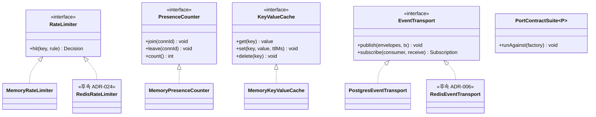

### 3.6 프로토콜·시계·식별자

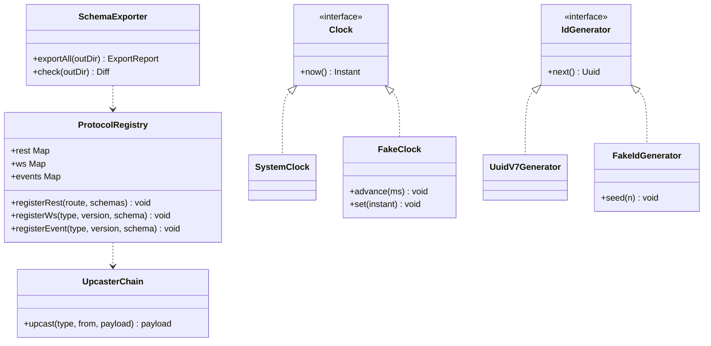

### 3.7 조립 루트와 생명주기

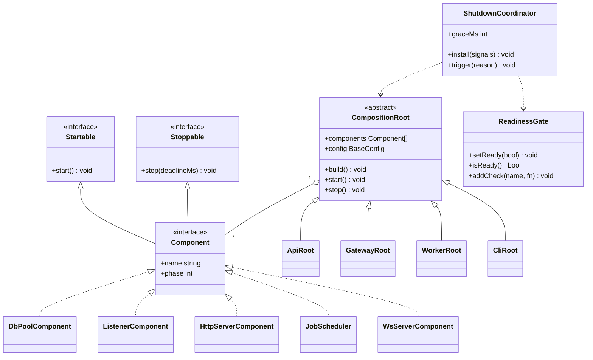

---

## 4. CM-01 가드 체인

### 4.1 목적·트리거
- 목적: 요청을 usecase 에 넘기기 전에 **출처·세션·속도·형식·권한**을 한 번에, 정해진 순서로 판정한다.
- 트리거: `apps/api` 의 모든 라우트, `apps/ws-gateway` 의 업그레이드(public 은 Origin 만, private 은 Origin + Session).
- 접근: `identity.session`(ResolveSession 경유), `RateLimiter` 포트.

### 4.2 순서와 입출력

| 순서 | 가드 | 입력 | 출력(성공) | 실패 오류 | 비고 |
|---|---|---|---|---|---|
| 10 | `OriginGuard` | `Origin`(없으면 `Referer`), `PUBLIC_ORIGIN` | 통과 | `ForbiddenError(origin_mismatch)` | 변경 메서드(POST·PUT·PATCH·DELETE)만. DB 조회 전에 교차 사이트를 걸러낸다 |
| 20 | `SessionGuard` | 쿠키 | `ctx.actor` (익명/로그인) | `UnauthenticatedError` | 모드 3종 — `required`: 세션이 없으면 401(쓰기 라우트·private·관리; 쓰기 전에 클라이언트가 `GET /api/me` 로 세션을 받아 둔다), `optional`: 세션이 없으면 `AnonymousActor`(세션 없음, 발급 안 함)로 취급(공개 조회), `issue`: 세션이 없거나 무효면 **익명 세션을 발급**(`GET /api/me` **한 곳**만, 06 §2·F10 ID-01) |
| 30 | `RateLimitGuard` | `ctx.actor.actorKey`, 라우트 규칙 | 통과 + `RateLimit-*` 헤더 값 | `RateLimitedError(retryAfter)` | 읽기 라우트는 규칙 없음. 규칙 수치는 설정(A-011) |
| 40 | `SchemaGuard` | 본문·쿼리·경로, 라우트 스키마 | 검증된 입력 | `ValidationError(fields)` | Elysia 스키마 검증 결과를 `AppError` 로 변환 |
| 50 | `AuthorizationGuard` | `ctx.actor` | 통과 | `UnauthenticatedError` / `ForbiddenError` | 라우트가 `RequireLogin` 또는 `RequireAdmin` 선언 |

- **소유자 검사(`OwnerPolicy`)는 가드가 아니라 usecase 안**의 도메인 서비스다(ADR-019, design/10 §4.1). 가드는 "로그인/관리자인가"까지만 안다.
- `Idempotency-Key` 존재·형식 검사는 `SchemaGuard` 가 하고(변경 라우트 필수), 처리는 CM-02 가 한다.
- **순서 근거**: Origin 을 가장 먼저 둔다 — 교차 사이트 요청이 DB 세션 조회·속도 제한 토큰 소모를 일으키지 못하게 한다.
- 가드는 요청 컨텍스트를 **불변 확장**한다(`ctx` 복사본에 필드 추가). 한 가드가 다른 가드의 입력을 바꾸지 않는다.

### 4.3 클래스
§3.2 `RequestGuard` · `GuardChain` · 각 가드. 라우트 선언 예:

```ts
// apps/api/src/routes/entries.ts (개념)
route('PATCH', '/api/entries/:id', {
  guards: [origin(), session('required'), rateLimit('edit'), schema(EditEntryReq), requireLogin()],
  handler: editEntry,   // OwnerPolicy 는 usecase 안
});
```

### 4.4 시퀀스

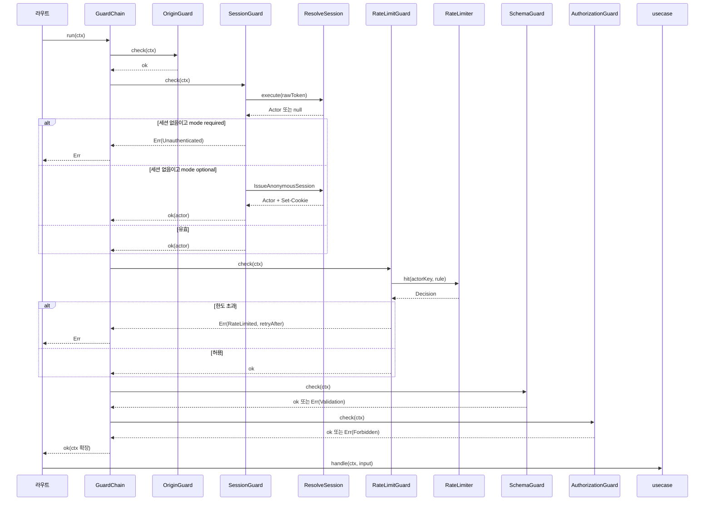

### 4.5 순서도

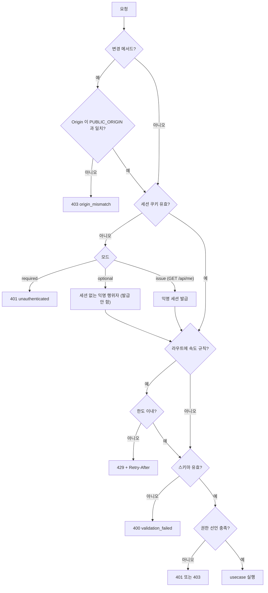

### 4.6 오류·지표·로그
- 오류: §6 표. 가드 실패는 **usecase 호출 전**이라 트랜잭션·outbox 부작용이 없다.
- 지표: `pf_guard_rejections_total{app,guard,reason}`(reason 은 코드 열거값), `pf_rate_limit_decisions_total{app,rule,decision}`. 레이블에 행위자·IP 금지(ADR-007).
- 로그: 거절은 `warn`, 필드 `trace_id`·`guard`·`code`. 쿠키·Origin 값은 기록하지 않는다(Origin 불일치는 불일치 사실만).

### 4.7 시험(08 연결)
- 가드 단위: 가드별 통과/거절 경계(Origin 없음+Referer 있음, 세션 만료 직전, 한도 정확히 N 번째).
- 체인 순서: 두 가드가 동시에 실패할 입력에서 **앞 순서 오류가 반환**되는지.
- 통합(L3): 03 §7.1 순서도의 모든 분기 / AC-007(429 + `Retry-After`).
- 구조: 교차 사이트 요청이 세션 조회 포트를 호출하지 않음(가짜 포트 호출 횟수 0).

---

## 5. CM-02 멱등 키 처리

### 5.1 목적·트리거
- 목적: 연결이 끊긴 사이 재시도한 쓰기가 **한 번만 반영**되고 같은 응답을 돌려받게 한다(ADR-014, 03 §3).
- 트리거: 모든 `POST`/`PUT`/`PATCH`/`DELETE` 명령(로그인·로그아웃 제외).
- 접근: 모듈 쓰기 스키마의 `request_key`(`guestbook`, `identity` 각각). **명령과 같은 트랜잭션.**

### 5.2 설계 요점
- 멱등 처리는 **트랜잭션 데코레이터** `Idempotent<C,R>` 가 맡는다. 키 선점·완료 기록이 명령과 같은 tx 라서, 명령이 롤백되면 키도 사라지고(재시도 가능), 커밋되면 응답이 함께 남는다.
- **성공 응답만** 저장·재생한다. 실패(4xx)는 tx 롤백으로 키가 남지 않으므로, 같은 키 재요청은 규칙을 다시 평가한다(결정적이라 같은 오류).
- 동시에 같은 키 두 요청: 두 번째 `INSERT … ON CONFLICT` 가 **첫 tx 의 커밋/롤백까지 유일 인덱스에서 대기**한다. 커밋되면 `DO NOTHING`(0행) → 저장 응답 재생. 대기가 `lock_timeout`(2초)을 넘으면 `409 request_in_progress` + `Retry-After: 1`.
- 요청 해시 = SHA-256( 메서드 + 경로 템플릿 + 경로 파라미터 + **정규화한 본문**(키 정렬 JSON) ). 같은 키·다른 해시는 `422 idempotency_key_reuse`.
- 보관 24시간. 만료된 키는 같은 쿼리에서 **인수**(UPDATE)하고, 남은 행은 정리 잡(EV-10)이 지운다.
- `status` 열(`in_progress`/`done`)은 이 설계에서 커밋 시점에 항상 `done` 이다. `in_progress` 는 **tx 밖 외부 호출이 생기는 후속 명령**을 위해 남겨 둔 값이다.

### 5.3 알고리즘 (SQL 수준)

```sql
-- 1) 선점: 새 키이거나, 24시간 지난 만료 키면 인수한다
INSERT INTO guestbook.request_key (actor_key, key, request_hash, status, created_at)
VALUES ($1, $2, $3, 'in_progress', $4)
ON CONFLICT (actor_key, key) DO UPDATE
   SET request_hash = EXCLUDED.request_hash, status = 'in_progress',
       response_status = NULL, response_body = NULL, created_at = EXCLUDED.created_at
 WHERE guestbook.request_key.created_at < $4 - interval '24 hours'
RETURNING 1;

-- 0행이면 이미 존재하는 유효 키: 조회한다
SELECT request_hash, status, response_status, response_body
  FROM guestbook.request_key WHERE actor_key = $1 AND key = $2;
--   hash 불일치            -> IdempotencyKeyReuseError (422)
--   status = 'done'        -> 저장된 (상태, 본문) 재생 + Idempotency-Replayed: true
--   status = 'in_progress' -> RequestInProgressError (409)  (정상 경로에서는 발생하지 않음)

-- 2) 명령 본문 실행 (같은 tx)

-- 3) 완료 기록 (같은 tx, 커밋과 함께 가시화)
UPDATE guestbook.request_key
   SET status = 'done', response_status = $3, response_body = $4
 WHERE actor_key = $1 AND key = $2;
```

- 세션은 `SET LOCAL lock_timeout = '2s'` 로 대기를 제한한다(tx 시작 시).
- `response_body` 는 16KB 상한. 넘으면 본문 대신 "재조회 안내"만 저장하고 재생 시 `200` + 안내를 돌려준다(큰 응답을 내는 명령은 M1 에 없음).

### 5.4 클래스
§3.2 `IdempotencyStore`(포트, `kernel`), `PostgresIdempotencyStore`(모듈 어댑터), `Idempotent`(`kernel` 데코레이터), `UnitOfWork`.

```ts
// 조립 시 (개념) — 핸들러는 tx 를 받아 본문만 안다
const postEntry = idempotent(uow, store, { name: 'PostEntry' })(postEntryBody);
```

### 5.5 시퀀스

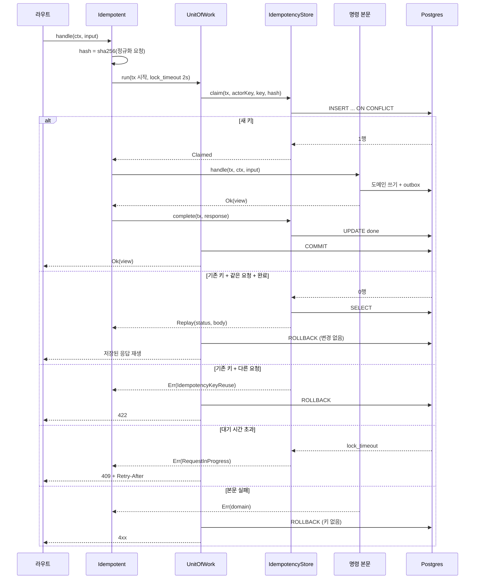

### 5.6 순서도

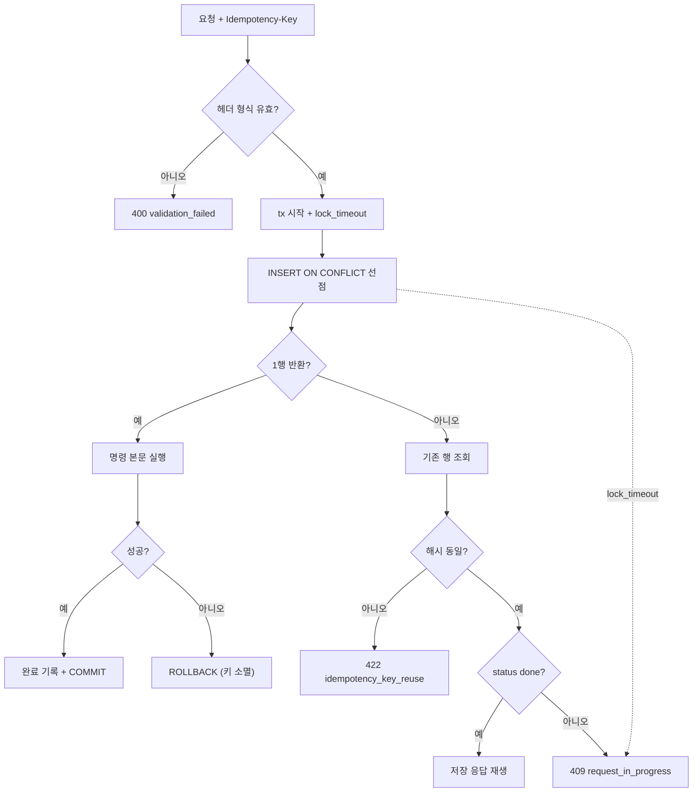

### 5.7 오류·지표·로그
- 오류: `IdempotencyKeyReuseError`(422), `RequestInProgressError`(409), `ValidationError`(키 형식).
- 지표: `pf_idempotency_total{app,outcome}`(`claimed`·`replayed`·`reuse`·`in_progress`), `pf_idempotency_wait_seconds`. 키·행위자 값은 레이블에 쓰지 않는다.
- 로그: 재생·충돌만 `info`/`warn`, 키 값은 마지막 4자만(`…ab12`).

### 5.8 시험
- 같은 키 순차 2회 → 응답 동일, 도메인 쓰기 1회, `Idempotency-Replayed` 헤더.
- **같은 키 동시 2회**(대기 지점 주입, 08 §5): 한 건만 커밋, 다른 건은 재생 또는 409.
- 같은 키·다른 본문 → 422. 24시간 경과 후 같은 키 → 새 요청으로 인수.
- 명령 롤백 시 키가 남지 않음(재시도하면 성공).

---

## 6. CM-03 오류 → HTTP 매핑

### 6.1 목적·트리거
- 목적: **한 곳**(`errorToResponse`)에서 `AppError`·프레임워크 오류·예상 밖 예외를 같은 응답 형식(03 §2)으로 바꾼다.
- 트리거: 라우트 핸들러의 `Result.err` 또는 던져진 예외(Elysia `onError`).

### 6.2 전체 매핑 표

| 출처 | 클래스 / 상황 | HTTP | `code` | 추가 헤더 | 본문 `details` | 로그 |
|---|---|---|---|---|---|---|
| 도메인 | `ValidationError` | 400 | `validation_failed` | — | `fields: [{path, rule}]` | info |
| 도메인 | `UnauthenticatedError` | 401 | `unauthenticated` | — | — | info |
| 도메인 | `ForbiddenError` | 403 | `forbidden` | — | — | warn |
| 가드 | `ForbiddenError(origin_mismatch)` | 403 | `origin_mismatch` | — | — | warn |
| 도메인 | `NotFoundError` | 404 | `not_found` | — | — | debug |
| 도메인 | `ConflictError` | 409 | `conflict` | — | — | info |
| 도메인 | `VersionConflictError` | 409 | `version_conflict` | — | `current: 최신 뷰` | info |
| 멱등 | `RequestInProgressError` | 409 | `request_in_progress` | `Retry-After: 1` | — | warn |
| 멱등 | `IdempotencyKeyReuseError` | 422 | `idempotency_key_reuse` | — | — | warn |
| 도메인 | `RateLimitedError` | 429 | `rate_limited` | `Retry-After`, `RateLimit-*` | `retryAfterSeconds` | warn |
| 도메인 | `WriteLockedError` | 503 | `write_locked` | `Retry-After: 60` | — | warn |
| 인프라 | `GithubUpstreamError` (GitHub 토큰 교환·프로필 실패) | 502 | `github_unavailable` | — | — | warn |
| 도메인 | `GithubUpstreamError` (GitHub 가 코드를 거절) | 502 | `github_rejected` | — | — | warn |
| 도메인 | `ValidationError` (OAuth `state` 불일치) | 400 | `oauth_state_invalid` | — | — | warn |
| 도메인 | `ValidationError` (OAuth 임시 쿠키 만료) | 400 | `oauth_state_expired` | — | — | info |
| 인프라 | `TransientError` | 503 | `unavailable` | `Retry-After` | — | warn |
| 인프라 | `LeaseLostError` (HTTP 경로에서는 발생 안 함) | 503 | `unavailable` | — | — | error |
| 인프라 | `PermanentError`, 예상 밖 예외 | 500 | `internal` | — | — (일반 문구) | error + 스택 |
| 프레임워크 | 라우트 없음 | 404 | `not_found` | — | — | debug |
| 프레임워크 | 허용 안 된 메서드 | 405 | `method_not_allowed` | `Allow` | — | debug |
| 프레임워크 | 본문 상한 초과(앱 단계) | 413 | `payload_too_large` | — | — | info |
| 프레임워크 | `Content-Type` 이 JSON 아님 | 415 | `unsupported_media_type` | — | — | info |
| 프레임워크 | 스키마 검증 실패(Elysia) | 400 | `validation_failed` | — | `fields` | info |
| 프레임워크 | 요청 시간 초과 | 504 | `timeout` | — | — | warn |

- 응답 본문 형식: `{ error: { code, message, traceId, details? } }`, 헤더 `X-Trace-Id`.
- `message` 는 `Accept-Language`(ko/en, 기본 en)로 `MessageCatalog` 에서 고른다. `internal`/`unavailable` 은 **일반 문구**이고 내부 정보·스택·SQL 을 담지 않는다.
- **와이어 코드는 모듈 접두사를 뗀다**: 모듈 안의 오류 코드 `guestbook.write_locked`·`identity.github_unavailable` 등은 응답 `error.code` 에서 `write_locked`·`github_unavailable` 이 된다(03 §2, 클라이언트는 `code` 로만 분기). 매핑 표는 와이어 코드를 적는다.

### 6.3 클래스
§3.2 `ErrorMapper`, `MessageCatalog`. 매핑은 `AppError.httpStatus`/`code` 를 그대로 쓰고, 프레임워크 오류만 변환 함수로 `AppError` 를 만든다.

### 6.4 시퀀스

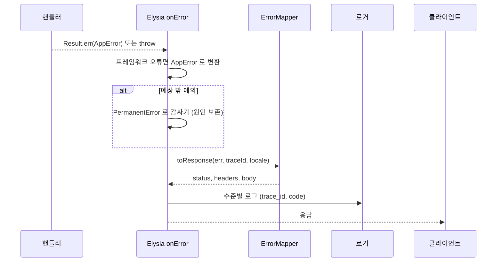

### 6.5 순서도

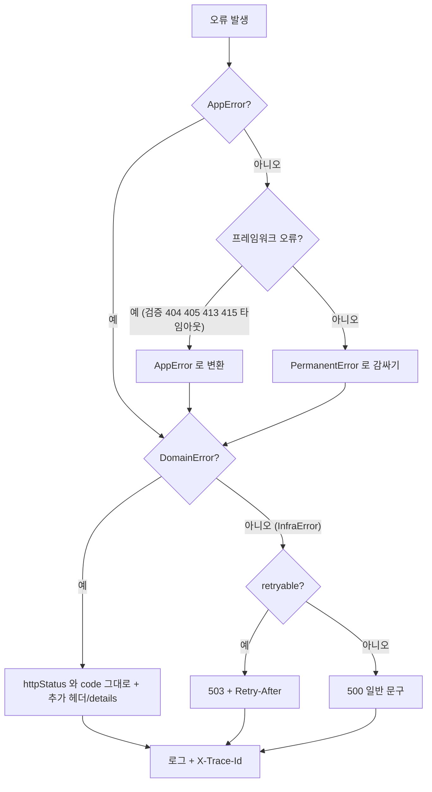

### 6.6 지표·로그·시험
- 지표: `pf_http_requests_total{app,method,route,status_class}` 가 오류도 센다. `pf_errors_total{app,code}`.
- 로그: 5xx 만 스택 포함(`error`), 4xx 는 코드만. 본문·쿠키·토큰은 기록하지 않는다.
- 시험: **표의 모든 행**을 데이터 주도 시험으로(입력 오류 → 상태·코드·헤더). 5xx 본문에 스택·SQL 문자열이 없음. `Accept-Language` ko/en 문구 전환.

---

## 7. CM-04 설정 로더

### 7.1 목적·트리거
- 목적: 환경변수를 **한 곳(`packages/config`)** 에서 읽고 검증해 타입이 있는 설정 객체로 만든다. 앱은 `process.env` 를 읽지 않는다(경계 B9).
- 트리거: 각 앱 `main.ts` 의 첫 동작, CLI 시작.

### 7.2 규약

| 항목 | 규약 |
|---|---|
| 스키마 구성 | `schemas/base.ts`(공통) + `schemas/{api,gateway,worker,web}.ts`. 앱은 `merge(base, 자기 스키마)` 만 로드 → **다른 앱의 필수 변수를 요구하지 않는다** |
| 값 해석 순서 | ① `NAME` ② `NAME_FILE`(파일 내용, 끝 개행 제거) ③ 기본값 ④ 없음(필수면 `missing`). `NAME` 과 `NAME_FILE` 이 둘 다 있으면 `NAME` 우선 + 경고 |
| 타입 변환 | `int`, `bool`(`true/false/1/0`), `url`, `enum`, `csv-int` (`ADMIN_GITHUB_IDS`), `duration` 접미 없음(단위는 변수명에 포함) |
| 교차 검증 | `refine`: `HANDLER_TIMEOUT_SECONDS ≤ LEASE_SECONDS / 2`, `WS_SEND_QUEUE_MAX ≥ 1`, `production` 에서 `COOKIE_SECURE=true` 와 `SESSION_COOKIE_NAME` 이 `__Host-` 접두 |
| 비밀 | `secret: true` 필드는 `SecretString`. `toString`/`toJSON`/로그/`util.inspect` 에서 `***`. 꺼내려면 `reveal()` |
| 요약 출력 | 부팅 시 `summarize(config)` 가 **비밀이 아닌 값 + 비밀 키 이름**만 로그 |
| 실패 | `ConfigError{missing[], invalid[]}` → 이름만 로그, **종료 코드 78**(`EX_CONFIG`). 값은 절대 출력하지 않는다 |
| 재로드 | 없음(불변). 설정 변경은 재시작 |

### 7.3 클래스
§3.3. `EnvSource` 구현 셋: `ProcessEnvSource`(운영), `FileBackedEnvSource`(`_FILE` 처리), `MapEnvSource`(시험).

### 7.4 시퀀스

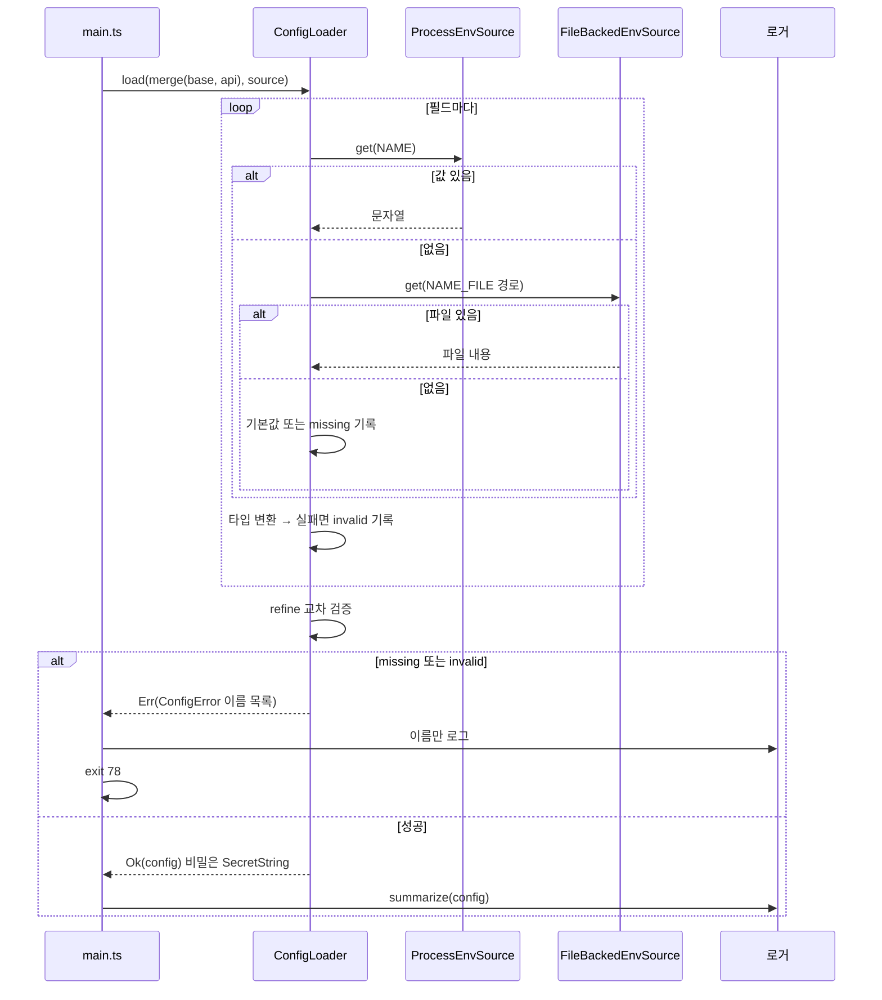

### 7.5 순서도
필드 해석 흐름은 design/01 §7.3 순서도가 정본이다. 여기서는 **교차 검증과 종료 결정**만 추가한다.

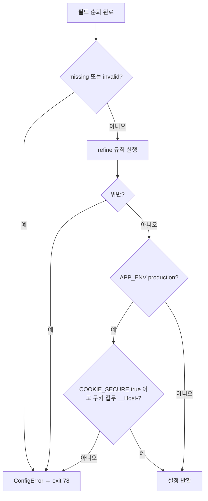

### 7.6 오류·지표·로그·시험
- 오류: `ConfigError`(`PermanentError` 하위). 부팅 중에만 발생.
- 지표: 없음(부팅 실패는 프로세스 종료). 부팅 성공 시 `app_info{app,version,env} 1`.
- 로그: 요약만. 비밀 값·`NAME_FILE` 경로 내용은 출력하지 않는다.
- 시험: 필수 누락 시 `ConfigError` 에 이름만 있고 값이 없음 / `_FILE` 우선순위 / `SecretString` 이 `JSON.stringify`·템플릿 문자열·`console.log` 에서 `***` / 교차 규칙 위반 / 앱별 스키마가 타 앱 변수를 요구하지 않음.

---

## 8. CM-05 DB 풀 · 트랜잭션(UoW) · 마이그레이션

### 8.1 목적·트리거
- 목적: 연결 관리, **트랜잭션 경계의 단일 구현**, 순방향 마이그레이션 적용·확인.
- 트리거: 앱 기동(풀·확인), 모든 command/event usecase(UoW), 배포(마이그레이션 실행).
- 드라이버는 **Bun.sql**(G4 로컬 실측 통과, tech-stack §11.1)이다. `DbPool`/`TxContext` 는 드라이버 중립 인터페이스로 두고 Bun.sql 어댑터를 구현한다. **SQLSTATE 는 `err.code` 가 아니라 `errno`(Drizzle 로 감싸면 `cause.errno`)** 이므로 중복 키(23505) 판별은 어댑터 한 곳의 `isUniqueViolation(err)` 로 감싼다.
- 마이그레이션 운영 규칙(push 금지, 적용 파일 수정 금지, CONCURRENTLY 불가, 저널 순서)은 tech-stack §11.1 에 있다.

### 8.1.1 쿼리 수준 (ADR-025)

| 수준 | 방식 | 트랜잭션 |
|---|---|---|
| T0 | Drizzle 빌더 | 호출자의 `tx` |
| T1 | 같은 `tx` 의 `sql` 템플릿 (`adapter/postgres/raw/`) | 호출자의 `tx` 그대로 |
| T2 | 별도 연결 (LISTEN, 리더 락, 배치) | 트랜잭션 밖 |

**명령·이벤트 usecase 의 트랜잭션 안에서는 T0·T1 만** 쓴다. `UnitOfWork` 는 `TxContext` 에 T0 클라이언트와 T1 실행기를 함께 노출하고 T2 연결은 노출하지 않는다.

### 8.2 UoW 사용 규약

| 규약 | 내용 | 강제 수단 |
|---|---|---|
| **모든 쓰기는 tx** | INSERT·UPDATE·DELETE 는 한 문장이어도 `uow.run` 안에서만 실행한다(잡·reaper·정리·집계·세션 갱신·`trace_step`·시드 포함). `DbPool` 은 읽기 전용 `ReadDb` 만 노출하고 쓰기 메서드는 `TxContext` 에만 있다. 대량 삭제·집계는 배치마다 짧은 tx. 근거 ADR-025 | 타입(`ReadDb` 에 쓰기 메서드 없음) + `check-purity` + 08 구조 시험 |
| 여는 곳 | **command/event usecase 와 잡 usecase 만** `uow.run` 을 부른다. query usecase 는 읽기 전용 연결(tx 없음 또는 `READ ONLY`) | 경계 규칙 B3(읽기·쓰기 포트 분리) + 코드 리뷰 |
| 중첩 금지 | `run` 안에서 `run` 을 부르면 `PermanentError`(프로그래밍 오류). 하위 작업은 `savepoint` | `PostgresUnitOfWork` 가 진행 중 tx 를 추적 |
| **tx 안 외부 호출 금지** | HTTP·파일·메시지 전송 등을 tx 안에서 하지 않는다. tx 안에서 `await` 하는 것은 `tx.query` 와 순수 계산만 | `TxContext` 에는 외부 클라이언트가 없고, 외부 호출은 usecase 가 **tx 앞/뒤**에서 한다(예: GitHub 호출은 로그인 usecase 에서 tx 이전). 시험은 `faults.hit` 지점으로 순서 확인(08) |
| 격리 수준 | `READ COMMITTED` 기본(ADR-021). 직렬화 격리를 쓰지 않는다 | `TxOptions` 기본값 |
| 경합 규칙 | 조건부 UPDATE(`WHERE version = $n`, `WHERE claim_token = $t`), 유일 키, `FOR UPDATE SKIP LOCKED` 로 해결. 읽고-판단-쓰기에 행 잠금이 필요하면 `SELECT … FOR UPDATE` 를 같은 tx 에서 | ADR-021 |
| 시간 제한 | tx 당 `statement_timeout = 5s`, `idle_in_transaction_session_timeout = 10s`, 멱등 대기용 `lock_timeout = 2s` | `SET LOCAL` |
| 재시도 | `40001`(직렬화)·`40P01`(교착)만 최대 2회 즉시 재시도(지터 20~50ms). 그 밖의 오류는 재시도하지 않는다. 멱등 키가 있는 명령만 안전 | `TxOptions.retryOnSerialization` |
| 시계 | tx 안의 "현재 시각"은 `tx.now`(usecase 진입 시 `Clock.now()` 로 고정). SQL 에서 `now()` 를 쓰지 않는다(시험에서 가짜 시계) | 리뷰 + 시험 |
| 이벤트 | outbox 기록(`OutboxWriter.append(tx, events)`)은 **같은 tx** 로만 호출 | 포트 시그니처에 `tx` 필수 |

### 8.3 클래스
§3.4. `PostgresUnitOfWork.run(fn, opts)` 는 `Result` 를 돌려준다: `fn` 이 `Err` 를 돌려주면 **롤백**, `Ok` 면 커밋, 예외는 롤백 후 `PermanentError`.

### 8.4 시퀀스 — 트랜잭션 실행과 재시도

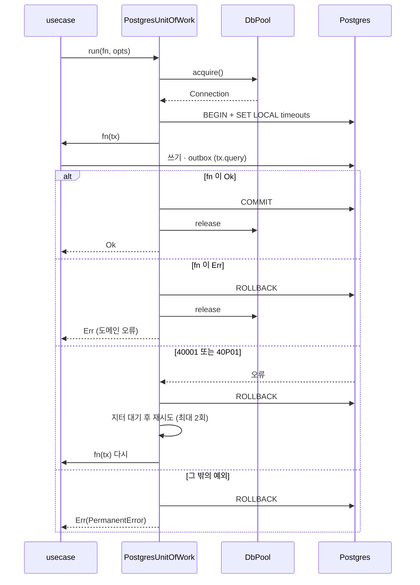

### 8.5 순서도 — 마이그레이션 실행 책임

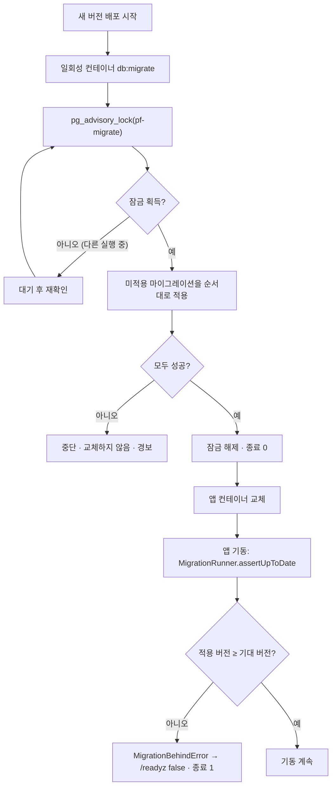

### 8.6 마이그레이션 책임·호환 규칙

| 환경 | 누가 언제 | 비고 |
|---|---|---|
| 로컬 개발 | 개발자가 `bun run db:migrate` (또는 `dev` 스크립트가 최초 1회) | 02 §3 |
| CI | `migration reproduce` 단계가 빈 DB 에 처음부터 적용하고 스키마를 대조(G10) | 09 |
| 라이브(Compose) | **교체 전** 일회성 컨테이너로 `db:migrate`. 실패하면 교체하지 않는다 | 09 §배포 |
| 검증(k3d) | 배포 전 `Job`(같은 코드) | 02 §8 |
| **앱 기동** | 마이그레이션을 **실행하지 않고 확인만** 한다(`assertUpToDate`) | 앱이 여러 개 동시에 떠도 경합이 없다 |

- **순방향 호환(expand → contract)**: 릴리스 N 은 **추가만**(새 컬럼 NULL 허용/기본값, 새 테이블, 새 인덱스). 이전 코드(N-1)가 새 스키마에서 돌아야 한다. 파괴적 변경(컬럼 삭제·타입 변경)은 N+1 에서, N 이 모든 인스턴스에서 확인된 뒤에만(ADR-014).
- 마이그레이션은 forward-only 이고 되돌리기 스크립트를 두지 않는다. 문제는 **앞으로 고치는 마이그레이션**으로 해결한다.
- 실행기는 어드바이저리 락으로 동시 실행을 막고, 적용 이력은 Drizzle 저널 테이블을 쓴다. `generate --custom` raw SQL(부분 인덱스·락 보조 객체)은 G10 에서 확인.
- `LISTEN/NOTIFY` 전용 연결(`ListenerConnection`)은 풀과 별개로 하나 연다. 끊기면 지수 백오프로 재연결하고, 재연결 직후 **놓친 신호를 폴링으로 보완**하라고 콜백(`onReconnect`)을 호출한다(RT-12).

### 8.7 오류·지표·로그
- 오류: `TransientError`(연결 불가·타임아웃 → 503), `PermanentError`(SQL 오류), `MigrationBehindError`.
- 지표: `pf_db_pool_connections{app,state}`, `pf_db_tx_duration_seconds{app,usecase,outcome}`, `pf_db_tx_retries_total{app,reason}`, `pf_migration_version{app}`, `pf_notify_reconnects_total{app}`.
- 로그: 느린 tx(>1초)는 `warn` + usecase 이름. SQL 파라미터 값은 기록하지 않는다.

### 8.8 시험
- 중첩 `run` → `PermanentError`. `Err` 반환 시 롤백(쓰기 흔적 없음).
- 교착/직렬화 오류 주입 → 최대 2회 재시도 후 `TransientError`.
- 풀 고갈(동시 요청 > 풀 크기)에서 대기·타임아웃 → 503.
- 마이그레이션: 빈 DB 재현(G10), 동시 실행 두 개 중 하나만 적용, 앱이 뒤처진 스키마에서 `MigrationBehindError`.
- 순방향 호환: N-1 코드로 N 스키마에서 핵심 usecase 통합 시험(릴리스 전).

---

## 9. CM-06 조립 루트와 생명주기

### 9.1 목적·트리거
- 목적: 설정으로 **어댑터 → usecase → 진입 어댑터**를 한 곳에서 조립하고, 기동·종료 순서를 일관되게 지킨다.
- 트리거: 각 앱 `main.ts`(`createXRoot(config).start()`), 신호(SIGTERM/SIGINT).

### 9.2 의존성 주입 방식: 수동 팩토리 함수
| 결정 | 이유 |
|---|---|
| DI 컨테이너·데코레이터·`reflect-metadata` 를 쓰지 않는다 | 모듈이 5개로 작아 의존 그래프가 눈에 보인다. 컨테이너는 의존을 문자열/토큰 뒤로 숨겨 **dependency-cruiser 경계 검사와 타입 검사가 약해진다** |
| 각 모듈 `index` 가 `createXModule(deps): XModule` 을 내보낸다 | 모듈 경계(공개 API 한 개)와 일치. `deps` 는 포트 인터페이스 묶음이라 시험에서 가짜로 바꾸기 쉽다 |
| 조립은 `apps/*/src/compose` 에서만 한다 | 어댑터 임포트 허용 위치(B6)와 `@pf/infra` 허용 위치(B10) 가 같다 |
| 런타임 호환 | Bun 의 데코레이터 메타데이터 지원 한계에 의존하지 않는다(G3 계열 위험 회피) |
| 대가 | 조립 코드가 길어진다 → 앱별 `compose/` 를 `ports.ts`·`modules.ts`·`routes.ts`·`jobs.ts` 로 나눠 읽기 쉽게 한다 |

### 9.3 앱별 조립 상세

| 단계 | api | ws-gateway | worker | web |
|---|---|---|---|---|
| 1 설정 | `ApiConfig` | `WsGatewayConfig` | `WorkerConfig` | `WebConfig` (Next 환경 규약) |
| 2 DB 풀 | 풀 | 풀 + 리스너 연결 | 풀 + 리스너 연결 | 없음 |
| 3 마이그레이션 확인 | `assertUpToDate` | `assertUpToDate` | `assertUpToDate` | — |
| 4 어댑터 | repo·outbox·inbox·idempotency, `MemoryRateLimiter`, `MemoryKeyValueCache` | `change_log`·`session`·`trace_step` 읽기 어댑터, `MemoryPresenceCounter`, 세션 캐시 | repo·outbox·inbox, `PostgresEventTransport`, retention 규칙들 | API 클라이언트(fetch) |
| 5 모듈 | identity·guestbook·events(조회)·realtime(조회)·observability | realtime·identity(`ResolveSession`)·observability | guestbook(projector)·events·realtime(broadcaster)·identity(정리)·observability | — |
| 6 진입 등록 | Elysia 라우트 + 가드 + `/healthz`·`/readyz`·`/metrics` | `/ws/public`·`/ws/private` + 헬스·지표 | `JobScheduler`(디스패처·러너·reaper·집계·정리) + `/healthz`·`/metrics` | Next 서버 |
| 7 헬스 | `/healthz`·`/readyz`: DB 핑 OK · 마이그레이션 OK · `draining` 아님 | `/healthz`·`/readyz`: DB 핑 + **리스너 연결 OK** · `draining` 아님 | **`/healthz` 만(readyz 없음)**: DB 핑 + 잡 하트비트 `3×주기` 이내. 라우팅 대상이 아니다(F17 §5.1) | `/healthz`·`/readyz`: 프로세스 응답 · `draining` 아님 |

### 9.4 기동 시퀀스 (api 기준, 나머지는 6단계 내용만 다르다)

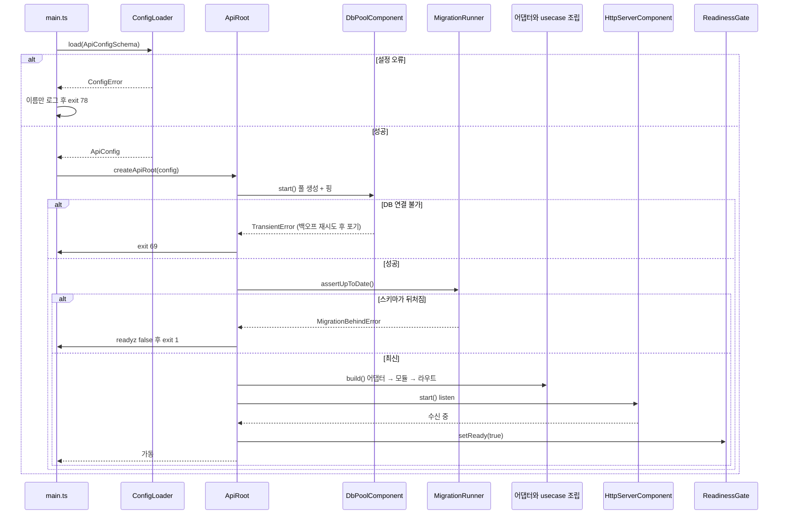

### 9.5 종료 순서도

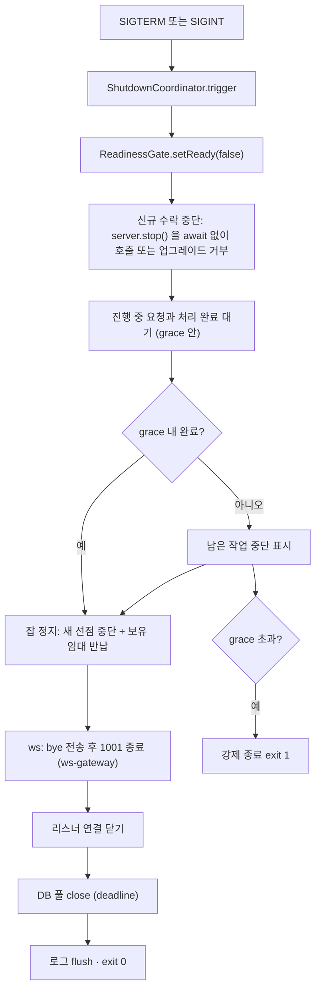

- **Bun 실측 주의**: `await server.stop()` 은 열린 WebSocket 이 있으면 끝나지 않는다. 그래서 위 C 단계는 `stop()` 을 **await 없이** 호출하고, H 단계에서 소켓에 `bye`+`close(1001)` 를 보낸 뒤 `grace` 안에서 `stop()` 의 완료를 기다린다. 타임아웃 후 `stop(true)` 강제 종료는 미확인(G2).
- `grace` 기본 25초(Compose `stop_grace_period` 30초, k8s `terminationGracePeriodSeconds` 30초보다 짧게). ws-gateway 는 `bye.reconnectAfterMs` 에 **지터**를 넣어 재접속 쏠림을 피한다(design/04 §7.3).
- **임대 반납(worker)**: 이 프로세스가 보유한 `processing` 행을 `claim_token` 일치 조건으로 `new`/`received` 로 되돌리고 `lease_until = now`. 반납하지 못해도 reaper 가 임대 만료 후 회수한다(ADR-021) — 반납은 지연을 줄이는 최적화다.
- 컴포넌트는 `phase` 순으로 시작하고 **역순으로 정지**한다: `config(0) → dbPool(10) → listener(20) → modules(30) → jobs/http/ws(40) → readiness(50)`.
- 종료 중 도착한 요청은 `503` + `Connection: close` 가 아니라 이미 `listen` 이 닫혀 있어 프록시가 다른 인스턴스로 재시도한다(단일 인스턴스에서는 짧은 단절, ADR-014).

### 9.6 web 조립에 대한 메모
`web` 은 서버 코드를 갖지 않는 Next.js 이고(`standalone`), 위 `CompositionRoot` 를 쓰지 않는다. 헬스는 Route Handler `/healthz`, 종료는 Next 서버의 신호 처리에 맡긴다. Bun 위 동작은 G3 확인 대상이다(미확인).

### 9.7 클래스
§3.7. `ApiRoot`·`GatewayRoot`·`WorkerRoot`·`CliRoot` 는 `CompositionRoot` 를 상속해 `build()`(어댑터·모듈 조립)만 다르게 구현하고, 시작·종료 골격은 부모가 갖는다(템플릿 메서드).

### 9.8 오류·지표·로그
- 종료 코드: `0` 정상, `78` 설정, `69` DB 불가(`EX_UNAVAILABLE`), `1` 마이그레이션 뒤처짐·강제 종료, `70` 내부 오류.
- 지표: `pf_app_ready{app}`(0/1), `pf_build_info{app,version,commit}`, `pf_shutdown_duration_seconds{app}`, `pf_shutdown_forced_total{app}`.
- 로그: 단계마다 `info`(`phase=start|stop`, `component`, 소요). 오류는 코드와 컴포넌트 이름.

### 9.9 시험
- 컴포넌트 시작 순서·역순 정지(가짜 컴포넌트가 호출 순서를 기록).
- 종료: `readyz` 가 먼저 false → 진행 중 요청 완료 → 풀 종료. grace 초과 시 강제 종료.
- worker: SIGTERM 후 보유 임대가 반납되어 다른 워커가 즉시 선점(AC-015 연계, 08 §5).
- 조립: 각 앱이 필요한 포트가 빠지면 **타입 오류**(런타임이 아니라 컴파일).

---

## 10. CM-07 보조 포트 구현

### 10.1 목적·트리거
- 목적: Redis 없이 M1 을 구현하되, 나중에 **포트 구현만 추가**해 붙이게 한다(ADR-024).
- 트리거: 가드(속도 제한), ws-gateway(접속자 수·세션 캐시), 디스패처(전달).

### 10.2 포트와 M1 어댑터

| 포트 | 시그니처(개념) | M1 어댑터 | 동작 요점 | 한계(문서화) |
|---|---|---|---|---|
| `RateLimiter` | `hit(key, rule) → { allowed, remaining, retryAfterMs }` | `MemoryRateLimiter` | 토큰 버킷(키별), 만료 키 주기 청소, `Clock` 주입 | 인스턴스별 한도(레플리카 간 공유 안 됨) |
| `PresenceCounter` | `join(connId)`, `leave(connId)`, `count()` | `MemoryPresenceCounter` | 집합 크기. 유령 연결은 하트비트 종료 시 `leave` | gateway 인스턴스 간 합산 불가 |
| `KeyValueCache` | `get/set(ttl)/delete` | `MemoryKeyValueCache` | TTL 맵 + 용량 상한(LRU) | 인스턴스 간 무효화 불가(세션 검증 최대 30초 지연) |
| `EventTransport` | `publish(envelopes, tx)`, `subscribe(consumer, receive)` | `PostgresEventTransport` | 디스패처가 **구독 모듈 inbox 에 직접 INSERT**(`ReceiveMessage` 경유), `NOTIFY` 로 러너를 깨움 | Postgres 부하(폴링), 처리량 상한 |

- `EventTransport.publish` 는 **디스패처가 선점한 outbox 이벤트를 구독자에게 넘기는 단계**다. Postgres 구현은 "inbox 에 저장"이 곧 전달이고, Redis Streams 구현은 `XADD` 후 소비자 그룹이 `ReceiveMessage` 를 호출한다. 어느 쪽이든 구독 모듈은 `ReceiveMessage` → inbox 만 안다(ADR-006·020). 상세는 [F13](13-events-pipeline.md).
- 포트는 `kernel/ports`, 구현은 `packages/infra/{memory,postgres}`. 모듈·usecase 는 구현을 임포트할 수 없다(B10).

### 10.3 클래스
§3.5. 계약 시험 스위트 `PortContractSuite<P>` 는 포트별 하나이고, 어댑터 팩토리를 받아 같은 시험을 돌린다.

### 10.4 시퀀스 — 속도 제한 한 건 (MemoryRateLimiter)

```mermaid
sequenceDiagram
    participant G as RateLimitGuard
    participant P as RateLimiter
    participant M as 버킷 맵
    participant C as Clock
    G->>P: hit(actorKey, rule edit)
    P->>C: now()
    P->>M: 버킷 조회 (없으면 가득 찬 버킷 생성)
    P->>P: 경과 시간만큼 토큰 보충 (상한 capacity)
    alt 토큰 1개 이상
        P->>M: 토큰 1 차감
        P-->>G: allowed, remaining
    else 토큰 없음
        P-->>G: denied, retryAfterMs
    end
```

### 10.5 순서도 — 도입 판단과 어댑터 선택

```mermaid
flowchart TD
    A["앱 조립(ports.ts)"] --> B{"어댑터 선택 (M1 은 코드 상수 memory/Postgres — 설정 변수 없음)"}
    B -- "M1" --> M["Memory 어댑터 생성"]
    B -- "redis (도입 후, 설정 변수 신설)" --> C{"Redis 연결 가능?"}
    C -- "예" --> R["Redis 어댑터 생성"]
    C -- "아니오" --> D{"포트 종류"}
    D -- "RateLimiter 또는 Cache" --> M2["fail-open: 메모리 폴백 + 경보"]
    D -- "EventTransport" --> P["Postgres 폴링으로 폴백 + 경보"]
    M --> OK["usecase 에 주입"]
    R --> OK
    M2 --> OK
    P --> OK
```
M1 에서는 `redis` 분기가 구현되지 않는다(분기 자리만 문서화). 포트별 장애 거동은 ADR-024 표를 따른다.

### 10.6 오류·지표·로그·시험
- 오류: 어댑터 내부 실패는 `TransientError`(속도 제한은 **fail-open** — 허용으로 처리하고 경보).
- 지표: `pf_rate_limit_decisions_total{app,rule,decision}`, `pf_kv_cache_ops_total{app,op,result}`, `pf_presence_connections{app}`, `pf_rate_limit_buckets{app}`(게이지, 누수 감지).
- 시험: **계약 스위트** 필수 항목 — 한도 정확성(N 번째 허용, N+1 번째 거절), 시간 경과 후 보충(`FakeClock`), 키 격리, TTL 만료, 용량 상한 축출, `leave` 없이 사라진 연결 처리. 메모리·Postgres 어댑터가 같은 스위트를 통과(S1-8).

---

## 11. CM-08 시드 · 관리 CLI

### 11.1 목적·트리거
- 목적: 개발 데이터와 **운영 보수 작업**(재구성·dead 재투입·쓰기 잠금)을 같은 프레임으로 실행한다.
- 트리거: 사람이 `bun run …` 또는 컨테이너에서 실행.

### 11.2 명령 목록

| 명령 | 위치 | 하는 일 | 운영 허용 | 주요 옵션 |
|---|---|---|---|---|
| `db:seed` | `scripts/seed.ts` | 시나리오 시드(`GuestbookBasic`·`AdminAndReports`·`LoadMix`) | **아니오**(`APP_ENV=production` 이면 즉시 종료) | `--scenario`, `--reset` |
| `worker rebuild <projection>` | `apps/worker/src/cli` | 읽기 모델 그림자 재구성(GB-26) | 예 | `--projection entry_view`, `--dry-run` |
| `worker dead-requeue` | 〃 | `dead` → 대기 재투입(EV-07) | 예 | `--consumer`, `--type`, `--id`, `--all`, `--limit`, `--reason`(필수) |
| `worker admin write-lock on\|off` | 〃 | 긴급 쓰기 잠금(GB-10) | 예 | `--reason` |
| `worker retention:run` | 〃 | 정리 규칙 즉시 1회 실행(EV-10, 점검용) | 예 | `--once`, `--dry-run` |
| `content:check` | `scripts/content-check.ts` | 사이트 변수·프로필 검사(12 §1.1) | 예(CI 릴리스) | `CONTENT_STRICT=1` |
| `db:migrate` | `packages/db` 실행기 | 마이그레이션 적용(CM-05) | 예(배포 전) | — |

### 11.3 공통 CLI 프레임

```mermaid
classDiagram
    class CliCommand {
        <<interface>>
        +name string
        +describe() string
        +options OptionSpec[]
        +run(ctx CliContext) CliResult
    }
    class CliContext {
        +args ParsedArgs
        +root CliRoot
        +actor ActorContext
        +out Output
    }
    class CliRunner {
        +register(cmd) void
        +main(argv) int
    }
    class OutputWriter {
        +json(obj) void
        +text(line) void
    }
    class CliResult {
        +exitCode int
        +summary object
    }
    class RebuildCommand
    class DeadRequeueCommand
    class WriteLockCommand
    class RetentionRunCommand
    class SeedCommand
    CliCommand <|.. RebuildCommand
    CliCommand <|.. DeadRequeueCommand
    CliCommand <|.. WriteLockCommand
    CliCommand <|.. RetentionRunCommand
    CliCommand <|.. SeedCommand
    CliRunner "1" o-- "*" CliCommand
    CliRunner ..> CliContext
    CliContext ..> OutputWriter
    CliCommand ..> CliResult
```

- `CliRoot` 는 `CompositionRoot` 의 한 종류다: **설정 → DB 풀 → 마이그레이션 확인 → 필요한 모듈만 조립**하고 **잡·서버는 시작하지 않는다**(readiness 도 없음).
- **행위자**: CLI 는 `ActorContext{ kind: 'system', actorKey: 'system:cli:<user>' }` 로 usecase 를 호출하고, 조치 이력(`moderation_action`, `write_lock.changed_by`)에 남긴다. CLI 는 HTTP 가드를 거치지 않으므로 **usecase 공개 API 만** 호출한다(쓰기 포트 직접 호출 금지).
- 종료 코드: `0` 성공, `2` 사용법 오류, `3` 대상 없음, `78` 설정, 그 밖 `1`. 결과는 JSON 한 줄(`--json`) 또는 사람이 읽는 요약.
- 위험 작업(`dead-requeue --all`, `rebuild`)은 **확인 문구 또는 `--yes`** 가 필요하고 `--dry-run` 으로 영향 범위를 먼저 보여 준다.

### 11.4 시퀀스 — `worker dead-requeue`

```mermaid
sequenceDiagram
    participant O as 운영자
    participant R as CliRunner
    participant X as CliRoot
    participant C as DeadRequeueCommand
    participant U as DeadRequeue usecase
    participant D as outbox·inbox
    O->>R: worker dead-requeue --consumer guestbook-projector --reason fix
    R->>R: 옵션 파싱 · 필수 --reason 검사
    R->>X: build(설정 · 풀 · 마이그레이션 확인)
    R->>C: run(ctx)
    C->>U: execute(selector, reason, actor system)
    U->>D: 한 tx: dead → received 조건부 갱신 (attempts 0, next_attempt_at now)
    D-->>U: 갱신 건수
    U-->>C: Ok(count)
    C-->>R: CliResult(exit 0, count)
    R->>X: stop (풀 종료)
    R-->>O: 결과 JSON
```

### 11.5 순서도 — CLI 공통 흐름

```mermaid
flowchart TD
    A["bun run worker ..."] --> B["argv 파싱"]
    B --> C{"명령 존재 · 옵션 유효?"}
    C -- "아니오" --> E2["사용법 출력 · exit 2"]
    C -- "예" --> D["설정 로드"]
    D --> F{"ConfigError?"}
    F -- "예" --> E78["exit 78"]
    F -- "아니오" --> G{"위험 작업?"}
    G -- "예" --> H{"--yes 또는 확인 입력?"}
    H -- "아니오" --> E1["취소 · exit 1"]
    H -- "예" --> I
    G -- "아니오" --> I["CliRoot 조립"]
    I --> J{"--dry-run?"}
    J -- "예" --> K["영향 범위만 출력 · exit 0"]
    J -- "아니오" --> L["usecase 실행"]
    L --> M{"성공?"}
    M -- "예" --> N["요약 출력 · exit 0"]
    M -- "아니오" --> O["오류 코드 · 종료 코드 매핑"]
```

### 11.6 오류·지표·로그·시험
- 오류: `AppError` → 종료 코드로 매핑(`NotFoundError` 3, `ValidationError` 2, 그 밖 1).
- 지표: CLI 는 단발이라 지표를 내지 않는다. 대신 **감사 로그**(`info`, `cli_command`, `actor`, `reason`, 결과 건수)를 남긴다.
- 시험: 옵션 검증/종료 코드, `--dry-run` 이 쓰기를 하지 않음, `APP_ENV=production` 에서 `db:seed` 거부, 필수 `--reason` 누락 거부, 같은 명령 2회 실행(멱등)에서 건수 0.

---

## 12. CM-09 프로토콜 스키마

### 12.1 목적·트리거
- 목적: REST·WS·이벤트 계약을 **TypeBox 한 곳**에 정의하고, 서버·클라이언트가 같은 타입·검증을 쓰며, 언어 중립 JSON Schema 를 내보낸다(ADR-022, G2 실패 시 교체 비용).
- 트리거: 개발 중 스키마 변경, `bun run gen:schema`, CI `gen:schema --check`.

### 12.2 구조

```
packages/protocol/
├─ src/
│  ├─ rest/        # 라우트별 요청·응답 스키마 (03)
│  ├─ ws/          # WS 메시지 스키마 (04)
│  ├─ events/      # 이벤트 페이로드 스키마와 버전 (05)
│  ├─ constants.ts # 길이 상한·이모지·종료 코드 (design/01 §8.6)
│  ├─ registry.ts  # ProtocolRegistry
│  └─ upcasters/   # 이벤트 버전 업캐스터
├─ schema/         # 내보낸 JSON Schema (커밋됨)
├─ golden/         # 이벤트·메시지 골든 JSON (한 경로, 08 §10)
└─ test/
```

### 12.3 파이프라인

```mermaid
flowchart LR
    SRC["TypeBox 정의<br/>src/rest · ws · events"] --> REG["ProtocolRegistry 등록"]
    REG --> TS["Static 타입 (서버·web 가 직접 임포트)"]
    REG --> RT["런타임 검증 (Elysia 라우트 · 서버 WS 입력 · 이벤트 디코드)"]
    REG --> EXP["SchemaExporter<br/>gen:schema"]
    EXP --> JS["schema/*.json (JSON Schema)"]
    JS --> CHK["CI: gen:schema --check<br/>변경이 있으면 실패"]
    JS --> OTH["다른 언어·문서 소비자<br/>(Go 교체 시 코드 생성 — 미확인)"]
    JS --> GOLD["골든 JSON 대조 시험"]
```

- **TS 소비자는 코드 생성이 필요 없다**: `Static<typeof Schema>` 타입을 `@pf/protocol` 에서 직접 임포트한다(web 도 B8 허용). JSON Schema 는 **계약의 문서화·비-TS 소비자·변경 감지** 용도다.
- `gen:schema --check` 는 내보낸 파일이 저장소의 `schema/` 와 다르면 실패 → 스키마 변경이 **리뷰에 보이게** 한다.
- 이벤트: `registry.registerEvent(type, version, schema)`. 같은 `type` 의 이전 버전은 삭제하지 않고(05 §7 규칙) `UpcasterChain` 이 최신화한다.
- 브라우저 런타임 검증: 번들 크기 때문에 **M1 은 WS 메시지에 `t`/`v` 태그 검사 + 필요한 필드만 방어적 접근**을 쓰고, 전체 스키마 검증은 개발 모드에서만 켠다(`TypeCompiler` 도입 여부는 구현 시 측정, 미확인).

### 12.4 미확인·위험

| 항목 | 상태 | 대응 |
|---|---|---|
| Elysia 가 내장하는 TypeBox 버전과 `@pf/protocol` 의 TypeBox 호환 | **확인됨(실측, Bun 1.4.4)**: 별도 설치한 `@sinclair/typebox` 0.34.x 를 Elysia 1.4.30 라우트 body/response 에 그대로 사용 가능(Elysia 의존 범위 `>=0.34 <1`). `typebox` 1.x 는 범위 밖이라 쓰지 않는다. 아래 "대응"은 어긋날 때만 | 두 버전을 같은 범위로 고정하고 S1 에서 라우트에 protocol 스키마를 그대로 넣어 확인. 어긋나면 Elysia 의 `t` 를 protocol 이 재수출 |
| TypeBox → OpenAPI 생성 도구(Elysia 플러그인 vs 변환) | **미확인**(03 §10) | 필요해질 때 선정. 계약 정본은 JSON Schema 로 충분 |
| JSON Schema → Go 구조체 생성기가 `oneOf` 를 지원하는지 | **미확인**(ADR-022) | G2 실패 시에만 문제. 이벤트·메시지 유니온을 `t` 판별자로 평평하게 유지해 생성기 의존을 줄인다 |
| 판별 유니온 스키마에 `discriminator` 옵션을 넣으면 최상위에 비표준 `discriminator` 키가 붙는다 | 실측 | **넣지 않는다** — 각 분기의 `t: const` 가 판별한다. 유니온 검증 오류는 `Expected union value` 하나뿐이므로 필드 단위 오류가 필요하면 `t` 로 분기를 먼저 골라 해당 스키마로 검사 |
| 브라우저 검증기 | 실측 | `Value.Check` 만 사용(최소 번들 약 13.9KB gzip). `TypeCompiler` 는 22KB 이고 `new Function` 사용으로 CSP 위험(미확인)이라 서버 전용 |
| `format: 'uuid'`·`date-time` 검증기 등록 | 구현 시 | `FormatRegistry` 에 등록(서버·테스트 공통) |

### 12.5 클래스
§3.6 `ProtocolRegistry`, `SchemaExporter`, `UpcasterChain`. 이벤트 봉투·도메인 이벤트 클래스는 [05 §3](../05-event-catalog.md).

### 12.6 시퀀스 — 스키마 변경에서 CI 까지

```mermaid
sequenceDiagram
    participant D as 개발자
    participant S as protocol 소스
    participant G as gen:schema
    participant R as 저장소 schema 폴더
    participant CI as CI
    D->>S: 필드 추가 (예: entry.posted 선택 필드)
    D->>G: bun run gen:schema
    G->>S: Registry 에서 전체 스키마 수집
    G->>R: JSON Schema 파일 갱신
    D->>D: 골든 JSON 갱신 또는 추가 (호환 변경이면 구버전 골든 유지)
    D->>CI: PR
    CI->>G: gen:schema --check
    alt 커밋된 schema 와 다름
        G-->>CI: 실패 (변경 누락)
    else 일치
        G-->>CI: 통과
    end
    CI->>CI: 골든 대조 + 업캐스터 시험
```

### 12.7 순서도 — 스키마 변경 분류

```mermaid
flowchart TD
    A["스키마 변경"] --> B{"선택 필드 추가인가?"}
    B -- "예" --> C["같은 schemaVersion 유지"]
    B -- "아니오" --> D["schemaVersion + 1 과 Upcaster 추가"]
    C --> E["골든 JSON 에 새 필드 케이스 추가"]
    D --> F["구버전 골든 유지 + 새 버전 골든 추가"]
    E --> G["gen:schema 실행"]
    F --> G
    G --> H["소비자(consumer) 먼저 배포 → 발행자 나중"]
```

### 12.8 오류·지표·시험
- 런타임: 서버가 받은 입력 검증 실패 → `ValidationError`(fields). 이벤트 디코드 실패 → `PermanentError`(→ `dead`).
- 시험: 각 `type × version` 골든 인코드/디코드 왕복, 업캐스터 체인, 공개 WS 메시지 스키마에 `ownerKey`·`userId` 필드가 **없음**(AC-009 구조 검사, 08 §8), `ALLOWED_EMOJI` 가 서버·클라이언트에서 같은 상수.

---

## 13. CM-10 시험 지원 (`packages/testkit`)

### 13.1 목적·트리거
- 목적: 시험을 **결정적**으로 만든다(시계·식별자·장애·동시성 제어, 실제 Postgres).
- 트리거: 모든 계층의 시험 코드. 프로덕션 번들에 포함되지 않는다.

### 13.2 구성

| 구성 | 역할 |
|---|---|
| `FakeClock` | 시각을 고정하고 `advance(ms)` 로 건너뜀(임대·만료·백오프 시험) |
| `FakeIdGenerator` | 순서가 있는 uuid(v7 형식 유지, 단조 증가) |
| `TestDb` | 시험마다 격리된 스키마/DB 생성·마이그레이션·정리. Testcontainers 는 G9 미확인 → compose `postgres` 대안 병기 |
| `WorkerHarness` | 여러 워커를 같은 DB 에 띄우고 한 단계씩 진행(선점 경쟁·임대 만료) |
| `FaultInjector` | `faults.hit('<지점>')` 훅에 `failAt`/`delayAt`(→`Gate`)로 실패·지연을 주입(`sleep` 없이 순서 강제). API 는 [08](../08-test-strategy.md) §3.1 정본 |
| `FakeRateLimiter`·`FakePresenceCounter`·`InMemoryEventTransport` | 포트 대역 |
| `GoldenFiles` | 골든 JSON 읽기·대조 |
| `PortContractSuite` | CM-07 어댑터 공용 계약 스위트 |
| `ApiHarness` | api 조립 루트를 가짜 포트로 띄워 HTTP 호출(통합; 08 의 `ApiHarness`). `GatewayHarness` 는 ws-gateway 를 띄워 `FakeSocket` 으로 호출 |

### 13.3 클래스

```mermaid
classDiagram
    class TestHarness {
        <<abstract>>
        +setup() void
        +teardown() void
    }
    class UnitHarness
    class ModuleHarness
    class ChaosHarness
    class DbHarness {
        +db TestDb
        +clock FakeClock
        +ids FakeIdGenerator
    }
    class WorkerHarness {
        <<helper>>
        +spawn(n) Worker[]
        +step(worker) void
        +runUntilIdle() void
    }
    class ApiHarness {
        +api ApiRoot
        +request(req) Response
    }
    class GatewayHarness {
        +connectPublic() FakeSocket
        +connectPrivate(cookie) FakeSocket
    }
    TestHarness <|-- UnitHarness
    TestHarness <|-- DbHarness
    DbHarness <|-- ModuleHarness
    DbHarness <|-- ChaosHarness
    DbHarness <|-- ApiHarness
    DbHarness <|-- GatewayHarness
    ChaosHarness ..> WorkerHarness
    class FaultInjector {
        +hit(point) void
        +failAt(point, nth) void
        +delayAt(point) Gate
        +clear() void
    }
    class Gate {
        +reached Promise
        +release() void
    }
    FaultInjector ..> Gate
    DbHarness ..> FaultInjector
    class FakeSocket {
        +received Message[]
        +send(msg) void
        +close(code) void
        +waitFor(type) Message
    }
    GatewayHarness ..> FakeSocket
```

### 13.4 시퀀스 — 결정적 동시성 시험(선점 경쟁 개요)

```mermaid
sequenceDiagram
    participant T as 시험
    participant H as ChaosHarness (WorkerHarness 사용)
    participant F as FaultInjector
    participant W1 as 워커 1
    participant W2 as 워커 2
    participant D as TestDb
    T->>H: spawn(2) + 이벤트 1건 준비
    T->>F: delayAt(events.outbox_dispatcher.after_claim) 설정
    T->>W1: step() 선점 시도
    W1->>D: 조건부 UPDATE 성공
    W1->>F: hit(events.outbox_dispatcher.after_claim) 대기
    T->>W2: step() 선점 시도
    W2->>D: 조건부 UPDATE 0행
    T->>T: 단언: 한 주체만 processing
    T->>F: gate.release()
    W1->>D: 완료 (토큰 일치)
    T->>T: 단언: 효과 1회
```

세부 시나리오(임대 만료 후 늦은 완료 거절 등)는 [08 §5](../08-test-strategy.md).

### 13.5 순서도 — 시험 환경 선택

```mermaid
flowchart TD
    A["시험 실행"] --> B{"DB 필요?"}
    B -- "아니오" --> U["단위 (L2): 순수 · 가짜 포트"]
    B -- "예" --> C{"Testcontainers 사용 가능? (G9)"}
    C -- "예" --> T["컨테이너 Postgres 격리 스키마"]
    C -- "아니오" --> S["compose postgres 서비스 + 시험별 스키마"]
    T --> I["통합 (L3)"]
    S --> I
    I --> D{"앱/소켓 필요?"}
    D -- "예" --> AH["ApiHarness · GatewayHarness"]
    D -- "아니오" --> DH["DbHarness"]
```

### 13.6 코드에 요구하는 것
- 장애 주입 지점 훅 `faults.hit('<이름>')` 를 usecase·디스패처 주요 지점에 둔다(프로덕션에서는 no-op). 호출 이름은 **`<모듈>.<usecase 또는 컴포넌트>.<지점>` 소문자 snake_case** 규칙의 상수 목록(`packages/testkit`)으로 관리한다(예: `events.outbox_writer.before_append`, `events.outbox_dispatcher.after_claim`, `events.message_runner.before_complete`, `guestbook.edit_entry.before_save`, `guestbook.idempotency.after_reserve`, `guestbook.<usecase>.after_load`). 08 §5 의 시나리오와 같은 이름이다.
- `Clock`·`IdGenerator` 는 항상 포트로 받는다(§14). SQL 에서 `now()` 를 쓰지 않고 `tx.now` 를 바인딩한다(§8.2).
- `testkit` 은 `packages/*` 규칙(B7)을 따르되 `modules/*` 를 임포트하지 않는다(모듈 시험은 각 모듈의 `test/` 에서 testkit 을 사용).

### 13.7 시험(시험 코드 자체)
- `FakeClock.advance` 가 단조 증가, `FakeIdGenerator` 가 정렬 순서와 생성 순서 일치, `FaultInjector` 가 해제 전까지 대기, `TestDb` 가 병렬 실행에서 서로 격리.

---

## 14. CM-11 시계 · 식별자

### 14.1 목적·트리거
- 목적: `domain`/`service` 가 시간·난수를 **직접 호출하지 않게** 하고(경계 B2 + `check-purity`), 시험에서 고정한다.
- 트리거: usecase 진입(`now`), 엔티티·이벤트 생성(`next`).

### 14.2 규약

| 항목 | 규약 |
|---|---|
| `Clock.now()` | `Instant`(밀리초 정밀 UTC). usecase 진입 시 한 번 호출해 `tx.now` 로 고정하고, 같은 usecase 안의 모든 시각이 같은 값 |
| `IdGenerator.next()` | **uuid v7**(앱 생성, ADR-017). 구현은 `Bun.randomUUIDv7()` 내장(실측: 시간 정렬 가능, 같은 밀리초 2000개도 생성 순서 = 문자열 순서). 별도 라이브러리 불필요 |
| 금지 | `domain`/`service` 에서 `Date.now`, `new Date()`, `Math.random`, `crypto.randomUUID` 호출(`scripts/check-purity.ts` 문자열 검사) |
| 허용 위치 | `SystemClock`, `UuidV7Generator` 구현 파일만 |
| 상수 시간 비교 | `crypto.timingSafeEqual` 은 **길이가 다른 버퍼에 예외를 던진다**(Bun 1.4.4 실측). 비교 전에 양쪽을 해시(SHA-256)해 같은 길이로 만든 뒤 비교하거나 길이를 먼저 검사한다(토큰·HMAC 비교 공통 유틸 `safeEqual`) |
| 토큰 난수 | 세션 토큰은 별도 `TokenGenerator` 포트(CSPRNG 32바이트, F10). `IdGenerator` 와 섞지 않는다 |
| DB 시간 | `now()` 대신 바인딩된 `tx.now`. 단, 정리 잡의 "N일 전" 계산은 `Clock` 에서 계산한 컷오프를 파라미터로 넘긴다 |

### 14.3 클래스
§3.6 `Clock` ← `SystemClock`·`FakeClock`, `IdGenerator` ← `UuidV7Generator`·`FakeIdGenerator`.

### 14.4 시퀀스

```mermaid
sequenceDiagram
    participant U as usecase
    participant C as Clock
    participant I as IdGenerator
    participant T as TxContext
    participant A as AggregateRoot
    U->>C: now()
    C-->>U: Instant
    U->>T: tx 시작 (tx.now = Instant)
    U->>I: next()
    I-->>U: uuid v7
    U->>A: 생성(id, 값 객체, tx.now)
    A-->>U: 엔티티 + 이벤트(occurredAt = tx.now)
    U->>T: 저장 (모든 시각 컬럼에 tx.now 바인딩)
```

### 14.5 순서도 — uuid v7 생성

```mermaid
flowchart TD
    A["next()"] --> B["now = Clock 밀리초"]
    B --> C{"now > 마지막 밀리초?"}
    C -- "예" --> D["카운터를 난수로 재설정"]
    C -- "아니오 (같은 ms 또는 시계 역행)" --> E["마지막 ms 유지 + 카운터 +1"]
    E --> F{"카운터 오버플로?"}
    F -- "예" --> G["마지막 ms +1 로 진행"]
    F -- "아니오" --> H
    D --> H["48비트 시각 + 버전 7 + 카운터/난수 조립"]
    G --> H
    H --> I["uuid 문자열 반환"]
```

### 14.6 오류·지표·시험
- 오류: 시계 역행은 오류가 아니라 **마지막 값 유지**로 단조성을 지킨다(경고 로그 1회).
- 시험: v7 정렬 = 생성 순서(같은 ms 연속 1만 개), 시계 역행에서 단조, `FakeClock` 으로 만료·백오프 경계, `check-purity` 가 도메인의 직접 호출을 잡는다(위반 샘플).

---

## 15. 지표 · 로그 요약 (이름·레이블의 정본은 [F17](17-ops-observability.md) §4.1)

| 이름 | 종류 | 레이블 | 위치 |
|---|---|---|---|
| `pf_http_requests_total` | counter | `app`, `method`, `route`, `status_class` | CM-03 |
| `pf_http_request_duration_seconds` | histogram | `app`, `method`, `route`, `status_class` | 공통 미들웨어(OB-01) |
| `pf_guard_rejections_total` | counter | `app`, `guard`, `reason` | CM-01 |
| `pf_rate_limit_decisions_total` | counter | `app`, `rule`, `decision` | CM-01·07 |
| `pf_idempotency_total` | counter | `app`, `outcome` | CM-02 |
| `pf_errors_total` | counter | `app`, `code` | CM-03 |
| `pf_db_tx_duration_seconds` | histogram | `app`, `usecase`, `outcome` | CM-05 |
| `pf_db_tx_retries_total` | counter | `app`, `reason` | CM-05 |
| `pf_db_pool_connections` | gauge | `app`, `state` | CM-05 |
| `pf_notify_reconnects_total` · `pf_migration_version` | counter · gauge | `app` | CM-05 |
| `pf_app_ready` · `pf_build_info` | gauge | `app`, `version`, `commit` | CM-06 |
| `pf_shutdown_duration_seconds` · `pf_shutdown_forced_total` | histogram · counter | `app` | CM-06 |
| `pf_kv_cache_ops_total` · `pf_presence_connections` · `pf_rate_limit_buckets` | counter · gauge · gauge | `app`, `op`, `result` | CM-07 |

**레이블 규칙**: 식별자(행위자·세션·글 id·IP)·자유 텍스트 금지. 값은 열거형 또는 라우트 템플릿(ADR-007). 로그 공통 필드: `trace_id`, `module`, `usecase`, `app`; IP·본문·토큰·쿠키 값은 기록하지 않는다.

---

## 16. 시험 매트릭스 (요약, 상세는 [08](../08-test-strategy.md))

| 기능 | 계층 | 등급 | 핵심 시험 |
|---|---|---|---|
| CM-01 | 단위 + 통합 | L2 · L3 | 가드별 경계, 순서, 교차 사이트가 세션 조회 안 함, AC-007 |
| CM-02 | 통합 | L3 | 순차·동시 같은 키, 해시 불일치, 롤백 시 키 소멸, 24시간 인수 |
| CM-03 | 단위 | L2 | 표 전체 데이터 주도, 5xx 본문 비노출 |
| CM-04 | 단위 | L2 | 누락·`_FILE`·비밀 마스킹·교차 규칙 |
| CM-05 | 통합 | L3 | 롤백·재시도·풀 고갈·마이그레이션 재현·순방향 호환 |
| CM-06 | 단위 + 통합 | L2 · L3 | 시작/정지 순서, 종료 흐름, 임대 반납 |
| CM-07 | 계약 | L2 · L3 | 포트별 스위트(어댑터 공용) |
| CM-08 | 단위 + 통합 | L2 · L3 | 옵션·종료 코드·`--dry-run`·운영 거부 |
| CM-09 | 단위 | L2 | 골든, 업캐스터, 공개 스키마 비식별, `gen:schema --check` |
| CM-10 | 단위 | L2 | 대역·하니스 자체 |
| CM-11 | 단위 | L2 | v7 정렬·단조, 순수성 검사 |

---

## 17. 미결과 다른 문서와의 정합 요청 (반영 완료 기록)

> 가드 순서(Origin→Session→RateLimit→Schema→Authorization), `RequireOwner` 제거(소유 판정은 usecase 안 `OwnerPolicy`), 00 §4.3 오류 클래스 추가, `write_lock` 테이블, `request_key.status` 설명은 2026-11-04 에 03·00·database-schema 에 반영되었다. 충돌 시 정본이 우선한다.

| 항목 | 상태 |
|---|---|
| DB 드라이버(G4), Next on Bun 종료 처리(G3), Testcontainers(G9) | 각 관문(G4 는 로컬 실측 진행) |
| TypeBox→OpenAPI 도구 | 미확인(03 §10) |
| `typebox` 1.x 전환 | Elysia 가 peer 범위를 넓힐 때 재검토 |
