# F17. 운영·관측 상세 설계 (OB-01 ~ OB-17)

[F00 카탈로그](00-feature-catalog.md) 의 OB 영역(§8)을 **구현 수준**으로 풀어 쓴 문서다. 지표·헬스·로그(코드가 있는 부분)와 프록시·폴백·백업·배포·CI·k3d(설정·스크립트가 있는 부분)를 다룬다.
근거: ADR-002(런타임) · ADR-007(관측) · ADR-014(배포·무중단) · ADR-022(스택, 관문) · ADR-023(운영 정책) · ADR-024(Redis 이음새). 상위 설계는 [00](../00-system-overview.md) · [02](../02-dev-environment.md) · [09](../09-ci-cd.md) · [10](../10-security.md) · [11](../11-implementation-plan.md).

> **표기 규칙**
> - **제안** = 이 문서가 처음 정하는 값·이름(다른 문서에 없다). 구현 시 바꿀 수 있다.
> - **미확인(Gn)** = 공식 문서나 실측으로 확인하지 못한 것. 관문 G 로 통과시키기 전에는 확정으로 쓰지 않는다.
> - 설정·PromQL 스니펫은 모두 **미검증**이다(실행해 보지 않았다).

## 0. 범위와 공통 규약

### 0.1 이 문서가 다루는 것

| 구분 | 기능 | 형태 |
|---|---|---|
| 코드 | OB-01 지표 레지스트리 · OB-02 도메인 지표 · OB-03 헬스 · OB-04 로그 | `modules/observability` + 각 앱의 조립 |
| 설정 | OB-05 Prometheus · OB-06 Grafana · OB-07 nginx · OB-08 폴백 1단계 | `infra/**` 선언형 파일 |
| 외부 | OB-09 Cloudflare 정적 미러 | Cloudflare 쪽 구성(G11) |
| 스크립트 | OB-10 백업 · OB-11 pull 배포 | `infra/scripts/*.sh` |
| 파이프라인 | OB-12 CI | `.github/workflows` (09 와 연결) |
| 절차 | OB-13 쓰기 잠금 런북 | 문서 + 관리 CLI |
| 매니페스트 | OB-14 k3d | `infra/k8s/**` |
| 스크립트 | OB-15 로그 아카이브·조회 | `infra/scripts/archive-logs.sh`, `logq.sh`, `infra/systemd/*` |
| 코드 | OB-16 운영 상태 파일 수집 | `modules/observability` 의 `StatusFileCollector`(worker) |
| 설정 | OB-17 경보 라우팅(Discord) | `infra/grafana/provisioning/alerting/**`, `infra/prometheus/rules/pf.yml`(식 정본) |

### 0.2 앱별 운영 포트와 경로 (02 §2.1 따름)

| 앱 | 포트 | 업무 경로 | 운영 경로 (같은 포트, **프록시가 외부에 전달하지 않음**) |
|---|---|---|---|
| web | 3000 | `/` , `/ko/**` , `/en/**` | `/healthz` , `/readyz` |
| api | 3001 | `/api/**` | `/healthz` , `/readyz` , `/metrics` |
| ws-gateway | 3002 | `/ws/public` , `/ws/private` | `/healthz` , `/readyz` , `/metrics` |
| worker | 3003 | (없음) | `/healthz` , `/metrics` |

- 운영 경로는 앱 루트(`/healthz` 등)에 있고, 업무 경로는 `/api/**` 아래에 있다. 프록시는 `/api/` 와 `/ws/` 와 `/` 만 전달하므로 **루트의 운영 경로는 구조적으로 외부에서 닿지 않는다.** 그 위에 nginx 가 `^/(healthz|readyz|metrics)` 를 404 로 한 번 더 막는다(깊은 방어).
- 별도 관리 포트를 두는 안은 쓰지 않는다(포트·설정이 늘고 이득이 작다). 재검토: 운영 경로를 외부에 절대 열 수 없는 환경이 필요해질 때.
- **web 의 `/metrics` 는 M1 에서 두지 않는다**(Next 를 Bun 으로 실행할 때의 지표 수집은 **미확인 G3·G5**). web 의 가시성은 헬스 + 액세스 지표(api 쪽) + 브라우저 측 성능 측정(S9-2)으로 갈음한다.

### 0.3 지표 이름 규칙 (제안)

- **도메인 지표는 `pf_` 접두**를 붙인다(`pf_outbox_depth`). 기존 문서(ADR-007, architecture §11)의 이름과의 대응은 §OB-02 표의 "기존 이름" 열에 둔다. 구현은 `pf_` 이름을 쓰고 기존 문서는 구현 시 이 표로 갱신한다.
- 단위는 접미로 드러낸다: `_seconds` , `_bytes` , `_total`(카운터), 접미 없음(게이지의 개수).
- **레이블 허용목록(전역)**: `app`, `method`, `route`, `status_class`, `code`, `kind`, `status`, `consumer`, `type`, `outcome`, `projection`, `job`, `channel`, `mode`, `table`, `result`, `state`, `resource`, `source`, `layer`, `usecase`, `version`, `commit`, `guard`, `reason`, `rule`, `decision`, `op`, `step`, `to`, `duplicate`(`true`/`false`). 마지막 여덟 개(`guard`~`duplicate`)는 상세 설계 F13·F14·F16 이 요구해 추가했다 — 모두 **작은 열거형**이어야 하며(`rule` ≤ 6, `reason` ≤ 15, `guard` ≤ 6, `step` ≤ 8) 자유 문자열은 안 된다.
- **레이블 금지(전역)**: 세션·사용자·글·추적 식별자, IP, 원본 경로(`route` 는 템플릿만), 본문, 표시 이름, 임의 문자열(ADR-007/008). `route` 는 `/api/entries/:id` 같은 **템플릿**이다.

### 0.4 의존 관계 요약

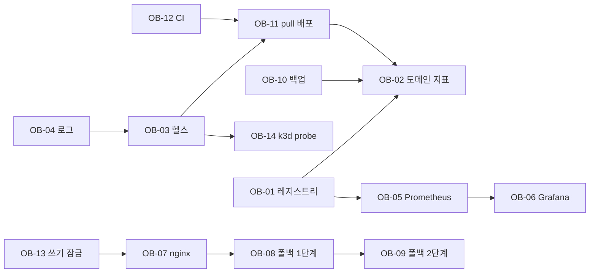

---

## 1. 운영 아키텍처 다이어그램

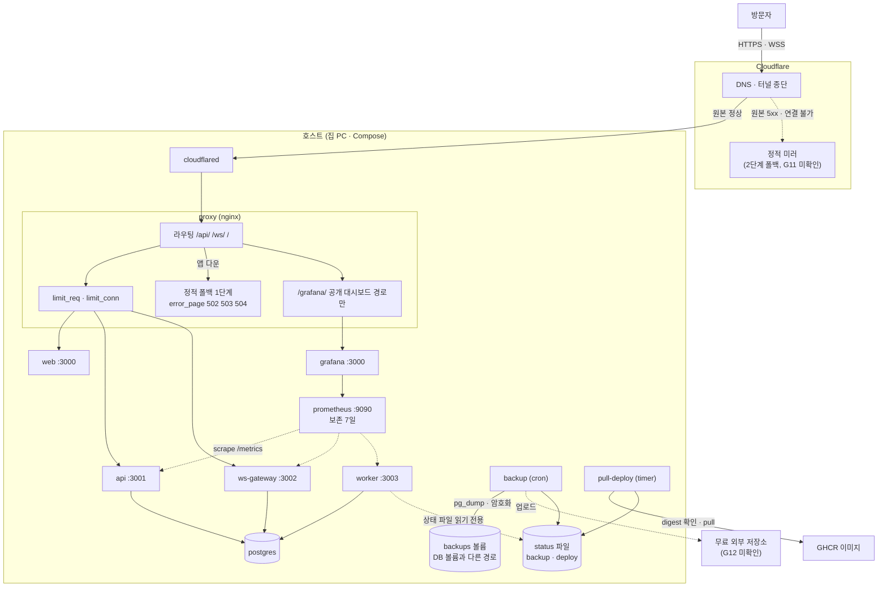

- 실선은 요청·데이터 경로, 점선은 비동기·조건부 경로다.
- **`worker` 가 상태 파일(백업·배포)을 읽어 지표로 바꾼다**(§OB-02). 백업·배포 스크립트는 지표 서버를 따로 띄우지 않는다(Pushgateway 컨테이너 불필요).
- Oracle 경로에서는 `cloudflared` 가 없고 방문자가 `proxy` 로 직접 온다(TLS 를 `proxy` 가 종료, G7).

---

## 2. 통합 클래스·구성 다이어그램

### 2.1 코드가 있는 부분 — `modules/observability`

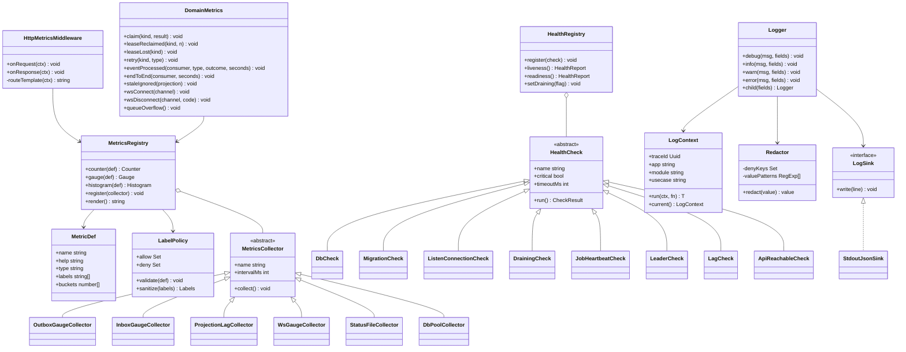

- `MetricsCollector` 는 **주기적으로 DB·파일을 읽어 게이지를 채우는** 수집기다(스크레이프 시점이 아니라 `intervalMs` 마다). 스크레이프마다 DB 를 치지 않게 한다.
- `HealthCheck.critical` 이 참인 검사가 하나라도 실패하면 `readiness` 가 503 이다. `LeaderCheck`·`LagCheck`·`ApiReachableCheck` 는 **비치명**(상태만 `degraded` 로 표시).
- 위치: 인터페이스·레지스트리·로거는 `modules/observability`, 검사 구현 중 DB 접근이 있는 것은 각 앱의 `compose/` 에서 포트를 꽂는다(순수성 규칙 B2·B6 유지).

### 2.2 설정 구조가 있는 부분 — 구성 요소 관계도로 대체

**클래스 해당 없음.** 프록시·Prometheus·Grafana·백업·배포·CI·k3d 는 선언형 설정과 셸 스크립트라 클래스가 없다. 대신 구성 요소의 관계와 파일 위치를 둔다.

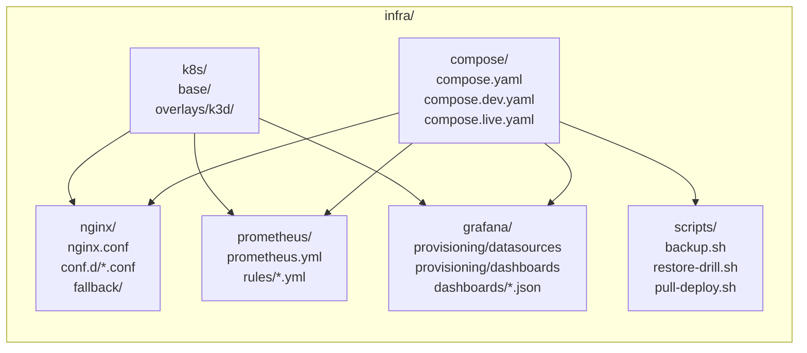

---

## 3. OB-01 지표 레지스트리·HTTP 지표 미들웨어

**목적.** 모든 앱이 같은 규약으로 지표를 만들고 `/metrics` 에 Prometheus 텍스트 형식으로 내보낸다. 레이블 규칙 위반을 **구조로** 막는다.

**트리거.** 앱 기동 시 레지스트리 생성, 요청마다 미들웨어, 스크레이프마다 `GET /metrics`.

| 구분 | 내용 |
|---|---|
| 사전 조건 | 지표 정의(`MetricDef`)는 모듈 부팅 시 한 곳(`defs.ts`)에서 등록한다. 레이블은 허용목록(§0.3) 안이어야 한다 |
| 사후 조건 | `/metrics` 응답에 정의된 지표만 있고 금지 레이블이 없다. 등록되지 않은 지표를 기록하면 개발·시험에서 예외, 운영에서는 버리고 `pf_metrics_dropped_total` 증가 |

**구성.** §2.1 의 `MetricsRegistry` · `LabelPolicy` · `HttpMetricsMiddleware`.

- **라이브러리는 G5 부분 실측.** `prom-client` 15.1.3 이 Bun 1.4.4 에서 Registry·Counter·Histogram·Gauge·`/metrics` 출력은 동작(기본 지표 일부 제외, §4.1). 후보 비교는 계속 열어 둔다: `prom-client`, OpenTelemetry Prometheus 내보내기(베타). 결정 전까지 레지스트리는 **어댑터 뒤**에 두어(`MetricsBackend` 포트) 구현을 바꿀 수 있게 한다.
- 라우트 템플릿은 Elysia 가 매칭한 패턴에서 얻는다. 매칭 실패(404)는 `route="unmatched"` 하나로 모은다(카디널리티 방지).
- 히스토그램 버킷(제안, 초): `0.005, 0.01, 0.025, 0.05, 0.1, 0.2, 0.3, 0.5, 1, 2.5, 5` — p95 300ms 판정(AC-013)에 0.3 이 경계로 들어간다.

### 3.1 시퀀스

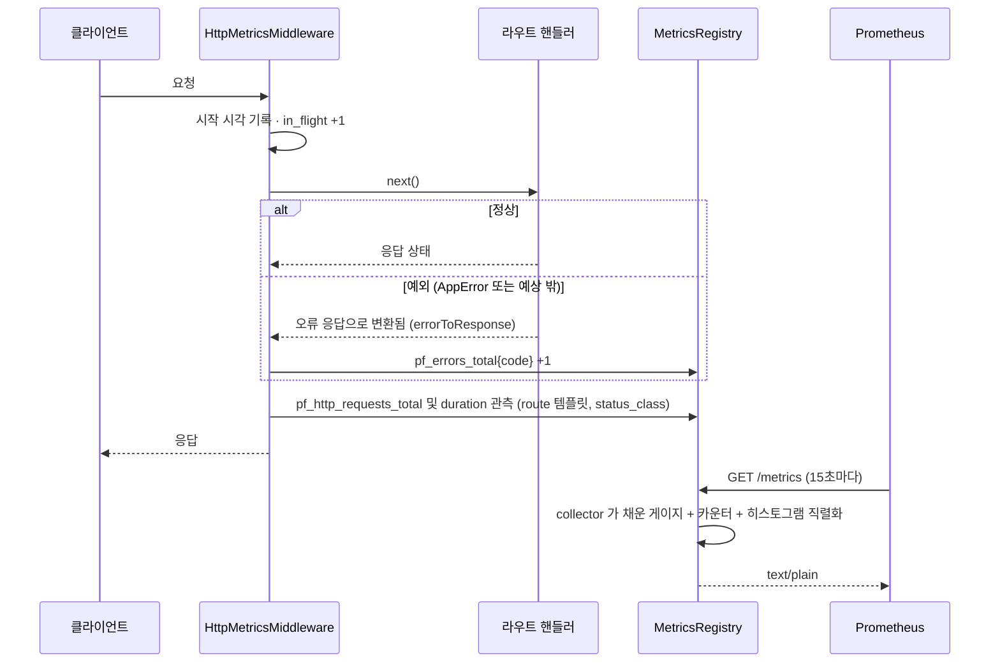

### 3.2 순서도 — 지표 기록 시 레이블 검증

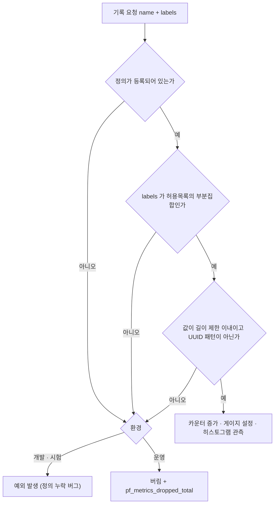

- 값 검사의 UUID 패턴 거부는 **식별자가 실수로 레이블에 들어가는 것**을 잡는 보조선이다(정의 단계의 허용목록이 1차).

**카운터 선초기화 의무 (로컬 실측, 2026-11-04).** 레이블 값이 **고정 열거**인 카운터(예: `pf_auth_login_failed_total{reason}`)는 앱 기동 시 **모든 레이블 조합을 0 으로 미리 노출**한다(`MetricsRegistry.preinit(name, labelValues[])`). 시리즈가 첫 이벤트 때 처음 생기면 `increase()`/`rate()` 가 **그 첫 건을 세지 않기** 때문이다. 실측: 선초기화 없이 실제 10건을 넣어도 `increase(...[10m])` 가 9.45 라 `LoginFailedSpike(>=10)` 이 불발이었고, `GitHubUnavailable` 도 실제 3건이면 불발이었다(선초기화하면 정상 발화). 열거 값 목록은 `packages/protocol` 상수가 정본이라 코드와 지표가 어긋나지 않는다. 열거가 아닌 레이블(자유 값)에는 적용하지 않는다(레이블 폭증 방지).

### 3.3 오류·경보

| 상황 | 동작 | 경보 |
|---|---|---|
| 지표 정의 누락/금지 레이블 | 운영: 버림, `pf_metrics_dropped_total` | `increase(pf_metrics_dropped_total[1h]) > 0` (정보) |
| `/metrics` 직렬화 지연(>1초) | 응답은 하되 `pf_metrics_scrape_seconds` 기록 | 지연 지속 시 정보 |

### 3.4 시험

| 시험 | 등급 |
|---|---|
| 정의에 금지 레이블 → `LabelPolicy.validate` 예외 | L2 |
| `/metrics` 출력을 파싱해 **레이블 이름·값에 UUID/IP 패턴이 없음**(AC-012, ADR-007 검증 방법) | L2→L3 |
| 라우트 템플릿: `/api/entries/<uuid>` 요청이 `/api/entries/:id` 로 집계 | L3 |
| 404 가 `route="unmatched"` 하나로 모임 | L3 |
| G5: 후보 라이브러리가 Bun 에서 지표 3종 출력 | 관문 |

---

## 4. OB-02 도메인 지표

**목적.** 이벤트 파이프라인·실시간·보관·운영 상태를 숫자로 보이게 하고, 대시보드(OB-06)와 알람 후보의 입력을 만든다.

**트리거.** 도메인 코드의 계측 호출(`DomainMetrics`) + 주기 수집기(`MetricsCollector`).

### 4.1 지표 카탈로그 (제안, 전체)

종류: C=카운터, G=게이지, H=히스토그램.

**HTTP · 공통**

| 이름 | 종류 | 레이블 | 단위 | 발생 위치 | 알람 후보 |
|---|---|---|---|---|---|
| `pf_http_requests_total` | C | `app`,`method`,`route`,`status_class` | 건 | HttpMetricsMiddleware | 5xx 비율 > 2% (5분) |
| `pf_http_request_duration_seconds` | H | `app`,`method`,`route`,`status_class` | 초 | 위와 동일 | p95 > 0.3 (10분, AC-013) |
| `pf_http_in_flight` | G | `app` | 건 | 위와 동일 | 지속 증가 시 정보 |
| `pf_errors_total` | C | `app`,`code` | 건 | errorToResponse | `internal` 코드 증가 |
| `pf_rate_limited_total` | C | `app`,`layer`(`session`) | 건 | RateLimitGuard | 급증(스팸 신호) |
| `pf_version_conflicts_total` | C | `resource`(`entry`,`report`) | 건 | CAS 실패 경로 | 정보(ADR-021) |
| `pf_idempotent_replays_total` | C | `app` | 건 | 멱등 키 재생 (`pf_idempotency_total{outcome="replayed"}` 와 같은 값의 별칭, 대시보드는 후자를 쓴다) | 정보 |
| `pf_write_locked_total` | C | `app` | 건 | WriteLockPolicy | 잠금 중 증가(정보) |
| `pf_build_info` | G(=1) | `app`,`version`,`commit` | — | 기동 시 | — |
| `pf_metrics_dropped_total` | C | `app` | 건 | LabelPolicy | §3.3 |
| `pf_db_pool_connections` | G | `app`,`state`(`idle`,`in_use`,`waiting`) | 개 | DbPoolCollector | `waiting` > 0 지속 |
| `pf_db_tx_duration_seconds` | H | `app`,`usecase`,`outcome` | 초 | UnitOfWork | p95 상승(정보) |

**outbox · inbox · 동시성** (기존 이름 대응: architecture §11, ADR-007)

| 이름 | 종류 | 레이블 | 단위 | 발생 위치 | 기존 이름 | 알람 후보 |
|---|---|---|---|---|---|---|
| `pf_outbox_depth` | G | `status`(`new`,`processing`,`dead`) | 건 | OutboxGaugeCollector | `outbox_pending`,`outbox_new` | `new` > 100 (2분) |
| `pf_outbox_oldest_age_seconds` | G | `status` | 초 | OutboxGaugeCollector | `oldest_processing_age_seconds` | `new` > 60 (2분) **적체** |
| `pf_outbox_dead_total` | C | — | 건 | EV-06 dead 전이 | `outbox_dead_total` | 15분 내 증가 |
| `pf_inbox_depth` | G | `consumer`,`status`(`received`,`processing`,`dead`) | 건 | InboxGaugeCollector | `inbox_depth` | `received` > 100 |
| `pf_inbox_oldest_age_seconds` | G | `consumer`,`status` | 초 | InboxGaugeCollector | `inbox_oldest_age_seconds` | > 60 |
| `pf_inbox_dead_total` | C | `consumer` | 건 | EV-06 | — | 증가 |
| `pf_claim_attempts_total` | C | `kind`(`outbox`,`inbox`),`result`(`won`,`lost`) | 건 | EV-02·04 | "선점 실패 수" | `lost` 비율 급증(정보) |
| `pf_lease_reclaimed_total` | C | `kind`,`to`(`new`,`dead`) | 건 | LeaseReaper | "임대 만료 회수 수" | 지속 발생 |
| `pf_lease_lost_total` | C | `kind` | 건 | fencing 거절 | — | 임대 길이 부적절 신호 |
| `pf_retry_total` | C | `kind`,`type` | 건 | EV-06 | — | 급증 |
| `pf_dispatcher_leader` | G | `app` | 0/1 | AdvisoryLeader | — | `sum()==0` (1분) **리더 없음** |
| `pf_event_process_duration_seconds` | H | `consumer`,`type`,`outcome`(`ok`,`stale`,`error`,`dead`) | 초 | MessageRunner | `event_process_duration_seconds` | p95 > 임대의 1/5 |
| `pf_event_end_to_end_seconds` | H | `consumer` | 초 | 처리 완료 시 (`processed_at − outbox.created_at`) | 작성→소비 시간 | p95 > 1 (목표 제안) |
| `pf_projection_lag_seconds` | G | `projection` | 초 | ProjectionLagCollector | `projection_lag_seconds` | > 30 |
| `pf_projection_stale_ignored_total` | C | `projection` | 건 | ProjectorBase.isStale | — | 정보(재전달·역전 규모) |
| `pf_projection_drift` | G | `projection` | 건 | 점검 잡(정본 대비 건수 차) | `projection_drift` | > 0 (30분) |

**실시간**

| 이름 | 종류 | 레이블 | 단위 | 발생 위치 | 기존 이름 | 알람 후보 |
|---|---|---|---|---|---|---|
| `pf_ws_connections` | G | `channel`(`public`,`private`) | 개 | WsGaugeCollector | `ws_connections` | 상한 근접 |
| `pf_ws_connects_total` | C | `channel` | 건 | 업그레이드 성공 | — | — |
| `pf_ws_disconnects_total` | C | `channel`,`code` | 건 | 종료 | — | `4408`·`4500` 증가 |
| `pf_ws_resume_total` | C | `mode`(`replay`,`snapshot`,`live`),`reason` | 건 | RT-04 | `ws_reconnects_total` 대응 | `snapshot` 비율 급증 |
| `pf_ws_queue_overflow_total` | C | `channel` | 건 | SendQueue 상한 초과 | — | 증가 |
| `pf_ws_send_queue_max` | G | `channel` | 건 | 스크레이프 시점 최댓값 | — | 정보 |
| `pf_ws_messages_sent_total` | C | `channel`,`type` | 건 | 전송 | — | — |
| `pf_ws_delivery_lag_seconds` | H | `channel` | 초 | `change_log.created_at` → 전송 | — | p95 > 1 |
| `pf_ws_wake_total` | C | `source`(`notify`,`poll`) | 건 | WakeSignal | — | `poll` 비중 높음 = NOTIFY 이상 |
| `pf_ws_session_cache_total` | C | `result`(`hit`,`miss`,`negative`) | 건 | RT-13 | — | — |

**잡 · 보관 · 운영**

| 이름 | 종류 | 레이블 | 단위 | 발생 위치 | 알람 후보 |
|---|---|---|---|---|---|
| `pf_job_last_success_timestamp_seconds` | G | `job`(`dispatcher`,`reaper`,`aggregator`,`retention`,`change_log_trim`) | 초(epoch) | 각 잡 | `time()-x > 3×주기` |
| `pf_job_duration_seconds` | H | `job` | 초 | 각 잡 | 정보 |
| `pf_retention_deleted_total` | C | `table` | 건 | RetentionRunner | 정보 |
| `pf_ops_last_success_timestamp` | G | `job`(`backup`,`archive_logs`,`pull_deploy`) | 초(epoch) | StatusFileCollector (`status/<job>/last_run.json` 의 `last_success_at`) | `time()-x > 26h`(backup·archive_logs) |
| `pf_ops_last_run_ok` | G | `job` | 0/1 | 위와 동일 (`ok`) | `==0` |
| `pf_retention_paused` | G | `app` | 0/1 | 보관 정리 정지 여부(증거 보존 중, ADR-028). 정지 파일이 24시간 넘으면 `RetentionPaused` 경보 | EV-16 |
| `pf_ops_status_age_seconds` | G | `job` | 초 | 위와 동일 (`now - finished_at`) | `pull_deploy` 15분 초과(타이머 정지) |
| `pf_backup_last_size_bytes` | G | — | 바이트 | 위와 동일 (`detail.bytes`) | 급감(정보) |

**추가 지표 — 상세 설계(F13·F14·F16)가 요구하는 이름의 정본** (위 표에 없던 것. 구현은 이 이름만 쓴다)

| 이름 | 종류 | 레이블 | 발생 위치 |
|---|---|---|---|
| `pf_guard_rejections_total` | C | `app`,`guard`,`reason` | CM-01 가드 |
| `pf_rate_limit_decisions_total` | C | `app`,`rule`,`decision`(`allow`,`deny`) | CM-01·07 (`pf_rate_limited_total` 은 deny 의 별칭 집계) |
| `pf_idempotency_total` | C | `app`,`outcome`(`claimed`,`replayed`,`reuse`,`in_progress`) | CM-02 |
| `pf_idempotency_wait_seconds` | H | `app` | CM-02 |
| `pf_db_tx_retries_total` | C | `app`,`reason` | CM-05 |
| `pf_migration_version` | G | `app` | CM-05 (적용된 마이그레이션 번호) |
| `pf_notify_connected` | G | `app` | EV-13 / RT-12 (LISTEN 연결 0/1) |
| `pf_notify_reconnects_total` | C | `app` | EV-13 / RT-12 |
| `pf_notify_wakeups_total` | C | `app`,`channel`,`source`(`notify`,`poll`) | EV-13 |
| `pf_app_ready` | G | `app` | CM-06 |
| `pf_shutdown_duration_seconds` | H | `app` | CM-06 |
| `pf_shutdown_forced_total` | C | `app` | CM-06 |
| `pf_kv_cache_ops_total` | C | `app`,`op`,`result` | CM-07 |
| `pf_presence_connections` | G | `app` | CM-07 / RT-09 |
| `pf_rate_limit_buckets` | G | `app` | CM-07 (메모리 어댑터 누수 감지) |
| `pf_outbox_appended_total` | C | `type` | EV-01 |
| `pf_inbox_received_total` | C | `consumer`,`duplicate` | EV-03 |
| `pf_dispatch_batch_size` | H | `app` | EV-02 |
| `pf_dispatch_published_total` | C | `type` | EV-02 |
| `pf_message_attempts_total` | C | `consumer`,`outcome` | EV-04·06 |
| `pf_job_runs_total` | C | `job`,`result` | 잡 공통 |
| `pf_retention_lag_seconds` | G | `rule` | EV-10 |
| `pf_flow_agg_rows` | G | `app` | EV-09 |
| `pf_trace_steps_total` | C | `step` | EV-08 |
| `pf_ws_replay_messages` | H | `channel` | RT-04 |
| `pf_ws_snapshot_build_seconds` · `pf_ws_snapshot_bytes` | H | `channel` | RT-05 |
| `pf_ws_send_queue_length` · `pf_ws_send_queue_bytes` | H | `channel` | RT-06 |
| `pf_ws_coalesced_total` | C | `channel` | RT-06 |
| `pf_anonymized_rows_total` | C | `table` | ID-10 / GB-12 (세션 만료 익명화) |
| `pf_dead_requeued_total` | C | `consumer` | EV-07 (dead 재투입 CLI) |
| `pf_audit_records_total` | C | `category`,`action`,`outcome` | EV-14 (감사 기록) |
| `pf_log_redactions_total` | C | `rule` | OB-04 (마스킹 발동 — 금지 데이터가 로그에 넘어간 신호) |
| `pf_auth_login_failed_total` | C | `reason`(`state_invalid`,`state_expired`,`github_rejected`,`github_unavailable`) | ID-06 (로그인 실패 — 고정 열거라 레이블 안전) |
| `pf_retention_skipped_total` | C | `rule`,`reason` | EV-10 (동시 실행·락 때문에 건너뜀) |
| `pf_retry_delay_seconds` | H | `consumer` | EV-06 (백오프 지연 분포) |
| `pf_write_lock_state` | G | `app` | GB-10 (쓰기 잠금 0/1) |
| `pf_projection_rebuild_status` | G | `projection`,`state` | GB-26 (재구성 상태 라벨 1/0) |
| `pf_ws_fanout_seconds` | H | `channel` | RT-06 (직렬화+전송 루프) |
| `pf_ws_session_revalidate_closed_total` | C | `channel` | RT-13 |
| `pf_ws_limit_rejected_total` · `pf_ws_evicted_total` | C | `channel`,`reason` | RT-15 |
| `pf_ws_shutdown_connections` · `pf_ws_shutdown_forced_total` | G · C | `channel` | RT-11 |
| `pf_realtime_broadcast_total` · `pf_realtime_broadcast_lag_seconds` | C · H | `type` · — | RT-01 |
| `pf_changelog_head` · `pf_changelog_min_seq` · `pf_changelog_rows` | G | `channel` | RT-02 |
| `pf_flow_step_delivered_total` | C | `channel` | RT-08 |
| `pf_flow_summary_push_total` | C | `channel` | RT-14 |
| `pf_trace_watch_lag_seconds` | H | `channel` | RT-08 |

- **F13 이 쓰는 같은 개념의 다른 이름**은 F13 이 이 카탈로그의 이름으로 바꿔야 한다: `pf_outbox_pending`/`pf_outbox_dead`(게이지) → `pf_outbox_depth{status}`, `pf_inbox_pending`/`pf_inbox_dead` → `pf_inbox_depth{consumer,status}`, `pf_leader{job}` → `pf_dispatcher_leader{app}`(+ `pf_job_last_success_timestamp_seconds{job}`), `pf_message_handle_seconds` → `pf_event_process_duration_seconds`. ADR-024 의 `outbox_lag_seconds` 는 `pf_event_end_to_end_seconds` 로 읽는다.
- **프로세스 지표**: prom-client 의 기본 지표는 Bun 1.4.4 에서 일부만 의미가 있다(실측). 쓸 수 있는 것: `process_cpu_*`, `process_resident_memory_bytes`, `process_open_fds`, `nodejs_eventloop_lag_{min,max,mean,p50,p90,p99}_seconds`, `nodejs_heap_size_*`. **쓰지 않는 것**: `nodejs_eventloop_lag_seconds`(항상 0), `nodejs_gc_duration_seconds`(샘플 없음), `nodejs_active_handles*`·`active_requests*`(의미 없음). GC 가시성은 M1 에서 포기하고 `process_resident_memory_bytes` 추이로 갈음한다. `healthz` 의 이벤트 루프 지연 판정(< 1초)은 `lag_max`/`p99` 를 쓴다.

- **nginx 지표는 M1 에서 두지 않는다.** 액세스 로그에서 주소 필드를 뺐고(ADR-008) 로그 기반 지표 수집기(추가 컨테이너)를 쓰지 않기 때문이다. 필요해지면 `stub_status` + 내보내기 컨테이너를 별도 결정으로 추가한다.
- 카디널리티 추정: `route` ≤ 20, `type` ≤ 10, `consumer` ≤ 3, `code` ≤ 15 → 최악 시리즈 수가 수천 이하(무료 자원에서 안전, 측정 후 확인).

### 4.2 시퀀스

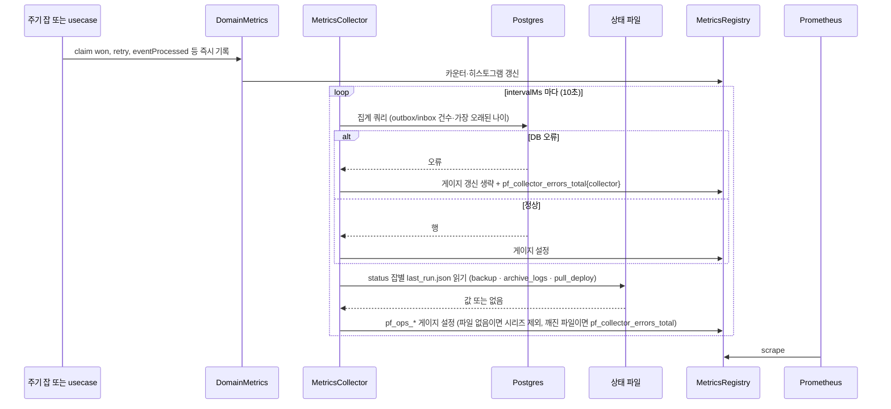

### 4.3 순서도 — `pf_event_end_to_end_seconds` 기록

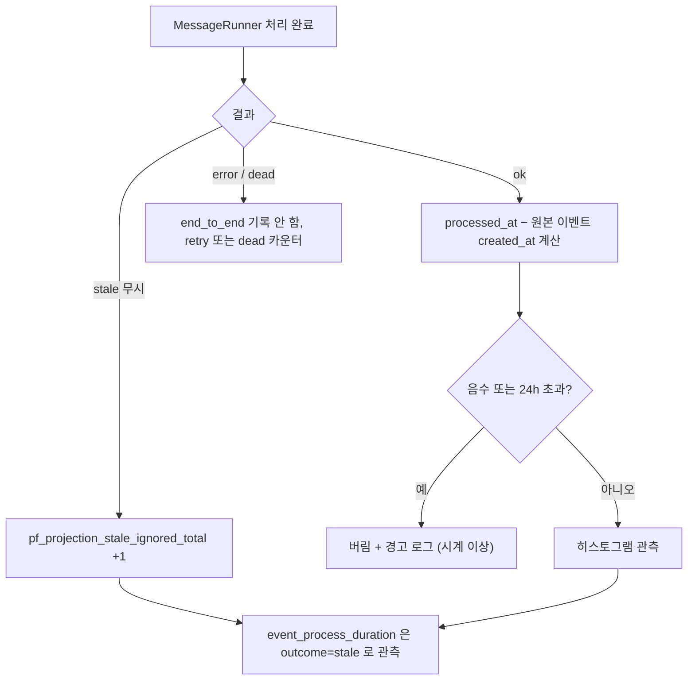

### 4.4 오류·경보

위 카탈로그의 "알람 후보" 열이 식의 출발점이고, 확정 규칙은 §17 표다. **Alertmanager 는 두지 않는다**(컨테이너 절약) — 평가·통지는 Grafana 알림이 하고 통지 채널은 **Discord 웹훅**이다(§16.3, 결정 2026-11-04).

### 4.5 시험

| 시험 | 등급 |
|---|---|
| 도메인 이벤트 발생 시 해당 카운터가 정확히 1 증가(선점 경쟁, 재시도, dead) | L3 |
| 적체를 일부러 만들면 `pf_outbox_oldest_age_seconds{status="new"}` 가 증가 | L3 (08 §7) |
| 수집기가 DB 오류에서도 `/metrics` 는 200 이고 `pf_collector_errors_total` 증가 | L3 |
| 상태 파일이 없을 때 backup/deploy 시리즈가 **없음**(0 이 아님) | L2 |

---

## 5. OB-03 `/healthz` · `/readyz`

**목적.** 오케스트레이터(compose healthcheck, k8s probe)와 배포 스크립트가 **살아 있음**과 **트래픽을 받을 수 있음**을 구분해 판단하게 한다(ADR-014 무중단, 09 §6 헬스 게이트).

**트리거.** `GET /healthz`(liveness), `GET /readyz`(readiness). 모두 내부 호출이다(§0.2).

| 구분 | 내용 |
|---|---|
| 사전 조건 | 앱 기동 완료(마이그레이션 버전 확인 포함) 후에만 readyz 가 통과 |
| 사후 조건 | 종료 신호 수신 즉시 readyz 는 503(`draining`)이 되어 새 트래픽에서 빠진다. healthz 는 종료 직전까지 200 |

**응답 형식** (제안): 200 이면 `{"status":"ok"|"degraded","version":"…","checks":{"db":{"status":"ok"},…}}`, 503 이면 `{"status":"fail",…}`. 본문에는 **비밀·연결 문자열·내부 주소를 넣지 않는다**(detail 은 짧은 문구).

### 5.1 앱별 판정 조건

| 앱 | `/healthz` (liveness) | `/readyz` (readiness) | 비치명(`degraded` 만) |
|---|---|---|---|
| **api** | 프로세스 응답, 이벤트 루프 지연 < 1초 | DB `SELECT 1`(타임아웃 500ms) · 마이그레이션 버전 ≥ 코드가 기대하는 버전 · `draining` 아님 | `LagCheck`(outbox 적체 > 임계) |
| **ws-gateway** | 위와 동일 | DB `SELECT 1` · **`LISTEN` 전용 연결이 살아 있음** · `draining` 아님 · 연결 수 < `WS_MAX_CONNECTIONS` | 폴링 대체 모드(NOTIFY 유실) |
| **worker** | 각 잡 하트비트가 `3×주기` 이내(`JobHeartbeatCheck`) · DB `SELECT 1` | (라우팅 대상이 아니라 **없음**. compose 는 `/healthz` 사용 — 02 §2.1) | `LeaderCheck`: 리더가 아니어도 정상(대기 인스턴스) |
| **web** | Next 서버 응답 | 프로세스 응답 · `draining` 아님 | `ApiReachableCheck`: api `/readyz` 실패 시 `degraded` (**readyz 는 실패시키지 않는다** — 정적 소개 페이지는 api 없이도 제공 가능, FR-070) |

- **api 의 readyz 는 worker 에 의존하지 않는다.** worker 가 죽어도 글은 저장되므로 api 는 트래픽을 받아야 한다(architecture §10 장애 모드).
- `LagCheck` 는 알림용 정보일 뿐 readiness 를 끄지 않는다(적체 때문에 api 를 빼면 쓰기가 막혀 악순환).

### 5.2 구성·클래스

§2.1 의 `HealthRegistry` · `HealthCheck` 계층. 앱 조립 루트가 필요한 검사만 등록한다.

| 앱 | 등록 검사 |
|---|---|
| api | `DbCheck`(critical) · `MigrationCheck`(critical) · `DrainingCheck`(critical) · `LagCheck` |
| ws-gateway | `DbCheck` · `ListenConnectionCheck` · `DrainingCheck` · (연결 수 상한) |
| worker | `DbCheck` · `JobHeartbeatCheck`(잡마다) · `LeaderCheck` |
| web | `DrainingCheck` · `ApiReachableCheck` |

### 5.3 시퀀스

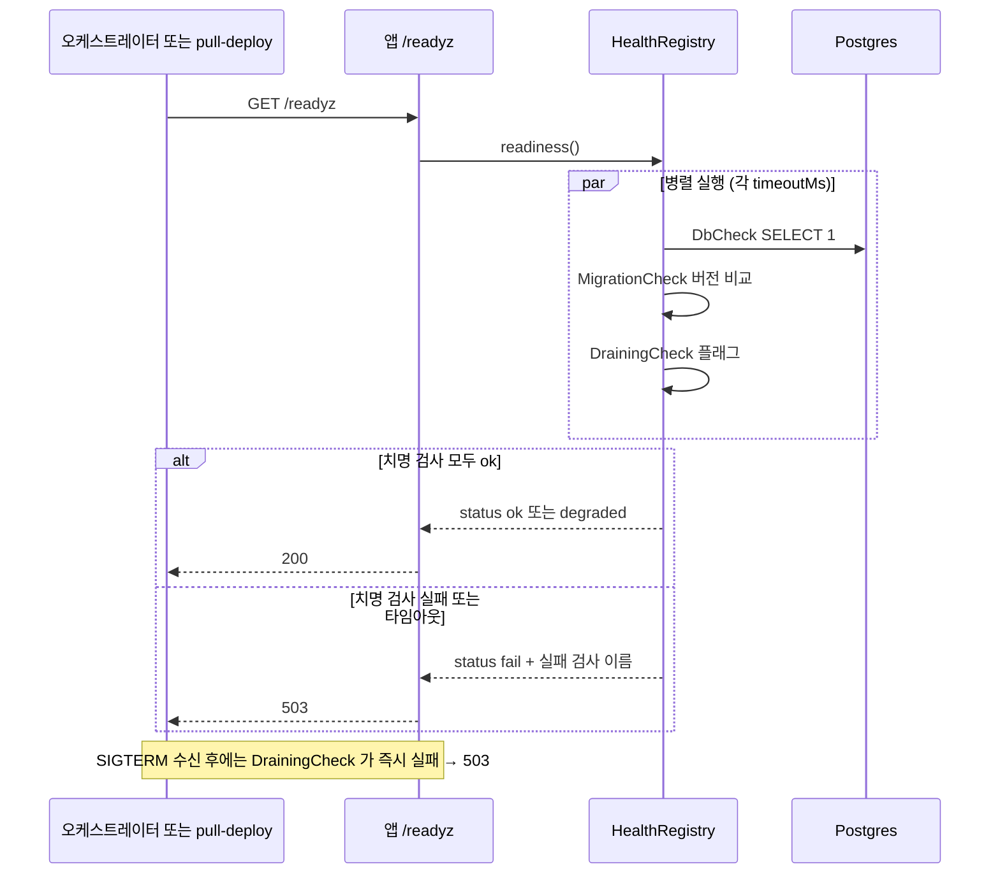

### 5.4 순서도 — 판정

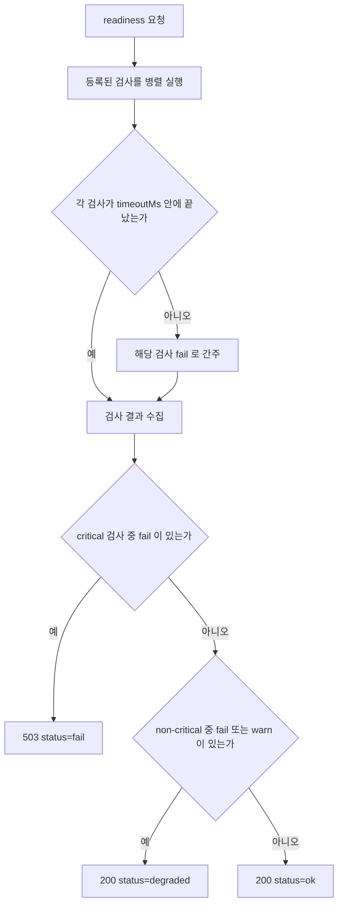

### 5.5 오류·경보

| 상황 | 동작 | 경보 |
|---|---|---|
| readyz 가 503 으로 3회 연속 | compose: 재시작 정책/ k8s: 트래픽 제외 | `up==0` 또는 배포 실패 지표 |
| 시작 직후 마이그레이션 미적용 | readyz 503 유지(앱은 계속 대기) | 배포 스크립트가 타임아웃으로 롤백 |
| `DrainingCheck` | SIGTERM 에서 `setDraining(true)` → 이후 ws `bye`(RT-11) | — |

### 5.6 시험

| 시험 | 등급 |
|---|---|
| DB 중단 → api readyz 503, healthz 200 | L3 |
| `LISTEN` 연결 끊김 → ws-gateway readyz 503, 복구 후 200 | L3 |
| worker 정지 → api readyz 200(영향 없음) | L3 |
| SIGTERM → readyz 503 이 `bye` 보다 먼저 | L3 (08 §6) |
| 응답 본문에 연결 문자열·비밀이 없음 | L2 |

---

## 6. OB-04 구조화 로그·trace_id 전파·마스킹

**목적.** 장애를 추적할 수 있되(`trace_id`), **개인정보·비밀·본문이 로그에 남지 않게** 한다(ADR-008, design/00 §5).

**트리거.** 모든 앱의 로그 호출. 요청·메시지 처리 진입 시 `LogContext` 설정.

| 구분 | 내용 |
|---|---|
| 사전 조건 | 진입점(요청, 이벤트 처리, 잡 틱, WS 메시지)이 `LogContext.run()` 으로 시작 |
| 사후 조건 | 모든 로그 줄이 JSON 한 줄, 필드 규약을 지키고, 금지 데이터가 없다 |

### 6.1 로그 필드 규약 (제안)

| 필드 | 필수 | 설명 |
|---|---|---|
| `ts` | 예 | ISO 8601 UTC, 밀리초 |
| `level` | 예 | `debug` `info` `warn` `error` |
| `msg` | 예 | 짧은 고정 문구(가변 값은 필드로) |
| `app` | 예 | `api` `ws-gateway` `worker` `web` |
| `module` | 선택 | 예: `guestbook` |
| `usecase` | 선택 | 예: `PostEntry` |
| `trace_id` | 선택 | 흐름 추적 단위(design/00). 요청 응답 `X-Trace-Id` 와 같은 값 |
| `req_id` | 선택 | 요청 단위 임시 id(디버깅용, 지표 레이블 금지) |
| `status` | 선택 | HTTP 상태 |
| `duration_ms` | 선택 | 처리 시간 |
| `err.code` | 선택 | `AppError.code` |
| `err.kind` | 선택 | `domain` `infra` `unexpected` |
| `err.stack` | 선택 | **`unexpected` 에서만**, 운영 로그에서 길이 제한 |
| `conn_id` | 선택 | WS 연결 id(세션과 무관한 임의 값) |
| `event_type`·`event_id` | 선택 | 이벤트 처리 로그. **payload 는 남기지 않는다** |

### 6.2 마스킹 규칙

| 구분 | 규칙 |
|---|---|
| 키 거부목록(재귀) | `authorization`, `cookie`, `set-cookie`, `token`, `access_token`, `secret`, `password`, `client_secret`, `x-forwarded-for`, `x-real-ip`, `cf-connecting-ip`, `body`, `payload`, `displayName`, `display_name` → 값을 `"[redacted]"` 로 |
| 값 패턴 | `Bearer …`, 32바이트 이상 base64url 토큰 형태, `://user:pass@` 연결 문자열, IPv4/IPv6 주소 → `[redacted]` |
| 금지(애초에 호출 금지) | 글 본문, 표시 이름, 세션 토큰 원문, IP. `Redactor` 는 **실수 방지용 2차선**이다 |
| nginx 액세스 로그 | `log_format` 에 `$remote_addr`·`$http_x_forwarded_for` 를 **넣지 않는다**(OB-07) |
| 보관 | 컨테이너 로그는 `json-file` 드라이버 `max-size=20m`, `max-file=10`(컨테이너당 약 200MB) + **일 아카이브 7일**(OB-15, ADR-027). 별도 집계 시스템(Loki 등)은 M1 에 두지 않는다(사용자 선택) |
| 연결 | 접근 로그 `rid` = 앱 로그 `req_id`, 앱 로그 `trace_id` = 감사 로그 `trace_id` (ADR-027) |

### 6.3 구성·클래스

§2.1 의 `Logger` · `LogContext` · `Redactor` · `LogSink`. `LogContext` 는 `AsyncLocalStorage`(`node:async_hooks`) 기반이며 **Bun 호환은 미확인(G5)**. 대체: 인자로 `ctx` 를 명시 전달.

### 6.4 시퀀스

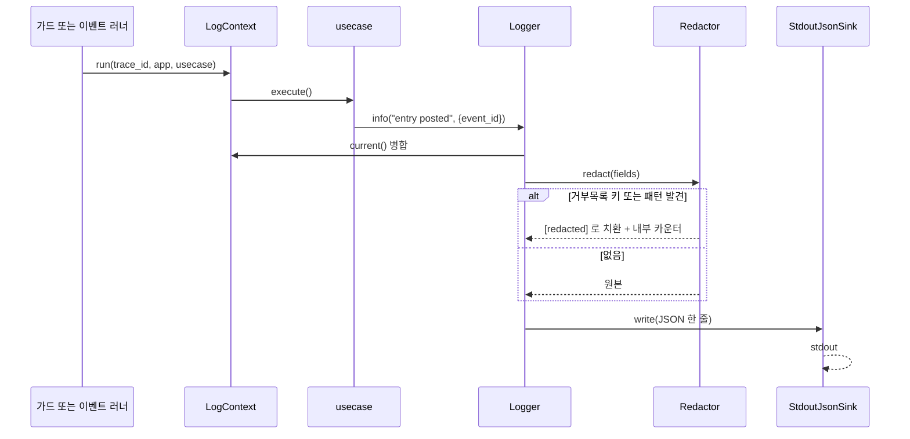

### 6.5 순서도 — 요청 로그 수준 결정

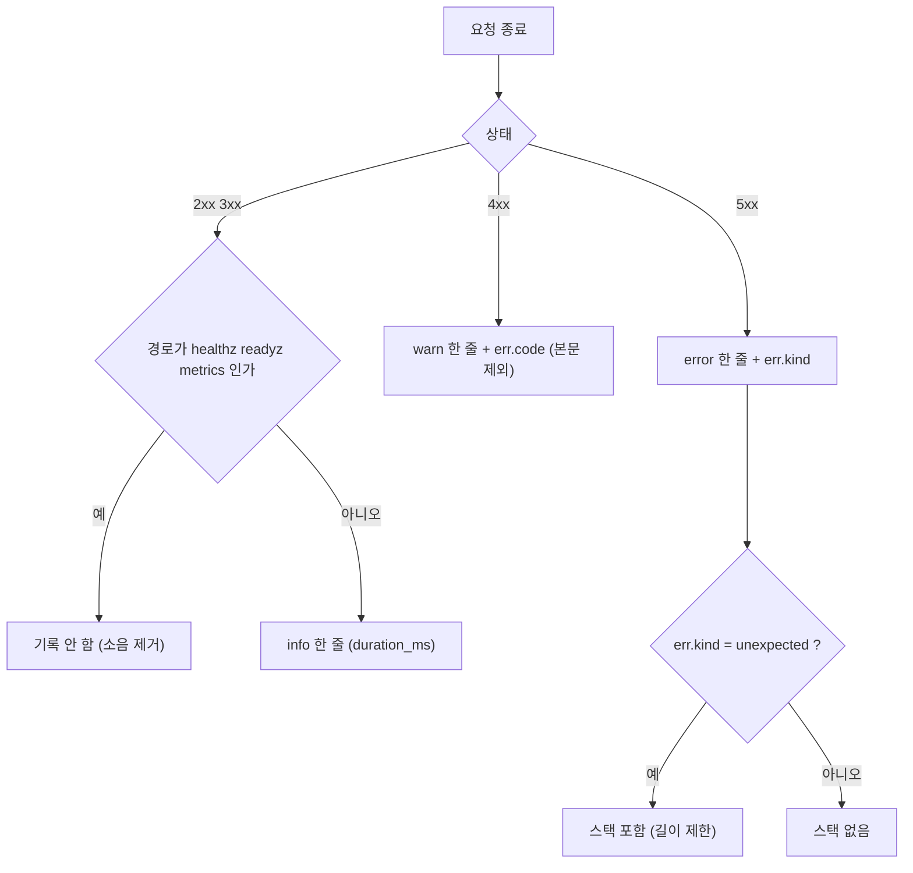

### 6.6 오류·경보

로그 자체는 경보를 만들지 않는다. 대신 `Redactor` 가 치환을 발견하면 `pf_log_redactions_total{app}` 를 올려(제안) **"누군가 금지 데이터를 로그에 넘기고 있음"** 을 드러낸다 — 0 이 정상.

### 6.7 시험

| 시험 | 등급 |
|---|---|
| 거부목록 키·패턴이 든 객체를 로깅 → 출력에 원본 값이 없음 | L2 |
| `PostEntry` 후 컨테이너 로그를 `grep` 해 글 본문·표시 이름·IP 가 없음(프라이버시 시험, AC-009 인접) | L3 |
| 한 요청의 로그 줄들이 같은 `trace_id` 를 공유 | L3 |
| 액세스 로그(nginx)에 클라이언트 주소 필드가 없음 | L3 |

---

## 7. OB-05 Prometheus 수집 설정·규칙

**목적.** 앱 지표를 모으고 7일 보관하며, 경보 규칙을 평가한다. 자원 한도 안에서 가볍게 돈다.

**트리거.** 컨테이너 기동 시 `prometheus.yml` 로드, 15초(제안)마다 스크레이프.

| 구분 | 내용 |
|---|---|
| 사전 조건 | 앱의 `/metrics` 가 내부 네트워크에서 닿는다. Prometheus 는 **외부에 노출하지 않는다**(ADR-007) |
| 사후 조건 | 보존 7일(데이터 보관 정책과 일치), 디스크 상한 내 동작 |

**구성 (제안)**

```yaml
# infra/prometheus/prometheus.yml — 제안/미검증
global:
  scrape_interval: 15s
  evaluation_interval: 15s
rule_files:
  - /etc/prometheus/rules/*.yml
scrape_configs:
  - job_name: api
    static_configs: [{ targets: ["api:3001"] }]
  - job_name: ws-gateway
    static_configs: [{ targets: ["ws-gateway:3002"] }]
  - job_name: worker
    static_configs: [{ targets: ["worker:3003"] }]
  - job_name: prometheus
    static_configs: [{ targets: ["localhost:9090"] }]
```

- 실행 인자(제안): `--storage.tsdb.retention.time=7d` , `--storage.tsdb.retention.size=1GB`(자원 한도 안에서 조정), `--web.enable-lifecycle` 는 쓰지 않는다.
- k3d 에서는 `static_configs` 대신 서비스 DNS(`api.pf.svc:3001`)를 쓴다(overlay 로 교체).
- 스크레이프 주기 15초는 해상도와 자원의 절충안이다(ADR-007 미결: "수집 주기는 구현 시"). 메모리가 압박되면 30초로 늘린다.
- 경보 규칙 식 정본 `infra/prometheus/rules/pf.yml`(제안): §17 표를 규칙으로 옮긴다. `promtool check rules`·`promtool test rules` 를 CI 에서 돈다(OB-12). **런타임 평가는 Prometheus 가 아니라 Grafana 알림**이 하므로 이 파일은 `rule_files` 에 로드하지 않는다(§16.3).

### 7.1 시퀀스

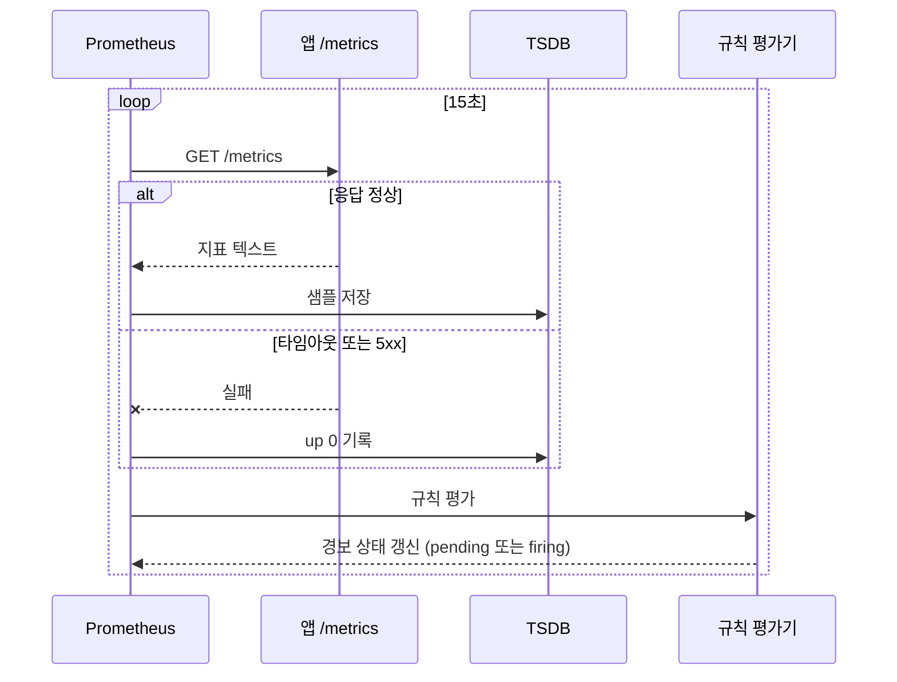

### 7.2 순서도 — 경보 상태

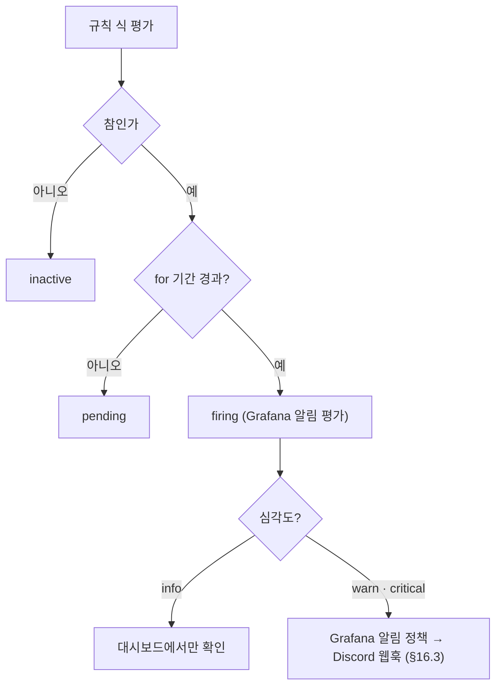

### 7.3 오류·경보

| 상황 | 동작 |
|---|---|
| 스크레이프 실패 | `up{job}==0` → 규칙 `TargetDown`(5분) |
| 디스크 가득 | 보존 크기 상한으로 오래된 블록 삭제. 메모리 압박 시 주기 연장 |

### 7.4 시험

| 시험 | 등급 |
|---|---|
| 세 앱 타겟이 `up==1` | L3 |
| `promtool check config` / `check rules` 통과 | L1 (CI) |
| 앱 하나를 내리면 `TargetDown` 이 pending→firing | L3 |

---

## 8. OB-06 Grafana 프로비저닝·대시보드·Public dashboards

**목적.** 지표를 시각화하고 **읽기 전용 공개 대시보드를 사이트에 임베드**한다(FR-061, AC-012). 대시보드·데이터소스는 코드로 관리한다.

**트리거.** 컨테이너 기동 시 프로비저닝 파일 로드. 방문자가 `/metrics` 페이지(WB-13)를 열면 iframe 으로 공개 대시보드.

| 구분 | 내용 |
|---|---|
| 사전 조건 | Prometheus 데이터소스 도달, 대시보드 JSON 이 저장소에 있음 |
| 사후 조건 | 외부에는 **공개 대시보드 경로만** 열려 있고 로그인·편집·탐색 UI 는 닿지 않는다 |

### 8.1 프로비저닝 구성 (제안)

```
infra/grafana/
├─ provisioning/
│  ├─ datasources/prometheus.yaml      # uid 고정: pf-prom, URL http://prometheus:9090, 읽기 전용
│  └─ dashboards/provider.yaml         # 폴더 'pf', 경로 /var/lib/grafana/dashboards, UI 수정 불가
└─ dashboards/
   ├─ pipeline.json                    # 공개
   ├─ api.json                         # 공개
   ├─ realtime.json                    # 공개
   └─ ops.json                         # 비공개 (관리자 전용: 잡·백업·배포·DB 풀)
```

- 환경(제안): `GF_SERVER_ROOT_URL`(공개 호스트 + `/grafana/`), `GF_SERVER_SERVE_FROM_SUB_PATH=true`, `GF_SECURITY_ALLOW_EMBEDDING=true`(**공개 대시보드 임베드에 필요한지 미확인 G6**), `GF_AUTH_ANONYMOUS_ENABLED=false`(Public dashboards 우선이므로 익명 로그인은 끈다), `GF_USERS_ALLOW_SIGN_UP=false`, `GF_SECURITY_ADMIN_PASSWORD__FILE`(시크릿 파일, 10 §5).
- **Public dashboards 가 파일 프로비저닝으로 만들어지는지는 미확인(G6).** 안 되면 관리자가 UI/API 로 한 번 생성하고 그 토큰 URL 을 `site-vars.yaml` 의 임베드 URL 변수로 둔다(콘텐츠 변수, 12 §1.1 방식 — **수정 요청 참조**).
- 프록시는 `/grafana/` 아래에서 **공개 대시보드 보기에 필요한 경로만 허용목록**으로 전달한다(§OB-07). 정확한 필요 경로(`/grafana/public-dashboards/<토큰>`, 정적 에셋, `/grafana/api/public/dashboards/**` 등)는 **G6 에서 실측으로 확정**한다.

### 8.2 대시보드 패널과 PromQL 예시 (미검증)

**pipeline (공개)** — 이 사이트의 핵심 볼거리

| 패널 | PromQL 예시 | 의미 |
|---|---|---|
| outbox 적체 | `sum(pf_outbox_depth{status="new"})` | 전달 대기 건수 |
| 가장 오래된 대기(초) | `max(pf_outbox_oldest_age_seconds{status="new"})` | 적체의 선행 지표 |
| inbox 적체(소비자별) | `sum by (consumer) (pf_inbox_depth{status="received"})` | 소비 지연 |
| 작성→소비 p50/p95 | `histogram_quantile(0.95, sum by (le) (rate(pf_event_end_to_end_seconds_bucket[5m])))` | 결과적 일관성 지연 |
| dead-letter 누계 | `sum(pf_outbox_dead_total) + sum(pf_inbox_dead_total)` | 격리 건수 |
| 선점 경쟁 | `sum by (result) (rate(pf_claim_attempts_total[5m]))` | `won`/`lost` 비율 |
| 임대 회수·fencing | `rate(pf_lease_reclaimed_total[5m])` , `rate(pf_lease_lost_total[5m])` | 동시성 제어 가시화 |
| 읽기 모델 지연 | `max by (projection) (pf_projection_lag_seconds)` | 프로젝터 건강 |

**api (공개)**

| 패널 | PromQL 예시 |
|---|---|
| 요청률 | `sum by (route) (rate(pf_http_requests_total{app="api"}[5m]))` |
| p95 지연 | `histogram_quantile(0.95, sum by (le, route) (rate(pf_http_request_duration_seconds_bucket{app="api"}[5m])))` |
| 5xx 비율 | `sum(rate(pf_http_requests_total{app="api",status_class="5xx"}[5m])) / sum(rate(pf_http_requests_total{app="api"}[5m]))` |
| 409·429 | `sum(rate(pf_version_conflicts_total[5m]))` , `sum(rate(pf_rate_limited_total[5m]))` |

**realtime (공개)**

| 패널 | PromQL 예시 |
|---|---|
| 접속 수 | `sum by (channel) (pf_ws_connections)` |
| 재개 방식 비율 | `sum by (mode) (rate(pf_ws_resume_total[15m]))` |
| 큐 초과 종료 | `rate(pf_ws_queue_overflow_total[5m])` |
| 전달 지연 p95 | `histogram_quantile(0.95, sum by (le) (rate(pf_ws_delivery_lag_seconds_bucket[5m])))` |

**ops (비공개)**: 잡 하트비트 나이 `time() - pf_job_last_success_timestamp_seconds`, 운영 작업 나이 `time() - pf_ops_last_success_timestamp{job}`, 마지막 실행 결과 `pf_ops_last_run_ok{job}`, DB 풀 `pf_db_pool_connections`.

- 공개 대시보드의 변수·레이블 표시는 **인스턴스 주소를 숨긴다**(`instance` 레이블 노출 금지 — 패널에서 `sum by` 로 집계하고 변수로 노출하지 않는다).
- 공개 대시보드는 **집계 지표만**이라 방문자 식별 정보가 구조적으로 없다(레이블 규칙).

### 8.3 시퀀스

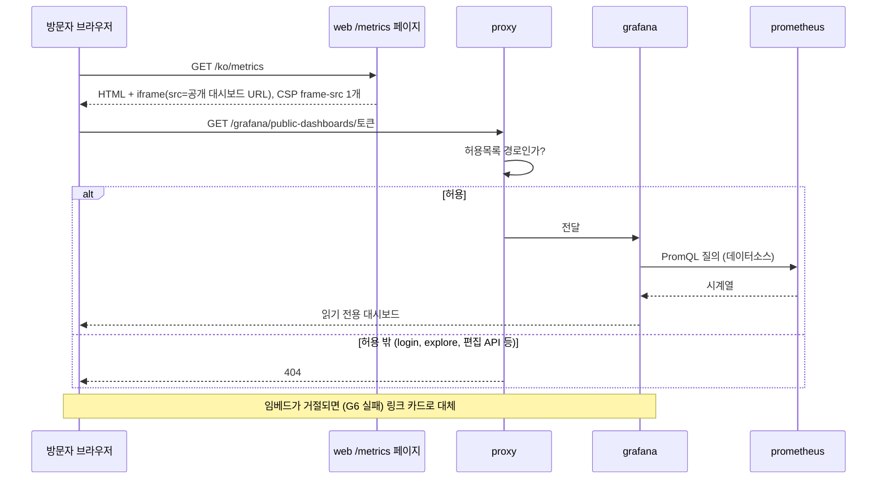

### 8.4 순서도 — 임베드 결정(G6, 로컬 실측 통과)

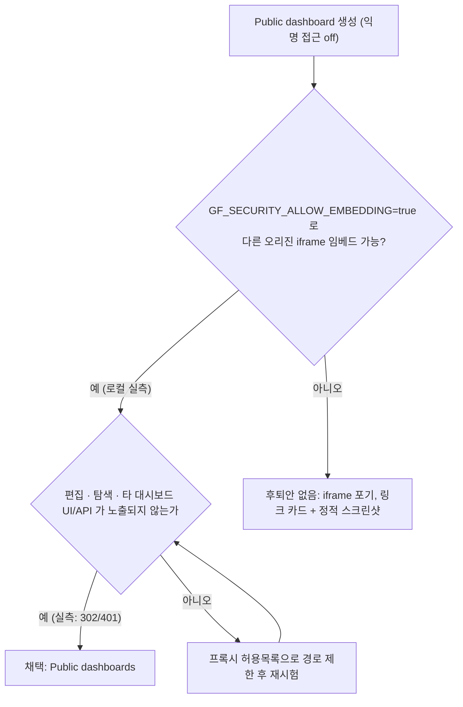

**후퇴안이 없는 이유(G6 실측)**: 익명 Viewer + 프로비저닝 대시보드 안은 `POST /api/ds/query` 로 임의 PromQL(`count({__name__=~".+"})`)이 200 으로 실행되고 `/api/search`·데이터 소스 목록·다른 대시보드가 열려 Prometheus 전체가 공개되는 것과 같다. 따라서 Public dashboards 가 안 될 때의 대안으로도 쓰지 않는다.

**실측 요약**: `GF_SECURITY_ALLOW_EMBEDDING=true`(기본은 `X-Frame-Options: deny`), 익명 접근 off, iframe `sandbox="allow-scripts allow-same-origin"`(둘 다 필수), 사이트 CSP `frame-src` 에 Grafana 공개 출처 1개. 공개 URL 에서 `/explore`·`/d/<다른>`·`/dashboard/new`·`/connections`·`/profile` 은 302(로그인), `/api/search`·`/api/datasources`·`/api/dashboards/uid/*`·`/api/ds/query` 는 401, 쿼리 API 는 `/api/public/dashboards/<토큰>/panels/<id>/query` 만 열려 있고 본문의 임의 `expr` 은 무시된다. 시간 선택을 끄면 클라이언트 범위를 무시하고 대시보드 기본값으로 조회(켜면 클라이언트 범위를 따르고 서버 측 상한은 없음).
**주의**: ① 공개 페이지 HTML 부트스트랩에 데이터 소스 이름·uid·type·`jsonData` URL(내부 주소)이 들어간다 — 데이터 소스 URL 에 자격 증명·비밀 경로를 두지 않는다. ② Grafana 포트의 `/metrics` 가 무인증으로 열려 있으므로 프록시에서 차단한다(외부 노출 금지). ③ 공개 토큰이 곧 자격이다 — 유출 시 공개를 해제하고 재발급한다.

### 8.5 오류·경보

| 상황 | 동작 |
|---|---|
| Grafana 다운 | 사이트 기능 영향 없음, `/metrics` 페이지는 안내 문구(architecture §10) |
| Prometheus 다운 | 대시보드가 비어 있음, 위와 동일 |
| 메모리 압박 | 스크레이프 주기 연장, 최후에는 자체 화면으로 후퇴(ADR-007 재검토 조건) |

### 8.6 시험

| 시험 | 등급 |
|---|---|
| 공개 URL 로 대시보드가 로드되고 편집 버튼·탐색 메뉴가 없음(AC-012) | L3 수동+스크린샷 |
| `/grafana/login`, `/grafana/explore`, `/grafana/api/dashboards/**` 가 외부에서 404 | L3 |
| 프로비저닝 JSON 이 `promtool` 식 검증이 아닌 **JSON 스키마·쿼리 문법** 점검을 CI 에서 통과 | L1 |
| 공개 대시보드 응답에 인스턴스 주소·식별자 레이블 없음 | L3 |

---

## 9. OB-07 nginx 프록시

**목적.** 단일 진입점: 라우팅, 속도 제한, 클라이언트 주소 정규화, 보안 헤더, WebSocket 업그레이드, 폴백, 내부 경로 차단(10 §7 책임 분담).

**트리거.** 모든 외부 요청(집 PC 경로는 `cloudflared` 경유, Oracle 경로는 직접).

| 구분 | 내용 |
|---|---|
| 사전 조건 | 이미지에 `ngx_http_realip_module` 포함(**G7 미확인**: 공식 이미지에서 `nginx -V` 로 확인), 업스트림 컨테이너 이름이 해석됨 |
| 사후 조건 | 클라이언트가 보낸 주소 헤더는 폐기, 앱에는 정규화된 헤더만, 액세스 로그에 주소 없음, 내부 경로는 404 |

### 9.1 설정 구조 (제안/미검증)

```
infra/nginx/
├─ nginx.conf                  # events, http { include conf.d/*.conf }
├─ conf.d/
│  ├─ 00-maps.conf             # map: 로케일, WS Connection, 로그 형식
│  ├─ 10-limits.conf           # limit_req_zone, limit_conn_zone
│  ├─ 20-upstreams.conf        # upstream web/api/ws/grafana (keepalive)
│  ├─ 30-security-headers.conf # add_header ... always (정적 값)
│  ├─ 40-realip-cf.conf        # 집 PC 경로 전용 (Oracle 경로는 realip-none)
│  ├─ 50-server.conf           # server { location ... }
│  └─ 90-write-block.conf      # 평소 비어 있음 (비상 쓰기 차단, OB-13)
└─ fallback/                   # 정적 폴백 산출물 (OB-08)
```

**핵심 스니펫 (제안/미검증)**

```nginx
# 00-maps.conf
map $http_upgrade $connection_upgrade { default upgrade; '' close; }
map $http_accept_language $fb_locale { default en; "~*^ko" ko; }
log_format pf_json escape=json
  '{"ts":"$time_iso8601","method":"$request_method","uri":"$uri","status":$status,'
  '"bytes":$body_bytes_sent,"rt":$request_time,"urt":"$upstream_response_time",'
  '"rid":"$request_id","proto":"$server_protocol"}';
# ↑ ADR-027: $uri 는 쿼리스트링을 포함하지 않는다(OAuth code/state 가 새지 않게). $request_uri·$args·$remote_addr·
#   $http_x_forwarded_for·$http_user_agent·$http_referer·쿠키는 넣지 않는다 (ADR-008·023)

# 10-limits.conf   (수치는 AC-007 미결 — 제안값)
limit_req_zone  $binary_remote_addr zone=pf_write:10m rate=5r/s;
limit_req_zone  $binary_remote_addr zone=pf_read:10m  rate=20r/s;
limit_conn_zone $binary_remote_addr zone=pf_ws:10m;
limit_req_zone  $binary_remote_addr zone=pf_me:1m   rate=30r/m;   # GET /api/me 세션 발급 남용 방지 (03 §1.1)
limit_req_zone  $binary_remote_addr zone=pf_auth:1m rate=10r/m;   # /api/auth/ 로그인 시작·콜백
limit_req_zone  $binary_remote_addr zone=pf_wsup:1m  rate=30r/m;  # /ws/ 업그레이드 재접속 폭주

# 40-realip-cf.conf  (집 PC 경로; G1·G7 로컬 실측 통과 — 임시 터널, 정식 터널은 미확인)
# G1 실측: 에지는 클라이언트의 X-Forwarded-For·True-Client-IP 를 지우지 않고(위조 값이 그대로 도달),
#   클라이언트가 보낸 CF-Connecting-IP 요청 헤더는 403(error 1000)으로 거부한다.
#   → 아래 realip 로 치환한 뒤 proxy_set_header 로 덮어쓰는 정규화가 필수다. cloudflared 가 같은 호스트면 set_real_ip_from 127.0.0.1 로 동작 확인.
set_real_ip_from  <cloudflared 컨테이너 네트워크 대역>;
real_ip_header    CF-Connecting-IP;
real_ip_recursive off;

# 50-server.conf (요지)
server {
  listen 8080;
  access_log /dev/stdout pf_json;
  proxy_set_header X-Request-Id $request_id;   # 앱 로그 req_id 와 연결 (ADR-027)
  client_max_body_size 16k;                  # 글 500자 기준 여유
  server_tokens off;

  # 내부 경로는 외부 404 (깊은 방어; 앱 루트라 원래 전달되지 않음)
  location ~* ^/(healthz|readyz|metrics)(/|$) { return 404; }   # 대소문자 무시·후행 슬래시 포함(G7 실측: `location =` 정확 일치는 /healthz/ 와 /HEALTHZ 를 못 막는다)
  location = /nginx-health { access_log off; return 200; }

  location = /api/me {
    limit_req zone=pf_me burst=10 nodelay;
    proxy_pass http://api;
    proxy_set_header X-Real-IP $remote_addr;
    proxy_set_header X-Forwarded-For "";
    add_header X-Robots-Tag "noindex" always;
  }

  location /api/auth/ {
    limit_req zone=pf_auth burst=5 nodelay;
    proxy_pass http://api;
    proxy_set_header X-Real-IP $remote_addr;
    proxy_set_header X-Forwarded-For "";
    add_header X-Robots-Tag "noindex" always;
  }

  location /api/ {
    add_header X-Robots-Tag "noindex" always;    # 14 SEO: API 는 색인 제외
    limit_req zone=pf_write burst=10 nodelay;   # 메서드별 분기는 map 으로 (아래 참고)
    proxy_pass http://api;
    proxy_set_header X-Real-IP $remote_addr;    # realip 이후의 단일 정규화 값. 클라이언트 값은 덮어쓴다
    proxy_set_header X-Forwarded-For "";        # 클라이언트가 보낸 체인 폐기
    proxy_read_timeout 30s;                      # 핸들러 제한 10초 + 여유
    error_page 502 503 504 = @api_unavailable;
  }

  location /ws/ {
    limit_req zone=pf_wsup burst=20 nodelay;     # 업그레이드 재접속 폭주 방지 (03 §1.1)
    limit_conn pf_ws 20;                         # 탭당 소켓 2 × 여러 탭 (제안)
    proxy_pass http://ws;
    proxy_http_version 1.1;
    proxy_set_header Upgrade $http_upgrade;
    proxy_set_header Connection $connection_upgrade;
    proxy_read_timeout 150s;                     # 서버 idle 120초 · hb 25초보다 길게. G1 실측: Cloudflare 임시 터널은 ping 없는 유휴 WS 를 약 126초에 1006 으로 끊는다 → hb 25초 필수
    proxy_send_timeout 150s;
    proxy_buffering off;
  }

  location /grafana/ { ... }                     # §9.3 허용목록만

  location / {
    limit_req zone=pf_read burst=40 nodelay;
    proxy_pass http://web;
    error_page 502 503 504 = @static_fallback;   # OB-08
  }

  location @api_unavailable {
    default_type application/json;
    return 503 '{"error":{"code":"unavailable","message":"Service temporarily unavailable"}}';
  }
}
```

- **메서드별 속도 제한**: 쓰기(`POST/PUT/PATCH/DELETE`)와 읽기를 다른 존으로 보내려면 `map $request_method $pf_zone_key` 로 읽기 요청의 키를 빈 문자열로 만들어(제한 비적용) 한 존만 쓰는 방식을 쓴다. 구체 방식은 구현 시 확정(제안).
- **보안 헤더**(10 §2.1)는 `30-security-headers.conf` 에서 `add_header … always` 로 설정한다. `Server`·`X-Powered-By` 제거, CSP 는 web 이 설정(10 §2.1).
- **속도 제한 거절 응답**: `limit_req_status 429`, 본문은 위 JSON 규약과 같은 모양(`rate_limited`) — 앱의 `Retry-After` 는 nginx 가 못 주므로 `add_header Retry-After 1 always` 를 429 전용 `error_page` 에서 붙인다(제안).
- 속도 제한 **수치는 AC-007 미결**이다. 위 값은 시작점이고 S6-4 에서 부하 시험으로 정한다.

### 9.2 두 진입 경로의 주소 정규화

| 경로 | 설정 | 결과 |
|---|---|---|
| 집 PC (cloudflared) | `40-realip-cf.conf` 포함. 신뢰 대역은 cloudflared 컨테이너만 | `$remote_addr` = `CF-Connecting-IP`(G1·G7 확인) |
| Oracle 직접 | `realip-none`(포함 안 함) | `$remote_addr` = 실제 접속 주소 |
| 공통 | `proxy_set_header X-Real-IP $remote_addr` 로 덮어쓰고 `X-Forwarded-For` 비움 | 앱은 `X-Real-IP` **하나만** 신뢰 (앱은 이 값을 저장하지 않는다 — 속도 제한은 세션 기준) |

환경 선택은 compose 오버라이드가 `conf.d` 에 올바른 파일을 마운트하는 방식(제안).

### 9.3 `/grafana/` 허용목록 (G6 확정 전 제안)

```nginx
location = /grafana/ { return 404; }                                   # 루트·로그인 화면 차단
location ~ ^/grafana/public-dashboards/[A-Za-z0-9]+$ { proxy_pass http://grafana; }
location ~ ^/grafana/(public/|build/|api/public/dashboards/) { proxy_pass http://grafana; }
location /grafana/ { return 404; }                                      # 그 외 전부
```

- 허용 경로 정규식은 **실측 후 확정**이다(G6). 메서드는 `GET`/`HEAD` 만 허용(`limit_except GET HEAD { deny all; }`).

### 9.4 시퀀스

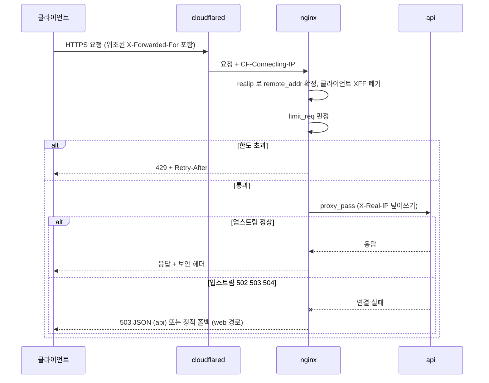

### 9.5 순서도 — 요청 분기

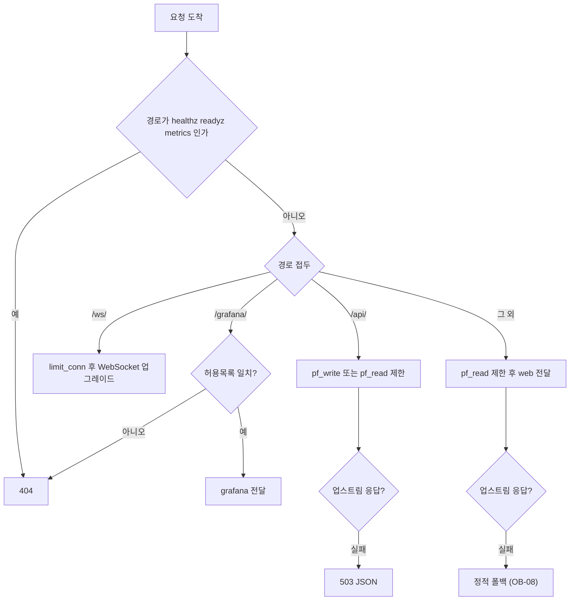

### 9.6 오류·경보

| 상황 | 동작 |
|---|---|
| 업스트림 다운 | 502/503/504 → 위 폴백 매핑 |
| `nginx -t` 실패한 설정 배포 | 컨테이너가 기동 실패 → 배포 헬스 게이트에서 롤백(OB-11) |
| 헤더 위조 | `X-Real-IP` 덮어쓰기 시험으로 방지 |

### 9.7 시험

| 시험 | 등급 |
|---|---|
| `nginx -t` 설정 검증(CI), `nginx -V` 에 `realip`(G7) | L1 / 관문 |
| 위조 `X-Forwarded-For`/`X-Real-IP`/`CF-Connecting-IP` 를 보내도 앱이 받은 헤더가 정규화 값(에코 업스트림으로) | L3 |
| `/healthz`·`/readyz`·`/metrics` 외부 404 | L3 |
| 쓰기 연타 → 429 (수치는 S6-4 에서) | L3 (AC-007) |
| 액세스 로그에 주소 필드 없음 | L3 |
| WS 업그레이드 통과 + 150초 유휴 후에도 서버가 먼저 정리 | L3 (G1·G2) |

---

## 10. OB-08 정적 폴백 1단계 (nginx)

**목적.** 앱 컨테이너가 응답하지 않아도 **소개·아키텍처·개인정보 페이지**를 계속 제공하고, 데모 영역에는 "일시 중단"을 보인다(FR-070, AC-010, ADR-023 7).

**트리거.** `web` 업스트림 502/503/504.

| 구분 | 내용 |
|---|---|
| 사전 조건 | `infra/nginx/fallback/` 에 최신 정적 산출물이 있다 |
| 사후 조건 | 폴백 페이지는 **api 없이** 동작하고 데모(방명록·흐름·지표)는 노출하지 않는다 |

### 10.1 산출물과 빌드 (제안)

```
infra/nginx/fallback/
├─ ko/{index,about,architecture,privacy}.html
├─ en/{index,about,architecture,privacy}.html
├─ _next/static/**                 # 폴백 페이지가 쓰는 해시 에셋만
└─ paused.html                     # 데모 경로용 "점검 중" (ko/en 병기)
```

- 빌드: `bun run build:fallback` — `apps/web` 에서 **정적 내보내기 대상 페이지를 한정**해 같은 소스로 빌드한다(소개·아키텍처·개인정보·홈, 12 의 MDX/프로필/site-vars 사용). 동적 페이지(방명록·흐름·지표·관리자)는 포함하지 않는다.
- Next 의 정적 내보내기가 App Router + next-intl 조합에서 이 한정 빌드를 지원하는지는 **미확인(G3)**. 대안: 폴백 전용 최소 정적 템플릿을 별도로 두고 같은 MDX 를 렌더하는 스크립트.
- 갱신: 릴리스 빌드(`build.yml`)가 산출물을 만들어 `pf-proxy` 이미지(`Dockerfile.proxy`)에 포함하거나, 호스트의 볼륨에 pull-deploy 가 동기화한다. **둘 중 하나로 정한다**(제안: 이미지 포함 — 앱 버전과 폴백이 항상 일치, G7 에서 proxy 를 직접 빌드해야 하면 자연스럽다).
- 폴백 페이지의 문구 변수(`site-vars`)는 빌드 시점 값이다 → 변경 시 재빌드.

### 10.2 nginx 매핑 (제안/미검증)

```nginx
location @static_fallback {
  root /usr/share/nginx/fallback;
  internal;
  # 경로 → 파일 매핑: /ko/about → ko/about.html , 알 수 없는 경로/데모 경로 → paused.html
  try_files /$fb_locale$uri.html /$fb_locale/paused.html =503;
  add_header Cache-Control "no-store" always;
  add_header X-Fallback "1" always;
}
```

- 폴백 응답은 **캐시하지 않는다**(복구 후 바로 정상 페이지로 돌아오게).
- 데모 경로(`/…/guestbook`, `/…/metrics`, `/…/admin/**`)는 `paused.html`, 상태 코드는 **503**(검색엔진·모니터가 일시 장애로 인식). 소개류는 200.

### 10.3 시퀀스

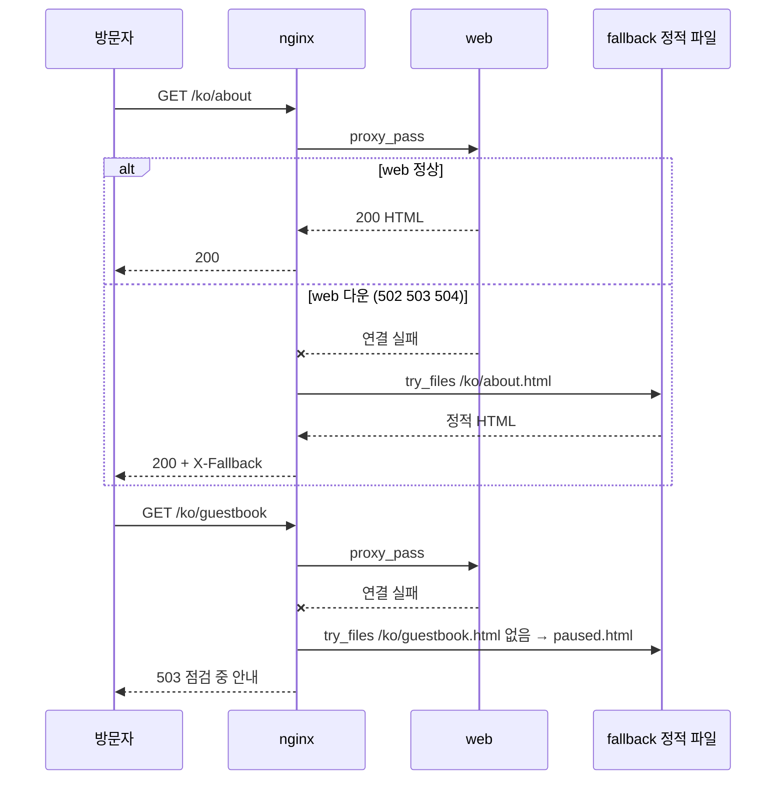

### 10.4 순서도

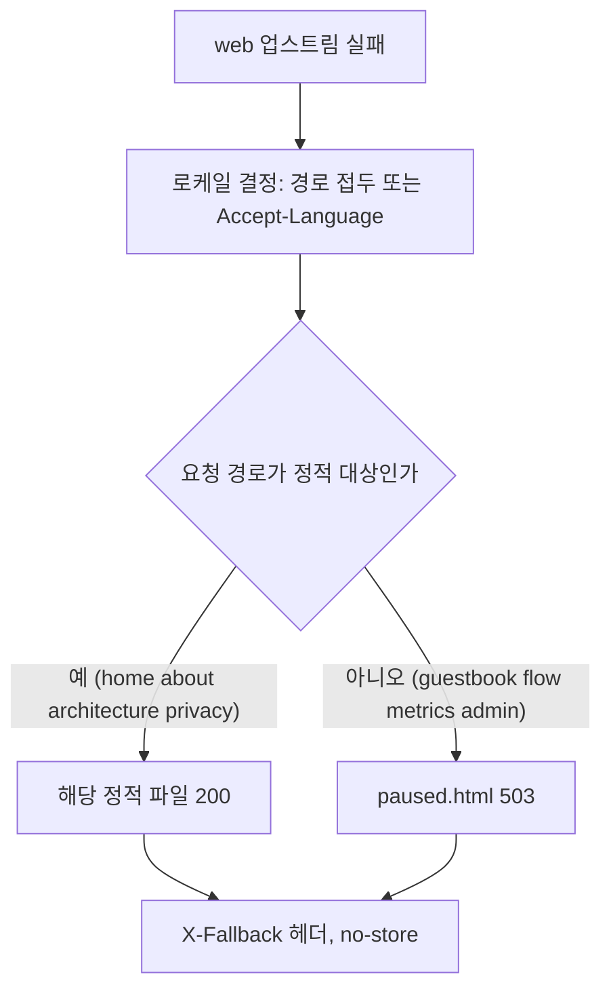

### 10.5 오류·경보

| 상황 | 동작 |
|---|---|
| 폴백 파일 누락 | `=503` 로 떨어짐(빈 화면 대신 단순 503). CI 에서 산출물 존재 검사 |
| 폴백이 오래된 내용 | 릴리스마다 재빌드로 방지 |

### 10.6 시험

| 시험 | 등급 |
|---|---|
| `web` 컨테이너 중지 → `/ko/about` 200 + `X-Fallback`, `/ko/guestbook` 503 안내 (AC-010) | L3 |
| 폴백 페이지에 api 호출이 없음(네트워크 탭/정적 검사) | L3 |
| `web` 복구 직후 같은 URL 이 정상 응답(폴백 캐시 없음) | L3 |

---

## 11. OB-09 Cloudflare 정적 미러 (2단계 폴백)

**목적.** 집 PC 전원·회선·Tunnel 이 끊겨도 정적 소개 페이지를 응답한다(1단계가 못 덮는 장애, ADR-023 7).

> **전체가 미확인(G11)이다.** 아래는 후보 구조와 통과 기준이며 어느 것도 확정이 아니다.

**트리거.** 원본(터널)이 5xx/연결 불가를 반환.

| 구분 | 내용 |
|---|---|
| 사전 조건 | Cloudflare 계정에 도메인 연결(이미 있음), 무료 한도 안의 구성 |
| 사후 조건 | 원본 정상 시에는 개입하지 않고(기본 경로 그대로), 원본 장애 시에만 정적 응답 |

### 11.1 후보 구조 (G11 비교 대상)

| 안 | 개요 | 장점 | 미확인·위험 |
|---|---|---|---|
| **A. Workers 폴백** | 사이트 라우트에 Worker 를 붙여 `fetch(origin)` 이 5xx/52x 면 Workers 정적 자산(폴백 산출물)을 응답 | 장애 시에만 개입, 같은 도메인 | 무료 한도(요청 수)와 터널 다운 시 오류 응답 형태(52x/1033 등)를 Worker 가 받는지 **미확인** |
| **B. Pages 미러 + 수동 전환** | 같은 산출물을 정적 호스팅에 올려 두고 장애 시 DNS/라우트를 수동 전환 | 구성 단순 | 자동 전환 아님(무료 플랜에서 자동 장애 조치는 미확인) |
| **C. 커스텀 오류 페이지** | 플랫폼의 오류 페이지를 정적 페이지로 교체 | 가장 가벼움 | 터널 다운 시 적용 대상 오류인지 **미확인**, 무료 플랜 제공 여부 미확인 |

- 산출물은 OB-08 의 `fallback/` 과 **동일한 파일**을 쓴다(소스 하나, 빌드 한 번).
- G11 통과 기준(ADR-023): "원본(Tunnel)을 내렸을 때 무료 한도 안에서 정적 페이지가 응답한다."

### 11.2 시퀀스 (A안 기준, 미검증)

```mermaid
sequenceDiagram
    participant V as 방문자
    participant E as Cloudflare 엣지 (Worker)
    participant T as 터널 → 원본
    participant S as Workers 정적 자산
    V->>E: GET /ko/about
    E->>T: fetch(원본)
    alt 원본 정상
        T-->>E: 200
        E-->>V: 200 (그대로)
    else 원본 5xx · 연결 불가 · 타임아웃
        T--xE: 실패 응답
        E->>S: 폴백 자산 조회
        S-->>E: 정적 HTML
        E-->>V: 200 또는 503 안내 (데모 경로)
    end
```

### 11.3 순서도 — 채택 결정

```mermaid
flowchart TD
    A["G11 시작"] --> B["A안: Worker 가 터널 다운 응답을 받아 분기할 수 있는가"]
    B -- "예" --> C{"무료 한도 안인가 (요청 수 · 자산 크기)"}
    C -- "예" --> OK["A안 채택"]
    C -- "아니오" --> D["B안 검토: 수동 전환 런북"]
    B -- "아니오" --> D
    D --> E{"수동 전환으로 충분한가"}
    E -- "예" --> OK2["B안 채택 + 런북"]
    E -- "아니오" --> F["1단계(nginx)만 유지, ADR-023 갱신"]
```

### 11.4 오류·경보

| 상황 | 동작 |
|---|---|
| 한도 초과 | 폴백이 막힘 → 1단계만 남음(ADR-023 실패 시 대안과 동일) |
| 미러가 오래됨 | 릴리스 시 함께 갱신(OB-11 배포 단계에 포함하거나 CI 가 배포) |

### 11.5 시험

| 시험 | 등급 |
|---|---|
| 터널(`cloudflared`)을 내린 상태에서 `/ko/about` 이 정적 응답(G11) | L4 (실환경) |
| 원본 정상 시 Worker 가 응답을 변형하지 않음(헤더·본문 동일) | L4 |

---

## 12. OB-10 백업·복구

**목적.** 방명록 글·반응·신원(쓰기 모델)을 잃지 않게 한다. 인프라는 git 에서 복구되므로 **데이터만** 보호한다(ADR-023 9).

**트리거.** 호스트 cron/systemd timer 하루 1회(제안, 새벽). 복구 시험은 M1 후반 1회, 이후 분기별.

| 구분 | 내용 |
|---|---|
| 사전 조건 | `backups` 볼륨이 **DB 볼륨과 다른 경로**에 있음. 암호화 공개키(수신자)가 호스트에 있음(개인키는 저장소·호스트 밖) |
| 사후 조건 | 일별 7개 + 주별 4개 보관, `status/backup/last_run.json` 갱신, 외부 저장소에도 업로드(G12) |

### 12.1 범위

| 포함 | 제외 |
|---|---|
| `guestbook` · `identity` **쓰기 스키마** | 읽기 모델(`*_read`, 이벤트로 재구성), `events` 이력(outbox·trace·flow, 7일 휘발), `realtime`(inbox·change_log 휘발) |

복원 후 읽기 모델은 `rebuild`(GB-26)로 다시 만든다.

### 12.2 스크립트 흐름 (제안/미검증)

```
infra/scripts/backup.sh
 1. flock 으로 중복 실행 방지
 2. 사전: DB 연결 확인, 디스크 여유 확인(덤프 예상 크기의 2배)
 3. 건수 기록: 한 트랜잭션(REPEATABLE READ)에서 row_counts 수집 + pg_export_snapshot (제안)
 4. pg_dump -Fc --schema=identity --schema=guestbook --snapshot=<id> > pf-YYYYMMDD.dump
 5. sha256 계산, manifest.json 작성 {file, bytes, sha256, row_counts, schema_version, at}
 6. 암호화: age -r $BACKUP_AGE_RECIPIENT → pf-YYYYMMDD.dump.age   (ADR-026: 수신자 공개키만 서버에 둔다, 개인키는 서버 밖 사용자 보관. age 설치·가용성은 미확인 — 대안 gpg/openssl)
    * report.note 는 이미 필드 암호화(note_enc)된 상태로 덤프된다. 복구 시에는 FIELD_KEYS 키링이 있어야 복호화된다
 7. 평문 덤프 안전 삭제
 8. 회전: 일별 7개 유지, 일요일 덤프는 주별(YYYY-Www) 로 복사해 4개 유지
 9. 외부 업로드 (G12 대상 확정 후)  실패해도 로컬 성공은 인정, 외부 실패는 별도 기록
10. status/backup/last_run.json 갱신 (원자적 rename; 실패해도 기록하고 `last_success_at` 은 직전 값을 유지)
```

### 12.3 시퀀스

```mermaid
sequenceDiagram
    participant T as timer
    participant B as backup.sh
    participant DB as Postgres
    participant V as backups 볼륨
    participant X as 외부 저장소 (G12)
    participant S as status 파일
    T->>B: 실행
    B->>B: flock 획득
    alt 이미 실행 중
        B-->>T: 종료 (중복)
    else 획득
        B->>DB: 스냅샷 + row_counts
        B->>DB: pg_dump -Fc (identity, guestbook)
        DB-->>B: 덤프
        B->>B: sha256 · manifest · age 암호화 · 평문 삭제
        B->>V: 저장 + 회전 (일 7 · 주 4)
        alt 외부 업로드 가능
            B->>X: 업로드
            X-->>B: 성공
        else 실패
            B->>S: external_failed=true 기록 (로컬은 유지)
        end
        B->>S: last_run.json 갱신 (ok, last_success_at)
    end
```

### 12.4 순서도 — 실패 처리와 회전

```mermaid
flowchart TD
    A["백업 시작"] --> B{"디스크 여유 충분?"}
    B -- "아니오" --> F1["실패 기록 후 종료 (경보)"]
    B -- "예" --> C["pg_dump"]
    C --> D{"성공 (종료코드 0, 크기 > 0)?"}
    D -- "아니오" --> F1
    D -- "예" --> E["암호화 + 평문 삭제"]
    E --> G["회전: 일별 8번째 이상 삭제"]
    G --> H{"일요일?"}
    H -- "예" --> I["주별로 복사, 5번째 이상 삭제"]
    H -- "아니오" --> J["외부 업로드 시도"]
    I --> J
    J --> K["last_run.json 갱신"]
```

### 12.5 복구 시험 절차와 무결성 검사 (`restore-drill.sh`, M1 후반)

```mermaid
sequenceDiagram
    participant D as 운영자 또는 restore-drill.sh
    participant V as backups 볼륨
    participant T as 임시 Postgres (컨테이너)
    D->>V: 최신 덤프 선택 + sha256 검증
    D->>D: 복호화 (개인키는 시험 때만 제공)
    D->>T: 빈 DB 생성 (pf_restore_test)
    D->>T: pg_restore (스키마 + 데이터)
    D->>T: 무결성 쿼리 실행
    alt 모두 통과
        T-->>D: 통과 보고
        D->>D: 절차·소요 시간을 docs 에 기록
    else 실패
        T-->>D: 실패 쿼리 이름
        D->>D: 원인 조사, 백업 절차 수정
    end
```

무결성 검사(제안, 읽기 쿼리만):

| 검사 | 쿼리 요지 | 기대 |
|---|---|---|
| 건수 | `manifest.row_counts` 와 복원본의 `entry`·`reaction`·`report`·`user_account` 건수 비교 | 일치(스냅샷 사용 시) |
| 고아 반응 | `reaction r LEFT JOIN entry e ON e.id=r.entry_id WHERE e.id IS NULL` | 0 건 |
| 고아 신고 | `report` 에 대해 동일 | 0 건 |
| 상태값 | `entry.status NOT IN ('visible','hidden','deleted')` 등 CHECK 위반 | 0 건 |
| 버전 | `entry.version < 1` | 0 건 |
| 유일성 | 반응 유일 키 위반 검사 (복원 중 이미 강제됨) | 복원 오류 없음 |
| 시각 | `created_at > now()` | 0 건 |
| 마이그레이션 | 복원본의 스키마 버전 = manifest.schema_version | 일치 |

- 복구 후 운영 DB 로 되돌릴 때는 **읽기 모델 재구성**(`rebuild`)과 `outbox` 비움 후 재개 절차가 필요하다(런북에 포함).
- 개인키는 호스트에 두지 않는다. 시험 때만 사람이 제공한다.

### 12.6 오류·경보

| 상황 | 경보 |
|---|---|
| 26시간 넘게 성공 없음 | `time()-pf_ops_last_success_timestamp{job="backup"} > 26*3600` |
| 덤프 크기 급감 | `pf_backup_last_size_bytes` 가 직전의 50% 미만(정보) |
| 외부 업로드 실패 지속 | `external_failed` 상태 지속(정보, G12 확정 후 규칙화) |

### 12.7 시험

| 시험 | 등급 |
|---|---|
| 빈 DB 복원 + 무결성 쿼리 전부 통과(M1 완료 조건 S8-4) | L3 |
| 회전: 날짜를 가짜로 진행해 일 7·주 4 가 유지됨 | L2 (스크립트 시험) |
| 평문 덤프가 종료 후 남지 않음 | L3 |
| 디스크 부족 상황에서 실패 기록 + 기존 백업 보존 | L3 |

---

## 13. OB-11 pull 배포

**목적.** 호스트가 레지스트리를 주기적으로 확인해 새 안정판이 있으면 **검증 가능한 순서로 교체**하고, 실패하면 되돌린다(ADR-014, 09 §6).

**트리거.** systemd 타이머 `pf-pull-deploy.timer` 5분 간격(§16.1.1, 결정 2026-11-04). 매 실행마다 `status/pull_deploy/last_run.json` 을 쓴다(변경 없음도 `ok=true`, `detail.action=none`).

| 구분 | 내용 |
|---|---|
| 사전 조건 | 호스트에 compose 와 `infra/` 체크아웃(릴리스 태그), GHCR 읽기 권한(공개 저장소면 불필요) |
| 사후 조건 | 모든 서비스가 새 다이제스트로 헬스(worker 는 `/healthz`, 그 외 `/readyz`)를 통과하거나, 직전 다이제스트로 복귀. 결과가 `status/deploy/*.json` 에 남는다 |

### 13.1 스크립트 흐름 (제안/미검증)

```
infra/scripts/pull-deploy.sh
 1. flock (이미 배포 중이면 종료)
 2. current.json 읽기. blocked.json(실패한 다이제스트 목록) 읽기 (배포 상태 전용 파일, 지표는 `last_run.json` 만 본다)
 3. GHCR 에서 pf-server·pf-web(·pf-proxy) 의 stable 다이제스트 조회
 4. current 와 같거나 blocked 에 있으면 종료
 5. previous.json ← current.json (롤백 기록)
 6. infra/ 를 해당 릴리스 태그로 체크아웃 (compose·nginx 설정·대시보드)  # 제안
 7. 새 이미지 pull
 8. 마이그레이션: 일회성 컨테이너 db:migrate  → 실패 시 교체하지 않고 종료(blocked 기록)
 9. 교체 순서: worker → api → ws-gateway → web → (proxy 설정 변경 시) proxy
    각 단계: compose up -d --no-deps <svc> (다이제스트 고정) → 헬스 연속 N회 통과 대기 (타임아웃 60초) — worker 는 /healthz, api·ws-gateway·web 은 /readyz
10. 모두 통과: current ← 새 다이제스트, last_run.json {ok:true}
11. 하나라도 실패: 직전 다이제스트로 되돌림(역순), blocked 에 새 다이제스트 추가, last_run.json {ok:false, detail.reason}
```

- 마이그레이션은 **앞으로 호환** 규칙(09 §4)이라 롤백 시 되돌리지 않는다. 롤백된 이전 코드가 새 스키마에서 돌아야 한다.
- 교체 순서의 이유: **소비자(worker) 먼저**(05 §7 배포 순서). ws-gateway 교체 중 연결이 끊기며 클라이언트가 `bye`→재접속·재개(RT-11, ADR-014: Compose 는 "짧은 단절 후 복구").
- 같은 실패 다이제스트를 5분마다 재시도하지 않도록 `blocked.json` 에 기록한다(새 stable 이 나오면 풀린다).
- 폴백 정적 산출물은 `pf-proxy` 이미지에 들어 있으면 proxy 교체가 곧 갱신이다(OB-08).

### 13.2 시퀀스

```mermaid
sequenceDiagram
    participant TM as timer
    participant PD as pull-deploy.sh
    participant R as GHCR
    participant C as compose
    participant S as status 파일
    TM->>PD: 5분마다 실행
    PD->>R: stable 다이제스트 조회
    alt 변경 없음 또는 blocked
        R-->>PD: 동일
        PD-->>TM: 종료
    else 새 다이제스트
        PD->>S: previous ← current
        PD->>R: 이미지 pull
        PD->>C: db:migrate 일회성 컨테이너
        alt 마이그레이션 실패
            C-->>PD: 실패
            PD->>S: blocked 추가 + last_run.json ok=false
        else 성공
            loop worker, api, ws-gateway, web
                PD->>C: up -d --no-deps 서비스
                PD->>C: 헬스 대기 (worker 는 /healthz, 나머지 /readyz, 최대 60초)
                alt 통과
                    C-->>PD: ready
                else 실패
                    C-->>PD: not ready
                    PD->>C: 이전 다이제스트로 되돌림
                    PD->>S: blocked 추가 + last_run.json ok=false
                end
            end
            PD->>S: current ← 새 다이제스트
        end
    end
```

### 13.3 상태 — 배포 한 건

```mermaid
stateDiagram-v2
    direction LR
    [*] --> idle
    idle --> checking : timer
    checking --> idle : 변경 없음 또는 blocked
    checking --> pulling : 새 다이제스트
    pulling --> migrating : pull 성공
    pulling --> failed : pull 실패
    migrating --> rolling : 성공
    migrating --> failed : 실패 (교체 안 함)
    rolling --> done : 모든 서비스 ready
    rolling --> rollback : 서비스 하나라도 not ready
    rollback --> failed : 이전 다이제스트 복귀
    done --> idle : current 갱신
    failed --> idle : blocked 기록
```

### 13.4 순서도 — 서비스 한 개 교체

```mermaid
flowchart TD
    A["서비스 교체 시작"] --> B["새 다이제스트로 up -d --no-deps"]
    B --> C["헬스 폴링 (worker: healthz, 그 외: readyz, 간격 2초)"]
    C --> D{"연속 3회 200 ?"}
    D -- "예" --> OK["다음 서비스"]
    D -- "아니오" --> E{"60초 경과?"}
    E -- "아니오" --> C
    E -- "예" --> F["롤백 시작: 이미 교체한 서비스부터 역순으로 이전 다이제스트"]
    F --> G["blocked 기록, last_run.json ok=false"]
```

### 13.5 오류·경보

| 상황 | 동작 | 경보 |
|---|---|---|
| 마이그레이션 실패 | 교체 안 함 | `pf_ops_last_run_ok{job="pull_deploy"}==0` |
| readyz 타임아웃 | 롤백 | 위와 동일 |
| 롤백도 실패 | 수동 개입 필요(런북) | `TargetDown` + `pf_ops_last_run_ok{job="pull_deploy"}==0` |
| GHCR 접근 불가 | 이번 주기 건너뜀 | 연속 실패 시 정보 |

### 13.6 시험

| 시험 | 등급 |
|---|---|
| 정상 교체: 새 이미지로 모두 ready, `current.json` 갱신 | L3 |
| 일부러 readyz 실패 이미지 → 롤백, blocked 기록, 재시도 폭주 없음 | L3 |
| 마이그레이션 실패 → 교체 안 함 | L3 |
| 교체 중 ws 연결이 끊긴 뒤 재접속·재개, 유실 0(08 §6) | L3 |
| 스크립트 `shellcheck` | L1 (CI) |

---

## 14. OB-12 CI 워크플로

**목적.** 변경이 들어올 때마다 품질 관문을 자동으로 돌리고, 릴리스를 재현 가능하게 만든다. **워크플로 자체의 정본은 [09](../09-ci-cd.md)** 이며 이 절은 운영 관점의 요약과 **운영 산출물 전용 검사**만 더한다.

| 워크플로 | 트리거 | 이 절이 보는 것 |
|---|---|---|
| `ci.yml` | PR | 린트·타입·경계·스키마·단위·통합·마이그레이션·web 빌드 (09 §2) |
| `build.yml` | main 푸시 | amd64/arm64 네이티브 러너 빌드 → GHCR → 매니페스트 병합 (09 §3) |
| `release.yml` | 태그 `v*.*.*` | 버전 태그 부착, `stable` 이동, `CONTENT_STRICT` 검사 (09 §4·§6) |
| (선택) `nightly.yml` | 스케줄 | 소크·의존성 점검 (09 미결) |

**운영 산출물 전용 검사 (제안 — 09 §2 PR 검사에 추가 요청)**

| 검사 | 대상 | 도구(미확인 포함) |
|---|---|---|
| `nginx -t` | `infra/nginx/**` | 공식 nginx 이미지로 실행 |
| `promtool check config` / `check rules` | `infra/prometheus/**` | prom/prometheus 이미지의 promtool |
| 대시보드 JSON 구문·UID 중복 검사 | `infra/grafana/dashboards/*.json` | 스크립트 |
| `docker compose config` | `infra/compose/*.yaml` 병합 결과 | compose |
| `shellcheck` | `infra/scripts/*.sh` | shellcheck |
| 매니페스트 검증 | `infra/k8s/**` | kubeconform 등(**미확인**) |
| 폴백 산출물 존재 검사 | `infra/nginx/fallback/**` | 스크립트 |

### 14.1 시퀀스 (운영 검사 포함 PR 흐름)

```mermaid
sequenceDiagram
    participant D as 개발자
    participant GH as GitHub Actions
    participant J as 운영 검사 잡
    D->>GH: PR 생성
    GH->>J: nginx -t, promtool, compose config, shellcheck, 대시보드 lint
    alt 모두 통과
        J-->>GH: 초록
        GH-->>D: 머지 가능
    else 실패
        J-->>GH: 빨강 + 위반 파일
        GH-->>D: 수정 요청
    end
```

### 14.2 순서도

```mermaid
flowchart TD
    A["변경 파일 확인"] --> B{"infra 하위가 바뀌었는가"}
    B -- "아니오" --> S["운영 검사 잡 건너뜀 (경로 필터)"]
    B -- "예" --> C["해당 종류별 검사 실행"]
    C --> D{"모두 통과?"}
    D -- "예" --> OK["필수 상태 검사 통과"]
    D -- "아니오" --> X["머지 차단"]
```

### 14.3 오류·시험

- 오탐으로 머지가 막히면 해당 검사만 임시 제외하지 말고 원인을 고친다(회귀 가드 원칙, 08).
- 시험: 의도적으로 깨진 `nginx.conf`·`rules`·대시보드 JSON 샘플이 CI 에서 실패하는지(S1-6 완료 기준과 같은 방식).

---

## 15. OB-13 쓰기 잠금 운영 런북

**목적.** 스팸 폭주 등 긴급 상황에서 **쓰기만 일시 차단**하고 읽기·실시간은 유지한다(ADR-008, GB-10·11). IP 를 저장하지 않으므로(ADR-023) 사후 주소 차단이 불가능한 대신 이 스위치와 nginx 제한이 방어선이다.

**트리거.** 관리자가 UI/CLI 로 스위치를 켠다. 감지 신호: `pf_rate_limited_total` 급증, 신고 급증, 쓰기 요청률 비정상.

| 구분 | 내용 |
|---|---|
| 사전 조건 | 관리자 권한(허용목록) 또는 호스트 접근(CLI) |
| 사후 조건 | 잠금 중 쓰기 요청은 `write_locked` 응답(503 + `Retry-After`, 03 §2·§4.2 에 반영됨), 읽기·WS 는 정상. 잠금 해제 시 즉시 복구 |

### 15.1 절차 (런북)

1. **감지**: 대시보드(api 패널의 429·요청률), 신고 큐 급증.
2. **1차 대응(이미 자동)**: nginx `limit_req`, 앱 세션 속도 제한.
3. **잠금**: 관리자 화면 또는 API `POST /api/admin/write-lock {locked:true, reason}`. 관리자 로그인이 불가하면 호스트에서 `docker compose exec worker bun run worker admin write-lock on --reason "<사유>"`(DB 단일 행 갱신, F16 §11 정본).
4. **확인**: 쓰기 요청이 `write_locked` 로 응답, `pf_write_locked_total` 증가, 읽기 정상.
5. **정리**: 신고 큐에서 스팸 글 숨김(GB-07). 일괄 숨김이 필요하면 관리 CLI(후속).
6. **해제**: 같은 경로로 `locked:false`. 쓰기 정상화 확인.
7. **기록**: 시각·사유·조치를 운영 메모에 남긴다(변경자·시각은 `write_lock` 행에 자동).
8. **api 자체가 응답하지 않을 때(비상)**: `infra/nginx/conf.d/90-write-block.conf` 에 `if ($request_method ~ ^(POST|PUT|PATCH|DELETE)$) { return 503; }`(제안)를 채우고 `nginx -s reload`. 이 파일은 평소 비어 있고 저장소에는 빈 상태로 있다.

### 15.2 시퀀스

```mermaid
sequenceDiagram
    actor A as 관리자
    participant API as api
    participant DB as guestbook.write_lock
    participant U as 쓰기 usecase
    participant V as 방문자
    A->>API: POST /api/admin/write-lock locked=true reason
    API->>API: RequireAdmin · OriginGuard · 속도 제한
    API->>DB: UPDATE 단일 행 (changed_by, changed_at)
    API-->>A: 200
    V->>U: POST /api/entries
    U->>DB: WriteLockPolicy.check()
    alt 잠금 중
        DB-->>U: locked
        U-->>V: write_locked (503 Retry-After)
    else 해제 상태
        DB-->>U: unlocked
        U->>U: 정상 처리
    end
```

### 15.3 순서도 — 잠금 판단

```mermaid
flowchart TD
    A["이상 징후 감지"] --> B{"nginx · 세션 제한으로 감당되는가"}
    B -- "예" --> M["모니터링 유지"]
    B -- "아니오" --> C{"api 가 응답하는가"}
    C -- "예" --> D["관리자 API 로 write-lock on"]
    C -- "아니오" --> E{"호스트 접근 가능?"}
    E -- "예" --> F["worker admin write-lock on 또는 90-write-block.conf + reload"]
    E -- "아니오" --> G["Cloudflare 측 임시 차단 (WAF 규칙, 무료 범위 미확인)"]
    D --> H["스팸 정리 후 off"]
    F --> H
    G --> H
```

### 15.4 오류·시험

| 시험 | 등급 |
|---|---|
| 잠금 ON → 모든 쓰기 usecase(GB-01,02,04,06)가 `write_locked`, 읽기·WS 정상 | L3 |
| 잠금 상태가 재시작 후에도 유지(DB 저장) | L3 |
| `90-write-block.conf` 로드 시 쓰기 503, 읽기 정상 | L3 |
| 관리 조치가 `moderation_action`/잠금 행에 행위자·시각과 함께 남음 | L3 |

---

## 16. OB-14 k3d 매니페스트·롤링 검증

**목적.** 같은 이미지가 Kubernetes 에서도 돈다는 증거를 만든다(AC-014). **라이브가 아니라 로컬 검증본**이다(ADR-002).

**트리거.** `bun run k3d:up` (02 §8). 롤링 시험은 수동/스크립트.

> **G8 로컬 실측 통과**(k3d v5.9.0·k3s v1.35.5, Envoy Gateway v1.9.3, Gateway API v1.7.0 표준 채널, 2026-11-04). 아래는 실측으로 확정한 구성과 절차다. **미확인**: 호스트 실 클라이언트 IP(k3d serverlb 가 L4), WS 업그레이드 요청에서의 헤더 정규화 적용, `sectionName` 단위 정책.

**설치 절차(CRD 충돌 우회)**: EG 차트(`crds.enabled=true`)는 Gateway API v1.6.1 CRD 를 내장해, 먼저 v1.7.0 을 적용하면 helm 이 server-side apply 충돌로 실패한다.
1. `kubectl apply --server-side -f <gateway-api v1.7.0 standard-install.yaml>`
2. EG 차트의 `crds/generated` 에 든 EG 전용 CRD 만 별도로 `kubectl apply --server-side`
3. `helm install eg oci://docker.io/envoyproxy/gateway-helm --version v1.9.3 --set crds.enabled=false`
리소스: 컨트롤 플레인 40~84Mi, Envoy 프록시 17~54Mi(shutdown-manager 19Mi), 노드 컨테이너(k3d-pf-server-0) 약 1.25GiB.

### 16.1 구성 (제안)

```
infra/k8s/
├─ base/
│  ├─ namespace.yaml                 # pf
│  ├─ configmap.yaml                 # 비밀 아닌 설정
│  ├─ secret.example.yaml            # 비밀 자리(실값은 저장소에 없음)
│  ├─ postgres-statefulset.yaml      # PVC, 서비스
│  ├─ migrate-job.yaml               # db:migrate (api 이미지와 같은 코드)
│  ├─ api.yaml  ws-gateway.yaml  worker.yaml  web.yaml   # Deployment + Service
│  ├─ prometheus.yaml  grafana.yaml  # (선택, 시험 범위에 따라)
│  └─ gateway.yaml                   # Gateway + HTTPRoute
└─ overlays/k3d/
   ├─ kustomization.yaml             # 이미지 태그, 호스트 포트 8081
   └─ patches/…                      # 레플리카 수 등
```

| 리소스 | 설정 요지 (제안) |
|---|---|
| `api` Deployment | replicas 2, `RollingUpdate` `maxUnavailable: 0` `maxSurge: 1`, readinessProbe `/readyz`, livenessProbe `/healthz`, startupProbe `/readyz`, 자원 요청/한도는 **측정 후 확정** |
| `ws-gateway` | replicas 2(레플리카 한계 측정: ADR-024), `terminationGracePeriodSeconds: 45`(`bye` 지터 + 유예), **preStop** `sleep 5`(엔드포인트 제거 전파 대기) 후 SIGTERM → 앱이 `readyz` 503 + `bye` |
| `worker` | replicas 2(리더 이양 시험), probe 는 `/healthz` 만, 리더가 아닌 인스턴스도 정상 |
| `web` | replicas 1~2, readinessProbe `/readyz` |
| `postgres` | StatefulSet 1, PVC |
| `migrate` Job | 배포 전 실행, 실패 시 롤아웃 보류(수동 순서) |
| `Gateway` / `HTTPRoute` | `GatewayClass`(Envoy Gateway), 규칙: `/api` → api:3001, `/ws/` → ws-gateway:3002, `/` → web:3000. **운영 경로 노출 주의(실측)**: catch-all `/` → web 규칙이 있으면 `/healthz`·`/readyz`·`/metrics` 도 web 으로 나간다. `HTTPRouteFilter`(`directResponse` 404) + 정확 일치 `HTTPRoute` 로 세 경로를 404 로 막는다(시험 완료: `/` 와 `/api/me` 는 200 유지) |
| 타임아웃 | **기본값은 유휴 무제한**(504초 유지 확인, `config_dump` 에 `stream_idle_timeout` 없음). 제한을 두려면 `ClientTrafficPolicy` 또는 `BackendTrafficPolicy` 의 `spec.timeout.http.streamIdleTimeout`(20초 설정 → 22.6초에 1006, 10초 간격 하트비트면 45초 이상 유지). `requestTimeout`·`connectionIdleTimeout` 은 WS 를 끊지 못했다. 150초 이상은 필수가 아니며 정책을 건 경우 `hb` 25초보다 길게 둔다. 정책 추가 시 이미 한도를 넘긴 유휴 연결은 즉시 끊긴다 |
| 주소 헤더 정규화 | 기본은 Envoy 가 `X-Forwarded-For` 에 피어 주소를 덧붙이고 위조 값을 그대로 통과시킨다. `ClientTrafficPolicy` `headers.earlyRequestHeaders`: `remove: [x-forwarded-for, cf-connecting-ip]`, `set: [{name: x-real-ip, value: "%DOWNSTREAM_REMOTE_ADDRESS_WITHOUT_PORT%"}]` (위조 헤더가 모두 사라지고 피어 주소만 남음). **`x-real-ip` 를 `remove` 와 `set` 에 동시에 넣으면 헤더가 사라진다 → `set` 만 쓴다**. nginx 의 `proxy_set_header … $remote_addr` 덮어쓰기에 해당 |
| 속도 제한 | nginx 가 없으므로 `limit_req` 상당은 **k3d 에서는 시험 범위 밖**(앱 세션 제한만). 정책으로 대체 가능한지 미확인 |

- 02 §8 의 "라우팅 확인" 은 `/api/healthz` 를 예로 들었으나 **업무 경로 `/api/**` 아래에 `healthz` 는 없다**(§0.2). 라우팅 확인에는 `GET /api/me` 같은 실제 업무 경로를 쓴다 (02 §8 에 반영됨).

### 16.2 시퀀스 (ws-gateway 롤링)

```mermaid
sequenceDiagram
    participant K as kubectl 롤아웃
    participant P as 새 Pod
    participant O as 기존 Pod
    participant GW as Gateway
    participant C as 브라우저
    K->>P: 새 Pod 생성
    P->>P: startupProbe, readinessProbe /readyz 통과
    P-->>GW: 엔드포인트 등록
    K->>O: 종료 시작 (preStop sleep 5)
    O->>O: SIGTERM → readyz 503 (draining)
    GW-->>GW: 엔드포인트 제거
    O-->>C: bye reconnectAfterMs + close 1001
    C->>GW: 재접속 (지터 후)
    GW->>P: 새 Pod 로 라우팅
    C->>P: hello resume → replay 또는 snapshot
    Note over C,P: 유실 0 · 중복 0 (08 §6)
```

**롤링 중 WS 실측(G8)**: 파드 `ws-gateway` 롤링 업데이트에서 연결 40개로 시험했다.

| 구성 | 종료 코드 | 연결 종료 | 재접속 | 새 연결 프로브 실패 |
|---|---|---|---|---|
| 우아한 종료 없음, preStop 없음 | 143 | 41건 1006 | 첫 시도 41/41 성공(최대 15ms) | 2/1320 |
| 우아한 종료 + preStop `sleep 5` | 0 | 40건 `bye`+1001 | 첫 시도 40/40 성공(최대 23ms) | **0/1156** |
| 우아한 종료만(preStop 없음) | 0 | 57건 1001 (드레이닝 중인 파드에 다시 붙음) | 첫 시도 29/57, 최대 18회 시도 | **26/837** |

readiness 이탈은 0.5초 이내이고, Envoy 는 엔드포인트를 지우지 않고 `draining` 으로 표시해 새 연결은 가지 않지만 열린 WS 12개는 유지됐다. 결론: **preStop `sleep 5` + readyz 503 + `bye`/1001 조합이 필요**하다(없으면 새 연결 실패 3%).

### 16.3 순서도 — 검증 절차

```mermaid
flowchart TD
    A["클러스터 · Gateway 생성"] --> B["Gateway Accepted · Programmed ?"]
    B -- "아니오" --> X["G8 실패: 다른 Gateway API 구현체 검토"]
    B -- "예" --> C["HTTPRoute 적용"]
    C --> D{"/api · /ws/public · / 응답?"}
    D -- "아니오" --> X
    D -- "예" --> E["WebSocket 이 hb 25초 간격으로 유지 (기본 유휴 타임아웃은 무제한, 정책을 걸었다면 그 한도보다 hb 가 짧은지)"]
    E --> F{"유지?"}
    F -- "아니오" --> T["타임아웃 정책 조정 후 재시험"]
    F -- "예" --> G["ws-gateway 롤링 + 재접속 시험"]
    G --> H{"유실 0 · 중복 0 ?"}
    H -- "예" --> OK["AC-014 k3d 쪽 통과"]
    H -- "아니오" --> Y["04·RT-11 수정"]
```

### 16.4 오류·시험

| 시험 | 등급 |
|---|---|
| 모든 매니페스트가 `kubectl apply --dry-run=server` 통과 | L3 |
| 라우팅 3종 + WS 유휴 유지 (G8) | L3 |
| 롤링 중 재접속·재개, 유실 0·중복 0 | L3 |
| worker 한 Pod 삭제 시 다른 Pod 가 리더 승계(`pf_dispatcher_leader` 합 1 복귀) | L3 |
| 레플리카 2 에서 메모리 어댑터의 한계(공유 속도 제한·presence)를 **수치로 기록**(ADR-024 도입 기준) | L3 |

---

## 16.1 OB-15 로그 아카이브·조회 (ADR-027)

**목적.** 서버 기록(앱 로그·접근 로그)을 **7일 시간 기준**으로 보관하고, `trace_id`·`req_id` 로 추적하게 한다. 별도 집계 시스템(Loki 등)은 M1 에 두지 않는다(사용자 선택, ADR-027).

**트리거.** `pf-archive-logs.timer`(systemd, 결정 2026-11-04) 일 1회 03:10, 운영자의 `logq` 호출.

| 구분 | 내용 |
|---|---|
| 사전 조건 | 컨테이너 로깅 드라이버 `json-file`, `max-size=20m`·`max-file=10`(컨테이너당 최대 약 200MB). `PF_LOG_DIR`(기본 `/var/log/pf`)가 `pf:pf` 소유, 권한 0750 |
| 사후 조건 | `$PF_LOG_DIR/archive/YYYY-MM-DD/<service>.jsonl.gz`(파일 0640), 7일 지난 디렉터리 삭제, `status/archive_logs/last_run.json` 갱신 |
| 대상 | api · ws-gateway · worker · web · proxy(nginx 접근 로그) |
| 제외 | 외부 업로드·백업 대상이 아니다(개인정보 최소화) |

```mermaid
flowchart TD
    TM["systemd 타이머 pf-archive-logs (일 1회 03:10)"] --> A["archive-logs.sh"]
    A --> L{"flock 획득?"}
    L -- "아니오" --> X["건너뜀 + last_run.json ok=false (detail=locked)"]
    L -- "예" --> S["서비스 목록 순회"]
    S --> D["docker logs --since 어제00:00 --until 오늘00:00"]
    D --> W["YYYY-MM-DD/서비스.jsonl 에 기록"]
    W --> G["gzip + chmod 0640"]
    G --> N{"다음 서비스?"}
    N -- "예" --> S
    N -- "아니오" --> Q{"retention 정지 파일 있음?"}
    Q -- "예 (증거 보존 중)" --> T["status/archive_logs/last_run.json 갱신 (원자적 rename)"]
    Q -- "아니오" --> P["7일 지난 날짜 디렉터리 삭제"]
    P --> T
    T --> M["worker StatusFileCollector 가 pf_ops_* 지표로 노출 (OB-16)"]
```

```mermaid
sequenceDiagram
    participant TM as systemd 타이머
    participant A as archive-logs.sh
    participant DK as Docker 로그
    participant FS as PF_LOG_DIR/archive
    participant ST as status/archive_logs
    TM->>A: 실행 (User=pf)
    A->>A: flock (중복 실행 방지)
    loop 서비스마다
        A->>DK: docker logs --since --until
        DK-->>A: JSON 줄들
        A->>FS: YYYY-MM-DD/svc.jsonl.gz (0640)
    end
    A->>FS: 7일 지난 디렉터리 삭제
    alt 모든 서비스 성공
        A->>ST: last_run.json {ok:true, last_success_at:지금}
    else 일부 실패
        A->>ST: last_run.json {ok:false, detail.failed[]} (last_success_at 은 직전 값 유지)
    end
    Note over A,ST: 실패해도 Docker 로그 크기 상한이 안전망
```

**조회 `logq.sh`** (jq 래퍼; 현재 Docker 로그 + 아카이브를 읽는다):

```
logq.sh --app api --level error --since 1h
logq.sh --trace 0192f3c0-…                  # 앱 로그를 trace_id 로 추적
logq.sh --app proxy --status 5xx --since 24h
logq.sh --rid <nginx rid>                   # 접근 로그 rid = 앱 로그 req_id
```

- 접근 로그의 `rid`(= nginx `$request_id`)는 업스트림에 `X-Request-Id` 로 전달되고 앱 로그의 `req_id` 와 같다 → 접근 로그 ↔ 앱 로그 연결. 앱 로그의 `trace_id` ↔ 감사 로그(`audit_log.trace_id`) 연결.

```mermaid
classDiagram
    class ArchiveLogs {
        <<script>>
        +services string[]
        +retentionDays int
        +run() int
    }
    class LogQuery {
        <<script>>
        +app string
        +trace string
        +rid string
        +level string
        +status string
        +since duration
    }
    class StatusFile {
        +job string
        +started_at Instant
        +finished_at Instant
        +ok bool
        +detail object
        +version string
        +last_success_at Instant
    }
    ArchiveLogs --> StatusFile : 쓰기
    LogQuery ..> ArchiveLogs : 아카이브 읽기
```

> 스크립트라서 클래스는 구조 설명용이다(코드 클래스 아님). 구현은 bash + jq, `shellcheck` 대상(09 PR 검사).

| 항목 | 내용 |
|---|---|
| 오류/경보 | 아카이브 26시간 이상 미성공 → `OpsJobStale`, 마지막 실행 실패 → `OpsRunFailed`(§16.3). 디스크 여유 부족(사전 검사 실패) → 실패 기록. 일부 서비스 로그 없음은 경고만 |
| 지표 | `pf_ops_last_success_timestamp{job="archive_logs"}`·`pf_ops_last_run_ok`·`pf_ops_status_age_seconds`(OB-16 이 노출), `pf_log_redactions_total{rule}`(C, 마스킹 발동 — 코드가 금지 데이터를 로그에 넘긴 신호), `pf_audit_records_total{category,action,outcome}`(C) — 호스트 스크립트의 상태는 지표를 직접 내지 않고 **상태 파일**로 남긴다 |
| 시험 | 08: 7일 지난 아카이브 삭제, 중복 실행 방지, 권한 0640, 접근 로그에 쿼리·IP 부재, `rid`↔`req_id` 연결 |

### 16.1.0 아카이브 스크립트 구현 주의 (로컬 실측, 2026-11-04)

더미 컨테이너 로그로 `archive-logs.sh` 를 구현해 확인했다. **동작 확인**: `docker logs --since/--until`(epoch 초)이 범위 밖 로그를 제외한다 · gzip 은 임시 파일에 쓰고 `mv` 로 확정 · 디렉터리 0750/파일 0640 · `flock` 중복 실행은 `locked` 로 종료.

| 함정 | 내용 | 규칙 |
|---|---|---|
| `date` 의 `+ 1 day` | `date -d "$DAY 00:00:00 + 1 day"` 는 `+ 1` 을 **시간대 오프셋으로 읽어** 8시간만 더한다(KST 에서 확인) | 다음 날은 `$(date -d "$DAY +1 day" +%F) 00:00:00` 로 계산한다 |
| stdout/stderr 순서 | `docker logs … 2>&1` 은 두 스트림의 **순서를 보존하지 않는다**(같은 시각 줄의 stderr 가 stdout 보다 먼저 옴) | `--timestamps` 로 받아 **시각순 정렬** 후 타임스탬프 접두를 제거해 기록한다. 같은 시각 줄의 상대 순서는 보장하지 않음을 한계로 문서화 |
| 보관 경계 | `find -mtime +7`(mtime 기준)과 날짜 디렉터리 이름 기준의 경계가 다를 수 있다 | **디렉터리 이름 기준으로 하나만 쓴다**: "오늘 − 7일 보다 이른 날짜 디렉터리를 삭제"(`<` 비교, 오늘 포함 최근 8개 날짜 이름이 남을 수 있음을 허용) |

### 16.1.1 호스트 작업 실행 수단 — systemd 타이머 (결정 2026-11-04)

로그 아카이브·백업·pull 배포를 **같은 방식(systemd 타이머)** 으로 돌린다. 이 호스트의 init 은 systemd 이고 cron 도 있으나, 타이머는 놓친 실행 보충(`Persistent=true`)과 journald 기록을 쓸 수 있어 채택했다. cron 은 systemd 가 없는 호스트의 대체 수단이다(같은 스크립트, 같은 상태 파일).

```
infra/systemd/
├─ pf-archive-logs.service / .timer   # OnCalendar=*-*-* 03:10:00  Persistent=true  RandomizedDelaySec=120
├─ pf-backup.service       / .timer   # OnCalendar=*-*-* 03:30:00  Persistent=true  RandomizedDelaySec=120
└─ pf-pull-deploy.service  / .timer   # OnBootSec=2min  OnUnitActiveSec=5min  RandomizedDelaySec=30
```

| 항목 | 값 (제안/미검증) |
|---|---|
| 서비스 형태 | `Type=oneshot`, `User=pf`, `Group=pf`, `SupplementaryGroups=docker`, `EnvironmentFile=/etc/pf/pf.env` |
| 격리 | `NoNewPrivileges=yes`, `ProtectSystem=strict`, `ReadWritePaths=@PF_LOG_DIR@ @STATUS_DIR@ /var/lib/pf` — **`$VAR` 를 쓰면 안 된다**(아래) |
| 중복 방지 | 스크립트마다 `flock`(주기가 겹쳐도 한 개만) |
| 로그 | 스크립트 출력은 journald(`journalctl -u pf-*`) — 앱 로그 규약과 같은 마스킹 규칙(IP·토큰 금지) |
| 설치 | `infra/scripts/install-systemd.sh`(제안): 유닛 **템플릿**(`*.service.in`)의 `@PF_LOG_DIR@`·`@STATUS_DIR@` 를 `/etc/pf/pf.env` 의 절대 경로로 치환해 `/etc/systemd/system/` 에 설치 → `systemd-analyze verify` → `daemon-reload` → `enable --now *.timer` → `systemctl list-timers` 로 확인 |

**실측 (2026-11-04, systemd 255)**: `ReadWritePaths=$PF_LOG_DIR …` 는 systemd 가 **환경변수를 확장하지 않고** `path is not absolute, ignoring` 경고와 함께 무시한다(`systemd-run -p 'ReadWritePaths=$X'` 는 `Invalid ReadWritePaths` 로 거부). `ProtectSystem=strict` 와 같이 쓰면 `/var/lib/pf` 외 경로에 쓸 수 없어 `/var/log/pf` 아카이브가 **실패할 수 있다**. 그래서 설치 스크립트가 유닛 생성 시 절대 경로로 치환한다. 유닛 6개의 `systemd-analyze verify` 는 치환 후 통과, `OnCalendar=*-*-* 03:10:00` 은 호스트 **로컬 시간대(KST)** 기준 03:10 으로 해석됨을 확인했다. **실제 `pf` 사용자로 실행해 쓰기가 되는지는 확인하지 못했다 → S8-1.**

**경로와 권한**

| 경로 | 소유·권한 | 용도 |
|---|---|---|
| `PF_LOG_DIR` (기본 `/var/log/pf`) | `pf:pf` 0750, 하위 파일 0640 | 로그 아카이브(운영 스크립트용 변수, 앱은 모른다) |
| `STATUS_DIR` (기본 `/var/lib/pf/status`) | `pf:pf` 0750 | 작업 상태 파일. worker 컨테이너에 **읽기 전용** 마운트 |
| rootless Docker 대체 | `PF_LOG_DIR=~/.local/state/pf/logs`, `STATUS_DIR=~/.local/state/pf/status`, `systemctl --user` 타이머 + `loginctl enable-linger` | 호스트가 rootless 일 때(미확인) |

> **주의**: `docker` 그룹 구성원은 사실상 root 와 동급이다. `pf` 사용자의 쉘 로그인을 막고(`nologin`) 유닛으로만 실행한다([10 §5](../10-security.md)). 이 호스트(WSL2)는 rootful Docker 이고 systemd 가 PID 1 이다(확인). Oracle 호스트·집 PC 실제 환경은 S8-1 에서 재확인한다.

## 16.2 OB-16 운영 상태 파일 수집 (`StatusFileCollector`)

**목적.** 호스트 스크립트(백업·로그 아카이브·pull 배포)의 결과를 **파일 하나의 규약**으로 받아 `/metrics` 로 노출한다. 스크립트가 지표 서버를 두지 않고(Pushgateway·node_exporter 없음), worker 가 **스크레이프 때** 파일을 읽는다.

**트리거.** worker `/metrics` 스크레이프(`MetricsCollector.collect()`), 캐시 10초.

**상태 파일 규약** `status/<job>/last_run.json` (`job` ∈ `backup` · `archive_logs` · `pull_deploy`)

```json
{ "job": "backup", "started_at": "2026-11-05T03:30:02Z", "finished_at": "2026-11-05T03:31:10Z",
  "ok": true, "detail": { "bytes": 1048576, "external": "ok" }, "version": "1",
  "last_success_at": "2026-11-05T03:31:10Z" }
```

| 필드 | 규칙 |
|---|---|
| `job`, `started_at`, `finished_at`, `ok`, `detail`, `version` | 필수. `version` 은 스키마 버전 문자열 |
| `last_success_at` | **제안으로 추가**: 실패해도 직전 성공 시각을 유지한다(`ok=false` 라도 마지막 성공 나이를 계산하려고) |
| `detail` | 작업별 작은 객체. **본문·IP·토큰 금지**, 길이 제한 |
| 쓰기 | 임시 파일에 쓰고 `rename`(원자적). 읽는 쪽은 부분 쓰기를 보지 않는다 |
| 쓰는 시점 | **매 실행마다**(성공·실패·건너뜀 모두) — 타이머가 멈췄는지를 `status_age` 로 알기 위해 |

| 구분 | 내용 |
|---|---|
| 사전 조건 | worker 에 `STATUS_DIR` 이 읽기 전용으로 마운트(`STATUS_DIR` 환경변수) |
| 사후 조건 | 잡마다 `pf_ops_last_success_timestamp`, `pf_ops_last_run_ok`, `pf_ops_status_age_seconds` 설정. **파일 없음**이면 해당 시리즈를 내지 않는다(없음 ≠ 실패), **깨진 파일**이면 `pf_collector_errors_total{collector="status_file"}` 증가 |

```mermaid
classDiagram
    class MetricsCollector {
        <<abstract>>
        +collect() void
    }
    class StatusFileCollector {
        -dir string
        -jobs string[]
        -cacheMs int
        +collect() void
    }
    class StatusFileReader {
        +read(job) StatusFile | Missing | Corrupt
    }
    class StatusFile {
        +job string
        +finished_at Instant
        +ok bool
        +last_success_at Instant
        +detail object
    }
    MetricsCollector <|-- StatusFileCollector
    StatusFileCollector --> StatusFileReader
    StatusFileReader ..> StatusFile
```

```mermaid
sequenceDiagram
    participant P as Prometheus
    participant W as worker /metrics
    participant C as StatusFileCollector
    participant F as STATUS_DIR (읽기 전용)
    participant R as MetricsRegistry
    P->>W: scrape
    W->>C: collect() (캐시 만료 시)
    loop job in backup, archive_logs, pull_deploy
        C->>F: last_run.json 읽기
        alt 없음
            F-->>C: Missing
            C->>R: 시리즈 생략 (OpsStatusMissing 은 absent() 로 감지)
        else 깨짐
            F-->>C: Corrupt
            C->>R: pf_collector_errors_total{collector=status_file}
        else 정상
            F-->>C: StatusFile
            C->>R: last_success_timestamp, last_run_ok, status_age_seconds
        end
    end
    W-->>P: 지표 텍스트
```

```mermaid
flowchart TD
    A["잡마다 파일 읽기"] --> B{"파일 있음?"}
    B -- "아니오" --> M["시리즈 없음 (absent 경보 후보)"]
    B -- "예" --> C{"JSON·version 유효?"}
    C -- "아니오" --> E["collector_errors +1, 시리즈 유지하지 않음"]
    C -- "예" --> D["last_success_timestamp = last_success_at"]
    D --> F["last_run_ok = ok ? 1 : 0"]
    F --> G["status_age = now - finished_at"]
```

| 항목 | 내용 |
|---|---|
| 오류/경보 | 파일 없음(`OpsStatusMissing`), 마지막 실행 실패(`OpsRunFailed`·`DeployFailed`), 오래된 성공(`OpsJobStale`), 타이머 정지(`PullDeployTimerStopped`) — §16.3 |
| 지표 | `pf_ops_last_success_timestamp{job}` · `pf_ops_last_run_ok{job}` · `pf_ops_status_age_seconds{job}` (§4.1) |
| 시험 | 08: **파일 없음 / 오래됨 / `ok=false` 를 서로 다른 결과로 구분**, 깨진 파일 처리, 부분 쓰기 방지(rename) |

## 16.3 OB-17 경보 라우팅 (Discord)

**목적.** 경보 규칙의 결과를 사람에게 전달한다. 알림 채널은 **Discord 웹훅**(사용자 선택, 무료·카드 불필요).

**구성 (제안/미검증 — 이 환경에서 Discord·Grafana 알림을 실행해 보지 않았다)**

| 항목 | 내용 |
|---|---|
| 평가자 | **Grafana 알림 규칙**(Prometheus 데이터 소스, 프로비저닝). Alertmanager 는 두지 않는다 |
| 식의 정본 | `infra/prometheus/rules/pf.yml` — CI 에서 `promtool check rules` · `promtool test rules` 로 검증. Prometheus 런타임은 이 파일을 **로드하지 않는다**(평가자 하나) |
| Grafana 규칙 | `infra/grafana/provisioning/alerting/rules.yml` 은 위 식에서 `scripts/gen-grafana-alerts.ts` 가 생성(제안, 미검증) |
| 연락처 | `infra/grafana/provisioning/alerting/contact-points.yml`: 종류 `discord`, URL 은 `$__file{/run/secrets/discord_webhook_url}` 또는 `${DISCORD_WEBHOOK_URL}`. **두 방식 모두 프로비저닝 YAML 에서 동작(로컬 실측, Grafana 13.3.0, 시크릿 파일 끝 개행 허용)** — envsubst 대안은 필요 없다 |
| 정책 | `policies.yml`: 루트 → Discord. `group_by=[alertname, severity]`, `group_wait=30s`, `group_interval=5m`, **`repeat_interval=4h`**, 해소 알림 켬 |
| 심각도 | `critical`(즉시 확인) · `warn`(업무 시간 확인) · `info`(대시보드에만, Discord 로 보내지 않음) |
| 시크릿 | `DISCORD_WEBHOOK_URL` 은 **grafana 컨테이너에만** 주입한다. 앱·worker 는 모른다 |
| 개발 모드 | 웹훅 미설정이면 **알림 프로비저닝 디렉터리 자체를 마운트하지 않는다**(또는 `gen-grafana-alerts.ts` 가 DISCORD 미설정 시 `alerting/` 파일을 생성하지 않는다). Grafana 가 대신 해주지 않는다 — 아래 "누락 시 동작" |
| 메시지 내용 | 규칙 이름·심각도·요약만. **알림 본문에는 라벨·어노테이션·Grafana 루트 URL(silence 링크)이 그대로 들어간다**(실측) → 규칙 라벨에 사용자 식별자·IP·본문을 싣지 않는다(지표 레이블 규칙과 같음). `GF_SERVER_ROOT_URL` 이 **공개 URL 인지 점검**(내부 주소가 Discord 메시지에 노출되지 않게) |

```mermaid
sequenceDiagram
    participant P as Prometheus
    participant G as Grafana 알림 평가
    participant N as 알림 정책
    participant D as Discord 웹훅
    loop 평가 주기 (1분)
        G->>P: PromQL 쿼리
        P-->>G: 값
        alt 조건 충족이 for 기간 지속
            G->>N: firing(severity)
            alt severity = info
                N-->>N: Discord 로 보내지 않음 (대시보드 표시)
            else critical 또는 warn
                N->>D: 메시지 (그룹 30초 대기)
                N-->>D: 같은 알림은 4시간마다 반복
            end
        else 조건 해소
            G->>N: resolved
            N->>D: 해소 메시지
        end
    end
```

```mermaid
flowchart TD
    A["규칙 평가"] --> B{"조건 충족?"}
    B -- "아니오" --> R{"이전에 firing?"}
    R -- "예" --> RS["해소 알림 전송"]
    R -- "아니오" --> Z["없음"]
    B -- "예" --> F{"for 기간 경과?"}
    F -- "아니오" --> PD["pending (전송 안 함)"]
    F -- "예" --> S{"심각도 info?"}
    S -- "예" --> DB["대시보드에만"]
    S -- "아니오" --> G["그룹핑 30초 → Discord 전송 → 4시간 뒤 반복"]
```

**로컬 실측 요약 (Grafana 13.3.0, 가짜 수신 서버, 2026-11-04)**

| 항목 | 결과 |
|---|---|
| `$__file{}` / `${VAR}` 확장 | 둘 다 프로비저닝 YAML 에서 동작. `GET /api/v1/provisioning/contact-points` 는 `settings.url` 을 `[REDACTED]` 로 보여 **API 값으로는 확인 불가**, 실제 전송으로 확인 |
| **누락 시 동작** | 시크릿 파일이 없거나(`$__file{}` stat 실패) 환경변수가 비면(`could not find webhook url property`) **alerting 프로비저닝 전체가 실패**한다. Grafana 자체는 기동하지만 **연락처가 하나도 등록되지 않는다** → 운영에서는 배포 전 점검(readiness 가 아님)으로 시크릿 파일 존재·비어 있지 않음을 확인한다 |
| 시험 알림 API | Grafana 13.3 에서 `POST /api/alertmanager/grafana/config/api/v1/receivers/test` 는 **제거**됐다. 새 경로 `POST /apis/notifications.alerting.grafana.app/v1beta1/namespaces/{namespace}/receivers/{uid}/test` 의 `{uid}` 는 **연락처 이름의 base64url**(integration uid 가 아님). 본문 `{"integration":{"uid":"…","type":"discord","settings":{},"secureFields":{"url":true}}}` — OpenAPI 에 없어 시행착오로 확인 |
| Discord 타입 URL 검증 | 호스트/도메인 검증이 없다(`http://127.0.0.1:…` 도 그대로 전송). 스킴이 없으면 프로비저닝은 통과하고 전송 시 `unsupported protocol scheme` 로 실패 |
| 수신 본문 | `Content-Type: application/json`, 필드 `username`·`content`(Firing/Value/Labels/Annotations/Silence URL)·`embeds[]`(title `[FIRING:1] …`, url, color, footer) |

> 임계값 수치는 모두 **트래픽 미측정 추정**이다(동시 접속 50 규모에서 정상 시 해당 지표가 거의 0 이라는 가정). 운영 데이터가 쌓이면 조정한다.

| 오류/시험 | 내용 |
|---|---|
| 오류 | 웹훅 전송 실패는 Grafana 가 재시도하고 실패를 자체 상태에 남긴다. Discord 장애 시 경보가 안 나갈 수 있다 → 대시보드의 경보 패널이 보조 |
| 시험 | 08: `promtool test rules` 로 식 단위 시험(예: `LoginFailedSpike` 10회 경계), 프로비저닝 파일 lint. 전송은 L4 수동 확인(시험 알림 1건) |

## 17. 경보 규칙 요약 (OB-17 의 식 정본)

반복 간격은 전부 4시간, 해소 알림은 전부 켬. 임계값은 **트래픽 미측정 추정(운영 후 조정)**. 식은 `promtool check rules`·`test rules` 로 문법·의미를 확인했다(OpsJobStale · LoginFailedSpike · GitHubUnavailable, 로컬 실측 — 단 세 규칙 모두 `for: 0` 이라 **`for` 경과 시나리오는 시험하지 못했고**, Grafana 알림 규칙으로 변환한 뒤의 평가도 미시험).

> **표의 `\|` 주의**: 마크다운 표 안의 정규식 파이프는 `\|` 로 이스케이프돼 있다. 이를 **규칙 파일에 그대로 옮기면 PromQL 리터럴 `|` 가 되어 어떤 job 에도 매치되지 않는다**(실측: OpsJobStale 영구 불발). **정본 규칙 파일(`pf.yml`)에는 `backup|archive_logs` 로 쓰고**, `gen-grafana-alerts.ts` 가 이 표를 파싱한다면 `\|` → `|` 로 풀어야 한다. 가능하면 정규식은 표 밖 코드 블록으로 분리해 이스케이프를 없앤다.

| 경보 | 식 | for | 심각도 | 의미 |
|---|---|---|---|---|
| NoDispatcherLeader | `sum(pf_dispatcher_leader) == 0` | 1m | critical | 디스패처 리더 없음 |
| TargetDown | `up == 0` | 5m | critical | 앱 다운 |
| Api5xxHigh | 5xx 비율 > 0.02 | 5m | critical | 장애 |
| DeployFailed | `pf_ops_last_run_ok{job="pull_deploy"} == 0` | 0 | critical | 배포 롤백됨/실패 |
| PullDeployTimerStopped | `pf_ops_status_age_seconds{job="pull_deploy"} > 900` | 0 | warn | 배포 타이머 정지(5분 주기의 3배) |
| OpsJobStale | `time()-pf_ops_last_success_timestamp{job=~"backup\|archive_logs"} > 26*3600` | 0 | critical | 백업·아카이브 26시간 초과 정체(24h + 유예 2h) |
| RetentionPaused | `pf_retention_paused == 1` (24시간 이상 지속은 `for: 24h`) | 24h | warning | 증거 보존용 보관 정지가 해제되지 않음(ADR-028). 정지는 24시간 후 자동 해제되므로 이 경보는 해제 실패 또는 재정지를 뜻함 |
| OpsRunFailed | `pf_ops_last_run_ok{job=~"backup\|archive_logs"} == 0` | 0 | warn | 마지막 실행 실패 |
| OpsStatusMissing | `absent(pf_ops_last_success_timestamp{job="backup"})` | 30m | warn | 상태 파일 없음(타이머 미설치 등) |
| OutboxStuck | `max(pf_outbox_oldest_age_seconds{status="new"}) > 60` | 2m | warn | 디스패처/리더 문제 |
| DeadLetterGrowing | `increase(pf_outbox_dead_total[15m]) > 0` | 0 | warn | 영구 실패 증가 |
| InboxBacklog | `max(pf_inbox_oldest_age_seconds{status="received"}) > 60` | 2m | warn | 소비 지연 |
| ProjectionDrift | `max(pf_projection_drift) > 0` | 30m | warn | 읽기 모델 불일치 |
| ApiLatencyHigh | `histogram_quantile(0.95, …) > 0.3` | 10m | warn | AC-013 위반 |
| JobStalled | `time()-pf_job_last_success_timestamp_seconds > 3*주기` | 0 | warn | 잡 정지 |
| LoginFailedSpike | `sum(increase(pf_auth_login_failed_total[10m])) >= 10` | 0 | warn | 로그인 실패 급증(10분 10회) |
| GitHubUnavailable | `increase(pf_auth_login_failed_total{reason="github_unavailable"}[5m]) >= 3` | 0 | warn | GitHub 장애/차단 의심(5분 3회) |
| LogRedactionSpike | `rate(pf_log_redactions_total[10m]) > 0` | 10m | warn | 코드가 금지 데이터를 로그에 넘김 |
| WsOverflow | `rate(pf_ws_queue_overflow_total[5m]) > 0` | 5m | info | 느린 소비자 격리 발생(대시보드만) |

`LoginFailedSpike` 임계값은 이전 초안(10분 20회)에서 **10분 10회**로 낮췄다: 동시 접속 50 규모에서는 정상 실패가 시간당 1건 미만일 것이라는 추정에 근거하며(미측정), GitHub 장애는 별도 규칙(`GitHubUnavailable`)이 잡는다.

## 18. 시험 연결 요약 (08)

| 영역 | 08 절 | 이 문서 시험 |
|---|---|---|
| 지표·헬스·로그 | §8 프라이버시, §7 장애 | §3.4, §4.5, §5.6, §6.7 |
| 프록시·폴백 | §6 재접속, AC-010 | §9.7, §10.6 |
| 백업·배포 | §7 장애 | §12.7, §13.6 |
| k3d | §6 무중단 | §16.4 |
| 쓰기 잠금 | AC-007 | §15.4 |

## 19. 미결

| 항목 | 결정 시점 |
|---|---|
| 지표 라이브러리(Bun 호환), `AsyncLocalStorage` 호환 | G5 |
| Public dashboards 프로비저닝 가능 여부, 임베드 허용 설정, 프록시 허용목록 정확한 경로 | G6 |
| nginx 이미지의 `realip` 포함, Oracle 경로 TLS 자동화 | G7 |
| ~~Envoy Gateway 의 WebSocket 타임아웃 정책 리소스~~ | G8 로컬 통과(`streamIdleTimeout`). 실 클라이언트 IP·업그레이드 경로 헤더 정규화·`sectionName` 정책은 실서버/S8-5 |
| Cloudflare 정적 미러 수단과 무료 한도 | G11 |
| 무료 외부 백업 저장소, 암호화 도구(`age` 가용성) | G12 |
| Grafana 프로비저닝의 `$__file{}` 시크릿 확장·Discord 연락처 동작, `gen-grafana-alerts.ts` 생성 방식 | S7-6 (미검증) |
| Oracle 호스트·집 PC 에서 `pf` 사용자·`docker` 그룹·rootless 여부, `PF_LOG_DIR` 권한 | S8-1 |
| 경보 임계값(로그인 실패 10/10m, GitHub 3/5m, 26h 등) | 운영 데이터 확보 후 조정 |
| 스크레이프 주기(15초) · 보존(7일/1GB) 조정 | 구현 중 측정 |
| 통지 채널 | **Discord 웹훅 확정**(§16.3). 연락처 프로비저닝 동작은 S7-6 에서 확인 |
| Next 정적 내보내기로 폴백 한정 빌드 가능 여부 | G3 |
| 속도 제한 수치(nginx·세션) | S6-4 부하 시험 |

## 20. 수정 요청 (반영 완료 기록)

> 아래 요청은 2026-11-04 에 정본 문서에 반영되었다. 이력으로 남긴다. 충돌 시 정본이 우선한다.

1. 02 §8 라우팅 확인 경로 → `GET /api/me` 로 교체됨.
2. 03 쓰기 잠금 계약(`write_locked` 503 + `Retry-After`, `POST /api/admin/write-lock`)과 00 §4.3 `WriteLockedError` → 반영됨.
3. 09 §2 PR 검사의 `config check` 잡 → 반영됨.
4. 12 §1.1 `site.metricsEmbedUrl` → 반영됨.
5. ADR-007 / architecture §11 의 `pf_` 지표 이름 → 반영됨. 보조 지표 허용은 §4.1 "추가 지표" 표가 정본.
