# P0. 플랫폼 진화 설계 (Phase 0~6)

M1 설계(00~15, features/)는 사이트 셸과 방명록 데모를 닫았다. 이 문서는 그 위에 **바둑(Phase 1~2) · 상거래(Phase 3·5) · 풀필먼트(Phase 6) · 채팅(Phase 1·6)** 을 올릴 때 **영역마다 따로 정하면 어긋나는 것**을 한 곳에서 정한다.
네 영역 설계(`01-baduk`, `02-commerce`, `03-fulfillment`, `04-chat`)는 이 문서의 결정 번호(**D1…D23**)를 인용한다.

- 상태: 이 문서와 ADR-030~047(이 문서는 030~033, 영역 설계는 034~047) 은 **Proposed(사용자 확정 대기)** 이다. 확정 전까지 영역 설계는 D 번호를 "잠정 전제"로 쓴다.
- 근거: README 로드맵, ADR-001·002·005·006·009~016·017~028, [architecture.md §12](../../domains/architecture.md), [database-schema.md §11](../../domains/database-schema.md).
- 모든 금전 요소는 **모의·테스트 환경**이다(ADR-015). 이 저장소 밖 다른 프로젝트의 코드는 참고하지 않았다.
- 값은 **측정(M1 실측·이번 유휴 측정)**, **추정**, **미확인**을 구분해 적었다.

## 0. 결정 요약

| D | 결정 | ADR | 영향 영역 |
|---|---|---|---|
| **D1** | **모듈러 모놀리스를 유지**한다. 분리는 5축 기준(독립 확장·언어/런타임·자원 프로파일·장애 격리·배포 주기) 중 **둘 이상이 강하게 해당할 때만** 한다. 기본값은 "분리 안 함" | 030 | 전부 |
| **D2** | 분리 판정 결과: **KataGo 분석 워커만 별도 프로세스·이미지**(Phase 2). 나머지(game·chat·deal·order·payment·settlement·fulfillment·support)는 모놀리스 모듈이다. 엔트리포인트 분화는 허용(같은 이미지). 분석 워커는 **별도 이미지 `pf-analysis`**(KataGo 바이너리 포함)이며 DB 쓰기는 `analysis` 스키마와 ledger 쌍 #6(`ConfirmRewardInTx`/`FlagRewardInTx`)뿐이다 | 030 | P1·P2·P3·P4 |
| **D3** | 룸 실시간(대국·채팅·CS)은 **`ws-gateway` 에 핸들러를 추가**한다(Phase 1). 부하·재시작 격리가 필요하면 Phase 4 에서 `ws-gateway` 를 사이트용/룸용 두 배포 단위로 나눈다(같은 이미지, 인자 `--surface=site|room`) | 032·033 | P1·P4 |
| **D4** | 이벤트 전달 정본은 **Postgres outbox + inbox**(ADR-005·020)를 유지한다. Redis Streams 는 `EventTransport` 포트(ADR-024)의 **소비자 단위 선택 어댑터**로 두고, **Phase 3 의 타임딜 버스트 측정**으로 채택을 판정한다(ADR-006 의 "Phase 2 착수 전" 시점을 바꾼다) | 031 | P2 |
| **D5** | Streams 를 쓰는 소비자의 설계: 모듈당 스트림 1개(`pf:evt:<module>`), 소비자 그룹 = inbox 소비자 이름, 전달→inbox 저장→`XACK`, 회수는 `XAUTOCLAIM`, 유실 방어는 `TransportReconciler` | 031 | P2 |
| **D6** | Redis 는 **Phase 3 에 도입**한다(재고 Lua). **단일 인스턴스 1개**(컨테이너 1개)로 시작하고(`noeviction`, 비스트림 키는 전부 TTL, 키 접두사 규약 `pf:stock:*`·`pf:evt:*`·`pf:rl:*`로 논리 분리), `redis-stock`/`redis-stream` 컨테이너·접속 분리는 Phase 4 에서 장애 영역 분리와 함께 재평가한다 | 031·033 | P2 |
| **D7** | Redis 에 있는 모든 것은 **Postgres 에서 재구성 가능**해야 한다(정본은 항상 Postgres, ADR-010·021). 재구성 절차가 없는 용도에는 Redis 를 쓰지 않는다 | 031 | P2·P4 |
| **D8** | WebSocket 은 **서버→클라이언트 push 전용**을 유지한다(쓰기는 REST, ADR-018). 룸 범위 채널은 **세 번째 연결 `/ws/room`** 으로 추가한다(인증 필수, 한 연결에 여러 룸 구독). 인바운드 허용은 `hello`·`room.join`·`room.leave`·`ping`·휘발성 `typing` 뿐이며 대국·채팅 명령은 받지 않는다 | 032 | P1·P4 |
| **D9** | `realtime` 모듈은 **포트를 소유**하고(`RoomAccessPolicy`, `RoomSnapshotProvider`, `RoomMessageMapper`, `RoomEventSource`) 도메인 모듈이 조립부에서 구현을 등록한다 → `realtime` 은 도메인 모듈에 의존하지 않는다 | 032 | P1·P4 |
| **D10** | 룸 이벤트 지연 예산 **p95 ≤ 250ms**(제안, 미측정). **자체 순번 로그를 가진 룸(대국 `game_event`)은 명령 tx 의 `NOTIFY room_changed` + `RoomEventSource` 로 즉시 push 하는 fast lane 을 기본**으로 하고, 로그 없는 룸이 예산을 넘길 때의 2차 대응 `AppendRoomLogInTx` 는 **미사용 예약**이다(쓰려면 ADR-030 개정으로 허용 쌍 #11 을 먼저 추가, §6.7) | 032 | P1·P4 |
| **D11** | 역할은 `visitor / user / agent / operator / admin`. **seller 는 두지 않는다**(단일 판매자 = 운영자). `agent`(CS 상담원)·`operator`(창고 작업자)·`admin` 은 모두 **설정 허용목록**(`AGENT_GITHUB_IDS` / `OPERATOR_GITHUB_IDS` / `ADMIN_GITHUB_IDS`, 숫자 GitHub ID, M1 ID-09 방식)으로 판정한다 — DB 에 권한 플래그를 두지 않아 DB 조작으로 권한 상승을 만들 수 없다(`role_grant` 표는 두지 않는다). 데모 모드의 샌드박스 작업자 체험은 사용자 결정(§16) | — | P3·P4 |
| **D12** | Passkey(Phase 6)는 `credential` 표를 추가할 뿐 **세션·행위자 키 모델은 바뀌지 않는다** | — | 전부 |
| **D13** | **Phase 5 착수 시 필드 암호화를 KEK/DEK 봉투 방식으로 상향**한다(ENC 필드가 3개 이상이 되어 ADR-026 재검토 조건 발동). 카드 데이터는 저장하지 않는다 | — | P2·P3·P4 |
| **D14** | 자원 예산 규칙: 라이브 호스트 RAM 의 **60% 이하**(상시), KataGo 는 **CPU 시간 예산을 따로** 둔다 | 033 | P1·P2 |
| **D15** | 지표 이름은 `pf_<도메인>_…`, 오류 wire code 는 모듈 접두사 없음, 이벤트 이름은 `<aggregate>.<verb-past>`, 스키마는 `<module>` / `<module>_read` | — | 전부 |
| **D16** | 모듈 간 동기 의존은 **피호출 층 ≤ 호출자 층**일 때만 허용한다(같은 층 허용, 위 방향은 이벤트·포트 역전; 경계 규칙 B12 제안). **같은 층 호출이 허용되므로 순환은 B5 가 막는다** | 030 | 전부 |
| **D17** | Phase 4 워크로드 분리 단위: `api`, `ws-gateway(site)`, `ws-gateway(room)`, `worker`, `analysis-worker`, `web`. 롤링은 M1 G8 실측 패턴(readyz 503 → bye/1001 → preStop 5초)을 재사용 | 033 | P1·P4 |
| **D18** | 금전 화면·응답에는 **"모의" 표시**를 항상 둔다(배너 + `X-PF-Mock: 1` 응답 헤더, ADR-015) | — | P2·P3 |
| **D19** | **presence 는 `realtime` 모듈이 소유**한다(`PresenceCounter` 포트, ADR-024). 도메인(game, chat)은 읽기 포트 `PresenceReader` 로 조회만 하며 **규칙 판정(이탈·`abandoned`)에는 쓰지 않는다**(판정은 game 소유 heartbeat 신호, §6.9) | 032 | P1·P4 |
| **D20** | **`ledger` 모듈 하나**가 다중 자산(POINT/KRW/USDC) 복식 원장을 소유한다. 스키마 정본은 ADR-040, POINT 자산 규칙과 보상 상태 머신은 ADR-037 (§2.5) | 037·040 | P1·P2 |
| **D21** | **모듈 간 한 트랜잭션은 `*InTx` 공개 usecase 의 허용 쌍으로만** 한다(경계 규칙 B12, §2.4). 중첩 `uow.run` 금지는 유지한다 | 030 | P1·P2·P4 |
| **D22** | **이벤트 계약 정본 표는 §8.3 하나**다. 영역 문서의 이벤트 이름·페이로드가 다르면 §8.3 이 이긴다 | — | 전부 |
| **D23** | **Phase 2 분석 큐는 Postgres inbox 선점**(DB 큐)이다. Redis Streams 판정은 Phase 3(D4) | 031·036 | P1 |

## 1. 로드맵별 목표 아키텍처 진화

### 1.1 Phase 별 추가분

| Phase | 추가되는 것 | 컨테이너 | 모듈 | 스키마 | 채널 | 인프라·관문 |
|---|---|---|---|---|---|---|
| 0 | 모노레포, CI, k3d 최소 배포 | (M1 컨테이너 세트) | — | — | — | G8(통과), Gateway API |
| **M1** | 사이트 셸·방명록·시각화 | proxy, web, api, ws-gateway, worker, postgres, prometheus, grafana, cloudflared | identity, guestbook, events, realtime, observability | 위 모듈 + `*_read` | `/ws/public`, `/ws/private` | G1~G10 |
| **1** | 바둑 코어 + 대국 채팅 | (추가 없음 — ws-gateway·api 에 핸들러) | game, chat | `game`, `game_read`, `chat`, `chat_read` | `/ws/room`(`game:*`, `chat:*`) | 룰 엔진 선정(ADR-012), 3D 에셋 서빙 |
| **2** | KataGo 분석 + 포인트 원장 | **`analysis-worker`**(+ KataGo 바이너리 이미지) | analysis, ledger | `analysis`, `ledger`, `ledger_read` | `/ws/private`(보상 상태 푸시) | CPU 예산(D14), 선점→트랜잭션 밖 분석 |
| **3** | 타임딜 | **redis** | catalog, deal, order(구매 접수) | `catalog`, `deal`, `order`, 각 `_read` | `/ws/public`(재고 카운트 푸시) | Redis 도입, Streams 판정(D4), k6 |
| **4** 🎯 | 프로덕션화 | ws-gateway 2분화, HPA 대상 레플리카 | — | — | — | 워크로드 분리, PDB·probe, CD, 에셋 캐시 |
| **5** | 모의 결제·에스크로·정산·시세 | (추가 없음 — 웹훅은 api 경로) | payment, escrow, settlement, pricefeed | `payment`, `escrow`, `settlement`, `pricefeed` (+`_read`) | `/ws/private`(결제 상태) | KEK/DEK 상향(D13), PG 테스트 모드 |
| **6** | CS 채팅 → Passkey → WMS → Solana devnet → 마작 | (추가 없음) | support, inventory, fulfillment, (identity 확장), game 규칙 플러그인 | `support`, `inventory`, `fulfillment` (+`_read`), `identity.credential` | `/ws/room`(`cs:*`) | 항목별 독립 DoD |

### 1.2 진화 타임라인

```mermaid
flowchart LR
    M1["M1<br/>사이트 셸 · 방명록<br/>이벤트 시각화"] --> P1["Phase 1<br/>바둑 코어 + 대국 채팅<br/>/ws/room · game · chat"]
    P1 --> P2["Phase 2<br/>KataGo 분석 워커<br/>포인트 원장"]
    P2 --> P3["Phase 3<br/>타임딜 · Redis 도입<br/>Streams 판정"]
    P3 --> P4["Phase 4 🎯<br/>프로덕션화<br/>워크로드 분리 · HPA"]
    P4 --> P5["Phase 5<br/>모의 결제 · 에스크로<br/>정산 · 시세 · KEK/DEK"]
    P5 --> P6a["Phase 6a<br/>CS 채팅"]
    P6a --> P6b["6b Passkey"]
    P6b --> P6c["6c WMS<br/>풀필먼트"]
    P6c --> P6d["6d Solana devnet<br/>에스크로"]
    P6d --> P6e["6e 마작<br/>규칙 플러그인"]
```

순서 재검토는 §12 에 있다(WMS 는 주문·재고·결제가 선행, 마작은 Phase 1 의 게임 프레임 재사용이 선행).

### 1.3 목표 컨테이너 구성 (Phase 6 최종)

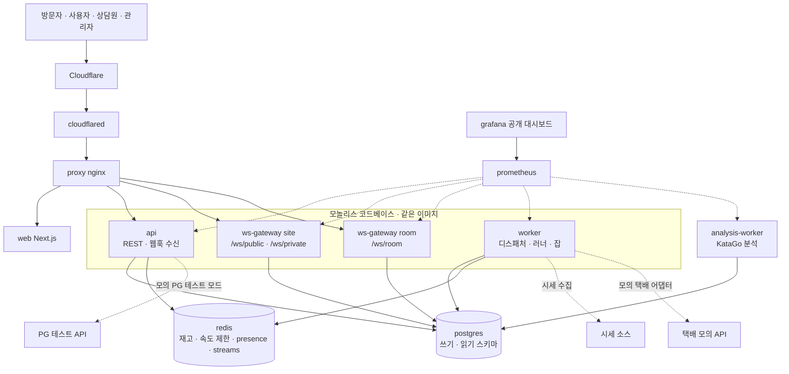

## 2. 모듈 지도 확장

### 2.1 모듈 표 (제안)

| 모듈 | Phase | 쓰기 스키마 / 읽기 스키마 | 구독 이벤트(소비자) | 발행 이벤트 | 동기 의존(공개 usecase·포트) |
|---|---|---|---|---|---|
| identity | M1 (+6) | `identity` | — | — | — |
| events | M1 | `events` | — | — | — |
| observability | M1 | — | — | — | — |
| guestbook | M1 | `guestbook` / `_read` | — | `entry.*` 등 | identity, events |
| realtime | M1 (+1) | `realtime` / `realtime_read` | 도메인 변경(브로드캐스터) | — | identity (+ 소유 포트 §6.6) |
| **game** | 1 | `game` / `game_read` | — | `game.*` | identity, events |
| **chat** | 1 (+6) | `chat` / `chat_read` | `game.*`(방 수명), `report.*` | `chat.*` | identity, events (`RoomAccessPolicy` 는 **realtime 소유 포트**이고 chat 은 `ChatRoomPolicy` 구현을 조립부에 등록 — §6.6) |
| **analysis** | 2 | `analysis` | `reward.pending_created`(작업 생성, 색별 reward 와 함께) | `analysis.completed`·`analysis.failed` | game(조회 포트 `GetGameRecord`), events, ledger(`ConfirmRewardInTx`·`FlagRewardInTx`, B12 쌍 #6) |
| **ledger** | 2 | `ledger` / `_read` | `game.finished`(`EligibilityPolicy` 판정 후 보상 `PENDING` 생성) | `reward.pending_created`·`reward.*`·`ledger.journal_posted` | events (공개 `*InTx`: `PostJournalInTx`·`ReverseJournalInTx`·`ConfirmRewardInTx`·`FlagRewardInTx`, §2.5) |
| **catalog** | 3 | `catalog` / `_read` | — | `product.*` | identity(관리자) |
| **deal** | 3 | `deal` / `_read` | `order.*`(확정·취소) | `deal.*` | catalog, events, 포트 `StockReservation`(Redis, ADR-024) |
| **order** | 3 (+5) | `order` / `_read` | `payment.*`, `deal.*`, `fulfillment.*`·`return.*` | `order.*` | deal(`ConfirmStockInTx`, 쌍 #2), ledger(`PostJournalInTx`, 쌍 #3), 포트 `PaymentRecordPort`·`EscrowHoldPort`(쌍 #4·#5, payment·escrow 가 구현), catalog, identity |
| **pricefeed** | 5 | `pricefeed` | — | `price.*` | — |
| **payment** | 5 | `payment` / `_read` (+웹훅 inbox) | `order.*`, `fulfillment.rejected`·`fulfillment.cancelled`·`return.inspected`(소비자 `payment-fulfillment-refunder`) | `payment.*`·`quote.*` | order(조회 `GetPayableOrder`, `MarkRefundedInTx` 쌍 #7), ledger(쌍 #7), escrow(`RefundInTx` 쌍 #7), 포트 `PaymentGateway` |
| **escrow** | 5 | `escrow` / `_read` | `shipment.delivered`, `shipment.delivery_failed`, `order.return_requested`, `payment.refunded` | `escrow.*` | ledger(`PostJournalInTx`, 쌍 #8) |
| **settlement** | 5 | `settlement` / `_read` | `payment.*`, `escrow.*` | `settlement.*` | pricefeed(견적 조회), ledger(`PostJournalInTx`, 쌍 #9), events |
| **inventory** | 6 | `inventory` / `_read` | `deal.published`·`deal.settled`·`deal.stock_adjusted`·`deal.restocked`(약정) | `inventory.*` | events |
| **fulfillment** | 6 | `fulfillment` / `_read` | `order.paid`·`order.cancel_requested`·`order.cancelled`·`order.disputed`·`payment.refunded`·`order.return_requested`·`order.address_corrected`, `inventory.*` | `fulfillment.*`·`shipment.*`·`package.*`·`return.*` | order(`GetShippingAddress`, 감사), inventory(`AllocateInTx`·`ReleaseAllocationInTx`·`IssueInTx`·`RecordMovementInTx`, 쌍 #10), 포트 `CarrierAdapter` |
| **support** | 6 | `support` / `_read` | `chat.*`, `order.*` | `support.ticket_*` | chat(`OpenRoomInTx`·`PostMessageInTx`·`CloseRoomInTx`·`AddParticipantInTx`·`RemoveParticipantInTx`, 쌍 #1), order(조회), identity |

### 2.2 층과 의존 규칙 (D16)

| 층 | 모듈 |
|---|---|
| L0 | kernel, protocol, db, config, infra (패키지) |
| L1 | identity, events, observability |
| L2 | realtime, catalog, pricefeed |
| L3 | game, chat, deal, guestbook |
| L4 | analysis, ledger, order, inventory |
| L5 | payment, escrow, settlement, fulfillment, support |

- **동기 호출(공개 usecase·포트)은 피호출 층 ≤ 호출자 층(같은 층 허용)** 일 때만 한다. 상위 모듈에 알려야 할 때는 **이벤트**를 쓰거나 호출자가 포트를 소유한다.
- **포트 의존 역전**: `realtime`(L2)이 `game`(L3)·`chat`(L3)의 상태를 알아야 하는 자리(스냅샷, 접근 판정)는 `realtime` 이 **포트를 소유**하고 상위 모듈이 구현을 `apps/*/compose` 에서 등록한다. 방 접근 판정 포트 `RoomAccessPolicy` 는 **`realtime` 소유**이고 `game`(`GameRoomPolicy`)·`chat`(`ChatRoomPolicy`)·`support`(`CsRoomPolicy`)가 구현을 조립부에 등록한다(chat 이 포트를 정의하거나 game 이 chat 을 임포트하지 않는다, §6.6).
- 검증: dependency-cruiser 규칙 **B12(제안)** — 모듈의 임포트는 자기 층 이하 모듈의 `index` 만. 위반은 CI 실패. **같은 층 호출은 허용되므로 층 규칙만으로는 순환이 막히지 않는다** — 모듈 단위 순환 금지 B5 가 함께 검사한다.

### 2.3 의존 그래프

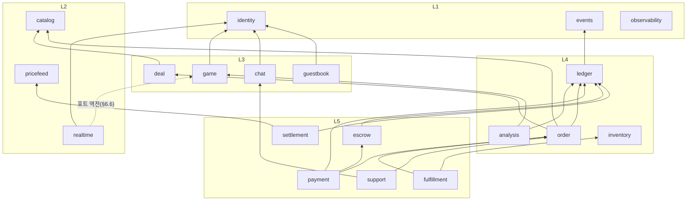

(모든 모듈은 `events` 의 outbox/inbox 포트와 `kernel` 도 쓰지만 그림에서는 생략했다. 실선은 직접 임포트(층 규칙 R3), 이벤트 관계는 §8.2, `order → payment/escrow` 는 포트 역전이라 코드 의존 화살표가 반대(`PM → OR`, `ES → OR`)로 나타난다. 모듈 간 한 트랜잭션은 §2.4 허용 쌍만.)

### 2.4 모듈 간 한 트랜잭션 — 트랜잭션 참여 규칙 (B12, **정본**, D21)

M1 규약(F16 §8.2)은 "command usecase 만 `uow.run` 을 부르고 중첩을 금지"한다. 그런데 몇몇 흐름은 **여러 모듈의 쓰기를 한 트랜잭션**에 묶어야 불변식을 지킨다(구매 확정의 재고·결제·원장, CS 티켓 전이와 메시지, 분석 결과와 보상 전이). M1 의 `OutboxWriter`·`AuditWriter` 가 이미 "호출자의 tx 에 참여하는 포트"라는 선례다. 이를 일반화하되 **허용 쌍을 표로 한정**한다.

| 규칙 | 내용 |
|---|---|
| R1 참여 함수 | 모듈 `index` 가 내보내는 공개 함수 중 이름이 `…InTx` 로 끝나고 **첫 인자가 `TxContext`** 인 것만 다른 모듈의 트랜잭션에 참여할 수 있다. 이 함수는 `uow.run` 을 호출하지 않고 새 트랜잭션을 열지 않는다(`TxContext` 만 사용). 중첩 `uow.run` 금지(F16 §8.2)는 그대로다 |
| R2 조율자 | 트랜잭션을 연(`uow.run`) command usecase **하나**가 조율자다. 조율자는 R4 허용 쌍에 있는 `InTx` 만 호출한다 |
| R3 층 | 직접 호출은 **피호출 층 ≤ 호출자 층**일 때만. 피호출 층이 더 높으면 호출자가 **포트를 소유**하고(의존 역전) 피호출 모듈이 구현해 조립부(`apps/api/compose`)에서 연결한다 |
| R4 허용 쌍 | 아래 표. **표 밖의 `InTx` 호출은 CI 실패**(dependency-cruiser + 허용 목록 파일 `modules/tx-pairs.json`). 새 쌍은 ADR 개정과 이 표 갱신이 선행 |
| R5 이벤트 | 각 `InTx` 는 자기 모듈의 outbox 이벤트를 **같은 `TxContext`** 로 기록한다(`OutboxWriter`) |
| R6 외부 호출 금지 | `InTx` 안에서 HTTP·PG·체인·KataGo 호출을 하지 않는다(F16 §8.2 "tx 안 외부 호출 금지"). 외부 호출은 트랜잭션 밖에서 하고 결과만 들어온다 |
| R7 읽기 | 조회는 `InTx` 가 아니라 일반 공개 usecase(층 규칙만 적용, 트랜잭션 비참여) |
| R8 실패 | 참여 함수는 `Result` 로 거절을 돌려주고 **조율자가 롤백**한다. 참여 함수가 스스로 커밋·롤백하지 않는다 |

**허용 쌍 (정본)**

| # | 조율자(모듈·usecase, 층) | 참여 함수(피호출 모듈, 층) | 방식 | 목적 | Phase |
|---|---|---|---|---|---|
| 1 | support · `OpenTicket`·`ClaimTicket`·`ReleaseTicket`·`ReplyTicket`·`ResolveTicket`·`CloseTicket`·`TicketAutoCloser`·`TicketLeaseReaper` (L5) | chat · `OpenRoomInTx`·`PostMessageInTx`·`CloseRoomInTx`·`AddParticipantInTx`·`RemoveParticipantInTx` (L3) | 직접 | 티켓 상태 전이와 방·참가자·메시지를 원자적으로(상담원 배정/해제 시 참가자 추가·제거 포함) | 6 |
| 2 | order · `ConfirmPurchase` (L4) | deal · `ConfirmStockInTx` (L3) | 직접 | 예약 확정 + 확정 수량 갱신(`confirmed ≤ total` CHECK) | 3 |
| 3 | order · `ConfirmPurchase` (L4) | ledger · `PostJournalInTx` (L4 동층) | 직접 | 포인트 차감·에스크로 보류 분개 | 3·5 |
| 4 | order · `ConfirmPurchase` (L4) | payment · `RecordPaymentInTx` (L5) | **포트 역전**(order 소유 `PaymentRecordPort`) | 결제 기록 | 3·5 |
| 5 | order · `ConfirmPurchase` (L4) | escrow · `HoldInTx` (L5) | **포트 역전**(`EscrowHoldPort`) | 에스크로 보류 생성 | 5 |
| 6 | analysis · `CompleteAnalysis` (L4) | ledger · `ConfirmRewardInTx`·`FlagRewardInTx` (L4 동층) | 직접 | 분석 결과 저장 + 보상 상태 전이(+기장) | 2 |
| 7 | payment · `RefundPayment` (L5) | ledger · `PostJournalInTx`·`ReverseJournalInTx` (L4), order · `MarkRefundedInTx` (L4), escrow · `RefundInTx` (L5 동층) | 직접 | 환불 = 결제 상태 + 역분개 + 주문 + 에스크로 원자 | 5 |
| 8 | escrow · `ReleaseEscrow` (L5) | ledger · `PostJournalInTx` (L4) | 직접 | 해제 분개 | 5 |
| 9 | settlement · `ExecuteSettlement` (L5) | ledger · `PostJournalInTx` (L4) | 직접 | 정산 분개 | 5 |
| 10 | fulfillment · `AcceptOrder`(할당 포함, 단일 tx)·`DispatchShipment`/`HandOverShipments`·피킹·패킹·PUTBACK·반품 입고·재입고 작업 (L5) | inventory · `AllocateInTx`·`ReleaseAllocationInTx`·`IssueInTx`·`RecordMovementInTx` (L4) | 직접 | 할당·이동·출고 원장 + 풀필먼트 상태. 다품목은 `sku_id` 오름차순으로 호출(교착 방지) | 6 |

**미사용 예약**: 쌍 #11(`AppendRoomLogInTx`, realtime 방 로그 — §6.7 2차 대응)은 **현재 허용 목록에 없다**. 룸 지연 예산 초과가 측정으로 확인될 때만 ADR-030 개정과 함께 추가한다.

**허용하지 않는 것(이벤트로만)**: `game → ledger`(상위 층), `game → chat`, `game → analysis`(대국 종료는 `game.finished` 이벤트로 알린다), `fulfillment → order`(상태는 이벤트로 알림), `inventory → deal`(약정 상한은 이벤트 `inventory.earmark_changed`), `realtime → 도메인`(포트 역전, §6.6).

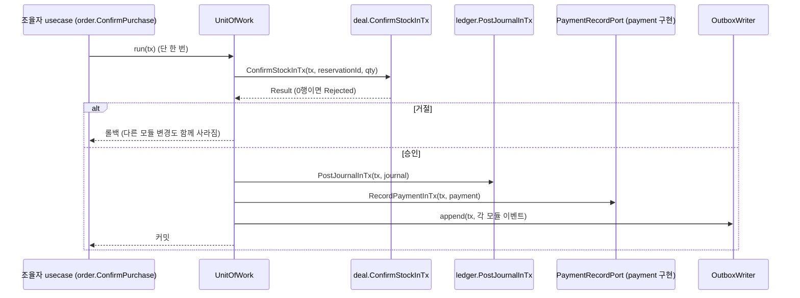

**검사와 시험**: ① `modules/layers.json`(모듈→층)과 `modules/tx-pairs.json`(R4 표)을 정본 파일로 두고 `check:arch` 스크립트가 dependency-cruiser 결과와 대조한다 — 규칙: (a) 타 모듈 임포트는 `index` 만, (b) 직접 임포트의 피호출 층 ≤ 호출자 층, (c) `…InTx` 심볼 임포트는 `tx-pairs.json` 에 있는 (호출자 모듈→피호출 함수)만 — 예: `{"support":["chat.OpenRoomInTx","chat.PostMessageInTx","chat.CloseRoomInTx","chat.AddParticipantInTx","chat.RemoveParticipantInTx"],"fulfillment":["inventory.AllocateInTx","inventory.ReleaseAllocationInTx","inventory.IssueInTx","inventory.RecordMovementInTx"],…}`, (d) `*-in-tx.ts` 파일은 `UnitOfWork`·`.run(` 을 임포트/호출하지 않는다. ② 쌍마다 **원자성 계약 시험**: 조율자 트랜잭션을 도중에 강제 롤백하면 피호출 모듈의 변경·outbox 도 남지 않는다(F13 `faults` 훅). ③ 허용 목록 밖 호출을 심은 샘플이 CI 에서 실패한다.

### 2.5 `ledger` 모듈 — 하나의 복식 원장 (D20)

| 항목 | 내용 |
|---|---|
| 소유 | `ledger` 모듈 하나. 스키마 정본은 [ADR-040](../../adr/ADR-040-escrow-settlement-and-ledger.md)(`account`·`journal`·`posting`·`account_balance`), POINT 자산 규칙과 보상(`reward`) 상태 머신은 [ADR-037](../../adr/ADR-037-simulated-points-ledger.md) |
| 자산 | `POINT`(Phase 2), `KRW`(Phase 5, 모의), `USDC`(Phase 5, 모의/devnet 거울). 분개는 **자산별로** 차변 합 = 대변 합 |
| 불변식 | 추가 전용, 지연 제약 트리거로 자산별 차변=대변, 정정은 역분개(`reversal_of_id`), 멱등 키 유일 |
| 음수 방지 | **계정 유형별 규칙**: 사용자 계정(`liab:user_*`)은 `min_balance = 0` — 잔액 조건부 갱신(`balance + Δ >= min_balance`); 시스템 계정은 유형별로 정하며 **정본은 ADR-040 의 계정 유형 표**(`exp:*`·`rev:*`·`fx:*` 하한 없음, `liab:escrow:*`·`liab:seller_payable:*`·`asset:*` 규칙 포함) |
| 공개 `InTx` | `PostJournalInTx(tx, JournalInput)`, `ReverseJournalInTx(tx, journalId, reason)`, `ConfirmRewardInTx(tx, rewardId, expectedVersion)`, `FlagRewardInTx(tx, rewardId, report)` — 시그니처 `(tx: TxContext, …) => Result<…, LedgerError>` |
| 보상 | `reward` 상태 `PENDING → CONFIRMED / FLAGGED → (수동) CONFIRMED / REVOKED`. **생성은 `ledger` 가 `game.finished` 를 소비해** `EligibilityPolicy`(ledger 소유, 입력은 `game.finished` 페이로드)로 자격을 판정한 뒤 `PENDING` 행을 만들고 `reward.pending_created` 를 발행한다(자격 미달이면 reward 도 분석도 없음). 확정 = `exp:points_issued`(POINT) 차변 / `liab:user_points:{uid}`(POINT) 대변 분개와 같은 트랜잭션. `PENDING`·`FLAGGED` 동안은 잔액 불변이고 **`CONFIRMED` 는 종결**이다. `FLAGGED → REVOKED` 는 PENDING 을 무효화할 뿐 **기장이 없다**(확정 보상의 역분개나 음수 잔액 허용은 없다) |
| 이벤트 | `reward.pending_created`, `reward.confirmed·flagged·revoked`, `ledger.journal_posted`(§8.3) |
| 모의 표시 | 모든 금액 응답에 `X-PF-Mock: 1`, 화면에 "모의" 배너(D18, ADR-015) |

## 3. 서비스 분리 기준 (ADR-030)

### 3.1 5축 기준

| 축 | 분리를 정당화하는 신호 |
|---|---|
| 독립 확장 | 다른 모듈과 확장 비율이 크게 다르다(연결 수 vs CPU vs 처리량) |
| 언어/런타임 | 다른 언어·네이티브 바이너리가 필수다 |
| 자원 프로파일 | 상주 메모리·CPU 점유가 사이트 전체를 위협한다 |
| 장애 격리 | 이 모듈의 장애/폭주가 다른 모듈로 번지면 안 된다 |
| 배포 주기 | 훨씬 자주 또는 훨씬 드물게 배포된다 |

**규칙**: 둘 이상이 **강하게** 해당하면 분리를 검토하고, 하나만 해당하면 **엔트리포인트 분화**(같은 이미지)로 먼저 푼다. 분리의 비용(서비스 간 계약, 분산 장애, 무료 자원)은 항상 함께 적는다.

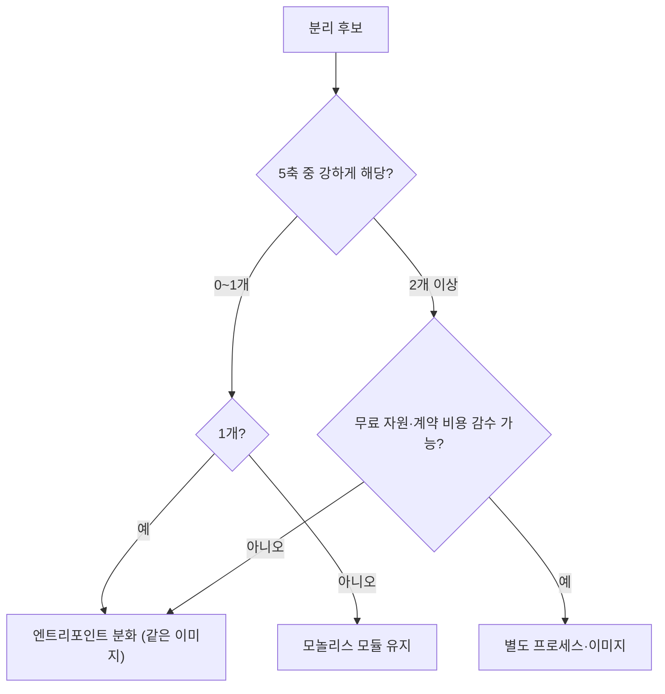

### 3.2 후보별 판정

| 후보 | 확장 | 런타임 | 자원 | 격리 | 배포 | 판정 |
|---|---|---|---|---|---|---|
| **KataGo 분석 워커** | 강(CPU 바운드) | **강**(C++ 바이너리·모델 파일) | **강**(코어 점유) | 강(폭주 시 사이트 영향) | 약 | **분리(D2)** — 별도 프로세스·이미지. 큐는 DB 선점(Phase 2) |
| 룸 실시간(대국·채팅) | 중(연결 수) | 없음(TS 가능, M1 실측 통과) | 약 | 중 | 약 | 엔트리포인트 분화(D3) — Phase 4 에 `--surface=room` |
| WMS(풀필먼트) | 약 | 없음 | 약 | 약 | 약 | **모듈 유지** |
| 채팅 | 중(연결) | 없음 | 약 | 약 | 약 | 모듈 유지 + 룸 채널 |
| 결제 웹훅 수신 | 약 | 없음 | 약 | 중(폭주 방어) | 약 | **모듈 유지**, `api` 의 `/api/webhooks/*` → inbox 저장 후 202(처리는 비동기) |
| 정산·시세 수집 | 약 | 없음 | 약 | 약 | 약 | 모듈 유지(worker 잡) |
| 룰 엔진 | — | **P1 판단**(ADR-012) | — | — | — | 공유 TS 패키지 vs Go 서비스는 P1 이 정한다. P0 요구: **`RuleEngine` 포트 뒤**, 서버 권위 |

- KataGo 분석 워커의 코드는 **같은 모노레포**에 두고(래퍼·큐 소비·결과 기록), KataGo 바이너리/모델은 별도 이미지 레이어다. "서비스 분리"는 프로세스·이미지·자원 한도의 분리이지 레포 분리가 아니다.
- 이 분리가 **이 프로젝트의 첫 번째 실제 서비스 분리**이며, "모놀리스로 시작해 필요가 증명된 지점만 분리했다"는 서사의 근거가 된다.

## 4. 이벤트 전달 계층 (ADR-031 — ADR-006 후속 제안)

### 4.1 왜 시점을 바꾸는가

ADR-006 은 "Phase 2 착수 전 측정"을 요구했다. 그런데 Phase 2 의 소비자(KataGo 워커)는 **DB 선점 큐로 충분**하다(`analysis_job` 선점→트랜잭션 밖 분석→토큰 완료, ADR-021). Redis 가 실제로 필요해지는 것은 **Phase 3**(재고 Lua)이고, 전달 계층이 정말 부하를 받는 것도 **타임딜 버스트**다. 그래서 **Redis 와 Streams 의 판정을 Phase 3 의 부하 시험으로 옮긴다.**

### 4.2 선택지

| 안 | 장점 | 단점 | 판정 |
|---|---|---|---|
| A. 끝까지 Postgres 폴링(+NOTIFY) | 가장 단순, 유실 없음(DB 가 보장), 컨테이너 0 | 버스트 시 폴링·DB 부하, 외부 소비자 확장 제한 | **기본값(M1~Phase 2)** |
| B. Redis Streams (소비자 단위 선택) | 컨테이너 추가 없음(Phase 3 에 어차피 Redis), 낮은 지연, 소비자 그룹·pending 회수 | 내구성 설정 의존(AOF everysec 시 최대 약 1초분 유실 가능, 공식 문서 기준 기억 — 구현 시 재확인), 장애 영역 공유 | **Phase 3 측정 후 채택 판정** |
| C. Kafka | 업계 표준, 서사 | 메모리·운영 비용(무료 자원), 규모 대비 과함 | **기각**(재검토 조건 §4.7) |
| D. NATS JetStream | 가벼움 | 이 저장소에 경험·스킬 없음, 컨테이너 추가 | 기각 |

### 4.3 결정 (D4·D5)

1. **정본은 Postgres outbox.** 어떤 전달 계층을 쓰든 이벤트는 outbox 에 같은 트랜잭션으로 먼저 기록된다(ADR-005).
2. **`EventTransport` 어댑터는 소비자 단위로 고른다.** 소비자 설정 `transport: postgres | streams`(기본 `postgres`). 같은 이벤트가 소비자별로 다른 경로를 탈 수 있다.
3. 발행 완료(`published`)의 의미는 **"전달 계층이 받았다"**(Postgres 경로: inbox INSERT 성공, Streams 경로: `XADD` 성공).
4. **`TransportReconciler`** 가 `XADD` 성공 후 Redis 가 유실한 이벤트를 복구한다(§4.5).

### 4.4 Streams 설계 (잠정, 측정 후 확정)

| 항목 | 설계 |
|---|---|
| 스트림 키 | 모듈당 1개: `pf:evt:<module>` (예 `pf:evt:deal`). 순서 보장 범위 = 모듈 내 스트림 순서 |
| 메시지 | 필드 `id`(이벤트 id), `seq`, `type`, `env`(봉투 JSON 전체). 소비자는 `env` 로 05 §1 의 봉투를 그대로 복원 |
| 소비자 그룹 | 그룹 이름 = inbox 소비자 이름(`deal-confirm-consumer` 등). 소비자 인스턴스 이름 = `<host>-<pid>` |
| 수신 | `XREADGROUP … >` → `ReceiveMessage`(inbox 저장, 중복 무시) → **저장 성공 후 `XACK`** (처리가 아니라 저장 후 ack, ADR-020) |
| 회수 | `XAUTOCLAIM`(유휴 > 60초, 제안)로 죽은 소비자의 pending 인수. 재전달은 inbox 유일 키가 흡수 |
| 트림 | `XADD … MAXLEN ~ N`(근사). N = 처리 중 + 여유: 기본 50,000(제안). **outbox `published` 확인 전에는 트림하지 않는다**는 보장은 정본이 outbox 에 있어 불필요 — 트림으로 잃은 메시지는 Reconciler 가 outbox 에서 재전달 |
| 내구성 | AOF `appendfsync everysec`(제안) + `maxmemory-policy noeviction`. 유실 가능 구간은 최대 약 1초분(공식 문서 기준 기억, **구현 시 재확인**) |
| 역압 | 디스패처가 `XLEN` 이 고수위(N×0.8)를 넘으면 해당 스트림 `XADD` 를 일시 중지하고 outbox 에 쌓아 둔다(Postgres 가 버퍼). 지표 `pf_transport_stream_length` |
| 순서 | 같은 집합체의 이벤트는 같은 스트림에서 순서대로. 소비자 동시성이 2 이상이면 inbox 의 집합체 선두 규칙(F13)이 순서를 지킨다 |

### 4.5 유실 방어 — TransportReconciler

`XADD` 성공 ≠ 디스크 반영이므로, Redis 가 재시작하며 최근 이벤트를 잃으면 outbox 는 `published` 인데 inbox 에는 없다.

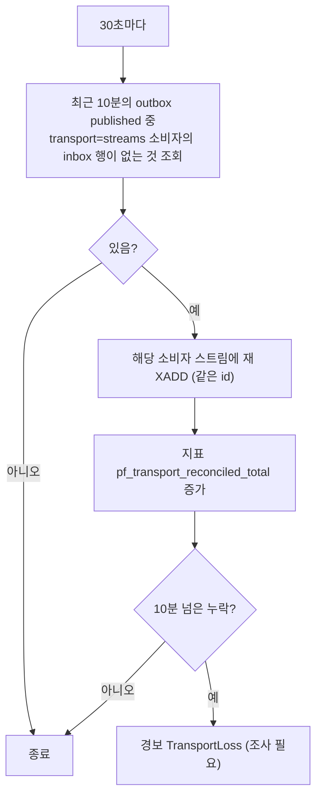

- 조회는 `(consumer, message_id)` 기본키와 `published_at` 인덱스로 한정된 창만 본다(전체 스캔 금지).
- 재전달이 중복이어도 inbox 유일 키가 한 번만 반영한다(AC-003 과 같은 보장).

### 4.6 측정 계획과 합격 기준 (Phase 3, `deal` 버스트)

| 지표 | 방법 | 합격 기준(제안) |
|---|---|---|
| 처리량·종단 지연 | k6 로 예약→확정 버스트(초당 500건 목표는 미확인, 근거 없음 → 단계별 증가) | Streams 경로 p95 가 Postgres 경로의 **50% 이하**이거나, Postgres 경로가 목표 처리량을 못 맞출 때 |
| 메모리 | 부하 중 Redis RSS | ≤ 256MiB(`maxmemory 256mb` 상한 포함, 제안) |
| 내구성 | 부하 중 `kill -9 redis` 후 복구 | Reconciler 이후 누락 0 |
| 소비자 복구 | 소비자 `kill -9` | `XAUTOCLAIM` 후 처리 완료, 중복 효과 0(AC-003) |
| DB 부하 | Postgres CPU·커넥션 | Postgres 경로 대비 감소 |
| 서사 가치 | — | 사용자가 "Streams 도입 자체"를 목표로 선택하면 위 기준 일부를 완화 가능(기준 완화는 ADR-031 에 기록) |

기준 미충족이면 **Postgres 유지**, Streams 는 폐기하지 않고 포트 뒤 어댑터로만 남긴다.

### 4.7 Kafka 재검토 조건

이벤트 규모가 초당 수천 건을 지속하거나, 이벤트 재생(수일 이상 보존)·다수 독립 소비자 그룹이 필요하거나, Redis 내구성이 Reconciler 로도 부족하다고 측정될 때. 현재 규모(동시 접속 50~수백)에서는 해당하지 않는다.

### 4.8 무중단 전환 (Postgres → Streams, 소비자 단위)

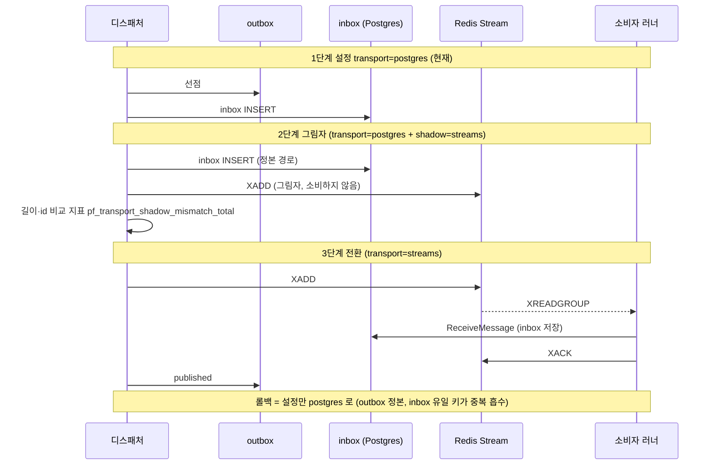

### 4.9 어댑터 클래스 구조

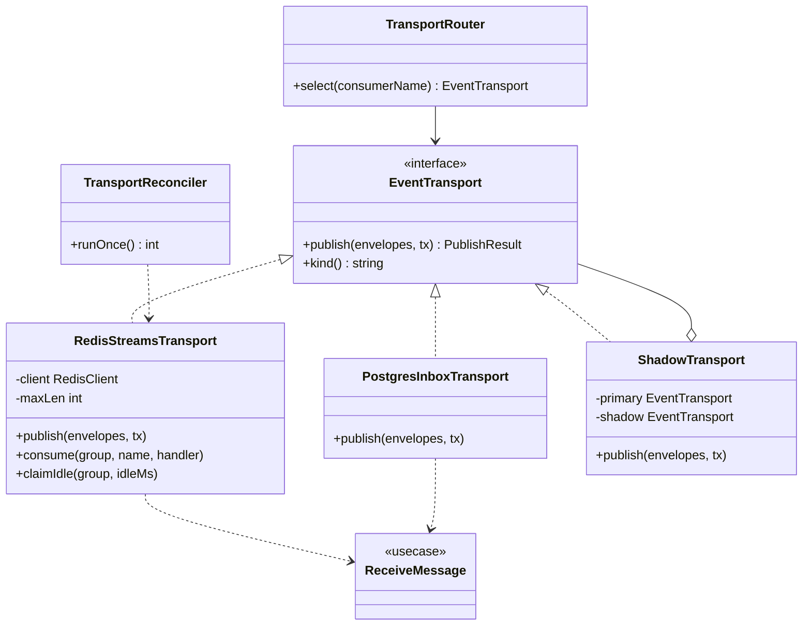

## 5. Redis/Valkey 도입 설계 (D6·D7)

### 5.1 용도와 도입 시점

| 용도 | 도입 시점 | 정본 | 재구성 방법 | 장애 시 거동(ADR-024 확장) |
|---|---|---|---|---|
| 재고 선점 Lua | Phase 3 | Postgres `deal.stock` | `reconcile-stock` 잡: 확정+활성 예약을 Postgres 에서 계산해 Redis 재설정 | **선점 거부**(초과 판매 0 우선, ADR-010) |
| 속도 제한(공유) | Phase 4 (레플리카 ≥2) | — (휘발) | 불필요 | fail-open + nginx 제한 유지 |
| presence | Phase 4 | — (휘발) | 불필요 | 마지막 값 유지/숨김 |
| 세션 검증 캐시 무효화 | Phase 4 | `identity.session` | 불필요 | 캐시 우회(DB 직접) |
| Streams | Phase 3 판정 | Postgres outbox | Reconciler(§4.5) | outbox 가 버퍼, Postgres 경로로 폴백 |
| 룸 팬아웃 다중 인스턴스 | Phase 4 (룸 gateway ≥2) | `realtime_read.room_log` | 불필요 | gateway 가 `NOTIFY` 대신 폴링으로 폴백 |

### 5.2 인스턴스 구성 (D6)

| 선택지 | 장점 | 단점 | 판정 |
|---|---|---|---|
| 단일 인스턴스, 키 접두사 | 자원 최소(유휴 6.8MiB 측정), 운영 단순 | 재고(휘발 허용)와 Streams(내구성 필요)의 정책이 한 설정에 묶임, 장애 영역 공유 | **시작 안(Phase 3)** |
| 인스턴스 2개(상태/스트림) | 정책·장애 분리 | 컨테이너 2개, 관리 부담 | Phase 4 재평가 |
| 논리 DB 번호 분리 | — | 메모리·영속성 정책이 분리되지 않아 효과 없음 | 기각 |

**단일 인스턴스 규칙**: `maxmemory 256mb`(제안), `maxmemory-policy noeviction`, AOF `everysec`, **스트림을 제외한 모든 키는 TTL 필수**(재고 키는 예약 TTL 기준), 키 접두사 `pf:<용도>:<...>`(`pf:stock:`, `pf:rl:`, `pf:pres:`, `pf:evt:`). 접두사 없는 키는 CI 린트(키 생성 헬퍼만 사용)로 금지.

**분리 트리거(Phase 4 재평가)**: Streams 메모리가 재고 키 공간을 압박하거나, 재시작 정책(휘발 허용 vs 내구성)이 충돌하거나, 한 용도의 장애가 다른 용도로 번진 사고가 측정될 때.

### 5.3 Redis vs Valkey

기능 호환이라 결정을 미룬다(tech-stack §13: ADR-006 측정 시). 두 이미지 모두 유휴 메모리가 비슷하다(redis:8 6.8MiB, valkey 9 5.9MiB, 측정). 라이선스/배포 정책 확인 후 Phase 3 시작 때 하나를 고정한다(미확인).

### 5.4 포트 확장

ADR-024 의 `StockReservation` 포트(이 문서 초안의 `StockStore` 와 **같은 포트, 이름은 `StockReservation` 으로 통일**)의 연산을 구체화한다: `reserve`, `release`, `confirm`, `restock`(출고 전 취소 시 재고 복원, `deal.restocked`), `peek`. `SlidingWindowLimiter` 는 기존 `RateLimiter` 구현체로 흡수. 메모리/Postgres 어댑터는 시험·단일 인스턴스용으로 남기고 Redis 어댑터가 같은 **포트 계약 시험 스위트**(08 §2.1)를 통과해야 한다.

## 6. 실시간 채널 모델 확장 (ADR-032)

### 6.1 문제

M1 은 `/ws/public`(모두에게 같은 메시지)과 `/ws/private`(세션 소유자에게만)이다. 바둑·채팅은 **"특정 룸의 참가자/관전자에게만"** 가는 메시지가 필요하다. 룸은 수가 많고 수명이 짧으며(대국 한 판), 권한이 룸마다 다르다.

### 6.2 선택지

| 안 | 설명 | 장점 | 단점 | 판정 |
|---|---|---|---|---|
| **A. `/ws/room` 세 번째 연결** | 인증 필수, 한 연결에 여러 룸 구독 | 장애·백프레셔 격리(룸 폭주가 사이트 채널에 영향 없음), M1 `public`/`private` 불변, 룸 수만큼 연결을 늘리지 않음 | 탭당 소켓 최대 3개 | **채택(D8)** |
| B. `/ws/private` 에 다중화 | 기존 private 에 룸 구독 추가 | 소켓 수 증가 없음 | private 의 단순성(세션 소유자 전용, 재개 없음) 훼손, 룸 폭주가 개인 흐름 지연 | 기각 |
| C. 룸마다 연결 | `/ws/room/<id>` | 구현 단순 | 관전하며 채팅하면 소켓 2+, 연결 폭증, 사용자 결정(public/private 분리)의 정신과 다름 | 기각 |
| D. 모두 한 소켓 | 채널 필드로 다중화 | 소켓 1개 | 사용자 결정으로 이미 기각(public/private 분리) | 기각 |

### 6.3 프로토콜 (04 의 봉투 확장)

- 연결 시점: **룸이 필요한 화면 진입 시**(로비·대국·채팅). 세션 필수(익명 세션 포함). `Origin` 검사·연결 수 제한은 04 §1 과 같다.
- 쓰기는 **REST**(D8, ADR-018): 착수·채팅 전송·신고는 멱등 키가 있는 `POST` 로 하고, 결과는 룸 채널로 push 된다.
- 클라이언트→서버(허용 목록 전부): `hello`(M1 과 같음), `room.join { room, resume? }`, `room.leave { room }`, `ping`, 그리고 채팅 방 한정 휘발성 `typing`. 그 밖의 인바운드는 `room.error { code: inbound_not_allowed }`(반복 시 `4400`).
- 서버→클라이언트: 봉투에 `ch:'room'`, `rm:'<type>:<id>'` 를 추가. 종류 `room.joined { room, role, head, mode: live|replay|snapshot }`, `room.snapshot { room, data, head }`, `replay.end`, 휘발성 `room.presence`·`room.typing`, 도메인 메시지(`game.move`, `chat.message` 등 — 영역 설계가 정의), `room.closed { room, reason }`(권한 상실·룸 종료), `room.error`.
- 룸 키(정본): `<type>:<uuid>` — `game:<gameId>`(대국 룸), `chat:<chatRoomId>`(채팅 룸; 대국 채팅은 game 에 연결된 **별도 chat 룸 2개**(players·spectators)이며 각각 자기 uuid), `cs:<ticketId>`(CS 티켓 룸). 필드 이름은 `room`(요청·응답 공통, `roomId` 아님), 서버→클라이언트 봉투의 `rm` 는 같은 키. 타입별 권한은 `RoomAccessPolicy` 가 판정한다. 영역 문서(P1·P4)는 이 형식과 메시지 이름(`room.join`/`room.joined`/`room.snapshot`/`room.presence`/`room.closed`/`room.error`)을 따른다.

### 6.4 순번·재개 일반화

| M1 (public) | 룸 |
|---|---|
| `realtime_read.change_log (channel, seq)` + `channel_seq` | `realtime_read.room_log (room_key, seq)` + `room_seq (room_key, last_seq)` |
| 보관: 1시간/1만 행 | 룸별: 최근 1시간 또는 1,000 행 중 먼저 닿는 쪽. 룸 종료 + 1시간 후 해당 룸의 행·카운터 삭제 |
| 이력 없으면 전체 스냅샷 | 이력 없으면 **`RoomSnapshotProvider`(도메인 소유)가 만든 스냅샷**. 대국은 정본(`move` 표)에서, 채팅은 최근 N건에서 만든다 |
| 클라이언트: `SeqTracker` | 룸별 `SeqTracker` |

- seq 부여 방식(카운터 행 `UPDATE … RETURNING`, 커밋 순서 = seq 순서)은 M1 과 같다. **도메인이 자체 순번 로그를 가진 룸**은 그 순번이 방 순번이며 `room_log`/`room_seq` 를 쓰지 않고 `RoomEventSource`(재생 원천)로 읽는다(§6.6). 두 가지 경우가 있다: (a) **대국** — `game_event` 가 로그이고 push 도 명령 tx 의 `pg_notify('room_changed')` fast lane(§6.7); (b) **채팅** — `chat` 메시지 표(명령 쪽 방 카운터 seq, ADR-045)가 로그이고 재생은 `RoomEventSource`(읽기 모델 `chat_read.message_view`)로 하되 **push 는 표준 경로**(outbox → chat-broadcaster → `NOTIFY chat_room_changed`)이며 `room_log` 에 쓰지 않는다. `room_log` 는 **자체 로그가 없는 룸 종류용(현재 해당 없음, 예약)** 이다. 룸 카운터 행은 룸 생성 시 만들고 룸 종료 정리 때 삭제한다.
- **정본은 도메인 표**다(`move`, `chat_message`). `room_log` 는 전달 편의용 이력이고 유실돼도 스냅샷으로 복구된다.

### 6.5 권한 판정

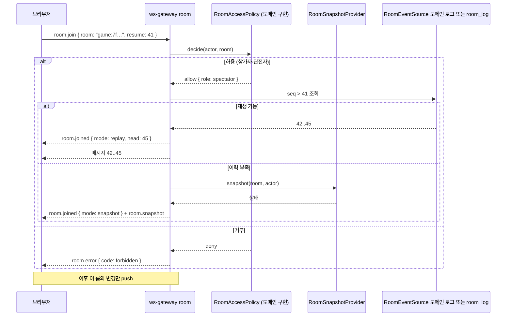

- 참가 자격이 바뀌는 이벤트(킥, 대국 종료 후 채팅 권한 변경)는 `RoomAccessPolicy` 가 재판정하며, 실패 시 서버가 `room.closed` 로 구독을 해제한다.
- 룸별 가시성(관전자에게 숨길 것, 예: 대국 중 개인 메모)은 `RoomMessageMapper` 가 **수신자 역할별로 변환**한다(공개 변환과 같은 허용목록 방식, AC-009 의 확장).

### 6.6 클래스 구조

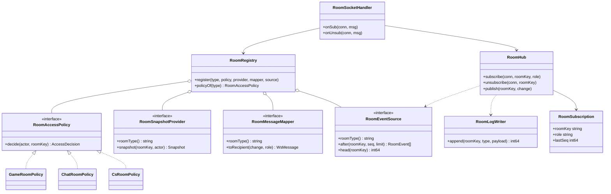

**`RoomAccessPolicy`·`RoomSnapshotProvider`·`RoomMessageMapper`·`RoomEventSource` 는 모두 `realtime`(L2) 소유 포트**다. `GameRoomPolicy`(game)·`ChatRoomPolicy`(chat)·`CsRoomPolicy`(support) 등은 각 도메인 모듈이 구현하고 `apps/ws-gateway/compose` 가 `RoomRegistry` 에 등록한다(D9). 포트를 chat 같은 도메인이 정의하거나, game 이 chat 을 임포트해 접근을 판정하는 구성은 층 규칙(R3)과 `game → chat` 금지에 어긋나므로 쓰지 않는다. 게이트웨이는 도메인의 읽기 모델(`chat_read` 등)을 직접 조회하지 않고 위 포트로만 읽는다.

### 6.7 지연 예산과 fast lane (D10)

M1 경로는 `명령 tx → outbox → 디스패처 → inbox → 브로드캐스터 → room_log+NOTIFY → gateway → 클라이언트` 로 여러 홉이다. 룸 이벤트(착수·채팅)는 사용자가 즉시 보는 값이다.

| 단계 | 방식 |
|---|---|
| 예산 | 룸 이벤트 종단 지연 **p95 ≤ 250ms**(제안, **미측정** — Phase 1 부하 시험에서 측정) |
| 1차 대응 | 디스패처를 NOTIFY 구동(폴링 대기 없음)으로 돌리고, 룸 이벤트용 브로드캐스터 러너를 별도 동시성으로 둔다 |
| 기본 fast lane (자체 순번 로그를 가진 룸 — 대국) | 명령 tx 가 `pg_notify('room_changed', {room, seq})` 를 추가(커밋 때 전달) → 게이트웨이가 `RoomEventSource.after(room, lastSent)` 로 도메인 로그(`game_event`)를 읽어 push. outbox 는 읽기 모델 투영용으로만 남는다. 모듈 경계 예외 없음(포트 의존 역전) |
| 2차(**미사용 예약**) | 자체 로그가 없는 룸이 예산을 넘는 일이 **측정으로 확인될 때만**: 그 룸의 명령이 같은 트랜잭션에서 `realtime` 의 `AppendRoomLogInTx(tx, …)` 를 호출한다. 이는 모듈 간 한 트랜잭션이므로 **허용 쌍 #11 을 ADR-030 개정과 함께 먼저 추가**해야 하며 그 전까지는 허용 목록에 없다(R4). 현재 대국은 `game_event` 로, 채팅은 표준 경로로 충분하므로 해당 룸이 없다 |

fast lane 은 outbox 정본·멱등 규약을 해치지 않는다(대국은 `game_event` 의 `UNIQUE (game_id, move_id)` 와 순번이, (예약된) `AppendRoomLogInTx` 경로는 `room_log.event_id` 유일 키가 브로드캐스터 경로와의 중복을 흡수). 채팅은 지연 요구가 낮아 표준 경로(P4 §4.4: outbox → chat-broadcaster → NOTIFY, `room_log` 미사용)를 쓴다. **P1 판단 근거와 구간별 추정은 [01-baduk §5.10](01-baduk.md).**

### 6.8 연결 수·팬아웃·백프레셔

| 항목 | 규칙 |
|---|---|
| 탭당 소켓 | 최대 3개(public·private·room). 룸 화면이 없으면 room 연결을 열지 않는다 |
| 연결당 룸 수 | 최대 8 (초과 시 `room.join` 거부, 제안) |
| 구독 속도 | **초당 5회** (`room.join`/`room.leave` 합산, 초과 시 `4429` 종료). **정본 값** — P1·P4 의 `room.join` 한도는 이 값에 맞춘다(방별 분당 한도 등 추가 한도를 둘 때는 이보다 느슨하지 않게 이 문서에 먼저 등재) |
| 룸별 연결 수 | 대국 관전 상한(제안 200), 채팅 룸 상한(제안 200). 초과 시 `room.error { code: room_full }` |
| 직렬화 | 룸 메시지 한 건을 **한 번만 직렬화**해 구독자 전원에게 전송(역할별 변환이 다르면 역할당 1회) |
| 백프레셔 | M1 `SendQueue`(64건/256KB, 초과 시 4408)를 그대로 사용. 합치기 키 `sk` 는 룸 메시지에도 적용(예: 시간 표시 갱신) |
| 용량 | M1 측정: 연결당 증분 약 5.5KB(단시간·앱 큐 제외), 보수적으로 50KB. 총 연결 상한 400 을 룸 연결이 **모두** 차지하는 최악의 경우 → 약 20MB(추정) |
| 총 연결 상한 | `WS_MAX_CONNECTIONS` 초기값 400(site+room 합산 정책은 Phase 4 에서 분리 상한으로) |

### 6.9 presence 소유 (D19)

| 항목 | 규칙 |
|---|---|
| 소유 | `realtime` 모듈. `PresenceCounter` 포트(ADR-024)를 방 범위 키(`room:<type>:<id>`)로 사용하고, `/ws/room` 의 `room.join`·`room.leave`·연결 종료에서만 증감한다 |
| 표시 | `room.presence { room, spectators, players }`(휘발성). 값의 의미는 "현재 이 방을 구독 중인 연결 수(근사)" |
| 읽기 | 도메인 모듈은 `realtime` 의 공개 **읽기** usecase `GetRoomPresence(room)`·`IsParticipantConnected(room, ref)` 만 호출한다(game L3 → realtime L2, 층 규칙 OK). 쓰기 경로는 없다 |
| 용도 | **표시 전용**: game 의 관전자 수·"상대 연결 끊김" 안내 표시, chat 의 접속자 수 표시. **규칙 판정(이탈 `abandoned`, 시간 초과)에 presence 를 근거로 쓰지 않는다**(근사값이며 `PresenceCounter` 는 참가자별 연결 여부를 담지 못함). 이탈 판정은 `game` 이 소유한 신호 — 플레이어가 20초마다 보내는 REST 하트비트가 갱신하는 `game_player.last_seen_at` — 와 자기 타이머로 한다(P1 §5, 결정 S3) |
| 장애 | Redis 도입 후 `PresenceCounter` 가 Redis 어댑터여도 장애 시 마지막 값 유지/숨김(ADR-024), 게임 진행에 영향 없음 |

## 7. ID·권한 확장

### 7.1 역할 (D11)

| 역할 | 얻는 법 | 할 수 있는 것(요약) |
|---|---|---|
| visitor | 익명 세션 | 방명록 쓰기, 공개 대국 관전, 공개 채팅 읽기(룸 정책에 따름) |
| user | GitHub 로그인(Phase 6 에 Passkey 추가) | 대국 참가, 채팅 쓰기, 구매, 본인 주문 조회 |
| agent | `AGENT_GITHUB_IDS` 허용목록(설정, 숫자 GitHub ID) | CS 룸 응대, 티켓 처리, 주문 **조회**(수정 불가, 열람 감사) |
| operator | `OPERATOR_GITHUB_IDS` 허용목록(설정) | 창고 작업(피킹·패킹·출고 스캔, 입고 검수), 작업 큐 열람. 재고 조정 승인·강제 취소는 `admin` |
| admin | `ADMIN_GITHUB_IDS` 허용목록(설정) | 숨김/신고/잠금, 상품·딜 관리, 정산 열람, 창고 관리(조정 승인·예외 해결), 감사 조회 |

- **허용목록 방식 통일**: 세 역할 모두 설정 허용목록이며 DB 에 권한을 두지 않는다(M1 ID-09). 역할 변경은 설정 변경 + 재배포이고, 허용목록 변경은 배포 로그와 감사 `system.config_changed`(제안)로 남긴다. 한 사람이 여러 역할을 가질 수 있다(단일 운영자).
- **데모 모드**: 방문자가 `operator`/`agent` 화면을 **샌드박스 데이터로** 체험하게 할지는 사용자 결정(§16). 허용하더라도 별도 `demo_` 스키마 데이터와 쓰기 시뮬레이션만 다룬다.
- **seller 없음**: 단일 판매자이므로 상품·딜·재고 관리는 `admin` 이다. 판매자 포털은 범위 밖(필요 시 Phase 6 이후 별도 ADR).
- `ActorContext` 에 `roles: Set<Role>` 을 추가한다. 가드 `RequireRole(role)` 와 도메인 `Policy` 클래스(소유자·참가자 판정)를 분리한다(M1 `OwnerPolicy` 와 같은 방식).
- 행위자 키(`session:<id>` / `user:<id>`)는 **변하지 않는다.** 역할은 요청마다 계산하는 파생 값이고 이벤트의 `ownerKey` 에 들어가지 않는다.

### 7.2 Passkey (D12, Phase 6)

`identity.credential (id, user_id, credential_id UNIQUE, public_key, sign_count, transports, created_at, last_used_at)`. 로그인 후 같은 방식으로 `session` 을 만든다. 계정 연결: 먼저 GitHub 로 로그인한 사용자가 Passkey 를 추가 등록(계정 단위). 복구·분실 정책은 영역 설계 대상이 아니라 Phase 6b 착수 시 ADR 로 남긴다(미결).

## 8. 규약 확장과 크로스 도메인 이벤트

### 8.1 규약 (D15)

| 항목 | 규약 |
|---|---|
| 스키마 | 쓰기 `<module>`, 읽기 `<module>_read`. FK 는 같은 스키마 안에서만 |
| 이벤트 이름 | `<aggregate>.<verb-past>`: `game.finished`, `order.paid`, `payment.approved`, `chat.message_posted` |
| 이벤트 버전 | 05 §7 규칙 그대로(`schemaVersion`, 소비자 먼저 배포) |
| 지표 | `pf_<도메인>_<이름>`, 레이블에 식별자(사용자·세션·룸·주문·게임 id) 금지 |
| 오류 코드 | wire code 에 모듈 접두사 없음, 도메인 고유 코드는 `snake_case`(`stock_exhausted`, `quote_expired`) |
| 금액 | 정수 최소단위(KRW 원, USDC 는 6자리 소수 → micro-USDC 정수), 부동소수점 금지 |
| 시각 | UTC `timestamptz`, 서버 시계만 신뢰(대국 시간 제어 포함) |
| ID | uuid v7, 클라이언트 생성 멱등 키(M1 규약) |
| 상태 머신 | 표 기반 허용 전이 + 조건부 UPDATE(`WHERE status = $expected`), 전이 표는 각 영역 설계가 소유 |

### 8.2 크로스 도메인 이벤트 지도 (정본 이름, D22)

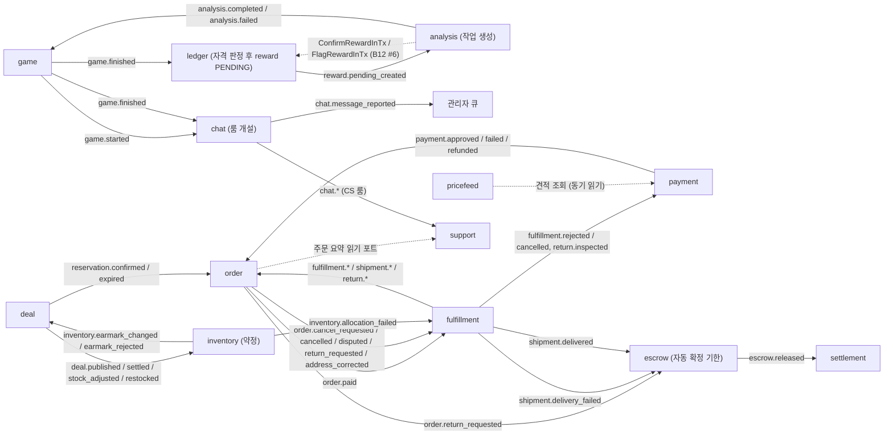

- 동기 호출은 점선(읽기 포트와 B12 `InTx`), 실선은 outbox→inbox 이벤트.
- 이벤트는 **다운스트림이 필요로 하는 사실만** 싣고 PII 를 싣지 않는다. 특히 **배송지는 어떤 이벤트에도 싣지 않고 참조(`shippingAddressRef`)만** 싣는다(§9.6).
- 보상 흐름(사가)은 영역 설계가 정의한다. P0 규칙은 **"보상도 이벤트로, 멱등하게"** 이다.

### 8.3 이벤트 계약 정본 표 (D22)

봉투·버전 규칙은 [05](../05-event-catalog.md). 이름은 `<aggregate>.<verb-past>`, 모듈 접두사를 붙이지 않는다. 페이로드는 식별자·금액·상태·수량만 싣는다. **P1~P4 영역 문서는 이 표를 따르고, 다르면 이 표가 이긴다.**

| `type` | 발행(모듈) | 페이로드 v1 요지 | 소비자 | 비고 |
|---|---|---|---|---|
| `challenge.created` · `challenge.cancelled` · `challenge.expired` | game | `challengeId`, 설정 | game-projector | 로비 |
| **`game.started`** | game | `gameId`, 설정, 참가자 표시, `startedAt` | game-projector, **chat**(`chat-game-sync`: 방 개설·플레이어 참가자), trace-recorder | 두 번째 참가자 확정 시. P4 의 `game.created` 는 폐기(이 이벤트로 통일) |
| `game.move_played` · `game.passed` · `game.resigned` · `game.timed_out` · `game.scoring_started` · `game.score_confirmed` | game | `gameId`, `seq`, 좌표/사유 | game-projector | 실시간 push 는 fast lane(`room_changed`), 이 이벤트는 투영용 |
| **`game.finished`** | game | `gameId`, 결과, 종료 사유, 수 수, 규칙, `rated`, 참가자(ownerKey·색), 자격 판정 입력(수 수·종료 사유·같은 상대 반복 횟수) | game-projector, **ledger**(`EligibilityPolicy` 판정 후 reward `PENDING` 생성), **chat**(`chat-game-sync`: 플레이어 방 읽기 전용·관전자 방 공개 전환), trace-recorder | **analysis 는 이 이벤트를 직접 소비하지 않는다** — ledger 가 만든 `reward.pending_created` 로 작업을 만든다(자격 미달 대국은 reward 도 분석도 없음). `game.review.requested` 는 폐기 |
| `game.abandoned` | game | `gameId`, 사유 | game-projector, chat(`chat-game-sync`: 방 종료) | 판정 근거는 game 소유 하트비트 신호(P1), presence 아님 |
| `analysis.completed` · `analysis.failed` | analysis | `gameId`, 요약 지표, **색별** `verdicts[{color, rewardId, verdict(CLEAN·SUSPECT), inconclusive?}]` | game-projector(표시) | 보상 전이는 이벤트가 아니라 B12 쌍 #6 으로 같은 tx 에서 수행(reward 별로 자기 색의 판정). 2단계 후에도 INCONCLUSIVE 면 CLEAN 취급(확정)하되 `inconclusive=true` 로 기록·지표·감사 |
| **`reward.pending_created`** | ledger | `gameId`, `rewards[{rewardId, ownerKey, color}]` | **analysis**(작업 멱등 생성, `UNIQUE (game_id)`), ledger-projector | `game.finished` 처리와 같은 tx 에서 발행 |
| `reward.confirmed` · `reward.flagged` · `reward.revoked` | ledger | `rewardId`, 금액(내부), 상태 | ledger-projector | `revoked` 는 PENDING 무효화(기장 없음) |
| `ledger.journal_posted` | ledger | `journalId`, `kind`, `refType`, `refId` | ledger-projector | (P1 의 `ledger.posted` 폐기) |
| `chat.room_opened` · `chat.room_closed` · `chat.room_revealed` · `chat.participant_added` · `chat.participant_removed` · `chat.participant_muted` · `chat.participant_unmuted` · `chat.message_posted` · `chat.message_hidden` · `chat.message_deleted` · `chat.read_marked` | chat | `roomId`, `seq`, … (CS 방은 본문 없음) | chat-projector, chat-broadcaster(realtime 소유), chat-game-sync 는 소비 측(game.*) | 04 §12 |
| **`chat.message_reported`** | chat | `reportId`, `roomId`, `seq` | chat-projector(관리자 큐) | M1 `report.filed` 와 같은 모양의 모더레이션 흐름 |
| `support.ticket_opened` · `support.ticket_claimed` · `support.ticket_released` · `support.ticket_first_replied` · `support.ticket_resolved` · `support.ticket_reopened` · `support.ticket_closed` | support | `ticketId`, `roomId`, … | support-projector | chat 은 구독하지 않는다 — 방 개설/종료/참가자 변경은 허용 쌍 #1 의 `…InTx`(같은 tx) |
| `deal.published` · `deal.scheduled` · `deal.publish_rejected` · `deal.opened` · `deal.closed` · **`deal.settled`** · `deal.sold_out` · **`deal.stock_adjusted`** · **`deal.restocked`** | deal | `dealId`, `skuId`, `totalQty`, (`delta`), (`restocked: qty·reason`), (`confirmedQty` — settled) | deal-projector, 관리자 알림(`publish_rejected`), **inventory**(약정 증감: published=Earmark, **settled=Release(`Q − confirmed` 만)**, stock_adjusted=조정, restocked=출고 전 취소 복원에 따른 +q) | `deal.scheduled`/`deal.publish_rejected` 는 약정 응답 소비자(`deal-earmark-reactor`)가 `inventory.earmark_changed`/`earmark_rejected` 를 받아 발행(`publish_rejected` 는 `reason` 포함). P3 의 `deal.created` 는 `deal.published` 로 통일. `closed` 는 약정을 풀지 않는다(결제 확정 후 `order.paid` 미소비 주문 보호). `deal.publishing`→`scheduled` 전이는 약정 승인 후 |
| `reservation.created` · `reservation.confirmed` · `reservation.expired` · `reservation.released` | deal | `reservationId`, `dealId`, `qty` | deal-projector, deal-redis-sync, order | |
| `stock.changed` | deal | `dealId`, `remainingApprox` | 실시간 변환기(`deal.state` 휘발성 push, ≤1회/초 합치기) | **프로젝터 파생 신호**(outbox 계약 이벤트 아님 — 위 `reservation.*` 의 파생). 정본 계약 대상 밖이며 영역 문서가 이름만 인용 |
| `order.created` | order | `orderId`, `number`, `totalKrw` | order-projector | |
| **`order.paid`** | order | `orderId`, `orderVersion`, `lines[{lineId,skuId,qty,dealId?}]`, `totalKrw`, **`shippingAddressRef`**, `shippingMethod`, `paidAt` | **fulfillment**, order-projector, 알림 | **주소 평문 금지**. `shippingAddressRef` = 불투명 참조(`<orderId>:<addressRev>`), 정정 시 rev 증가 |
| **`order.cancel_requested`** | order | `orderId`, `reason`, `requestedBy` | fulfillment | 결제 후 취소 요청. 결과는 `fulfillment.cancelled` / `cancel_rejected` |
| `order.cancelled` · `order.expired` · `order.completed` · `order.disputed` | order | `orderId`, `reason` | order-projector, **fulfillment**(`cancelled`·`disputed`: 출고 보류/중지 판단) | 결제 전 취소는 풀필먼트와 무관. 주문 상태에 `fulfilling→cancelled` 전이가 있다 |
| **`order.return_requested`** | order | `orderId`, `returnId`, `lines`, `reason` | fulfillment, **escrow**(자동 해제 기한 동결 / `held→disputed`) | (P3 의 `return.requested` 는 이 이름으로 통일). 반품 요청 가능 기한 = 배송 완료 후 5일 < 에스크로 자동 해제 7일 |
| **`order.address_corrected`** | order | `orderId`, `shippingAddressRef`(새 rev) | fulfillment | (P3 의 `address.corrected` 통일) |
| `payment.initiated` · `payment.approved` · `payment.failed` · `payment.unknown` · `payment.refunded` | payment | `paymentId`, `orderId`, `method`, `amountKrw`, `snapshotId` | order(reactor), payment-projector, (`refunded`: **fulfillment**, escrow) | 포인트 결제도 결제 시작 때 FX 스냅샷을 고정(`snapshotId`) |
| `payment.amount_mismatch` | payment | `paymentId`, `expectedKrw`, `observedKrw` | 감사/경보 | |
| `quote.issued` · `quote.used` | payment | `quoteId`, `snapshotId`, `expiresAt` | payment-projector | |
| `escrow.held` · `escrow.disputed` · `escrow.released` · `escrow.refunded` | escrow | `escrowId`, `orderId`, `amount`, `currency` | settlement(reactor), 알림 | |
| `settlement.completed` · `settlement.failed` | settlement | `settlementId`, `escrowId`, `usdcNetMicro`, `snapshotId` | 알림 | |
| `pricefeed.snapshot_accepted` · `pricefeed.snapshot_held` | pricefeed | `snapshotId`, `pair`, `rateE8` | 경보 | |
| `fulfillment.accepted` | fulfillment | `orderId`, `foId`, `lines[{lineId, skuId, qty}]`(할당 결과) | order(주문 상태 "출고 준비") | **AcceptOrder 단일 tx 에서 할당(`AllocateInTx`)이 성공한 뒤** 발행 — `fulfillment.allocated` 는 이 이벤트에 병합되어 폐기 |
| **`fulfillment.rejected`** | fulfillment | `orderId`, `reason`(`OUT_OF_STOCK`·`ADDRESS_UNSHIPPABLE`) | **order**(주문 `cancelled`), **payment**(`payment-fulfillment-refunder` — 환불 사가 트리거, 멱등 키는 `eventId` 파생) | 상거래가 소비하는 거절 신호는 이것 하나(P2 의 `inventory.allocation_failed` 소비는 폐기) |
| `fulfillment.allocation_completed` · `fulfillment.cancelled` · `fulfillment.cancel_rejected` | fulfillment | `orderId`, `foId`, `lines`/`stage`, `reason` | `allocation_completed`: fulfillment-projector 전용(상거래는 소비하지 않음 — `accepted` 가 이미 출고 준비를 알림); `cancelled`·`cancel_rejected`: order, (`cancelled`: **payment** `payment-fulfillment-refunder`) | `fulfillment.cancelled` → order 가 `order.cancelled`(`fulfilling→cancelled`) + 환불. **`reason=EXTERNAL`(order/payment 가 먼저 시작한 취소의 후속)이면 refunder 는 환불을 다시 시작하지 않는다**(중복 환불 방지, 환불 멱등 키는 `eventId` 파생). `fulfillment.allocated`·`fulfillment.partially_allocated` 는 `accepted` 에 병합되어 폐기 |
| `package.packed` | fulfillment | `foId`, `packageId` | fulfillment-projector | |
| **`shipment.dispatched`** | fulfillment | `orderId`, `foId`, `carrier`, `trackingNo`, `lines` | order(shipped), 알림 | (P2 의 `shipment.created/shipped` 통일) |
| `shipment.status_changed` | fulfillment | `shipmentId`, `status`, `occurredAt` | fulfillment-projector | |
| **`shipment.delivered`** | fulfillment | `orderId`, `deliveredAt` | order(delivered), **escrow**(`release_due_at` = 배송 완료 + 7일 설정) | |
| **`shipment.delivery_failed`** | fulfillment | `orderId`, `attempts` | order, **escrow**(14일 상한 자동 해제 중지) | (P2 의 `shipment.failed` 통일). 반송(`RETURNED_TO_SENDER`)은 P3 가 ReturnCase/`RETURN_RECEIPT` 흐름으로 입고 |
| **`return.received`** · **`return.inspected`** | fulfillment | `returnId`, `orderId`, (`disposition`: `RESTOCK`·`DISPOSE`·`REFUND_ONLY`) | order(환불 판단), **payment**(`payment-fulfillment-refunder`) | (P2 의 `shipment.returned` 통일). `orderId` 단위 순서 보장을 위해 fulfillment.* 이벤트의 outbox 집합체 키는 `orderId` |
| `inventory.allocation_failed` | inventory | `skuId`, `foLineId`, `qty` | fulfillment (**inventory→fulfillment 내부 신호**, 상거래는 소비하지 않음) | fulfillment 가 `fulfillment.rejected` 로 변환 |
| **`inventory.earmark_changed`** · **`inventory.earmark_rejected`** | inventory | `skuId`, `channelRef`, `qty` | **deal**(`deal_read.sku_capacity` 갱신 / 게시 거절) | **타임딜 총량 ≤ 약정 상한 규칙은 상거래(deal)가 받는다**: 게시 시 로컬 `sku_capacity` 로 1차 검증, 약정(`EarmarkStock`)이 조건부 UPDATE 로 최종 심판. 거절 시 `publishing` 이던 딜은 `draft` 로 복귀(`scheduled` 전이는 약정 승인 후) |
| `inventory.stock_received` · `inventory.low_stock` · `inventory.discrepancy_detected` | inventory | `skuId`, `qty`/`atp`/`kind` | fulfillment(백오더 재할당), 관리자 알림 | |
| `ticket.*` | — | (폐기) | — | `support.ticket_*` 로 통일 |

**폐기·통일된 이름 요약**: `game.created`→`game.started`, `review.requested`/`review.*`→(없음)/`analysis.*`, `game.finished` 의 analysis 직접 소비→`reward.pending_created` 경유, `fulfillment.allocated`→`fulfillment.accepted` 에 병합, `reward.created`→`reward.pending_created`, `ledger.posted`→`ledger.journal_posted`, `deal.created`→`deal.published`, `return.requested`→`order.return_requested`, `address.corrected`→`order.address_corrected`, `shipment.created/shipped`→`shipment.dispatched`, `shipment.failed`→`shipment.delivery_failed`, `shipment.returned`→`return.received`/`return.inspected`, `inventory.allocation_failed`(상거래 소비)→`fulfillment.rejected`, `fulfillment.shipped/delivered/returned`→`shipment.*`/`return.*`, `payment.captured`→`payment.approved`, `chat.reported`→`chat.message_reported`.

## 9. 보안·데이터 보호·감사 확장 (ADR-026/027/028 적용 지침)

### 9.1 새 도메인의 데이터 등급 분류 방법

1. 컬럼마다 등급(PUB·SYS·PSD·PII·HSH·ENC)을 database-schema §9.1 형식으로 적는다(`check:classification` 이 강제).
2. **직접 식별 정보 조합**(이름 + 전화 + 주소)은 개별 PII 가 아니라 한 묶음으로 보고 **ENC**.
3. **자유 텍스트**(문의 본문, 신고 메모)는 기본 ENC 후보 — 공개 채널로 의도된 텍스트(대국 채팅)는 PUB(룸 범위 가시성은 접근 제어).
4. **비밀**(PG 키, 웹훅 서명 키, 지갑 개인키)은 DB 에 저장하지 않고 시크릿 파일. 저장이 불가피하면 ENC.

### 9.2 영역별 후보

| 데이터 | 등급(제안) | 비고 |
|---|---|---|
| 대국 기록(착수, 결과) | PUB | SGF 내보내기 가능 |
| 대국 참가자 id | PSD | |
| 대국 채팅 | PUB (룸 범위) | 신고 메모 ENC |
| 포인트 원장 | SYS (+ 소유자 PSD) | 모의 포인트 |
| 주문 품목·금액 | SYS | |
| **배송지 이름·전화·주소** | **ENC** | 검색 없음(주문 id 로 조회) → 블라인드 인덱스 불필요 |
| 결제 키·토큰(PG 테스트 모드) | 저장 최소화, 참조 id 만 | 카드번호 비저장 |
| 지갑 주소(devnet) | PII 평문(공개 체인 데이터) | 개인키는 비저장 |
| CS 채팅 본문·티켓 | **ENC** | 개인정보 포함 가능 |
| 택배 송장번호 | PII(준) | 수취인과 연결되는 식별자라 평문 로그·지표 금지, 이벤트(`shipment.dispatched`)에는 싣되 보관은 배송 완료 후 정책을 따른다(P3 §보호 등급) |

### 9.3 D13 — KEK/DEK 상향

M1 은 ENC 가 `report.note` 하나(키링 방식). Phase 3 의 `order.shipping_address_enc`, Phase 5 의 `payment.provider_payment_key_enc`·`escrow_dispute.reason_enc`, Phase 6 의 CS 본문·수취인이 더해지면 ADR-026 의 재검토 조건("ENC 필드 3개 이상")이 발동한다(§9.5 통합표). **Phase 5 착수 전**(카드 결제 어댑터 구현 전)에 다음으로 올린다.

| 항목 | 설계 |
|---|---|
| KEK | 시크릿 파일의 키링(회전 가능, 키 ID) |
| DEK | 도메인/테이블 단위 데이터 키를 `security.data_key (id, wrapped_key, kek_id, created_at, retired_at)` 에 KEK 로 감싸 저장 |
| 봉투 | `v2.<dekId>.<base64url(iv ‖ ct ‖ tag)>` — v1 호환 읽기 유지 |
| 회전 | KEK 회전은 DEK 재포장만(대량 재암호화 없음), DEK 회전은 신규 쓰기만 새 키 + 배치 재암호화 |
| 마이그레이션 | `report.note_enc`·`order.shipping_address_enc` v1 → v2 재암호화 잡 |

**상향 작업 항목(Phase 5 착수 전 체크리스트)**: ① `security.data_key` 마이그레이션 ② KEK 키링 시크릿(`KEK_KEYS_FILE`, 기존 `FIELD_KEYS` 대체)과 design/02·10 의 비밀 표·회전 절차 갱신 ③ `FieldCipher` v2 봉투 쓰기 + v1 읽기 호환 ④ `worker rotate-field-keys` 의 KEK 재포장 모드와 DEK 회전 모드 ⑤ v1 필드 일괄 재암호화(위 표) ⑥ 키 백업·복구 런북(design/13)과 키링 분실 시 영향 ⑦ ws-gateway 에 키가 없음을 시험(알림-only 모델 유지) ⑧ 시험: v1→v2 왕복, KEK 회전은 재포장만, DEK 회전 멱등, 덤프에 평문 부재 ⑨ ADR-026 개정(상향 사실 기록).

### 9.4 감사·사고 대응 확장

- 감사 action 추가 후보: `admin.deal_created`, `admin.stock_adjusted`, `admin.refund_issued`, `system.stock_reconciled`, `admin.support_conversation_opened`(CS 상담원이 배송지·문의 열람 — **category 는 `admin`(90일) 유지, `actor_role` 에 `agent`·`operator` 추가**를 M1 변경 요청 #8 에 반영). 열람 감사의 단위는 **GET 마다가 아니라 '대화/주문 열람 세션당 1회'**(알림 때마다 감사 행이 쏠리는 것 방지). 패턴은 M1 `report_note_read` 와 같다(조회도 짧은 쓰기 tx).
- 런북(design/13)에 새 자산 추가 필요: PG 테스트 키, 웹훅 서명 키, 지갑 서명 키(devnet), KEK. 영역 설계가 자산 목록을 올리면 13 에 합친다.

### 9.5 ENC 필드 통합표 (D13)

| # | 필드(컬럼) | 소유 모듈 | 도입 Phase | 등급 | 보관 | 키 회전 대상 |
|---|---|---|---|---|---|---|
| 1 | `guestbook.report.note_enc` | guestbook | M1 | ENC | 글과 함께 보관 | 예 |
| 2 | `order.shipping_address_enc` (수령인·전화·주소 JSON 한 덩어리) | order | 3 | ENC | 배송 완료/취소 후 **30일** 뒤 암호문 삭제(익명화), 주문 자체는 보관 | 예 |
| 3 | `payment.provider_payment_key_enc` | payment | 5 | ENC | 결제 보관 정책(금융 기록) | 예 |
| 4 | `escrow_dispute.reason_enc` | escrow | 5 | ENC | 분쟁 종결 후 보관(제안 1년) | 예 |
| 5 | `fulfillment.fulfillment_order.recipient_enc` | fulfillment | 6 | ENC | 배송 완료 + 반품 기한 후 **30일** 익명화(§9.6) | 예 |
| 6 | `chat.message.body_enc` + 읽기 사본 `chat_read.message_view.body_enc` (CS 방만) | chat | 6 | ENC | CS **1년**(제안, 법적 의무는 법무 검토 필요·미확인) | 예 |
| 7 | `chat.report.snapshot_enc` (CS 방 신고 스냅샷) | chat | 6 | ENC | 신고 종결 후 90일(제안) | 예 |

**합계: 7개 논리 필드(8개 컬럼 — #6 의 읽기 사본 컬럼 포함)** — 상향 조건(3개 이상) 충족. Phase 3 에서 2개가 되고, Phase 5 착수 전에 4개가 되기 전 상향한다(§9.3). `rotate-field-keys --field` 는 위 표의 `(테이블.컬럼)` 이름을 레지스트리로 갖는다. 읽기 사본(#6)은 투영기가 **암호문 그대로 복사**하며 복호화하지 않는다. ws-gateway 에는 키가 없다(알림-only).

### 9.6 개인정보(PII) 이벤트·사본 지침 (ADR-026 확장)

| 규칙 | 내용 |
|---|---|
| 페이로드 | outbox/inbox `payload`·`request_key.response_body`·로그·지표에 **ENC 대상 값(주소·전화·메모·본문·결제 키)의 평문을 싣지 않는다.** 참조(id, `shippingAddressRef`)와 상태만. outbox 보관(7일) 동안 평문이 DB 에 남는 것을 구조적으로 막기 위함 |
| 주소 정본 | **상거래(`order`)가 보관**(`order.shipping_address_enc`, 암호화). 풀필먼트는 `order.paid` 의 `shippingAddressRef` 를 받고 **출고 지시(`AcceptOrder`) 시점에** 상거래의 공개 usecase `order.GetShippingAddress(ref)`(감사 `system.shipping_address_read`)로 읽어 **자기 키로 다시 암호화한 사본**(`recipient_enc`)을 둔다 |
| 사본 수명 | 풀필먼트 사본은 배송 완료 + 반품 기한 경과 후 **30일**에 익명화(암호문 삭제, 제안). 상거래 원본도 배송 완료/취소 후 30일에 삭제(제안). 정정(`order.address_corrected`)이 오면 새 `rev` 로 재스냅샷 |
| 열람 감사 | 주소·CS 본문·신고 메모를 사람이 열람하면 감사 기록(`admin.support_conversation_opened` 등 `actor_role=agent`, 열람 세션당 1회, 조회도 짧은 쓰기 tx) |
| 이벤트 검사 | 스키마 시험이 `payload` 허용 필드 목록(additionalProperties:false)을 강제하고, 08 시험이 센티널 PII 가 outbox/inbox/로그/덤프에 없음을 확인 |

## 10. 운영 확장 (D17)

### 10.1 Phase 4 워크로드 분리

| 워크로드 | 스케일 | probe | PDB(제안) | 종료 |
|---|---|---|---|---|
| `api` | 무상태, HPA(CPU 60%, 최소 2) | readyz | minAvailable 1 | 진행 요청 완료 후 |
| `ws-gateway site` | 연결 수 기준 수동/HPA(사용자 지정 지표는 미확인) | readyz | minAvailable 1 | readyz 503 → `bye`/1001 → preStop 5초 (M1 G8: 새 연결 실패 0/1156 vs preStop 없음 26/837) |
| `ws-gateway room` | 위와 같음 | readyz | minAvailable 1 | 같음 + 룸 재구독은 `resume` |
| `worker` | 디스패처 리더 1(어드바이저리 락), 러너는 늘릴 수 있음 | healthz | — | 임대 반납 |
| `analysis-worker` | 큐 길이·CPU 기준, 동시성 **1**(ADR-033, 늘리려면 CPU 예산 재산정) | healthz | — | 진행 분석 취소(토큰 미완료 → 임대 만료 후 재선점) |
| `web` | 동적 렌더(CSP nonce, G3) 라 CPU 기준 | readyz | minAvailable 1 | SIGTERM 143 |

- k3d 검증(G8)과 live Compose 는 **같은 이미지**(ADR-002). HPA·PDB 는 k3d 에서만 검증된다.
- 롤링 중 소켓 재접속은 M1 실측 결과를 그대로 쓴다(우아한 종료 + preStop 조합 필수).

### 10.2 관측·경보

- 지표 네임스페이스 `pf_<도메인>_…`. 영역 설계가 도메인 지표를 정의하고 F17 카탈로그에 합친다. **종류 규약은 F17 과 같다**: 카운터만 `_total`, 게이지는 접미 없음(예: `pf_ledger_imbalance`). 새 지표를 만들기 전에 M1 지표에 `channel`/`mode` 레이블을 확장해 흡수할 수 있는지 먼저 본다 — 룸 연결 수는 `pf_ws_connections{channel="room"}`, 재개는 `pf_ws_resume_total{mode}` 로 흡수(별도 `pf_room_connections`·`pf_game_resync_total` 를 만들지 않는다).
- 영역별 필수 경보 후보: 대국 중단 비율, 분석 큐 적체/실패, 재고 불일치(Redis vs Postgres), 결제 웹훅 실패/지연, 풀필먼트 SLA 초과, CS 응답 지연, `TransportLoss`.
- 공개 대시보드(Grafana Public dashboards)에는 **도메인 요약 지표만** 노출한다(주문·결제의 개별 값 금지).

## 11. 자원 예산 (ADR-033)

### 11.1 컨테이너별 메모리 (유휴 측정 / 추정)

| 컨테이너 | 값 | 근거 |
|---|---|---|
| nginx proxy | 7.5MiB | 유휴 측정 |
| web (Next, Bun) | 약 164MiB | M1 G3 측정(컨테이너 실행 직후) |
| api (Bun) | 약 60–90MiB | 추정(M1 Bun 서버 36–90MB 측정 범위 기반) |
| ws-gateway (Bun) | 36–90MiB | M1 측정(기준 36MB, 10k 연결 89MB) |
| worker (Bun) | 약 60MiB | 추정 |
| postgres | 유휴 56MiB → 운영 200–400MiB | 유휴 측정 + 추정(shared_buffers·커넥션) |
| prometheus | 유휴 46MiB → 150–300MiB | 유휴 측정 + 추정(시계열 증가) |
| **grafana** | **유휴 440MiB** | 유휴 측정(13.x 는 무겁다) |
| cloudflared | 약 30MiB | 추정 |
| redis | 유휴 6.8MiB → ≤ 256MiB(maxmemory) | 유휴 측정 + 설정 상한(제안) |
| envoy gateway (k3d 검증 시) | 컨트롤 40–84MiB + 프록시 17–54MiB | M1 G8 측정 |
| k3d 노드 | 약 1.25GiB | M1 G8 측정(검증 때만, 라이브와 동시 상주 아님) |
| analysis-worker (KataGo) | **미확인** — 모델·스레드에 따라 약 0.5–3GiB(추정 범위). 컨테이너 한도는 P1 의 2GiB(제안)가 아니라 **S0 스파이크(실측) 후** 정한다(범위 상단 3GiB 와 어긋남) | P1 이 모델 선정 후 측정 |

### 11.2 Phase 별 합산 (라이브 Compose, 상시)

| 구성 | 합(추정) | 16GB 호스트 대비 | 24GB 호스트 대비 |
|---|---|---|---|
| M1 (§11.1 구성요소 하한/상한 합: nginx 7.5 + web 164 + api 60–90 + ws 36–90 + worker 60 + postgres 200–400 + prometheus 150–300 + grafana 440 + cloudflared 30 MiB = 1,148–1,582 MiB) | 약 1.12–1.54GiB | 약 7–10% | 약 5–6% |
| + Phase 1 (추가 컨테이너 없음, 룸 연결 최대 +20MiB) | 약 1.14–1.56GiB | 약 7–10% | 약 5–7% |
| + Phase 2 (+ analysis-worker 1.5GiB 가정) | 약 2.6–3.1GiB | 약 17–19% | 약 11–13% |
| + Phase 3 (+ redis, 상한 256MiB 로 계산) | 약 2.9–3.3GiB | 약 18–21% | 약 12–14% |
| + Phase 4 (레플리카: api×2, ws×2 → +200–300MiB) | 약 3.1–3.6GiB | 약 19–23% | 약 13–15% |
| + Phase 5·6 (추가 컨테이너 없음, 모듈 메모리 +50–100MiB) | 약 3.1–3.7GiB | 약 20–23% | 약 13–15% |

- **D14 규칙**: 상시 합 ≤ 호스트 RAM 의 60%(16GB 면 9.6GiB). 위 추정은 여유가 크다. 가장 큰 불확실성은 **KataGo 와 Grafana(440MiB)** 다.
- 집 PC 의 WSL2 는 메모리 상한이 별도로 있을 수 있다(미확인). Oracle 24GB 는 Always Free 정책 변동 가능성이 있어 가입 시점에 확인한다(미확인).
- **CPU 예산이 메모리보다 먼저 걸린다**: 이 개발 머신은 6코어. KataGo 는 CPU 바운드이므로 `analysis-worker` 는 스레드 수·동시성 1·낮은 우선순위(`nice`)·방문 수 상한을 두고, 라이브 사이트(api·ws)의 코어를 침범하지 않게 `cpuset`/limits 로 분리한다(제안). 분석 큐 적체는 허용하되 대국 서비스 지연은 허용하지 않는다.
- Prometheus 시계열 증가를 막기 위해 레이블 허용목록(식별자 금지)을 도메인 지표에도 적용한다.

### 11.3 배포 단위 (Phase 4)

M1 의 "같은 이미지 · 다른 시작 명령" 원칙을 유지한다: `server` 이미지 1개(api·ws-gateway(site|room)·worker 의 시작 명령 분화), `web` 이미지 1개, **분석 워커는 별도 이미지 `pf-analysis`**(KataGo 바이너리·모델 레이어 포함, 같은 모노레포 코드). GHCR 태그 규약(09)은 이미지 이름 하나 추가(`pf-analysis`)만 필요하다.

## 12. 위험·순서 재검토·DoD 정합

### 12.1 위험

| 위험 | 영향 | 대응 |
|---|---|---|
| KataGo 가 라이브 호스트 CPU 를 점유 | 대국·사이트 지연 | CPU 예산(D14), 낮은 우선순위, 큐 적체 허용, 분석은 오프피크 |
| Redis 장애 영역 공유(재고+Streams) | 초과 판매 방어/전달 동시 영향 | D7(재구성), 재고 거부 우선, 분리 트리거(§5.2) |
| 모의 금전의 오해 | 법·신뢰 문제 | D18 표시, README 면책(ADR-015) |
| 스코프 팽창(Phase 5·6) | 일정 | 항목별 독립 DoD, 중단 가능(ADR-016) |
| 룸 이벤트 지연 | 체감 품질 | D10 예산 측정 → fast lane |
| 설계 대 구현 괴리 | 문서 낡음 | 단계 착수 전 ADR Accepted, 단계 종료 시 문서 동기 |

### 12.2 순서 재검토

- **Phase 6 순서**(CS 채팅 → Passkey → WMS → Solana → 마작)는 유지하되 의존을 확인한다: CS 채팅은 chat(Phase 1)+order(Phase 3/5) 선행, **WMS 는 주문·재고·결제(Phase 3·5) 선행**이라 5 이후가 맞고, Solana 에스크로는 payment/settlement 선행, **마작은 Phase 1 의 게임 프레임이 `GameRules` 플러그인 구조일 때만 저비용**이다 → P1 에 "규칙 플러그인 경계"를 요구한다.
- **Redis 를 Phase 2 가 아니라 Phase 3 에** 도입한다(D6). Phase 2 의 분석 큐는 DB 선점으로 충분하다.

### 12.3 Phase 별 DoD 와 아키텍처 선행조건

| Phase | README DoD | 선행 아키텍처 조건 | 검증 후보 |
|---|---|---|---|
| 1 | 두 브라우저 3D 대국, 복구, 관전 동기화 (+ **대국 채팅: 복구·중복 방지·관전자 비공개**, P4 DoD 후보 — README 반영은 README 소유자) | `/ws/room`, 룸 로그/스냅샷, 룰 엔진 선정, 채팅 전달 모델(ADR-045) | 룸 재접속 시험, 룰 시험 세트, 채팅 재개·중복 시험 |
| 2 | 종료 → 분석 → 보상 확정 end-to-end | `analysis` 선점/토큰, `ledger` 복식 | 분석 중 워커 kill → 재선점, 보상 상태 전이 |
| 3 | 초과 판매 0 + k6 결과 | Redis 도입(단일 인스턴스), `StockReservation`, reconcile 잡, (Streams 판정) | 동시 예약 시험, Redis 유실 시험 |
| 4 | README+영상만으로 이해 가능 | 워크로드 분리, HPA/PDB, 롤링 소켓 재접속 | k3d 롤링 시험, 관측 대시보드 |
| 5 | 결제→에스크로→정산 재현, 환율 고정 기록 | PG 어댑터, 웹훅 inbox, KEK/DEK | 웹훅 중복/역순, 견적 만료 |
| 6 | 항목별 독립 | support/fulfillment/credential | 항목별 |

### 12.4 통합 M1 변경 요청 표 (영역 설계 P0~P4 → M1 정본 문서)

영역 설계가 요구한 M1 문서·ADR 변경을 중복 제거해 모았다. **M1 문서는 이 작업에서 수정하지 않았고**, 해당 Phase 착수 직전에 아래 순서로 반영한다.

| # | 대상 | 요청 내용 | 출처 | 시점 |
|---|---|---|---|---|
| 1 | design/04, ADR-018 | 세 번째 연결 `/ws/room`, 봉투 `ch:'room'`·`rm`, 인바운드 허용 목록(`hello`·`room.join`·`room.leave`·`ping`·`typing`), 휘발성 `room.presence`·`room.typing`, "WS 는 읽기 전용" 원칙에 룸 구독 제어 예외 명시 | P0·P1·P4 | Phase 1 |
| 2 | F14 | `PublicHub` → 방별 `RoomHub` 일반화(포트 `RoomAccessPolicy`·`RoomSnapshotProvider`·`RoomMessageMapper`·`RoomEventSource`), `SendQueue`·4408·`bye` 재사용, NOTIFY `room_changed` 구독, presence 소유(§6.9) | P0·P1·P4 | Phase 1 |
| 3 | design/03 §1.1 | 속도 제한 등급 추가: `write.game`, 채팅 7종(P4 §6.1), `write.purchase`·`write.checkout`·`write.refund`, 웹훅 | P1·P2·P4 | Phase 1·3 |
| 4 | design/03, 00 §4.3, F16 | 오류 wire code 추가(`illegal_move`·`not_your_turn`·`game_over`·…, CAS 경합 패배는 M1 `version_conflict` 재사용(`stale` 신규 코드 폐기), 결제·재고 코드 P2 §13.4, 채팅 코드), 접두사 없음 규칙 유지 | P1·P2·P4 | Phase 1·3 |
| 5 | design/01 B12, F16 §8.2, ADR-019 | 경계 규칙 **B12**(§2.4: 층 규칙 + `*InTx` 허용 쌍, `layers.json`·`tx-pairs.json`, `check:arch` 규칙 (a)~(d)), `TxContext` 를 받는 `InTx` 공개 함수 개념과 "중첩 `uow.run` 금지는 유지" 문구 | P0·P2·P4 | Phase 1(틀), 3(쌍 확장) |
| 6 | F16 가드 | `RequireRole(agent\|operator\|admin)`, `RequireParticipant`, `WebhookGuard`, `StepUpGuard`(Phase 6) | P1·P2·P3·P4 | Phase 1·5·6 |
| 7 | F10(ID-09), design/01 env | `AdminPolicy` 일반화 → `RolePolicy`: `AGENT_GITHUB_IDS`·`OPERATOR_GITHUB_IDS`·`ADMIN_GITHUB_IDS`, `ActorContext.roles` | P0·P3·P4 | Phase 6 |
| 8 | ADR-027, database-schema 감사 | 감사 `actor_role` 에 `agent`·`operator` 추가(category 는 `admin`/`system`/`auth` 유지 — 새 category 없음), action 추가(`admin.reward_*`, `system.ledger_audit_ran`, `admin.deal_created`, `admin.stock_adjusted`, `admin.refund_issued`, `system.stock_reconciled`, `system.shipping_address_read`, `admin.support_conversation_opened`(actor_role=agent), `admin.support_conversation_opened`, 창고 action 등). 열람 감사 단위는 열람 세션당 1회 | P1~P4 | 각 Phase |
| 9 | database-schema §9 | "이벤트 없는 읽기 모델 삭제 예외"에 채팅 보관 정리·`hold` 규칙 추가, `RetentionRule` 등록 목록(채팅, `carrier_event` 90일, `pick_scan` 90일, 수취인·배송지 익명화 30일, `reservation` 30일, `payment_event` 90일 등) | P2·P3·P4 | 각 Phase |
| 10 | database-schema §9.1, ADR-026, `rotate-field-keys` | 컬럼 등급 등록, ENC 통합표(§9.5) 필드를 회전 대상에 등록, KEK/DEK 상향(§9.3) | 전부 | Phase 3~5 |
| 11 | design/01 env, design/02 | `AGENT_/OPERATOR_GITHUB_IDS`, `CHAT_*` 한도, **단일 Redis 접속 `REDIS_URL`**(키 접두사로 용도 분리, D6; `REDIS_STOCK_URL`/`REDIS_STREAM_URL` 분리는 Phase 4 재평가 후), PG·웹훅 서명 시크릿, `KEK_KEYS_FILE` | P2·P3·P4 | Phase 3~6 |
| 12 | F17 nginx | `pf_purchase`·`pf_webhook`·`/ws/room` 연결 zone, 웹훅 경로 분리, 결제 라우트 분리 | P2·P3 | Phase 3·5 |
| 13 | design/02 compose | **단일 `redis` 컨테이너**(`maxmemory 256mb`, `noeviction`, AOF everysec, 비스트림 키 전부 TTL — D6; `redis-stock`/`redis-stream` 분리는 Phase 4 재평가), `analysis-worker`(KataGo, 별도 이미지 `pf-analysis`) 컨테이너 | P1·P2 | Phase 2·3 |
| 14 | F17 지표·경보 | 영역별 `pf_*` 지표와 경보(P1 §16.1, P2 §18, P3 §15, P4) | P1~P4 | 각 Phase |
| 15 | design/10 CSP, design/12 콘텐츠 | PG 도메인·결제 라우트 CSP, three.js 에셋, 모의 면책 변수·약관/환불 문구, 개인정보 안내 확장(채팅·배송지) | P1·P2 | Phase 1·3 |
| 16 | design/13 런북 | 새 자산: PG 키·웹훅 서명 키·devnet 키·KEK·모델 파일 | P0 | Phase 5 |
| 17 | tech-stack | three.js/R3F, KataGo, `@sabaki/sgf`, Redis/Valkey 이미지 고정(Phase 3 시작) | P0·P1 | 각 Phase |
| 18 | ADR-023 | 분석 워커는 **ADR-021 의 토큰 조건 임대 연장(heartbeat)을 적용**한다(ADR-023 의 "임대 연장 없음"은 M1 짧은 핸들러 기준 문구이므로 "오래 걸리는 분석 워커는 ADR-021 연장 사용" 한 줄 보강). 연장 간격 = 임대/3, ADR-023 의 `임대 ≥ p99×10` 규칙은 **연장 간격**에 적용(총 작업 시간이 아님) | P1 | Phase 2 |
| 19 | ADR-024 | 이미 있는 포트 `StockReservation` 의 연산 구체화(`reserve`·`release`·`confirm`·`restock`·`peek`)와 도입 시점(Phase 3), 단일 인스턴스 규칙 참조 | P0 | Phase 3 |
| 20 | ADR-006 | 확정 시 `Superseded by ADR-031` | P0 | Phase 3 판정 후 |
| 21 | architecture §12, database-schema §11, README | Phase 표·모듈 지도·스키마 윤곽을 본 문서로 동기(이번 작업에서 포인터만 반영) | 전부 | 각 Phase |
| 22 | F00 | 기능 접두사 BD·LG·AN·CT·OD·PY·ES·ST·WM·CH·SP 등록 | 전부 | 각 Phase |
| 23 | design/11 | Phase 1 이후 작업 분할은 영역 설계 확정 후 별도 문서 | P0 | Phase 1 직전 |
| 24 | database-schema §1·§9 (CQRS 예외 목록) | **예외 E1 등재**: `game_event` 는 방 로그이므로 ws-gateway 의 `RoomEventSource.after`, query usecase `SyncGame`, `GET /api/games/{id}/events` 가 쓰기 스키마 `game_event` 를 읽는다(스냅샷의 쓰기 모델 읽기와 함께 문서화된 예외). ADR-018 5번 규칙에도 한 줄 | P1 | Phase 1 |
| 25 | ADR-009 | `game.review.requested`·"분석 요청과 보상 생성은 같은 트랜잭션"을 **개정(Superseded 부분)** — 보상 생성은 `ledger` 가 `game.finished` 소비, 분석 작업은 `reward.pending_created` 소비(P0 §8.3) | P1 | Phase 2 |
| 26 | F14, design/04 | 룸 구독 속도 한도 정본(초당 5회, `4429`)을 M1 04 §1 의 클라이언트 메시지 한도(초당 10건)와 구분해 서술, `RoomAccessPolicy` 소유는 realtime | P0·P1·P4 | Phase 1 |
| 27 | design/03 §1.1·§4 | 대국 명령 REST 계약 일체(`POST /api/games/{id}/moves`·`passes`·`resign`·`dead-stones`·`score-confirmations`·`resume-requests`·`resume-accept`·`heartbeat`)와 오류 코드 `game_over`·`resume_limit`·`no_pending_request`·`illegal_move`·`not_your_turn`(CAS 경합 패배는 `version_conflict` 재사용) | P1 | Phase 1 |
| 28 | database-schema §1·§9 (CQRS 예외 목록) | **예외 E2 등재**: ws-gateway 의 `RoomSnapshotProvider`/`RoomEventSource` 구현(chat)이 읽기 모델 지연에 대비해 쓰기 모델 `chat.room.last_seq` 로 `head` 를 읽는다(구독 먼저 등록 → head → 읽기 모델 대기·재시도, 04 §4) | P4 | Phase 1 |
| 29 | F10(ID-10), database-schema §9·§9.1 | `AnonymizeSessionData` 등록 대상에 `game.game_player`, `chat.participant`·`message.sender_key`·`report.reporter_key` 의 세션 행위자 키 추가 | P1·P4 | Phase 1 |

## 13. 문서·ADR 갱신 계획

이 문서가 확정되면 다음을 갱신한다(이번 작업에서는 수정하지 않았다).

| 대상 | 내용 |
|---|---|
| `docs/adr/README.md` | ADR-030~033 색인(Proposed) 추가 |
| ADR-006 | 확정 시 `Superseded by ADR-031` 표시 |
| ADR-024 | 기존 포트 `StockReservation` 의 연산(`restock` 포함)과 도입 시점(Phase 3)·단일 인스턴스 규칙 참조 |
| `database-schema.md §11` | 이 문서·영역 설계의 스키마 윤곽으로 교체, `realtime_read.room_log`·`room_seq`, `security.data_key` 추가 |
| `architecture.md §12` | Phase 표를 §1.1 로 교체, 모듈 지도에 L 층 규칙 |
| `README.md` 로드맵 | Phase 2 의 Redis 도입 문구 정정(Phase 3), 영역 설계 링크 |
| `design/01` 경계 규칙 | B12 층 규칙, 룸 fast lane 예외 |
| `design/04` | `/ws/room` 절, 봉투 `rm` 필드 |
| `design/11` | Phase 1 이후 작업 분할은 영역 설계 확정 후 별도 문서 |
| `design/13` | 새 자산(PG 키, 서명 키, KEK) 런북 추가 |
| `tech-stack.md` | Redis/Valkey 결정 시점, KataGo, three.js 항목 |

## 14. 영역별 접점 요청 (P1~P4 가 이 문서에 기대는 것·이 문서가 기대하는 것)

| 영역 | 이 문서가 영역에 요구하는 것 | 영역이 이 문서에 기대하는 것 |
|---|---|---|
| **P1 바둑** | `RuleEngine` 포트 + 서버 권위 + 공통 시험 세트, `GameRules` 플러그인 경계(마작), `RoomAccessPolicy/SnapshotProvider/MessageMapper` 구현, `game.started`·`game.finished` 이벤트 정의(§8.3), `analysis` 모듈(분석 작업을 ledger 의 `reward.pending_created` 로 생성), `ledger` 는 §2.5 단일 원장, 룸 이벤트 지연 측정 | D8 push 전용, D3 ws 배치, D10 지연 예산, D14 CPU 예산, 룸 프로토콜(§6.3) |
| **P2 상거래** | `StockReservation` 계약과 reconcile 절차, 예약→확정 사가, 웹훅 inbox 멱등, 금액 규약, 모의 표시(D18), Streams 판정용 부하 시나리오 | D4~D7 Redis/Streams, D13 KEK/DEK, 크로스 도메인 이벤트 지도 |
| **P3 풀필먼트** | `order.paid` 소비, 재고 이중 원장(상거래 재고 vs 물리 재고) 정의, `CarrierAdapter`, 배송지 ENC·열람 감사 | 크로스 이벤트 지도, 역할 `admin`/`agent`, D13 |
| **P4 채팅** | `chat` 룸 수명(대국 연동), `RoomAccessPolicy` 구현, 신고→관리자 큐, 보관 정책(대국/CS), CS 룸 `cs:` 와 `agent` 역할 | D8·§6 룸 모델, 접근 판정 포트, 보관·ENC 기준(§9) |

## 15. 미결

| 항목 | 결정 시점 |
|---|---|
| Redis vs Valkey 이미지 고정 | Phase 3 시작 |
| Streams 채택 여부(D4) | Phase 3 부하 시험 후 |
| 룸 이벤트 지연 실측과 fast lane 필요 여부(D10) | Phase 1 부하 시험 |
| KataGo 모델·스레드·메모리 | P1 설계 + 측정 |
| HPA 사용자 지정 지표(연결 수) 방식 | Phase 4 |
| Passkey 복구·분실 정책 | Phase 6b 착수 시 ADR |
| 호스트별 메모리 상한(WSL2, Oracle 정책) | 호스팅 확정 시 |
| seller 포털 필요 여부 | Phase 6 이후 |
| `escrow`·`inventory` 모듈의 층 배치 확정(L5/L4) | 구현 착수 시(§2.1 은 제안) |
| 승격 가능한 허용 쌍 추가(B12 #11…) | ADR-030 개정 |
| 선택한 Redis 이미지 고정 후 인스턴스 분리(`redis-stock`/`redis-stream`) 재평가 | Phase 4 |
| 방 로그 모델: 자체 로그 룸(대국·채팅) 외에 `room_log` 가 필요한 룸이 생기는지 | 새 룸 종류가 생길 때(현재 해당 없음) |

## 16. 사용자 결정 목록 (모두 Proposed — 사용자 판단 필요)

영역 설계가 남긴 미결 중 **기술 근거만으로 정할 수 없는 항목**이다. 각 항목은 권장안을 따랐을 때의 기본값을 적었고, 결정이 없으면 권장안으로 진행한다.

| # | 결정 | 선택지 | 권장 | 영향·시점 |
|---|---|---|---|---|
| U1 | **ADR-030~047 확정** | 일괄 확정 / 개별 수정 | 영역별 검토 후 확정(Phase 착수 직전) | 설계 기준선. 확정 전에는 구현 근거로 쓰지 않는다 |
| U2 | **경계 규칙 B12 허용 쌍(§2.4 표) 승인** | 승인 / 쌍 축소(사가로 대체) | 승인 | 상거래·CS 의 원자성. 거절하면 사가·보상 경로가 늘어난다 |
| U3 | **데모 모드 샌드박스 작업자·상담원 체험** | 허용(샌드박스 데이터만) / 운영자만 | 허용(읽기 위주, 시뮬레이션 쓰기) | P3·P4 화면 공개 범위, 별도 `demo_` 스키마 필요 |
| U4 | **배송지·수취인 익명화 기한** | 30일(제안) / 7일 / 90일 | 30일 | 개인정보 보관 정책 시연(§9.6) |
| U5 | **실제 택배사 연동 여부** | 모의만(기본) / 한 곳 연동 | 모의만 | P3 어댑터 범위, 외부 계정·비용 |
| U6 | **PG 선정**(Phase 5 착수 시) | 토스페이먼츠(1순위 후보) / 기타 | 착수 시 공식 문서 재확인 후 | 가입 조건·웹훅 서명 방식 미확인 |
| U7 | **보관 기간** | 대국 채팅 30일 / CS 1년 / 신고 스냅샷 90일 / 결제 이벤트 90일 / 택배 이벤트 90일(모두 제안) | 제안값 | 개인정보 정책. 법적 의무는 법무 검토 필요·미확인 |
| U8 | **Redis vs Valkey**(Phase 3 시작) | Redis / Valkey | 라이선스·이미지 확인 후 | 컨테이너 이미지, 클라이언트 |
| U9 | **Streams 채택 여부**(Phase 3 측정 후) | Postgres 폴링 유지 / Streams / 둘 혼합 | 측정 합격선(ADR-031) 미달일 때만 Streams | 컨테이너·운영 복잡도 |
| U10 | **에스크로 자동 확정 기한** | 7일(제안, 시연용 압축 가능) / 14일 | 7일 | ADR-016 미결 해소 |
| U11 | **바둑 규칙 범위** | 중국식만 / 일본식 추가 / 무르기(undo) | 중국식만 | P1 룰 엔진·시험 세트 크기 |
| U12 | **KataGo 실행 방식** | 라이브 호스트 CPU 저우선 / 오프라인 배치 / 보류 | 호스트 RAM·CPU 확인 후(Phase 2 스파이크) | 자원 예산(D14) |
| U13 | **Solana devnet 에스크로(Phase 6-4)·마작(Phase 6-5) 진행 여부** | 진행 / 보류 | 경계(포트)만 설계 유지, 착수는 보류 | 일정 |
| U14 | **KEK/DEK 상향 시점 승인**(Phase 5 착수 전, §9.3) | 승인 / 늦춤 | 승인 | ENC 필드 7개, 키 관리 |
| U15 | **모의 면책·약관·환불 정책 문구** | 사용자 제공 | 제공 필요 | 법적 오해 방지(ADR-015, D18), design/12 |
| U16 | **Web Push 채택 여부와 구독 토큰 등급**(P4, Phase 6 후반) | 채택 / 앱 내 읽지 않음 표시만 | 앱 내 표시만(Web Push 동작 미확인) | CS 응답 알림 수단, 구독 토큰 ENC 등급 |
| U17 | **금칙어 정책: 마스킹 vs 거절**과 초기 목록(P4, P1 구현 시) | 마스킹 / 거절 | 거절(우회 감소, 오탐은 신고로 보완) | 채팅 UX·모더레이션 부담 |
| U18 | **포인트:원 환산 비율**(P2, P1 보상 설계와 함께) | 1:1 가정 / 별도 비율 | 1:1 | 보상 크기·포인트 결제 금액 |
| U19 | **캡차/가상 대기열 도입 여부**(P2, 타임딜 부하 시험 후) | 도입 / 속도 제한·입장 토큰만 | 부하 시험 결과 후(기본은 입장 토큰만) | 봇 구매 방어·UX |
| U20 | **seller 포털 필요 여부**(D11) | 두지 않음(단일 판매자) / Phase 6 이후 별도 ADR | 두지 않음 | 상품·딜 관리 화면, 권한 모델 |
| U21 | **익명 플레이어 허용 확인**(P1 §10 은 비레이팅 대국 허용, P4 는 '플레이어 로그인 권장'): 플레이어 로그인 필수 여부, 관전자 익명 허용 | 로그인 필수 / 익명 비레이팅 허용 | 익명 비레이팅 허용(뮤트 우회 위험을 위험표에 기록) | 진입 장벽 vs 모더레이션 |
| U22 | **분석 INCONCLUSIVE 처리**(P1/ADR-037): 2단계 후에도 결론이 안 나면 | CLEAN 취급(확정) / 수동 검토 큐 | CLEAN 취급(보수적 박탈 회피, 지표·감사 기록) | 보상 무결성 vs 운영 부담 |
| U23 | **교환(반품+신규 주문) UX와 분할 배송의 구매자 노출**(P3, W4·W5) | 단순화(반품 후 재주문) / 교환 흐름 구현 | 반품 후 재주문 | P2·P3 UI 범위 |

