# Phase 1~2. 바둑 (실시간 대국 · KataGo 분석 · 모의 포인트 원장)

로드맵 Phase 1(바둑 실시간 코어)과 Phase 2(KataGo 워커 + 모의 포인트 원장)의 아키텍처 설계다. 상태는 **제안(Proposed)** 이며 근거 ADR 은 [ADR-034](../../adr/ADR-034-baduk-rules-engine.md) · [035](../../adr/ADR-035-game-state-and-realtime-protocol.md) · [036](../../adr/ADR-036-katago-analysis-worker.md) · [037](../../adr/ADR-037-simulated-points-ledger.md) 이다(모두 사용자 확정 대기).
M1 의 규약(모듈러 모놀리스, CQRS, domain·service·usecase, outbox·inbox, CAS·임대·낙관적 버전, 모든 쓰기는 트랜잭션, 데이터 보호 등급, 감사, `pf_` 지표)을 그대로 따른다. 기존 문서와 어긋나는 점은 §17 에 모았다.

> **구현 순서: 마지막 (P0 D24).** 이 문서의 Phase 1·2 는 로드맵 번호일 뿐 구현은 **M1 → 3 → 4 → 5 → 6a~6d 다음**에 한다(바둑 계열(Phase 1·2)이 마지막이고 Phase 1 이 6번째, Phase 2 가 7번째이며, 마작(6e)은 그 뒤다). 따라서 이 문서는 아래 기반이 **이미 존재한다는 전제**로 쓰였다 — ① `chat` 코어와 `/ws/room`·룸 포트(`RoomAccessPolicy` 등, 6a — 6a 는 CS 룸(본문 없는 알림 push + REST)만 실행하므로 **평문 본문 push·관전자 비공개·`ChatRoomPolicy` 는 Phase 1 에서 처음 실행**한다) ② `ledger`·POINT 계정·데모 포인트 지급(Phase 3) ③ B12 `InTx` 틀과 `tx-pairs.json`(Phase 3) ④ Redis(Phase 3, 이 문서는 쓰지 않음) ⑤ `agent`/`RolePolicy` 일반화(6a). 이 문서가 **추가하는 것**은 `game` 모듈, 대국 룸 종류(`game:*`, 대국 채팅 룸), `GameRoomPolicy`·`RoomEventSource`, 바둑 보상(`EligibilityPolicy`·reward)과 `analysis` 이다. 착수 전에는 설계 재검토(P0 §12.5)를 거친다.

> **공통 결정(P0 정본 반영, 2026-11-04 조정)**: 모듈러 모놀리스 유지 · KataGo 워커는 첫 서비스 분리 · **이벤트 전달은 Postgres outbox + inbox 이고 Phase 2 의 분석 큐는 Postgres inbox 선점(DB 큐)이다 — Redis Streams 판정은 Phase 3**(P0 D4·D6·D23) · 실시간은 `/ws/public`·`/ws/private` 에 더해 **room 범위 연결 `/ws/room`**(인증 필수, 한 연결에 여러 room) · **WebSocket 은 push 전용, 대국 명령은 REST**(P0 D8·채팅 ADR-045) · **모듈 간 한 트랜잭션은 `*InTx` 허용 쌍만**(P0 §2.4, 경계 규칙 B12) · **원장은 `ledger` 모듈 하나**(P0 §2.5, ADR-040/037) · 이벤트 이름은 P0 §8.3 정본 표를 따른다.
> 외부 조사 근거는 2026-11-04 에 확인한 공식 저장소·npm 메타데이터이며, 확인하지 못한 값은 **미확인** 으로 표기했다. ADR-015 에 따라 이 저장소 밖의 다른 프로젝트 코드는 참고하지 않았다.

---

## 1. 범위와 완료 기준

| 단계 | 로드맵 내용 | 완료 기준(DoD) | 이 문서 절 |
|---|---|---|---|
| Phase 1-A | 서버·프로토콜: 룰 라이브러리, 룸·대국·관전, 재접속, 채팅, SGF | 서버가 규칙(중국식·일본식 선택)·시계·승패를 권위로 판정, 비레이팅 대국의 무르기(상대 동의), 플레이어는 GitHub 로그인 필수·관전자만 익명, 두 클라이언트가 대국 완료, 새로고침·끊김 후 복구, 관전자 동기화, **롤링 배포 중 룸 재구독 시험**(`room.join { resume }` 로 누락 없이 복구), **평문 본문 push·관전자 비공개 대국 채팅의 첫 실행**(`ChatRoomPolicy`) | §3~8, §11~13 |
| Phase 1-B | three.js 3D 클라이언트 | **두 브라우저에서 3D 대국 완료**, 새로고침·끊김 후 복구, 관전자 동기화 | §7 |
| Phase 2 | KataGo 워커 + 바둑 보상(모의 포인트 원장은 **Phase 3 에서 도입**, 여기서는 보상 `PENDING → CONFIRMED/FLAGGED` 추가) | **대국 종료 → 비동기 분석 → 보상 확정 end-to-end**, 실패·재시도 확인 | §9~10 |

범위 밖: 레이팅 시스템(Glicko 등), 핸디캡 돌, 토너먼트, 마작(Phase 6), 대국 중 물리적 AI 힌트, 모바일 네이티브 앱(웹 전용). 채팅 상세는 [04-chat](04-chat.md) 가 정본이고 이 문서는 대국 방과의 접점만 다룬다.

## 2. 아키텍처 개요

### 2.1 컨텍스트

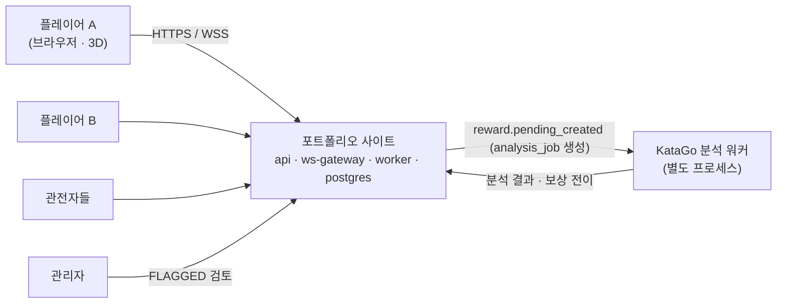

### 2.2 컨테이너

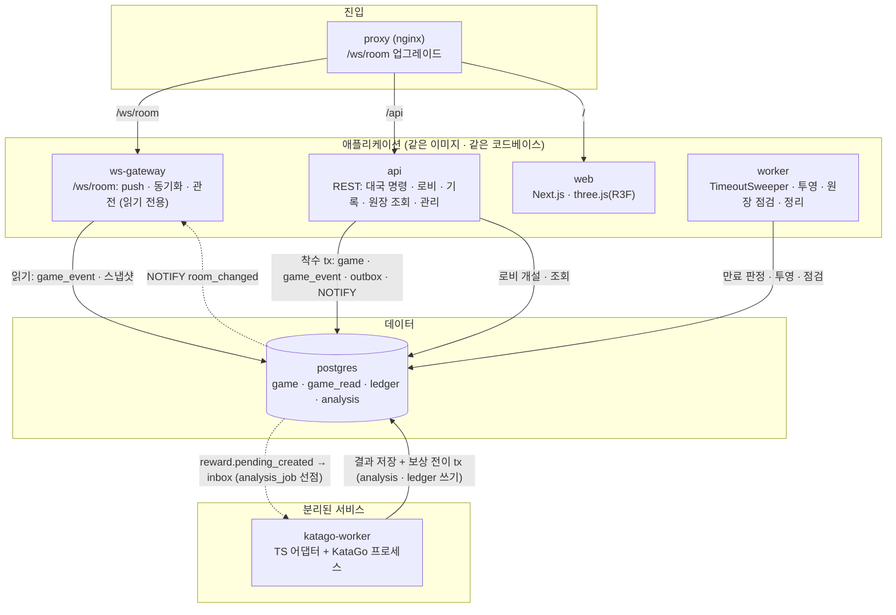

- 대국 명령은 **`api` 의 REST 라우트**가 받아 명령 usecase 를 호출한다(§5.2). `ws-gateway` 는 M1 과 같이 **읽기·push 전용**이다 — DB 쓰기가 없고, `game` 모듈의 읽기 포트(`RoomEventSource`·`RoomSnapshotProvider`)로 `game_event` 와 `game` 스냅샷을 읽을 뿐이다(§5.10).
- KataGo 워커는 `analysis_job` 을 **Postgres 에서 조건부 UPDATE 로 선점**하는 소비자일 뿐(Phase 2 에 Redis 없음, P0 D23) 대국 서버와 같은 DB 에 쓴다. 쓰는 범위는 **`analysis` 스키마(작업·결과·의심도 보고), B12 쌍 #6 을 통한 `ledger` 보상 전이**(`ConfirmRewardInTx`·`FlagRewardInTx`, 같은 트랜잭션), **`events.outbox_event`(+`inbox`)**, **`audit`** 뿐이고, 그 외 스키마에는 DB 역할 권한이 없다(분석 워커 전용 DB 역할, 최소 권한). 이미지는 P0 ADR-033 대로 서버 래퍼 이미지와 분리된 `pf-analysis` 다.

### 2.3 모듈 지도 확장

| 모듈 | 쓰기 스키마 | 읽기 스키마 | 소비자 / 프로젝터 | 의존할 수 있는 것 |
|---|---|---|---|---|
| `game` | `game` | `game_read` | `game-projector` | `identity`(세션·사용자), `events`(outbox·audit 포트), `realtime`(읽기 `GetRoomPresence` — **표시 전용**, L2), `baduk-rules`(패키지) — **`chat`·`ledger` 는 임포트하지 않는다**(방 개설은 `chat` 이 `game.started` 를 구독, 보상은 `ledger` 가 `game.finished` 를 구독). 이탈 판정 신호는 `game` 이 소유한다(§8, 플레이어 heartbeat) |
| `ledger` (**Phase 3 에서 이미 도입 — 여기서는 바둑 보상 추가분**) | `ledger` | `ledger_read` | `ledger-projector`, `reward-settler`(`game.finished` 구독 → **`EligibilityPolicy` 판정**(ledger 소유) → 통과 시 `reward PENDING` 생성 → `reward.pending_created` 발행) | `identity`, `events` (공개 `InTx`: P0 §2.5) |
| `analysis` | `analysis` | — | `analysis-job-creator`(`reward.pending_created` 구독 → `analysis_job` 멱등 생성), `analysis-runner`(KataGo 워커, 작업 선점) | `game`(공개 조회 포트: 기보), `ledger`(`ConfirmRewardInTx`·`FlagRewardInTx`, B12 쌍 #6; 조율자는 `CompleteAnalysis`, `AnalysisRunner` 는 내부 실행기), `events` |
| 패키지 `baduk-rules` | — | — | — | 아무것도 임포트하지 않음(순수, kernel 만) |

- `game` 은 `ledger`·`chat`·`analysis` 를 직접 호출하지 않는다(상위 층이거나 이벤트 관계). 대국 종료는 **`game.finished` 한 이벤트**로 알리고, **소비 순서는 의존 체인**이다: ① `ledger` 가 `EligibilityPolicy` 로 자격을 판정해 통과하면 보상 `PENDING` 을 만들고(`UNIQUE (game_id, user_id)`) `reward.pending_created {gameId, rewards:[{rewardId,userId,color}]}` 를 발행한다 → ② `analysis` 가 **이 이벤트**를 소비해 `analysis_job` 을 만든다(`UNIQUE (game_id)`) → ③ 분석이 끝나면 `ConfirmRewardInTx`/`FlagRewardInTx` 가 `rewardId` 로 호출된다. `chat` 은 `game.finished` 로 방 공개 전환을 한다. 자격 미달 대국(비레이팅 등)은 보상이 없으므로 **분석도 하지 않는다**. reward 행이 존재한 뒤에만 분석 작업이 생기므로 "분석이 보상보다 먼저 끝나는" 순서 의존이 구조적으로 없다. 별도 `game.review.requested` 는 폐기했다(ADR-009 개정).

### 2.4 `game` 모듈 계층

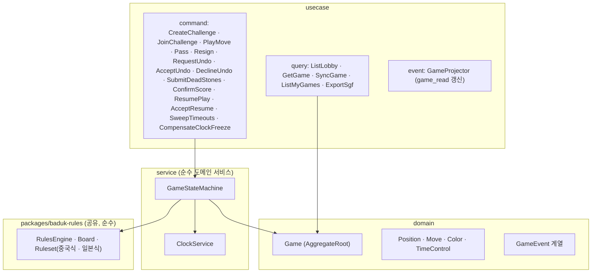

명령 usecase 는 `api` 의 REST 라우트가 호출한다(`ws-gateway` 는 호출하지 않는다). 계층 규칙은 M1 과 같다(`usecase → service → domain`, 포트·어댑터, `command` 는 쓰기 포트만 · `query` 는 읽기 포트만). `baduk-rules` 는 어떤 `@pf/*` 모듈에도 의존하지 않고 `kernel` 의 값 타입만 쓰는 **순수 패키지**라서 서버·클라이언트가 함께 번들한다.

---

## 3. 룰 엔진 (ADR-034)

### 3.1 후보 조사 결과 (2026-11-04)

| 후보 | 라이선스 | 최근 변경(npm) | 규칙 | Bun 실측 | 판정 |
|---|---|---|---|---|---|
| `tenuki` 0.3.1 | MIT | 2022-06 | 단순/위치/상황 슈퍼코, 영역·집 계가, 시키 | 5x5 패·포획 시험 통과(즉시 재따냄 거절, 한 수 둔 뒤 허용), 자충 거절, 영역 점수 계산 | **차분 시험 기준**. 타입 없음·beta API |
| `gogame.js` 1.0.0 | MIT | 2026-01 | 위치 슈퍼코, **영역 계가만** | 같은 패 시나리오 통과 | **차분 시험 기준**. 자충 처리 문서 미확인 |
| `weiqi-engine` 1.1.0 | MIT | 2025-08 | `ChineseRules`, 패 규칙 미확인 | 로드만 확인 | 제외(검증 불충분) |
| `@sabaki/go-board` 1.4.3 | MIT | 2022-04 | `analyzeMove` 로 자충·단순 패·덮어쓰기·포획 판정 | 호출 성공 | 참고. 초강력 패·계가 없음 |
| `@sabaki/sgf` 3.5.0 | MIT | 2026-07 | SGF 파싱·직렬화 | 파싱 성공(문자열 라운드트립은 정규화 차이로 불일치 → 의미 비교) | **채택**(SGF) |
| `@sabaki/deadstones` 2.2.0 | MIT | 2026-07 | 몬테카를로 사석 추정(WASM) | 임포트 성공, 동작 미시험 | 선택(사석 제안) |

재현 스크립트는 별도 보관하지 않고 결과만 기록한다. 이 시험은 5x5 한 가지 패 시나리오와 자충 한 가지뿐이라 **정확성의 근거가 아니라 "Bun 에서 돌아간다"는 근거** 일 뿐이다.

### 3.2 결정(제안): 직접 구현 + 라이브러리를 차분 시험 기준으로

- 직접 구현(`packages/baduk-rules`)을 서버·클라이언트가 공유한다. 이유는 ADR-034 에 있다: 어느 후보도 유지보수·타입·직렬화를 모두 충족하지 못하고, 규칙 자체는 작으며, 클라이언트의 불법수 미리보기에 같은 코드를 쓰면 서버·클라이언트가 어긋나지 않는다.
- **규칙 세트 둘 (U11, 2026-11-05)**: 도전 개설 시 `rules: chinese | japanese` 를 고른다. 판 19(9·13 포함 가능), 자충 금지, **위치 슈퍼코(zobrist 해시)** 는 두 규칙 공통이고 **계가 방식과 덤 기본값만 규칙이 정한다** — **중국식 영역 계가**(덤 7.5), **일본식 영역(집) 계가 + 사로잡은 돌**(덤 6.5, **제안·공식 규정 근거 미확인**). 9·13 판의 덤은 두 규칙 모두 제안값 미정(미확인). 규칙·덤은 대국 시작 시 `game` 행에 스냅샷되고 이후 바뀌지 않는다.
- **규칙 선택은 `Ruleset` 전략이다** — 같은 `RulesEngine` 이 `ChineseAreaRuleset`·`JapaneseTerritoryRuleset` 중 하나를 주입받는다(§3.4). 서버·클라이언트가 같은 코드를 쓰므로 계가 미리보기도 규칙별로 어긋나지 않는다.
- 라이브러리는 **CI 차분 퍼징**에서 무작위 합법수 대국을 재생해 결과를 비교한다. 불일치는 규칙 해석 판정 대상이다.

### 3.3 시험 세트 (정본, 라이브러리 비의존)

| 영역 | 시나리오 | 기대 |
|---|---|---|
| 기본 | 빈 곳 착수, 점유 거절, 판 밖 거절, 차례 위반 | 합법/불법 + 이유 코드 |
| 포획 | 단일·다수 돌 포획, 모서리·변, 포획 동반 자충 합법 | 포획 목록 정확 |
| 자충 | 포획 없는 자충 불법 | `suicide` |
| 패 | 즉시 되따냄 불법, 다른 곳 둔 뒤 허용 | `ko` |
| 초강력 패 | 3패·장생 순환(위치 슈퍼코로 두 번째 반복 불법) | `superko` |
| 패스·종국 | 연속 패스 → `scoring` 진입, 패스 뒤 착수는 연속 카운트 초기화, **재개 표식(`resume`) 뒤 연속 카운트 0**(재개 직후 한 번의 패스로 다시 `scoring` 에 들어가지 않음) | |
| 계가(중국식) | 영역 계가, 한 색만 접한 빈 영역, 중립점, 덤 7.5 | 점수 정확 |
| 계가(일본식) | 영역(집) + 사로잡은 돌, 종국 때 사석 표시한 돌은 포획 돌로 가산하고 그 자리는 상대 집, 덤 6.5(제안), 착수한 돌(생존석)은 점수에 안 들어감 | 점수·내역(`territory`·`prisoners`) 정확 |
| 규칙 차이 | 같은 종국 국면을 두 규칙으로 계가(집 안쪽에 둔 수가 중국식에서는 득실 0, 일본식에서는 1집 손실), 패스 횟수에 따른 점수 불변 | 규칙별 기대값 표(§3.5)와 일치 |
| 시키(seki) | 공배 시키(양쪽 공유 활로), 한 눈 시키(눈 자리 빈 점), 시키 안 빈 점은 두 규칙 모두 어느 쪽 영역·집도 아님(§3.5), 시키 돌은 생존 | 규칙별 점수, 시키 돌은 생존 |
| 사석 처리 | 사석 표시 → 제거 후 계가, 사석·중립점(일본식 시키) 표시가 점수 내역과 `scoreHash`(§4.2)에 반영됨, 같은 표시는 같은 `scoreHash`(결정적) | 규칙별 결과·해시 |
| 패(규칙별) | 단순 패, 3패·장생 순환(위치 슈퍼코)을 두 규칙에서 같은 거절로 처리, 일본식에서 순환 시 무승부 선언은 구현하지 않음(§3.5) | `ko` · `superko` |
| 무르기 복원 | 임의 수열에서 N수 되돌린 뒤 재생한 국면 = 처음부터 (수열 − N수) 재생한 국면(돌·포획 수·패 해시 이력·`toPlay`). 되돌림은 마지막 재개 표식을 넘지 않는다 | 해시·포획 수 일치 |
| 기보 코퍼스 | 공개 SGF 재생(라이선스 확인 후 선정, 미확인) | 결과 일치 |
| 속성 기반 | 무작위 합법수 열: 돌 수 보존, 호흡 계산 불변식, 해시 일관, 직렬화 왕복, **무작위 지점 되돌림 후 재생 동등성**, **재개(`play_resumed`)가 섞인 이벤트열의 접기 = 명령별 증분 상태**(유효 수열·연속 패스·차례·상태) | 위반 0 |
| 차분 퍼징 | 직접 구현 vs `tenuki` vs `gogame.js` 무작위 N 만 판. **중국식은 세 구현이 모두 영역 계가를 지원하고, 일본식 계가는 `tenuki`(영역·집 계가 지원, 조사 사실)만 비교 대상이다** — `gogame.js` 는 영역 계가만 지원해 합법성·포획만 비교 | 불일치 수집·판정 |

### 3.4 어댑터 인터페이스와 클래스

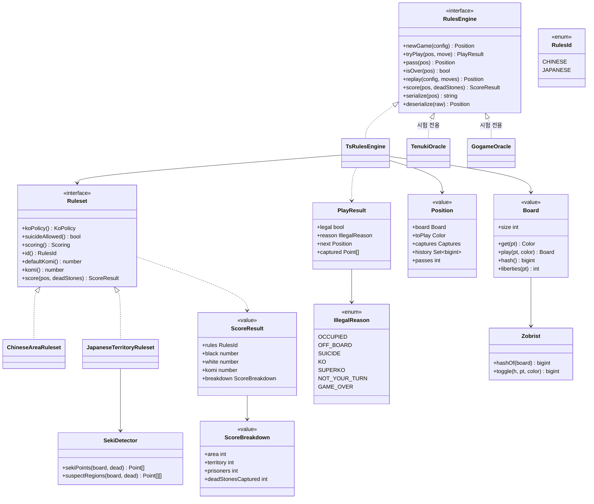

- `replay(config, moves)` 는 수열 전체를 처음 국면에서 다시 둬 `Position` 을 만든다. **무르기(§4.5)는 되돌림 연산이 아니라 유효 수열을 줄여 재생하는 것**이라 `Board` 에 `undo` 가 없다 — 패 해시 이력(`history`)·포획 수가 항상 재생으로만 만들어져 어긋날 수 없다.
- `Board`·`Position` 은 **불변 값**이다(구조 공유로 복사 비용을 낮춘다). 위치 슈퍼코 검사는 `history: Set<hash>` 한 번의 조회다.
- `TenukiOracle`·`GogameOracle` 은 시험 코드에만 있고 서버 번들에 들어가지 않는다(경계 규칙: `test/` 외 임포트 금지).
- **버전 고정(재생·해시가 시간이 지나도 같은 값을 내도록)**: ① 패키지 상수 `ENGINE_VERSION`(규칙 해석·계가 코드가 바뀌면 올림)을 **대국 시작 시 `game.engine_version` 에 스냅샷**하고, 서버는 그 대국을 항상 같은 버전의 엔진으로 재생한다(이전 버전 엔진은 패키지 안에 남긴다) ② `serialize` 결과는 `{ v: <직렬화 버전>, … }` 로 **직렬화 버전 필드**를 갖고 `deserialize` 는 모르는 `v` 를 거절한다 ③ Zobrist 표는 **고정 시드 상수**(`ZOBRIST_SEED`)로 만든 결정적 표이고 시드를 바꾸면 `ENGINE_VERSION` 을 올린다 ④ 해시(`positionHash`·`history` 원소)는 64비트 값을 **16진 문자열 16자**로 직렬화한다(JSON 에 bigint 를 싣지 않는다) ⑤ 클라이언트 번들의 `ENGINE_VERSION` 이 스냅샷의 `engineVersion` 과 다르면 클라이언트는 **해시 검증을 생략**하고 서버 이벤트·스냅샷만 따른다(불법수·계가 미리보기는 "참고용" 표시).

### 3.5 규칙 세트: 중국식과 일본식 (U11)

| 항목 | 중국식 (`chinese`) | 일본식 (`japanese`) |
|---|---|---|
| 계가 | **영역 계가**: 살아 있는 내 돌 수 + 내 돌에만 둘러싸인 빈 점 | **영역(집) 계가**: 내 집(내 돌에만 둘러싸인 빈 점, 사석 제거 후) + **사로잡은 돌**(대국 중 따낸 돌 + 종국 때 사석으로 표시해 제거한 상대 돌) |
| 사석 | 표시 후 제거, 계가에 포획 수 불필요 | 표시한 사석은 제거하며 **상대의 포획 돌로 가산**하고, 그 자리는 상대의 집이다 |
| 집 안쪽에 둔 수 | 영역에서 돌이 되므로 득실 0 | 집이 줄어 **1집 손실**(착수한 돌은 점수가 아님) |
| 시키(seki) | 영역 정의에 따라 계산(공유 활로의 빈 점은 두 색에 접하므로 어느 쪽 영역도 아님) | **시키 안의 빈 점은 누구의 집도 아니다**(돌은 생존) |
| 덤 기본값 | 7.5 | **6.5 (제안 — 관행값이며 공식 규정으로 확인하지 못했다)** |
| 자충 | 금지(다석 자충 포함) | 금지 |
| 패 | **위치 슈퍼코** | **위치 슈퍼코**(제안) — 실제 일본 규정은 3패·장생을 무승부(무효국)로 다루지만 이 설계는 **무승부·무효국 결과를 구현하지 않고** 순환 착수를 거절한다. 대국 설정 화면에 고지한다 |
| 종국 | 연속 패스 → `scoring` → 사석 합의 | 같음(합의 단계가 이미 있다, §4.2) |
| 계가 합의 실패·시한 경과 | **기본 판정 없음**(D3, 2026-11-05) — 착수를 재개해 실제 착수로 분쟁을 푼다(§4.2) | 같음. 단 분쟁 재개 중 자기 집 안에 둔 수의 감점 처리는 **규정서 확인 필요**(아래) |
| 중립점·시키 표시 | 엔진 계산 그대로(영역 정의상 시키 빈 점은 자동으로 어느 쪽도 아님) | 사석과 함께 **중립점(시키 안 빈 점)을 사람이 표시**할 수 있고 표시가 `SekiDetector` 결과보다 우선한다(§4.2 `scoreHash`) |

**일본식 계가 절차 (`JapaneseTerritoryRuleset.score`)**
1. 합의된 사석 집합을 판에서 제거하고, 제거한 돌 수를 **상대의 `deadStonesCaptured`** 에 더한다.
2. `prisoners = 대국 중 포획 수(Position.captures) + deadStonesCaptured`.
3. `SekiDetector` 가 시키 안의 빈 점을 찾아 집 후보에서 뺀다. 나머지 빈 영역은 **한 색의 돌에만 접하면 그 색의 집**, 두 색에 접하면 중립이다.
4. 점수 = `territory + prisoners`(색별), 흑 − 백 − 덤으로 승패를 낸다. 반환하는 `ScoreResult.breakdown` 에 내역을 싣는다(UI 표시·분쟁 확인용).
- **시키 판정(`SekiDetector`)은 보수적 정의로 시작한다**: 서로 다른 색의 두 그룹이 활로를 공유하고, 어느 쪽도 상대 활로를 메우는 수가 자신의 자충 또는 선수 포획 당함으로 이어지는 형태. 한 눈이 시키 안에 있는 경우(눈 자리 빈 점을 집으로 셀지)와 복잡한 다중 그룹 시키는 **규정 해석이 갈리는 영역이라 착수 시 규정서로 확인한다(미확인)**. 확인 전에는 사석 합의 단계(사람 합의)가 최종 안전장치다.
- **교정 경로(B7)**: 판정기가 시키를 놓치거나 잘못 잡아도 사람이 고칠 수 있어야 한다. ① 일본식 사석 표시는 `dead[]` 와 함께 `neutral[]`(중립점·시키 안 빈 점)을 받고, 표시가 `SekiDetector` 결과보다 우선한다 ② `SekiDetector.suspectRegions` 가 보수적 정의보다 **넓게** 잡은 "시키 의심 모양"이 있으면 화면에 경고하고, 그 대국의 사석 표시 요청은 `sekiReviewed: true` 가 없으면 `422 seki_review_required` 로 거절한다(사람이 의심 영역을 보고 중립 여부를 정했다는 신고) ③ 계가 확인은 사석·중립 표시와 점수 내역을 묶은 **`scoreHash`** 에 대해 한다(§4.2) — 양측이 같은 숫자를 보고 확인한다 ④ 판정기 신뢰도(규정서 확인·시키 시험 세트·`tenuki` 차분)가 확인되기 전 **일본식 레이팅 대국은 보상에서 제외**한다(§10.3, 제안).
- **재개 중 수의 불이익(규정서 확인 필요)**: 일본식은 분쟁 후 재개된 대국에서 둔 수(특히 사석을 따내려고 **자기 집 안에 둔 수**)에 대한 감점 처리 규정이 따로 있다. D3 로 분쟁을 실제 착수로 풀게 되었으므로 이 처리가 결과에 직접 영향을 주지만, **규정서로 확인하기 전에는 구현하지 않고** 현재 계가 규칙(착수한 돌은 점수가 아님, 자기 집 안 착수는 1집 손실)을 그대로 적용한다. 이 미확인이 남아 있는 동안 일본식 레이팅 대국의 보상 제외(위 ④)가 함께 유지된다. 규정 확인과 구현 여부는 미결(§19).
- **중국식은 이전 설계와 같다**(회귀 시험으로 동일성을 고정한다). 일본식 추가가 중국식 점수·합법성에 영향을 주지 않는다 — 합법성 판정(`tryPlay`)은 규칙과 무관하게 공통이고 **규칙이 달라지는 곳은 `score` 와 덤 기본값뿐**이다.
- **규칙은 대국 안에서 바뀌지 않는다.** 재개(`ResumePlay`)·무르기에도 `rules` 는 유지된다.

---

## 4. 대국 도메인 모델과 상태 머신

### 4.1 엔티티와 값 객체

| 이름 | 종류 | 설명 |
|---|---|---|
| `Room`(도전/방) | 집합체 | 대국을 만들기 전 로비 항목: 판 크기, **규칙(`rules`: `chinese`·`japanese`)**, 시간 설정, 레이팅 여부, 공개/초대, 개설자(GitHub 로그인 사용자) |
| `Game` | 집합체 루트 | 한 판. `version`(= 마지막 `seq`), **`boardVersion`**(판 버전, 아래), `eventSeq`, 상태, 현재 국면, 시계, 참가자 2명, 결과, `engineVersion` |
| `GameEvent` | 도메인 이벤트(추가 전용 로그 행) | `seq` 순서: `started`, `move_played`, `passed`, `resigned`, `timed_out`, **`undo_requested`, `undo_accepted`, `undo_declined`**, `scoring_started`, `dead_marked`, `score_confirmed`, `resume_requested`, `resume_accepted`, `play_resumed`, `scoring_timed_out`, **`clock_adjusted`**, `finished`, `abandoned` (`scoring_timed_out` 은 **scoring 시한 경과 표식이며 종국 사유가 아니다** — 같은 tx 의 `play_resumed` 로 착수가 재개된다(D3). 시계 패배의 `timed_out` 과 구분한다. `clock_adjusted` 는 정비·장애 구간 시계 보정, §4.3) |
| `Participant` | 값 | 색, `user_id`(**GitHub 로그인 사용자만 — 익명 세션은 플레이어가 될 수 없다**, U21), 접속 상태, 남은 시간 |
| `TimeControl` | 값 객체 | `byoyomi`(주 시간 + 초읽기 횟수 × 초) 또는 `fischer`(주 시간 + 증분) |
| `Move` | 값 | `(color, point | pass)`, `moveId`(멱등) |

### 4.2 대국 상태 머신

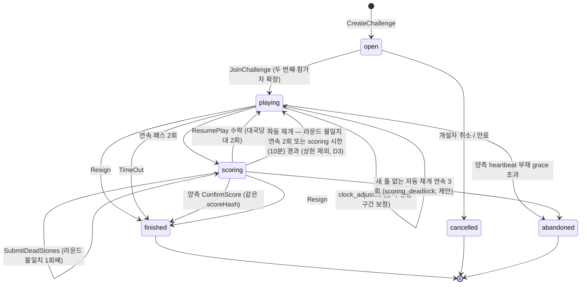

- 전이는 모두 **`game` 행 `FOR UPDATE` 아래 조건 재평가 + 조건부 갱신(CAS)** 이다. 같은 국면에서 동시에 일어나는 두 전이(착수와 시간 초과, 기권과 상대 착수)는 먼저 커밋된 쪽만 성공한다. **`game.version` 은 마지막 `game_event.seq` 와 같다**(S11). 종국 전이는 사유 행(`resigned`/`timed_out`/`score_confirmed`…)과 `finished` 행을 **같은 트랜잭션**에 쓰므로 한 번의 종국 전이로 `seq`·`version` 이 **+2** 된다(`FinalizeGame` 은 별도 tx 가 아니라 같은 tx 안의 단계다).
- **경합 판정은 `seq` 가 아니라 판 버전(`board_version`)으로 한다 (B3)**. `seq` 는 상대의 무르기 요청·거절, 사석 표시, 재개 요청, 시계 보정처럼 **내 수의 유효성과 무관한 이벤트**에도 오르므로, `seq` 로 CAS 를 걸면 제시간에 차례를 지켜 둔 착수가 `version_conflict` 로 지고 재동기화하는 사이 시간을 잃는다. 그래서 `game.board_version` 을 따로 둔다 — **국면·차례·단계를 바꾸는 명령(또는 시스템 전이) 한 번마다 +1** 되는 단조 카운터다(`move_played`·`passed`(→`scoring_started` 포함)·`undo_accepted`·`play_resumed`). `undo_requested`·`undo_declined`·`dead_marked`(자동 재개를 일으키지 않는 것)·`resume_requested`·`clock_adjusted` 는 올리지 않는다. 무르기로 유효 수열 번호 `ply` 가 줄어도 `board_version` 은 줄지 않으므로 ABA 가 없다. 명령별 조건은 §5.2 표이고, 요지는 착수·패스 = `status='playing' AND turn=색 AND board_version=expectedBoardVersion`, 기권 = `status IN (playing, scoring)`(버전 무관), 무르기·재개 응답 = 대기 요청의 `requestSeq` 일치, 계가 명령 = `status='scoring' AND board_version=expectedBoardVersion` 이다. 불일치는 `version_conflict`(`details.current`: `seq`·`boardVersion`·`status`), 이미 끝난 대국은 `game_over` 다(§5.2).
- 무르기(`undo_*`)는 **상태(`status`)를 바꾸지 않는다** — `playing` 안에서 국면(유효 수열)만 바뀌는 자기 전이이고 `seq`·`version` 은 항상 +1 이상이다(`board_version` 은 수락 때만 +1). 세부는 §4.5.
- `finished` 와 `abandoned` 는 종결 상태다. 결과는 **불변**이다(ADR-009). 이후 분석은 보상 상태만 바꾼다.
- **계가와 재개 규칙(S9, ADR-035)**
  - **표시와 `scoreHash`(B7)**: `scoring` 에서는 양측이 `SubmitDeadStones` 로 사석(`dead[]`, 일본식은 중립점 `neutral[]` 포함, §3.5)을 표시한다. 서버는 그 표시로 `Ruleset.score` 를 계산하고 **`scoreHash` = H(`rules`·`komi`·정렬된 `dead`·정렬된 `neutral`·`breakdown`·결과)**(16진 문자열)를 `dead_marked` 페이로드에 싣는다. 양측의 최신 표시가 같은 `scoreHash` 이면 **일치**이고, 양측이 그 `scoreHash` 로 `ConfirmScore` 하면 종국한다(다른 해시로 확인하면 `409 mark_mismatch`). 확인 대상이 사석 집합이 아니라 점수 내역까지 묶은 해시이므로, 판정기가 시키·집을 잘못 셌더라도 양측이 **같은 숫자를 본 뒤에만** 결과가 확정된다.
  - **불일치와 자동 재개 — "연속 2회"로 통일**: 라운드는 양측이 표시를 한 번씩 낸 시점에 닫힌다(같은 라운드 안에서 같은 쪽의 재제출은 자기 표시를 바꿀 뿐 세지 않는다). 닫힌 라운드의 `scoreHash` 가 다르면 불일치 카운터 +1, 같으면 0 이다. **연속 2회 불일치**면 두 번째 라운드를 닫은 `dead_marked` 와 같은 tx 에서 `play_resumed { by: 그 표시를 낸 색 }` 으로 **자동 재개**한다. 카운터는 재개 때 0 으로 초기화된다.
  - **요청 재개**: 어느 쪽이든 `ResumePlay` 를 요청할 수 있으나 **상대의 수락**(`resume-accept`)이 있어야 재개된다(일방 요청 재개 불가). **재개 상한(대국당 2회)은 이 요청·수락 재개에만 적용**하고, **자동 재개(불일치 연속 2회·시한 경과)는 상한에서 제외**한다(D3, 2026-11-05) — 분쟁은 상한과 무관하게 언제나 실제 착수로 풀 수 있어야 하기 때문이다. 이전 설계의 "상한 소진 뒤에는 자동 재개 없이 시한 경과 종국"은 폐기했다.
  - **`seq` 소비**: `resume-requests`(`resume_requested`)·`resume-accept`(`resume_accepted`+`play_resumed`, seq +2)·`dead-marks`(`dead_marked`, 자동 재개를 일으키면 +`play_resumed` 로 seq +2)는 각각 `game_event` 행을 쓰므로 **`version`/`seq` 를 소비**한다. 시한 경과는 `scoring_timed_out`+`play_resumed` 로 seq +2 이다(S11). `play_resumed` 는 outbox 이벤트 `game.play_resumed {gameId, seq, by}` 로, `scoring_timed_out` 은 `game.scoring_timed_out {gameId, seq}` 로도 발행한다(§12, P0 §8.3).
  - 계가는 대국의 `rules`(§3.5)로 한다. `scoring` 중에는 무르기를 쓸 수 없다(`not_playing`). 재개 뒤의 무르기는 **마지막 `play_resumed` 이후의 수만** 되돌린다(§4.5).
  - 재개 후 선수는 **마지막으로 패스한 쪽의 상대**다(접기에서 `play_resumed` 는 연속 패스 카운트를 0 으로 되돌리는 표식이고 차례는 그대로다). 착수 시계는 `scoring` 중 정지하고, 재개 시 `turn_started_at` = 재개 시각으로 이어서 흐른다.
  - **scoring 시한 경과 — 기본 판정 없음 (D3, B1)**: `scoring` 시한(제안 10분, scoring 에 들어갈 때마다 새로 시작)이 지나면 `TimeoutSweeper` 가 `scoring_timed_out` + `play_resumed { by: null }`(시스템)로 **착수를 재개**한다. 이전 설계의 "사석 제거 없이 모든 돌 생존으로 계가"는 **사석 주인에게 지연할 이유를 주었으므로**(합의를 미루면 죽은 돌이 산 돌로 계가됨) 폐기했다. 이제 합의를 미뤄도 얻는 것이 없다 — 재개 뒤에는 시계가 흐르고, 상대는 실제 착수로 사석을 따낼 수 있으며, 자리를 비운 쪽은 자기 시계로 시간패한다. 시한 경과를 **한 번이라도 거친 대국**(`game.scoring_timeouts > 0`)의 종국을 "시한 경과 종국"이라 부르고, **레이팅 대국이면 보상에서 제외하고 감사 `system.game_scoring_timed_out` 을 남긴다**(§10.3). `pf_game_finished_total` 에는 `reason` 레이블로 종국 사유를 남긴다(§16.1).
  - **교착 방어 (제안, 사용자 확인 필요)**: 자동 재개는 상한이 없으므로, 재개 뒤 **새 돌 없이(패스만으로)** 다시 `scoring` 에 들어와 또 자동 재개되는 일이 **연속 3회**(제안)면 `abandoned { reason: "scoring_deadlock" }`(무효, 보상 없음, 감사)로 닫는다. 실제 착수로도 풀 수 없는 주장(상대의 산 돌을 사석이라 우기기)을 반복해 상대가 지쳐 이탈 → 시간패하게 만드는 것을 막는다. 값·채택은 미결(§19).

### 4.3 시간 제어

| 방식 | 파라미터 | 동작 |
|---|---|---|
| 초읽기(byo-yomi) | 주 시간 M, 횟수 N, 1회 P초 | 주 시간 소진 후 N 번의 P 초. 착수가 P 초 안이면 그 횟수는 유지, 초과하면 1회 소모, 횟수 소진 시 패배 |
| 피셔(Fischer) | 주 시간 M, 증분 I | 착수마다 I 초 가산, 0 이 되면 패배 |

- 시계 상태(`time_ms[B,W]`, `period_left`, `turn_started_at`, `deadline_at`)는 `game` 행에 영속한다.
- **서버가 정본**이다. 서버는 `Clock` 포트의 **벽시계 기반 `now()`**(`Date.now()` 계열) 로 착수 수신 시각을 정하고 `clock` 메시지를 보낸다. 클라이언트는 받은 값에서 **로컬 보간**만 한다(표시용). 클라이언트 시각을 판정에 쓰지 않는다.
- 착수 시각은 `api` 가 **요청 수신 시점(`receivedAt`)에 서버 시계로 확정**한다. REST 전송 지연의 책임 소재와 지연 보상 정책(`lagGrace`, 제안 0.3초 가산)은 **§5.9** 가 정한다. 지연을 상대에게 전가하지 않는다는 원칙을 지킨다.
- **무르기는 시계를 되감지 않는다**(§4.5): 이미 쓴 시간·소모한 초읽기 횟수는 그대로이고 유효 수열만 줄어든다. 무르기 요청이 대기 중인 동안에도 시계는 현재 차례 쪽에서 계속 흐른다. **수락 시 정산 규칙(B10)**: 수락 시각 `t` 에 ① 그때 시계가 흐르던 쪽(현재 차례)의 경과 `t − turn_started_at` 을 그 쪽에 착수와 같은 방식으로 청구하되 **증분·`lagGrace` 는 주지 않는다**(수락은 착수가 아니다) ② 제거되는 각 수가 받았던 **피셔 증분을 그 수의 색에서 회수**한다(0 아래로는 내리지 않으며, 0 이 되면 그 색은 남은 시간 0 으로 이어서 시간 초과 규칙을 따른다 — 요청 화면에 회수량을 미리 보인다) ③ 초읽기 횟수·주 시간 소모분은 복원하지 않는다 ④ 차례 = 요청자, `turn_started_at = t`, `deadline_at` 은 **요청자의 남은 시간(주 시간·초읽기 상태)으로 다시 계산**한다. 결과로 "두 색에 청구된 경과의 합 = 착수 중 벽시계 시간(계가·정지 구간 제외)"이 무르기 전후로 보존된다(속성 시험, AC-BD-29).
- **정비·장애 구간 시계 보정 (`clock_freeze`, B4)**: 라이브 `api` 는 Compose 단일 인스턴스라 재배포·장애 동안 착수를 받을 수 없는데 시계는 흐른다. ① **계획 정비**: 배포 스크립트가 `api` 를 내리기 전에 `game.clock_freeze`(`kind=planned`, `started_at`)를 기록하고, 새 `api` 의 readyz 가 통과하면 `ended_at` 을 기록한다 ② **계획 외 장애**: `api` 가 5초(제안)마다 갱신하는 생존 신호(`game.api_liveness.last_beat_at`)가 15초(제안) 넘게 끊기면 worker 가 `kind=detected` freeze 를 `started_at = 마지막 신호 시각` 으로 열고, 신호가 돌아오면 닫는다(DB 장애도 신호가 끊기므로 같은 경로) ③ 열린 freeze 가 있거나 생존 신호가 신선하지 않으면 `TimeoutSweeper` 는 시간 초과·무르기 만료·scoring 시한을 **선언하지 않는다** ④ freeze 가 닫히면 `ClockFreezeCompensator`(worker)가 진행 중(`playing`·`scoring`) 대국마다 한 tx 로 `deadline_at`·`turn_started_at`·scoring 시한·`pending_undo.expiresAt` 을 `shiftMs = ended_at − max(started_at, turn_started_at)` 만큼 미루고 `clock_adjusted { shiftMs, cause: planned|detected, freezeId }` 를 기록한다(seq +1, `board_version` 불변, `move_id` = `freezeId` 에서 만든 결정적 uuid 라 `UNIQUE (game_id, move_id)` 로 멱등). outbox 로 `game.clock_adjusted` 도 발행한다 ⑤ freeze 가 30분(제안)을 넘으면 보정하지 않고 복구 런북으로 진행 중 대국을 `abandoned { reason: "outage" }`(무효, 보상 없음)로 일괄 종료한다(§15).
- 서버 타임스탬프는 `Date.now()` 계열을 쓴다(`performance.timeOrigin + performance.now()` 는 이 호스트에서 벽시계와 어긋남이 관찰됨 — 실측).

### 4.4 도메인 클래스

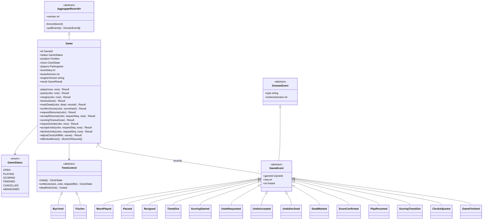

- `Game.play()` 는 `RulesEngine.tryPlay` 결과가 합법일 때만 `MovePlayed` 를 기록한다. 도메인 서비스(`GameStateMachine`)가 전이를 판정하고, `Game` 은 불변식(차례, 상태, 시계)을 지킨다.
- `Game.effectiveMoves()` 는 `game_event` 를 `seq` 순으로 접어(§4.5 접기 규칙) **유효 수열**(착수·패스와 재개 표식 `resume`)을 만든다. 현재 국면(`position`)은 항상 이 수열의 재생과 같아야 하며 이것이 재생 동등성 시험(AC-BD-22)의 대상이다.
- `GameEvent` 는 **두 얼굴**을 가진다: ① 대국별 `seq` 의 추가 전용 로그 행(동기화·재생의 정본) ② outbox 에 실리는 `DomainEvent`(투영·분석·보상용). 같은 클래스가 두 곳에 쓰이되 outbox 에는 `game.<verb-past>` 이름으로 발행한다(§12).

### 4.5 무르기 (undo, U11)

**원칙: 상대의 동의가 있어야만 되돌려지고, 되돌림은 로그를 고치지 않고 새 이벤트로 남긴다.** `game_event` 는 추가 전용이고 `game.version == 마지막 game_event.seq`(S11)는 그대로다 — 무르기가 일어나도 `seq` 는 **줄지 않고 증가**한다.

| 항목 | 규칙 (값은 모두 제안, 미측정) |
|---|---|
| 허용 대국 | **비레이팅 대국만.** 레이팅(보상) 대국은 `403 undo_not_allowed`. 이유: 보상·분석(AN)은 레이팅 대국에만 있고, 무르기는 수 일치율 분석과 보상 파밍 방어(§8)를 약하게 만든다 |
| 요청 자격 | `playing` 상태(`scoring` 에서는 `409 not_playing`), 참가자, 유효 수열의 **마지막 재개 표식 이후에 자기 착수가 1수 이상**(없으면 `409 nothing_to_undo`), 대기 중 요청이 없을 것(`409 undo_pending`), 요청 본문의 `expectedBoardVersion` 이 현재 판 버전과 같을 것(되돌릴 범위가 요청자가 본 국면 기준이 되도록) |
| 되돌릴 범위 | **요청자의 마지막 착수 직전 국면**으로 간다. 요청자의 마지막 수가 최신이면 1수(상대 차례였음), 상대가 그 뒤에 한 수 뒀으면 2수를 되돌린다. 어느 경우든 되돌린 뒤 **차례는 요청자**다. 패스도 수로 센다. **마지막 `play_resumed` 표식을 넘어 되돌리지 않는다**(계가 단계로 되돌아가는 일이 없다, B6) |
| 횟수 상한 | 대국당 **플레이어별 요청 3회**(수락 여부와 무관하게 센다 — 반복 요청 방지). 초과는 `409 undo_limit` |
| 응답 제한 시간 | **30초**. 만료는 `TimeoutSweeper` 가 `undo_declined { reason: "expired" }` 를 기록한다. 응답자는 `undo-accept` 또는 `undo-decline` 을 보낸다 |
| 자동 철회 | 대기 중 **어느 쪽이든 착수·패스·기권**을 하면 요청은 `undo_declined { reason: "superseded" }` 로 닫히고 같은 트랜잭션에서 그 명령이 이어진다(seq +2). 기권·시간 초과도 마찬가지로 요청을 닫는다 |
| 시계 | **되감지 않는다**(B10). 수락 시각 `t`(`receivedAt`)에 시계가 흐르던 쪽(현재 차례 — 1수 되돌림이면 응답자, 2수면 요청자)의 경과를 그 쪽에 착수처럼 청구하되 증분·`lagGrace` 없음, 제거되는 수가 받은 **피셔 증분은 그 수의 색에서 회수**(0 하한), 초읽기 횟수·주 시간은 복원하지 않음, 차례 = 요청자, `turn_started_at = t`, `deadline_at` 은 요청자의 남은 시간으로 재계산한다(§4.3). 정산 뒤 시계 값은 `undo_accepted.clock` 에 싣는다 |
| 보상 자격 | 비레이팅 대국은 애초에 보상이 없다. 방어적 중복으로 `game.finished` 에 `undoCount` 를 싣고 `EligibilityPolicy` 가 `undoCount = 0` 을 요구한다(§10.3) |
| 분석 입력 | 분석은 레이팅 대국만 하므로 무르기가 없는 것이 정상이다. 그래도 분석기에는 항상 **유효 수열**(접기 결과)을 넘긴다(§9.4) |

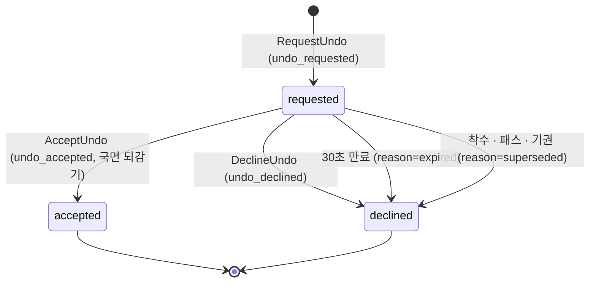

**이벤트와 접기 규칙** — 로그는 아래 세 이벤트를 더할 뿐이고 `move_played` 행은 지워지지 않는다.

| `type` | 페이로드(공개 가능한 값만) | `version`/`seq` | 효과 |
|---|---|---|---|
| `undo_requested` | `by`(색), `toPly`(되돌아갈 수 번호), `expiresAt` | +1 | `game.pending_undo` 설정 |
| `undo_accepted` | `by`(수락한 색), `requestSeq`, `toPly`, `removed`(제거되는 수의 `ply`·색·좌표), **`restored`**(제거되는 수가 따냈던 돌, 되살아나는 돌의 좌표·색), **`captures`**(되돌린 뒤 색별 포획 수), `toPlay`, `positionHash`(16진 문자열), `clock`(정산 뒤 시계) | +1 (`board_version` +1) | 유효 수열을 `toPly` 까지로 줄이고 `position`·`turn` 을 재생으로 갱신, `pending_undo` 해제. 이력을 갖지 않은(스냅샷으로 입장한) 클라이언트도 `removed`·`restored`·`captures` 만으로 판을 고칠 수 있다(B11) |
| `undo_declined` | `reason`(`declined`·`expired`·`superseded`), `by`(`declined` 일 때 거절한 색), `requestSeq` | +1 | `pending_undo` 해제 |

- **접기(fold)**: `move_played`/`passed` 는 유효 수열 끝에 붙고(`ply` = 유효 수열 길이 + 1), `undo_accepted` 는 유효 수열을 `toPly` 로 자른다. **`play_resumed` 는 유효 수열에 `resume` 표식을 붙인다(B6)** — `ply` 를 소비하지 않고, `replay` 는 이 표식에서 **연속 패스 카운트를 0 으로 되돌리며**(차례는 그대로), 무르기는 마지막 표식을 넘지 않는다. 표식이 없으면 "패스·패스 뒤 착수"가 불법(`GAME_OVER`)으로 재생되어 재개된 대국의 재생 동등성이 깨진다. `scoring_started`·`dead_marked`·`resume_requested`·`resume_accepted`·`scoring_timed_out`·`clock_adjusted`·`undo_requested`·`undo_declined` 는 유효 수열에 영향이 없다. 서버·클라이언트·분석 입력·SGF 내보내기는 **같은 접기 함수**(`foldMoves`)를 쓴다(`game` 도메인 서비스, `baduk-rules` 의 `replay` 로 국면을 만든다). SGF·KataGo 질의로 바꿀 때는 `resume` 표식을 빼고 착수·패스만 넘긴다.
- **접기 검증(2026-11-05, 보드 없는 모형 시뮬레이션, 저장소 밖 스크립트)**: 착수·패스·무르기(요청·수락·철회)·자동 재개·시계 보정이 섞인 무작위 이벤트열 20,000개에서 로그만 보고 접은 결과(유효 수열·연속 패스·차례·상태·마지막 재개 위치)가 명령별 증분 상태와 매 단계 일치했고, 무르기 수락 정산(경과 청구·피셔 증분 회수) 뒤 색별 "남은 시간 = 초기 + 유효 수열 증분 + grace 크레딧 − 청구 경과(+0 하한으로 못 거둔 회수분)"와 "두 색 청구 합 = 착수 중 벽시계(계가·정지 구간 제외)"가 모두 성립했다(작은 초기 시간에서 0 하한 회수 1,005건 포함). 구현 시 같은 성질을 `baduk-rules`·`game` 속성 시험(AC-BD-29·30)으로 옮긴다.
- **`move_played` 페이로드에 `ply`(유효 수열 번호)를 싣는다.** `seq` 는 로그 순번이고 `ply` 는 대국 수 번호이며 무르기 뒤에는 둘이 달라진다. `toPly` 가 가리키는 대상이 모호하지 않게 하는 필드다.
- **기존 응답 규칙 유지**: 명령 응답은 `{ event, seq }` 이고 요청자는 응답으로 즉시 반영, 뒤따르는 push 의 같은 `seq` 는 중복 제거한다. 멱등은 `Idempotency-Key`(= `game_event.move_id`)다.
- **보관**: 무르기 이벤트는 해당 `move_played` 와 같은 `game_event` 보관 규칙을 따른다(비레이팅은 종료 후 30일, §11.4). SGF 는 유효 수열만 담는다(§6).

---

## 5. 서버 권위 프로토콜 (REST 명령 + `/ws/room` push, ADR-035)

### 5.1 원칙과 연결 모델

**대국 명령(착수·패스·기권·무르기 요청/응답·사석 표시·계가 확인·재개)은 전부 REST 로 받는다.** 쓰기 경로는 `api` 한 곳이다(P0 D8, ADR-018, 채팅 [ADR-045](../../adr/ADR-045-chat-message-delivery.md) 와 같은 원칙). `ws-gateway` 는 **읽기·push 전용**이며 대국 상태를 쓰지 않는다.

| 항목 | 규칙 |
|---|---|
| 명령 경로 | 클라이언트 → `POST /api/games/{id}/…`(§5.2, `Idempotency-Key` = 명령 id = `moveId`) → `api` 가드 체인 → 명령 usecase → **한 트랜잭션**으로 `game`(CAS) + `game_event` + outbox + `pg_notify('room_changed')` |
| push 경로 | 커밋 때 전달되는 `NOTIFY room_changed` 로 `ws-gateway` 가 깨어남 → `RoomEventSource.after(room, lastSent)` 로 `game_event` 조회 → 방 구독자에게 push (§5.10). 읽기 모델 투영(`game_view`, 로비)은 outbox 경로(비동기) |
| 엔드포인트 | `/ws/room` — 세션 쿠키 필수(익명 세션 포함: **익명 세션은 관전 구독만 가능**하다, 아래 "익명 세션의 경로"). 없으면 업그레이드 단계에서 `401`. `Origin` 검사는 04 와 같다 |
| 연결 시점 | 대국/관전 화면에 들어갈 때(사이트 최초 진입 시가 아님). 한 연결에 방 여러 개 구독 가능(P0 §6.8: 연결당 최대 8) |
| 방 키 | P0 §6.3 `<type>:<uuid>`: 대국 룸 `game:<gameId>`. 대국 채팅 룸은 `chat:<chatRoomId>`(chat 소유의 별도 uuid; players/spectators 두 개가 game 에 연결됨, 04 정본) — `chat:game:<id>` 표기는 폐기 |
| 구독 권한 | `RoomAccessPolicy`(**realtime 소유 포트**, P0 §6.6)를 `game` 모듈이 `GameRoomPolicy` 로 구현해 조립부(compose)에서 등록한다: 공개 대국은 익명 세션을 포함해 누구나 관전, 비공개는 초대 토큰 해시 검증, 플레이어는 참가자 확인(`role` = `black`·`white` 는 GitHub 로그인 사용자의 참가자 행이 있을 때만) |
| 인바운드 허용 목록 | `hello`, `room.join { room, resume? }`, `room.leave { room }`, `ping`, 그리고 채팅 휘발성 `typing`(P4). **이 밖의 인바운드(`move` 포함)는 처리하지 않고** `room.error { code: inbound_not_allowed }`, 반복되면 `4400`. **구독 속도는 P0 §6.8 값(초당 5회)을 정본으로 하며 초과 시 `4429`** (연결당 클라이언트 메시지 초당 10건 한도는 M1 04 와 같다) |
| 봉투 | P0 §6.3 과 같다 `{v, t, ch:"room", rm:"game:<id>", seq?, ts, d}`. `seq` 는 대국별 단조 증가(= `game_event.seq`) |
| 하트비트·유휴·백프레셔 | 04 §1·§6 의 규칙(hb 25초, 송신 큐 64건/256KB, 4408) 그대로 |

**익명 세션의 경로 (U21, 2026-11-05)**: **플레이어는 레이팅·비레이팅 모두 GitHub 로그인 사용자뿐**이고 익명 세션은 **관전만** 한다. 익명 세션은 M1 규칙대로 사이트 진입 시 `/ws/private`(자기 흐름 전용, M1 04)에 연결되고, 공개 대국을 볼 때 `/ws/room` 에 연결해 `room.join` 으로 **관전 구독(`role = spectator`)** 만 한다. 두 연결 모두 대국 상태를 쓰지 않으며(WS 는 push 전용) 도전 개설·수락·착수·무르기 등 모든 대국 명령 REST 는 가드 `RequireUser` 에서 `403 login_required` 로 거절된다. 익명 관전자가 대국에 참여하려면 로그인(GitHub OAuth) 후 도전을 만들거나 수락해야 하고, 로그인으로 세션이 회전하면 이전 익명 세션의 소켓은 서버가 `4401` 로 닫는다(M1 04). 이전 설계의 "익명 비레이팅 대국"은 **폐지**되었다.

### 5.2 REST 명령 API (정본 계약)

모든 쓰기 요청: `Idempotency-Key`(uuid, = `moveId`) 필수, `Origin` 검사, 세션 쿠키, JSON 전용 — M1 03 §1 규약 그대로. 경합 판정의 기준은 명령마다 아래 표의 "조건"이다(§4.2, B3).
- **판 버전 기준**: 착수·패스·무르기 요청·계가 명령(사석 표시·계가 확인·재개 요청)은 **`expectedBoardVersion`**(= 클라이언트가 마지막으로 본 `game.board_version`)을 싣는다. `seq` 가 아니라 판 버전으로 비교하므로 **상대의 무르기 요청·거절, 사석 표시, 시계 보정이 끼어들어도 제시간에 차례를 지켜 보낸 착수는 지지 않는다.** 무르기·재개 **응답**은 대기 중인 요청의 `requestSeq` 를 싣는다. 기권은 버전을 보지 않는다(상태와 무관한 의사 표시 — 내부 재시도가 필요 없다).
- 경합에서 지면 M1 의 코드 **`version_conflict`**(`details.current`: `seq`·`boardVersion`·`status`)를 돌려주고, 대국이 이미 끝났으면 **`game_over`**(`details.reason`: `timeout`·`resigned`·`score`·`abandoned`)를 돌려준다. `stale` 은 쓰지 않는다.
- **최초 수신 시각(`first_received_at`) 보존**: 가드 체인을 통과한 명령은 본 트랜잭션보다 먼저 **별도의 짧은 tx** 로 `game.command_receipt (game_id, move_id, request_hash, first_received_at)` 를 `INSERT … ON CONFLICT DO NOTHING` 하고 저장된 값을 읽는다. 본 tx 는 이 **`first_received_at` 을 `receivedAt` 으로 쓴다** — 정시에 받은 착수가 락 대기·`lock_timeout`·커밋 실패로 롤백된 뒤 같은 키로 재전송돼도 처음 수신 시각으로 판정된다(본 tx 와 같은 tx 였다면 롤백과 함께 사라졌다). `request_hash` 가 다르면 `422 idempotency_key_reuse` 라 "먼저 키만 찍고 수를 나중에 고르는" 악용은 안 된다. 스윕은 `commitMargin` 만큼만 기다리므로 그 뒤의 재전송은 보호하지 않는다(§5.5).
- **공통 시간 초과 가드(기권 제외)**: `playing` 에서 받은 모든 플레이어 명령(착수·패스·무르기 요청·수락·거절)은 먼저 `receivedAt > 현재 차례의 deadline_at + lagGrace` 인지 본다. 넘었으면 그 명령을 처리하지 않고 **현재 차례 쪽의 시간 초과 전이**(`timed_out`+`finished`)를 기록한 뒤 `409 game_over(timeout)` 로 응답한다 — 시간이 다 된 쪽이 무르기 수락(차례·`turn_started_at` 이 바뀜)으로 시계를 되살리는 경로를 막는다. `scoring` 의 명령은 시계가 정지 중이라 대상이 아니고(시한은 스윕이 처리), 기권은 언제나 받는다.

| 메서드·경로 | 인증 | 본문 | 조건(행 잠금 아래 재평가) | 성공 | 오류(wire code) |
|---|---|---|---|---|---|
| `POST /api/games/{id}/moves` | 해당 대국 참가자(로그인) | `{ x, y, expectedBoardVersion }` | `status='playing'` · `turn`=내 색 · `board_version` 일치 · 공통 시간 초과 가드 | `200 { event, seq, boardVersion, clock }` | `422 illegal_move`(`details.reason`: `occupied` · `suicide` · `ko` · `superko` · `out_of_bounds`(= 엔진 `OFF_BOARD`)) · `409 not_your_turn` · `409 version_conflict`(`details.current`) · `409 game_over` · `403 not_player` · `429 rate_limited` |
| `POST /api/games/{id}/pass` | 참가자 | `{ expectedBoardVersion }` | 위와 같음 | `200 { event, seq, boardVersion, clock }` | 위와 같음 |
| `POST /api/games/{id}/resign` | 참가자 | `{}` | `status IN ('playing','scoring')` 만(차례·버전 무관) | `200 { event, seq }` | `409 game_over` · `403 not_player` |
| `POST /api/games/{id}/dead-marks` | 참가자(`scoring`) | `{ dead[], neutral[]?(일본식), sekiReviewed?, expectedBoardVersion }` | `status='scoring'` · `board_version` 일치 | `200 { event, seq }` (`dead_marked` 에 `scoreHash`·`breakdown`; 두 번째 연속 불일치면 같은 tx 에 `play_resumed`) | `409 not_scoring` · `409 version_conflict` · `422 seki_review_required`(시키 의심 모양이 있는데 `sekiReviewed` 없음, §3.5) · `409 game_over` |
| `POST /api/games/{id}/score-confirmations` | 참가자(`scoring`) | `{ scoreHash, expectedBoardVersion }` | `status='scoring'` · `board_version` 일치 · 양측 최신 표시가 이 `scoreHash` 로 일치 | `200 { event, seq }` | `409 mark_mismatch` · `409 not_scoring` · `409 version_conflict` |
| `POST /api/games/{id}/undo-requests` | 참가자(`playing`, **비레이팅 대국만**) | `{ expectedBoardVersion }` | `status='playing'` · `board_version` 일치 · 대기 요청 없음 · 공통 시간 초과 가드 | `200 { event, seq }` (`undo_requested`; 상대 응답 전에는 되돌려지지 않음) | `403 undo_not_allowed`(레이팅 대국) · `409 not_playing` · `409 undo_pending` · `409 undo_limit`(플레이어별 3회) · `409 nothing_to_undo`(마지막 재개 이후 자기 착수 없음) · `409 version_conflict` |
| `POST /api/games/{id}/undo-accept` | 상대 참가자(대기 요청이 있을 때) | `{ requestSeq }` | `pending_undo.requestSeq` 일치 · `receivedAt ≤ expiresAt` · 공통 시간 초과 가드 | `200 { event, seq, boardVersion, clock }` (`undo_accepted`, 국면 되감기·시계 정산 §4.5) | `409 no_pending_request` · `409 game_over` |
| `POST /api/games/{id}/undo-decline` | 상대 참가자(대기 요청이 있을 때) | `{ requestSeq }` | 위와 같음 | `200 { event, seq }` (`undo_declined`) | `409 no_pending_request` · `409 game_over` |
| `POST /api/games/{id}/resume-requests` | 참가자(`scoring`) | `{ expectedBoardVersion }` | `status='scoring'` · `board_version` 일치 · 수락 재개 2회 미만 | `200 { event, seq }` (요청 기록; 상대 수락 전에는 재개되지 않음) | `409 not_scoring` · `409 resume_limit`(대국당 2회, 자동 재개는 세지 않음) · `409 version_conflict` |
| `POST /api/games/{id}/resume-accept` | 상대 참가자(`scoring`, 요청이 있을 때) | `{ requestSeq }` | `status='scoring'` · 대기 재개 요청의 `requestSeq` 일치 | `200 { event, seq, boardVersion }` (재개, `resume_accepted`+`play_resumed`) | `409 no_pending_request` · `409 not_scoring` |
| `POST /api/games/{id}/heartbeat` | 참가자 | `{}` | — | `204` (`game_player.last_seen_at` 갱신, 20초 간격, 이탈 판정 신호 §5.6) | `403 not_player` · `429` |
| `GET /api/games/{id}` | 열람 권한(공개/참가자/토큰) | — | — | `200 { state, position, moves, clock, players, seq, boardVersion, engineVersion, pendingUndo, scoring }` (`moves` = 유효 수열, `scoring` = 양측 최신 표시·`scoreHash`·시한) | `404`·`403` |
| `GET /api/games/{id}/events?after=&limit=` | 열람 권한 | — | — | `200 { events[], head }` (최대 200건) | 같음 |

- **플레이어 명령 전부(위 표와 `POST /api/challenges`·`…/join`)는 GitHub 로그인 사용자만** 쓸 수 있다. 익명 세션이 호출하면 가드 `RequireUser` 가 `403 login_required` 로 거절한다(U21). 열람(`GET`)과 관전 구독은 익명도 가능하다.
- 공통 오류 코드는 M1 00 §4.3 과 같다: `rate_limited`(429, `Retry-After`), `request_in_progress`(409), `idempotency_key_reuse`(422), `validation_failed`(400), `unauthenticated`(401).
- 성공 응답에 **생성된 이벤트 자체**(`event`)가 들어간다 → 요청자는 즉시 화면에 반영(읽기-내-쓰기)하고, 뒤따르는 push 의 같은 `seq` 는 `SeqTracker` 가 중복으로 버린다.
- 도전 개설·수락·로비는 §5.7, 기보 내보내기는 BD-13 이다.

### 5.3 메시지 (WebSocket)

**클라이언트 → 서버(허용 목록 전부)**

| `t` | 본문 | 설명 |
|---|---|---|
| `hello` | M1 04 와 같다 | 연결 직후 5초 안 |
| `room.join` | `{ room, resume? }` | 방 구독. `resume` 이 있으면 그 `seq` 이후를 재생, 없으면 스냅샷. **이미 구독 중인 방에 다시 보내면** 구독(구독자 집합)을 그대로 둔 채 `resume` 이 있으면 그 이후를 재생하고 없으면 `room.snapshot` 을 다시 보낸다 — 해시 불일치·순번 공백 때의 재동기화 요청이 이 메시지다(B11) |
| `room.leave` | `{ room }` | 구독 해제 |
| `ping` | `{ n }` | 선택 |
| `typing` | (채팅 방 한정, P4) | 휘발성, 대국 판정과 무관 |

**서버 → 클라이언트**

| `t` | 본문 | 설명 |
|---|---|---|
| `room.joined` | `{ room, role, head, mode: live\|replay\|snapshot }` | `join` 응답. `role` = `black` · `white` · `spectator` |
| `room.snapshot` | `{ room, data: { state, position, moves, clock, players, boardVersion, engineVersion, pendingUndo, scoring }, head }` | 현재 국면 전체. 재접속·관전 입장. `moves` 는 **유효 수열**(재개 표식 포함)이라 스냅샷으로 입장한 클라이언트도 이후 `undo_accepted` 를 재생으로 적용할 수 있다(B11) |
| `game.event` | `{ gameId, seq, type, payload }` | `game_event` 한 건. 모든 참가자·관전자가 같은 순서로 받는다(자기 명령의 결과도 포함, REST 응답과 `seq` 로 병합) |
| `clock` | `{ gameId, black, white, turn, at, head }` | 시계 보정. **휘발성**(순번 없음, 재개 시 최신값만). 착수 후 + 10초 간격(제안). `head`(현재 마지막 `seq`)를 실어 유휴 중에도 클라이언트가 누락을 감지한다(`head` > 받은 마지막 `seq` 이면 `room.join { resume }`) |
| `room.presence` | `{ room, spectators, players:{B,W} }` | 휘발성, **표시 전용**(판정에 쓰지 않음, 근거는 §5.6). 관전자 수는 근사 |
| `room.closed` | `{ room, reason }` | 권한 상실·대국 종료 후 정리 |
| `replay.end` · `room.error` · `bye` · `hb` | P0 §6.3 / 04 와 같다 | |

- **`game.ack` / `game.reject` 는 없다**(명령 결과는 REST 응답). `room.error` 는 구독 거절(`forbidden`, `not_found`, `inbound_not_allowed`) 전용이고 연결은 유지된다.
- 모든 `game.event` 의 `payload` 는 **공개 가능한 값만** 담는다(좌표, 색, 시간). 사용자 식별자는 이벤트에 싣지 않고 `players` 에서 표시 이름만 준다(플레이어는 로그인 사용자의 표시 이름이고, 관전자 목록·`room.presence` 의 익명 관전자는 가명 또는 수만 노출한다). 변환은 `RoomMessageMapper`(역할별 허용목록)가 한다.
- `undo_requested`·`undo_accepted`·`undo_declined` 도 `game.event` 로 같은 `seq` 순서로 전달된다. 클라이언트는 `undo_accepted` 를 받으면 **로컬 유효 수열을 `toPly` 로 자르고 `positionHash` 가 로컬 재생과 일치하는지 확인**하며(불일치면 `room.join { room }` 재전송으로 스냅샷 재요청), 스냅샷의 `data` 에는 `pendingUndo`(요청자·만료 시각)가 포함된다. 로컬 이력이 없거나 엔진 버전이 다른 클라이언트(§3.4)는 `removed`·`restored`·`captures`·`toPlay` 로 판을 고치고 해시 검증은 생략한다. 휘발성 `clock` 은 무르기와 무관하게 서버 값으로 보정된다.
- 방별 `seq` 연속성은 04 §5 와 같은 규칙이다(건너뛰면 `room.join { resume }` 재요청).
- **구독-스냅샷 순서 (채팅·방명록과 같은 계약, P4·F14 정본)**: 게이트웨이는 **구독을 먼저 등록해 들어오는 `game.event` 를 버퍼에 담고 → 스냅샷(`head` 포함)을 만든 뒤 → 버퍼에서 `seq > head` 인 것만 방출**한다. 대국 스냅샷은 읽기 모델이 아니라 쓰기 모델(`game` 행, X1)에서 만들므로 "읽기 모델이 `head` 를 못 따라잡는" 대기는 생기지 않는다. `hb` 에도 `clock` 과 같이 방별 `head` 를 싣는 것은 04·F14 의 공통 계약을 따른다.

### 5.4 착수 시퀀스 (정상, REST + 즉시 push)

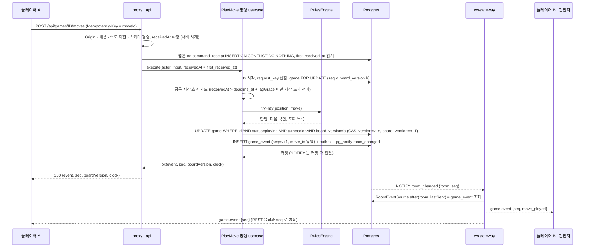

- 비동기 뒤쪽: 같은 트랜잭션의 outbox 가 `game-projector`(`game_view`·로비)와 `trace-recorder` 로 간다. **실시간 push 는 outbox 에 기다리지 않는다**(§5.10).
- 대기 중 무르기 요청이 있으면 같은 tx 에서 `undo_declined { reason: superseded }` 를 먼저 쓰고 착수를 이어 쓴다(seq +2, §4.5). 상대가 그 직전에 무르기 요청을 커밋했어도 판 버전은 그대로라 이 착수는 `version_conflict` 가 되지 않는다(B3).

### 5.5 경합 시퀀스 (착수 vs 시간 초과)

**원칙(S2)**: `receivedAt ≤ deadline_at + lagGrace` 로 수신된 착수는 스윕보다 **늦게 커밋돼도 이긴다.** 이를 위해 스윕은 `now > deadline_at + lagGrace + commitMargin` 일 때만 시간 초과를 선언한다. `commitMargin = lock_timeout(2s) + statement_timeout(5s) = 7초`(제안)는 정시에 수신된 요청이 가드 체인·`request_key` 선점·락 대기를 거쳐 커밋(또는 실패)하는 데 걸릴 수 있는 상한이다. 정시에 받은 요청이 실패해 같은 키로 재전송되면 `command_receipt.first_received_at` 으로 판정하므로 margin 안의 재전송도 이긴다(§5.2). 착수 경로와 스윕은 모두 `game` 행에 `FOR UPDATE` 를 건 뒤 **조건을 재평가**한다(같은 행을 직렬화). 스윕은 조회 때 본 `version` 과 비교하지 않는다 — 상대의 무르기 요청·사석 표시·시계 보정처럼 차례와 무관한 이벤트로 `version` 이 올라도 시간 초과 판정을 건너뛰면 안 되고, 반대로 착수·무르기 수락으로 차례·`deadline_at` 이 바뀌었으면 새 값으로 다시 판정해야 하기 때문이다. 스윕은 또 **열린 `clock_freeze` 가 없고 `api` 생존 신호가 신선할 때만** 선언한다(§4.3).

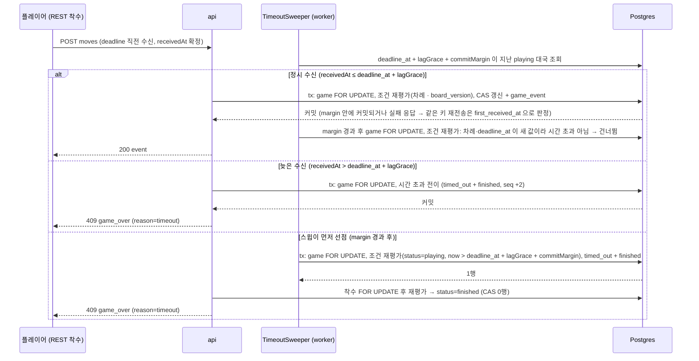

- 화면의 남은 시간은 `deadline_at` 에 0 이 되지만 **패배 선언은 `lagGrace + commitMargin` 뒤**에 일어난다. 그 사이에 정시 수신된 요청이 도착하면 이긴다. 지연 비용은 마지막 몇 초 동안 상대가 결과를 늦게 보는 것이고, 시계 불공정은 아니다.
- 착수 요청의 **시간 초과 여부는 서버가 요청 수신 시각(`receivedAt`)으로 재검사**한다: `receivedAt > deadline_at + lagGrace`(§5.9) 이면 착수 대신 시간 초과 전이로 처리한다. 스윕과 착수 경로는 같은 `timeoutAt = deadline_at + lagGrace` 로 "누가 늦었나"를 판정하고, 스윕은 거기에 `commitMargin` 을 더해 "정시 수신 요청이 아직 커밋 중일 수 있는 구간"을 보호한다.
- 어느 경로가 먼저 커밋되든 **결과가 같은 규칙으로 정해진다**: 정시 수신 요청은 이기고, 늦게 수신된 요청은 `game_over(timeout)` 이다.

### 5.6 재접속·관전 동기화

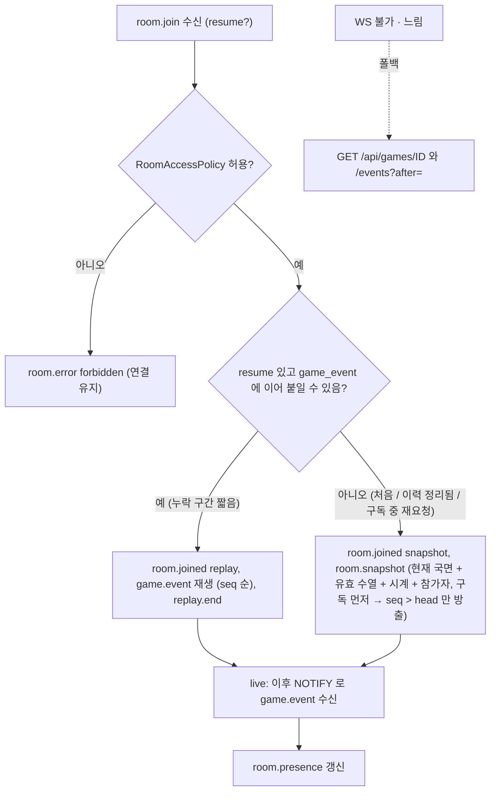

- 스냅샷은 `game` 행(현재 국면 직렬화 + 시계 + `event_seq`)에서 만든다 — `GameSnapshotProvider`(`RoomSnapshotProvider` 구현)가 `game` 모듈의 조회 usecase 로 읽는다. 읽기 모델이 아니라 **쓰기 모델을 읽는 문서화된 CQRS 예외 X1** 이다: 스냅샷의 `game` 행뿐 아니라 `RoomEventSource.after` 의 `game_event` 조회, `SyncGame` 쿼리, `GET /api/games/{id}/events` 가 모두 쓰기 스키마 `game` 의 `game_event`(= 방 로그)를 읽는다. 이유는 `head`·`seq` 가 쓰기 모델과 정확히 일치해야 하고 복제 시 fast lane 의 이점이 사라지기 때문이다(M1 의 `LoadEntryForConflict` 와 같은 종류). X1 은 P0 §2.4 의 '문서화된 CQRS 예외' 표에 등재하고 M1 database-schema §1 예외 목록 반영은 §17 변경 요청에 포함한다.
- 진행 중 대국의 이벤트는 대국이 끝날 때까지 전부 보관되므로 재생은 항상 가능하다. 종료 후 보관 정리 뒤에는 스냅샷 + SGF 로만 조회한다(§11 보관).
- **무르기와 재접속·관전**: 무르기는 로그에 이벤트로 남아 있으므로 `resume` 재생과 스냅샷이 모두 같은 접기 결과를 낸다. 대기 중 요청의 응답자가 끊겨도 요청은 30초 뒤 `expired` 로 닫힌다(재접속한 응답자는 스냅샷의 `pendingUndo` 로 남은 시간을 본다). 관전자는 `undo_accepted` 를 받아 보드를 되돌리며 별도 권한이 필요 없다. 종료 후 이벤트 정리가 일어나도 SGF(유효 수열)로만 조회한다.
- **플레이어 이탈**: 연결이 끊겨도 시계는 계속 간다. 접속 상태가 끊기면 `room.presence`(표시 전용)로 상대에게 알린다. 끊긴 플레이어는 시간 초과로 패하거나 재접속한다. **`abandoned` 의 근거는 presence 가 아니라 `game` 이 소유한 신호다(S3)**: 플레이어 클라이언트가 20초마다 `POST /api/games/{id}/heartbeat` 를 보내 `game_player.last_seen_at` 을 갱신하고(착수·패스 등 모든 명령도 같은 갱신을 함), `TimeoutSweeper` 가 **양측의 `last_seen_at` 이 모두 `grace`(제안 5분) 넘게 갱신되지 않은** 대국을 `abandoned`(무효, 보상 없음)로 닫는다. presence 는 근사값이고 gateway 가 둘 이상이 되면 합산이 안 되므로 판정에 쓰지 않는다. REST 착수·heartbeat 는 WS 연결이 없어도 가능하다.

### 5.7 로비·매칭

| 항목 | 규칙 |
|---|---|
| 도전(챌린지) | **로그인한** 개설자가 판 크기·**규칙(`rules`: 중국식·일본식, 덤 기본값은 규칙이 정하고 화면에 표시)**·시간·레이팅 여부·공개/초대를 정해 `open` 방을 만든다(REST `POST /api/challenges`). 로비에 노출. 무르기는 비레이팅 도전에서만 가능함을 설정 화면에 표시 |
| 수락 | 다른 **로그인** 사용자가 `JoinChallenge`(REST) → 색 배정(무작위 또는 개설자 선택) → `playing` |
| 빠른 매칭 | M1 범위: 같은 설정의 열린 도전에 자동 수락. 레이팅 기반 매칭은 후속(범위 밖) |
| 만료 | `open` 은 15분 후 자동 `cancelled`(제안) |
| 로비 조회 | `game_read.lobby_view`(읽기 모델). 새 도전·시작·종료는 이벤트로 갱신하고 WS `/ws/public` 로 요약 푸시(공개 정보만) |
| 익명 | **플레이어는 레이팅·비레이팅 모두 GitHub 로그인 필수**(U21). 익명 세션은 로비 조회와 공개 대국 **관전만** 가능하다(§5.1 "익명 세션의 경로"). 익명 비레이팅 대국은 폐지. 이 절(§5.7)과 §5.1 이 정본이다 |

### 5.8 명령 검증 순서도 (REST 가드 체인 → usecase)

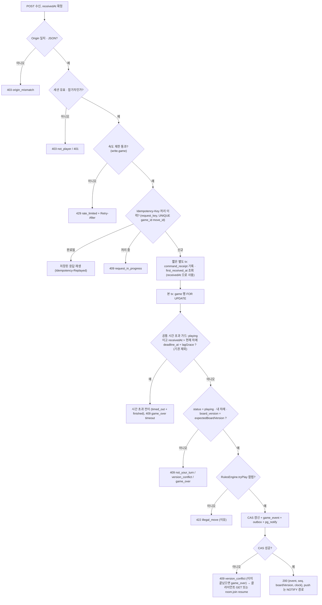

- **무르기 명령의 추가 검사**: `RequireUser`(로그인) → 참가자 → 공통 시간 초과 가드 → `status = playing` → `rated = false` → 요청이면 `board_version` 일치·대기 요청 없음·플레이어별 횟수·마지막 재개 이후 자기 착수 존재, 응답이면 `requestSeq` 가 대기 요청과 같음·`receivedAt ≤ expiresAt`·응답자 = 요청자의 상대. 모두 `game` 행 `FOR UPDATE` 아래 조건 재평가로 직렬화되며, 응답과 만료·착수·기권이 경합하면 먼저 커밋된 쪽이 이기고 늦은 쪽은 `no_pending_request`(또는 `game_over`)다.
- **계가 명령**(사석 표시·계가 확인·재개 요청/수락)은 `status = scoring` 과 `board_version`(재개 요청은 버전, 수락은 `requestSeq`)으로 판정한다. 같은 scoring 단계 안에서는 판 버전이 바뀌지 않으므로 상대의 사석 표시가 먼저 커밋돼도 내 표시·확인이 `version_conflict` 로 지지 않고, 이전 scoring 단계(재개 전)에 만든 요청은 판 버전이 달라 거절된다.

### 5.9 시계 공정성 — 서버 시계와 REST 지연 (제안)

REST 로 명령을 받으므로 **요청이 서버에 닿기까지의 지연**과 **상대에게 push 가 닿기까지의 지연**이 시계에 끼어든다. 원칙은 "서버 시각이 정본이고, 한쪽의 네트워크 지연이 상대의 시간을 깎지 않는다"이다.

| 구간 | 누구의 시계에 포함되나 | 설명 |
|---|---|---|
| 착수자의 요청 전송 지연(클라이언트 → api) | **착수자 본인** | 착수자의 시계는 `receivedAt`(서버가 요청을 받은 시각)에 멈춘다. 서버는 전송 지연을 알 수 없다 |
| 상대(다음 차례)의 시계 시작 | `receivedAt` | 상대 시계는 직전 착수의 `receivedAt` 에서 시작한다 → **착수자의 요청 전송 지연은 상대 시계에 영향이 없다** |
| 서버 처리·커밋 지연 | 아무에게도 안 받음 | `receivedAt` 은 가드 체인 진입 직후 `Clock` 포트로 확정한다. DB 락 대기·커밋 시간은 시계 계산에 쓰지 않는다 |
| push 도착·렌더 지연(서버 → 상대 화면) | 상대(다음 착수자) | 상대의 시계는 이미 가고 있다. 이 부분은 `lagGrace` 로 보상한다 |
| 멱등 재전송·`request_in_progress` | 영향 없음 | 처음 수신 시각(`command_receipt.first_received_at`, 본 tx 와 **별도 tx** 로 먼저 기록 — 본 tx 가 롤백돼도 남는다, §5.2)을 기준으로 한 번만 반영된다 |
| 정비·장애로 `api` 가 명령을 못 받는 구간 | 아무에게도 안 받음 | `clock_freeze` 구간만큼 `deadline_at`·`turn_started_at` 을 미루고 `clock_adjusted` 를 남긴다(§4.3, B4) |

**지연 보상 정책 (제안, 값은 Phase 1 측정으로 확정)**

| 안 | 내용 | 판정 |
|---|---|---|
| A. 무보상 | 서버 수신 시각만 사용 | 가장 단순하나 느린 회선의 플레이어가 구조적으로 불리 |
| **B. 고정 가산 `lagGrace`** | 착수마다 **0.3초**(제안)를 착수자에게 가산한다: 주 시간 방식은 차감 `elapsed' = max(0, elapsed − lagGrace)`, 초읽기는 허용 시간을 `P + lagGrace` 로. 시간 초과 판정 시각은 `timeoutAt = deadline_at + lagGrace` | **채택(제안)** — 단순하고 악용 이득이 착수당 최대 0.3초로 상한이 고정되며 시간 설정 화면에 규칙으로 표시할 수 있다 |
| C. 서버 측정 RTT 기반 가변 보상 | `ping/pong` RTT 의 절반(상한 1초)을 보상 | 후속. RTT 측정 신뢰도가 필요하고 WS 가 없는 REST 전용 클라이언트에는 적용 불가 |

- **판정 일치**: `TimeoutSweeper` 와 착수 경로가 같은 `timeoutAt = deadline_at + lagGrace` 로 "누가 늦었나"를 판정하고, 스윕은 `commitMargin`(7초, 제안)을 더해 정시 수신 요청의 커밋을 기다린다(§5.5). 그래서 "시간 안에 도착한 요청은 이긴다"가 경합에서도 지켜진다.
- **클라이언트 시각 불신**: `clock` push 는 표시 보정용이고 판정에 쓰지 않는다. 클라이언트가 보낸 타임스탬프는 받지 않는다.
- 서버 시각은 **벽시계 기반 `Clock.now()`**(`Date.now()` 계열)를 쓴다 — 영속되는 `deadline_at`·`game_event.at` 이 재시작 뒤에도 비교돼야 하기 때문이다(`performance.timeOrigin + performance.now()` 는 이 호스트에서 벽시계와 어긋남이 관찰됨 — G2 실측).
- 측정 항목: `pf_game_lag_grace_used_total`(착수 중 grace 구간에 걸린 비율), push 도착 지연 분포(§5.10). 비율이 높으면 grace 값·방식을 재검토한다.

### 5.10 지연 예산과 fast lane 판단

**예산** — P0 D10 의 "룸 이벤트 종단 지연 p95 ≤ 250ms"(제안, 미측정)를 두 구간으로 나눈다.

| 지표 | 정의 | 목표(제안) |
|---|---|---|
| `T_click→peer` | 착수자의 요청 송신 → 상대 화면 push 수신 | p95 ≤ 250ms (P0 D10) |
| `T_commit→push` | 트랜잭션 커밋 → 게이트웨이가 첫 구독자에게 write | p95 ≤ 100ms (서버 내부 예산) |

**구간별 추정** (측정값은 출처 표기, 나머지는 추정)

| 구간 | 값 | 근거 |
|---|---|---|
| 터널 편도 + 프록시 (클라이언트 ↔ 서버) | 5–15ms | 폐기된 G1(Cloudflare 임시 터널) WS RTT 최소/중앙/최대 8/10/15ms 의 절반(측정) — Funnel 에는 적용되지 않아 G14 에서 재측정 |
| api: 가드 체인·세션·룰·tx 커밋 | 10–25ms | 추정(로컬 Postgres, 단일 행 CAS + insert 2건) |
| 커밋 → NOTIFY 도착 | p50 0.31 / p99 8–17ms | G4 LISTEN 수신 지연(측정) |
| gateway: `game_event` 조회 + 매핑 + 직렬화 | 3–8ms | 추정 |
| gateway → 구독자 팬아웃 (같은 호스트) | p50 2.6–3.7 / p99 7–65ms | G2 소크 전달 지연, 1000연결·초당 20건(측정) |
| 터널 편도 (서버 → 상대) | 5–8ms | 폐기된 G1 RTT 의 절반(측정) — G14 에서 재측정 |

→ `T_click→peer` p95 는 대략 **40–140ms**(추정). 같은 호스트·단일 사용자 조건이라 실제 인터넷 구간(회선 지연)은 별도다.

**표준 경로로 가면?** 착수 이벤트를 `outbox → 디스패처 → inbox → 브로드캐스터 → room_log → NOTIFY → gateway` 로 보내면 DB 왕복과 러너 깨움이 4~5 홉 추가돼 **+30–100ms(추정)**, p95 가 70–240ms 로 예산(250ms)에 붙는다. 채팅(P4 §4.4)은 이 표준 경로를 쓰지만, 착수는 사용자 체감이 핵심이고 선반영 비용이 작다.

**판단 — fast lane 을 game 룸의 기본 경로로 둔다.**
1. 착수 트랜잭션이 이미 `game_event`(대국별 순번이 있는 추가 전용 로그)를 쓴다 → 그 자체가 재생 가능한 방 로그다. `room_log` 에 같은 내용을 한 번 더 쓸 이유가 없다.
2. 명령 트랜잭션이 `pg_notify('room_changed', {room, seq})` 를 한 줄 추가한다(커밋 때 전달). 게이트웨이는 **`RoomEventSource.after(room, lastSent)`** 로 `game_event` 를 읽는다.
3. `RoomEventSource` 는 P0 ADR-032 의 `realtime` 소유 포트이고 **`game` 이 구현**한다(의존 역전, P0 D9). → P0 §6.7 이 예고했던 "명령이 `realtime.AppendRoomLog` 를 호출"하는 경로는 **미사용 예약**이다(S6): 쓰게 되면 `AppendRoomLogInTx` 로 개명하고 허용 쌍 #11 을 ADR-030 개정과 함께 추가해야 한다. 이 설계는 필요 없으므로 경계 규칙 예외가 늘지 않는다.
4. NOTIFY 는 깨우기 신호일 뿐이다(ADR-023). 유실돼도 구독자가 있는 방은 1초 폴링으로 보완한다(M1 F14 `WakeSignal` 과 같은 규칙). 정확성은 `game_event` 의 순번이 지킨다.
5. **되돌리는 조건**: Phase 1 부하 시험에서 표준 경로의 `T_click→peer` p95 가 150ms 이하로 측정되면 fast lane 은 단순화를 위해 제거할 수 있다(그때까지는 유지). 반대로 fast lane 으로도 p95 가 250ms 를 넘으면 원인은 Funnel·클라이언트 구간이다.

- 시험: k6 로 REST 착수 + 두 WS 클라이언트 push 도착 시각을 서버 `Date.now()` 로 대조(§16.3). 지표 `pf_game_push_latency_seconds`.

### 5.11 프로토콜 클래스

```mermaid
classDiagram
    class GameCommand {
        <<abstract>>
        +gameId GameId
        +commandId Uuid
        +receivedAt Instant
        +actor ActorContext
    }
    class MoveCommand {
        +x int
        +y int
        +expectedBoardVersion int
    }
    class PassCommand {
        +expectedBoardVersion int
    }
    class ResignCommand
    class DeadMarkCommand {
        +dead Point[]
        +neutral Point[]
        +sekiReviewed bool
        +expectedBoardVersion int
    }
    class ScoreConfirmCommand {
        +scoreHash string
        +expectedBoardVersion int
    }
    class ResumeCommand {
        +expectedBoardVersion int
        +acceptRequestSeq int
    }
    class UndoRequestCommand {
        +expectedBoardVersion int
    }
    class UndoRespondCommand {
        +accept bool
        +requestSeq int
    }
    class CommandReceipt {
        +gameId GameId
        +moveId Uuid
        +requestHash string
        +firstReceivedAt Instant
    }
    GameCommand ..> CommandReceipt : receivedAt = firstReceivedAt
    GameCommand <|-- MoveCommand
    GameCommand <|-- PassCommand
    GameCommand <|-- ResignCommand
    GameCommand <|-- DeadMarkCommand
    GameCommand <|-- ScoreConfirmCommand
    GameCommand <|-- ResumeCommand
    GameCommand <|-- UndoRequestCommand
    GameCommand <|-- UndoRespondCommand
    class GameCommandRoute {
        <<api route>>
        +post(path, schema, guards) Response
    }
    class GameCommandHandler {
        <<usecase>>
        +execute(cmd) Result
    }
    GameCommandRoute --> GameCommand
    GameCommandRoute --> GameCommandHandler
    class WsMessage {
        <<abstract>>
        +v int
        +t string
        +ch string
        +ts Instant
    }
    class RoomInbound {
        <<abstract>>
    }
    class JoinRoom {
        +room string
        +resume int
    }
    class LeaveRoom
    class RoomOutbound {
        <<abstract>>
        +rm string
    }
    class SequencedRoomMessage {
        <<abstract>>
        +seq int
    }
    class GameEventMsg
    class RoomSnapshot
    class VolatileRoomMessage {
        <<abstract>>
    }
    class ClockMsg
    class PresenceMsg
    class RoomJoined
    class RoomClosed
    class RoomError
    WsMessage <|-- RoomInbound
    RoomInbound <|-- JoinRoom
    RoomInbound <|-- LeaveRoom
    WsMessage <|-- RoomOutbound
    RoomOutbound <|-- SequencedRoomMessage
    SequencedRoomMessage <|-- GameEventMsg
    SequencedRoomMessage <|-- RoomSnapshot
    RoomOutbound <|-- VolatileRoomMessage
    VolatileRoomMessage <|-- ClockMsg
    VolatileRoomMessage <|-- PresenceMsg
    RoomOutbound <|-- RoomJoined
    RoomOutbound <|-- RoomClosed
    RoomOutbound <|-- RoomError
    class RoomAccessPolicy {
        <<interface, realtime>>
        +decide(actor, roomKey) AccessDecision
    }
    class RoomSnapshotProvider {
        <<interface, realtime>>
        +snapshot(roomKey, actor) Snapshot
    }
    class RoomMessageMapper {
        <<interface, realtime>>
        +toRecipient(change, role) WsMessage
    }
    class RoomEventSource {
        <<interface, realtime>>
        +after(roomKey, seq, limit) RoomEvent[]
        +head(roomKey) int
    }
    class GameRoomPolicy
    class GameSnapshotProvider
    class GameMessageMapper
    class GameRoomEventSource
    RoomAccessPolicy <|.. GameRoomPolicy
    RoomSnapshotProvider <|.. GameSnapshotProvider
    RoomMessageMapper <|.. GameMessageMapper
    RoomEventSource <|.. GameRoomEventSource
    class RoomHub {
        +subscribe(conn, room, role)
        +unsubscribe(conn, room)
        +publish(room, msg)
    }
    class RoomSocketHandler {
        +onJoin(conn, msg)
        +onLeave(conn, msg)
    }
    RoomSocketHandler --> RoomHub
    RoomHub ..> RoomEventSource
    RoomSocketHandler ..> RoomAccessPolicy
```

`RoomHub` 는 M1 의 `PublicHub` 와 같은 팬아웃·합치기·송신 큐 규칙을 재사용하되 **방별 구독자 집합**을 가지고, 방별 정책·스냅샷·변환·이벤트 원천은 위 네 포트를 `RoomRegistry` 에서 방 종류(`game`)로 찾는다(P0 §6.6, ADR-032). `RoomSocketHandler` 는 `join`/`leave` 외에는 처리하지 않는다 — 명령 라우터가 없다.

---

## 6. SGF 입출력

| 항목 | 규칙 |
|---|---|
| 내보내기 | 종료된 대국의 `game_event` 를 `@sabaki/sgf` 로 직렬화: `FF[4] GM[1] SZ RU[Chinese 또는 Japanese] KM PB PW DT RE[B+R / W+3.5 / B+T …]` + 착수 노드(**무르기로 제거된 수는 담지 않는 유효 수열**). 종료 후 한 번 만들어 `game.sgf` 텍스트로 저장(보관 정리 후에도 기보는 유지) |
| 가져오기 | 연습·분석용 업로드: 크기 상한(제안 256KB), 노드 수 상한(제안 1000), 지원 속성만 사용(`;B ;W AB AW AE SZ KM RU`, `RU` 는 `Chinese`·`Japanese` 만 인정하고 그 밖의 값은 `chinese` 로 연습 분석), 나머지는 무시. 변화도(분기)는 주 변화만 사용 |
| 라운드트립 시험 | 문자열이 아니라 **노드·속성 의미 동등성**(실측: 파싱 후 재직렬화 문자열은 정규화 차이로 불일치) |
| 분석 입력 | KataGo 질의의 `moves` 는 SGF 가 아니라 서버가 `game_event` 를 접어(`foldMoves`, §4.5) 얻은 **유효 수열**을 `[["B","D4"],…]` 로 변환 |
| 개인정보 | 대국자 표시 이름만 `PB/PW` 에 기록(플레이어는 로그인 사용자), 사용자 ID·세션 ID 는 포함하지 않는다 |

---

## 7. 3D 클라이언트 (Phase 1-B)

### 7.1 서버가 보장해야 할 것 / 클라이언트가 할 것

| 서버 보장(계약) | 클라이언트 책임 |
|---|---|
| 모든 `game.event` 는 방별 연속 `seq` 로 한 번씩, 같은 순서로 도착(건너뛰면 `room.join { resume }`) | `SeqTracker` 로 누락 감지, 재구독 요청 |
| `room.snapshot` 한 번(또는 REST `GET /api/games/{id}`)으로 화면을 전부 복원 가능 | 스냅샷 적용 시 렌더 상태를 전부 교체 |
| 서버 시계 정본, `clock` 은 보정용 | 로컬 보간만, 판정 없음 |
| 거절은 REST 오류 응답의 wire code(`illegal_move`·`not_your_turn`·`version_conflict`·`game_over`·`rate_limited`) | 낙관적 착수 표시는 응답 전까지 "대기 중" 표현, 오류면 되돌림. `version_conflict` 이면 재동기화(`GET` 또는 `room.join { resume }`) |
| 규칙 판정은 서버가 최종 | 같은 `baduk-rules` 로 **불법수 미리보기**와 규칙별(`rules`) **계가 미리보기**만(서버가 최종) |
| 무르기는 `undo_accepted` 이벤트로만 반영 | 요청 버튼은 비레이팅 대국에서만 노출, 응답 대기 UI(30초 카운트다운), 수락 시 보드를 `toPly` 로 되돌리고 해시 검증, 포획 애니메이션 큐는 비운다 |

### 7.2 구조 (렌더 상태와 도메인 상태의 분리)

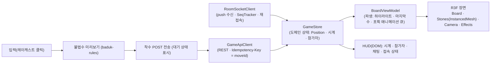

- **도메인 상태(Position)는 서버 이벤트로만 변한다.** 3D 장면은 `BoardViewModel` 이 만든 **표시용 파생 상태**만 읽는다 → 애니메이션이 실패하거나 느려도 상태가 어긋나지 않는다.
- 돌은 `InstancedMesh`(최대 361개)로 그린다. 포획 애니메이션은 큐에 쌓고 `prefers-reduced-motion` 이면 건너뛴다.
- 2D 폴백: WebGL 불가/저사양 시 같은 `GameStore` 위에 2D 보드(DOM/SVG)로 대체한다. 접근성(키보드 좌표 입력, 스크린리더 알림)은 2D 보드가 담당한다.

### 7.3 성능 예산 (제안, 미측정)

| 항목 | 목표 |
|---|---|
| 프레임 | 중간급 노트북에서 60fps 목표, 모바일은 30fps 허용 |
| 장면 | 드로 콜 < 200, 정점 < 200k, 텍스처 총합 < 2MB(gzip 전, 압축 텍스처는 후속 검토) |
| 번들 | 3D 장면은 대국 화면에서만 지연 로드(`next/dynamic`, SSR 제외), 초기 홈 번들에 포함하지 않음(LCP 예산 2.5초 유지) |
| 서버 왕복 | 착수 REST 응답 p95 150ms 목표, 상대 화면 push 도착 p95 250ms(P0 D10, §5.10, 둘 다 미측정) |

---

## 8. 치팅·남용 방어 (ADR-009)

| 위협 | 방어 | 비고 |
|---|---|---|
| 잘못된 수·차례 위반 | 서버 룰 엔진 검증, `reject` | 클라이언트 신뢰 안 함 |
| 같은 수 중복 전송·재전송 | `moveId` 유일 제약 | 멱등 |
| 시간 조작 | 서버 시계 정본, 클라이언트 시각 불신, `deadline_at` 영속, 수신 시각 `receivedAt` 기준 | 지연 보상은 §5.9 `lagGrace` |
| 요청 폭주 | REST 가드 체인의 세션 속도 제한 등급 `write.game`(초당 5건, burst 10, 제안; 초과 `429` + `Retry-After`). WS 인바운드는 P0 §6.8 값(구독 초당 5회)과 M1 04 의 연결당 초당 10건을 따른다(위반 `4429`) | M1 03 §1.1 확장, 04 §1 |
| 관전 중 정보 노출 | 관전자는 공개 상태만 수신, 플레이어 전용 정보 없음(바둑은 완전 정보 게임) | 비공개 대국은 초대 토큰 해시 검증 |
| AI 도움(부정행위) | **사후 분석**(KataGo, §9), 즉시 승패에는 영향 없음 | 보상만 `FLAGGED` |
| 보상 파밍(계정 둘이 대국) | 보상 자격 정책(§10.3, D4): **패자 보상 0**(둘이 번갈아 져 줘도 한 판에 한쪽만 받는다), **색당 최소 수**(한쪽이 패스만 하는 판 제외), **기권 판 보상 축소**, 사용자 일일·같은 상대 일일 한도(동시 처리에도 지켜지는 카운터 행, §10.3) | IP 는 저장하지 않으므로(ADR-023) 계정 단위 규칙만. 계정 생성일 하한·상대 쌍 평생 상한·군집 지표는 검토했으나 미채택(§10.3) |
| 고의 이탈·시간 끌기 | 시계 + `game` 소유 heartbeat 기반 이탈 유예 한도(§5.6, presence 는 판정에 쓰지 않음), 반복 이탈은 레이팅 대국 참가 제한(후속) | |
| 초대 링크 추측 | 토큰 128비트 난수, 해시 저장 | ADR-026 HSH |
| 무르기 남용(시간 끌기·반복 요청·분석 회피) | 비레이팅 대국만, 플레이어별 3회, 대기 1건·30초, 시계 되감지 않음, 요청 대기 중 착수하면 철회 | 레이팅 대국은 불허라 보상·분석 경로에 영향 없음(§4.5) |
| 익명 계정을 이용한 모더레이션 우회 | **플레이어는 로그인 필수**라 대국 참여·착수·무르기 경로의 우회 위험은 사라졌다. **남은 위험은 관전자 익명**뿐이다: 익명 세션은 세션 재발급으로 뮤트를 피해 관전 채팅에 다시 나타날 수 있다 | 관전자 채팅 쓰기 권한·속도 제한·신고는 P4 `ChatRoomPolicy` 가 정본이고, 이 문서는 익명이 플레이어가 될 수 없다는 보장만 한다 |

---

## 9. KataGo 분석 워커 (Phase 2, ADR-036)

### 9.1 조사 사실과 미확인 (2026-11-04)

| 사실(공식 저장소·문서) | 설계 영향 |
|---|---|
| 라이선스 MIT, 별도 프로세스로 사용 가능 | 분리 서비스로 문제 없음(저작권 고지 유지) |
| Analysis Engine: stdin 에 JSON 한 줄 질의, stdout 에 비동기 결과(순서 뒤바뀔 수 있음), 질의당 여러 턴 결과 가능 | 질의 `id` 로 결과 매칭, 한 대국을 한 질의(`analyzeTurns`)로 처리 |
| 질의 필드: `id`, `moves`, `rules`, `komi`, `boardXSize/YSize`, `analyzeTurns`, `maxVisits` | 서버가 `game_event` 로 질의 생성 |
| 응답: `moveInfos[]`(`move`·`order`·`winrate`·`scoreLead`·`prior`·`pv`), `rootInfo` | 일치율·승률 손실 계산 입력 |
| 순수 CPU 빌드(`EIGEN`, AVX2 변형)와 작은 신경망 존재 | 무료 호스팅 CPU 가능성 있음 |
| 규칙 문자열 목록은 분석 엔진 문서에 없음(`tromp-taylor` 예시만) | 우리 규칙 둘(중국식·일본식, 위치 슈퍼코)에 대응하는 KataGo 의 규칙 이름·옵션은 **공식 문서로 확인되지 않았다 — 착수 시(S0 스파이크) 확인**(아래 규칙 매핑) |
| CPU 초당 방문 수, 모델 파일 크기·출처 | **미확인** — S0 스파이크로 측정 |

**KataGo `rules` 파라미터 매핑 (U11)** — 질의의 `rules` 는 우리 `game.rules` 에서 만든다. **KataGo 가 지원하는 규칙 이름·세부 옵션(영역/집 계가, 패 규칙, 자충, 시키 처리)은 공식 문서로 확인하지 못했으므로 모든 칸을 "착수 시 확인"으로 둔다.**

| 우리 `rules` | KataGo `rules` 후보 | 상태 | 확인 전 임시 방침 |
|---|---|---|---|
| `chinese` | 중국식에 대응하는 이름 또는 옵션 조합 | **착수 시 확인** | 확인 못 하면 질의에 쓰는 규칙은 문서에 예시가 있는 `tromp-taylor` 로 둔다(영역 계가·위치 슈퍼코이므로 우리 중국식과 가장 가깝다고 보되 **그 대응 자체도 시험으로 확인**) |
| `japanese` | 일본식에 대응하는 이름 또는 옵션 조합 | **착수 시 확인** | 같음. 집 계가를 못 쓰면 `tromp-taylor` 로 근사하고 **`scoreLead` 지표를 쓰지 않는다**(점수 의미가 달라진다) |

- 의심도 지표(상위 일치율·승률 손실, §9.5)는 주로 정책·승률에 의존하므로 계가 방식 차이의 영향이 작을 것으로 **추정**하나 측정하지 않았다. 규칙 매핑이 근사인 경우 `analysis_result.report` 에 `rules_mapping: "exact" | "approx"` 를 기록해 임계값 보정 때 구분한다.
- 질의에는 항상 대국에 스냅샷된 `komi` 를 명시한다(규칙 기본 덤에 맡기지 않는다). `boardXSize/YSize`·`moves`(**유효 수열**)·`rules`·`komi` 는 모두 `game` 모듈의 공개 조회 포트가 `game.rules`·`komi`·`foldMoves` 결과로 제공한다.
- 분석 대상은 레이팅 대국뿐이고 레이팅 대국은 무르기가 없으므로 유효 수열 = 기록된 전체 수열이 정상이다. 접기 결과가 달라졌다면 불변식 위반이므로 분석을 `failed` 로 두고 경보한다.

### 9.2 구성

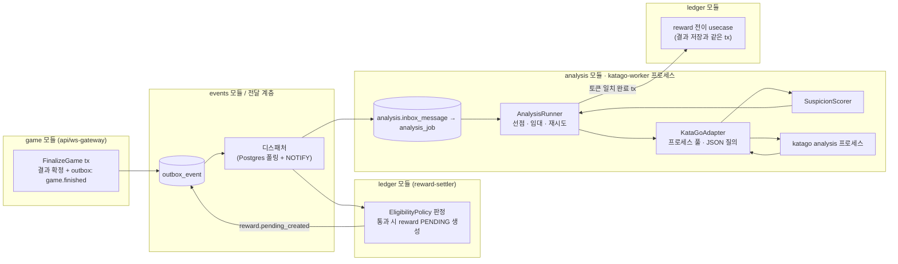

### 9.3 분석 작업 상태 머신 (`analysis.analysis_job`)

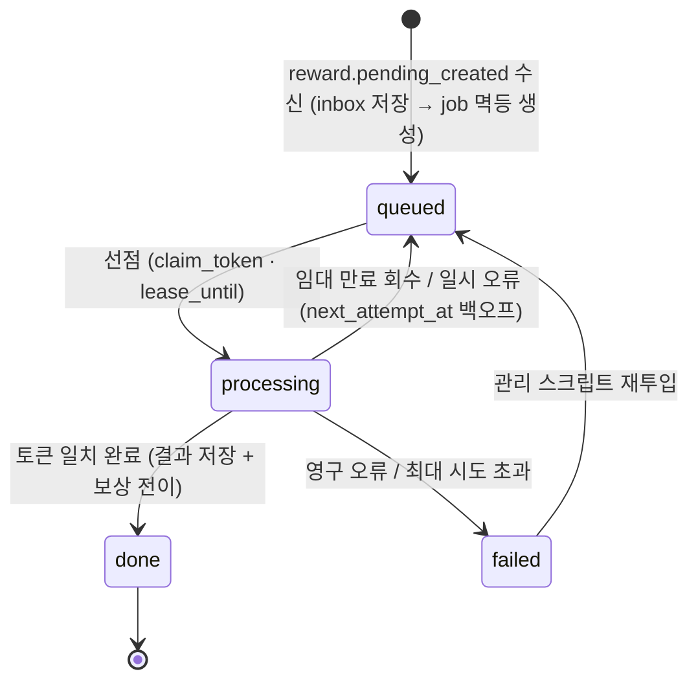

- `queued → processing` 은 **조건부 UPDATE**(선점, ADR-021). 같은 대국을 두 워커가 분석해도 완료는 토큰 하나만 성공한다.
- 분석은 **트랜잭션 밖**에서 일어난다. 완료만 짧은 트랜잭션이다(분석 결과 행 + `reward` 전이 + 원장 기장 요청). `reward` 행은 `analysis_job` 이 생기기 전에 이미 존재한다(§2.3의 소비 체인).
- 재시도 백오프·최대 시도는 ADR-023 규칙(1초×2, 상한 5분, 8회)을 따른다. **임대 연장은 예외가 아니라 ADR-021 의 적용이다**(S8): ADR-021 은 "오래 걸리는 작업은 중간에 임대를 연장(heartbeat)한다 — 토큰 일치 조건으로"를 허용한다. 워커는 임대의 **1/3 간격**으로 `UPDATE … SET lease_until=… WHERE claim_token=…` 를 보내고(0행이면 임대를 잃은 것이므로 결과를 버린다), ADR-023 의 "임대 ≥ p99×10, 핸들러 제한시간 ≤ 임대/2" 규칙은 **연장 간격과 한 번의 연장 단위**에 적용하며 총 분석 시간에는 적용하지 않는다. 임대 초기값은 스파이크 후 정한다(미확인).

### 9.4 분석 시퀀스 (정상)

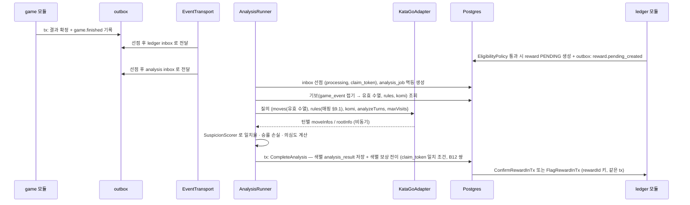

### 9.5 2단계 분석과 의심도

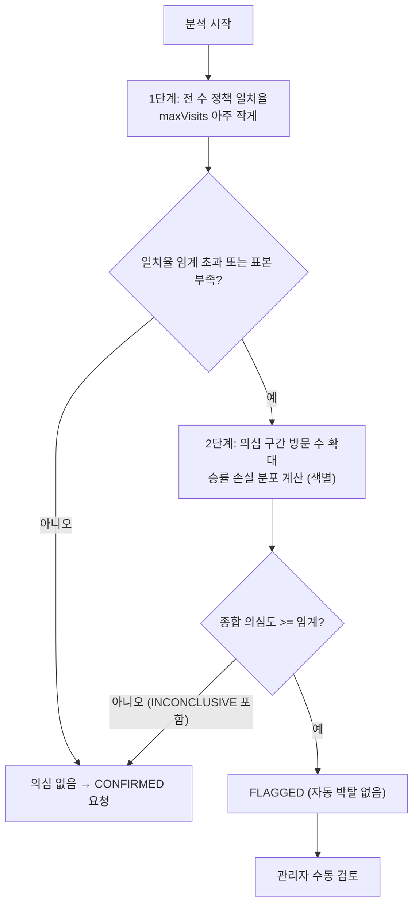

| 지표 | 정의(제안) | 쓰임 |
|---|---|---|
| 상위 일치율 | 플레이어 수가 분석 1순위(또는 상위 K) 수와 같은 비율 | 1단계 |
| 평균 승률 손실 | 수마다 (최선 승률 − 실제 수 승률) 평균 | 2단계 |
| 일치 곡선 | 난이도(수의 후보 수·정책 집중도)가 높은 국면의 일치율 | 오탐 완화 |
| 표본 크기 | 분석 대상 수 개수(너무 적으면 2단계로 보내고, 2단계 후에도 결론이 안 나면 `INCONCLUSIVE`) | 신뢰도 |

임계값은 **실제 대국 데이터가 없으므로 지금은 정할 수 없다**(ADR-009). 초기에는 지표만 저장하고 `FLAGGED` 전이는 보수적 임계에서만, **자동 박탈은 하지 않는다**.

**이 분석의 목적을 솔직히 적는다 (B8)**: 보정 데이터가 없고 대국 수도 적은 포트폴리오 사이트에서 이 분석은 **부정행위를 실제로 잡는 장치라기보다 기술 시연**(별도 프로세스 분리, 선점·임대 큐, 트랜잭션 밖 분석, 색별 판정과 보상 전이)이다. 보상 파밍 방어의 실질은 §10.3 의 자격 규칙(D4)이 맡는다. Phase 2 설계 재검토(P0 §12.5)에서 **범위 축소(1단계 정책 일치율만 운영, 2단계는 후속)** 를 함께 검토한다.

**판정 단위와 종착(S1)**: 판정은 **색(참가자)별**이다 — `analysis_result` 는 `(game_id, color)` 단위이고 `SuspicionReport` 도 색별이다. 판정 대상 색은 `reward.pending_created.rewards[]` 에 있는 색이고, **패자 보상이 0 이라(D4) 보통 승자 한 색**이다. 그 색이 의심스러우면 그 reward 만 `FLAGGED`, 아니면 `CONFIRMED` 로 간다. 2단계 후에도 `INCONCLUSIVE` 이면 **`CLEAN` 취급으로 `CONFIRMED`** 하되 감사 기록과 지표(`pf_analysis_inconclusive_total`)를 남긴다(보수적 박탈 금지 원칙, 의심만으로 보상을 막지 않음). 이벤트 `analysis.completed` 는 **`verdicts[{color, rewardId, verdict(CLEAN·SUSPECT), inconclusive?}]`**(P0 §8.3 정본 형식) — INCONCLUSIVE 는 `verdict=CLEAN, inconclusive=true` 로 접힌다.

### 9.6 자원 예산과 실행 가능성

| 항목 | 값 | 근거 |
|---|---|---|
| 호스트 | **라이브 = 집 서버** Linux, Xeon Bronze 3204(6코어 1.9GHz, HT 없음, AVX2 확인), RAM 62GB(2026-11-05 사용자 `lscpu`). 개발 PC(i5-12400 6코어·AVX2)는 사전 실측용. Oracle ARM 은 미추진 | ADR-036 사전 실측, 집 서버 재측정은 S0 |
| 컨테이너 한도 | **CPU: compose `cpus: "2"`(쿼터 상한) + `cpuset: "4-5"`(전용 코어, 사이트용은 0–3) + `cpu_shares: 128`(경합 시 가중치), KataGo 탐색 스레드 2** — 정본 값은 ADR-033 결정 2(U12 의 '코어 2~3개'). `nice` 는 컨테이너 사이에서는 저우선을 보장하지 못하므로 쓰지 않는다. 3코어(`cpuset: "3-5"`)로 올리는 것은 S0 의 '분석 중 착수 p95' 와 사이트 부하 시험이 여유를 보인 뒤에만. 메모리 한도는 **S0 스파이크 후 확정**(P0 자원 추정 범위 0.5–3GiB, 가정 1.5GiB; 62GB 호스트라 메모리보다 CPU 예산이 먼저 걸린다) | 신경망·캐시 크기 미확인 |
| 동시 분석 | **1건**(ADR-033 정본; 스파이크에서 CPU 여유가 확인되면 2건으로 상향 검토) | CPU 격리 |
| 분석량 | 250수 대국 기준 1단계는 신경망 평가 250회 수준 | 정확한 시간은 **미확인** |
| 모델 파일 | 저장소 밖 볼륨, 출처·라이선스 확인 후 | 크기 미확인 |
| 실패 시 대안 | ① 분석 범위 축소(중반 구간 샘플링) ② 1단계만 운영 ③ 분석 비활성(보상은 `PENDING` 유지 후 정책 유예) | ADR-036 |

**S0 스파이크(Phase 2 착수 시)**: ① KataGo 바이너리(AVX2·Eigen)와 작은 신경망 두어 종을 내려받아 이 호스트에서 초당 방문 수 측정 ② 우리 규칙 둘(`chinese`·`japanese`)에 대응하는 KataGo 규칙 이름·옵션 확인 ③ 250수 대국 1단계 분석 소요 시간 ④ 메모리 상한 ⑤ 프로세스 풀 크기 ⑥ **분석 중 착수 p95**(분석을 돌리는 동안 `pf_game_move_request_seconds`·`T_click→peer` 를 재서 D10 지연 예산(§5.10)을 지키는지 — 지키지 못하면 `cpuset` 분리·스레드 수부터 고친다).

### 9.7 클래스

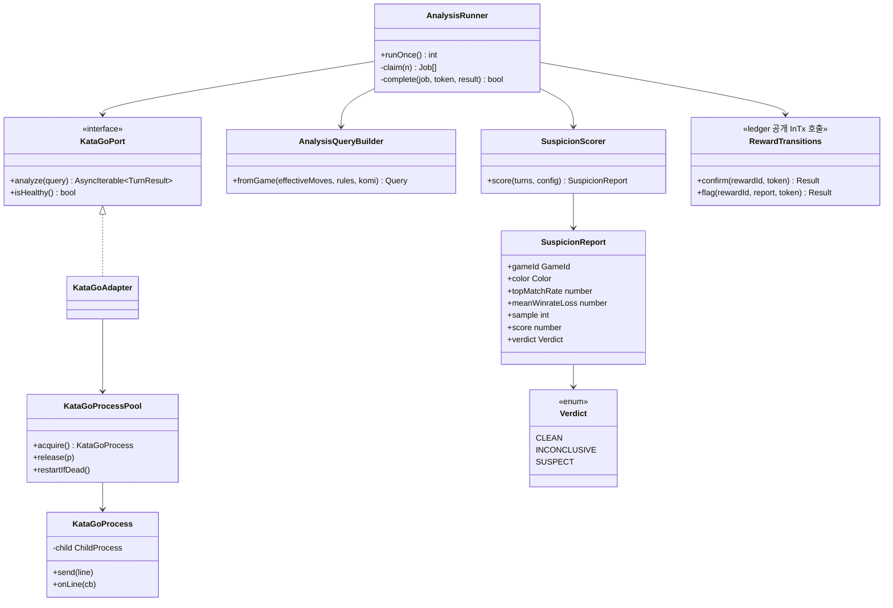

---

## 10. 모의 포인트 원장 — 바둑 보상 (Phase 2, ADR-037; 원장 자체는 Phase 3 도입)

> **구현 순서 (D24)**: `ledger` 모듈·POINT 계정·`liab:user_points:{uid}` 는 **Phase 3 에서 이미 도입**되어 있고 첫 포인트 출처는 **첫 로그인 지급(POINT 100,000)·USDC→POINT 교환**(`exp:demo_grant:POINT`, P0 §1.4 G1·ADR-048)이다. 이 절의 바둑 보상은 구현 순서상 **마지막 출처**(`exp:points_issued`)이며 출처들은 계정으로 구분해 대사한다.

> **모든 화면·API·문서에 "모의 포인트, 실제 가치 없음" 을 표기한다**(ADR-015). 환전·출금·거래 기능은 없다.

### 10.1 구조

> **원장 스키마의 정본은 [ADR-040](../../adr/ADR-040-escrow-settlement-and-ledger.md)·[phases/00 §2.5](00-platform-evolution.md)** 이다(`ledger` 모듈 하나, 다중 자산 복식 원장). 이 절은 그 위에서 **POINT 자산과 보상**을 어떻게 쓰는지만 정한다.

- 분개 `journal` 1건 = 차변·대변 `posting` 둘 이상, **자산(`POINT`)별 차변 합 = 대변 합**(지연 제약 트리거), 추가 전용, 정정은 역분개.
- 계정(`ledger.account`): `liab:user_points:{userId}`(사용자 보유 포인트, `min_balance = 0`), `exp:points_issued`(보상으로 발행한 포인트, 하한 없음). 포인트는 환전·출금·거래가 없다.
- 보상 확정 분개: `exp:points_issued`(POINT) **차변** / `liab:user_points:{uid}`(POINT) **대변**. **박탈은 기장된 보상의 역분개가 아니다**: 기장은 `CONFIRMED` 전이와 같은 트랜잭션에서만 일어나므로 `PENDING`/`FLAGGED` 보상은 애초에 기장이 없고, `REVOKED` 는 PENDING 을 무효화할 뿐 분개가 없다. 따라서 `liab:user_points` 의 `min_balance = 0` 과 충돌하는 음수 잔액 경로가 없다. 확정(CONFIRMED)된 보상은 종결이다.
- 멱등 키: `reward:{rewardId}:confirm`. 같은 보상을 두 번 기장하지 못한다.

### 10.2 보상 상태 머신

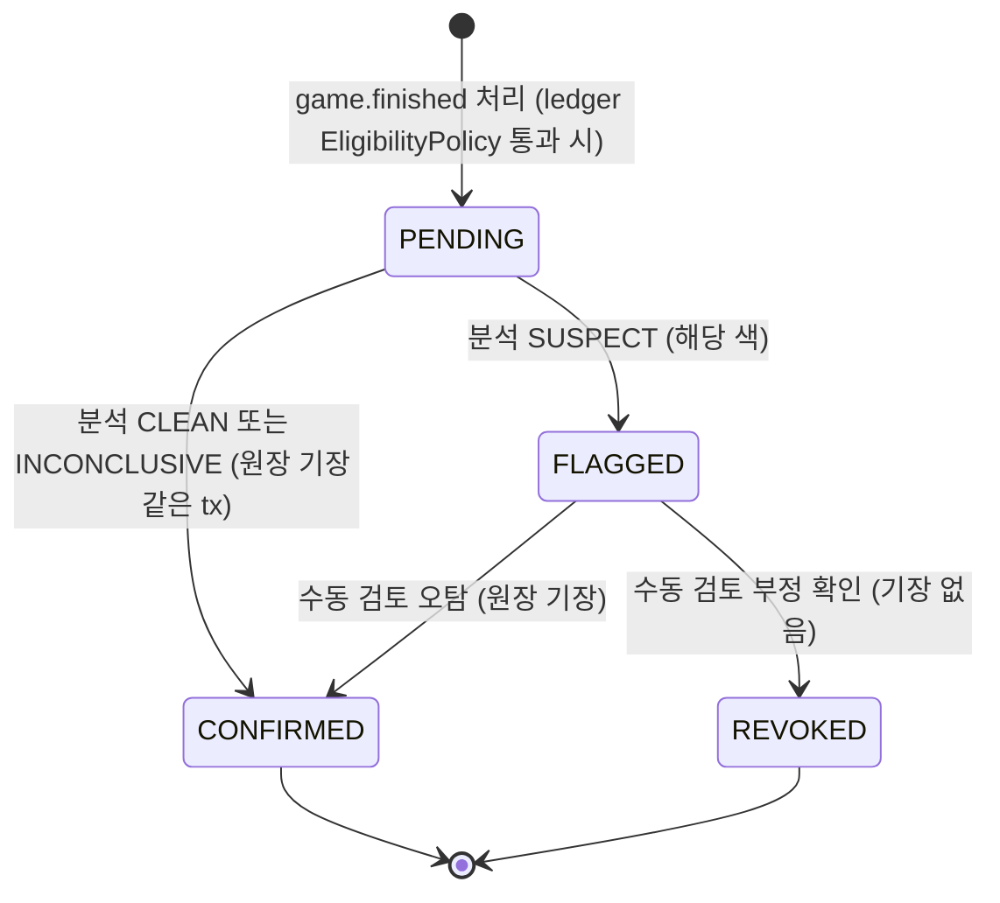

- 기장은 `PENDING → CONFIRMED`(또는 `FLAGGED → CONFIRMED`) 전이와 **같은 트랜잭션**이다. `PENDING`·`FLAGGED` 동안은 잔액에 반영되지 않는다(보류).
- `REVOKED` 는 기장이 없다(보류 상태에서 무효화). **`CONFIRMED` 는 종결이며 사후 박탈 경로가 없다**(필요해지면 별도 ADR 로 상쇄 거래 정책을 정한다).
- **패자 보상은 0 이라(D4) reward 행은 승자 1행만 만든다**(`UNIQUE (game_id, user_id)` 는 그대로 — 재전달 멱등). 그 행은 자기 색(승자 색)의 판정으로 전이한다.
- 분석이 오래 걸리거나 dead 가 되어도 reward 는 `PENDING` 으로 남는다(유예 만료 자동 확정은 하지 않음 — 정책 필요 시 별도 결정).

### 10.3 보상 자격 정책 (`EligibilityPolicy`, **ledger 모듈 소유**, 서버 규칙)

`ledger` 의 `reward-settler` 가 `game.finished` 를 소비할 때 판정한다. **입력은 `game.finished` 페이로드**(P0 §8.3: `rated`, 결과(승자 색), **색별 수 수 `movesByColor`**, 종료 사유, **`scoringTimeouts`**(scoring 시한 경과 횟수), `rules`, `undoCount`, 참가자(`userId`·로그인 여부), 대국 종료 시각)와 `ledger` 자신의 **한도 카운터 행**(`ledger.reward_quota`)뿐이다 — `game`(L3)은 `ledger`(L4)를 부를 수 없으므로 정책은 소비 쪽에 있다. **"같은 상대 반복 횟수"는 `game` 이 계산해 싣지 않고 `ledger` 가 카운터로 센다**(B20 — `game` 은 보상이 실제로 만들어졌는지 모르므로 계산 주체가 될 수 없다). 통과하지 못하면 reward 를 만들지 않고 따라서 분석 작업도 만들지 않는다(§2.3).

| 조건 | 값(제안, 미확정) |
|---|---|
| 양측 모두 GitHub 로그인 사용자 | 필수(U21 이후 모든 플레이어가 로그인 사용자이므로 **방어적 중복 검사**) |
| 레이팅(보상) 대국 선택 | 필수 |
| 규칙 | 중국식은 대상. **일본식은 판정기 신뢰도(시키 정의·재개 중 감점의 규정서 확인, 시키 시험 세트, `tenuki` 차분)가 확인되기 전까지 제외**(설정 `REWARD_JAPANESE_ENABLED=false`, B7·§3.5, 제안) |
| 무르기 미사용 | `undoCount = 0` 필수(레이팅 대국은 무르기 불허라 방어적 중복) |
| 서로 다른 계정 | 필수 |
| 최소 수 | **색당 15수 이상**(`movesByColor.B ≥ 15` 그리고 `movesByColor.W ≥ 15`, 패스 제외 — D4). 이전의 합계 30수는 한쪽이 패스만 해도 통과했다 |
| 종료 사유 | 계가 합의(`score`)·시간 초과(`timeout`)·기권(`resign`) 허용, 무효(`abandoned`)는 제외. **scoring 시한 경과를 거친 대국(`scoringTimeouts > 0`)은 제외**하고 감사 `system.game_scoring_timed_out` 을 남긴다(D3) |
| 일일 한도 | 사용자당 하루 N 건, 같은 상대(계정 쌍) 하루 M 건 — 아래 카운터 행으로 센다 |
| 보상 크기 | **승자 +10, 기권승 +5(D4: 기권 판 보상 축소), 패자 0**(D4: 둘이 번갈아 져 줘도 한 판에 한쪽만 받는다). 모의 값, 임의 |

- **한도의 동시성 (B17)**: `reward` 표를 `COUNT` 로 세면 같은 사용자의 두 대국이 동시에 끝날 때 둘 다 한도 안으로 보고 통과한다. 그래서 reward 생성과 **같은 tx** 에서 카운터 행 `ledger.reward_quota (scope_key, day, count)` 를 조건부로 올린다 — `scope_key` 는 `user:{승자 userId}` 와 `pair:{작은 userId}:{큰 userId}`, `day` 는 대국 종료 시각의 KST 날짜. `INSERT … ON CONFLICT (scope_key, day) DO UPDATE SET count = reward_quota.count + 1 WHERE reward_quota.count < $limit RETURNING count` 를 두 키에 대해 실행하고(행 잠금이 같은 키의 경합을 직렬화한다), **하나라도 0행이면 세이브포인트로 되돌려 reward 를 만들지 않는다**(사유 `daily_limit`·`pair_limit` 을 지표·감사에 남김). 재전달은 inbox 멱등이라 카운터가 두 번 오르지 않는다.
- **검토했으나 미채택 (D4)**: 계정 생성일 하한(예: 가입 N일 뒤부터 보상), 상대 쌍 평생 상한, 계정 군집 지표(같은 상대와만 두는 계정 묶음 탐지)는 검토했으나 채택하지 않았다 — 패자 보상 0·색당 최소 수·일일 한도로 이 규모의 파밍 이득이 작고, 모의 포인트라 금전 피해가 없기 때문이다.

### 10.4 확정 시퀀스와 박탈

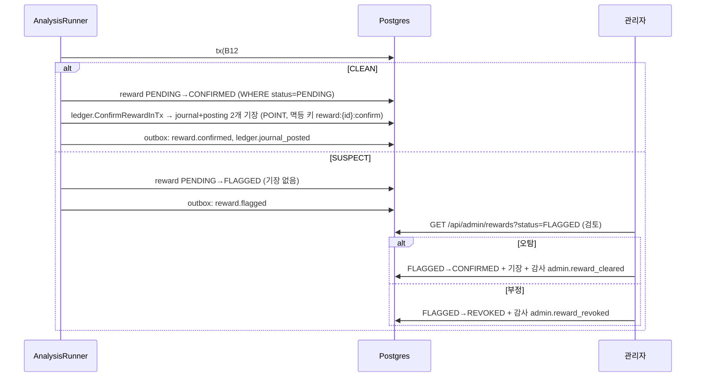

### 10.5 정합성 점검 (`LedgerAuditJob`)

| 점검 | 쿼리(개념) | 이상 시 |
|---|---|---|
| 분개별 자산별 차변=대변 | `SELECT journal_id, asset FROM ledger.posting GROUP BY 1,2 HAVING sum(CASE direction WHEN 'D' THEN amount ELSE -amount END) <> 0` | `pf_ledger_imbalance`(게이지) > 0, 경보 |
| 잔액 대조 | `account_balance` vs `posting` 합계 | 불일치 계정 목록, 재계산 |
| 확정 보상의 기장 존재 | `reward` CONFIRMED 인데 기장 없음 | 보정 잡 |
| 멱등 키 중복 | 유일 제약 위반 시도 로그 | 정보 |
| 불변성 | 항목 UPDATE/DELETE 시도 감지(트리거 로그) | 보안 사고 후보(ADR-028 연계) |

점검은 매시간(제안) 읽기 쿼리이며 결과는 지표·감사(`system.ledger_audit_ran`)로 남긴다.

### 10.6 클래스

```mermaid
classDiagram
    class Account {
        +id AccountId
        +code string
        +type AccountType
        +asset Asset
        +minBalance int
    }
    class Journal {
        +id JournalId
        +idempotencyKey string
        +kind JournalKind
        +reversalOf JournalId
        +postings Posting[]
        +assertBalancedPerAsset()
    }
    class Posting {
        +accountId AccountId
        +direction Direction
        +amount int
        +asset Asset
    }
    class Reward {
        +id RewardId
        +gameId GameId
        +userId UserId
        +amount int
        +status RewardStatus
        +version int
        +confirm()
        +flag(report)
        +revoke(by)
    }
    class RewardStatus {
        <<enum>>
        PENDING
        CONFIRMED
        FLAGGED
        REVOKED
    }
    class LedgerPoster {
        +postJournalInTx(tx, journal) Result
    }
    class BalanceReader {
        <<interface>>
        +balanceOf(account) int
    }
    Account "1" --> "*" Posting
    Journal "1" o-- "2..*" Posting
    Reward --> RewardStatus
    LedgerPoster --> Journal
    BalanceReader ..> Account
```

---

## 11. 데이터 모델

규약은 ADR-017·025·026 을 따른다(uuid v7, timestamptz, 쓰기는 tx, 보호 등급 PUB·SYS·PSD·PII·HSH·ENC). 컬럼 전수는 구현 시 `database-schema.md` 에 합치고 여기서는 **핵심 테이블·제약·인덱스·등급·보관**을 정한다.

### 11.1 스키마 `game` (쓰기)

| 테이블 | 핵심 컬럼 | 제약·인덱스 | 보호 등급 |
|---|---|---|---|
| `challenge` | `id`, `creator_actor`(로그인 사용자), `board_size`, `ruleset`(값 `chinese`·`japanese`, API 필드명 `rules`), `komi`(규칙 기본값 스냅샷), `time_control jsonb`, `rated`, `visibility`, `invite_token_hash`, `status`, `expires_at`, `version` | `status`·`expires_at` 부분 인덱스(`open`) | actor=PSD, 설정=SYS, `invite_token_hash`=HSH |
| `game` | `id`, `challenge_id`, `status`, `version`(= 마지막 `game_event.seq`, §4.2), **`board_version`**(판 버전, 경합 판정 기준, §4.2), `event_seq`, `position` (직렬화 text, 직렬화 버전 `v` 포함), **`engine_version`**(시작 시 스냅샷, §3.4), `clock jsonb`, `turn`, `turn_started_at`, `deadline_at`, `result jsonb`, `ruleset`, `komi`, `rated`, `pending_undo jsonb`(요청 색·`expiresAt`·`requestSeq`, 없으면 null), `undo_count jsonb`(색별 요청 횟수), **`scoring jsonb`**(양측 최신 표시·`scoreHash`, 라운드·불일치 카운터, `deadline_at`, 대기 재개 요청, 새 돌 없는 자동 재개 연속 횟수), **`accepted_resumes`**(수락 재개 횟수, 상한 2), **`scoring_timeouts`**(시한 경과 횟수), `started_at`, `finished_at` | `(status, deadline_at)` 부분 인덱스(`playing`·`scoring`), `(finished_at)` | position·result=PUB(대국 내용), 나머지 SYS |
| `game_player` | `game_id`, `color`, `actor_key`, `user_id`(NOT NULL — 플레이어는 로그인 사용자만, U21), `display_name`, `last_seen_at`(heartbeat·명령으로 갱신, 이탈 판정 신호 §5.6) | PK(`game_id`,`color`), `(actor_key)` | actor_key·user_id=PSD, display_name=PUB, last_seen_at=SYS |
| `game_event` | `game_id`, `seq`, `type`(무르기 이벤트 `undo_*`·`play_resumed`·`scoring_timed_out`·`clock_adjusted` 포함, 로그는 추가 전용이라 무르기가 행을 지우지 않음), `payload jsonb`, `move_id`(= `Idempotency-Key`; 시스템 전이는 결정적 uuid — 예: `clock_adjusted` 는 `freezeId` 에서), `at`(= 서버 수신 시각 `receivedAt`, §5.9) | PK(`game_id`,`seq`), `UNIQUE (game_id, move_id)` where not null | PUB(좌표·색·시간), 추가 전용 |
| `command_receipt` | `game_id`, `move_id`, `request_hash`, `first_received_at` — 본 tx 와 **별도 tx** 로 먼저 기록(§5.2, B3) | PK(`game_id`,`move_id`). 대국 종료 1일 뒤 삭제 | SYS |
| `clock_freeze` | `id`, `kind`(`planned`·`detected`), `started_at`, `ended_at`, `reason`, `compensated_at` — 배포 스크립트·worker 가 기록(§4.3, B4) | 열린 행(`ended_at IS NULL`) 부분 인덱스 | SYS |
| `api_liveness` | `instance_id`, `last_beat_at` — `api` 가 5초마다 갱신(§4.3) | PK(`instance_id`) | SYS |
| `game_sgf` | `game_id`, `sgf text`, `created_at` | PK(`game_id`) | PUB(가명 표시 이름) |
| `inbox_message` | M1 공통 형태(§4-5) | | M1 과 동일 |
| `request_key` | M1 공통 | | M1 과 동일 |

### 11.2 스키마 `game_read` (읽기 모델)

| 테이블 | 용도 | 갱신 |
|---|---|---|
| `lobby_view` | 열린 도전 목록(설정, 개설자 표시 이름, 만료) | `challenge.*`·`game.started` 이벤트 |
| `game_view` | 진행/종료 대국 요약(참가자 표시 이름, 수 수, 결과, 관전 수) | `game.*` 이벤트(필드별 순번 규칙, M1 과 동일) |
| `my_games_view` | 사용자별 대국 목록 | 동일 |

### 11.3 스키마 `analysis` / `ledger`

| 테이블 | 핵심 컬럼·제약 | 등급 |
|---|---|---|
| `analysis.analysis_job` | `id`, `game_id` UNIQUE(`reward.pending_created` 구독으로 멱등 생성), `reward_ids jsonb`, `status`, `claim_token`, `claimed_by`, `lease_until`, `attempts`, `next_attempt_at`, `last_error`(본문 금지) | SYS |
| `analysis.analysis_result` | `game_id`, **`color`**, `analyzer_version`, `model_id`, `report jsonb`(지표), `verdict`(`CLEAN`·`SUSPECT`; INCONCLUSIVE 는 CLEAN 으로 접고 `report` 에 사유 기록), `analyzed_at` — PK(`game_id`,`color`) | SYS(대국 내용에 대한 지표) |
| `analysis.inbox_message` | M1 공통 형태(§4-5) | M1 §9.1 |
| `ledger.account` | `id`, `code` UNIQUE, `type`, `asset`, `owner_ref`, `min_balance` — **ADR-040 정본** | PSD(`owner_ref`) |
| `ledger.journal` | `id`, `kind`, `ref_type`, `ref_id`, `idempotency_key` UNIQUE, `reversal_of_id`, `trace_id`, `created_at` — **ADR-040 정본** | SYS |
| `ledger.posting` | `journal_id`, `line_no`, `account_id`, `direction`(`D`/`C`), `amount` > 0, `asset` — 추가 전용 | SYS |
| `ledger.account_balance` | `account_id`, `balance`, `version` — 같은 트랜잭션에서 조건부 갱신(`balance + Δ >= min_balance`) | SYS |
| `ledger.reward` | `id`, `game_id`, `user_id`, `amount`, `status`, `version`, `flagged_report jsonb`, `decided_by`, `decided_at` — **`UNIQUE (game_id, user_id)`**(멱등). 패자 보상 0 이라 대국당 승자 1행(D4) | PSD |
| `ledger.reward_quota` | `scope_key`(`user:{id}`·`pair:{id}:{id}`), `day`(KST 날짜), `count` — PK(`scope_key`,`day`), reward 생성 tx 에서 조건부 증가(§10.3, B17). 90일 뒤 삭제 | PSD(`scope_key`) |
| `ledger_read.balance_view` | 표시용 잔액 사본, 순번 컬럼 | 이벤트로 갱신 |

### 11.4 보관·익명화

| 데이터 | 보관 | 비고 |
|---|---|---|
| 종료된 대국의 `game`·`game_sgf`·`game_player`(표시 이름) | 보관 | 포트폴리오 서사(기록), 표시 이름은 대국 시점 스냅샷 |
| `game_event` | 레이팅 대국 영구, 비레이팅은 종료 후 30일(제안) | SGF 가 남아 재생 가능 |
| `challenge`(만료·취소) | 7일 | M1 의 이벤트 로그 규칙과 동일 |
| `analysis_*` | 영구(작음) | |
| `ledger_*` | 영구 | 감사·정합성 |
| 세션 만료 시 | 플레이어는 모두 로그인 사용자라 `game_player` 에 익명 세션 행이 없다(U21). 익명 세션은 관전 구독·presence 에만 나타나고 `game` 쓰기 스키마에 저장되지 않는다. 사용자 삭제 시 `user_id` 처리는 ADR-008 | ADR-008 |

---

## 12. 이벤트 카탈로그

명명은 M1 규약 `<aggregate>.<verb-past>` 이고 **이벤트 계약의 정본은 [phases/00 §8.3](00-platform-evolution.md)** 이다(아래는 P1 소유 이벤트의 요지). ADR-009 의 `game.review.requested`·초안의 `review.requested` 는 **폐기**되었다(ADR-009 개정) — 분석 작업은 `ledger` 가 보상 `PENDING` 을 만든 뒤 발행하는 **`reward.pending_created`** 를 구독해서 만든다.

| `type` | 발행 | 페이로드 요지 | 소비자 |
|---|---|---|---|
| `challenge.created` · `challenge.cancelled` · `challenge.expired` | game | 설정, 개설자 표시 | `game-projector`(lobby_view) |
| `game.started` | game | 대국 id, 설정, 참가자 표시, 시작 시각 | `game-projector`, **`chat`**(`chat-game-sync`: 방 개설, P4), trace-recorder |
| `game.move_played` · `game.passed` | game | seq, 좌표/패스, 색 | `game-projector`(game_view 수 수). 실시간 push 는 outbox 가 아니라 `game_event` + `NOTIFY room_changed` 경로(§5.10) |
| `game.resigned` · `game.timed_out` · `game.scoring_started` · `game.score_confirmed` | game | 사유, 점수(규칙별 내역 포함) | `game-projector` |
| **`game.undo_requested` · `game.undo_accepted` · `game.undo_declined`** | game | `seq`, 요청/응답 색, `toPly`·`positionHash`(수락), `requestSeq`, `reason`(거절·만료·철회) | `game-projector`(`game_view` 수 수 보정). 실시간 push 는 `game_event` + `NOTIFY room_changed` 경로(§5.10), 이 이벤트는 투영용. 룸 push 의 `undo_accepted` 는 `restored`·`captures`·`clock` 까지 싣는다(§4.5) |
| **`game.play_resumed`** · **`game.scoring_timed_out`** · **`game.clock_adjusted`** | game | `play_resumed {gameId, seq, by}`(`by` = 수락 재개는 수락한 색, 불일치 자동 재개는 두 번째 불일치 표시를 낸 색, 시한 경과 재개는 `null`), `scoring_timed_out {gameId, seq}`, `clock_adjusted {gameId, seq, shiftMs, cause}` | `game-projector`(`game_view` 상태 `scoring → playing`·남은 시간 갱신). **접기 규칙**: `play_resumed` 는 연속 패스 카운트 리셋 표식, 무르기 범위는 마지막 재개 이후(§4.5). `scoring_timed_out` 은 종국이 아니라 자동 재개의 사유다(D3) |
| **`game.finished`** | game | 결과(승자 색), 수 수(유효 수열 기준)와 **색별 수 수 `movesByColor`**, 종료 사유, **`scoringTimeouts`**, 규칙(`chinese`·`japanese`), 덤, 무르기 횟수 `undoCount`, 레이팅 여부, 참가자(`ownerKey`·색 — 플레이어는 로그인 사용자라 `ownerKey = user:<userId>`, 자격 판정은 여기서 `userId` 를 얻는다), 종료 시각. **같은 상대 반복 횟수는 싣지 않는다**(ledger 카운터, §10.3) | `game-projector`, **`ledger`**(`reward-settler`: `EligibilityPolicy` → reward `PENDING`), **`chat`**(`chat-game-sync`: 플레이어 방 읽기 전용·관전자 방 공개 전환), trace-recorder |
| **`reward.pending_created`** | ledger | `gameId`, `rewards:[{rewardId,userId,color}]`(행위자 필드는 `userId` 로 단일, D4 이후 보통 승자 1건) | **`analysis`**(`analysis_job` 멱등 생성), trace-recorder |
| `game.abandoned` | game | 사유(`heartbeat`·`scoring_deadlock`·`outage`) | `game-projector`, **`chat`**(`chat-game-sync`: 방 종료, P0 §8.3) |
| `analysis.completed` · `analysis.failed` | analysis | `gameId`, 요약 지표, **`verdicts[{color, rewardId, verdict(CLEAN·SUSPECT), inconclusive?}]`**(P0 §8.3 정본 형식) | `game-projector`(분석 상태 표시). 보상 전이는 이벤트가 아니라 B12 #6 으로 같은 tx |
| `reward.confirmed` · `reward.flagged` · `reward.revoked` | ledger | reward id, 금액(내부), 상태 | `ledger-projector` |
| `ledger.journal_posted` | ledger | `journalId`, `kind`, `refType`, `refId` | `ledger-projector`(잔액) |

- 페이로드에는 **좌표·색·시간·개수만** 싣고 본문이 없다(채팅 제외). `game` 이벤트의 사용자 식별은 봉투·참가자의 `ownerKey` 로만(M1 규칙)이고, ledger 소유 `reward.*` 는 보상 행 키인 `userId` 를 쓴다(P0 §8.3). 둘 다 내부 소비 전용이며 룸 push(`game.event`)에는 실리지 않는다(§5.3).
- `game.finished` 한 건이 네 소비자(투영, 보상 생성(ledger), 채팅 방 전환, 추적)에 팬아웃되고, 분석 작업은 ledger 의 `reward.pending_created` 로 이어진다 — M1 의 구독 레지스트리 규약.

---

## 13. 기능 카탈로그

단계: P1=Phase 1, P2=Phase 2. `BD` 대국, `AN` 분석, `LG` 원장.

### 13.1 대국 (BD)

| ID | 기능 | 트리거 | 단계 | 비고 |
|---|---|---|---|---|
| BD-01 | 도전 개설 | `POST /api/challenges` | P1 | `CreateChallenge` |
| BD-02 | 로비 조회 | `GET /api/lobby` | P1 | `ListLobby`(읽기 모델) |
| BD-03 | 도전 수락·대국 시작 | `POST /api/challenges/{id}/join` | P1 | `JoinChallenge` → `StartGame` |
| BD-04 | 착수 | `POST /api/games/{id}/moves` | P1 | `PlayMove`(CAS, 멱등 키 = moveId) |
| BD-05 | 패스 | `POST /api/games/{id}/pass` | P1 | 연속 2회 → scoring |
| BD-06 | 기권 | `POST /api/games/{id}/resign` | P1 | |
| BD-07 | 시간 초과 판정 | worker 주기 + 착수 시 재검사 | P1 | `SweepTimeouts` |
| BD-08 | 계가 합의(사석 표시·확인·재개 요청/수락) | `POST …/dead-marks` · `/score-confirmations` · `/resume-requests` · `/resume-accept` | P1 | scoring 상태, `scoreHash` 확인, 수락 재개 최대 2회·자동 재개(불일치 연속 2회·시한 경과)는 상한 제외, 기본 판정 없음(§4.2, D3) |
| BD-09 | 대국 확정 | 내부(`FinalizeGame`) | P1 | 결과 불변 + outbox |
| BD-10 | 재접속·관전 동기화 | WS `room.join`(+ REST `GET /api/games/{id}`·`/events` 폴백) | P1 | 스냅샷 + 재생 |
| BD-11 | 시계 방송 | 착수 후 + 주기 | P1 | `clock` |
| BD-12 | 이탈 유예 | 플레이어 heartbeat(`POST …/heartbeat`, 20초) → `game_player.last_seen_at`, `TimeoutSweeper` 가 양측 grace 초과를 `abandoned` 로 판정. presence(`room.presence`)는 표시 전용 | P1 | §5.6 |
| BD-13 | 기보 내보내기 | `GET /api/games/{id}/sgf` | P1 | |
| BD-14 | 기보 가져오기(연습) | `POST /api/sgf/import` | P1 후반 | 상한·무시 속성 |
| BD-15 | 대국 기록 조회 | `GET /api/games`, `/api/games/{id}` | P1 | |
| BD-16 | 룰 엔진 패키지 | 라이브러리 | P1 | `baduk-rules`(중국식·일본식 `Ruleset`), 시험 세트·차분 퍼징 |
| BD-17 | 3D 클라이언트 | web | P1-B | R3F, 2D 폴백 |
| BD-18 | 악용 방어(속도 제한·권한) | 가드 | P1 | §8 |
| BD-19 | 종료 대국 보관 정리 | worker | P1 후반 | `game_event` 30일 규칙 |
| BD-20 | 방 이벤트 원천·즉시 push(fast lane) | 명령 tx 의 `pg_notify('room_changed')` | P1 | `GameRoomEventSource`(`RoomEventSource` 구현), §5.10 |
| BD-21 | 룸 포트 구현 | gateway 조립부 | P1 | `GameRoomPolicy` · `GameSnapshotProvider` · `GameMessageMapper`(P0 ADR-032) |
| BD-22 | 시계 공정성(수신 시각·`lagGrace`) | 명령 usecase | P1 | §5.9, `ClockService` |
| BD-23 | 무르기 요청 | `POST …/undo-requests` | P1 후반 | `RequestUndo`, 비레이팅만·플레이어별 3회(§4.5) |
| BD-24 | 무르기 수락·거절·만료 | `POST …/undo-accept` · `…/undo-decline` · worker 만료 | P1 후반 | `AcceptUndo`(유효 수열 되감기, 시계 유지)·`DeclineUndo`, `TimeoutSweeper` 가 30초 만료 |
| BD-25 | 규칙 선택(중국식·일본식)·규칙별 계가·덤 | 도전 설정 / 룰 엔진 | P1 | `Ruleset`, §3.5 |
| BD-26 | 플레이어 로그인 가드·익명 관전 | 가드 `RequireUser` / `GameRoomPolicy` | P1 | U21, §5.1 |
| BD-27 | 정비·장애 구간 시계 보정 | 배포 스크립트(`clock_freeze`) · worker(`api` 생존 신호 단절 감지) | P1 | `ClockFreezeCompensator`, `clock_adjusted`, 장기 장애는 런북 일괄 `abandoned`(§4.3, §15) |

### 13.2 분석 (AN)

| ID | 기능 | 트리거 | 단계 |
|---|---|---|---|
| AN-01 | 분석 작업 생성(`reward.pending_created` 구독, 멱등) | `analysis` 소비자 | P2 |
| AN-02 | 분석 작업 러너(선점·임대·재시도) | 큐 | P2 |
| AN-03 | KataGo 어댑터(프로세스 풀) | 러너 | P2 |
| AN-04 | 의심도 계산 | 러너 | P2 |
| AN-05 | 결과 저장·보상 전이 | 완료 tx | P2 |
| AN-06 | 수동 검토(FLAGGED 처리) | 관리자 API | P2 |
| AN-07 | 분석 재투입 CLI | worker CLI | P2 |

### 13.3 원장 (LG)

| ID | 기능 | 트리거 | 단계 |
|---|---|---|---|
| LG-01 | 계정 개설(지갑) | 최초 지급/보상/조회 | P3 (원장 도입 시) |
| LG-02 | 자격 판정(`EligibilityPolicy`)·보상 생성(PENDING)·`reward.pending_created` 발행 | `game.finished` 소비 | P2 |
| LG-03 | 보상 확정·기장 | 분석 CLEAN / 수동 | P2 |
| LG-04 | 보상 FLAGGED 전이 | 분석 SUSPECT | P2 |
| LG-05 | 보상 박탈(REVOKED) | 관리자 | P2 |
| LG-06 | 잔액·내역 조회 | `GET /api/me/points` | P3 |
| LG-07 | 원장 정합성 점검 | worker 주기 | P3 (보상 항목은 P2 에서 추가) |
| LG-08 | 모의 면책 표기 | UI·API | P3 |
| LG-09 | 관리자 지급(`AdminGrant`, POINT·USDC) | 관리자 | P3 (P2 문서 §9 와 같은 기능) |
| LG-10 | 첫 로그인 지급 받기(`ClaimWelcomeGrant`)·USDC→POINT 교환(`ExchangeUsdcToPoint`) | 로그인 사용자 | P3 |

---

## 14. 동시성·정합성 지점

| 지점 | 경합 | 해결 |
|---|---|---|
| 착수 | 두 탭/재전송 중복 | `Idempotency-Key`(`request_key`) + `UNIQUE (game_id, move_id)` + CAS(`board_version`, `turn`, `status`) |
| 착수 REST 재시도 | 응답 유실 후 같은 키 재전송, 같은 키 동시 요청, 본 tx 롤백 뒤 재전송 | 완료된 키는 응답 재생, 처리 중이면 `409 request_in_progress`(M1 03 §3). 판정 시각은 별도 tx 로 먼저 남긴 `command_receipt.first_received_at`(§5.2) |
| 착수 vs 시간 초과 | 같은 deadline 근처 | `game` 행 `FOR UPDATE` + 조건 재평가(스윕은 `version` 비교 안 함). 스윕은 `deadline_at + lagGrace + commitMargin` 뒤에만, 그리고 `clock_freeze` 가 없고 `api` 생존 신호가 신선할 때만 선언하므로 정시 수신 착수가 이긴다(§5.5). 늦게 수신된 착수는 `game_over(timeout)` |
| 착수 vs 상대의 무르기 요청·거절 | 내 착수 직전에 상대 이벤트가 커밋됨 | 판 버전 CAS 라 내 착수는 `version_conflict` 가 되지 않고 대기 요청을 `superseded` 로 닫으며 이어진다(B3) |
| 착수 vs 기권 | 거의 동시 | 같은 행 잠금. 기권은 버전 조건이 없고 먼저 커밋된 쪽이 이긴다 |
| 도전 수락 | 둘이 동시에 수락 | `challenge` 상태 CAS(`open → matched`), 하나만 성공 |
| 무르기 요청 vs 상대 착수 | 대기 중 상대가 착수 | `game` 행 `FOR UPDATE` + 판 버전 CAS. 먼저 커밋된 쪽이 이기고, 착수가 먼저면 요청은 `superseded` 로 닫히거나(요청 후) `version_conflict`(요청이 늦어 판 버전이 바뀜) |
| 무르기 수락 vs 만료·기권·시간 초과 | 30초 경계, 동시 응답, 차례 쪽 시간 소진 | 같은 행 잠금. `pending_undo.requestSeq` 가 다르거나 해제되었으면 `no_pending_request`. 만료 판정은 `expiresAt` 으로 하고 응답 경로도 수신 시각이 `expiresAt` 이후면 만료로 처리. 현재 차례의 시간이 이미 지났으면 공통 시간 초과 가드가 수락 대신 시간 초과로 처리(시계 되살리기 차단) |
| 계가 표시·확인 | 동시 `dead-marks`·`score-confirmations` | 행 잠금 아래 `status='scoring'`·판 버전 재평가(같은 scoring 단계 안에서는 상대 표시가 먼저 커밋돼도 충돌 아님), 양측 최신 표시의 `scoreHash` 가 같고 양측이 그 해시로 확인하면 종결 |
| 보상 자격 한도 | 같은 사용자·같은 쌍의 두 대국이 동시에 끝남 | `ledger.reward_quota` 카운터 행의 조건부 upsert(행 잠금으로 직렬화), 0행이면 세이브포인트 되돌림(§10.3, B17) |
| 시계 보정 vs 명령 | freeze 종료 직후 보정과 착수가 겹침 | 같은 `game` 행 잠금. 보정은 판 버전을 올리지 않아 착수와 충돌하지 않고, `move_id` 결정적 uuid 로 보정은 한 번만 |
| 분석 선점 | 두 워커 | `analysis_job` 선점 CAS + `claim_token` 완료, 임대는 1/3 간격 토큰 조건 연장(ADR-021) |
| 보상 전이 | 분석 완료 vs 수동 처리 | `reward.status` 조건부 UPDATE |
| 원장 기장 | 재전달·동시 확정 | `idempotency_key` 유일 + 보상 상태 CAS + 같은 tx |
| 읽기 모델 | 이벤트 역전·재전달 | M1 의 필드별 순번 규칙 |

모든 쓰기는 `uow.run` 안에서(ADR-025). 외부 호출(KataGo)은 트랜잭션 밖(ADR-021).

---

## 15. 실패 모드와 복구

| 실패 | 영향 | 복구 |
|---|---|---|
| `ws-gateway` 재시작/배포 | push 중단(연결 끊김). **착수는 REST 라 계속 가능** | `bye` + 지터 재접속 → `room.join { resume }`(DB 정본이라 상태 손실 없음) |
| `api` 중단/배포 | 착수 불가. 라이브는 `api` 단일 인스턴스라 재배포 동안 명령을 못 받는다 | **계획 정비는 `clock_freeze`**: 배포 스크립트가 freeze 를 열고 닫으며, 그동안 스윕은 선언하지 않고 종료 뒤 진행 중 대국의 `deadline_at`·`turn_started_at` 을 정지 구간만큼 미루고 대국별 `clock_adjusted` 를 남긴다(§4.3, B4). 롤링(readyz 503 후 요청 완료)은 k3d 검증 구성에만 해당한다 |
| `api` 계획 외 장애 | 착수 불가, 시계는 흐름 | worker 가 `api_liveness` 단절(15초, 제안)을 감지해 `detected` freeze 를 열고 같은 보정을 한다. 스윕은 생존 신호가 신선할 때만 선언 |
| `NOTIFY` 유실 | push 지연 | 구독자가 있는 방은 1초 폴링으로 `game_event` 조회(M1 `WakeSignal` 규칙) |
| DB 장애 | 대국 정지 | `api` 생존 신호도 끊기므로 복구 뒤 `detected` freeze 로 보정(복구 직후 스윕은 신호가 신선해질 때까지 선언하지 않음). **장기 장애(freeze 30분 초과, 제안)는 복구 런북의 "진행 중 대국 `abandoned { reason: outage }` 일괄 종료" 단계**로 닫는다(무효, 보상 없음, 감사 `system.games_abandoned_outage`) |
| worker 중단 | 시간 초과 판정 지연, 투영 지연 | 착수 시 재검사로 공백 완화, 재시작 후 스윕이 따라잡음 |
| 이벤트 역전/중복 | 읽기 모델 오염 | 필드별 순번, 재구성(M1 `rebuild`) |
| KataGo 프로세스 사망 | 분석 중단 | 임대 만료 회수, 프로세스 풀 재시작, 재시도 상한 후 `failed` |
| 분석 장기 지연 | 보상 `PENDING` 정체 | 지표·경보(`pf_reward_pending_age_seconds`), 유예 정책(미결) |
| 원장 불균형 | 포인트 불일치 | 점검 잡 경보, 보정 거래(수동), 코드 롤백 |
| 무르기 후 국면 불일치(접기 vs 스냅샷) | 클라이언트·분석·SGF 가 서로 다른 수열을 봄 | `positionHash` 검증 → 스냅샷 재요청, 서버는 재생 동등성 시험(AC-BD-22)과 점검 쿼리로 `game.position` = 접기 재생을 대조 |
| 무르기 만료 스윕 지연 | 요청이 30초 넘게 남음 | 응답 경로가 `expiresAt` 으로 만료를 재판정, 대기 중 착수는 어차피 철회로 처리 |
| 일본식 계가 버그(시키·사석) | 점수 오판정 | 결과 불변이라 사후 수정 불가 → **확정 전 교정 경로**: 사람이 중립점(시키)을 표시할 수 있고, 시키 의심 모양은 경고·`sekiReviewed` 신고를 요구하며, 계가 확인은 점수 내역까지 묶은 `scoreHash` 에 대해서만 된다(§3.5·§4.2, B7). 그 위에 규칙별 시험 세트(§3.3)·차분 퍼징(`tenuki`), 판정기 신뢰도 확인 전 일본식 레이팅 대국 보상 제외(§10.3) |
| 계가 분쟁 교착 | 양측이 끝없이 불일치만 반복 | 자동 재개(상한 없음, D3) 뒤 새 돌 없는 재진입 연속 3회면 `abandoned { scoring_deadlock }`(제안, §4.2) |
| 룰 엔진 버그 | 잘못된 합법/불법 판정 | 대국 결과 불변이므로 **사후 수정 불가** → 시험 세트·차분 퍼징이 방어선, 이상 판정은 감사·재생으로 조사 |

---

## 16. 관측·시험·자원

### 16.1 지표(`pf_` 규약, 식별자 레이블 금지)

| 지표 | 종류 | 레이블 |
|---|---|---|
| `pf_game_active` | G | `status` |
| `pf_game_moves_total` | C | `result`(accepted·rejected), `reason` |
| `pf_game_move_request_seconds` | H | `outcome` |
| `pf_game_push_latency_seconds` | H | — (커밋 → 첫 구독자 write, §5.10) |
| `pf_game_lag_grace_used_total` | C | — |
| `pf_game_cas_conflicts_total` | C | `kind`(move·timeout·resign·join) |
| `pf_game_timeouts_total` | C | `source`(sweeper·move_check) |
| `pf_game_undo_total` | C | `outcome`(requested·accepted·declined·expired·superseded·rejected) |
| `pf_game_finished_total` | C | `rules`(chinese·japanese), **`reason`**(score·resign·timeout·abandoned), `scoring_timed_out`(yes·no — 시한 경과를 거친 대국인가, D3) |
| `pf_game_auto_resume_total` | C | `cause`(mismatch·scoring_timeout) |
| `pf_game_clock_adjusted_total` | C | `cause`(planned·detected) |
| `pf_analysis_jobs` | G | `status` |
| `pf_analysis_duration_seconds` | H | `stage`(1·2) |
| `pf_analysis_queue_age_seconds` | G | — |
| `pf_analysis_inconclusive_total` | C | — (INCONCLUSIVE 를 CLEAN 으로 접은 횟수) |
| `pf_reward_total` | C | `status` |
| `pf_reward_pending_age_seconds` | G | — |
| `pf_ledger_imbalance` | G | — (0 이어야 함; 게이지는 `_total` 접미를 쓰지 않음, F17 규약) |

룸 연결 수는 M1 의 `pf_ws_connections{channel="room"}`, 재접속·재개는 `pf_ws_resume_total{mode}` 로 흡수한다(중복 지표 없음). 감사 action 추가: `admin.reward_cleared`, `admin.reward_revoked`, `system.ledger_audit_ran`, `system.game_scoring_timed_out`(시한 경과 종국의 보상 제외, D3), `system.game_clock_adjusted`(freeze 보정 일괄), `system.games_abandoned_outage`(장기 장애 런북).

### 16.2 인수 기준 후보

| ID | 내용 |
|---|---|
| AC-BD-01 | 두 브라우저가 대국을 시작해 종국까지 두고 같은 결과(승자·점수)를 본다 |
| AC-BD-02 | 불법수(점유·자충·패·차례)는 서버가 거절하고 상태가 바뀌지 않는다 |
| AC-BD-03 | 새로고침·네트워크 단절 후 재접속하면 동일 국면·시계로 복구된다 |
| AC-BD-04 | 관전자가 진행 중 입장하면 스냅샷 후 실시간 수를 같은 순서로 받는다 |
| AC-BD-05 | 같은 `moveId` 중복 전송은 한 수만 반영된다 |
| AC-BD-06 | 착수와 시간 초과가 동시에 일어나도 결과가 하나로 정해진다 |
| AC-BD-07 | 서버 재시작 후에도 시간 초과가 `deadline_at` 기준으로 판정된다 |
| AC-BD-08 | 연속 패스 후 사석 합의(같은 `scoreHash` 확인), 요청 재개(상대 수락·대국당 최대 2회), 라운드 불일치 **연속 2회** 자동 재개와 재개 뒤 카운터 초기화, **수락 재개 2회를 소진한 뒤에도 자동 재개는 일어나고**, scoring 시한(10분) 경과는 **기본 판정 없이 자동 재개**(`scoring_timed_out`+`play_resumed`)하며, `resume_requested`·`resume_accepted`·`dead_marked`·`play_resumed`·`scoring_timed_out` 이 각각 version/seq 를 소비한다. **"사석 주인이 지연해도 이득 없음" 시험**: 사석이 있는 쪽이 표시·확인을 하지 않고 시한을 넘기면 착수가 재개되어 그 쪽 시계가 흐르고, 상대가 실제 착수로 사석을 따낸 뒤의 계가 결과가 합의했을 때의 결과보다 사석 주인에게 유리하지 않으며(중국식; 일본식은 재개 중 감점 미확인이라 같은 시험을 '참고'로 둔다), 레이팅 대국이면 보상이 만들어지지 않고 감사가 남는다 |
| AC-BD-09 | 룰 시험 세트(규칙별)와 차분 퍼징에서 불일치 0(또는 판정된 예외만) |
| AC-BD-10 | 대국 종료 → 분석 → 보상 `CONFIRMED`/`FLAGGED` 가 end-to-end 로 동작한다(Phase 2) |
| AC-BD-11 | 분석 워커를 강제 종료해도 임대 만료 후 다른 실행이 이어받고 결과가 한 번만 반영된다 |
| AC-BD-12 | 같은 `game.finished` 재전달에도 보상·원장 기장이 한 번만 일어난다 |
| AC-BD-13 | 원장 모든 거래의 항목 합이 0이고 `UPDATE`/`DELETE` 가 거부된다 |
| AC-BD-14 | 모든 포인트 표시에 모의 면책이 있다 |
| AC-BD-15 | 속도 제한 초과 명령은 `429 rate_limited` 로 거절된다(WS 인바운드 폭주는 `4429`) |
| AC-BD-16 | 게이트웨이는 대국 명령 인바운드를 받지 않는다(`move` 등 WS 메시지는 `room.error inbound_not_allowed`, 상태 불변) |
| AC-BD-17 | 착수 → 상대 화면 push 도착 지연이 측정·기록되고 p95 ≤ 250ms(P0 D10)이거나 원인이 기록된다 |
| AC-BD-18 | `receivedAt ≤ deadline_at + lagGrace` 로 수신된 착수는 스윕과 경합해도(커밋이 늦어져도) 이기고, 초과 수신은 `game_over(timeout)` 이며, 스윕은 `commitMargin` 뒤에만 선언한다 |
| AC-BD-19 | 도전 개설 때 `rules`(중국식·일본식)를 고르고 규칙별 덤 기본값이 표시·스냅샷되며, 같은 종국 국면의 계가 결과가 서버와 클라이언트 미리보기에서 규칙별로 일치한다 |
| AC-BD-20 | 일본식 시험 세트(영역+사로잡은 돌, 사석 가산, 시키 안 빈 점 제외, 집 안쪽 착수 1집 손실)가 통과하고 중국식 시험 세트 결과는 일본식 추가 전후로 동일하다 |
| AC-BD-21 | 무르기: 요청 → 상대 수락 시 요청자의 마지막 착수 직전 국면으로 돌아가 차례가 요청자이고, 거절·30초 만료·대기 중 착수(철회)는 국면 불변이며, 시계는 되감기지 않는다 |
| AC-BD-22 | 무르기 후 `game_event` 재생(접기) 결과 = `game` 스냅샷 = 관전자·재접속 `resume` 결과이고, `undo_*` 가 각각 `seq`·`version` 을 +1 소비해 `version == 마지막 seq` 를 유지하며 `seq` 가 줄지 않는다 |
| AC-BD-23 | 레이팅 대국의 무르기 요청은 `403 undo_not_allowed`, 비레이팅 대국은 플레이어별 3회 초과 `409 undo_limit`, 대기 요청이 있으면 `409 undo_pending`, `scoring`·종료 후는 불가 |
| AC-BD-24 | 익명 세션은 도전 개설·수락·착수·무르기 REST 에서 `403 login_required` 를 받고 `/ws/room` 에서 `room.join` 으로 공개 대국 관전만 가능하며, 로그인 후에는 같은 흐름으로 플레이할 수 있다 |
| AC-BD-25 | (결정적 시험, B3) A 가 판 버전 b 를 보고 착수를 보내기 직전에 B 의 무르기 요청(또는 거절)이 커밋돼도 A 의 착수는 `version_conflict` 없이 성공하고 대기 요청은 `superseded` 로 닫힌다. 계가 단계에서 상대의 사석 표시가 먼저 커밋돼도 내 표시·확인은 충돌하지 않는다 |
| AC-BD-26 | (결정적 시험, B3) `receivedAt ≤ deadline_at + lagGrace` 로 받은 착수의 본 tx 를 `lock_timeout` 주입으로 롤백시키고 마감 뒤(스윕 선언 전) 같은 키로 재전송하면 `command_receipt.first_received_at` 으로 판정되어 착수가 이긴다. 다른 본문으로 같은 키를 쓰면 `422 idempotency_key_reuse` |
| AC-BD-27 | 시간이 이미 지난 차례의 대국에서 무르기 수락·거절·요청이 들어오면 처리되지 않고 시간 초과로 종국한다(공통 가드, 기권은 예외). 스윕은 차례와 무관한 이벤트로 `version` 이 올라도 시간 초과를 건너뛰지 않는다 |
| AC-BD-28 | (B4) 배포 스크립트가 연 `clock_freeze` 동안 스윕은 시간 초과를 선언하지 않고, 종료 뒤 진행 중 대국마다 `clock_adjusted` 한 건(재실행해도 한 건)으로 `deadline_at`·`turn_started_at` 이 정지 구간만큼 이동한다. `api` 생존 신호를 끊는 장애 주입에서도 같은 보정이 일어나고, 30분 초과는 런북 일괄 `abandoned` 로 닫힌다 |
| AC-BD-29 | (B10, 속성 시험) 무작위 착수·무르기 수열에서 두 색에 청구된 경과의 합 = 착수 중 벽시계 시간(계가·정지 구간 제외)이고, 색별 남은 시간 = 초기 + 유효 수열 증분 + grace 크레딧 − 청구 경과(0 하한 회수분 보정)이며, 수락 뒤 `deadline_at` 은 요청자의 남은 시간으로 계산된다 |
| AC-BD-30 | (B6, 속성 시험) 재개(`play_resumed`)가 섞인 이벤트열의 접기 결과가 명령별 증분 상태·스냅샷·`resume` 재생과 같고, 재개 직후 한 번의 패스로 `scoring` 에 들어가지 않으며, 무르기는 마지막 재개를 넘지 않는다. `game_view` 는 `game.play_resumed` 로 `playing` 으로 돌아온다 |
| AC-BD-31 | (B7) 일본식 대국에서 중립점 표시가 점수 내역과 `scoreHash` 에 반영되고, 다른 해시로 확인하면 `409 mark_mismatch`, 시키 의심 모양이 있는데 `sekiReviewed` 가 없으면 `422 seki_review_required` 이며, 판정기 신뢰도 확인 전 일본식 레이팅 대국은 보상이 만들어지지 않는다 |
| AC-BD-32 | (B11) 스냅샷으로 입장한 관전자가 이후의 `undo_accepted` 를 받아 판을 바르게 고치고(`moves`·`removed`·`restored`), 구독 중 `room.join { room }` 재전송은 구독을 유지한 채 스냅샷을 다시 받는다 |
| AC-BD-33 | (B12) 진행 중 대국은 시작 때 스냅샷한 `engine_version` 으로 재생되고, 해시는 16진 문자열로 직렬화되며, 엔진 버전이 다른 클라이언트는 해시 검증을 생략하고도 서버 이벤트로 같은 국면을 본다 |
| AC-BD-34 | (B17·D4) 같은 사용자의 두 대국이 동시에 끝나도 일일·같은 상대 한도를 넘는 reward 가 만들어지지 않고, 패자 reward 는 만들어지지 않으며, 색당 15수 미만·기권승(축소 +5)·시한 경과 종국 규칙이 지켜진다 |

### 16.3 시험 전략

| 계층 | 내용 |
|---|---|
| 단위(L2) | `baduk-rules` 시험 세트(규칙별 계가·시키·패·중립점 표시)·속성 기반(무르기 재생 동등성, **재개 수열 접기**, **무르기 전후 총 경과 시간 보존**)·시계 계산·무르기 접기 함수·상태 머신 전이표·`scoreHash` 결정성 |
| 차분 퍼징(L2~L3) | 직접 구현 vs `tenuki` vs `gogame.js`, 야간 |
| 통합(L3) | 실제 Postgres: 착수 CAS·멱등·재생 동등성(이벤트 재생 결과 = 스냅샷) |
| 카오스(L3) | 착수·시간초과 경합(결정적 대기 지점 주입), **착수 직전 상대 무르기 요청 커밋(AC-BD-25)**, **본 tx 롤백 뒤 같은 키 재전송(AC-BD-26)**, 게이트웨이 재시작, **`api` 재배포·생존 신호 단절 주입과 `clock_freeze` 보정(AC-BD-28)**, 분석 워커 강제 종료, 원장 중복 전달, **보상 한도 동시 종료(AC-BD-34)** |
| E2E(L3) | Playwright 두 브라우저 컨텍스트로 대국 완주 |
| 부하(L3) | 동시 N 대국(§16.4), 룸당 관전자 N, k6 REST 착수 + WS push 도착 시각 대조(`Date.now()` 기준, §5.10) |
| 시계 공정성(L2~L3) | 가짜 시계로 `receivedAt`·`lagGrace` 경계(정확히 grace 안/밖) 속성 시험, 스윕·착수 경합 결정적 재현 |
| 푸시 전용 불변(L3) | 게이트웨이에 `move` 인바운드를 보내도 거절·상태 불변 |
| 무르기 경합(L3) | 요청·수락·만료·착수·기권 경합을 결정적 대기 지점으로 재현, 재생 동등성·`version == seq` 대조 |
| 익명 가드(L3) | 익명 세션으로 모든 플레이어 명령 REST 가 `403 login_required`, 관전 구독만 성공 |

### 16.4 자원·확장 추정 (모두 **추정**)

| 항목 | 추정 | 근거 |
|---|---|---|
| 룸당 메시지율 | 착수 1건/5~20초, 시계 1건/10초, 관전자 팬아웃 N배 | 바둑의 낮은 수 속도 |
| 동시 대국 | 사이트 동시 접속 50 가정 시 대국 ≤ 25, 관전자 합 ≤ 50 | M1 목표(AC-013) 재사용 |
| 연결 | 탭당 소켓 +1(`/ws/room`), 대국 화면에서만 | 04 의 연결 수 상한과 합산 필요 |
| 메모리 | 연결당 약 5.5KB(단시간 측정)~50KB(보수), 룸 상태는 DB(메모리 최소) | ADR-022 측정 인용 |
| DB 부하 | 착수당 tx 1건(UPDATE+INSERT+outbox+NOTIFY), 초당 수 건 이하 | 추정 |
| REST 착수 처리율 | 동시 대국 ≤ 25 × 착수 1건/5~20초 ≈ 초당 1~5건 | 추정, `write.game` 한도(초당 5/세션)보다 훨씬 낮음 |
| 분석 | 대국당 CPU 분~십수 분(미확인) | §9.6 스파이크 |

---

## 17. M1 과의 접점·변경점

| 대상 | 변경/요청 | 이유 |
|---|---|---|
| `04-ws-protocol.md` | 세 번째 연결 `/ws/room` 절 추가. **"WS 는 읽기 전용" 원칙은 유지**하고 인바운드는 `hello`·`room.join`·`room.leave`·`ping`(+채팅 `typing`)만 허용 | P0 ADR-032, 채팅 ADR-045 와 정합 |
| `03-api-contract.md` | 대국 명령·조회 엔드포인트(§5.2), 속도 제한 등급 `write.game`, 오류 코드(`illegal_move`·`not_your_turn`·`game_over`·`not_player`·`not_scoring`·`mark_mismatch`·`resume_limit`·`no_pending_request`, 무르기 `undo_not_allowed`·`undo_pending`·`undo_limit`·`nothing_to_undo`·`not_playing`, 가드 `login_required`, 일본식 `seki_review_required`; CAS 경합은 M1 `version_conflict` 재사용, `details.current` 에 `boardVersion`) 추가, `heartbeat`·`resume-accept`·`undo-requests`·`undo-accept`·`undo-decline` 엔드포인트. 대국 명령의 경합 필드는 `expectedVersion` 이 아니라 **`expectedBoardVersion`**(응답 명령은 `requestSeq`, 기권은 없음), 계가 확인은 **`scoreHash`**(B3·B7) | 쓰기는 `api` 한 경로 |
| `features/14-realtime.md` | `PublicHub` 를 방별 구독자 집합이 있는 `RoomHub` 로 일반화하되 **P0 ADR-032 의 포트**(`RoomAccessPolicy`·`RoomSnapshotProvider`·`RoomMessageMapper`·`RoomEventSource`) 방식을 따른다. `SendQueue`·4408·`bye` 재사용 | 팬아웃 구조 동일, 도메인 의존 역전 |
| `ws-gateway` | **변경 없음(읽기·push 전용 유지)**. 룸 포트·`/ws/room`·`RoomHub` 는 6a 에서 이미 도입되어 있고, 여기서는 NOTIFY 채널 `room_changed` 구독과 조립부의 `GameRoomPolicy`·`RoomEventSource` 등록만 추가, DB 쓰기·명령 호출 없음 | M1 04·F14 의 읽기 전용 모델 보존 |
| `api` | 대국 명령 라우트와 가드(`RequireParticipant`), 수신 시각 `receivedAt` 확정 미들웨어(+ `command_receipt` 별도 tx), 생존 신호(`api_liveness`, 5초) 추가 | §5.2, §5.9, §4.3 |
| 배포 스크립트·복구 런북(`09`·`13-incident-response`) | 라이브 `api` 재배포 전후에 `clock_freeze` 열기·닫기, 장기 장애 런북에 "진행 중 대국 `abandoned { outage }` 일괄 종료" 단계 | §4.3, §15 (B4) |
| P0 §8.3 이벤트 정본 | (반영됨) `game.undo_*`·`game.play_resumed`·`game.scoring_timed_out`·`game.clock_adjusted`, `reward.pending_created` 의 `userId`. **남은 요청**: `play_resumed.by` 에 시한 경과 재개의 `null`(시스템) 허용, `scoring_timed_out` 은 종국이 아니라 자동 재개의 사유라는 주석, `game.finished` 페이로드에 `movesByColor`·`scoringTimeouts` 추가와 "같은 상대 반복 횟수" 삭제(ledger 카운터, §10.3), `game.abandoned` 사유값 (**요청만, 이 문서가 P0 를 고치지 않는다**) | D3·D4·B6·B20 |
| `events` | `game.finished` 구독 레지스트리에 `ledger`·`chat` 소비자, `reward.pending_created` 에 `analysis` 소비자 등록. 전달 계층 전환(Streams)은 **P0 D4: Phase 3 에서 판정**하므로 Phase 2 의 분석 큐는 **Postgres inbox 선점**이다(§2.2·§9 는 이에 맞춰 조정 완료) | 분석 큐 |
| `identity` | **변경 불필요**(세션의 로그인 여부는 기존 속성): 플레이어 명령 가드 `RequireUser`(`login_required`)는 `api` 쪽에 둔다. 자격 판정은 `ledger` 의 `EligibilityPolicy` 가 `game.finished` 페이로드(로그인 여부 포함)로 한다 | §10.3 |
| `database-schema.md` §1 예외 목록 | `game_event`(쓰기 스키마)를 `ws-gateway`·`SyncGame`·`events` 조회가 읽는 **CQRS 예외 X1** 등재(P0 §2.4) | §5.6 |
| `database-schema.md` §11 | 본 문서 §11 의 핵심 테이블 반영 | Phase 윤곽 동기 |
| `architecture.md` §12 | Phase 1~2 행 갱신(`/ws/room`, `game_event` 로그, `analysis` 모듈) | |
| `10-security` / `ADR-023` | `/ws/room` 속도 제한 값 추가. 분석 임대 연장은 **ADR-021 의 적용**이라 ADR-023 변경은 문구 명확화(10배 규칙은 연장 간격에 적용)뿐 | §8, §9.3 |
| 지표 | F17 카탈로그에 §16.1 추가 | |
| 감사 | `admin.reward_*`, `system.ledger_audit_ran`, `system.game_scoring_timed_out`, `system.game_clock_adjusted`, `system.games_abandoned_outage` | ADR-027 |
| 비용 | 컨테이너 +1(katago-worker, **Phase 2 에서 합류 — 구현 순서 7**). Redis 는 P0 D6 에 따라 Phase 3 도입 | ADR-024 도입 조건 |

---

## 18. 단계별 구현 순서와 위험

**전체 구현 순서에서의 위치 (D24)**: 이 절의 작업은 6a~6d 가 끝난 뒤에 시작한다. 착수 전 **설계 재검토**(P0 §12.5: 앞 Phase 에서 배운 것 반영, 독립 검토, ADR 확정)를 먼저 하고, KataGo 실행 가능성 스파이크(아래 #8)는 **Phase 1 착수 전에 앞당겨 실행하는 것을 제안**한다(P0 §1.4 G14). 표의 "기존 기반"은 앞 단계가 이미 만든 것이다.

| 순서 | 작업 | 완료 기준 | 위험 |
|---|---|---|---|
| 1 | `baduk-rules` 패키지(중국식 → 일본식 순) + 시험 세트 + 차분 퍼징 | AC-BD-09·19·20 | 규칙 해석 오류(특히 일본식 시키·사석) → 시험이 방어선 |
| 2 | `game` 모듈: 도전·대국·**REST 명령 라우트**(로그인 가드)·착수·CAS·`game_event`·`pg_notify room_changed` | AC-BD-01·02·05·06·24 | 핫 행 경합 지표 |
| 3 | `/ws/room` 에 **대국 룸 추가**(룸 포트·허브·재개는 6a 에서 이미 존재): `GameRoomPolicy` + `RoomEventSource` + `room.join`(game)/event/clock | AC-BD-03·04·07·16 | P0 ADR-032 와의 정합, 연결 수 |
| 4 | 시간 제어·`TimeoutSweeper`·종국·계가 합의(`scoreHash`·자동 재개)·**무르기(접기 함수·이벤트·만료·시계 정산)**·판 버전 CAS·`command_receipt`·`clock_freeze` | AC-BD-06·08·21~23·25~31 | 지연 허용치 미결, 무르기-재생 동등성 |
| 5 | 로비·`game_read` 투영·SGF | | |
| 6 | 3D 클라이언트(R3F) + 2D 폴백 | Phase 1-B DoD | 번들·성능 예산 |
| 7 | 악용 방어·속도 제한·관측 + 지연 측정(§5.10) + `lagGrace` 시험 | AC-BD-15·17·18 | 지연 예산 초과 시 원인 분리 |
| 8 | **Phase 2 스파이크**: KataGo CPU 성능·규칙 문자열·모델 (**Phase 1 착수 전에 앞당김 제안**) | 결정(ADR-036 확정) | CPU 에서 비현실적일 수 있음 |
| 9 | `ledger` **확장**(원장·POINT 는 Phase 3 에 존재): `EligibilityPolicy`·`reward_quota`·보상 `PENDING`/상태 머신·`reward.pending_created`·점검 잡의 보상 항목 | AC-BD-12·13·14·34 | 모의 표기 누락 |
| 10 | `analysis` 모듈·워커·DB 큐(Redis 없음, `reward.pending_created` 구독, 임대 연장은 ADR-021) | AC-BD-10·11 | 분석 전에 reward 가 존재해야 함(순서 의존) |
| 11 | 의심도 지표·수동 검토 화면 | | 임계값은 데이터 후 |

---

## 19. 미결과 ADR

| 항목 | 결정 시점 | 비고 |
|---|---|---|
| `lagGrace` 값(0.3초)과 가변(RTT 기반) 보상 도입 여부 | Phase 1 시험 후 | §5.9 B 안 채택(제안) |
| fast lane(NOTIFY + `RoomEventSource`) 유지 여부 | Phase 1 부하 시험 | 표준 경로 p95 ≤ 150ms 로 측정되면 제거 가능(§5.10) |
| `RoomEventSource` 포트의 P0 ADR-032 반영 | 이 변경과 함께 | P0 §6.6 갱신 요청 |
| ~~분석 큐가 Phase 2 에 Redis Streams 인가 Postgres 선점인가~~ | **닫힘(2026-11-04)** | Postgres inbox 선점으로 확정(P0 D23). Streams 판정은 Phase 3 |
| ~~대국 방 presence 소유(P1 vs chat)~~ | **닫힘(2026-11-04)** | `realtime` 모듈이 소유(P0 D19, §6.9), `game` 은 읽기 포트만 |
| 이탈 grace(`abandoned`)와 heartbeat 주기 | 구현 시 | 제안 grace 5분, heartbeat 20초 (S3) |
| `commitMargin`(7초)·scoring 시한(10분)·재개 횟수(2회) 값 | Phase 1 시험 후 | 제안 (S2·S9). 시한 경과 기본 판정은 **폐기**(D3, 2026-11-05), 자동 재개는 상한 제외 |
| 계가 교착 방어(새 돌 없는 자동 재개 연속 3회 → `abandoned { scoring_deadlock }`) 채택 여부·값 | Phase 1 시험 후 | **제안, 사용자 확인 필요** — D3 로 자동 재개 상한이 없어져 생긴 종료 보장의 빈틈(§4.2) |
| `clock_freeze` 값(생존 신호 5초·단절 판정 15초·장기 장애 30분) | Phase 1 시험 후 | 제안 (§4.3, B4) |
| 무르기 수락의 피셔 증분 회수 | Phase 1 시험 후 | 제안: 회수(0 하한), 화면에 회수량 표시 (§4.3, B10) |
| 보상 값(승자 +10·기권승 +5·패자 0·색당 15수·일일 N·같은 상대 M)·일본식 보상 활성 조건 | Phase 2 착수 시 | D4 방향 확정, 숫자는 제안 (§10.3) |
| ~~일본식(집 계가) 규칙 추가 여부~~ | **닫힘(2026-11-05, U11)** | 중국식 + 일본식 둘 다 제공(§3.5) |
| 일본식 덤 기본값(6.5)·9·13 판 덤 | 구현 시 | 6.5 는 제안(공식 규정 미확인), 9·13 판 미확인 |
| 일본식 시키(한 눈 시키·다중 그룹) 정의, 재개 중 수(특히 분쟁 재개 중 자기 집 안 착수)의 감점 처리, 3패·장생 무승부 미구현 고지 | 일본식 구현 착수 시 | **규정서 확인 필요**(미확인), §3.5. 확인 전 일본식 레이팅 대국 보상 제외 |
| 무르기 값(플레이어별 3회·응답 30초)과 "요청자의 마지막 착수 직전" 범위 | Phase 1 시험 후 | 제안 (§4.5) |
| 레이팅 대국의 무르기 불허 | 레이팅 시스템 도입 시 재검토 | 제안: 불허 (§4.5) |
| 레이팅 시스템(Glicko 등) | Phase 1 이후 | 범위 밖 |
| ~~분석 임대 연장(heartbeat) 예외~~ | **닫힘(2026-11-04)** | ADR-021 이 토큰 조건 연장을 허용하므로 예외가 아님(S8). 연장 간격 = 임대/3 |
| 보상 유예 경과 전이 허용 | Phase 2 | ADR-009 미결 |
| KataGo 규칙 이름·옵션(중국식·일본식 대응)·모델·성능 | Phase 2 스파이크(착수 시 확인) | 미확인, §9.1 |
| 공개 SGF 코퍼스 선정·라이선스 | Phase 1 시험 설계 시 | 미확인 |
| 9·13 판의 덤 | 구현 시 | 미확인 |
| ~~대국 중 `undo` 요청~~ | **닫힘(2026-11-05, U11)** | 상대 동의 + 새 이벤트(`undo_*`)로 표현, 로그는 추가 전용 유지(§4.5) |

신규 ADR(모두 **Proposed**, 사용자 확정 대기): [ADR-034](../../adr/ADR-034-baduk-rules-engine.md) 룰 엔진 · [ADR-035](../../adr/ADR-035-game-state-and-realtime-protocol.md) 대국 상태·프로토콜 · [ADR-036](../../adr/ADR-036-katago-analysis-worker.md) KataGo 워커 · [ADR-037](../../adr/ADR-037-simulated-points-ledger.md) 포인트 원장.
