# P2. 상거래 영역 아키텍처 (타임딜 · 결제 · 에스크로 · 정산)

- 상태: **설계안(Proposed)** — 사용자 확정 대기. 관련 ADR 은 ADR-038~041(모두 Proposed).
- 범위: 로드맵 **Phase 3**(타임딜, Redis Lua 재고 선점, 원장 결제·최소 에스크로·환불), **Phase 5**(카드 모의 결제·분쟁·반품 동결·자동 확정·정산·시세), **Phase 6-4**(Solana USDC devnet 에스크로 경계).
- 전제: M1 의 기반 규약을 그대로 따른다 — 모듈러 모놀리스(ADR-001), CQRS 논리 분리와 `usecase → service → domain`(ADR-018·019), outbox/inbox(ADR-005·020), 선점·임대·낙관적 버전(ADR-021), **모든 쓰기는 트랜잭션**과 Drizzle 빌더 기본(ADR-025), 데이터 보호 등급(ADR-026), 감사 로그(ADR-027), 사고 대응(ADR-028), Redis 이음새(ADR-024).
- 근거 문서: ADR-010(재고), ADR-011(정산 통화), ADR-015(모의 면책), ADR-016(결제·확장), [database-schema.md §11](../../domains/database-schema.md), [architecture.md §12](../../domains/architecture.md), [design/00](../00-system-overview.md), [F13](../features/13-events-pipeline.md).

> **구현 순서 (P0 D24).** 이 문서의 **Phase 3 은 구현 순서 2번째**(M1 다음, 바둑보다 먼저)이고 Phase 5 는 4번째다. 그 결과 **Phase 3 은 바둑 보상 없이 단독으로 닫혀야** 한다. 선행 공백과 해법은 P0 §1.4 에 있고 이 문서에 반영한 것은 다음과 같다 — ① 포인트 출처는 **첫 로그인 지급(POINT 100,000, `ClaimWelcomeGrant`; USDC 는 환경별 공급 — P0 U24)·관리자 지급·USDC→POINT 단방향 교환**이고 바둑 보상은 Phase 2 에서 붙는 마지막 출처(ADR-048) ② Phase 3 의 `payment` 는 **원장 결제 어댑터(포인트 우선 + USDC 혼합)와 그 환불(원장 역분개)까지의 최소형**, 카드·웹훅·PG 환불은 Phase 5 ③ Phase 3 에도 **최소 `pricefeed`(고정 환율 소스 `FixedRateSource`)** 가 있어 모든 결제가 스냅샷을 갖는다(P0 G3 개정; `legacy_demo`·`LegacyDemoOrderClosure` 는 **완전 폐기**) ④ Phase 3 에도 **최소 `escrow`**(`hold`/`release`/`refund` 만)가 있어 `ConfirmPurchase` 가 `escrow` 행을 만들고(`HoldInTx`, 쌍 #5) 환불(쌍 #7)도 Phase 3 부터 활성이다 — 분쟁(`disputed`)·반품 동결(`frozen`)·자동 확정 타이머·정산(`settlement`)은 Phase 5 가 같은 테이블 위에 확장한다(소급 이관 절차 없음, §7.0) ⑤ `inventory` 약정은 6c 까지 꺼져 있다(`INVENTORY_EARMARK=off`, 딜 게시는 `publishing` 을 즉시 통과) ⑥ `/ws/room` 이 없어도 구매 결과·재고 카운트는 `/ws/private`·`/ws/public` 으로 충분하다. 착수 전에는 설계 재검토(P0 §12.5)를 거친다.

> **면책 (ADR-015).** 이 문서의 모든 결제·정산·포인트·에스크로는 **모의(시뮬레이션) 또는 테스트넷**이다. 실제 금전이 오가지 않는다. 결제 관련 화면과 README 상단에 이를 표기하고, 카드번호·계좌번호는 어디에도 저장하지 않는다.

> **확인 수준 표기.** 이 문서의 외부 서비스 서술은 2026-11-04 에 한 웹 검색의 요약에 근거한다. 공식 문서 원문을 읽은 것이 아니므로 모두 **착수 시 재확인** 대상이다. "(미확인)"은 근거를 찾지 못한 것, "(제안)"은 이 문서가 정한 초기값이다.

---

## 0. 공통 결정과의 정합 (2026-11-04 조정)

영역 설계 간 충돌을 조정했다. 아래는 [P0](00-platform-evolution.md)의 정본 결정을 이 문서가 따르는 방식이다. **이벤트 이름·페이로드는 P0 §8.3 이 정본**이고, 모듈 간 한 트랜잭션은 **P0 §2.4(B12 허용 쌍 #2~#5, #7~#9)** 를 따른다.

| 가정 | 내용 |
|---|---|
| 서비스 경계 | 상거래 전체가 기존 모놀리스의 모듈. 별도 서비스로 분리하지 않는다 |
| 이벤트 전달 | Postgres outbox 가 정본. Redis Streams 는 **Phase 3 부하 시험 후 소비자 단위로 판정**(P0 D4·ADR-031). 소비자 코드·inbox 는 불변 |
| Redis | **Phase 3 의 재고 선점부터 필수.** Phase 3 은 **Redis 인스턴스 1개**(P0 D6·ADR-033)이고 용도는 **키 접두사로 논리 분리**한다 — 재고 영역(`pf:stock:`, 이 문서의 `redis-stock`)과 전달 영역(`pf:evt:`, Streams 를 채택할 때의 `redis-stream`). `noeviction`, 비스트림 키는 전부 TTL 또는 재구성 가능. 문서 안의 `redis-stock`/`redis-stream` 은 **논리 영역 이름**이다. 인스턴스 물리 분리는 Phase 4 재평가(S4) |
| 실시간 | 개인 알림은 M1 의 `/ws/private`, 공개 딜 재고 표시는 `/ws/public` 의 순번 없는 휘발성 메시지. 방 단위 구독(`/ws/room`)은 필요할 때만 |
| 원장 | `ledger` 모듈은 **하나**다(P0 D20): 스키마 정본은 이 문서 §9 / [ADR-040](../../adr/ADR-040-escrow-settlement-and-ledger.md), 바둑 보상의 POINT 규칙·`reward` 상태 머신은 [phases/01 §10](01-baduk.md) / ADR-037. 상거래는 `PostJournalInTx` 등 공개 `InTx` 만 쓴다 |

---

## 1. 범위와 완료 기준

| 단계 | 내용 | DoD(로드맵) | 이 문서의 구체화 |
|---|---|---|---|
| **Phase 3** | 타임딜: Redis Lua 재고 선점 → outbox → 멱등 소비 → Postgres, k6 부하 시험 | **초과 판매 0건 + 부하 결과표**(ADR-010·013) | 원장 결제(포인트 우선 + USDC 혼합)로 구매 완료까지의 수직 조각 — **최소 `escrow`(hold/release/refund)와 원장 환불 포함**. 선점·확정·만료·재구성·대조·부하 시험 |
| **Phase 5** | 결제·정산(모의): PG 테스트 모드, 에스크로 흐름, 시세 피드 | 결제 → 에스크로 → 정산 **재현**, **환율 고정 시점 기록**(ADR-011·016) | 카드 테스트 결제 어댑터, 웹훅 inbox, 에스크로 확장(분쟁·`frozen`·자동 확정 타이머)·정산 상태 머신, 시세 견적·실시세 수집 |
| **Phase 6-4** | Solana(Anchor) USDC 에스크로(devnet) | devnet 에서 결제 → 보류 → 확정/환불 | **경계만 설계**: `EscrowChainPort`, 오프체인 상태와의 동기화 계약(§8.7) |

### 1.1 하지 않는 것 (비목표)

- 실제 PG 계약, 실제 카드 처리, 메인넷, 실제 환전.
- 장바구니·쿠폰·프로모션 엔진·멀티 판매자 정산 온보딩 UI(§5.3 에서 범위 한정).
- 재고 입출고·창고 재고 관리(풀필먼트 P3 소관). 상거래는 **딜 재고(판매 가능 수량)**만 다룬다.

---

## 2. 아키텍처 개요

### 2.1 컨텍스트

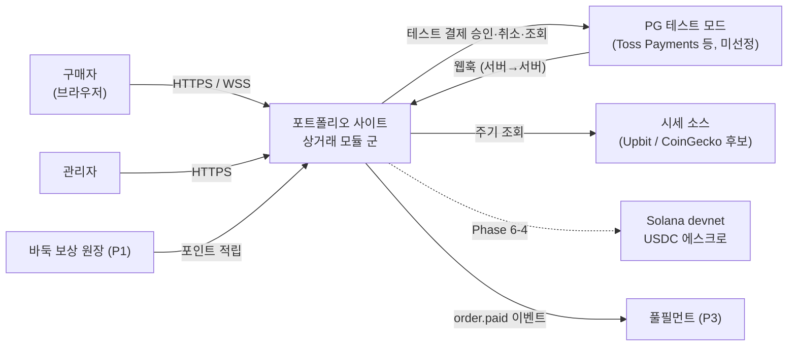

### 2.2 컨테이너와 데이터 경로

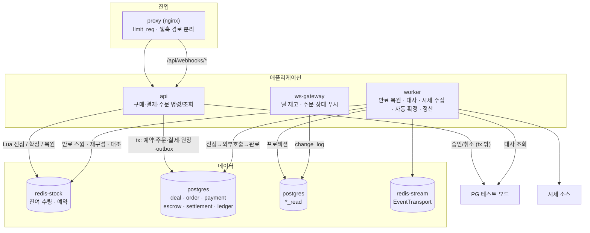

- `redis-stock`·`redis-stream` 은 **한 Redis 인스턴스의 논리 영역**(키 접두사 `pf:stock:`/`pf:evt:`, P0 §5 `pf:<용도>:`)이다(§0, P0 D6). 재고 영역의 키는 PG 로 언제든 재구성할 수 있어야 하며(§4.5), 전달(스트림) 영역은 Phase 3 부하 시험 뒤 채택이 판정될 때까지 비어 있을 수 있다.

### 2.3 모듈 지도 (상거래 군)

| 모듈 | 쓰기 스키마 | 읽기 스키마 | 책임 | 코드 수준 의존 |
|---|---|---|---|---|
| `catalog` | `catalog` | — | 상품 정의(SKU, 이름 ko/en, 설명, 이미지 참조, 상태) | — |
| `deal` | `deal` | `deal_read` | 타임딜, 재고 정본(`stock`), 예약(`reservation`), Redis 선점 게이트 | `catalog` 공개 조회 |
| `order` | `order` | `order_read` | 주문 집합체, **구매 확정 오케스트레이션**(§4.7), 상태 머신 | 포트만(아래) |
| `payment` | `payment` | `payment_read` | 결제 집합체, PG 어댑터, 웹훅 inbox, 환불, 견적 | `pricefeed` 공개 조회, `order` 공개 조회 |
| `escrow` | `escrow` | `escrow_read` | 에스크로 집합체(다리별 `escrow_leg` 포함). **Phase 3 은 hold/release/refund 만**, 분쟁·동결·자동 확정은 Phase 5 | `payment`/`order` 이벤트(inbox) |
| `settlement` | `settlement` | `settlement_read` | 판매자 정산 실행(USDC 환산), 정산 내역 | `escrow` 이벤트(inbox), `ledger` |
| `pricefeed` | `pricefeed` | — | 시세 스냅샷 수집·검증·보류 | — |
| `ledger` | `ledger` | `ledger_read` | 복식 원장(다중 자산 POINT/KRW/USDC). 스키마 정본은 §9, 보상 규칙은 P1 §10(P0 §2.5) | — |

- **순환 의존은 만들지 않는다.** 한 번에 여러 모듈을 바꿔야 하는 구매 확정은 §4.7 의 **트랜잭션 참여 포트**로 푼다.
- 각 모듈의 내부 구조는 M1 과 같다: `domain/ service/ usecase/{command,query,event}/ port/ adapter/ index`.

### 2.4 모듈 의존 (코드 수준)

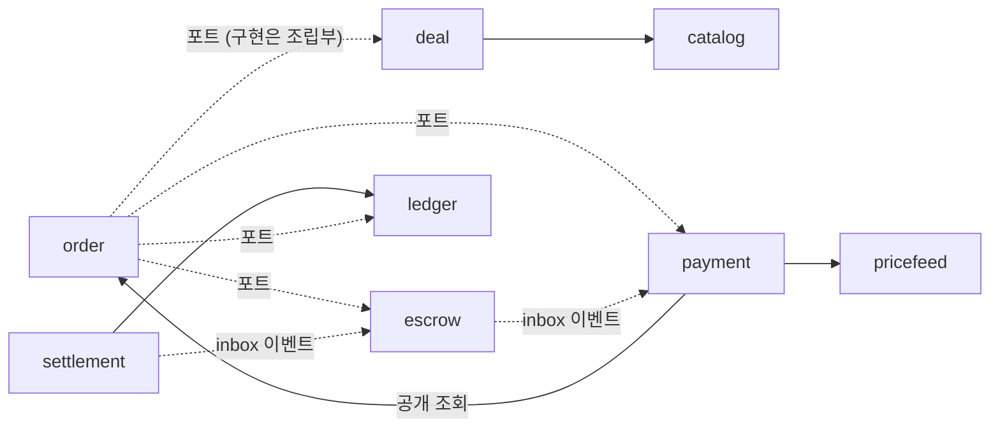

점선은 포트 또는 이벤트다. `order` 가 다른 모듈의 내부를 임포트하지 않는다(경계 규칙 B4 유지).

---

## 3. 카탈로그·타임딜 모델

### 3.1 용어

| 용어 | 뜻 |
|---|---|
| 상품(Product) | 팔 수 있는 것의 정의(SKU). 가격은 상품이 아니라 **딜**이 가진다 |
| 딜(Deal) | 기간·수량·가격·개인 한도가 정해진 한정 판매 |
| 재고(Stock) | 딜의 판매 가능 총량과 **확정된** 수량 |
| 예약(Reservation) | 결제 대기 동안 수량을 묶어 두는 임시 권리. 만료 시각이 있다 |

### 3.2 딜 수명 상태

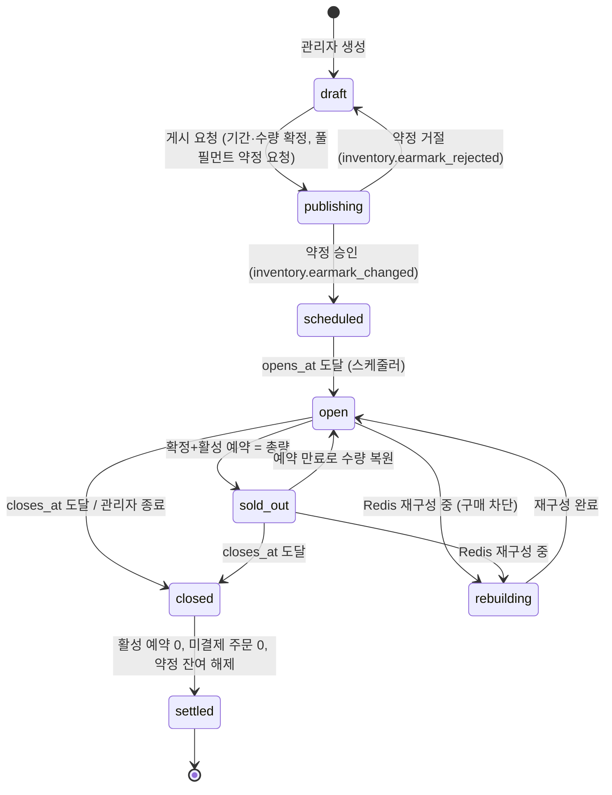

- `publishing` 은 **약정 승인을 기다리는 중간 상태**다. 게시 요청 트랜잭션이 `draft→publishing` 으로 바꾸고 `deal.published`(= 약정 요청, P3 가 소비)를 발행한다. 풀필먼트의 `inventory.earmark_changed` 를 받으면 `scheduled`, `inventory.earmark_rejected` 면 `draft` 로 **되돌린다**(`deal.publish_rejected` 발행, 관리자에게 사유 표시). `scheduled` 는 약정이 승인된 뒤에만 도달하므로 **약정 없는 딜이 열리지 않는다**.
- **약정 꺼짐 모드 (구현 순서 D24)**: `inventory`(6c)가 생기기 전까지는 `INVENTORY_EARMARK=off` 이고, 이때 `PublishDeal` 은 약정 요청 없이 `draft→publishing→scheduled` 를 **같은 트랜잭션에서 통과**한다(`deal.scheduled` 즉시 발행). 6c 에서 `on` 으로 바꾸면 위 약정 승인 흐름이 활성화되고, **진행 중(open/scheduled) 딜은 초기 약정 동기화 잡**으로 맞춘다(닫힘·정산 딜 제외, P0 §1.4 G5). **6c 착수 점검에는 '물리 재고 시드(딜 SKU 의 `inventory` 포지션)와 초기 약정 동기화'를 포함**한다 — 6c 이전에 확정된 주문은 `fulfillment_mode=demo` 로 남고 소급해 `physical` 로 바뀌지 않는다(§5.2.1).
- `rebuilding` 은 §4.5 의 Redis 재구성 동안만 거치는 상태이며 구매는 `UNAVAILABLE` 로 차단된다(재구성 전 상태 `open`/`sold_out` 으로 복귀).
- `closed → settled` 에서 **약정 잔여분을 해제**한다(§12.1): 해제량 = `total − confirmed`(= 판매되지 않은 수량만). 판매된 수량의 약정은 `order.paid` 소비(AcceptOrder)가 이미 또는 곧 소비한다.
- `sold_out` 은 **파생 표시 상태**에 가깝다. 예약이 만료되면 수량이 돌아와 다시 `open` 이 된다(마지막 1개를 두고 결제를 놓친 사람 때문에 영구 품절로 보이면 안 된다).
- 전이는 모두 기대 상태 조건부 UPDATE(`WHERE status = $expected AND version = $v`)다(ADR-021).

### 3.3 재고 정본은 Postgres, Redis 는 속도 게이트

ADR-010 의 결정(정본 = Postgres)을 유지하고, 역할을 **두 개의 게이트**로 명확히 한다.

| 게이트 | 어디 | 막는 것 | 틀렸을 때 |
|---|---|---|---|
| **빠른 게이트** | Redis `avail` 카운터(Lua 원자) | 폭주를 DB 앞에서 거절. 활성 예약 총량이 남은 수량을 넘지 못하게 한다 | 재구성 가능(§4.5). 틀려도 아래 하드 게이트가 초과 판매를 막는다 |
| **하드 게이트** | Postgres `deal.stock.confirmed ≤ total` `CHECK` + 조건부 UPDATE | **초과 확정**(= 초과 판매) | 틀리면 안 되는 정본. DB 제약이 마지막 방어선 |

> 이 두 게이트 구조가 **ADR-010 에서 한 가지를 조정**한다. ADR-010 은 확정 수량 차감을 outbox 소비자가 비동기로 한다고 적었으나, 비동기 차감으로는 DB 가 초과 확정을 **원자적으로 거절**할 수 없다. 이 설계는 확정 수량을 **구매 확정 트랜잭션 안에서 동기 갱신**하고(§4.7), 소비자는 읽기 모델·Redis 확정 동기화·통지를 맡는다. 근거와 대안은 ADR-038.

### 3.4 시간 모델

- 딜의 `opens_at`/`closes_at` 판정은 **Redis `TIME`**(스크립트 안)으로 한다. 앱 서버의 시계 차이가 판정에 끼지 않는다. (스크립트 안 `TIME` 사용은 Redis 8.10.3 에서 동작함을 확인했다 — 아래 §4.2.)
- Postgres 쪽 시각은 `tx.now`(M1 규약). 두 시계의 차이는 만료 판정에 영향을 주지 않도록 **예약 만료의 정본 시각은 PG 에 기록한 `expires_at`**, Redis 의 만료 점수는 속도용 사본으로 취급한다.

---

## 4. 재고 정합성 (ADR-010 상세화 / ADR-038)

### 4.1 불변식

```
(I1)  deal.stock.confirmed  ≤  deal.stock.total                      — DB CHECK, 언제나
(I2)  confirmed + (활성 예약 수량의 합)  ≤  total                    — 빠른 게이트가 지킴, 대조 작업이 점검
(I3)  어떤 예약도 confirmed 와 expired/released 중 하나로만 끝나고, 끝난 예약은 되돌아오지 않는다   — 조건부 UPDATE(CAS), 부활 없음(§6.7)
(I4)  수량 복원은 예약당 정확히 최대 1회                              — Lua 의 상태 검사 + PG CAS (부활이 없으므로 재복원 경로가 없다)
```

초과 판매 0건의 의미는 **(I1)** 이다. (I2)가 깨지면 일부 구매자가 결제 단계에서 거절될 수 있으나(고객 불편) 초과 판매는 아니다. (I2)는 대조 작업이 감시한다.

### 4.2 Redis 키 구조와 Lua 스크립트

키는 딜 단위 해시 태그 `{deal:<id>}` 로 묶는다. 단일 노드에서는 필요 없지만 클러스터 이전 시 한 슬롯에 모이도록 처음부터 맞춘다.

| 키 | 타입 | 내용 |
|---|---|---|
| `{deal:<id>}:meta` | hash | `state`(`open`…), `opens_ms`, `closes_ms`, `per_user_limit` |
| `{deal:<id>}:avail` | string(int) | 지금 선점 가능한 수량 |
| `{deal:<id>}:res` | hash | `resId → "userKey\|qty\|expiresMs\|state"` (`active`/`confirmed`/`released`) |
| `{deal:<id>}:exp` | zset | `resId`, 점수 = 만료 시각(ms) — 만료 스윕용 |
| `{deal:<id>}:user` | hash | `userKey → 보유 수량(활성 + 확정)` — 개인 한도 |
| `{deal:<id>}:idem:<key>` | string | `resId` (PX = 예약 TTL × 4) — 같은 요청 재생 |

**스크립트 4종** (`reserve`, `confirm`, `release`, `restock`). 동작 요약은 아래이고, 실제 Redis 로 돌려 본 결과는 §4.6 시험표에 있다(재현 스크립트는 별도 보관하지 않고 결과만 기록한다. 구현 시 §4.6 의 항목을 시험 코드로 다시 쓴다).

```lua
-- reserve  KEYS: meta, avail, res, exp, user, idem   ARGV: resId, userKey, qty, ttlMs
local t   = redis.call('TIME')
local now = tonumber(t[1]) * 1000 + math.floor(tonumber(t[2]) / 1000)
local existing = redis.call('GET', KEYS[6])
if existing then return {'REPLAY', existing, redis.call('HGET', KEYS[3], existing) or ''} end
if redis.call('HGET', KEYS[1], 'state') ~= 'open' then return {'UNAVAILABLE', 'state'} end   -- 키 없음 = fail-closed
if now <  tonumber(redis.call('HGET', KEYS[1], 'opens_ms'))  then return {'NOT_OPEN'} end
if now >= tonumber(redis.call('HGET', KEYS[1], 'closes_ms')) then return {'CLOSED'} end
local qty  = tonumber(ARGV[3])
local used = tonumber(redis.call('HGET', KEYS[5], ARGV[2]) or '0')
if used + qty > tonumber(redis.call('HGET', KEYS[1], 'per_user_limit')) then return {'LIMIT', tostring(used)} end
local avail = tonumber(redis.call('GET', KEYS[2]) or '-1')
if avail < 0   then return {'UNAVAILABLE', 'no_avail_key'} end
if avail < qty then return {'SOLD_OUT'} end
redis.call('DECRBY', KEYS[2], qty)
local exp = now + tonumber(ARGV[4])
redis.call('HSET', KEYS[3], ARGV[1], ARGV[2] .. '|' .. qty .. '|' .. exp .. '|active')
redis.call('ZADD', KEYS[4], exp, ARGV[1])
redis.call('HSET', KEYS[5], ARGV[2], used + qty)
redis.call('SET',  KEYS[6], ARGV[1], 'PX', tonumber(ARGV[4]) * 4)
return {'OK', ARGV[1], tostring(exp)}
```

| 스크립트 | 입력 | 효과 | 멱등 성질 |
|---|---|---|---|
| `reserve` | 딜, resId, userKey, 수량, TTL, 멱등 키 | 잔여 확인 → 감소 → 예약 기록 → 만료 큐 → 개인 보유 증가 | 같은 멱등 키 재호출은 `REPLAY` 로 **같은 resId** 를 돌려준다 |
| `confirm` | resId | `active → confirmed`, 만료 큐에서 제거(수량은 이미 감소된 상태 유지) | 이미 confirmed 면 `NOOP` |
| `release` | resId | `active` 일 때만 수량 복원 + 개인 보유 감소 + `released` 표시 + 만료 큐 제거 | `active` 가 아니면 `NOOP` — **두 번 호출돼도 한 번만 복원** |
| `restock` | orderId(멱등 키 `restock:<orderId>`), userKey, qty | **이미 `confirmed` 인 구매의 출고 전 취소**(§6.6) 시 `avail +qty`, `user` 보유 `−qty`. 딜이 `open`/`sold_out` 일 때만 | 멱등 키가 있으면 `NOOP` — 두 번 호출돼도 한 번만 복원. `release` 와 달리 `active` 예약이 아니라 **확정 수량**을 되돌린다 |

- 결과 코드: `OK`, `REPLAY`, `SOLD_OUT`, `LIMIT`, `NOT_OPEN`, `CLOSED`, `UNAVAILABLE`(메타·수량 키 없음 = 재구성 필요, **fail-closed**), 복원 쪽은 `RELEASED`, `NOOP`, `ABSENT`, `REJECT`.
- 스크립트는 **외부 호출·긴 루프를 하지 않는다**(Redis 단일 스레드). 모든 입력은 `KEYS`/`ARGV` 로 명시한다.
- `avail` 키가 없으면 `UNAVAILABLE` 로 거절한다. **Redis 유실 직후에 구매가 새어 나가지 않게 하는 안전장치**다(실측: `FLUSHALL` 후 `UNAVAILABLE`/`missing`).

### 4.3 예약 상태 머신

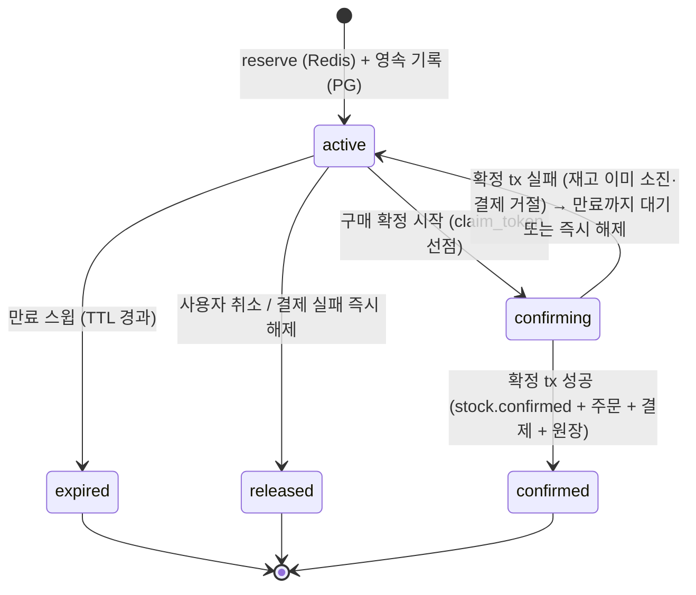

- 전이는 모두 **기대 상태 조건부 UPDATE** 다. 결제 확정과 만료 복원이 동시에 와도 한쪽만 성공한다(ADR-010, 021).
- `confirming` 은 임대(`lease_until`)와 `claim_token` 을 가진다. 임대가 지난 `confirming` 은 reaper 가 `active` 로 되돌린다(F13 EV-05).
- Redis 의 상태(`active`/`confirmed`/`released`)는 PG 상태의 **사본**이다. 불일치는 대조 작업이 PG 기준으로 교정한다.
- `expired`·`released`·`confirmed` 는 **종결 상태**다. 만료된 예약을 되살리지 않는다. 늦은 결제가 도착하면 **새 예약**을 만들어 같은 흐름을 탄다(§6.7). 이 덕분에 (I3)(I4)가 예외 없이 성립한다.

### 4.4 예약 흐름 (정상, Phase 3)

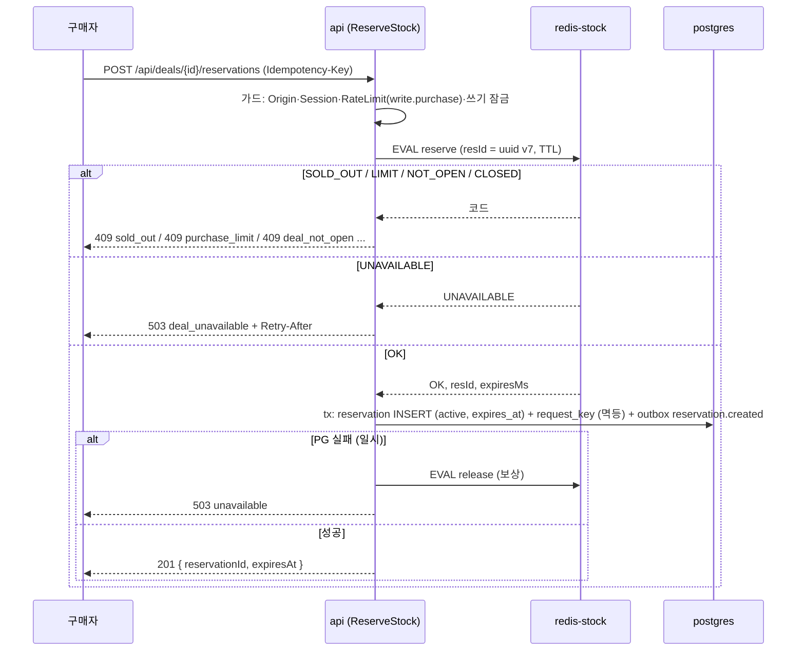

- **응답은 PG 영속 기록 이후에만** 돌려준다. 그래서 구매자가 가진 예약은 항상 PG 에 있다. Redis 에만 있는 예약은 아직 아무에게도 약속되지 않은 것이다(→ 회수해도 안전, §4.5).
- PG 영속 기록이 실패하면 즉시 `release` 로 보상한다. 그 보상마저 실패하면 고아 예약이 남고, 대조 작업이 TTL 후 회수한다.

### 4.5 Redis 장애·재시작·불일치 복구

| 상황 | 탐지 | 조치 |
|---|---|---|
| Redis 재시작/유실 | `UNAVAILABLE`(키 없음) 급증, `pf_redis_stock_missing_total` | 구매 **자동 차단(fail-closed)** → 재구성 잡이 PG 로 키 재생성 → 차단 해제 |
| Redis 에만 있는 예약(고아) | 대조 잡: Redis `res` 중 PG 에 없는 것 중 생성 후 grace(제안 10초) 초과 | `release` 로 회수 |
| PG 에 `active` 인데 Redis 에 없음 | 대조 잡 | Redis 재생성(재구성에 포함) 또는 PG 쪽 `expired` 처리 |
| `avail` 수치 불일치 | 대조 잡: `total - confirmed - Σactive` vs `avail` | **PG 기준으로 교정**, 지표 `pf_redis_stock_drift`, 경보 |

**재구성 절차 (`worker deal:rebuild-stock <dealId>`, 멱등)**

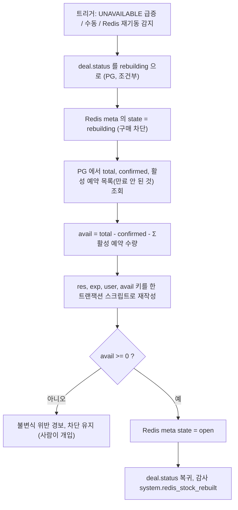

- 재구성 중에는 구매가 거절되므로(`UNAVAILABLE`) 짧은 점검 창이 생긴다. 이것이 의도된 fail-closed 다.
- 유실 시점에 **Redis 에만 있던 예약**(PG 영속 기록 전)은 재구성에서 사라진다. 응답을 받지 못한 구매자에게는 영향이 없다(§4.4).

### 4.6 초과 판매 0 불변식의 논거

1. **(I1) 은 DB 제약이다.** 확정 수량 갱신은 `UPDATE stock SET confirmed = confirmed + $q WHERE deal_id = $d AND confirmed + $q <= total` 이고, 제약 `CHECK (confirmed >= 0 AND confirmed <= total)` 가 조건 없는 갱신까지 거절한다. 앱이나 Redis 가 어떻게 틀려도 `confirmed > total` 은 저장될 수 없다.
2. **이중 확정은 CAS 로 막힌다.** 예약 한 건은 `active/confirming → confirmed` 가 조건부 UPDATE 이므로 두 번 확정될 수 없다.
3. **Redis 는 (I1) 에 기여하지 않는다.** Redis 는 불필요한 시도를 DB 앞에서 걸러 부하와 고객 불편을 줄일 뿐, 정합성의 근거가 아니다.
4. **복원은 최대 1회.** `release` 는 `active` 에서만 복원하고, PG 의 `active → expired` CAS 도 한 번이다.
5. **깨질 수 있는 지점**과 대응: 확정 tx 에서 (I1) 로 거절되면(`Exhausted` — Redis 가 과대 선점을 허용한 경우) **결제를 되돌린다** — 포인트 결제는 같은 tx 라 자동 롤백이고, 카드 결제는 `refund_pending` 을 거쳐 PG 취소 호출로 보상한다(§6.3·§6.6). **같은 예약·같은 주문의 중복 확정(`AlreadyConfirmed`)은 소진이 아니라 NOOP** 이며 결제를 취소하지 않는다(§4.7).

시험으로 이 논거를 확인했다.

| 시험 (로컬, 2026-11-04) | 결과 |
|---|---|
| Redis `reserve` — 재고 100, 서로 다른 5000명이 동시 | `OK` 100 / `SOLD_OUT` 4900, `avail` 0 |
| 같은 멱등 키 500회 동시 | 예약 1, `REPLAY` 499, resId 1종 |
| 개인 한도 2, 같은 사용자 50회 동시 | `OK` 2 / `LIMIT` 48 |
| `release` 20회 동시 | `RELEASED` 1 / `NOOP` 19, 수량 한 번만 복원 |
| `confirm` vs `release` 경합 | `confirm` 만 성공, 이후 `release` 는 `NOOP` |
| 재고 7, 수량 2 요청 200건 | 3건 성공, 잔여 1 (홀수 잔여 정상) |
| `FLUSHALL` 후 `reserve` | `UNAVAILABLE` (fail-closed) |
| PG 하드 게이트 — 재고 100, 동시 확정 3000건 | 성공 100 / 거절 2900, 최종 `confirmed` = 100 |
| 조건 없는 `UPDATE confirmed + 1` | `CHECK` 로 거절 |
| 같은 예약을 50개 연결이 동시에 확정 | 승자 1 |

### 4.7 구매 확정 트랜잭션과 모듈 경계 (`ConfirmPurchase`)

구매 확정은 한 트랜잭션에서 **여러 모듈의 쓰기**를 묶어야 (I1) 을 원자적으로 지킬 수 있다. M1 의 `OutboxWriter`·`AuditWriter` 선례를 일반화한다.

| 원칙 | 내용 |
|---|---|
| 조율자 | `order` 모듈의 `ConfirmPurchase` usecase 가 트랜잭션 경계 |
| 참여 방식 | 층 규칙상 `order`(L4)는 `deal`(L3)·`ledger`(L4)를 **직접** 호출하고, 상위 층인 `payment`·`escrow`(L5)는 `order/port` 의 `PaymentRecordPort`·`EscrowHoldPort` 를 **소비자 쪽에서 정의**해 두고 구현은 각 모듈이 노출한 **`…InTx(tx, input)` 공개 함수**를 조립부(`apps/api/compose`)가 연결한다 |
| 중첩 금지 유지 | 참여 함수는 트랜잭션을 열지 않고 받은 `TxContext` 를 쓴다(`uow.run` 중첩이 아님) |
| 경계 규칙 | **B12 정본은 [P0 §2.4](00-platform-evolution.md)** — 이 경로는 허용 쌍 #2(order→deal 직접), #3(order→ledger 직접), #4(order→payment, **order 소유 `PaymentRecordPort` 로 의존 역전**), #5(order→escrow, `EscrowHoldPort`)에 해당한다. 함수 이름은 `…InTx`(`ConfirmStockInTx`·`PostJournalInTx`·`RecordPaymentInTx`·`HoldInTx`), 첫 인자 `TxContext`, 새 트랜잭션을 열지 않는다. 목록 밖 호출은 CI 가 막는다 |
| 결과 열거 | `ConfirmStockInTx` 는 `Confirmed` / `AlreadyConfirmed(sameOrder)` / `Exhausted` 셋 중 하나를 돌려준다. **`AlreadyConfirmed`**: 같은 예약이 이미 `confirmed` 이고 그 예약의 주문이 `paid` 이상(= 다른 경로가 먼저 정상 확정) → **NOOP**(롤백 없이 기존 결과를 돌려줌, 결제 취소 금지). **`Exhausted`**: 예약은 아직 확정되지 않았는데 `confirmed + q <= total` 조건이 0행(= 재고 소진) → 롤백하고 `rejected_stock`. 판별은 같은 tx 에서 예약 상태(`SELECT … FOR UPDATE` 후 `status`)를 먼저 읽어 `confirmed` 면 `AlreadyConfirmed` 로 분기한다 |
| 경로별 완료 | API 승인 경로는 payment `claim_token`(임대)으로, **웹훅·대사 경로는 inbox 메시지의 `claim_token` + payment 행 `version` CAS** 로 직렬화한다(별도 예약 `claim_token` 불필요). 세 경로가 동시에 같은 결제에 도착해도 예약 CAS 가 한 번만 성공시키고 나머지는 `AlreadyConfirmed` 로 NOOP |
| 락 순서 (전역 규약) | 행 잠금은 모든 tx 에서 **`reservation` → `deal.stock` → `user_purchase` → `payment` → `escrow` → `ledger` 계정(`account_balance`, id 오름차순) → `order`** 한 순서다. 확정 tx·환불 tx(§6.6: `payment` → `escrow` → 계정)·정산 tx(§8.5: 자기 `settlement` 행 → 계정, `escrow` 는 종결 상태라 잠그지 않는다)·지급/교환 tx(`grant`/`exchange_quote` → `supply_cap` → 계정)가 모두 이 순서의 부분 수열이다. 순서가 다른 경로를 만들면 교착한다(ADR-021, ADR-038, ADR-040, P0 §2.4) |
| 대안(사가) | 단계별 tx + 보상. 정합성은 약하고 보상 경로가 늘어 기각(ADR-038) |

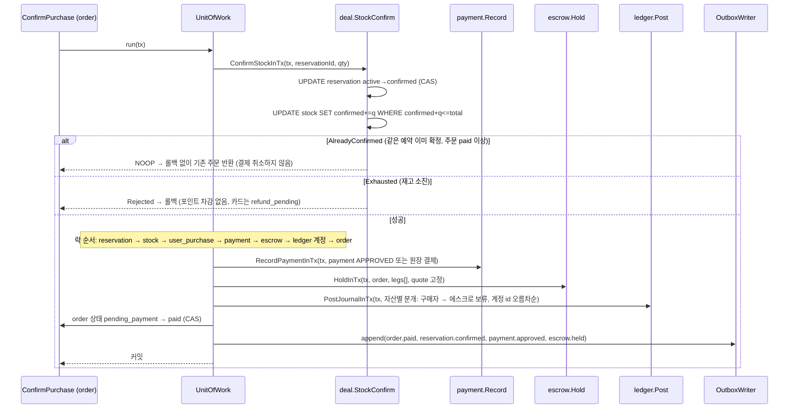

- Phase 3(원장 결제)은 `payment.RecordPaymentInTx` 가 다리별 원장 차감을 포함하므로 **외부 호출이 없어 한 트랜잭션으로 끝난다.** 최소 `escrow`(`HoldInTx`)도 Phase 3 부터 같은 tx 에 참여한다.
- Phase 5(카드)는 PG 승인 호출이 **트랜잭션 밖**(§6.3)이고, 승인 성공 뒤 이 확정 tx 로 들어온다.

### 4.8 타임딜 오픈 순간의 폭주 처리

| 계층 | 장치 | 값(제안, 측정 후 조정) |
|---|---|---|
| 접속 주소 | nginx `limit_req` (기존 `pf_write` zone 재사용 또는 `pf_purchase` 신설), `limit_conn` | 접속 주소당 5r/s, burst 10 |
| 세션 | 앱 `RateLimitGuard` 등급 `write.purchase` | 세션당 10회/분, burst 3 |
| 멱등 | `Idempotency-Key` 필수. 같은 키 재요청은 `REPLAY` | 키 TTL = 예약 TTL × 4 |
| 입장 제어 | `reserve` 호출 앞의 **입장 토큰 버킷**(Redis `INCR` 윈도우): 초당 최대 N건만 Redis/PG 로 통과, 나머지는 `429 + Retry-After(지터)` | N = 200/s (제안, k6 로 PG 쓰기 한계 측정 후 확정) |
| 품절 단축 | `deal_sold_out` 플래그를 api 프로세스에 1초 캐시. 품절 후 요청은 Redis 를 부르지 않고 즉시 `409 sold_out` | 캐시 1초 |
| 오픈 전 | 클라이언트는 `GET /api/deals/{id}` 와 WS 휘발성 `deal.state` 로 대기. 오픈 시각 이전 `reserve` 는 `NOT_OPEN` | — |
| 대기실(옵션) | 가상 대기열(번호표) — M1 규모에는 과해서 **범위 밖**, 미결 | — |

### 4.9 k6 부하 시험 설계 (ADR-013 규칙 준수)

**원칙**: 합격선은 정합성(0건)이고, 성능 수치는 **측정 후에 기록**한다(합격선이 아니다). 결과표에는 환경(CPU·메모리·Redis/PG 버전·k6 위치·루프백 여부)을 함께 적는다.

| ID | 시나리오 | 설정 | 합격 기준 |
|---|---|---|---|
| L1 | 초과 판매 사냥 | 재고 100, 서로 다른 사용자 5,000 VU 동시(`constant-arrival-rate` 램프). **시험 조건은 아래 "L1 시험 전제"** | `confirmed` = 정확히 100, `OK` 응답 ≤ 100+(만료 복원분), **초과 판매 0** |
| L2 | 같은 키 폭풍 | 동일 `Idempotency-Key` 로 500회 | 예약 1건, 나머지 REPLAY |
| L3 | 개인 한도 | 한 사용자 다중 기기 50회 | 한도 이하만 성공 |
| L4 | 만료 복원 | TTL 짧게, 일부만 결제 | 수량 복원 정확, 재오픈 시 구매 가능 |
| L5 | 마지막 1개 경합 | 재고 1, 1,000 동시 | 정확히 1명 |
| L6 | 카오스 A | L1 도중 Redis 재고 영역 키 전량 삭제(`FLUSHALL`)/재시작 | 구매 일시 차단 후 재구성, **초과 판매 0**, 불변식 위반 0 |
| L7 | 카오스 B | 예약 후 api 강제 종료(kill -9) | 고아 예약 회수, 수량 보존 |
| L8 | 카오스 C | 확정 tx 도중 worker/DB 연결 단절 | 중복 확정 없음, 재시도 후 일관 |
| L9 | 비교(ADR-010 요구) | 같은 부하를 **PG 행 잠금만** 쓰는 변형과 나란히 | Redis 방식의 처리량·지연 이점을 수치로 기록(이점이 없으면 ADR 재검토) |
| L10 | 오픈 폭주 | 오픈 시각에 램프 5,000 req/s(환경 한계까지) | 오류율·429 비율·p95 기록, 정합성 유지 |

- **L1 시험 전제(우회 구성)**: ① 로그인 필수·세션당 `write.purchase` 10회/분 때문에 **5,000개 세션을 시험 시작 전에 사전 생성**한다(시험 전용 시드 스크립트가 `identity.session` 행과 토큰을 만들고 k6 가 토큰 파일을 읽는다). ② 단일 호스트 k6 는 접속 주소가 하나라 nginx 접속 주소 제한(5r/s, burst 10)에 막힌다 → 이 시험은 **nginx 를 우회**(api 직접 호출)하거나 시험용 설정에서 `pf_purchase` zone 을 끄고 k6 를 별도 호스트로 둔다. 어느 쪽이든 **그 사실을 결과표 환경란에 적는다**. ③ 입장 토큰 버킷(N=200/s)은 L1·L10 에서 **켠 경우와 끈 경우를 모두** 측정한다(끈 경우가 Redis/PG 한계, 켠 경우가 운영 구성). ④ 앱 세션 속도 제한도 시험 전용 등급으로 완화하고 완화 값을 기록한다. 이 전제를 쓰지 않으면 시험이 429 로 끝나 정합성이 아니라 제한 장치를 시험하게 된다.
- **참고치(로컬 사전 측정, 합격선 아님)**: Redis `reserve` 스크립트는 단일 연결 파이프라인에서 약 4만~5만 건/초, 예약 1건당 Redis 메모리 약 525B(예약·만료 큐·개인 보유·멱등 키 포함). PG 의 핫 로우 확정 UPDATE 는 거절이 섞이면 약 4천 tps, **성공 확정만 연속**이면 약 590 tps(WSL2·도커 볼륨, 동기 커밋). **이 590 tps 는 `stock` 행 하나만 갱신한 값이다.** 실제 확정 tx 는 `stock` 락을 쥔 채 `user_purchase`·`payment`·`escrow`·`ledger`·`order` 를 쓰고 커밋하므로 **전체 경로의 처리량은 측정하지 않았고 더 낮다**(합격선도 한계 근거도 아님). 또한 모든 구매 확정이 같은 시스템 계정(`liab:escrow:*`, `asset:pg_receivable:KRW`)의 `account_balance` 행을 갱신하는 **전역 핫 로우**가 있다(§4.10). 확정 성공 건수는 **재고 수량으로 상한**이 걸리므로(100~수천 개) 문제가 되지 않지만, 재고가 매우 크면(수십만) `stock` 을 샤드 행으로 나누는 안이 필요하다(§4.10, 미결).
- **측정 한계**: 단일 호스트에서 k6 와 서버가 CPU 를 나눠 쓴다. 루프백이라 네트워크 지연이 없다. Funnel 경유 수치는 별도로 잰다.
- 결과는 `docs/` 에 표로 남기고(재현 스크립트 포함), L9 결과로 ADR-010 의 "Redis 가 이기는가" 를 증명한다.

### 4.10 확장 한계와 대안

| 한계 | 설명 | 대안 |
|---|---|---|
| 핫 로우 | 한 딜의 `stock` 한 행에 확정이 모인다(~590 tps 참고치) | 재고가 크면 `stock_shard(deal_id, shard, total, confirmed)` 로 분할, 확정 시 샤드를 해시 선택하고 총합은 읽기 모델로 |
| 전역 시스템 계정 핫 로우 | 모든 확정이 같은 `liab:escrow:{KRW\|POINT}`·`asset:pg_receivable:KRW` 잔액 행을 갱신해 딜을 가로질러 직렬화된다(`stock` 샤딩으로는 풀리지 않음) | 시스템 계정은 **샤드 계정**(`liab:escrow:KRW#00..#15`, 확정 시 `hash(orderId)` 로 선택, 합은 대사 질의가 계산)으로 분할하는 안을 검토. 필요성은 전체 경로 부하 시험(L1, 확정 경로 포함)의 결과로 판정(미결) |
| 단일 Redis | 단일 노드, 클러스터 아님 | 해시 태그로 딜 단위 슬롯 고정이 되어 있어 이전 가능 |
| 한 딜 한 인스턴스 | 가용성은 단일 노드 한계 | 복제본+센티넬은 M1 자원 밖(미결) |

### 4.11 예약 TTL

ADR-010 은 "측정 전에는 값을 두지 않고 설정으로 뺀다"고 했다. 이 문서의 초기값은 **포인트 결제 60초, 카드 결제 10분(제안)** 이다. 카드는 결제창 이탈·인증 지연이 있어 길고, 포인트는 클릭 한 번이라 짧다. 결제 방식별 TTL 은 `deal.reservation_ttl_seconds{method}` 설정이며, 실제 결제 시간 분포를 측정한 뒤 조정한다. 너무 짧으면 정상 결제를 거절하고(§6.7 늦은 결제), 너무 길면 재고가 묶인다.

---

## 5. 주문 도메인 (`order`)

### 5.1 범위 한정 (장바구니)

- **Phase 3~5 의 주문은 "딜 예약 1건 → 주문 1건(라인 1개)"이다.** 장바구니·다건 결제는 만들지 않는다(YAGNI). 모델은 `order_line` 을 두어 라인이 여러 개가 되어도 깨지지 않게 하되, 생성 경로는 예약 기반 하나뿐이다.
- 딜이 아닌 일반 카탈로그 상품의 구매가 풀필먼트(P3)에서 필요해지면, `Availability` 포트(`DealAvailability` = Redis 게이트, `InventoryAvailability` = 창고 재고)를 구현만 추가하면 같은 주문 흐름을 쓴다.

### 5.2 주문 상태 머신

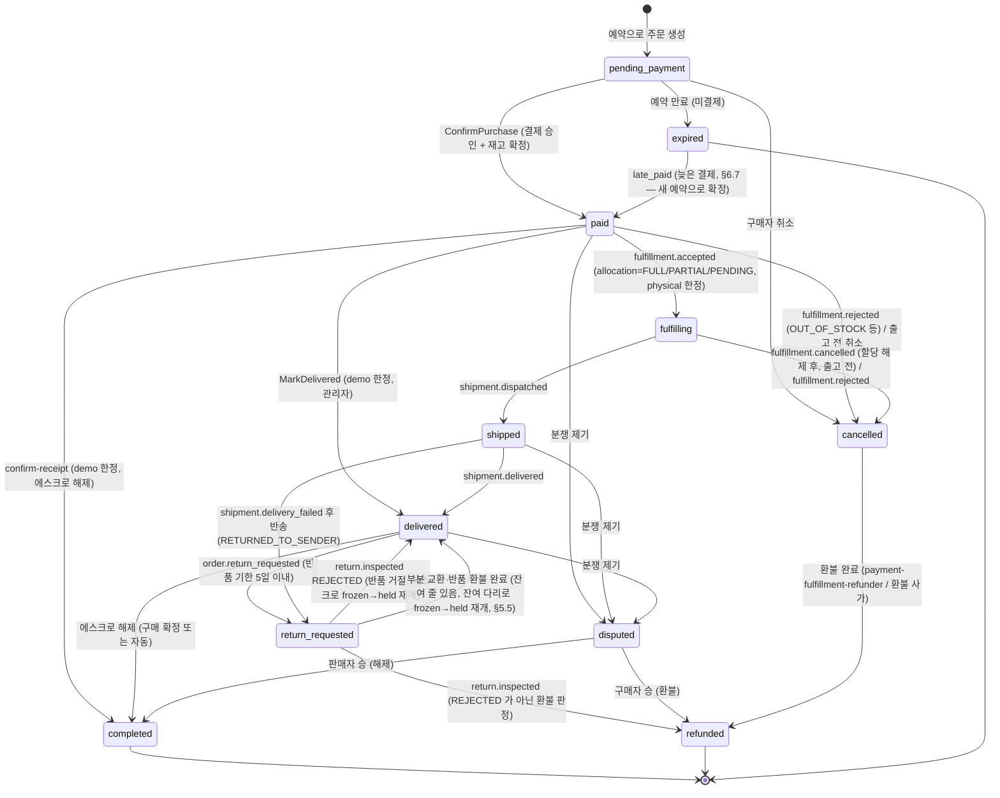

| 규칙 | 내용 |
|---|---|
| 전이 | 모두 `UPDATE … SET status = $to, version = version + 1 WHERE id = $id AND status = $from AND version = $v` (ADR-021). 허용 표(from→to)는 `OrderTransitionTable` 한 곳에 둔다 |
| 이력 | `order.order_status_history` 추가 전용(누가·언제·무엇이·원인 이벤트) |
| 외부 주도 전이 | `fulfilling`/`shipped`/`delivered`/`return_requested` 의 후속은 풀필먼트 이벤트의 inbox 소비로만 일어난다(주문이 풀필먼트를 직접 호출하지 않는다) |
| `fulfilling → cancelled` | `fulfillment.accepted` 는 AcceptOrder 단일 tx 가 접수(+할당 시도)를 끝낸 뒤 발행되고 페이로드에 `allocation(FULL\|PARTIAL\|PENDING)`·`lines[{lineId, qtyAllocated}]` 를 싣는다(P3 판본이 정본, `PENDING` 은 접수 후 할당 대기). 주문이 `fulfilling` 이 된 뒤에도 PICKING 중 취소 등으로 `fulfillment.cancelled`·`rejected` 가 올 수 있다. 이 전이를 허용 표에 둔다(없으면 상태 머신이 막힌다). 출고(PACKED 이후)는 취소가 아니라 반품 경로 |
| 반품 | `delivered` 후 **반품 가능 기한 5일**(`RETURN_WINDOW_DAYS`, 제안) 안에서만 `order.return_requested`; **5일을 넘긴 요청은 `409 return_window_closed` 로 거절**한다. 기한은 에스크로 자동 해제(7일)보다 **짧게** 두어 반품 요청이 해제 전에 도달하도록 한다(§7.2). 요청 시 에스크로 해제를 동결(`held→frozen`)한다(§7.1). 검수 결과 `return.inspected{disposition ∈ RESTOCK\|DISPOSE\|REFUND_ONLY\|REJECTED}` 중 `REJECTED` 는 환불 없이 `return_requested → delivered` 로 되돌리고 에스크로를 `frozen→held` 로 재개하며, 같은 주문의 **반품 재요청은 막는다**. `demo` 주문(§5.2.1)에는 반품 경로가 없다 |
| 교환 | 반품 기한(5일) 안에서 반품 요청에 **교환 의사**를 실을 수 있다(U23). 교환은 새 주문 상태가 아니라 **반품 케이스 + `exchange_of_order_id` 로 연결된 신규 주문**이며, 원 주문은 반품과 같은 `return_requested` 경로를 탄다. 흐름·가격차·순서는 §5.5. `demo` 주문에는 교환 경로가 없다 |
| 환불 후속 | `cancelled`·`return_requested`(`REJECTED` 가 아닌 환불 판정)의 환불은 `payment-fulfillment-refunder`(§6.6)가 근거 이벤트를 소비해 수행한다. 주문 상태는 `payment.refunded` 소비로 `refunded` 가 된다 |
| 이벤트 역전 | 늦게 온 이벤트가 이미 지나간 상태로 되돌리지 못한다. 상태 순위(rank)가 낮아지는 전이는 `NOOP` 으로 흡수한다 |

#### 5.2.1 `fulfillment_mode` — 풀필먼트가 없는 구간의 주문 (demo / physical)

주문은 `fulfillment_mode ∈ {demo, physical}` 을 갖는다. **`ConfirmPurchase` 시점에 풀필먼트(6c)가 켜져 있지 않으면 `demo`, 켜져 있으면 `physical`** 로 한 번 정해지고 바뀌지 않는다(`INVENTORY_EARMARK` 와 같은 스위치).

| 항목 | `demo` | `physical` |
|---|---|---|
| `order.paid` 소비 | 풀필먼트가 소비하지 않는다(페이로드 `fulfillmentMode='demo'` 를 보고 건너뜀) | 풀필먼트가 접수 → 출고 |
| 종결 경로 | 관리자 `MarkDelivered`(`paid→delivered`, `delivered_at` 기록, `order.demo_delivered` 발행) 또는 구매자 `confirm-receipt`(`paid` 에서 허용, `paid→completed`, 에스크로 `held→released`) | 풀필먼트 이벤트(`shipment.delivered` …) |
| 에스크로 자동 해제 | Phase 3 은 수동만. **Phase 5 부터** `MarkDelivered` 후 `ESCROW_AUTO_RELEASE_DAYS_AFTER_DELIVERY` 를 **`ESCROW_TIME_SCALE` 로 압축**해 재현(Phase 5 DoD 의 재현 경로, 며칠을 기다리지 않는다) | `shipment.delivered` 후 7일(압축 가능) |
| 반품·배송 실패 | 없음 | §5.2 |
| 배송지 익명화 기준 | 종결(수령 확인/`MarkDelivered`) 후 30일 | 배송 완료 + 반품 기한 5일 + 30일(§5.4) |

- **`legacy_demo` 와 `LegacyDemoOrderClosure` 는 완전히 폐기**한다. Phase 3 에도 스냅샷·에스크로가 있으므로 Phase 5 착수 시 정리할 별도 주문 유형이 없다. 풀필먼트 쪽의 `legacy_demo` 소비자 필터도 필요 없다(P0 G6).
- `demo` 주문의 에스크로·정산은 `physical` 과 같은 경로를 탄다(`escrow-order-reactor` 는 `order.demo_delivered` 를 `shipment.delivered` 와 같게 취급해 `release_due_at` 을 설정한다).

### 5.3 주문 번호·멱등

| 항목 | 규칙 |
|---|---|
| 주문 번호 | `ORD-YYMMDD-XXXXXXXX` — 날짜 + Crockford base32 8자(uuid v7 의 난수부 파생, 5비트×8 = 40비트). **순차 번호를 쓰지 않는다**(주문량 추정 방지). 유일 제약 위반 시 재생성(최대 3회) |
| 주문 생성 멱등 | `order.reservation_id` **유일**(예약 한 건당 주문 한 건) + `Idempotency-Key`(`request_key`). 같은 요청 재전송은 같은 주문을 돌려준다 |
| 금액 | KRW 정수(원). `total_krw = Σ(unit_price × qty)`, 생성 시 `order_line` 에 이름·단가 **스냅샷**(딜 가격이 나중에 바뀌어도 불변) |
| 만료 | 미결제 주문은 예약 만료와 함께 `expired`. 별도 타이머가 아니라 `reservation.expired` 이벤트로 전이 |

### 5.4 배송지 (개인정보)

- 수령인 이름·전화·주소는 **PII** 이며 `shipping_address_enc`(JSON 한 덩어리를 `FieldCipher` 로 암호화한 text)로 저장한다. 평문 컬럼 없음, 이벤트·읽기 모델·로그에 싣지 않는다(ADR-026 확장).
- 풀필먼트에는 주소 원문이 아니라 **`shippingAddressRef`(불투명 참조 `<orderId>:<addressRev>`, 정정 시 rev 증가)** 만 전달하고, 풀필먼트가 **접수(AcceptOrder) 시점에** `order.GetShippingAddress` 공개 usecase 를 호출한다(풀필먼트는 자기 키로 다시 암호화한 사본을 둔다, [P0 §9.6](00-platform-evolution.md))(관리자·워커 권한, 감사 `system.shipping_address_read` 기록).
- ADR-026 의 재검토 조건("암호화 필드 3개 이상이면 KEK/DEK 로 상향")에 **이 필드와 `escrow_dispute.reason_enc`, `payment.provider_payment_key_enc` 가 더해져** 필드가 4개가 된다. Phase 5 착수 시 KEK/DEK 상향을 결정한다(미결, §20).
- 보관: `physical` 주문은 **배송 완료 + 반품 기한 5일 + 30일**(취소는 취소 후 30일), `demo` 주문은 **종결(수령 확인/`MarkDelivered`) 후 30일** 지나면 주소를 익명화(암호문 삭제)한다(제안, 모의 데이터라도 정책을 시연). 주문 자체는 보관(금융 기록).

### 5.5 상품 교환 (U23) — 반품 케이스 + 연결된 신규 주문

> **용어.** 이 문서에서 "교환"은 이미 §8.2.1~8.2.2 의 **USDC→POINT 화폐 교환**(`ExchangeUsdcToPoint`, ST-15)을 뜻한다. 이 절의 **상품 교환**(구매한 상품을 다른 상품·옵션으로 바꾸는 것)은 이름이 겹치지 않게 `Exchange` 접두 대신 **`order_exchange`·`RequestExchange`** 로 쓰고, API 도 `/api/orders/{id}/exchanges` 로 분리한다. 화폐 교환의 견적·속도 제한 등급(`write.exchange`)과 무관하다.
>
> **결정 이력.** 처음 설계는 "반품 후 재주문"(교환을 반품 + 구매자의 새 주문으로 단순화)이었으나 사용자가 **교환 흐름 구현**을 선택했다(2026-11-05, U23 — 권장안과 다르게 사용자가 변경). 아래는 그 확장 설계이며 값(기한·등급)은 제안이다.

#### 5.5.1 모델

| 항목 | 내용 |
|---|---|
| 연결 | 신규 주문 `order.exchange_of_order_id`(NULL 이면 일반 주문) = 원 주문. 교환 한 건은 `order_exchange` 행(§10.3)이 원 주문·신규 주문·`returnId` 를 묶는다 |
| 대상 | 원 주문의 **줄·수량 단위**(부분 교환 가능). 같은 줄에 대한 반품·교환 총량은 `order_line.qty_returned + 요청 ≤ qty` 조건부 UPDATE 로 막는다(동시 이중 요청 방지) |
| 신규 주문 줄 | 카탈로그 정가의 일반 SKU 만. **타임딜 줄은 허용하지 않는다**(딜 재고 `confirmed`·개인 한도(I1)를 다시 거치는 경로를 만들지 않으려는 범위 한정, 제안) → `409 exchange_not_allowed`. 신규 주문은 `deal_id` 와 `reservation_id` 가 NULL 이다(`UNIQUE(reservation_id)` 는 NULL 을 허용) |
| 재고 | 상거래의 Redis 게이트를 거치지 않는다. 요청 시 P3 의 읽기 usecase `CheckExchangeAvailability`(ATP 조회, 확약 아님)로 사전 확인하고, 실제 확보는 신규 주문의 `order.paid` 를 받은 풀필먼트의 `AcceptOrder` 할당이 한다(§5.5.5). 사전 확인에서 부족하면 `409 exchange_stock_unavailable` |
| 가격차 | `price_diff_krw = 신규 주문 총액 − 반품 줄 환불 대상 금액`(양수 = 구매자 추가 부담, 음수 = 구매자 환급). **표시·영수증용 값**이고 별도 정산 분개를 만들지 않는다(§5.5.3) |
| 기한 | 요청은 반품 기한(`RETURN_WINDOW_DAYS`=5일) 안, 구매자의 반품 발송은 요청 후 `EXCHANGE_RETURN_SHIP_DAYS`(7일, 제안) 안, 신규 주문 결제는 일반 결제 TTL(§6.7) 안 |

#### 5.5.2 교환 상태 (`order_exchange.status`)

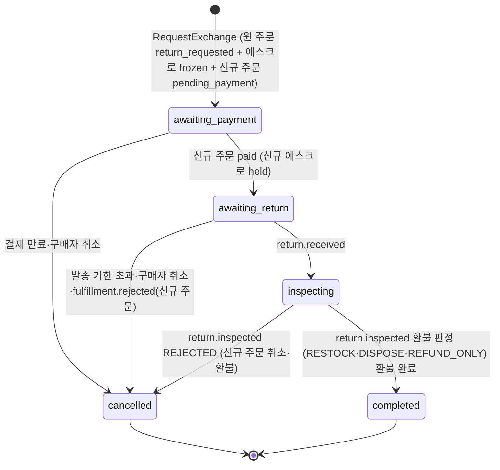

- 전이는 모두 `status`·`version` 조건부 UPDATE 다. `cancelled` 의 원인은 `cancel_reason`(`PAYMENT_EXPIRED`·`BUYER`·`SHIP_TIMEOUT`·`STOCK`·`INSPECTION_REJECTED`)에 기록한다.
- `cancelled` 가 되면 **원 주문은 반품 거절과 같은 방식으로 복귀**한다: 에스크로 `frozen→held`(`release_due_at = now + 1일`, 제안), 주문 `return_requested→delivered`. 신규 주문이 이미 `paid` 였다면 취소·환불 경로(§6.6, 출고 전이므로 `fulfillment.cancelled`)를 탄다. 이미 반품 입고(`return.received`) 후에 `cancelled` 가 되는 경우는 `INSPECTION_REJECTED` 뿐이다.
- 교환은 한 번 `cancelled` 가 되면 **같은 줄에 대해 새 교환을 열 수 없다**(`REJECTED` 의 "반품 재요청 금지"와 같은 규칙, 단 `PAYMENT_EXPIRED`·`BUYER`·`STOCK` 사유는 기한 안이면 다시 요청할 수 있다).

#### 5.5.3 에스크로·원장 순서와 가격차 정산

신규 주문은 **전액을 독립 결제**하고, 원 주문의 반품 줄은 **별도 환불**한다. 두 흐름은 서로 다른 트랜잭션이며 **어떤 트랜잭션도 두 에스크로를 동시에 잠그지 않는다**. 가격차는 이 둘의 순 효과로 나타난다.

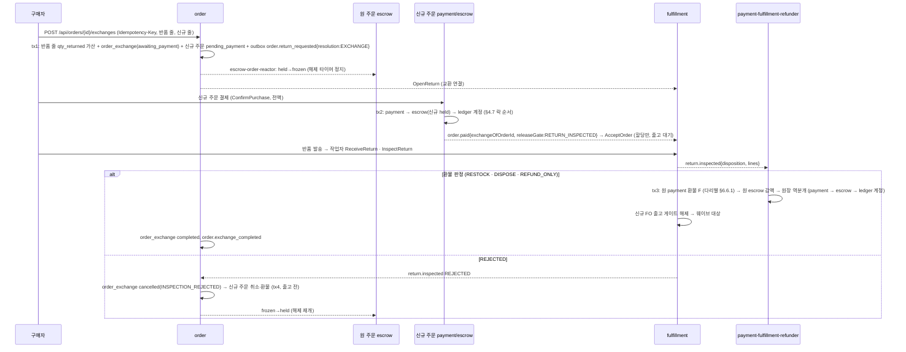

| 단계 | 원 주문 에스크로 | 신규 주문 | 락·트랜잭션 |
|---|---|---|---|
| 요청 | `held→frozen`(`frozen_reason='return'`, 기존 반품 동결 그대로) | `pending_payment` 생성 | tx1 은 `order`·`order_exchange` 만, 에스크로 변경은 inbox 소비자(별 tx) |
| 신규 결제 | 변화 없음 | 결제 승인과 같은 tx 에서 `held` 생성(§4.7) | 신규 결제의 전역 락 순서 `reservation`(없음) → `payment` → `escrow` → 계정 id 오름차순. **원 에스크로를 잡지 않는다** |
| 검수 환불 | 환불 대상 줄 금액 F 만큼 다리별 감액. 전량이면 `frozen→refunded`, **부분이면 `escrow_leg.refunded_amount` 증가 후 `frozen→held`**(잔여 다리로 해제 재개) | 출고 게이트 해제 | 환불 tx3: `payment → escrow → ledger 계정`(§6.6). 신규 주문 행을 건드리지 않는다 |
| 정산 | 잔여 다리 `amount − refunded_amount` 로 §8.5.1 그대로(교환이 새 정산 규칙을 만들지 않는다) | 독립 에스크로·독립 정산 | 서로 다른 `escrow_id` 의 `settlement` |

- **가격차 의미.** 신규 > 원(`price_diff_krw > 0`): 구매자는 신규 전액을 먼저 내고 원 환불액 F 를 나중에 돌려받아 **순 차액을 부담**한다. 신규 < 원(`< 0`): 같은 방식으로 **순 차액이 환불**된다. 환불은 원 결제의 자산·다리로 돌아가고(§6.6.1) 신규 결제는 구매자가 새로 고른 수단을 쓰므로 두 흐름의 자산이 다를 수 있다 — 그래서 합산 분개를 만들지 않고 각자 자기 분개를 가진다.
- **부분 환불 잔여 다리와의 관계.** 교환이 부분(일부 줄)이면 원 에스크로의 일부 다리만 줄어들고, 이후 해제 시 정산 입력이 `amount − refunded_amount`(§8.5.1, 누적 비례 환불 §6.6.1)이므로 `r ≥ 0`·`net+fee+dust=gross` 항등식이 그대로 성립한다. 속성 시험(AC-C34)에 "교환 환불 후 정산" 시퀀스를 추가한다(AC-C42).
- **위험 1 — 자금 일시 이중 점유.** 신규 결제가 환불보다 먼저이므로 구매자는 일시적으로 N + (원 대금)을 묶어 둔다. 잔액이 모자라면 포인트·USDC 부족으로 신규 결제가 실패한다(`awaiting_payment` 에서 `PAYMENT_EXPIRED`). 화면은 "필요 금액 = 신규 총액(환불은 검수 후)"을 명시한다. 원 에스크로 잔여분을 신규 에스크로로 직접 이월하는 방식은 서로 다른 `escrow_leg` 자산 구성·락 순서(두 에스크로 동시 잠금)를 요구해 **채택하지 않았다**(미결, §20.4).
- **위험 2 — 출고 게이트의 지연.** 신규 상품은 `return.inspected` 환불 판정 뒤에야 출고된다(반품이 불량·미도착이면 신규 출고 후 회수가 불가능하므로 보수적으로 둔다). 대신 교환 소요 시간이 길어진다. 입고(`return.received`) 시점 출고로 줄이는 안은 `REJECTED` 시 회수 불가 손실을 감수해야 해서 보류(미결).
- **멱등.** 요청은 `Idempotency-Key` 필수. 환불 키는 기존 규칙 `refund:<paymentId>:<eventId>:<asset>`, 교환 완료·취소 전이는 `return.inspected` 의 inbox 중복 제거와 `order_exchange.version` CAS 로 한 번만 일어난다.

#### 5.5.4 이벤트 (이름과 필드 — P0 §8.3 반영 요청 대상)

| 이벤트 | 변경 | 소비자 |
|---|---|---|
| `order.return_requested` | 필드 추가: `resolution ∈ {REFUND, EXCHANGE}`, `exchangeId`, `newOrderId`(교환일 때) | 풀필먼트(`OpenReturn` 에 교환 연결), `escrow-order-reactor`(기존 동결 그대로) |
| `order.paid` | 필드 추가: `exchangeOfOrderId`(NULL 허용), `releaseGate`(`{type:'RETURN_INSPECTED', returnId}`, 교환 신규 주문만) | 풀필먼트(할당 후 출고 게이트 설정) |
| `return.inspected` | 필드 추가: `lines[{lineId, qty}]`(환불 대상 줄·수량, 부분 환불 금액 계산), `exchangeId`(NULL 허용) | `payment-fulfillment-refunder`(줄 단위 금액 F), `escrow-order-reactor`(부분이면 `frozen→held`), order |
| `shipment.delivered` · `shipment.dispatched` | 필드 추가: `shipmentSeq`, `allDelivered`(분할 배송에서 마지막 배송 완료일 때만 true) — §5.5.6 | order(주문 `delivered` 전이·에스크로 기한은 `allDelivered=true` 에서만) |
| **신규 `order.exchange_completed`** | 교환 완료(환불 + 게이트 해제 후) | 알림·프로젝터 |
| **신규 `order.exchange_cancelled`** | `reason`(위 `cancel_reason`) | `escrow-order-reactor`(원 에스크로 `frozen→held` 재개), 풀필먼트(`order.cancel_requested` 가 별도로 신규 주문 취소를 이끎), 알림 |

`return.exchange_requested` 는 두지 않는다 — 요청은 `order.return_requested` 의 `resolution` 필드로 충분하고 이벤트를 늘리면 풀필먼트·에스크로 소비자가 둘로 갈린다.

#### 5.5.5 재고 약정·할당 영향 (P3)

- 신규 주문의 할당은 일반 주문과 같은 `AcceptOrder`(단일 tx, `AllocateInTx`) 이다. **약정(earmark)을 소비하지 않는다**(타임딜 줄이 없으므로) — `sku_position.allocated_total` 만 오른다.
- 출고 게이트 동안 할당은 **유지**된다(재고를 잡아 둔다). 게이트는 최대 `EXCHANGE_RETURN_SHIP_DAYS` + 검수 시간이며, 그 뒤 `cancelled` 면 `ReleaseAllocationInTx` 로 풀린다. 오래 잡는 비용은 `pf_exchange_gate_age_seconds`(§18.1)로 본다.
- 반품 상품이 `RESTOCK` 이면 반품 SKU 의 `available_total` 이 늘어나며(AC-WM-09), 교환 신규 SKU 의 할당과 **독립**이다(같은 SKU 교환이면 순증감 0이어도 두 사건은 각자 원장 이동이다).
- 할당이 실패하면(`fulfillment.rejected(OUT_OF_STOCK)`) 신규 주문은 환불되고 교환은 `cancelled(STOCK)`, 원 주문은 `frozen→held` 로 복귀하며 구매자는 같은 기한 안이면 환불형 반품으로 다시 요청할 수 있다.

#### 5.5.6 분할 배송의 구매자 노출 (UI 계약)

`ALLOW_PARTIAL` 정책에서 한 주문이 여러 `shipment` 로 나뉘어도 **주문 상태는 하나**로 유지하고(§5.2), 구매자 화면은 부분 배송을 다음 계약으로 보여 준다. 정본 데이터는 P3 `fulfillment_read.tracking_view` 이고 P2 의 주문 상세 라우트가 합성한다(풀필먼트는 구매자 API 를 열지 않는다).

| 필드(`GET /api/orders/{id}` 응답에 추가) | 의미 |
|---|---|
| `fulfillment.allocation` | `FULL`·`PARTIAL`·`PENDING`(풀필먼트 `accepted` 의 값 그대로) |
| `fulfillment.shipments[]` | `{shipmentSeq, status(dispatched·in_transit·delivered·delivery_failed), carrier, trackingNoMasked, lines:[{lineId, qty}], dispatchedAt, deliveredAt}` |
| `fulfillment.shippedQty` · `fulfillment.totalQty` | 합계(화면의 "부분 배송 1/2"), 대기 중인 줄은 `pendingLines[{lineId, qty}]` |
| `fulfillment.allDelivered` | 모든 배송이 완료됐는지(반품 가능 기한·자동 확정 기산 기준) |

- **주문 상태 의미**: 첫 `shipment.dispatched` 에 `shipped`, `allDelivered=true` 인 `shipment.delivered` 에 `delivered` 가 된다. 일부만 배송 완료된 동안은 `shipped` 이며 **에스크로 `release_due_at` 도 마지막 배송 완료 기준**으로 설정한다(`shipment.delivered` 하나로 전체 타이머가 시작되는 일을 막는다).
- 반품·교환 기한(5일)은 `allDelivered` 시각부터 센다(먼저 받은 상품은 구매자에게 유리하게 더 오래 열려 있다. 단순함을 우선한 제안). 줄 단위 반품은 이미 배송 완료된 줄만 선택할 수 있고, 배송 중·대기 줄은 취소 경로(`order.cancel_requested`, 판정표 P3 §5.4)로 간다.
- 구매자 화면은 배송 N건 타임라인(건별 택배 상태)과 "남은 상품은 입고 후 발송됩니다" 안내를 보여 준다(백오더 `PENDING` 줄). 택배는 모의라 운송장은 시연용이다.

#### 5.5.7 API·보안

| 엔드포인트 | 권한 | 설명 |
|---|---|---|
| `POST /api/orders/{id}/exchanges` | 주문 소유 구매자, `Idempotency-Key` 필수 | 본문 `{returnLines[{lineId, qty}], newLines[{skuId, qty}], reasonCode}` → `201 {exchangeId, newOrderId, priceDiffKrw}`. 오류: `409 return_window_closed`·`exchange_not_allowed`·`exchange_stock_unavailable`·`return_quantity_exceeded` |
| `GET /api/orders/{id}/exchange` | 소유 구매자 | 교환 상태(§5.5.2)·가격차·다음 행동 |
| `POST /api/orders/{id}/exchange/cancel` | 소유 구매자 | `awaiting_payment`·`awaiting_return` 에서만(입고 후 취소는 불가) |

속도 제한 등급은 `write.return`(세션당 10회/분, 제안; `write.exchange` 는 화폐 교환 전용). 소유 검사는 주문 `buyer_user_id` 와 세션 사용자의 일치이며 불일치는 `404`(존재 은닉). 자유 텍스트 사유는 두지 않고 `reasonCode` 열거만 받는다(개인정보 입력 경로 최소화).

---

## 6. 결제 (`payment`)

### 6.1 결제 수단 포트와 단계별 구현

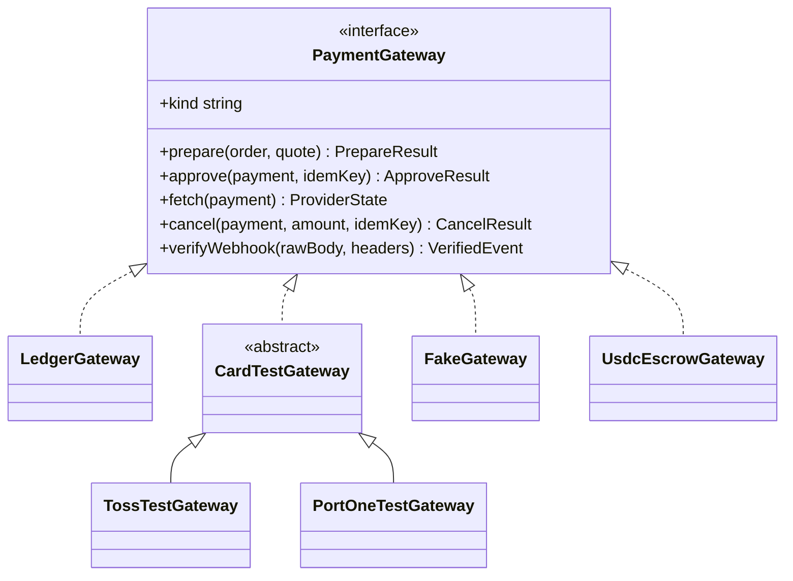

| 구현 | 단계 | 비고 |
|---|---|---|
| `LedgerGateway` | Phase 3 | 외부 호출 없음. `prepare` 가 다리 계획을, `approve` 가 **다리별** 원장 차감(`ledger.PostJournalInTx` — POINT 다리 + USDC 다리, §6.1.1)을 동기 완료. `cancel` 은 원장 역분개 |
| `FakeGateway` | Phase 3~5 시험 | 결정적 성공/실패/지연/중복 웹훅을 주입하는 **시험용 PG**. 계약 시험의 기준 구현 |
| `TossTestGateway` / `PortOneTestGateway` | Phase 5 | PG 선정은 착수 시 확정(§6.2). 둘은 `CardTestGateway` 공통 흐름(위젯 → 승인 → 웹훅)을 공유 |
| `UsdcEscrowGateway` | Phase 6-4 | 온체인 에스크로 경계(§8.7) |

#### 6.1.1 결제 다리(leg)와 혼합 결제 (ADR-048)

`method=ledger`(구 `points`)는 **다리 두 개까지**를 갖는다. 카드(테스트) 결제는 KRW 단일 다리이며 포인트와 섞지 않는다.

| 다리 | 자산 | 계산 | 원장 |
|---|---|---|---|
| POINT | POINT | `P = usePoints ? min(포인트 잔액, T) : 0` (T = 주문 KRW 합계, 1 POINT = 1 KRW) | `liab:user_points:{u}` → `liab:escrow:POINT` |
| USDC | USDC(micro) | `R = T − P`, `u = floor(R × 10¹⁴ / rate_e8)` (결제 시작 시 고정한 스냅샷, §8.2.1) | `liab:user_usdc:{u}` → `liab:escrow:USDC` |

- **포인트 우선 차감**: UI 토글 `usePoints`(기본 켜짐)로 끌 수 있다. `P = 0` 이면 USDC 단일 다리, `R = 0` 이면 POINT 단일 다리다.
- **원자성**: `ConfirmPurchase` 의 한 트랜잭션이 두 분개를 함께 기장한다. 어느 쪽 `account_balance` 조건부 갱신이 `min_balance` 에서 거절되면 **전체 롤백**(`insufficient_funds`, 예약은 유지되어 TTL 안에 다시 시도할 수 있다).
- **계획 고정과 확인 단계**: `InitiatePayment` 가 `payment_leg` 계획 행(자산, 수량, KRW 가치)을 만들고 **응답으로 `{paymentId, P, u, rate, snapshotId, planExpiresAt}` 를 돌려준다.** 구매자가 이 금액(포인트 P · USDC u · 적용 환율)을 화면에서 확인한 뒤 `POST /api/payments/{id}/approve`(`LedgerGateway.approve`)를 보내야 `ConfirmPurchase` 가 실행된다 — 확인 없이 한 번에 차감되지 않는다. 승인 시점의 잔액 변동으로 계획이 바뀌지 않으며, 잔액이 모자라면 실패하고 사용자가 다시 시작한다.
- **저널은 자산별 1건이고 멱등 키에 `:{asset}` 접미를 붙인다**(지급·결제 확정·환불 공통, §9.1): 확정은 `payment:{paymentId}:confirm:POINT` / `…:USDC`, 환불은 `refund:{paymentId}:{eventId}:{asset}` 다. 포인트 단독(`R=0`)이면 USDC 분개를, USDC 단독(`P=0`)이면 POINT 분개를 만들지 않는다.

### 6.2 PG 후보 조사 (2026-11-04 웹 검색 요약, 모두 재확인 필요)

| 후보 | 확인된 것 | 확인 못한 것 | 모의 사용 적합성 |
|---|---|---|---|
| **토스페이먼츠** | 개발자센터에서 **테스트 키**를 발급(키 혼용 시 `INVALID_API_KEY`). 테스트 키 결제는 **실제 결제가 일어나지 않고** 개발자센터 "테스트 결제내역"에서 확인. 웹훅은 엔드포인트 등록, **10초 안에 200 응답**, 실패 시 **최대 7회 재시도**, 전송 기록 확인 가능. 결제 후 승인 API 를 호출하지 않으면 상태가 만료로 보임 | 가입 조건(사업자 등록 필요 여부), 웹훅 서명 방식, 결제위젯 이용 약관의 테스트 용도 허용, 위젯 스크립트 도메인 | 높음(KRW·카드·테스트 키 명시). **1순위 후보** |
| **포트원(PortOne) V2** | 서버 SDK 문서: 2024-06 부터 웹훅에 **Standard Webhooks** 규격 헤더 포함(메시지 자체 검증 가능) | 테스트 채널 설정 절차, 무료 한도, 가입 조건 | 중간(웹훅 검증 모델이 좋음, 절차 미확인) |
| **KG이니시스 / NICE** | — | 테스트 MID 발급 절차(대부분 신청 필요로 알려졌으나 미확인) | 미확인 |
| **Stripe** | 한국 로컬 카드·간편결제 수용 문서 존재(해외 사업자 대상). 일부 문서는 지원 사업자 소재지 목록에 KR 이 없음. 테스트 모드를 지원국 밖에서도 쓸 수 있다는 일화는 있으나 비공식 | **한국 사업자 계정 개설 가능 여부**, 약관 | 낮음~미확인 |
| PayPal sandbox | (이번에 조사하지 않음) | — | 미조사 |

**선정 기준**: ① 카드·무료·**카드 정보 없이** 가입 가능 ② 테스트 모드의 승인·취소·부분 취소·웹훅 재시도 재현 가능 ③ 약관상 모의 시연 허용 ④ 위젯 스크립트·프레임 도메인이 우리 CSP 에 수용 가능(§17) ⑤ 웹훅 검증 수단. **최종 선정은 Phase 5 착수 시** ADR-039 의 후속으로 한다. 포트 설계는 위 후보 둘(토스·포트원)이 모두 구현 가능한 최소 공통 계약으로 잡았다.

### 6.3 결제 상태 머신

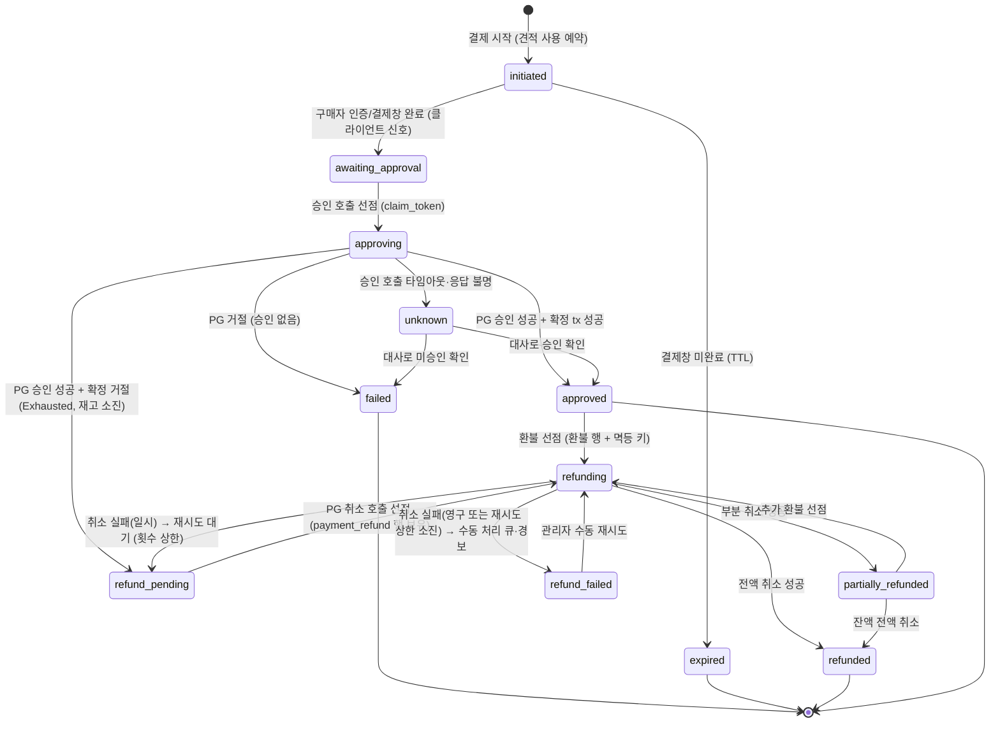

| 규칙 | 내용 |
|---|---|
| 한 주문 한 활성 결제 | `payment` 에 **부분 유일 인덱스** `UNIQUE (order_id) WHERE status IN ('initiated','awaiting_approval','approving','approved','unknown','refund_pending','refunding','refund_failed','partially_refunded')` — 이중 결제 시도를 DB 가 막는다. 환불이 끝나(`refunded`)야 같은 주문에 새 결제를 시작할 수 있다 |
| 환불 상태 | `refunding→approved` 전이는 **없다**(되돌아가면 돈이 잡힌 채 정상 결제로 보인다). 일시 실패는 `refund_pending` 으로 돌아가 같은 멱등 키로 재시도하고(상한 5회·백오프, 제안), 영구 실패·상한 소진은 `refund_failed`(수동 처리 큐·경보, 활성 결제 유일 인덱스에 남아 새 결제를 막는다). `method=ledger` 의 환불은 외부 호출이 없어 한 tx 안에서 `refunding→refunded` 를 거친다 |
| `refund_pending` | PG 는 승인됐지만 재고 확정이 거절된 상태(또는 환불 재시도 대기). **돈이 잡혀 있는 상태**이므로 종결이 아니다. 같은 tx 에서 `payment_refund`(reason=`rejected_stock`, 멱등 키 `refund:<paymentId>:rejected_stock`) 행을 만들고 취소 호출 대상으로 남긴다. 취소가 실패해도 이 행과 대사(§6.8)가 추적한다 |
| 선점 | `awaiting_approval → approving` 은 조건부 UPDATE + `claim_token` + 임대(`lease_until`). 승인 응답이 늦게 와도 토큰이 맞아야 완료 갱신 가능(ADR-021) |
| 상태 순위 | `unknown` 은 순위 중간. 대사 결과로만 `approved`/`failed` 로 간다 |
| 금액 | 승인 요청 금액은 **서버가 주문에서 읽은 값**이다. 클라이언트가 보낸 금액을 쓰지 않는다 |

### 6.4 카드(테스트) 결제 시퀀스 — 승인, 웹훅, 대사

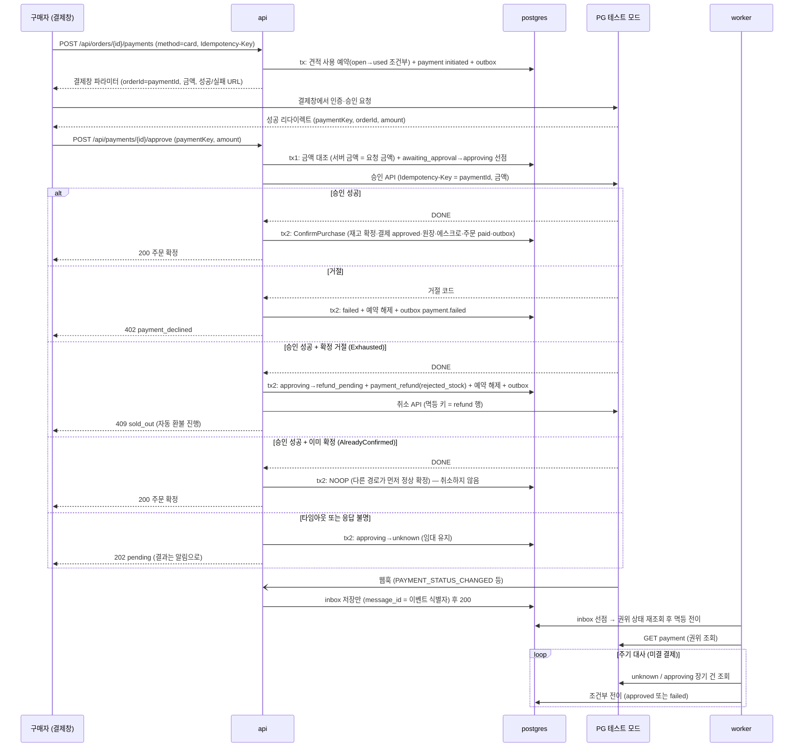

- 승인 호출은 **트랜잭션 밖**(ADR-021 규칙 4)이다. tx1(선점)과 tx2(완료) 사이에 외부 호출이 있고, 호출 동안 행 잠금을 쥐지 않는다.
- PG 의 `Idempotency-Key`(지원 여부는 미확인) 또는 `orderId` 유일성으로 **승인 호출 재시도가 이중 승인이 되지 않게** 한다. 지원이 없으면 재시도 전에 `fetch` 로 상태를 먼저 확인한다.

### 6.5 웹훅 수신과 처리 (inbox, ADR-020)

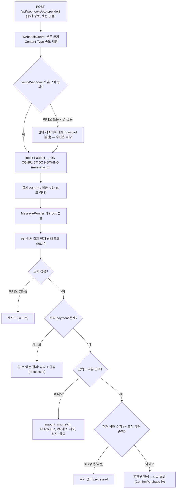

| 문제 | 처리 |
|---|---|
| 중복 웹훅 | inbox PK `(consumer, message_id)`. 식별자가 없는 PG 면 `sha256(provider, paymentKey, status, 이벤트 시각)` 로 만든다 |
| 지연·역전 | 상태 순위가 낮아지는 전이는 `NOOP`. 웹훅이 승인 응답보다 먼저 와도 권위 조회 결과가 정본 |
| 위조 | 서명 검증이 가능한 PG 는 검증, 불가능하면 **웹훅 내용을 신뢰하지 않고 항상 권위 조회**(우리가 PG API 키로 가져온 값만 신뢰) |
| 유실 | 주기 대사 잡(§6.8)이 미결 결제를 PG 에서 직접 조회 |
| 큰 본문·남용 | 본문 크기 상한(64KB), 경로별 속도 제한, 알 수 없는 `provider` 404, PG 고정 IP 대역 허용목록은 선택(미확인) |

웹훅 경로는 서버→서버 호출이라 M1 의 `OriginGuard`/`SessionGuard` 대상이 아니다. 별도 `WebhookGuard`(본문 제한·속도 제한·서명 모드)를 가드 체인 앞에 둔다(F16 CM-01 확장, §16).

### 6.6 환불·취소

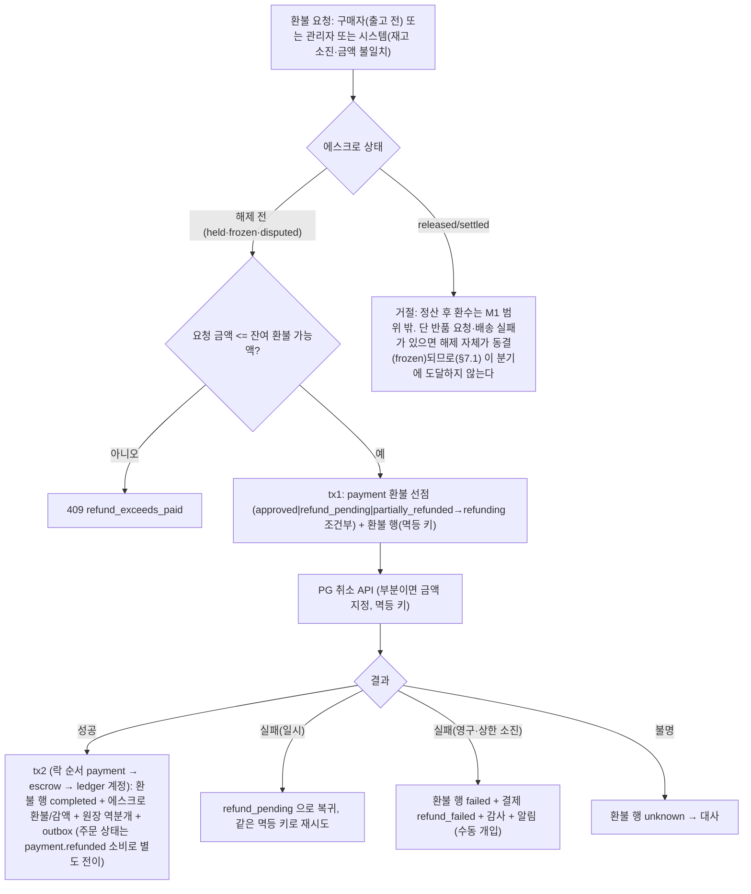

| 규칙 | 내용 |
|---|---|
| 누적 한도 | `payment_refund` 합계 ≤ 승인 금액 `CHECK` 대신 **조건부 UPDATE** `refunded_total + $r <= amount` (집계 컬럼을 payment 에 둔다) |
| 멱등 | 환불 요청마다 `refund_idempotency_key` 유일. 같은 키 재요청은 같은 결과. **이벤트에서 시작하는 환불의 키는 근거 이벤트 id 에서 파생**한다: `refund:<paymentId>:<eventId>` (같은 `fulfillment.rejected` 가 재전달돼도 환불 1건) |
| 환불 트리거 소비자 | **`payment-fulfillment-refunder`**(payment 모듈 소비자, 신규): `fulfillment.rejected`·`fulfillment.cancelled`·`return.inspected`(`disposition ∈ RESTOCK\|DISPOSE\|REFUND_ONLY` 인 환불 판정; `REJECTED` 는 환불하지 않는다)를 구독해 `RefundPayment` 를 호출한다. 순서: 이벤트 수신(inbox) → 주문의 활성 결제 조회 → 환불 선점 tx → PG 취소(tx 밖) → 완료 tx(원장 역분개 + 에스크로 환불 + `payment.refunded`). 주문 쪽 `order.cancelled` 전이는 별도로 `order-fulfillment-reactor` 가 같은 이벤트로 수행하고, 두 소비자는 서로를 기다리지 않는다(독립·멱등). B12 쌍 #7 의 조율자는 `RefundPayment`(payment) |
| 원장 | 환불은 원래 분개의 **역분개(reversal)** 새 행. 원 분개를 고치지 않는다(§9). **부분 환불의 역분개 합은 원 분개를 넘지 못한다**(같은 `reversal_of_id` 를 가진 분개들의 라인별 금액 합 ≤ 원 분개 라인 금액, §9.1) |
| 원장 결제(Phase 3 환불) | `method=ledger` 의 환불은 다리별 원장 역분개만(외부 호출 없음). **Phase 3 의 환불 트리거는 구매자 취소·관리자 환불·시스템(재고 소진)** 이고, `fulfillment.*`·`return.inspected` 소비(`payment-fulfillment-refunder`)는 풀필먼트(6c) 이후 활성이다 |
| 재고 복원 | **출고 전 취소**(`fulfillment.cancelled`, 구매자 취소 사유)이고 딜이 `open`/`sold_out`(종료 전)일 때만, **deal 의 소비자 `deal-restock-reactor` 가 환불과 독립적으로**(환불 성공 여부와 무관) `deal.restocked {dealId, qty, reason:'cancel'}` 를 발행하고 Redis `restock.lua`(avail +q, 개인 보유 −q, 멱등 키 `restock:<orderId>`)와 PG(`stock.confirmed −q`, `user_purchase.qty −q`)를 갱신한다. **`fulfillment.rejected(OUT_OF_STOCK)` 는 복원하지 않는다**(물리 재고가 없는데 판매 가능 수량을 늘리면 안 됨). 약정은 복원 시 `+q` 로 짝지어 돌려준다(`deal.restocked` 를 inventory 가 소비, P3). 반품·분쟁 환불은 재고를 복원하지 않는다(물리 입고는 풀필먼트 `return.received` 가 관리) |


#### 6.6.1 다리별 환불 규칙 (ADR-048 E4)

혼합 결제의 환불은 **원래 자산으로, 다리별로** 한다. 새 환율로 재환산하지 않는다.

```
환불 F(KRW), 남은 환불 가능액 T_rem = P_rem + R_rem, 다리 잔여 KRW 가치 P_rem(POINT)·R_rem(USDC)
pk      = min(P_rem, floor(F × P_rem / T_rem))           // POINT 다리 몫 (1 POINT = 1 KRW)
rk      = F − pk                                          // 나머지는 USDC 다리 몫
(rk > R_rem 이면 rk = R_rem, pk = F − R_rem)              // 반올림으로 USDC 몫이 잔여를 넘으면 초과분은 POINT 로 이월
R_done' = R_done + rk
USDC 환불 수량 = (R_done' = R 이면 u, 아니면 floor(R_done' × u / R)) − (이미 환불한 USDC 수량)   // 누적 기준 증분
```

- **누적 기준**인 이유: 건별로 내림하면 여러 번 환불할 때 낸 수량보다 적게 돌려주거나(내림 누적), 반대로 넘겨 줄 수 있다. 누적 비례로 계산하면 **전액 환불 시 낸 수량이 정확히 돌아오고, 어떤 순서의 부분 환불에서도 합이 낸 수량을 넘지 않는다.**
- 멱등 키는 다리별로 `refund:<paymentId>:<eventId>:<asset>` 이다. 환불 행은 `payment_refund_leg`(자산, 수량, KRW 가치, 멱등 키 컬럼 `idempotency_key` = 같은 값이며 `ledger.journal.idempotency_key` 와 일치)를 갖는다. 저널은 자산별 1건이다(§9.1).
- **`R=0`(포인트 단독) 결제의 환불은 USDC 다리를 건너뛴다**(USDC 저널·`payment_refund_leg` USDC 행을 만들지 않는다). `P=0`(USDC 단독)이면 반대로 POINT 다리를 건너뛴다.
- 에스크로 **해제 전(`held`·`frozen`·`disputed`)** 에만 환불한다(§6.6 의 표). 정산 후 환수는 범위 밖이다. 환불로 줄어든 다리는 `escrow_leg.refunded_amount` 에 누적되고, 이후 정산은 **잔여 다리(`amount − refunded_amount`)** 를 입력으로 한다(§8.5.1).
- **검산**: 순수 정수 모델 29.9만 단계(주문 10만 건)에서 다리별 환불 합이 낸 금액을 넘은 경우 0건, 전액 환불 시 불일치 0건(ADR-048 검산 표). 환불 후 정산까지 이은 속성 시험은 §8.5.1 에 있다.

### 6.7 늦은 결제 (예약 만료 후 승인)

카드 결제는 예약 TTL 을 넘겨 승인될 수 있다. 정책은 **"재고가 남았으면 새 예약으로 구매를 살리고, 없으면 자동 환불"** 이다. **만료된 예약을 되살리지 않는다**(종결 상태 불변, I3·I4 예외 없음).

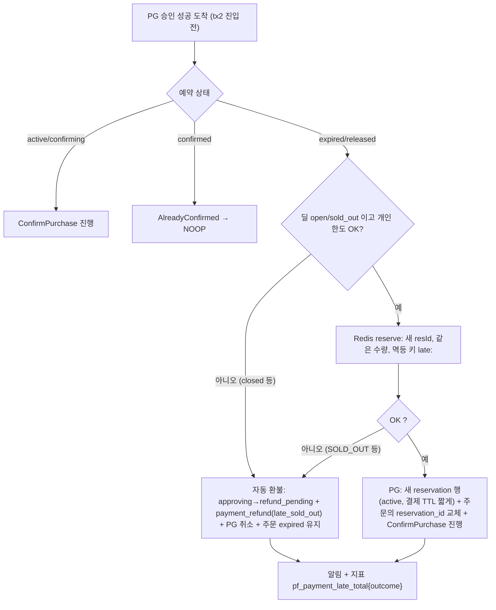

- 새 예약은 `reserve` 와 같은 불변식(개인 한도·딜 종료·수량)을 모두 검사한다. 멱등 키 `late:<paymentId>` 로 재시도에도 예약 1건이다. 주문은 `expired → pending_payment` 로 **되살아나지 않고**, 늦은 결제용 `order.reservation_id` 교체와 함께 `ConfirmPurchase` 가 `expired→paid` 전이를 하나의 허용 전이(`late_paid`, 이력에 원인 기록)로 처리한다. 이 전이는 주문 허용 표의 유일한 `expired` 출구이며 늦은 결제 경로에서만 쓴다.
- 딜이 이미 `closed` 면 새 예약을 만들지 않고 환불한다.
- 이 경로의 비율이 높으면 카드 TTL(10분 제안)이 짧다는 신호다. 지표로 TTL 을 조정한다.

### 6.8 대사 작업 (`PaymentReconciler`)

| 대상 | 주기(제안) | 동작 |
|---|---|---|
| `unknown`·`approving`(임대 만료) | 1분 | PG `fetch` → 조건부 전이 |
| `awaiting_approval` 장기(> 결제 TTL) | 5분 | PG 조회: 승인됐으면 정상 경로로, 아니면 `expired` |
| `refund_pending`·`refunding`·환불 `unknown`(환불 행이 `pending`/`unknown`인 것) | 1분(`refund_pending` 은 돈이 잡혀 있으므로 `unknown` 과 같은 주기) | PG 조회 후 취소가 됐으면 완료 전이, 안 됐으면 취소 재시도(멱등 키 재사용, 상한 5회) |
| `refund_failed` | 5분(경보는 즉시) | 자동 재시도 없음. 수동 처리 큐에 남기고 `RefundFailed` 경보, 관리자 재시도 시 `refunding` 으로 |
| 일 1회 전수 | 03:40 | 어제 PG 승인 목록(가능한 PG)과 우리 `approved` 대조, 차이 보고(감사 `system.payment_reconciled`) |

### 6.9 보안·개인정보 (결제)

- 카드번호·CVC·계좌는 **받지도 저장하지도 않는다**(PG 위젯이 직접 수집, 우리는 토큰만).
- `provider_payment_key` 는 PG 취소·조회에 쓰이는 비밀성 식별자이므로 **ENC**(`provider_payment_key_enc`)로 저장한다. 로그에는 마지막 4자만(마스킹 규칙 `Redactor` 거부목록에 `paymentKey` 추가).
- PG API 비밀 키는 시크릿 파일(`PG_SECRET_KEY_FILE`), 저장소에 없음. 테스트 키라도 같은 취급(ADR-015, ADR-028 회전 표에 행 추가).
- 결제 화면에는 모의 면책을 상시 표기(ADR-015).

---

## 7. 에스크로 (`escrow`)

### 7.0 단계별 도입 (Phase 3 최소형 → Phase 5 확장)

| 기능 | Phase 3 (최소 `escrow`) | Phase 5 (확장) |
|---|---|---|
| 상태 | `held`·`released`·`refunded` | + `disputed`·`frozen`(§7.1) |
| 생성 | `ConfirmPurchase` 의 `HoldInTx` — 다리(`escrow_leg`)별 보류, 분개 `liab:user_*` → `liab:escrow:{asset}` | 동일 |
| 해제 | **수동만**: 구매자 `confirm-receipt`(`demo` 주문은 `paid` 에서도 허용, `MarkDelivered` 로 `delivered` 가 된 뒤에도 가능, §5.2.1) → `held→released`, `escrow.released` 발행, POINT 다리 소각 분개 | 자동 확정 타이머(`EscrowAutoRelease`, `ESCROW_TIME_SCALE` 압축 재현), 반품 기한 연동 |
| 환불 | 해제 전 환불(쌍 #7 활성): 구매자 취소·관리자 환불·시스템 | 반품·분쟁 환불, PG 취소 |
| 정산 | **없음**(`settlement` 모듈 도입 전) — `escrow.released` 는 발행만 되고 USDC 다리는 `liab:escrow:USDC` 에 남는다 | `settlement-escrow-reactor` 가 시작 시 `released` 이면서 `settlement` 행이 없는 에스크로를 **스캔해 정산**(`UNIQUE(escrow_id)` 로 멱등) — outbox 보존 기간과 무관하게 Phase 3 에서 해제된 건도 처리하므로 **소급 이관 절차가 필요 없다** |

### 7.1 상태 머신 (ADR-016 초안 확장)

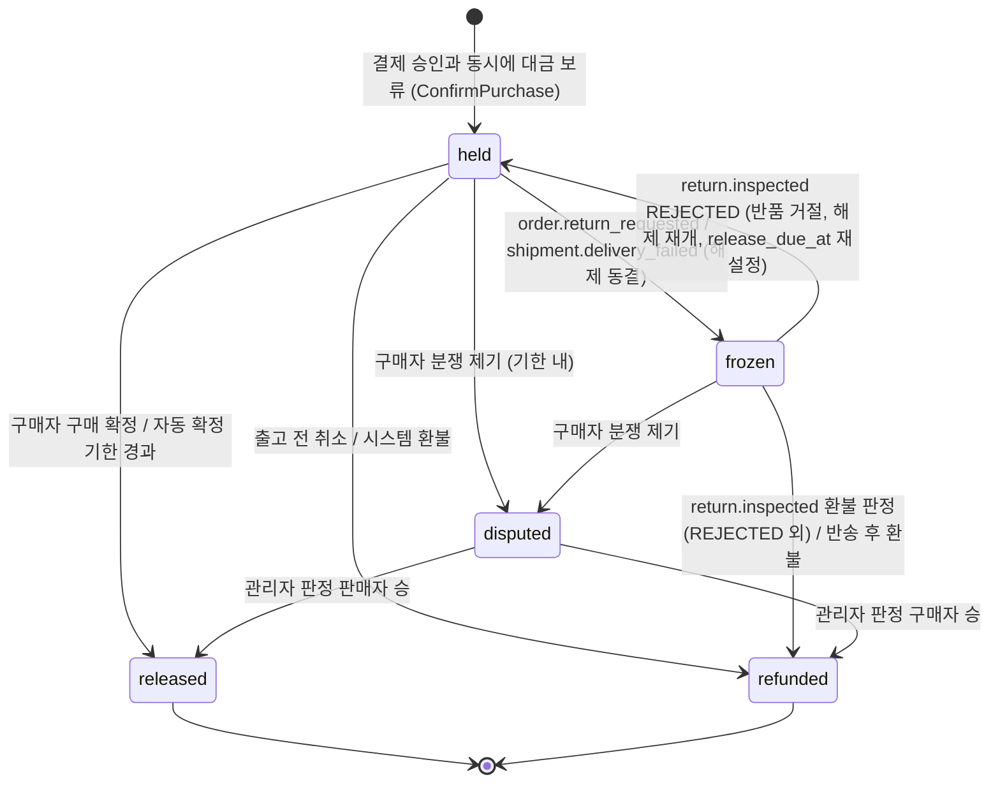

- `frozen` 은 **해제 타이머를 멈춘 `held`** 다(`release_due_at` 을 NULL 로, `frozen_reason` = `return`|`delivery_failed` 기록). 반품 요청(`order.return_requested`)이나 배송 실패(`shipment.delivery_failed`)가 오면 자동 해제 작업이 건드리지 않는다. `escrow-order-reactor` 가 `return.inspected{disposition}` 를 구독해, `REJECTED` 면 **`frozen→held`**(해제 기한을 `now + 1일`, 제안으로 재설정하고 `frozen_reason` 비움)로 정상 흐름을 타게 하고 환불은 하지 않는다. `RESTOCK`·`DISPOSE`·`REFUND_ONLY` 는 환불 경로(`payment-fulfillment-refunder`)가 `frozen→refunded` 를 수행한다. `frozen` 에서의 모든 전이도 `held`/`frozen` 기대 상태 조건부 UPDATE 다. 분쟁(`disputed`)은 `held`·`frozen` 에서만 열 수 있다.
- 에스크로는 **결제 승인과 같은 트랜잭션에서 `held` 로 생성**된다(ConfirmPurchase). 따라서 `pending` 상태는 두지 않는다. 다리별 보류액은 `escrow_leg`(§10.6)에 두고 `escrow.amount_krw` 는 KRW 환산 합계(표시용)다.
- `released` 가 되면 `escrow.released` 이벤트(잔여 다리 `legs[]` 포함, §11)를 `settlement` 가 소비해 정산한다. `refunded` 는 결제 환불·원장 역분개와 한 트랜잭션이다(락 순서 `payment → escrow → ledger 계정`, §4.7).

### 7.2 기한 값 (ADR-016 미결 해소 제안)

| 값 | 제안 | 설정 키 | 근거 |
|---|---|---|---|
| 자동 확정 기한 | **배송 완료(`shipment.delivered`) 후 7일** | `ESCROW_AUTO_RELEASE_DAYS_AFTER_DELIVERY` | 일반 전자상거래의 구매 확정 대기 관행을 단순화한 값(미검증, 시연용) |
| **반품 가능 기한** | 배송 완료 후 **5일** | `RETURN_WINDOW_DAYS` | 자동 해제(7일)보다 짧아야 반품 요청이 해제 **전에** 도달한다. 이 불변 관계(`RETURN_WINDOW_DAYS < ESCROW_AUTO_RELEASE_DAYS_AFTER_DELIVERY`)는 설정 검증이 강제한다 |
| 배송 완료 이벤트가 없을 때 | 출고(`shipped`) 후 14일 | `ESCROW_AUTO_RELEASE_DAYS_AFTER_SHIP` | 풀필먼트 이벤트 유실 대비 상한. **`shipment.delivery_failed` 가 오면 이 상한을 중지**(`frozen`, 미배송 대금이 판매자에게 정산되는 것을 막음). 반송 완료는 `return.received`(P3) 경로로 환불·재입고 |
| 분쟁 제기 가능 기간 | 위 기한 안(= 해제 전까지) | — | |
| 분쟁 판정 | 관리자 수동, **기한 없음**(시연 규모) | — | 실서비스는 SLA 필요 |
| **시연 압축** | `…_SECONDS` 단위 설정으로 분·초 단위 압축 가능 | `ESCROW_TIME_SCALE` | DoD "재현"을 위해 며칠을 기다리지 않게 함 |

### 7.3 자동 확정 작업 (`EscrowAutoRelease`)

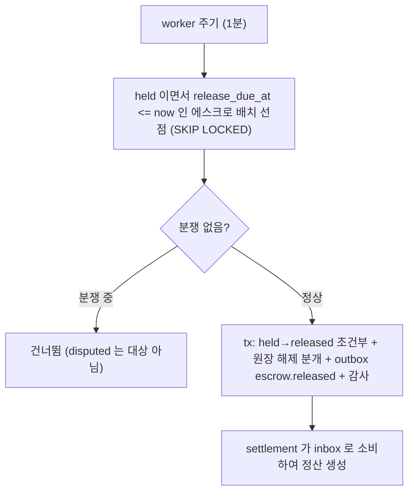

- `release_due_at` 은 `delivered_at + N일` 로 `shipment.delivered` 소비 시 설정한다(그 전에는 `shipped_at + M일` 상한만). 자동 확정 작업은 `status = 'held'` 만 대상이므로 `frozen`·`disputed` 는 자연히 제외된다. 소비자 `escrow-order-reactor` 가 `order.return_requested`·`shipment.delivery_failed`·`shipment.delivered`·`return.inspected` 를 받아 동결·기한 설정·재개를 수행한다(§11).
- 구매자 수동 확정(`POST /api/orders/{id}/confirm-receipt`)도 같은 전이를 쓴다. 두 경로가 동시에 와도 조건부 UPDATE 로 한 번만 성공한다.

### 7.4 분쟁

| 단계 | 내용 |
|---|---|
| 제기 | 구매자가 `held` 에서 사유(분류 + 자유 텍스트)로 제기. 자유 텍스트는 **ENC**(`escrow_dispute.reason_enc`, 길이 ≤ 500) |
| 판정 | 관리자 화면에서 증빙 텍스트·주문/배송 이력을 보고 `seller_wins`/`buyer_wins` 선택 |
| 효과 | `seller_wins` → `released`(정산), `buyer_wins` → `refunded`(PG 취소 + 역분개). 부분 판정은 M1 범위 밖(미결) |
| 감사 | `admin.dispute_resolved`(결과, 금액) |
| 동시성 | `disputed→released/refunded` 조건부 UPDATE. 분쟁과 자동 확정이 동시에 와도 `held` 에서 한 쪽만 성공 |

### 7.5 판매자 모델

- 판매자는 `settlement.seller` 로 **시드 데이터**(예: 플랫폼 직영 1~2개)로만 둔다. 판매자 온보딩 UI·KYC·정산 계좌 관리는 범위 밖.
- 각 딜은 `seller_id` 를 가진다. 수수료율은 `seller.fee_bps`(기본 0, 제안: 시연을 위해 100 bps 로 둘 수 있음).

---

## 8. 정산·통화·시세 (`settlement`, `pricefeed`, `payment.quote`) — ADR-011 상세화 / ADR-041

### 8.1 자산과 금액 표현

| 자산 | 단위 | 타입 | 비고 |
|---|---|---|---|
| `KRW` | 원 | `bigint` | 모의 현금성 금액(카드 테스트 결제) |
| `POINT` | 포인트 | `bigint` | 플랫폼 크레딧(모의) — **첫 로그인 지급 100,000**(`exp:demo_grant:POINT`), 관리자 지급, **USDC→POINT 단방향 교환**(`exp:points_exchanged:POINT`), Phase 2 이후 바둑 보상(`exp:points_issued`)으로 얻는다. POINT→USDC 환전은 없다. **1 POINT = 1 KRW 가치로 고정**(`POINT_KRW_RATE = 1` 상수, 설정 항목이 아니다 — 환산 함수에 비율 인자가 없다) |
| `USDC` | micro-USDC(10⁻⁶) | `bigint` | 구매자 **모의 보유 자산**(원장 고정액 자동 지급 없음 — 환경별 `WELCOME_GRANT_USDC_MICRO`·`AdminGrant`·교환 경로, P0 U24)이자 정산 통화. Solana USDC 소수 자릿수(6)와 같다. 원장의 모의 잔액이며 온체인이 아니다 |

- 환율은 `numeric(20,8)` 으로 저장하고, 계산은 **정수 연산**(환율 × 10⁸ 을 `bigint` 로)으로만 한다. 부동소수점을 금액 계산에 쓰지 않는다.

### 8.2 환산 함수 (단일 지점)

```
rate_e8 = (KRW per 1 USDC) * 10^8

grossMicro = floor( krw * 10^14 / rate_e8 )                              // 환산 총액 (micro-USDC)
netMicro   = floor( krw * 10^14 * (10000 - fee_bps) / (rate_e8 * 10000) ) // 판매자 정산액
feeMicro   = floor( krw * 10^14 * fee_bps          / (rate_e8 * 10000) ) // 수수료
dustMicro  = grossMicro - netMicro - feeMicro                            // 반올림 차액, 항상 0 또는 1
```

| 용도 | 반올림 | 이유 |
|---|---|---|
| **판매자 정산액(`net`)** | `floor` (정확한 유리수에서 한 번) | 정산이 환산 이상으로 나가지 않게(플랫폼이 손해 보지 않음) |
| **수수료(`fee`)** | `floor` (정확한 유리수에서 한 번, `net` 과 독립) | 판매자 몫과 수수료를 각각 내림하므로 합이 총액을 넘지 않는다 |
| **반올림 차액(`dust`)** | `gross − net − fee` | `floor(x)+floor(y) ≥ floor(x+y) − 1` 이므로 `dust ∈ {0, 1}`. 원장 `rev:rounding_dust:USDC` 행으로 기록해 **총액이 정확히 보존**되고 감사 가능 |
| 구매자 참고 환산 | `half_up` | 표시용 |

- **정수 정밀도**: `krw × 10^14` 는 `krw > 92,233`(= 2⁶³ ÷ 10¹⁴) 이면 **64비트 부호 정수를 넘는다.** 따라서 애플리케이션 계산은 **임의 정밀도 정수(JS `BigInt`)** 로, SQL 에서 계산하면 `numeric` 으로 하고 결과만 `bigint` 에 저장한다. 부동소수점은 금액 계산에 쓰지 않는다.
- **분개 보존**: `fx:clearing:USDC` 차변 = `gross`, 대변 = `seller_payable(net)` + `platform_fee(fee)` + `rounding_dust(dust)`. `net + fee + dust = gross` 이므로 항상 균형이고, 테이블 제약 `CHECK (net_micro + fee_micro + dust_micro = usdc_gross_micro)` 가 같은 식을 강제한다.
- **검산 예시** (직접 계산, 임의 정밀도): ① `krw=1,000,000`, `rate_e8=140,000,000,000`(1,400 KRW/USDC), `fee_bps=100` → gross 714,285,714 / net 707,142,857 / fee 7,142,857 / dust **0**. ② `krw=50,000`, `rate_e8=138,765,432,100`(1,387.654321), `fee_bps=250` → gross 36,032,028 / net 35,131,227 / fee 900,800 / dust **1** (35,131,227 + 900,800 + 1 = 36,032,028).
- **분포(시험 확인)**: `krw ∈ [1천, 500만]`, `rate ∈ [800, 2500]`, `fee_bps ∈ {0,100,250,333}` 20만 건 무작위에서 dust 는 0 이 약 62%, 1 이 약 38% 였고 2 이상은 0건, `gross = net + fee + dust` 위반 0건이다. dust 가 거의 항상 0 이어서 `rounding_dust` 계정이 무의미하다는 우려(AC-C16 이 공허해지는 문제)는 이 정의에서는 성립하지 않는다 — 38% 에서 실제 값이 생기므로 시험이 의미를 가진다.

속성 시험(property test): ① 모든 입력에서 결과 ≥ 0 ② `net ≤ gross`, `fee ≤ gross` ③ `net + fee + dust = gross` 이고 `dust ∈ {0,1}` ④ 환율 단조성(환율이 오르면 gross 비증가) ⑤ `krw > 92,233` 인 큰 금액에서도 BigInt/numeric 계산이 오버플로 없이 일치(64비트 정수 구현과의 차분 시험으로 **오버플로 지점 검출**).


#### 8.2.1 구매자 USDC 다리와 교환 환산 (ADR-048)

```
buyerUsdcMicro(R)   = floor( R × 10^14 / rate_e8 )          // 구매자 USDC 다리 (R = T − P, KRW)
sellerGrossMicro(T) = floor( T × 10^14 / rate_e8 )          // 정산 총액(위 grossMicro 와 같다)
pointRedemption r   = sellerGrossMicro(T) − buyerUsdcMicro(T − P)   // 플랫폼 부담, 항상 ≥ 0 (환불이 없을 때)
exchangeCost(K)     = ceil ( K × 10^14 / rate_e8 )          // 포인트 K 를 사는 데 드는 USDC (올림)
```

- 구매자 다리는 **내림**(정산 총액과 방향을 맞춰 `r ≥ 0` 보장), 교환은 **올림**이다. 교환 후 포인트로 사는 비용 `ceil(K·c)` 가 직접 USDC 로 K 원어치를 내는 비용 `floor(K·c)` 이상이므로 **같은 스냅샷 한정으로** 교환 경로가 더 싸지 않다(차익 없음, 차이 ≤ 1 micro-USDC).
- 두 스냅샷이 다르면(교환 시점 ≠ 결제 시작 시점) 환율 변동에 따른 차익이 생길 수 있으므로, 교환은 **즉시 사용 가능한 POINT** 로 취급할 뿐 가치 보증이 아니다. 교환 금액에는 상한을 두지 않는다(P0 U26: 무제한). 교환 견적 만료(§8.2.2)·`maxUsdcMicro` 보호·`write.exchange` 속도 제한(§16.2, 남용 방어이며 한도가 아니다)으로 시차와 속도를 제한한다.
- **환불이 있었던 결제의 `r` 은 위 식이 아니라 잔여 다리 기준(§8.5.1)이다**: 위 식은 `u_rem = u`, `T_rem = T` 인 특수형이다.
- **검산 예시** (ADR-048): ① 포인트만 `T=50,000`, `rate_e8=138,765,432,100`, `fee_bps=250` → `r=36,032,028`, net 35,131,227 + fee 900,800 + dust 1 = 36,032,028 ② 혼합 `T=1,000,000`, `P=300,000`, 1,400 KRW/USDC, `fee_bps=100` → `u=500,000,000`, `r=214,285,714`, gross 714,285,714 = net 707,142,857 + fee 7,142,857 + dust 0.
- 속성 시험: 무작위 20만 건에서 자산별 차변≠대변 0건, `r<0` 0건, 교환이 같은 스냅샷의 직접 결제보다 싼 경우 0건. 부분 환불 후 정산까지의 시험은 §8.5.1.

#### 8.2.2 교환 견적·상한·멱등 (`ExchangeUsdcToPoint`)

교환은 주문과 무관하므로 주문 견적(`quote`)을 쓰지 않고 **`exchange_quote`**(§10.5)를 따로 둔다.

| 단계 | 내용 |
|---|---|
| 견적 | `POST /api/me/exchange/quotes {pointAmount K}` → `{exchangeQuoteId, pointAmount, usdcMicro = ceil(K×10^14/rate_e8), rate, snapshotId, expiresAt}`. 최신 accepted 스냅샷(허용 지연 15분 이내, 아니면 `503 pricefeed_stale`)을 고정하고 **만료는 60초(제안)**. `exchange_quote(id, user_id, snapshot_id, point_amount, expires_at, status)` |
| 요청 | `POST /api/me/exchange {exchangeQuoteId, pointAmount, maxUsdcMicro}` — **헤더 `Idempotency-Key` 필수**(없으면 400). 같은 키 재요청은 같은 결과를 재생한다 |
| 확정 | 견적이 만료·사용됨이면 `409 quote_expired`. 견적 스냅샷으로 다시 계산한 `exchangeCost` 가 `maxUsdcMicro` 를 넘으면 `409 price_moved`(상한을 넘는 비용은 확정하지 않는다). 통과하면 한 tx 에서 견적 `open→used` 조건부 + USDC 분개 + POINT 분개 + `supply_cap`(POINT) 증가 + outbox `ledger.points_exchanged` |
| 저널 키 | 자산별 1건, `exchange:{userId}:{idempotencyKey}:{asset}` (`USDC`·`POINT`) |
| 속도 제한 | 등급 `write.exchange`(§16.2) |

### 8.3 시세 수집 (`PriceFeedCollector`)

**소스 후보** (2026-11-04 검색 요약, 재확인 필요):

| 소스 | 확인된 것 | 확인 못한 것 | 용도 |
|---|---|---|---|
| **Upbit 공개 REST** (ticker, 시세 그룹) | 시세 조회는 **IP 당** 제한, 시세(market) 그룹 **초당 10건**, `Origin` 헤더가 있으면 **10초에 1건** 제한(서버 호출은 Origin 을 붙이지 않는다), 429·418 규칙. 한도는 공지로 바뀔 수 있음 | **KRW-USDC 마켓 상장 여부**(KRW-USDT 만 있을 수 있음), 이용 약관의 재배포 범위 | 1차 후보 |
| **CoinGecko** | Demo 플랜: 월 1만 호출. 분당 한도는 자료가 갈림(30 또는 100). `usd-coin` 의 KRW 지원은 미확인 | 분당 한도 정확치, KRW 지원, 약관 | 2차(교차 검증) |
| 환율 API(USD/KRW) 조합 | USDC ≈ 1 USD 가정 + USD/KRW | USDC 디페그 시 오차 | 대안 |

- 수집 주기 **5분**(ADR-011: 5~10분). CoinGecko 를 쓰면 5분 주기는 월 8,640회라 Demo 월 1만에 **13% 여유**뿐이므로, 2차 소스는 **10분 주기(월 4,320회)** 로 둔다(제안).
- 두 소스가 있으면 **교차 검증**: 두 값의 괴리가 `1%`(제안) 이내여야 채택, 채택값은 1차(또는 중앙값). 괴리 초과 → 보류.
- 어떤 소스도 KRW-USDC 를 직접 주지 못하면 "KRW-USDT 프록시"를 쓸 수 있으나 **프록시 사실을 스냅샷에 기록**(`source_note`)하고 UI 면책에 반영한다.

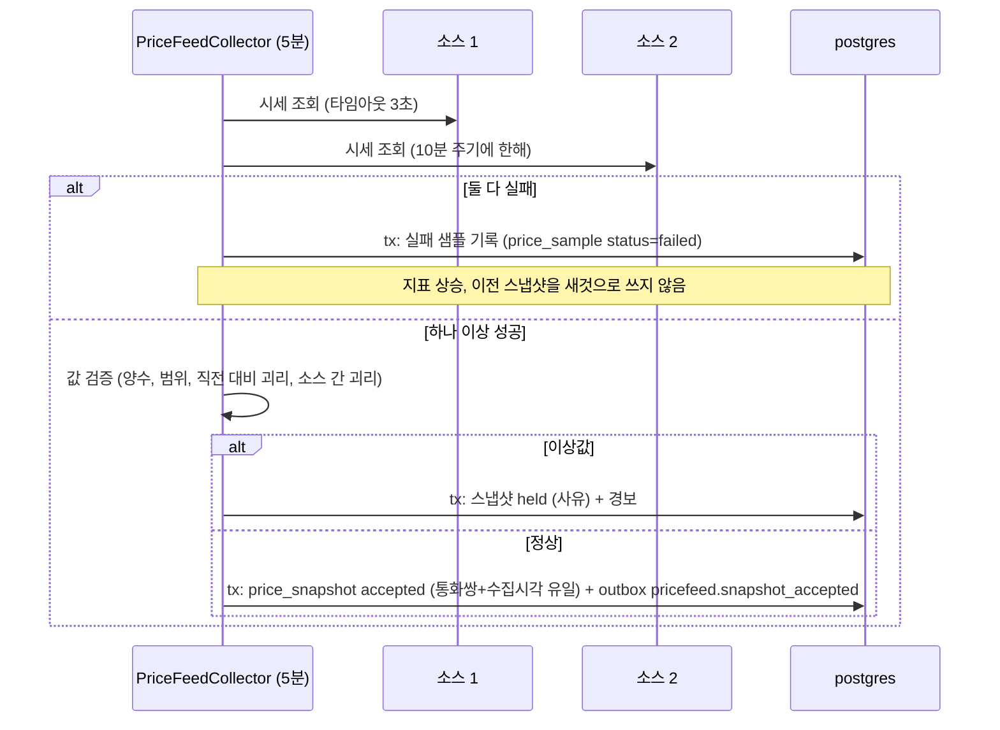

| 검증 | 기준(제안, 소스 확인 후 조정) |
|---|---|
| 양수·유한 | 필수 |
| 절대 범위 | 800 ≤ KRW/USDC ≤ 2,500 (시연용 안전 범위, 설정) |
| 직전 스냅샷 대비 | 한 주기에 ±3% 초과 → 보류 |
| 소스 간 | 1% 초과 → 보류 |
| 신선도 | 소스가 주는 시각이 수집 시각보다 5분 넘게 오래됨 → 거절 |

### 8.4 견적(Quote)

```mermaid
stateDiagram-v2
    [*] --> open: 발급 (최신 accepted 스냅샷, 만료 시각)
    open --> used: 결제 시작에서 사용 (조건부, 1회)
    open --> expired: 만료 시각 경과 (조회 시 또는 스윕)
    used --> [*]
    expired --> [*]
```

```mermaid
flowchart TD
    A["POST /api/orders/{id}/quotes"] --> B{"주문 pending_payment 이고 내 주문?"}
    B -- "아니오" --> X["403/404"]
    B -- "예" --> C["최신 accepted 스냅샷 조회"]
    C --> D{"있고, 나이 <= 허용 지연(15분)?"}
    D -- "아니오" --> E["503 pricefeed_stale (fail-closed) + 지표"]
    D -- "예" --> F["usdc_micro = convert(주문 KRW, rate, half_up) 표시용"]
    F --> G["quote INSERT (open, expires_at = now + 5분, snapshot_id 고정)"]
    G --> H["200 { quoteId, krw, usdcApprox, rate, expiresAt, 모의 면책 }"]
```

| 규칙 | 값(제안) |
|---|---|
| 견적 TTL | **5분** — 결제창을 열어 승인까지 보통 걸리는 시간보다 길게, 시세 변동 위험보다 짧게 |
| 허용 지연(최신 스냅샷 나이 상한) | **15분** = 수집 주기 × 3. 넘으면 견적 거절(fail-closed) |
| 사용 | 견적은 **결제 시작(`initiated`)에서 1회만** 쓴다(`open→used` 조건부). 만료된 견적으로는 시작 불가. **포인트 결제도 결제 시작 시 최신 accepted 스냅샷을 `payment.snapshot_id` 로 고정**한다(견적 UI 없이 서버가 고정; 스냅샷이 허용 지연을 넘으면 포인트 결제 시작도 `pricefeed_stale` 로 거절 — 정산이 항상 환율 근거를 갖게 하기 위함, 이 때문에 시세 장애는 포인트 구매에도 영향) |
| 고정 | 결제 시작 시 견적의 `snapshot_id` 를 `payment.snapshot_id` 로 복사한다. 이후 새 스냅샷이 들어와도 **불변**. 승인이 견적 만료 이후에 와도 고정된 스냅샷을 쓴다(결제 TTL 안이면) |
| 결제 TTL 초과 | 승인이 결제 TTL(10분)을 넘으면 늦은 결제 정책(§6.7) 또는 거절 |

### 8.5 정산 (`SettlementExecutor`)

```mermaid
sequenceDiagram
    participant E as escrow
    participant I as settlement inbox
    participant S as SettlementExecutor
    participant L as ledger
    participant D as postgres
    E-->>I: escrow.released (outbox 경유, 잔여 legs[] 포함)
    S->>D: inbox 선점 → settlement 생성 (escrow_id 유일, pending)
    S->>D: tx1: pending→processing 선점 (claim_token)
    S->>S: 잔여 다리 입력 + 고정된 snapshot 의 환율로 환산 (floor) + 수수료 + dust
    S->>D: tx2 (락 순서: settlement 행 → ledger 계정): processing→settled 조건부 + 원장 분개 (§8.5.1: 비 USDC 다리 소각 0~1건 + USDC 정산 1건) + outbox settlement.completed
    Note over S,D: 외부 호출 없음(모의). 온체인은 Phase 6-4 에서 tx1 과 tx2 사이로 이동
```

| 규칙 | 내용 |
|---|---|
| 멱등 | `settlement.escrow_id` 유일. 재전달된 `escrow.released` 는 inbox PK 로 흡수 |
| 환율 | **에스크로 생성 시점이 아니라 결제 시작 시 고정한 스냅샷**(§8.4, **모든 결제 수단**)을 쓴다 → "이 결제는 몇 시 몇 분 스냅샷의 환율로 확정됐다"를 한 질의로 보인다(Phase 5 DoD). 혼합 결제의 정산은 **총액 차이 방식**이다: 잔여 총액 `T_rem` 전체를 같은 스냅샷으로 한 번 환산해 `gross_rem` 을 구하고, 구매자가 이미 낸 USDC 다리 `u_rem` 을 뺀 차이가 플랫폼 부담 `r` 이다(POINT 다리를 따로 환산하지 않는다, §8.5.1) |
| 정산 입력 | **에스크로의 잔여 다리** — `escrow_leg.amount − refunded_amount`(부분 환불이 있었으면 줄어든 값). 원 결제 금액이 아니다 |
| 실패 | 환산 입력 이상(스냅샷 없음·음수)이면 `failed` + 경보, 수동 재시도 CLI. 모든 결제가 스냅샷을 가지므로 정상 경로에서 "스냅샷 없음"은 일어나지 않는다(이전 설계의 포인트 결제 정산 영구 실패 결함 해소) |
| 모의 지급 | `settled` 는 "판매자 USDC 지급채무 확정"이며 실제 이체는 없다. 지급 완료 표시는 `payout_marked` 별도 행위(관리자, 모의) |


#### 8.5.1 혼합 결제의 정산 분개 (ADR-048 E5)

에스크로는 다리별로 보류하고(`liab:escrow:POINT`·`liab:escrow:USDC`) 해제 시 **판매자 정산은 USDC** 이다. 정산의 입력은 원 결제가 아니라 **해제 시점의 잔여 다리**다.

```
P_rem = escrow_leg(POINT).amount − refunded_amount          // 잔여 POINT 다리 (KRW 가치 = P_rem)
u_rem = escrow_leg(USDC).amount  − refunded_amount          // 잔여 USDC 다리 (micro-USDC)
R_rem = 잔여 USDC 다리의 KRW 가치 (payment_leg.krw_value − 환불된 KRW 가치)
T_rem = P_rem + R_rem                                       // 잔여 총액 (KRW)
x_eff = max( T_rem × 10^14 / rate_e8 , u_rem )              // 유리수. 두 번째 항은 구매자가 이미 낸 USDC (아래 설명)
gross_rem = floor(x_eff)                                    // = max( floor(T_rem·c), u_rem )
r         = gross_rem − u_rem                               // 플랫폼 부담, 항상 ≥ 0
net  = floor( x_eff × (10000 − fee_bps) / 10000 )
fee  = floor( x_eff × fee_bps / 10000 )
dust = gross_rem − net − fee                                // ∈ {0, 1}
```

- **왜 `max(·, u_rem)` 인가**: 구매자 USDC 다리는 결제 때 내림(`floor(R·c)`), 부분 환불은 누적 비례 내림(§6.6.1)으로 돌려주므로 환불이 끼면 `u_rem` 이 `floor(T_rem·c)` 보다 **1~2 micro-USDC 클 수 있다**(시험에서 정산 7만 3천 건 중 8,117건). 그대로 빼면 `r < 0` 이 되어 `exp:point_redemption:USDC` 가 대변으로 쌓이므로, 판매자 정산 총액은 구매자가 낸 몫 아래로 내려가지 않게 하고 차이가 없으면 `r = 0` 으로 둔다.
- **반올림 때문에 생기는 차이**(`T_rem·c` 를 내림한 값과 구매자가 낸 `u_rem` 의 차, 위 `max` 로 흡수되는 몫 포함)는 `rev:rounding_dust` 에 섞지 않고 **`exp:point_redemption:USDC`(r) 에 일관되게 포함**한다. `dust` 는 `net`/`fee` 의 내림 차액만이다.
- 카드 결제(USDC 다리 없음, `u_rem = 0`)의 정산 총액은 §8.2 의 `grossMicro` 이고 USDC 차변은 `fx:clearing:USDC` 다.

| 단계 | 분개 (차변 / 대변), 자산별 1건 |
|---|---|
| 해제: POINT 다리 소각 | `liab:escrow:POINT` P_rem / `fx:clearing:POINT` P_rem |
| 정산(USDC 자산) | `liab:escrow:USDC` u_rem + `exp:point_redemption:USDC` r / `liab:seller_payable:{s}:USDC` net + `rev:platform_fee:USDC` fee + `rev:rounding_dust:USDC` dust |

- 차변 합 `u_rem + r = gross_rem` = 대변 합 `net + fee + dust` 이므로 **USDC 자산에서 항상 균형**이고, POINT 자산은 별도로 균형이다(자산별 분개, 다중 자산 복식).
- **금액 0 인 라인은 만들지 않는다**(`posting.amount > 0` CHECK): `P_rem = 0`(POINT 다리가 전액 환불됐거나 없음)이면 POINT 소각 분개 없음, `u_rem = 0` 이면 `liab:escrow:USDC` 라인 없음, `r = 0`·`fee = 0`(`fee_bps = 0`)·`dust = 0` 이면 해당 라인 생략, `net = 0`(수수료율 100% 같은 퇴화형) 이면 `seller_payable` 라인 생략. 분개는 어떤 형태에서도 `gross_rem > 0` 이라 최소 한 개의 차변·대변 라인을 가진다.
- **분개 수**: 해제·정산 분개는 `다리 수 + 1` 에서 USDC 다리의 해제 분개가 정산 분개에 합쳐지므로 **비 USDC 잔여 다리(POINT 또는 KRW, 0 또는 1개) + USDC 정산 분개 1건**이다 — 포인트 단독·혼합·카드는 2건, USDC 단독은 USDC 정산 분개 1건(§9.3 대사 질의가 이 형태를 기대한다).
- `settlement` 행은 `funded_usdc_micro`(= u_rem), `funded_point_krw`(= P_rem), `point_redemption_micro`(= r) 를 갖고 `CHECK (funded_usdc_micro + point_redemption_micro = usdc_gross_micro)` 와 `CHECK (net_micro + fee_micro + dust_micro = usdc_gross_micro)` 가 같은 식을 강제한다.

**속성 시험(2026-11-05, 정수 모델, 무작위 10만 주문)**: `T ∈ [100, 5,000,000]`, 환율 `[800, 2500]`(소수 8자리), `fee_bps ∈ {0, 100, 250, 333}`, 포인트 단독·USDC 단독·혼합을 섞고, 결제 후 부분 환불 0~5단계(§6.6.1 규칙, 마지막 단계는 15% 확률로 전액) 뒤 남은 잔여 다리로 정산했다. 환불 17만 6,052단계, 정산 7만 3,538건(전액 환불로 정산이 없는 2만 6,462건 제외), `r > 0` 5만 8,604건. 결과 — 자산별 분개 차변≠대변 **0건**, `r < 0` **0건**, 에스크로·사용자 계정 음수 잔액 **0건**, 다리별 환불 합 > 낸 수량 **0건**, 정산 후 에스크로 잔액 잔존 **0건**, `dust ∉ {0,1}` **0건**. 대조군: `max(·, u_rem)` 없이 `r = floor(T_rem·c) − u_rem` 으로 계산하면 8,117건에서 `r < 0` 이 나온다(그래서 위 정의가 필요하다). 재현 스크립트는 별도 보관하지 않고 결과만 기록한다.

### 8.6 시세 이상 시 동작 요약

| 상황 | 결제/견적 | 정산 |
|---|---|---|
| 스냅샷 오래됨 | 견적 발급 거절(503), 이미 만든 견적·결제는 영향 없음 | 영향 없음(고정된 스냅샷) |
| 이상값 보류 | 마지막 accepted 를 쓰되 나이 상한 적용 | 영향 없음 |
| 소스 모두 장애 | 15분 후 견적 불가 → 신규 결제 시작 불가(의도된 동작) | 이미 고정된 건은 진행 |

### 8.7 Solana USDC devnet 에스크로 경계 (Phase 6-4)

**경계만 설계한다.** 구현은 착수 시 별도 ADR(키 관리 ADR 선행, ADR-016).

```mermaid
classDiagram
    class EscrowChainPort {
        <<interface>>
        +open(orderId, buyerRef, sellerRef, usdcMicro) ChainTx
        +release(orderId) ChainTx
        +refund(orderId) ChainTx
        +status(orderId) ChainEscrowState
        +watch(since) ChainEvent[]
    }
    class SolanaDevnetEscrow
    class InMemoryChainEscrow
    EscrowChainPort <|.. SolanaDevnetEscrow
    EscrowChainPort <|.. InMemoryChainEscrow
```

| 항목 | 방향 |
|---|---|
| 상태 모델 | 오프체인 `escrow` 상태 머신이 **정본**이고 온체인 계정은 그 거울. 온체인 상태는 `status`/`watch` 로 읽어 대조 |
| 호출 위치 | 온체인 트랜잭션은 **트랜잭션 밖**(선점 → 체인 호출 → 완료), 서명 확인/확정 깊이는 폴링 대사 |
| 네트워크 | **devnet 한정**. USDC devnet 민트 주소 `4zMMC9srt5Ri5X14GAgXhaHii3GnPAEERYPJgZJDncDU`(Circle 문서에서 확인한 값), 테스트 USDC 는 Circle faucet 과 Coinbase CDP faucet 이 같은 민트로 보낸다(2026-11-05 검색; Circle 문서 developers.circle.com/stablecoins/usdc-contract-addresses). 한도는 제3자 자료 기준 Circle 20 USDC/2시간/주소(Circle 자체 페이지 미확인), Coinbase CDP 1 USDC/요청·10 USDC/24시간(Coinbase 문서) — 6d 착수 전 재확인. 수수료용 SOL 은 Solana faucet. **확정(P0 U28, 2026-11-05): 정산 토큰은 자체 발행 `tUSDC`(devnet 모의 토큰, 메타데이터 이름 'Test USDC (demo)', 화면에도 `tUSDC` 명시)가 기본**이고 설정 `SETTLEMENT_MINT` 로 Circle devnet USDC 에 연결할 수 있다. 지갑 연결이 유도 경로라 외부 faucet 두 곳을 거치면 이탈하므로 사이트가 tUSDC 를 발행하고 수수료를 대납(fee payer)한다. **민트 권한 키·수수료 대납 키는 비밀**(devnet 전용, ADR-026 등재)이고 지갑당 발행 속도·횟수를 제한한다. **수수료 대납 안전장치(P0 U29 확정, 2026-11-05)**: 지갑당 대납 횟수·일일 총량 상한, 대납 키 SOL 잔액이 기준 이하이면 Discord 경보(게이지 `pf_wallet_fee_payer_balance_lamports` 제안, ADR-027), 잔액이 바닥나면 대납을 멈추고 '사용자 faucet 안내' 화면으로 자동 폴백(지갑 연결·원장 기능은 정상). 사용자 1명당 약 0.003 SOL 은 미검증 추정이며 상한 숫자는 초기값 제안, 6d 착수 시 확정 `SETTLEMENT_MINT` 가 Circle USDC 이면 사이트는 발행하지 않고 사용자가 Circle faucet 으로 받은 것을 쓴다(수수료 대납은 유지 가능). 앞서의 '권고는 Circle USDC, tUSDC 는 폴백'은 개정 이력이다. 지갑은 선택 사항이며 연결한 사용자만 이 경로를 쓴다 |
| 키 | 서버 서명 키·tUSDC 민트 권한 키·수수료 대납 키는 시크릿 파일, **devnet 키만**. 메인넷 키는 어떤 설정에도 두지 않는다. 키 관리 ADR 이 착수 선행 조건 |
| 시험 | `InMemoryChainEscrow` 로 전 흐름을 결정적으로 시험하고 devnet 은 통합 시연으로만 |
| 범위 | 분쟁·부분 해제 온체인화는 범위 밖 |

---

## 9. 원장 (`ledger`) — 복식·불변·대사

> `ledger` 모듈은 **하나**다(P0 D20, §2.5). **이 절이 원장 스키마(다중 자산·복식·지연 제약)의 정본**이고([ADR-040](../../adr/ADR-040-escrow-settlement-and-ledger.md)), 바둑 보상의 POINT 규칙과 `reward` 상태 머신은 [P1 §10](01-baduk.md) / ADR-037 이 이 스키마 위에 정의한다. 공개 `InTx` 는 `PostJournalInTx`·`ReverseJournalInTx`·`ConfirmRewardInTx`·`FlagRewardInTx`(시그니처 `(tx: TxContext, …) => Result`).

### 9.1 모델

| 테이블 | 핵심 |
|---|---|
| `ledger.account` | `id`, `code`(유일), `type`(`asset`/`liability`/`revenue`/`expense`), `asset`(`KRW`/`POINT`/`USDC`), `owner_ref`(사용자·판매자 id, NULL), `min_balance`(아래 표, **정본은 ADR-040**) |
| `ledger.journal` | `id`, `kind`, `ref_type`, `ref_id`, `asset`(**저널은 자산별 1건**), `idempotency_key` **유일**(키 끝에 `:{asset}` 접미), `reversal_of_id` NULL, `created_at`, `trace_id` |
| `ledger.posting` | `journal_id`, `line_no`, `account_id`, `direction`(`D`/`C`), `amount` `bigint > 0`, `asset` |
| `ledger.grant` | `id`, `user_id`, `github_id`(불변 subject 사본), `kind`(`welcome` 또는 `admin:{requestId}`), `asset`, `amount`, `journal_id`, `created_at` — **`UNIQUE (github_id, kind)`**. 사용자 삭제는 소프트 삭제(톰스톤, `github_id` 유지)라 같은 GitHub 계정이 재가입해도 첫 로그인 지급이 다시 나가지 않는다 |
| `ledger.supply_cap` | `asset` PK, `issued`, `cap` `numeric(40,0)` — 자산별 단일 행(P0 U25: `cap` 값은 signed 64-bit 최대 9223372036854775807 마이크로 단위이고, 각 잔액 컬럼이 BIGINT 인 한 합이 이를 넘을 수 없다). 발행은 `UPDATE ledger.supply_cap SET issued = issued + :amt WHERE asset = :a AND issued + :amt <= cap` 한 문장으로 **원자 강제**(0행이면 `supply_cap_exceeded` 거절 + 경보). **지급(첫 로그인·관리자)과 교환으로 발행되는 POINT 를 모두 센다**(교환은 USDC 를 소비하지만 POINT 총량을 늘리므로 포함). 바둑 보상 POINT 는 별도 정책(P1)이라 이 행에 넣지 않는다. 상한이 실질 무제한이라 이 원자 UPDATE 는 구조 방어로만 남고, 남용 방어는 사용자당 1회 지급(`github_id` 유일)과 속도 제한이 맡는다 |
| `ledger.account_balance` | `account_id` PK, `balance`, `version` — **같은 트랜잭션**에서 조건부 갱신(`balance + Δ >= min_balance`). 한 분개가 여러 계정을 갱신할 때는 **계정 id 오름차순**으로 갱신해 교착을 막는다(락 순서 규약, §4.7). `min_balance` 가 NULL 이면 하한 없음 |

| 불변식 | 강제 수단 |
|---|---|
| 분개마다 자산별 차변 합 = 대변 합 | **지연 제약 트리거**(커밋 시 검사, `CONSTRAINT TRIGGER … DEFERRABLE INITIALLY DEFERRED`) — raw SQL 객체(ADR-025 레지스트리, G10 목록 관리) |
| 추가 전용 | `journal`/`posting` 에 앱 경로 UPDATE·DELETE 없음, DB 권한도 INSERT 전용(역할 분리는 미결) |
| 정정은 역분개 | `reversal_of_id` 로 원 분개를 가리키는 새 분개 |
| 같은 사건 두 번 기장 금지 | `idempotency_key` 유일(`ref_type:ref_id:kind:{asset}` — 지급 `grant:welcome:{uid}:{asset}`, 결제 확정 `payment:{id}:confirm:{asset}`, 환불 `refund:{paymentId}:{eventId}:{asset}`, 교환 `exchange:{userId}:{key}:{asset}`) |
| **부분 환불 역분개의 합 상한** | 같은 `reversal_of_id` 를 가진 분개들의 (계정·자산별) 라인 금액 합 ≤ 원 분개 라인 금액. 지연 제약 트리거가 커밋 시 검사하고 대사 질의(§9.3)가 점검 |
| 잔액 음수 금지(계정 유형별 `min_balance`, 아래 표) | `account_balance` 조건부 갱신 + 대조 잡. **규칙은 ledger 모듈의 계정 유형별 설정**이며 바둑 보상(P1)·상거래가 같은 표를 쓴다 |

### 9.2 계정 체계(초안)와 대표 분개

| 계정 코드 | 유형 | 자산 | 의미 |
|---|---|---|---|
| `liab:user_points:{uid}` | 부채 | POINT | 사용자 보유 포인트 |
| `liab:user_usdc:{uid}` | 부채 | USDC | 사용자 **모의** USDC 잔액(환경별 공급분·관리자 지급, 결제·교환으로 감소) |
| `exp:demo_grant:POINT` · `exp:demo_grant:USDC` | 비용 | POINT · USDC | 데모 지급(첫 로그인 `ClaimWelcomeGrant`·관리자 `AdminGrant`)으로 발행한 모의 자산 |
| `exp:points_exchanged:POINT` · `rev:point_exchange:USDC` | 비용 · 수익 | POINT · USDC | USDC→POINT 교환(발행한 포인트 · 소비된 USDC) |
| `exp:point_redemption:USDC` | 비용 | USDC | 정산 시 POINT 다리 몫을 USDC 로 환산해 플랫폼이 부담한 값(§8.5.1) |
| `exp:points_issued` | 비용 | POINT | 보상으로 발행한 포인트(P1, Phase 2~) |
| `liab:escrow:POINT` / `liab:escrow:USDC` / `liab:escrow:KRW` | 부채 | POINT / USDC / KRW | 에스크로로 보류 중인 대금(다리별) |
| `asset:pg_receivable:KRW` | 자산 | KRW | PG 로부터 받을 승인 대금(모의) |
| `fx:clearing:KRW` / `fx:clearing:POINT` / `fx:clearing:USDC` | 자산 | KRW / POINT / USDC | 통화 환산 청산·POINT 다리 소각(자산별로 분리해 각각 균형) |
| `liab:seller_payable:{sid}:USDC` | 부채 | USDC | 판매자에게 줄 정산 대금 |
| `rev:platform_fee:USDC` | 수익 | USDC | 수수료 |
| `rev:rounding_dust:USDC` | 수익 | USDC | 반올림 차액 |
| `asset:payout_marked:USDC` | 자산 | USDC | 모의 지급 표시 누계(관리자 `payout_marked`) |

> `min_balance` 의 **정본은 [ADR-040](../../adr/ADR-040-escrow-settlement-and-ledger.md) 한 곳**이다. 아래 표는 그 인용이며 어긋나면 ADR-040 이 맞다.

| 계정 | `min_balance` | 이유 |
|---|---|---|
| `liab:user_points:{uid}` · `liab:user_usdc:{uid}` | **0** | 사용자 보유 자산은 음수가 될 수 없다(결제·교환 차감이 조건부 갱신으로 거절됨) |
| `liab:escrow:POINT` · `liab:escrow:USDC` · `liab:escrow:KRW` | **0** | 보류 중 대금 합. 해제·환불이 보류액을 넘을 수 없다 |
| `liab:seller_payable:{sid}:USDC` | **0** | 지급채무. 모의 지급 표시가 채무를 넘을 수 없다 |
| `asset:pg_receivable:KRW` | **0** | PG 로부터 받을 대금. 취소가 승인액을 넘을 수 없다 |
| `fx:clearing:{KRW\|POINT\|USDC}` | NULL(하한 없음) | 환산 청산 계정은 단계 사이에서 일시적으로 반대 방향 잔액이 생길 수 있다 |
| `exp:points_issued` · `exp:demo_grant:*` · `exp:points_exchanged:POINT` · `rev:point_exchange:USDC` · `exp:point_redemption:USDC` · `rev:platform_fee:USDC` · `rev:rounding_dust:USDC` | NULL(하한 없음) | 비용·수익 누적 계정(차변/대변 한쪽으로만 쌓이지만 역분개 때 줄 수 있어 하한을 두지 않음) |
| `asset:payout_marked:USDC` | NULL(하한 없음) | 모의 지급 표시 누계 |

- **음수 잔액 허용(부채)이라는 서술은 없다.** 포인트 보상이 `PENDING` 일 때는 기장이 없고 `CONFIRMED` 가 되어야 `liab:user_points` 에 들어가므로(P1 §10, ADR-037) 사후 박탈 역분개로 사용자 잔액이 음수가 되는 경로 자체가 없다.

| 사건 | 분개 (차변 / 대변) |
|---|---|
| 첫 로그인 지급 (Phase 3) | POINT 분개 `exp:demo_grant:POINT` / `liab:user_points:{u}` 100,000 — 저널 1건, 멱등 키 `grant:welcome:{uid}:POINT`. 설정 `WELCOME_GRANT_USDC_MICRO` > 0 인 환경(로컬·시험)에서만 USDC 분개 `exp:demo_grant:USDC` / `liab:user_usdc:{u}` 가 **자산별 저널로 1건 더** 붙고 멱등 키는 `grant:welcome:{uid}:USDC` (라이브 기본 0)(사용자당 1회, `ledger.grant` 의 `UNIQUE (github_id, kind)` 가 계정 삭제·재가입에도 막는다). 관리자 지급은 `grant:admin:{uid}:{requestId}:{asset}` |
| USDC→POINT 교환 | USDC 분개 `liab:user_usdc:{u}` / `rev:point_exchange:USDC` x, POINT 분개 `exp:points_exchanged:POINT` / `liab:user_points:{u}` K — 반대 방향은 없다 |
| 보상 확정 (P1, Phase 2) | `exp:points_issued`(POINT) / `liab:user_points:{u}`(POINT) |
| 결제 확정(POINT 다리) | `liab:user_points:{u}` / `liab:escrow:POINT` |
| 결제 확정(USDC 다리) | `liab:user_usdc:{u}` / `liab:escrow:USDC` |
| 카드 승인(모의) | `asset:pg_receivable:KRW` / `liab:escrow:KRW` |
| 환불(해제 전) | 위 분개의 **역분개**(다리별 자산별 저널, 부분 환불은 일부 금액 — 누적 합 ≤ 원 분개) |
| 해제 → 정산 1단계 | `liab:escrow:{KRW\|POINT}` / `fx:clearing:{KRW\|POINT}` — **잔여 다리 금액**(USDC 다리는 정산 2단계에서 직접 차변, §8.5.1) |
| 정산 2단계 | `liab:escrow:USDC`(u_rem, 혼합·USDC) + `exp:point_redemption:USDC`(r) 또는 카드 경로의 `fx:clearing:USDC`(gross) / `liab:seller_payable:{s}:USDC`(net) + `rev:platform_fee:USDC`(fee) + `rev:rounding_dust:USDC`(dust ∈ {0,1}) — 0 인 라인 생략, 대변 합 = 차변(§8.2, §8.5.1) |
| 모의 지급 표시 | `liab:seller_payable:{s}:USDC` / `asset:payout_marked:USDC` |

### 9.3 대사 질의 (점검 잡 `LedgerReconciler`, 일 1회 + 요청 시)

| 점검 | 질의 요지 | 기대값 |
|---|---|---|
| 시산표 | 자산별 `Σ(D) − Σ(C)` | 0 |
| 불균형 분개 | 자산별 차변·대변 합이 다른 `journal` | 0건 |
| 계정 잔액 | `account_balance` vs `posting` 합 | 일치 |
| 음수 잔액 | `min_balance` 위반 계정 | 0건 |
| 주문 ↔ 원장 | `order.status in (paid..)` 마다 `ref_type='order'` 보류 분개 1건 | 일대일 |
| 해제 ↔ 정산 | `escrow.released` 마다 해제·정산 분개 = (비 USDC 잔여 다리 0~1건) + USDC 정산 1건(§8.5.1). 정산 입력이 잔여 다리와 일치 | 일대일 |
| 역분개 상한 | 원 분개 라인별 `Σ(reversal)` ≤ 원 금액 | 위반 0 |
| 공급 상한 | `supply_cap.issued` = 지급·교환 발행 분개 합, ≤ `cap` | 일치 |
| 재고 불변식 | (I1) `confirmed ≤ total`, (I2) `avail` 대조 | 위반 0 |

결과는 지표(`pf_ledger_imbalance`(분개 단위 게이지), `pf_ledger_trial_balance_nonzero`)와 감사 `system.ledger_reconciled` 로 남는다.

---

## 10. 데이터 모델 개요

> 컬럼 전수가 아니라 **핵심 컬럼·제약·인덱스·보호 등급**이다. 표기는 [database-schema.md](../../domains/database-schema.md)와 같다. 보호 등급: PUB·SYS·PSD·PII·HSH·**ENC**(ADR-026). 모든 쓰기는 `UnitOfWork` 트랜잭션(ADR-025). 손으로 쓰는 SQL(raw)은 `adapter/postgres/raw/` 레지스트리에 등록한다.

### 10.1 `catalog`

| 테이블 | 핵심 컬럼 | 제약·인덱스 | 등급 |
|---|---|---|---|
| `product` | `id`, `sku`, `name_ko`, `name_en`, `description_ko/en`, `image_ref`, `reference_price_krw`, `reference_source`(출처 이름), `reference_checked_on`(확인일), `status`(`draft`/`active`/`retired`), `version`, 시각 | `sku` 유일 | PUB·SYS |

**시드 상품 (P0 U27).** 시드는 실제 쇼핑몰(네이버 쇼핑 등)의 대표 상품을 조사해 **참고 가격**을 표시하는 방식이다. `reference_price_krw` 는 참고용 KRW, `reference_source` 는 출처 이름, `reference_checked_on` 은 확인일이다. 자동 수집(스크래핑)은 하지 않고 **사람이 Phase 3 착수 시 조사해 시드 파일(`seeds/products.*`)에 기록**한다(실제 가격 수치는 아직 확보하지 못해 이 문서에 쓰지 않는다). 이미지는 쇼핑몰 것을 복사하지 않는다(저작권·약관) — 자체 일러스트 또는 무이미지. 가격은 시점 스냅샷이며 실제 거래가 아님을 화면에 표기한다. **지갑 없는 사용자는 USDC 를 받지 않으므로(P0 U24 해결, 2026-11-05 사용자 결정) POINT 단독 구매가 핵심 경험이고, 시드 상품 중 POINT 100,000 안에서 살 수 있는 상품이 다수 있어야 한다.** **가격 충돌은 해결(2026-11-05 사용자 결정): (c) 로 푼다** — 첫 로그인 POINT 지급을 1,000 → **100,000**(1 POINT = 1 KRW)으로 올리고 시드 상품은 **대략 현실 금액(참고가 그대로)** 을 쓴다. 폐기한 안: (a) 참고가 스케일링, (b) 소액 상품군 필수 포함(소액 상품을 넣는 것은 자유). 시드는 참고가 대부분이 100,000원 이하가 되도록 조사하고, 100,000원을 넘는 상품은 USDC 교환·혼합 결제의 시연 대상으로 둔다.

### 10.2 `deal`

| 테이블 | 핵심 컬럼 | 제약·인덱스 | 등급 |
|---|---|---|---|
| `deal` | `id`, `product_id`, `seller_id`, `price_krw`(정수), `total_qty`, `per_user_limit`, `opens_at`, `closes_at`, `status`(`draft`/`publishing`/`scheduled`/`open`/`sold_out`/`rebuilding`/`closed`/`settled`, §3.2), `earmarked_qty`(약정 승인 수량), `version` | `CHECK (closes_at > opens_at AND total_qty > 0 AND price_krw >= 0)`, `(status, opens_at)` 인덱스 | PUB·SYS |
| `stock` | `deal_id` PK, `total`, `confirmed`, `version` | **`CHECK (confirmed >= 0 AND confirmed <= total)`** (I1) | SYS |
| `reservation` | `id`, `deal_id`, `user_id`, `qty`, `status`(`active`/`confirming`/`confirmed`/`expired`/`released`), `expires_at`, `claim_token`, `claimed_by`, `lease_until`, `order_id` NULL, `method`, `idempotency_key`, 시각 | `UNIQUE (deal_id, idempotency_key)`, 부분 인덱스 `(expires_at) WHERE status='active'`, `(lease_until) WHERE status='confirming'`, `(user_id, deal_id)` | PSD(`user_id`)·SYS |
| `user_purchase` | `(deal_id, user_id)` PK, `qty` | 개인 한도 **하드 게이트**: `UPDATE … SET qty = qty + $q WHERE qty + $q <= $limit` (확정 tx 안). **확정 구매 수량**을 센다(활성 예약은 Redis `user` 해시). 출고 전 취소 복원(`deal.restocked`, reason=`cancel`) 때만 같은 tx 에서 `qty − q` (`CHECK qty >= 0`) | PSD |
| `request_key` | M1 공통 형태 | 24시간 | PSD·HSH |
| `inbox_message` | M1 공통 형태(소비자 `deal-projector`, `deal-redis-sync`) | — | SYS |

### 10.3 `order`

| 테이블 | 핵심 컬럼 | 제약·인덱스 | 등급 |
|---|---|---|---|
| `order` | `id`, `number`, `buyer_user_id`, `status`(§5.2), `fulfillment_mode`(`demo`/`physical`, §5.2.1, 확정 시 고정), `total_krw`, `deal_id` NULL, `reservation_id`, `seller_id`, `shipping_address_enc`, **`exchange_of_order_id` NULL**(상품 교환 신규 주문이 원 주문을 가리킴, §5.5), `paid_at`, `delivered_at`, `version`, 시각 | `UNIQUE(number)`, **`UNIQUE(reservation_id)`**, `(buyer_user_id, created_at DESC)` | PSD·SYS·**ENC**(`shipping_address_enc`) |
| `order_line` | `order_id`, `line_no`, `sku`, `name_snapshot`, `unit_price_krw`, `qty`, **`qty_returned`**(반품·교환 확정 요청 누계, 기본 0) | PK `(order_id, line_no)`, `CHECK (qty > 0)`, `CHECK (qty_returned BETWEEN 0 AND qty)` | PUB·SYS |
| `order_exchange` | `id`, `original_order_id`, `new_order_id`, `return_id`, `status`(§5.5.2), `cancel_reason` NULL, `price_diff_krw`, `refund_krw`(반품 줄 환불 대상 F), `version`, 시각 | `UNIQUE(new_order_id)`, `UNIQUE(return_id)`, 부분 인덱스 `(original_order_id) WHERE status IN ('awaiting_payment','awaiting_return','inspecting')`, `order_exchange` 가 활성인 줄에 대한 중복 요청은 `qty_returned` 조건부 UPDATE 가 막는다 | SYS |
| `order_status_history` | `id`, `order_id`, `from_status`, `to_status`, `cause_event_id`, `at`, `actor_key` | 추가 전용, `(order_id, id)` | SYS·PSD |
| `request_key`, `inbox_message` | 공통 | `inbox` 소비자 `order-fulfillment-reactor`(풀필먼트 이벤트), `order-reservation-reactor` | — |

### 10.4 `pricefeed`

| 테이블 | 핵심 컬럼 | 제약·인덱스 | 등급 |
|---|---|---|---|
| `price_sample` | `id`, `source`, `pair`, `rate_e8`, `observed_at`, `collected_at`, `status`(`ok`/`failed`/`invalid`), `note` | `(source, pair, collected_at)` | SYS |
| `price_snapshot` | `id`, `pair`, `rate_e8`(`bigint`), `collected_at`, `source_note`, `status`(`accepted`/`held`), `hold_reason` | **`UNIQUE (pair, collected_at)`**, `(pair, collected_at DESC) WHERE status='accepted'` | SYS |

### 10.5 `payment`

| 테이블 | 핵심 컬럼 | 제약·인덱스 | 등급 |
|---|---|---|---|
| `quote` | `id`, `order_id`, `user_id`, `krw_amount`, `snapshot_id`, `usdc_micro_ref`, `expires_at`, `status`(`open`/`used`/`expired`), `version` | `(order_id, status)`, 사용은 `UPDATE … WHERE status='open' AND expires_at > $now` | PSD·SYS |
| `payment` | `id`, `order_id`, `method`(`ledger`/`card_test`/`usdc_escrow`), `provider`, `provider_payment_key_enc`, `amount_krw`, `quote_id`, `snapshot_id`(고정), `status`(`initiated`/`awaiting_approval`/`approving`/`approved`/`unknown`/`refund_pending`/`refunding`/`refund_failed`/`partially_refunded`/`refunded`/`failed`/`expired`, §6.3), `refunded_total`, `claim_token`, `claimed_by`, `lease_until`, `attempts`, `next_attempt_at`, `version`, `approved_at` | **부분 유일 `UNIQUE (order_id) WHERE status IN ('initiated','awaiting_approval','approving','approved','unknown','refund_pending','refunding','refund_failed','partially_refunded')`**, `(status, lease_until)`, `CHECK (refunded_total BETWEEN 0 AND amount_krw)` | PSD·SYS·**ENC**(`provider_payment_key_enc`) |
| `payment_refund` | `id`, `payment_id`, `amount_krw`, `reason`(`rejected_stock`/`late_sold_out`/`cancel`/`fulfillment_rejected`/`return`/`admin`), `status`(`pending`/`completed`/`failed`/`unknown`), `provider_ref`, `cause_event_id` NULL, `idempotency_key` | **`UNIQUE (idempotency_key)`**(이벤트 기원 환불은 `refund:<paymentId>:<eventId>`), `(status) WHERE status IN ('pending','unknown')` | SYS |
| `payment_leg` | `id`, `payment_id`, `asset`(`POINT`/`USDC`), `amount`(POINT 또는 micro-USDC), `krw_value`, `plan_seq` | `UNIQUE (payment_id, asset)`, `CHECK (amount > 0)`, 합계 `SUM(krw_value) = payment.amount_krw` (애플리케이션+대사) | PSD·SYS (ADR-048) |
| `payment_refund_leg` | `id`, `refund_id`, `asset`, `amount`, `krw_value`, `idempotency_key`(= `refund:<paymentId>:<eventId>:<asset>`), `journal_id` | `UNIQUE (refund_id, asset)`, **`UNIQUE (idempotency_key)`**, 누적 `SUM(amount) ≤ payment_leg.amount` (대사) | PSD·SYS |
| `exchange_quote` | `id`, `user_id`, `snapshot_id`, `point_amount`, `usdc_micro`, `expires_at`, `status`(`open`/`used`/`expired`) | 주문과 무관(§8.2.2), 사용은 `UPDATE … WHERE status='open' AND expires_at > $now`, 만료 60초(제안) | PSD·SYS |
| `payment_event` | `id`, `payment_id`, `source`(`api`/`webhook`/`reconcile`), `provider_status`, `parsed`(jsonb, 최소 필드), `observed_at` | 추가 전용. **원본 payload 는 저장하지 않는다**(PII 가능) | SYS |
| `inbox_message` | 소비자 `payment-webhook-handler` (웹훅 수신), `payment-order-reactor`, **`payment-fulfillment-refunder`**(`fulfillment.rejected`·`cancelled`, `return.inspected` 의 환불 판정) | 7일 | SYS |
| `request_key` | 공통 | — | — |

### 10.6 `escrow`

| 테이블 | 핵심 컬럼 | 제약·인덱스 | 등급 |
|---|---|---|---|
| `escrow` | `id`, `order_id`, `payment_id`, `amount_krw`(다리 KRW 가치 합, 표시용 — 별도 `currency` 컬럼은 없다), `status`(`held`/`frozen`/`disputed`/`released`/`refunded`, §7.1; Phase 3 은 `held`/`released`/`refunded` 만), `frozen_reason` NULL(`return`/`delivery_failed`), `held_at`, `release_due_at` NULL(동결 중 NULL), `released_at`, `version` | **`UNIQUE (order_id)`**, 부분 인덱스 `(release_due_at) WHERE status='held'` | SYS |
| `escrow_leg` | `id`, `escrow_id`, `asset`(`POINT`/`USDC`/`KRW`), `amount`, `refunded_amount` | `UNIQUE (escrow_id, asset)`, `CHECK (refunded_amount BETWEEN 0 AND amount)`. 정산 입력 = `amount − refunded_amount`(§8.5.1). 혼합 결제는 다리별 보류(ADR-048) | SYS |
| `inbox_message` | 소비자 `escrow-order-reactor`(`order.return_requested`, `shipment.delivery_failed`, `shipment.delivered`, `return.inspected`) | 7일 | SYS |
| `escrow_dispute` | `id`, `escrow_id`, `opened_by`, `category`, `reason_enc`, `status`(`open`/`resolved`), `resolution`, `resolved_by`, 시각 | `UNIQUE (escrow_id) WHERE status='open'` | PSD·**ENC**(`reason_enc`) |

### 10.7 `settlement`

| 테이블 | 핵심 컬럼 | 제약·인덱스 | 등급 |
|---|---|---|---|
| `seller` | `id`, `name`, `fee_bps`, `status` | 시드 | PUB |
| `settlement` | `id`, `escrow_id`, `seller_id`, `krw_amount`, `snapshot_id`, `rate_e8`, `usdc_gross_micro`, `funded_usdc_micro`, `funded_point_krw`, `point_redemption_micro`, `fee_micro`, `net_micro`, `dust_micro`, `status`(`pending`/`processing`/`settled`/`failed`), `journal_id`, `claim_token`…, `version` | **`UNIQUE (escrow_id)`**, `CHECK (net_micro + fee_micro + dust_micro = usdc_gross_micro)` | SYS |
| `inbox_message` | 소비자 `settlement-escrow-reactor` | 7일 | SYS |

### 10.8 `ledger` (단일 원장 모듈, 정본은 §9)

`account`, `journal`, `posting`, `account_balance`. 등급: 금액·계정 코드 SYS, `owner_ref` PSD.

### 10.9 읽기 모델 (`*_read`)

| 테이블 | 채우는 이벤트 | 내용 | 비고 |
|---|---|---|---|
| `deal_read.deal_view` | `deal.*`, `reservation.*`, `stock.changed` | 공개 목록·상세: 이름·가격·기간·상태·`remaining_approx` | 목록은 읽기 모델만(CQRS). 잔여 수량은 **근사값**(수 초 지연), 정확한 판정은 `reserve` 에서만 |
| `order_read.order_view` | `order.*`, `payment.*`, `escrow.*`, `shipment.*` | 내 주문 목록·상세(단계 타임라인) | `owner_key` 로 본인 필터 |
| `payment_read.payment_view` | `payment.*` | 결제 상태(관리자·본인) | |
| `escrow_read.escrow_view` | `escrow.*` | 보류/해제 기한 표시 | |
| `settlement_read.settlement_view` | `settlement.*` | 판매자/관리자 정산 내역 | |
| `ledger_read.statement_view` | `ledger.*` | 포인트 거래 내역 | |

모두 필드별 순번/`last_seq` 가드로 이벤트 역전·재전달을 흡수한다(M1 규약, F12).

### 10.10 보관·익명화

| 데이터 | 보관 | 비고 |
|---|---|---|
| 주문·결제·에스크로·정산·원장 | **보관**(금융 기록, 추가 전용) | 모의 데이터지만 정책을 시연 |
| 배송지 암호문 | `physical`: 배송 완료 + 반품 기한 5일 + 30일, `demo`: 종결 후 30일에 삭제(익명화) | §5.4 |
| `reservation` 종료 행 | 종료 후 30일 | 대사 근거 |
| `price_sample` | 30일, `price_snapshot` 은 보관(결제가 id 로 참조) | |
| 웹훅 `inbox_message` | 7일(`processed`), `dead` 30일 | M1 규약(ADR-023) |
| `payment_event` | 90일(확정, U7) | |
| `request_key` | 24시간 | M1 규약 |

---

## 11. 이벤트 카탈로그

봉투·버전 규칙은 [05](../05-event-catalog.md)를 따른다. 페이로드에는 **식별자·금액·상태만** 싣고, 이름·주소·결제 토큰은 싣지 않는다.

| `type` | 발행(usecase, 같은 tx) | 페이로드 v1 (요약) | 소비자 | 공개 변환 |
|---|---|---|---|---|
| `deal.published` / `deal.opened` / `deal.closed` / `deal.sold_out` / **`deal.stock_adjusted`** | 딜 관리·스케줄러 | `dealId`, `skuId`, `totalQty`, `at`, (`remaining`, `delta`) | `deal-projector`, `deal-redis-sync`, **inventory**(published=약정 **요청**, stock_adjusted=조정; **해제는 `deal.settled` 에서**), 실시간 변환기 | `deal.state` 휘발성 |
| **`deal.scheduled`** / **`deal.publish_rejected`** / **`deal.settled`** | 약정 응답 소비자(`deal-earmark-reactor`) / 정산 판정 | `dealId`, (`reason`), `confirmedQty`, `releaseQty = total − confirmed` | `deal-projector`, 관리자 알림 / **inventory**(`deal.settled` = 약정 잔여 `releaseQty` 해제) | 없음 |
| **`deal.restocked`** | deal 모듈 소비자 `deal-restock-reactor` 가 `fulfillment.cancelled`(구매자 취소 사유)를 소비하는 tx (`RestockOnCancel`; 예약의 `order_id` 로 수량 조회, 모듈 간 InTx 쌍이 필요 없음) | `dealId`, `orderId`, `qty`, `reason`(`cancel`) | `deal-projector`, `deal-redis-sync`(`restock.lua`), **inventory**(약정 `+qty` 복원) | `deal.state` 휘발성 |
| `reservation.created` | `ReserveStock` | `reservationId`, `dealId`, `qty`, `expiresAt` (`ownerKey`=행위자) | `deal-projector` | 없음 |
| `reservation.confirmed` / `.expired` / `.released` | 확정 tx / 만료 스윕 / 취소 | `reservationId`, `dealId`, `qty` | `deal-projector`, `deal-redis-sync`(Redis `confirm`/`release` 동기), `order-reservation-reactor` | 없음 |
| `stock.changed` | 위 이벤트의 파생(프로젝터) | `dealId`, `remainingApprox` | 실시간 변환기 | `deal.state` 휘발성(≤1회/초 합치기) |
| `order.created` | `CreateOrder` | `orderId`, `number`, `totalKrw`, `dealId` | `order-projector` | 없음 |
| `order.paid` | `ConfirmPurchase` | `orderId`, `orderVersion`, `lines[{lineId,skuId,qty,dealId?}]`, `totalKrw`, **`fulfillmentMode`**(`demo`/`physical`, §5.2.1), **`shippingAddressRef`**(불투명 참조), `shippingMethod`, `paidAt` | **풀필먼트**(`physical` 만 소비), `order-projector`, 알림 | 개인 알림. 주소 평문 금지(P0 §9.6) |
| `order.demo_delivered` | `MarkDelivered`(관리자, `demo` 주문) | `orderId`, `deliveredAt` | **`escrow-order-reactor`**(`shipment.delivered` 와 같게 해제 기한 설정), 프로젝터 | 개인 알림 |
| `order.cancel_requested` | `RequestCancel` (결제 후 취소 요청) | `orderId`, `reason`, `requestedBy` | **풀필먼트**(결과: `fulfillment.cancelled`/`cancel_rejected`) | 없음 |
| `order.return_requested` | `RequestReturn`·`RequestExchange`(반품 기한 5일 이내) | `orderId`, `returnId`, `lines`, `reason`, **`resolution`**(`REFUND`/`EXCHANGE`), `exchangeId`·`newOrderId`(교환일 때, §5.5.4) | **풀필먼트**, **`escrow-order-reactor`**(해제 동결) | 개인 알림 |
| `order.address_corrected` | `CorrectShippingAddress` | `orderId`, `shippingAddressRef`(새 rev) | **풀필먼트** | 없음 |
| `order.cancelled` / `order.expired` / `order.completed` / `order.disputed` | 각 usecase | `orderId`, `reason` | 풀필먼트(취소 시), 프로젝터 | 개인 알림 |
| `payment.initiated` / `.approved` / `.failed` / `.unknown` / `.refund_pending` / `.refund_failed` / `.refunded` | 결제 usecase | `paymentId`, `orderId`, `method`, `amountKrw`, **`legs[{asset, amount, krwValue}]`**(결제 다리), `status`, `snapshotId`, (`refundReason`), **`.refund_pending`·`.refunded` 는 `refundLegs[{asset, amount, krwValue}]`**(이번 환불의 다리별 수량, 누적 아님) | 프로젝터, `payment-order-reactor`, 풀필먼트(`.refunded`) | 개인 알림 |
| `payment.amount_mismatch` | 웹훅 처리 | `paymentId`, `expectedKrw`, `observedKrw` | 감사/경보 | 없음 |
| `quote.issued` / `quote.used` | 견적 usecase | `quoteId`, `snapshotId`, `expiresAt` | 프로젝터 | 없음 |
| `escrow.held` / `.frozen` / `.disputed` / `.released` / `.refunded` | 에스크로 usecase(자기 `escrow_leg` 를 읽어 채운다) | `escrowId`, `orderId`, `amountKrw`, **`legs[{asset, amount, krwValue}]`**(`.released` 는 **잔여 다리**, `.refunded` 는 환불된 다리; `currency` 필드는 없다), (`resolution`) | `settlement-escrow-reactor`(`.released`), 프로젝터, 알림 | 개인 알림 |
| `settlement.completed` / `.failed` | `SettlementExecutor` | `settlementId`, `escrowId`, `usdcNetMicro`, **`fundedUsdc`**(= u_rem), **`fundedPoint`**(= P_rem, KRW), **`r`**(= point_redemption_micro), `snapshotId` | 프로젝터, 알림 | 없음 |
| `pricefeed.snapshot_accepted` / `.snapshot_held` | 수집기 | `snapshotId`, `pair`, `rateE8`, (`holdReason`) | 프로젝터, 경보 | 없음 |
| `ledger.journal_posted` | `ledger.PostJournalInTx` | `journalId`, `kind`, `refType`, `refId`, `asset` | `ledger_read` 프로젝터 | 없음 |
| `ledger.demo_granted` | `ClaimWelcomeGrant`·`AdminGrant`(같은 tx outbox) | **자산별 1건**: `grantId`, `kind`(`welcome`/`admin`), `asset`(단수), `amount` (`ownerKey`=수혜자) | `ledger_read` 프로젝터, 알림 | 개인 알림 |
| `ledger.points_exchanged` | `ExchangeUsdcToPoint`(같은 tx outbox) | `exchangeId`, `pointAmount`, `usdcMicro`, `snapshotId` (`ownerKey`=행위자) | `ledger_read` 프로젝터 | 개인 알림 |

- **소비자 순서**: 같은 집합체(`orderId`, `reservationId`)의 이벤트는 F13 의 집합체 선두 규칙으로 순서를 지킨다. 풀필먼트가 발행하는 `fulfillment.*`·`shipment.*`·`return.*` 의 outbox 집합체 키는 **`orderId`** 로 통일되어 `accepted` → `shipment.*` → `return.*` 순서가 보장된다.
- **환불 트리거 소비자**: `payment-fulfillment-refunder`(payment 모듈)가 `fulfillment.rejected`·`fulfillment.cancelled`·`return.inspected`(`REJECTED` 제외)를 구독해 §6.6 의 `RefundPayment` 를 호출한다. 같은 이벤트를 `order-fulfillment-reactor`(order 모듈)도 구독해 주문 상태를 바꾼다. 두 소비자는 독립이며 환불 멱등 키는 이벤트 id 에서 파생한다.
- **에스크로 소비자** `escrow-order-reactor`: `shipment.delivered`·`order.demo_delivered`(해제 기한 설정), `order.return_requested`·`shipment.delivery_failed`(`held→frozen` 동결), `return.inspected`(`disposition=REJECTED` 면 `frozen→held` 해제 재개·`release_due_at` 재설정, 그 외는 환불 경로). Phase 5 에서 활성이다(Phase 3 의 최소 에스크로는 이 소비자 없이 `confirm-receipt`·`MarkDelivered` 로만 움직인다).
- **약정 응답 소비자** `deal-earmark-reactor`: `inventory.earmark_changed`(→ `scheduled`), `inventory.earmark_rejected`(→ `draft`, `deal.publish_rejected`).
- Redis 동기(`deal-redis-sync`)는 `reservation.confirmed/expired` 를 받아 `confirm.lua`/`release.lua` 를 **멱등으로** 실행한다. 이 소비자가 늦거나 실패해도 정합성은 PG 가 지킨다(Redis 는 사본).

---

## 12. 다른 영역과의 접점 (계약)

### 12.1 풀필먼트 (P3) — 이벤트 계약 (P0 §8.3 정본)

```mermaid
sequenceDiagram
    participant O as order
    participant X as outbox 이벤트 계층
    participant F as fulfillment (P3)
    participant I as inventory (P3)
    participant E as escrow
    participant D as deal
    participant PR as payment (refunder)
    O->>X: order.paid { orderId, lines, fulfillmentMode, shippingAddressRef }
    X->>F: 출고 지시 접수 (inbox, physical 주문만 — demo 는 건너뜀)
    F->>O: order.GetShippingAddress (공개 usecase, 감사)
    F->>I: AllocateInTx (B12 #10, SKU 포지션 조건부 UPDATE)
    alt 접수 (AcceptOrder 단일 tx: 접수 + AllocateInTx)
        F-->>X: fulfillment.accepted { allocation: FULL|PARTIAL|PENDING, lines[{lineId, qtyAllocated}] } (P3 판본이 정본, PENDING 은 접수 후 대기)
        F-->>X: shipment.dispatched → shipment.delivered
        X->>O: order-fulfillment-reactor: paid→fulfilling→shipped→delivered
        X->>E: shipment.delivered → release_due_at 설정 (7일 후 자동 확정, 반품 기한 5일)
    else 재고 부족 (영구)
        I-->>F: inventory.allocation_failed (내부)
        F-->>X: fulfillment.rejected { reason: OUT_OF_STOCK }
        X->>O: order-fulfillment-reactor: 주문 cancelled
        X->>PR: payment-fulfillment-refunder: RefundPayment (멱등 키 = refund:paymentId:eventId)
    end
    D->>X: deal.published (약정 요청) / closed / stock_adjusted
    X->>I: 약정 증감 (EarmarkStock)
    I-->>X: inventory.earmark_changed / earmark_rejected
    X->>D: deal-earmark-reactor: publishing→scheduled 또는 draft 복귀 (deal.publish_rejected)
    D->>X: deal.settled (releaseQty = total − confirmed)
    X->>I: ReleaseEarmark(releaseQty) — 판매된 수량의 약정은 건드리지 않음
```

| 방향 | 이벤트 | 필요한 계약 |
|---|---|---|
| 상거래 → 풀필먼트 | `order.paid`(`fulfillmentMode='physical'` 만 소비), `order.cancel_requested`, `order.return_requested`, `order.address_corrected`, `order.cancelled`/`order.disputed`/`payment.refunded`(출고 중단 근거) | 결제 후 취소는 **요청**이고 결과는 `fulfillment.cancelled`/`cancel_rejected`. 출고 후는 반품 경로. 풀필먼트는 `order.cancelled`·`disputed`·`payment.refunded` 도 구독해 이미 환불·분쟁 처리된 주문의 출고를 멈춘다 |
| 풀필먼트 → 상거래 | `fulfillment.accepted`(`allocation(FULL\|PARTIAL\|PENDING)`·`lines[{lineId, qtyAllocated}]`), `fulfillment.rejected/cancelled/cancel_rejected`(`allocated` 는 `accepted` 에 병합), `shipment.dispatched/delivered/delivery_failed`, `return.received/inspected`(페이로드에 **`orderId`** 포함) | 순서 보장 단위는 `orderId`(풀필먼트 outbox 집합체 키). 중복 허용(멱등). **상거래가 소비하는 거절 신호는 `fulfillment.rejected` 하나**(`inventory.allocation_failed` 는 풀필먼트 내부 신호). 반송(`RETURNED_TO_SENDER`)은 P3 가 `return.received`(reason=`rts`)로 흘려 보내 환불·재입고 경로를 탄다 |
| 재고 이중 원장 | 딜 재고(판매 가능 수량, 상거래) vs 창고 재고(물리, 풀필먼트) | **타임딜 총량 ≤ 풀필먼트 약정 상한**: 이 규칙은 **상거래(deal)가 받는다.** 딜 게시 시 `deal_read.sku_capacity`(inventory 이벤트로 유지)로 1차 검증하고, 약정(`EarmarkStock`)이 `allocated + earmarked ≤ available` 조건부 UPDATE 로 최종 심판한다. 거절(`inventory.earmark_rejected`)이면 딜은 `publishing → draft` 로 **되돌아가고** `deal.publish_rejected` 가 발행된다(약정 없는 딜이 `scheduled` 가 되지 않는다). 약정 해제는 딜 `settled` 시 `total − confirmed` 만이다. `deal → inventory` 동기 호출은 없다(층 규칙) |

### 12.2 바둑 보상 원장 (P1) — 단일 `ledger` 모듈

| 항목 | 계약(P0 §2.5·D20 로 확정) |
|---|---|
| 소유 | `ledger` 모듈 **하나**. 스키마 정본은 §9 / ADR-040, 바둑 보상의 POINT 규칙·`reward` 상태 머신은 P1 §10 / ADR-037 |
| 공개 API | `OpenAccount`, `GetBalance`(조회) + `PostJournalInTx`·`ReverseJournalInTx`·`ConfirmRewardInTx`·`FlagRewardInTx`(B12 쌍 #3·#6~#9) |
| 자산 | `POINT` 를 바둑 보상과 상거래 포인트 결제가 같이 쓴다. 바둑 보상은 `PENDING` 동안 기장이 없고 `CONFIRMED` 때 기장(종결)되며, `FLAGGED→REVOKED` 는 PENDING 무효화일 뿐 **기장이 없다** → 확정된 보상의 역분개나 음수 포인트 잔액은 존재하지 않는다(P1 §10, ADR-037, S1) |
| 변환 | 포인트→원 환산은 **1:1 고정**(상수 `POINT_KRW_RATE=1`). 환율 개념은 상거래 쪽(USDC)에만 있다 |
| 음수 방지 | 계정 유형별 `min_balance` 표(§9.2): 사용자 포인트·에스크로·판매자 지급채무·PG 미수금은 0, 환산 청산·수익·비용·지급 표시 계정은 하한 없음 |

### 12.3 채팅 (P4)

- CS 채팅의 주문 맥락은 `order.GetOrderSummaryForSupport(orderId)` 공개 usecase(상담원 권한, 배송지 제외, 감사 기록)로 읽는다.
- 상거래는 채팅 메시지를 알지 못한다. 분쟁 증빙으로 대화 첨부는 범위 밖.

### 12.4 M1·플랫폼(P0)

| 접점 | 내용 |
|---|---|
| identity | 구매자 = 로그인 사용자 필수(익명 구매 금지, §16). Phase 6-2 Passkey 는 `payment.initiate` 에 `StepUpGuard` 로 붙는다(고액 기준 금액 미결) |
| realtime | `/ws/public` 에 `deal.state` 휘발성, `/ws/private` 에 `order.status`·`payment.status`(§17.3) |
| events | 새 소비자 이름들이 `RetentionRule`·구독 레지스트리에 등록된다 |
| Redis | Phase 3 은 **단일 Redis 인스턴스**의 키 접두사 논리 분리(`pf:stock:`/`pf:evt:`, §0). 물리 분리는 Phase 4 재평가(P0 D6) |
| observability | 새 지표·경보·감사 action(§18) |

---

## 13. 클래스 구조

### 13.1 도메인 모델과 값 객체

```mermaid
classDiagram
    class AggregateRoot~Id~ {
        <<abstract>>
        +version int
    }
    class ValueObject~T~ {
        <<abstract>>
    }
    class Money {
        <<abstract>>
        +amount bigint
        +asset Asset
        +plus(other) Money
        +minus(other) Money
    }
    class Krw
    class Point
    class UsdcMicro
    class ExchangeRate {
        +rateE8 bigint
        +pair CurrencyPair
        +snapshotId Uuid
    }
    class Converter {
        +krwToUsdc(krw, rate, mode) UsdcMicro
    }
    ValueObject <|-- Money
    Money <|-- Krw
    Money <|-- Point
    Money <|-- UsdcMicro
    ValueObject <|-- ExchangeRate
    Converter ..> ExchangeRate

    class Deal {
        +price Krw
        +window TimeWindow
        +perUserLimit int
        +publish()
        +close()
    }
    class Stock {
        +total int
        +confirmed int
        +confirm(qty) ConfirmResult
    }
    class Reservation {
        +qty int
        +expiresAt Instant
        +state ReservationState
        +beginConfirm(token)
        +confirm()
        +expire()
    }
    class Order {
        +number OrderNumber
        +lines OrderLine[]
        +status OrderStatus
        +markPaid()
        +cancel()
    }
    class Payment {
        +method PaymentMethod
        +status PaymentStatus
        +snapshotId Uuid
        +beginApprove(token)
        +approve()
        +refund(amount)
    }
    class Quote {
        +expiresAt Instant
        +use()
    }
    class Escrow {
        +status EscrowStatus
        +release()
        +dispute()
        +refund()
    }
    class Settlement {
        +amounts SettlementAmounts
        +execute()
    }
    AggregateRoot <|-- Deal
    AggregateRoot <|-- Stock
    AggregateRoot <|-- Reservation
    AggregateRoot <|-- Order
    AggregateRoot <|-- Payment
    AggregateRoot <|-- Quote
    AggregateRoot <|-- Escrow
    AggregateRoot <|-- Settlement
    Deal "1" o-- "1" Stock
    Deal "1" o-- "*" Reservation
    Order "1" o-- "*" OrderLine
    Order "1" --> "1" Reservation
    Order "1" --> "0..*" Payment
    Payment "*" --> "1" Quote
    Order "1" --> "0..1" Escrow
    Escrow "1" --> "0..1" Settlement
```

### 13.2 상태 머신 일반형

```mermaid
classDiagram
    class TransitionTable~S,E~ {
        +allowed(from, to) bool
        +rank(state) int
        +isRegression(from, to) bool
    }
    class OrderTransitionTable
    class PaymentTransitionTable
    class EscrowTransitionTable
    class ReservationTransitionTable
    TransitionTable <|-- OrderTransitionTable
    TransitionTable <|-- PaymentTransitionTable
    TransitionTable <|-- EscrowTransitionTable
    TransitionTable <|-- ReservationTransitionTable
    class ConditionalTransition {
        +apply(tx, id, from, to, version) bool
    }
    ConditionalTransition ..> TransitionTable
```

모든 집합체의 상태 전이는 `ConditionalTransition`(기대 상태+버전 조건부 UPDATE)과 `TransitionTable`(허용·순위) 한 쌍을 거친다. 순위가 낮아지는 전이(`isRegression`)는 `NOOP`.

### 13.3 usecase·포트

```mermaid
classDiagram
    class StockReservation {
        <<interface>>
        +reserve(cmd) ReserveOutcome
        +confirm(resId) void
        +release(resId) ReleaseOutcome
        +restock(orderId, qty) RestockOutcome
        +rebuild(dealId) void
    }
    class ConfirmStockResult {
        <<enum>>
        Confirmed
        AlreadyConfirmed
        Exhausted
    }
    class RedisStockReservation
    class PostgresRowLockReservation
    class InMemoryStockReservation
    StockReservation <|.. RedisStockReservation
    StockReservation <|.. PostgresRowLockReservation
    StockReservation <|.. InMemoryStockReservation
    class PaymentGateway {
        <<interface>>
    }
    class PriceSource {
        <<interface>>
        +fetch(pair) RateSample
    }
    class UpbitSource
    class CoinGeckoSource
    class FakeSource
    PriceSource <|.. UpbitSource
    PriceSource <|.. CoinGeckoSource
    PriceSource <|.. FakeSource
    class ReserveStockHandler
    class ConfirmPurchaseHandler
    class CreateOrderHandler
    class InitiatePaymentHandler
    class ApprovePaymentHandler
    class PaymentWebhookReceiver
    class PaymentWebhookProjector
    class PaymentReconciler
    class EscrowAutoRelease
    class SettlementExecutor
    class PriceFeedCollector
    class ExpireReservationsJob
    class RebuildStockJob
    class StockReconciler
    class LedgerReconciler
    ReserveStockHandler ..> StockReservation
    ConfirmPurchaseHandler ..> StockReservation
    ApprovePaymentHandler ..> PaymentGateway
    PaymentReconciler ..> PaymentGateway
    PriceFeedCollector ..> PriceSource
    ExpireReservationsJob ..> StockReservation
    RebuildStockJob ..> StockReservation
```

- 포트 이름 `StockReservation` 은 ADR-024 의 `StockReservation` 과 같은 것이다(P0 가 제안한 `StockStore` 이름은 폐기). `ConfirmStockInTx` 의 반환 `ConfirmStockResult` 는 §4.7 의 세 값이다.
- `PostgresRowLockReservation` 는 **부하 시험 L9(ADR-010 요구) 비교용**으로만 구현한다(행 잠금 방식의 처리량 기준선).
- 모든 핸들러는 M1 의 `CommandHandler`/`EventHandler`/`QueryHandler` 계층을 따르고 `Result<T, AppError>` 를 돌려준다.

### 13.4 오류 계층 확장 (wire code 에 모듈 접두사 없음)

| 클래스 | HTTP | wire code |
|---|---|---|
| `DealNotOpenError` | 409 | `deal_not_open` |
| `SoldOutError` | 409 | `sold_out` |
| `PurchaseLimitError` | 409 | `purchase_limit` |
| `ReservationExpiredError` | 409 | `reservation_expired` |
| `StockUnavailableError` | 503 | `deal_unavailable` (+`Retry-After`) |
| `PaymentDeclinedError` | 402 | `payment_declined` |
| `PaymentPendingError` | 202 | `payment_pending` (오류 아님, 응답 코드만) |
| `AmountMismatchError` | 409 | `amount_mismatch` |
| `QuoteExpiredError` / `QuoteUsedError` | 409 | `quote_expired` / `quote_used` |
| `PriceFeedStaleError` | 503 | `pricefeed_stale` |
| `RefundExceedsPaidError` | 409 | `refund_exceeds_paid` |
| `ReturnWindowClosedError` | 409 | `return_window_closed` |
| `ExchangeNotAllowedError` | 409 | `exchange_not_allowed` (타임딜 신규 줄·`demo` 주문·이미 활성 교환 등, §5.5.1) |
| `ExchangeStockUnavailableError` | 409 | `exchange_stock_unavailable` (사전 ATP 확인 실패) |
| `ReturnQuantityExceededError` | 409 | `return_quantity_exceeded` (`qty_returned` 조건부 UPDATE 0행) |
| `ExchangeQuoteExpiredError` / `PriceMovedError` | 409 | `quote_expired` / `price_moved` (교환 견적 만료 / 확정 비용이 `maxUsdcMicro` 초과, §8.2.2) |
| `SupplyCapExceededError` | 409 | `supply_cap_exceeded` |
| `EscrowStateError` | 409 | `escrow_state_conflict` |
| `ProviderUnavailableError` | 503 | `provider_unavailable` |

---

## 14. 기능 카탈로그

단계: **P3**(Phase 3), **P5**(Phase 5), **P6**(Phase 6-4). 접두사: `CT`(카탈로그·딜·재고), `OD`(주문), `PY`(결제·견적), `ES`(에스크로), `ST`(시세·정산·원장).

### 14.1 CT — 카탈로그·딜·재고

| ID | 기능 | 트리거 | 주요 클래스 | 쓰기 테이블 | 단계 |
|---|---|---|---|---|---|
| CT-01 | 상품 등록·수정(관리자) | `POST/PATCH /api/admin/products` | `UpsertProduct` | `catalog.product` | P3 |
| CT-02 | 딜 생성·게시 요청(관리자): `draft→publishing`, 약정 요청 | `POST /api/admin/deals`, `…/publish` | `CreateDeal`, `PublishDeal` | `deal.deal`, `deal.stock`, outbox | P3 |
| CT-03 | 딜 목록·상세 조회 | `GET /api/deals(/{id})` | `ListDeals`, `GetDeal` | 읽기 `deal_view` | P3 |
| CT-04 | 딜 상태 스케줄러(open/close) | worker 주기 | `DealScheduler` | `deal.deal`, Redis `meta` | P3 |
| CT-05 | **재고 선점** | `POST /api/deals/{id}/reservations` | `ReserveStock`, `StockReservation` | Redis, `deal.reservation` | P3 |
| CT-06 | 예약 영속 기록·고아 회수 | CT-05 내부, 대조 잡 | `PersistReservation`, `OrphanReleaser` | `deal.reservation` | P3 |
| CT-07 | 예약 취소 | `DELETE /api/reservations/{id}` | `ReleaseReservation` | Redis, `deal.reservation` | P3 |
| CT-08 | 예약 만료 복원(스윕) | worker 주기(5초) | `ExpireReservationsJob` | Redis, `deal.reservation` | P3 |
| CT-09 | 재고 확정(구매 확정 tx 일부) | `ConfirmPurchase` | `StockConfirmPort` | `deal.stock`, `deal.reservation`, `deal.user_purchase` | P3 |
| CT-10 | Redis 재구성 | 자동/수동 | `RebuildStockJob` | Redis, `deal.deal` | P3 |
| CT-11 | 재고 대조·불변식 점검 | worker 주기 | `StockReconciler` | (읽기) 지표 | P3 |
| CT-12 | 딜·재고 프로젝션 | inbox | `DealProjector` | `deal_read.deal_view` | P3 |
| CT-13 | Redis 사본 동기 | inbox | `DealRedisSync` | Redis | P3 |
| CT-14 | 입장 토큰 버킷(폭주 제어) | CT-05 진입 | `AdmissionController` | Redis | P3 |
| CT-15 | 개인 한도 검사(빠른+하드) | CT-05, CT-09 | `PurchaseLimitPolicy` | Redis, `deal.user_purchase` | P3 |
| CT-16 | 늦은 결제 **새 예약** 생성(부활 없음) | PY-10 | `ReserveForLatePayment` | Redis, `deal.reservation` | P5 |
| CT-17 | 딜 종료·`settled` 판정·약정 잔여 해제 요청 | 스케줄러/관리자 | `CloseDeal`, `SettleDeal` | `deal.*`, outbox `deal.settled` | P3 |
| CT-18 | 출고 전 취소 재고 복원 | inbox `fulfillment.cancelled` 후 환불 완료 | `RestockOnCancel`, `restock.lua` | `deal.stock`, `deal.user_purchase`, Redis, outbox `deal.restocked` | P5 |
| CT-19 | 약정 응답 반응(`publishing→scheduled`/`draft`) | inbox `inventory.earmark_changed`·`rejected` | `DealEarmarkReactor` | `deal.deal`, outbox | P3 |

### 14.2 OD — 주문

| ID | 기능 | 트리거 | 주요 클래스 | 쓰기 테이블 | 단계 |
|---|---|---|---|---|---|
| OD-01 | 주문 생성(예약→주문) | `POST /api/orders` | `CreateOrder`, `OrderNumberGenerator` | `order.order`, `order_line`, outbox | P3 |
| OD-02 | 내 주문 목록·상세 | `GET /api/orders(/{id})` | `ListMyOrders`, `GetOrder` | 읽기 `order_view` | P3 |
| OD-03 | 구매 확정 오케스트레이션 | PY-01/PY-05 | `ConfirmPurchase` | 여러 모듈(§4.7) | P3 |
| OD-04 | 주문 취소 | `POST /api/orders/{id}/cancel` | `CancelOrder` | `order.order`, 환불 사가 | P3·P5 |
| OD-05 | 미결제 주문 만료 반응 | inbox `reservation.expired` | `OrderReservationReactor` | `order.order` | P3 |
| OD-06 | 풀필먼트 이벤트 반응(`fulfilling→cancelled`, `return_requested` 포함) | inbox `fulfillment.*`·`shipment.*`·`return.*` | `OrderFulfillmentReactor` | `order.order`, 이력 | P5 |
| OD-07 | 배송지 입력·암호화 | `PUT /api/orders/{id}/shipping` | `SetShippingAddress`, `FieldCipher` | `order.order` | P3 |
| OD-08 | 배송지 조회(내부) | 풀필먼트 호출 | `GetShippingAddress` | (읽기+감사) | P5 |
| OD-09 | 구매 확정(수령 확인, `demo` 주문은 `paid` 에서도 허용) | `POST /api/orders/{id}/confirm-receipt` | `ConfirmReceipt` | `escrow.escrow` | P3 |
| OD-10 | 주문 프로젝션·알림 | inbox | `OrderProjector` | `order_read.order_view` | P3 |
| OD-11 | 배송지 익명화(보관 규칙, `demo` 는 종결 후 30일) | worker 주기 | `AnonymizeShipping` | `order.order` | P5 |
| OD-12 | `demo` 주문 배송 완료 처리(관리자) | `POST /api/admin/orders/{id}/mark-delivered` | `MarkDelivered` | `order.order`, outbox `order.demo_delivered` | P3 |
| OD-13 | 상품 교환 요청(반품 줄 + 신규 주문 생성, 사전 재고 확인) | `POST /api/orders/{id}/exchanges` | `RequestExchange`, `CheckExchangeAvailability`(P3 읽기 포트) | `order.order`, `order_line`, `order_exchange`, outbox `order.return_requested` | P5·6c |
| OD-14 | 교환 상태 조회·취소 | `GET /api/orders/{id}/exchange`, `POST …/exchange/cancel` | `GetExchange`, `CancelExchange` | `order_exchange`, outbox `order.exchange_cancelled` | P5·6c |
| OD-15 | 교환 진행 반응(신규 결제·`return.received`·`return.inspected`·`fulfillment.rejected` → 상태 전이, 완료/취소 발행) | inbox | `ExchangeReactor` | `order_exchange`, outbox `order.exchange_completed`/`cancelled` | P5·6c |
| OD-16 | 교환 기한 스윕(결제 만료·발송 기한 초과 → `cancelled`) | worker 주기 | `ExchangeDeadlineSweeper` | `order_exchange` | P5·6c |
| OD-17 | 분할 배송 합성(주문 상세의 `fulfillment.shipments[]`) | `GET /api/orders/{id}` | `ComposeFulfillmentView`(P3 `tracking_view` 읽기) | (읽기) | 6c |

### 14.3 PY — 결제·견적

| ID | 기능 | 트리거 | 주요 클래스 | 쓰기 테이블 | 단계 |
|---|---|---|---|---|---|
| PY-01 | **원장 결제(포인트 우선 + USDC 혼합)**: 시작 응답 `{P, u, rate, snapshotId}` 확인 후 승인 | `POST /api/orders/{id}/payments` (method=ledger, `usePoints`) → `POST /api/payments/{id}/approve` | `LedgerGateway`, `InitiatePayment`, `ApprovePayment` | `payment.payment`, `ledger.*` + OD-03 | P3 |
| PY-02 | 결제 시작(카드: 견적 사용 + 스냅샷 고정 / 포인트: 최신 accepted 스냅샷 서버 고정) | 위 | `InitiatePayment` | `payment.payment`, `payment.quote` | P3(스냅샷 고정)·P5(견적) |
| PY-03 | PG 승인 호출(카드; 원장 결제의 승인은 PY-01) | `POST /api/payments/{id}/approve` | `ApprovePayment`, `PaymentGateway` | `payment.payment` | P5 |
| PY-04 | 웹훅 수신(저장만) | `POST /api/webhooks/pg/{provider}` | `PaymentWebhookReceiver`, `WebhookGuard` | `payment.inbox_message` | P5 |
| PY-05 | 웹훅 처리(권위 조회·전이) | inbox | `PaymentWebhookProjector` | `payment.payment`, `payment_event` | P5 |
| PY-06 | 결제 대사 | worker 주기 | `PaymentReconciler` | `payment.payment` | P5 |
| PY-07 | 환불·취소(락 순서 payment → escrow → ledger 계정) | 관리자/주문 취소/시스템 | `RefundPayment` | `payment.payment_refund`, `escrow.*`, `ledger.*` | P3(원장 결제 — 쌍 #7)·P5(PG 취소) |
| PY-08 | 결제 조회 | `GET /api/payments/{id}` | `GetPayment` | 읽기 | P5 |
| PY-09 | 금액 불일치 처리 | PY-05 | `HandleAmountMismatch` | `payment.payment` | P5 |
| PY-10 | 늦은 결제 처리(새 예약 또는 자동 환불) | PY-03/05 | `HandleLatePayment` | `payment.payment`, 예약 | P5 |
| PY-11 | 견적 발급 | `POST /api/orders/{id}/quotes` | `IssueQuote` | `payment.quote` | P5 |
| PY-12 | 견적 만료 처리 | worker 주기 | `ExpireQuotes` | `payment.quote` | P5 |
| PY-13 | 결제 프로젝션 | inbox | `PaymentProjector` | `payment_read.*` | P5 |
| PY-14 | 풀필먼트 이벤트 기반 환불 | inbox `fulfillment.rejected`·`cancelled`, `return.inspected`(REJECTED 제외) | `PaymentFulfillmentRefunder`, `RefundPayment` | `payment.payment_refund`, `ledger.*`, outbox | P5(풀필먼트 6c 이후) |

### 14.4 ES — 에스크로

| ID | 기능 | 트리거 | 주요 클래스 | 쓰기 테이블 | 단계 |
|---|---|---|---|---|---|
| ES-01 | 에스크로 보류 생성(다리별 `escrow_leg`) | OD-03 | `EscrowHoldPort`, `HoldEscrow` | `escrow.escrow`, `escrow.escrow_leg` | P3 |
| ES-02 | 해제 기한 설정 | inbox `shipment.delivered`·`order.demo_delivered` | `SetReleaseDue` | `escrow.escrow` | P5 |
| ES-03 | 자동 확정 | worker 주기 | `EscrowAutoRelease` | `escrow.escrow`, `ledger.*` | P5 |
| ES-04 | 수동 구매 확정(해제, POINT 다리 소각 분개) | OD-09 | `ReleaseEscrow` | `escrow.escrow`, `ledger.*` | P3 |
| ES-05 | 분쟁 제기 | `POST /api/orders/{id}/disputes` | `OpenDispute` | `escrow_dispute`, `escrow.escrow` | P5 |
| ES-06 | 분쟁 판정(관리자) | `POST /api/admin/disputes/{id}/resolve` | `ResolveDispute` | `escrow_dispute`, `escrow.escrow` | P5 |
| ES-07 | 에스크로 환불(해제 전) | PY-07 연동 | `RefundEscrow` | `escrow.escrow`, `escrow.escrow_leg` | P3 |
| ES-08 | 에스크로 조회 | `GET /api/orders/{id}/escrow` | `GetEscrow` | 읽기 | P3 |
| ES-09 | 해제 동결(`held→frozen`)·재개(`frozen→held`, `REJECTED`)(반품 요청·배송 실패·반품 검수) | inbox `order.return_requested`, `shipment.delivery_failed`, `return.inspected` | `EscrowOrderReactor` | `escrow.escrow` | P5 |

### 14.5 ST — 시세·견적·정산·원장

| ID | 기능 | 트리거 | 주요 클래스 | 쓰기 테이블 | 단계 |
|---|---|---|---|---|---|
| ST-01 | 시세 수집 | worker 주기(5분) | `PriceFeedCollector`, `PriceSource` | `pricefeed.price_sample` | P5 |
| ST-02 | 시세 검증·보류·채택 | ST-01 | `SnapshotValidator` | `pricefeed.price_snapshot` | P5 |
| ST-03 | 최신 스냅샷 조회·신선도 판정 | PY-11 | `LatestSnapshotReader` | (읽기) | P5 |
| ST-04 | 환산 함수 | 정산·견적 | `Converter` | — | P5 |
| ST-05 | 정산 생성(잔여 다리 입력; 시작 시 `released` 이면서 정산 없는 에스크로 스캔 포함) | inbox `escrow.released` | `CreateSettlement` | `settlement.settlement` | P5 |
| ST-06 | 정산 실행 | worker | `SettlementExecutor` | `settlement`, `ledger.*` | P5 |
| ST-07 | 정산 내역 조회 | `GET /api/admin/settlements` | `ListSettlements` | 읽기 | P5 |
| ST-08 | 원장 분개·계정 관리 | 각 usecase | `LedgerPostPort` | `ledger.*` | P3 |
| ST-09 | 원장 대사 | worker 일 1회 | `LedgerReconciler` | (읽기) | P3 |
| ST-10 | 거래 내역(statement) 조회 — 잔액은 ST-16 이 맡는다 | `GET /api/me/points` | `ListStatement` | 읽기 | P3 |
| ST-11 | 온체인 에스크로 어댑터 | Phase 6-4 | `EscrowChainPort` | — | P6 |
| ST-12 | 정산 재시도 CLI | 관리자 | `RetrySettlement` | `settlement` | P5 |
| ST-13 | 관리자 지급(POINT·USDC, 데모; `supply_cap` 적용) | 관리자 | `AdminGrant` | `ledger.grant`, `ledger.supply_cap`, `ledger.*` | P3 |
| ST-14 | 첫 로그인 지급 받기(POINT 100,000, USDC 는 `WELCOME_GRANT_USDC_MICRO` > 0 인 환경에서만; 별도 멱등 tx, `UNIQUE (github_id, kind)`, `supply_cap` 원자 증가) | 로그인 사용자, 사용자당 1회 | `ClaimWelcomeGrant` | `ledger.grant`, `ledger.supply_cap`, `ledger.*` | P3 |
| ST-15 | USDC→POINT 교환(단방향, `Idempotency-Key` 필수·`maxUsdcMicro` 상한) | `POST /api/me/exchange` | `ExchangeUsdcToPoint` | `ledger.*`, `exchange_quote` | P3 |
| ST-16 | 잔액 조회(POINT·USDC) | `GET /api/me/balances` | `GetBalances` | `ledger_read.*` | P3 |
| ST-17 | 교환 견적 발급(60초) | `POST /api/me/exchange/quotes` | `IssueExchangeQuote` | `payment.exchange_quote` | P3 |

### 14.6 UI

| 화면 | 요지 | 단계 |
|---|---|---|
| 딜 목록·상세 | 카운트다운(서버 시각 보정), 재고 바(근사), 품절/마감 상태, **모의 면책 배너** | P3 |
| 구매 흐름 | 예약(남은 시간) → 배송지 → 결제 수단 → 확정, 실패별 안내(품절·한도·만료) | P3 |
| 결제창 | PG 위젯 임베드, 견적(USDC 환산 참고) 표시 | P5 |
| 내 주문·에스크로 | 최소형(보류·수령 확인·환불, `demo` 주문 종결) → 타임라인(결제·보류·출고·배송·확정 기한), 구매 확정/분쟁 | P3(최소)·P5 |
| 교환 | 반품 줄·신규 줄 선택, 가격차("추가 부담/환급 예정")와 "필요 금액 = 신규 총액, 환불은 검수 후" 안내, 상태 타임라인(§5.5.2) | P5·6c |
| 부분 배송 | 주문 상세의 배송 N건 타임라인·"부분 배송 n/m"·남은 줄 안내(§5.5.6) | 6c |
| 포인트 | 잔액·내역 | P3 |
| 관리자 | 딜·상품 관리, 분쟁 판정, 시세 스냅샷·보류 목록, 정산 내역, 대사 결과 | P3~P5 |

---

## 15. 동시성 지점과 실패 모드

### 15.1 경합 지점

| 지점 | 경합 | 해결 (ADR-021 수단) |
|---|---|---|
| 같은 딜의 마지막 수량 | 다수 구매자 | Redis Lua 원자 + PG `confirmed ≤ total` CHECK |
| 같은 요청 재전송 | 클라이언트 재시도 | `Idempotency-Key` + Lua `idem` 키 + `request_key` |
| 같은 예약 확정 vs 만료 | 결제 완료와 TTL 만료 | 예약 상태 조건부 UPDATE(CAS), Lua 상태 검사 |
| 같은 예약 이중 확정 | 클릭 중복/중복 웹훅 | CAS + `UNIQUE(reservation_id)`(주문) |
| 같은 주문 이중 결제 | 결제창 중복 | `payment` 부분 유일 인덱스 |
| 승인 응답 vs 웹훅 vs 대사 | 세 경로가 같은 결제를 전이 | 조건부 UPDATE + 상태 순위(회귀 NOOP) + `claim_token` |
| 자동 확정 vs 구매자 확정 vs 분쟁 | 에스크로 동시 전이 | `held` 에서 조건부 전이, 한 쪽만 성공 |
| 정산 이중 실행 | 재전달 이벤트/워커 둘 | `UNIQUE(escrow_id)` + inbox PK + 임대 |
| 시세 스냅샷 동시 수집 | 워커 둘 | `UNIQUE(pair, collected_at)` + 어드바이저리 리더 락(싱글톤) |
| 환불 합계 | 부분 환불 동시 | `refunded_total + $r <= amount` 조건부 UPDATE |
| 포인트 잔액 | 동시 결제 | `account_balance` 조건부 갱신(`balance + Δ >= min_balance`) |
| 개인 한도 | 다기기 동시 | Lua 빠른 검사 + `user_purchase` 조건부 갱신(하드) |
| 확정 경로 간 경합 | API 승인·웹훅·대사가 같은 결제를 동시에 확정 | 예약 CAS 1회 + `ConfirmStockResult.AlreadyConfirmed` NOOP(결제 취소 금지) |
| 확정 vs 환불 vs 정산 락 순서 | 서로 다른 순서로 행을 잠그면 교착 | 전역 락 순서 규약(§4.7): reservation→deal.stock→user_purchase→payment→escrow→ledger 계정 id 오름차순→order (환불은 payment→escrow→계정, 정산은 settlement→계정) |
| 환불 이중 실행 | 같은 이벤트 재전달·두 소비자 | 환불 멱등 키 `refund:<paymentId>:<eventId>`(다리별 `:<asset>`) 유일 |
| 지급 이중 실행·상한 | 로그인 중복·재가입·관리자 동시 지급 | `ledger.grant UNIQUE (github_id, kind)` + 자산별 저널 키 + `supply_cap` 단일 문장 조건부 UPDATE |
| 교환 이중 실행 | 같은 요청 재전송·견적 재사용 | `Idempotency-Key` + 저널 키 `exchange:{userId}:{key}:{asset}` + `exchange_quote` `open→used` 조건부 |
| 같은 줄의 반품·교환 동시 요청 | 두 요청이 같은 수량을 동시에 가져감 | `order_line.qty_returned + q ≤ qty` 조건부 UPDATE(0행이면 `return_quantity_exceeded`) |
| 교환 취소 vs `return.inspected` | 구매자 취소와 검수 완료가 동시 | `order_exchange` `status`·`version` CAS 로 한쪽만 성공, 환불 키로 환불은 한 번 |
| 에스크로 해제 vs 반품 요청 | 자동 해제와 반품이 동시 | `held→frozen` 조건부 전이와 `held→released` 조건부 전이 중 하나만 성공. 반품 기한(5일) < 자동 해제(7일) 불변. 반품 거절 시 `frozen→held` 로 재개 |
| 약정 해제 vs 늦은 `order.paid` | 딜 `settled` 와 결제 확정 소비 사이 순서 없음 | 해제량 = `total − confirmed`(미판매분만), 해제는 `settled`(활성 예약 0·미결제 주문 0) 이후 |

### 15.2 실패 모드

| 실패 | 영향 | 탐지 | 복구 |
|---|---|---|---|
| Redis 재시작/유실 | 구매 일시 차단(fail-closed) | `UNAVAILABLE` 급증 | 자동 재구성(§4.5), 초과 판매 없음 |
| `reserve` 후 api 종료(영속 전) | Redis 고아 예약 | 대조 잡 | TTL/grace 후 `release` |
| 확정 tx 중 DB 단절 | 확정 안 됨, 포인트 차감 없음 | 5xx, 재시도 | 예약 `confirming` 임대 만료 → `active` 복귀, 재시도 |
| Redis 과대 선점 → 확정 거절(`Exhausted`) | 일부 구매자 결제 단계 실패 | `pf_purchase_confirm_total{result="rejected_stock"}` | 포인트는 롤백, 카드는 `refund_pending` → PG 취소 자동(취소 실패해도 환불 행·대사가 추적) |
| PG 장애/타임아웃 | 결제 불가·`unknown` | `provider_unavailable`, `unknown` 건수 | 대사가 확정, 경보 |
| 웹훅 유실 | 결제 `awaiting`/`unknown` 정체 | 대사 정체 지표 | 대사 잡이 PG 조회로 확정 |
| 웹훅 중복·역전 | 없음(흡수) | inbox 중복 지표 | 순위 NOOP |
| 이중 결제 시도 | 두 번째 거절 | 유일 인덱스 위반 | 사용자 안내 |
| 시세 소스 장애 | 새 견적 불가(의도) | `pricefeed_stale`, 지표 | 소스 복구/수동 보류 해제 |
| 시세 이상값 | 보류 | `snapshot_held` | 관리자 확인 후 채택/폐기 |
| 정산 환산 입력 이상 | 정산 `failed` | 경보 | 수동 재시도 CLI (모든 결제가 스냅샷을 가지므로 "스냅샷 없음"은 비정상) |
| 반품·배송 실패와 자동 해제 경합 | 정산이 미배송·반품 건을 지급 | 동결 상태 건수 지표 | `frozen` 로 해제 타이머 중지, `RETURN_WINDOW_DAYS < ESCROW_AUTO_RELEASE_DAYS_AFTER_DELIVERY` 설정 검증 |
| 풀필먼트 이벤트 유실 | 자동 확정 기한 미설정 | 정체 지표 | `shipped_at + 14일` 상한이 대비 |
| 환불 영구 실패 | 돈이 잡힌 채 `refund_failed` | `pf_payment_total{status="refund_failed"}`, `RefundFailed` 경보 | 수동 처리 큐에서 관리자 재시도(`refund_failed→refunding`), 활성 결제 유일 인덱스가 새 결제를 막음 |
| 원장 불균형 | 정합성 결함 | `pf_ledger_imbalance > 0` | 즉시 경보(S1 후보, ADR-028) |

---

## 16. 보안·남용

### 16.1 위협과 방어

| 위협 | 방어 |
|---|---|
| 봇 구매·스크립트 | 로그인 필수(익명 구매 금지), 세션/접속 주소 속도 제한, 입장 토큰 버킷, `Idempotency-Key` 필수. 캡차는 미결(§20) |
| **재고 점유 공격**(예약만 하고 방치) | 개인 한도, 세션당 활성 예약 수 상한(딜당 `per_user_limit`), **연속 만료 쿨다운**: 같은 사용자가 만료를 N회(제안 3) 연속하면 해당 딜 재예약을 일정 시간(제안 10분) 제한, 지표 `pf_reservation_expired_streak` |
| 금액 변조 | 승인 금액·주문 금액은 서버가 계산. 클라이언트 금액은 **비교용**만(불일치 시 거절, §6.4) |
| IDOR | 주문·결제·에스크로 조회는 `buyer_user_id` 일치(OwnerPolicy), 관리자는 별도 가드. 존재 여부 노출 방지 위해 타인 것은 404 |
| 웹훅 위조 | 서명/규격 검증 가능하면 검증, 항상 **권위 재조회**, 경로·본문 제한, 선택적 IP 허용목록(미확인) |
| 웹훅 재생 | inbox 멱등 + 상태 순위 |
| 환불 남용 | 환불 누적 한도, 관리자 환불은 감사, 구매자 환불은 출고 전 한정 |
| 시세 조작 | 이중 소스 교차검증, 범위·괴리 검사, 보류 후 관리자 확인 |
| 로그 유출 | `paymentKey` 마스킹, 배송지·사유 로그 금지(`Redactor` 거부목록 추가) |
| 모의 오인 | 결제 화면·README 면책(ADR-015), 실제 카드 입력 방지(테스트 카드 안내) |

### 16.2 가드 확장 (F16 CM-01)

| 추가 | 내용 |
|---|---|
| 등급 `write.purchase` | 예약: 세션당 10회/분 burst 3(제안) |
| 등급 `write.checkout` | 주문 생성·결제 시작·승인: 세션당 20회/분(제안) |
| 등급 `write.refund` | 관리자 환불·분쟁 판정: 관리자당 30회/분(제안) |
| 등급 `write.exchange` | USDC→POINT 교환·교환 견적: 세션당 10회/분(남용 방어 속도 제한). 교환 금액 한도는 없다(P0 U26 확정: 무제한). `Idempotency-Key` 필수 |
| `WebhookGuard` | `/api/webhooks/pg/*` 전용: 세션·Origin 검사 제외, 본문 64KB 상한, 접속 주소 속도 제한(nginx `pf_webhook` zone 신설), `provider` 허용 목록 |
| `StepUpGuard` | Phase 6-2 Passkey. 고액 결제 시작에 요구(기준 미결) |
| 쓰기 잠금 | 예약·주문·결제 시작은 M1 쓰기 잠금 대상. 환불·분쟁 판정·웹훅 처리는 **잠금 중에도 허용**(진행 중 건 정리) |

nginx 추가(제안): `limit_req_zone … zone=pf_purchase:10m rate=5r/s`, `pf_webhook:10m rate=20r/s`. 웹훅 경로는 `proxy` 에서 **외부 공개되지만 다른 경로와 분리**한다.

### 16.3 개인정보·보호 등급 추가분 (ADR-026 확장 제안)

| 컬럼 | 등급 | 이유 |
|---|---|---|
| `order.shipping_address_enc` | **ENC** | 수령인·전화·주소 |
| `payment.provider_payment_key_enc` | **ENC** | PG 취소·조회에 쓰이는 비밀성 식별자 |
| `escrow_dispute.reason_enc` | **ENC** | 자유 텍스트 |
| `order.buyer_user_id`, `payment.order_id` 등 | PSD | 가명 식별자 |
| 금액·상태·시각 | SYS | |

ENC 필드가 4개가 되어 ADR-026 의 재검토 조건("3개 이상 → KEK/DEK")에 해당한다. Phase 5 착수 시 상향 여부를 결정한다.

---

## 17. 프런트엔드·CSP·실시간

### 17.1 실시간 메시지 (제안)

| 채널 | 메시지 | 본문 | 성격 |
|---|---|---|---|
| `/ws/public` | `deal.state` | `{ dealId, state, remainingApprox, serverTime }` | **순번 없는 휘발성**, 딜당 ≤ 1회/초 합치기. 재접속 시 최신값만 |
| `/ws/private` | `order.status` | `{ orderId, status, at }` | 개인 알림(best-effort). 놓친 상태는 REST 재조회 |
| `/ws/private` | `payment.status` | `{ paymentId, status }` | 결제 `unknown`→확정 등 비동기 결과 통지 |

- 재고 수치는 **근사값**으로 표시하고 구매 가능 여부는 서버 응답만 신뢰한다.
- 카운트다운은 `welcome` 의 `ts` 로 서버-클라이언트 시계 오차를 보정한다.

### 17.2 CSP·PG 위젯 (재확인 필요)

M1 의 요청별 nonce CSP(ADR-022 실측: 동적 렌더 + nonce)를 유지한다. PG 위젯은 아래가 필요할 수 있다(모두 **미확인**).

| 지시어 | 요구 가능성 |
|---|---|
| `script-src` | PG 위젯 스크립트 로더. `strict-dynamic` 이면 nonce 가 붙은 로더가 불러오는 스크립트는 허용되므로 도메인 열거 없이 가능할 수 있음 |
| `frame-src` | 결제 인증창(프레임) 도메인 |
| `connect-src` | PG API 도메인 |
| `form-action` | PG 로의 폼 제출 |
| `style-src-attr` | 위젯 인라인 스타일 |

선정한 PG 의 실제 도메인 목록은 Phase 5 착수 시 확정해 design/10 §2 에 추가한다. **결제 화면에만** 완화된 CSP 를 적용하는 라우트별 헤더 분리를 우선 검토한다.

### 17.3 면책 배치

README 상단, 딜 상세·결제·주문 화면 상단 배너, 정산 내역 화면, 견적 표시(USDC 환산은 "참고용 모의 환율"). 문구는 12 의 콘텐츠 변수(`site.mockPaymentNotice`, 제안)로 관리한다.

---

## 18. 관측·감사

### 18.1 지표 (`pf_` 접두, 식별자 레이블 금지)

| 이름 | 종류 | 레이블 | 의미 |
|---|---|---|---|
| `pf_deal_reserve_total` | counter | `result`(`ok`/`replay`/`sold_out`/`limit`/`not_open`/`closed`/`unavailable`) | 선점 결과 |
| `pf_deal_reserve_duration_seconds` | histogram | `result` | 선점 지연(Redis+PG) |
| `pf_reservation_active` | gauge | — | 활성 예약 수 |
| `pf_reservation_expired_total` | counter | `method` | 만료 복원 |
| `pf_reservation_expired_streak` | counter | — | 연속 만료 사용자 발생(점유 공격 신호) |
| `pf_stock_invariant_violations_total` | counter | `invariant`(`i1`/`i2`) | **0 이어야 함** (ADR-010 `stock_invariant_violations` 의 `pf_` 이름) |
| `pf_redis_stock_drift` | gauge | — | Redis `avail` 와 PG 기준 차이의 절대값 |
| `pf_redis_stock_missing_total` | counter | — | `UNAVAILABLE`(키 없음). 모든 곳에서 이 이름만 쓴다(`pf_redis_stock_missing` 표기 폐기) |
| `pf_redis_stock_rebuild_total` | counter | `result` | 재구성 |
| `pf_purchase_confirm_total` | counter | `result`(`ok`/`already_confirmed`/`rejected_stock`/`rejected_limit`/`error`) | 확정 tx 결과(`pf_purchase_confirm_rejected_total` 은 폐기, 이것의 `result="rejected_stock"` 를 쓴다) |
| `pf_admission_rejected_total` | counter | — | 입장 토큰 버킷 거절 |
| `pf_order_total` | counter | `status` | 주문 전이 |
| `pf_payment_total` | counter | `method`,`status` | 결제 전이 |
| `pf_payment_duration_seconds` | histogram | `method` | 시작→승인 시간(TTL 보정 근거) |
| `pf_payment_late_total` | counter | `outcome`(`new_reservation`/`refunded`) | 늦은 결제 |
| `pf_escrow_frozen` | gauge | `reason`(`return`/`delivery_failed`) | 동결 중 에스크로 |
| `pf_exchange_total` | counter | `result`(`completed`/`cancelled_*` 열거 `cancel_reason`) | 상품 교환 결과 |
| `pf_exchange_gate_age_seconds` | histogram | — | 신규 주문의 출고 게이트 대기(할당 유지) 시간 |
| `pf_refund_total` | counter | `reason`,`result` | 환불 결과 |
| `pf_payment_webhook_total` | counter | `result`(`accepted`/`duplicate`/`invalid`/`unknown_payment`) | 웹훅 |
| `pf_payment_amount_mismatch_total` | counter | — | **0 이어야 함** |
| `pf_payment_reconcile_pending` | gauge | `state` | 대사 대기 건수 |
| `pf_escrow_state` | gauge | `state` | 상태별 건수 |
| `pf_escrow_auto_release_total` | counter | `result` | 자동 확정 |
| `pf_settlement_total` | counter | `status` | 정산 |
| `pf_pricefeed_age_seconds` | gauge | `pair` | 최신 accepted 나이 |
| `pf_pricefeed_held_total` | counter | `reason` | 보류 |
| `pf_pricefeed_fetch_total` | counter | `source`,`result` | 소스 호출 |
| `pf_quote_total` | counter | `outcome`(`issued`/`rejected_stale`/`used`/`expired`) | 견적 |
| `pf_ledger_imbalance` | gauge | `asset` | 자산별로 차변≠대변인 분개 수(**분개 단위**), **0 이어야 함** (`pf_ledger_unbalanced_journals` 는 폐기) |
| `pf_ledger_trial_balance_nonzero` | gauge | `asset` | **0 이어야 함** |
| `pf_ledger_demo_grant_total` | counter | `kind`,`asset` | 데모 지급(첫 로그인·관리자) 건수 |
| `pf_ledger_demo_supply` | gauge | `asset` | 데모로 발행한 누적 총량(상한 대비 경보) |
| `pf_ledger_exchange_total` | counter | — | USDC→POINT 교환 건수 |

### 18.2 경보 후보 (Discord, ADR-027 후속)

| 경보 | 조건(제안) | 심각도 |
|---|---|---|
| `StockInvariantViolated` | `pf_stock_invariant_violations_total` 증가 | critical (ADR-028 S1 후보) |
| `LedgerUnbalanced` | `pf_ledger_imbalance > 0` 또는 `pf_ledger_trial_balance_nonzero > 0` | critical |
| `RefundFailed` | `pf_payment_total{status="refund_failed"}` 증가 | critical |
| `SupplyCapExceeded` | `supply_cap_exceeded` 거절 발생 | warn |
| `PaymentAmountMismatch` | 증가 | critical |
| `RedisStockMissing` | `pf_redis_stock_missing_total` 급증 | warn |
| `PriceFeedStale` | `pf_pricefeed_age_seconds > 900` | warn |
| `PaymentReconcileBacklog` | `pf_payment_reconcile_pending > 0` 이 15분 지속 | warn |
| `ReservationExpiredStreak` | 증가 | info |

### 18.3 감사 action 추가 (ADR-027)

| category | action | 비고 |
|---|---|---|
| admin | `deal_created`, `deal_published`, `deal_closed`, `dispute_resolved`, `payment_refunded`, `price_snapshot_override` | 관리자 행위 |
| admin | `settlement_retried`, `product_changed`, `grant`(관리자 지급 `AdminGrant`), `order_marked_delivered` | |
| system | `redis_stock_rebuilt`, `payment_reconciled`, `ledger_reconciled`, `late_payment_refunded`, `welcome_grant_claimed`, `points_exchanged`, `wallet_linked`, `wallet_unlinked`, `shipping_address_read` | 시스템·내부 열람 |
| auth | (없음) | |

---

## 19. 시험 전략

### 19.1 인수 기준 후보 (명세 AC 로 올릴 후보)

| ID | Given / When / Then |
|---|---|
| AC-C01 | 재고 100·동시 구매자 5,000명 → **확정 정확히 100, 초과 판매 0**, 불변식 위반 0 |
| AC-C02 | 같은 `Idempotency-Key` 로 예약 500회 → 예약 1건 |
| AC-C03 | 개인 한도 2, 한 사용자 다기기 동시 → 2건까지만 |
| AC-C04 | 예약 TTL 경과 → 수량 복원 정확히 1회, 재오픈 시 구매 가능 |
| AC-C05 | 확정과 만료가 동시 → 한쪽만 성공, 수량 보존 |
| AC-C06 | Redis 전량 유실(FLUSHALL) → 구매 일시 차단 후 재구성, 초과 판매 0 |
| AC-C07 | 예약 후 api 강제 종료 → 고아 예약 회수 |
| AC-C08 | 포인트 부족 → 결제 거절, 재고·원장 불변 |
| AC-C09 | 같은 웹훅 3회·역순 도착 → 결제 전이 1회 |
| AC-C10 | 웹훅 금액 ≠ 주문 금액 → FLAGGED, 취소, 경보 |
| AC-C11 | PG 승인 호출 타임아웃 → `unknown` 후 대사로 확정 |
| AC-C12 | 예약 만료 후 승인 도착 → 재고 있으면 **새 예약**으로 구매 유지(만료 예약은 되살아나지 않음, 복원 1회 불변), 없으면 `refund_pending` 을 거쳐 자동 환불 |
| AC-C13 | 만료된/사용된 견적으로 결제 시작 → 거절 |
| AC-C14 | 스냅샷이 허용 지연 초과 → 견적 발급 거절(fail-closed) |
| AC-C15 | 결제 후 새 스냅샷 수집 → 기존 결제의 환율 불변, 정산이 고정 스냅샷 사용 |
| AC-C16 | 환산 속성 시험: 정산액+수수료+dust = 총액, 반올림 방향 |
| AC-C17 | 에스크로 자동 확정·수동 확정·분쟁이 동시 → 한 전이만 |
| AC-C18 | 결제→에스크로→정산 전 과정 재현, "이 결제의 환율 스냅샷"을 한 질의로 조회 |
| AC-C19 | 모든 분개가 균형, 시산표 0 |
| AC-C20 | 신고 메모·배송지·결제 키가 DB 덤프·로그·이벤트에 평문으로 없음 |
| AC-C21 | API 승인·웹훅·대사가 같은 결제를 동시에 확정 → 확정 1회, 나머지는 `AlreadyConfirmed` NOOP, **정상 확정 결제를 PG 취소하지 않음** |
| AC-C22 | 승인 직후 재고 소진(`Exhausted`) → 결제 `refund_pending` → PG 취소 성공, 취소 실패 시 환불 행·대사가 추적(돈이 잡힌 채 종결 없음) |
| AC-C23 | `fulfillment.rejected` 재전달 3회 → 환불 정확히 1건(멱등 키 `refund:<paymentId>:<eventId>`) |
| AC-C24 | 배송 완료 후 **4일째** 반품 요청 → 에스크로 `held→frozen`, 7일째 자동 해제 안 됨, `return.inspected` 환불 판정(`REFUND_ONLY` 등) 시 환불 성공 |
| AC-C25 | `shipment.delivery_failed` 후 14일 경과 → 자동 해제 안 됨(`frozen`) |
| AC-C37 | 배송 완료 후 **5일을 넘긴**(예: 6일째) 반품 요청 → `409 return_window_closed`, 에스크로는 `held` 그대로 7일째 정상 자동 해제 |
| AC-C38 | `return.inspected{disposition:'REJECTED'}` → 환불 없음, 에스크로 `frozen→held` 와 `release_due_at` 재설정, 주문 `return_requested→delivered`, 반품 재요청 거절, 이후 정상 자동 해제 |
| AC-C39 | 교환 요청 → 반품 케이스 생성(`resolution=EXCHANGE`), 원 에스크로 `held→frozen`, 신규 주문 `pending_payment`(`exchange_of_order_id` 설정, `deal_id`·`reservation_id` NULL), 신규 줄에 타임딜을 넣으면 `409 exchange_not_allowed`, 같은 `Idempotency-Key` 재전송은 같은 결과 | L3 |
| AC-C40 | 신규 > 원: 신규 결제 → 신규 에스크로 `held` → 검수 환불 판정 후 원 환불 F → 순 차액(`priceDiffKrw > 0`)이 구매자 순 지출과 일치. 신규 < 원: 순 차액이 환불됨. 어느 tx 도 두 에스크로를 동시에 잠그지 않음(락 순서 시험, 교착 0) | L3 |
| AC-C41 | 신규 주문은 `return.inspected` 환불 판정 전에 풀필먼트 웨이브에 들어가지 않고(출고 게이트), `REJECTED` 면 신규 주문 취소·환불과 원 에스크로 `frozen→held`(`release_due_at` 재설정), 발송 기한 초과도 같은 복귀 | L3 |
| AC-C42 | 부분 교환 후 원 에스크로: `escrow_leg.refunded_amount` 증가·`frozen→held`, 해제 시 정산 입력이 잔여 다리이며 `r ≥ 0`·`net+fee+dust=gross`(AC-C34 속성 시험에 교환 환불 시퀀스 포함) | 속성 L2 + L3 |
| AC-C43 | 같은 줄에 반품·교환 동시 N 건 → `qty_returned ≤ qty` 유지(성공 합이 `qty` 이하), 교환 취소와 검수 완료 경합에서 환불 정확히 1건 | L3 동시성 |
| AC-C44 | 분할 배송: 주문 상세가 배송 N건(`shipments[]`, `pendingLines`)을 보이고, 일부만 `delivered` 인 동안 주문은 `shipped`·에스크로 `release_due_at` 미설정, `allDelivered` 에서 `delivered`·기한 설정, 반품 기한은 그 시각부터 5일 | L3 |
| AC-C26 | 출고 전 취소만 `deal.restocked` 발행(약정 +q 짝), `fulfillment.rejected(OUT_OF_STOCK)` 는 복원 안 함; 같은 이벤트 재전달에도 복원 1회 |
| AC-C27 | 포인트 결제 주문도 결제 시작 시 스냅샷이 고정되어 정산이 `failed` 가 되지 않음; 정산 `net+fee+dust = gross`, dust ∈ {0,1} |
| AC-C28 | 딜 게시 후 약정 거절 → `publishing→draft` 복귀 + `deal.publish_rejected`, 약정 없는 딜은 `open` 이 되지 않음 |
| AC-C29 | 딜 `settled` 시 약정 해제량 = `total − confirmed`, 결제는 확정됐으나 `order.paid` 가 아직 소비되지 않은 주문의 약정은 건드리지 않음 |
| AC-C30 | 첫 로그인 지급: `ClaimWelcomeGrant` 는 사용자당 1회(`UNIQUE (github_id, kind)` + 멱등 키 `grant:welcome:{uid}:{asset}`, 재호출은 같은 응답 재생, 계정 소프트 삭제 후 재가입에도 재지급 없음)이고 지급된 자산(POINT, 설정상 USDC 포함 시 USDC)의 저널이 각각 차변=대변이며 감사 기록이 남는다. 바둑 보상 없이 혼합 결제 구매가 끝까지 시연된다(**Phase 3 DoD**) |
| AC-C31 | 혼합 결제: 포인트 우선 차감 후 나머지를 USDC 로 낸다. 한 다리라도 잔액이 모자라면 전체 롤백되고 어느 계정도 음수가 되지 않는다 |
| AC-C32 | 교환: USDC→POINT 만 존재하며 `exchangeCost` 는 올림이고, 같은 스냅샷에서 교환 후 포인트 결제가 직접 USDC 결제보다 싼 경우가 무작위 20만 건에서 0건이다. `Idempotency-Key` 없는 요청은 400, 같은 키 재요청은 1회만 반영, 만료 견적은 `quote_expired`, 확정 비용이 `maxUsdcMicro` 초과면 `price_moved` |
| AC-C33 | 정산 균형: 혼합 결제의 USDC 분개는 `u_rem + r = net + fee + dust` 이고 `r ≥ 0`, POINT 분개는 별도로 균형이다(자산별 시산표 0). 금액 0 라인은 생략되고 분개 수는 §8.5.1 형태(포인트·혼합·카드 2건, USDC 단독 1건)와 일치한다 |
| AC-C34 | 다리별 환불 **및 부분 환불 후 정산**: 낸 자산으로 돌려주고, 부분 환불 1~5단계 어떤 순서에서도 다리별 합이 낸 수량을 넘지 않으며 전액 환불은 낸 수량과 일치한다. 환불 뒤 정산은 **잔여 다리**를 입력으로 하고 자산별 차변=대변·`r ≥ 0`·음수 잔액 0건(무작위 10만 주문, §8.5.1 시험 결과 위반 0건)이며, 부분 환불 역분개 합이 원 분개를 넘지 않는다 |
| AC-C35 | 지급 총량(운영 `cap` 은 실질 무제한이라 시험은 낮춘 `cap` 으로 구조를 검증한다): `supply_cap` 단일 행 조건부 UPDATE 로 총 발행 상한(지급+교환 POINT 포함)을 넘는 신규 지급·교환은 거절되고 경보가 나며, 동시 100건 지급에서도 상한을 넘지 않는다. 모든 화면에 "모의" 표시가 있다 |
| AC-C36 | 지갑 연결(선택, **6d**): 서명 챌린지는 1회용·5분 만료·사용자 바인딩이며 재사용·다른 사용자 서명이 거절된다. 지갑 없이 모든 구매가 가능하다 |

> **AC 단계 배정**: AC-C30·C31·C32·C35 는 Phase 3(3-C1/3-C2), AC-C34 의 환불 부분은 Phase 3(3-C3)·정산 이후 부분은 Phase 5, AC-C33 은 Phase 5(5-D), AC-C36 은 6d. AC-C24·C25·C37·C38 은 Phase 5(반품·동결 확장, 풀필먼트 이벤트는 6c 이후).

### 19.2 계층

| 계층 | 대상 | 등급 |
|---|---|---|
| 단위 | 상태 머신 `TransitionTable`, `Converter`(속성 시험 — `krw > 92,233` 큰 금액 차분 시험으로 64비트 오버플로 검출), 다리별 환불·잔여 다리 정산 속성 시험(§8.5.1: 무작위 10만 주문, 위반 0건), `PurchaseLimitPolicy`, `OrderNumberGenerator` | L2 |
| Lua | `reserve/confirm/release` 를 실제 Redis 로(경합·멱등) — 이 설계가 이미 사전 시험(§4.6) | L3 |
| PG 통합 | 하드 게이트·CAS·부분 유일 인덱스·원장 균형 트리거 | L3 |
| 계약 | `PaymentGateway` 공통 시험 스위트: `FakeGateway`·`LedgerGateway`·`Toss/PortOne` 가 같은 시나리오 통과(승인·거절·타임아웃·중복·역전) | L3 |
| 카오스 | §4.9 L6~L8, 웹훅 중복·유실, PG 타임아웃, 시세 소스 장애 | L3 |
| 부하 | k6 L1~L10 | L3~L4 |
| E2E | Playwright: 구매 흐름, 품절, 만료, 결제 실패, 분쟁 | L3 |

### 19.3 시험 지원

`FakeGateway`(결정적 지연·오류·중복 주입), `FakePriceSource`, `FakeClock`(예약·견적 만료), `FaultInjector` 지점(`deal.reserve_stock.after_redis`, `order.confirm_purchase.before_commit`, `payment.approve.after_provider_call`), Redis 컨테이너 하니스(Testcontainers 는 병렬 실행에서 래퍼 공유 패턴, G9 실측).

---

## 20. M1 접점·구현 순서·위험·미결

### 20.1 M1 에서 바뀌는 곳

| 대상 | 변경 |
|---|---|
| 모듈 지도(architecture §4) | 상거래 모듈 추가, 경계 규칙 **B12**(P0 §2.4 정본: 층 규칙 + `InTx` 허용 쌍) |
| 가드·등급(design/03, F16) | `write.purchase`/`write.checkout`/`write.refund`, `WebhookGuard`, `StepUpGuard`(P6) |
| 오류 코드(00 §4.3, 03) | §13.4 의 wire code |
| nginx(F17) | `pf_purchase`, `pf_webhook` zone, 웹훅 경로 분리 |
| compose(02) | **단일 `redis` 서비스 1개**(Phase 3): 키 접두사 `pf:stock:`(재고, 재구성 가능)/`pf:evt:`(스트림, 채택 시), `noeviction`, `maxmemory` 는 P0 §D6 값. 물리 분리는 Phase 4 재평가 |
| 보관(ADR-023/database-schema) | §10.10 |
| 보호 등급(ADR-026 §9.1) | §16.3 컬럼 추가, 재검토 조건 해당 |
| 감사/지표(ADR-027, F17) | §18 |
| realtime(04) | `deal.state`·`order.status`·`payment.status` 메시지 |
| CSP(10) | PG 도메인(§17.2), 결제 라우트 분리 |
| 콘텐츠(12) | 모의 면책 변수, 약관/환불 정책 문구 |

### 20.2 구현 순서

> 구현 순서(P0 D24·T12): 3-A~3-D 가 **전체 2번째**, 5-A~5-E 가 **4번째**, 6-4 가 **5번째 묶음(6d)** 이다. 3-C 는 셋으로 나눈다 — **3-C1** `ledger`(POINT+USDC)·지급·교환, **3-C2** 최소 `pricefeed`(`FixedRateSource`)·혼합 결제, **3-C3** 최소 `escrow`(hold/release/refund)·환불. 결정 열의 근거는 ADR-048.

| 단계 | 내용 | 완료 기준 |
|---|---|---|
| 3-A | `catalog`·`deal` 조회, 딜 스케줄러, 관리자 생성 | 딜 목록/상세, 오픈/마감 자동 전이 |
| 3-B | Redis(재고 영역) + Lua 4종 + `ReserveStock` + 만료 스윕 + 재구성 + 대조 | AC-C02~C07, §4.6 시험 항목을 시험 코드로 재작성 |
| 3-C1 | `ledger` 도입(POINT·USDC 다중 자산) + **지급**(`ClaimWelcomeGrant`·`AdminGrant`, `ledger.grant`·`supply_cap`) + **교환**(`exchange_quote`, `ExchangeUsdcToPoint`) | AC-C30, AC-C32, AC-C35, AC-C19(소규모) |
| 3-C2 | 최소 `pricefeed`(`FixedRateSource`, 스냅샷 고정) + 최소 `payment`(`LedgerGateway`, 혼합 결제·시작 응답 확인 단계) + `order` + `ConfirmPurchase`(쌍 #2·#3·#4) | AC-C01(소규모), AC-C08, AC-C31, AC-C27(포인트 결제 스냅샷) |
| 3-C3 | 최소 `escrow`(`HoldInTx` 쌍 #5, `release`, `refund`) + 원장 환불(`RefundPayment` 쌍 #7, 다리별 역분개) + `confirm-receipt`·`MarkDelivered` | AC-C34(환불 부분), 구매→보류→수령 확인→해제, 구매→환불 시연 |
| 3-D | k6 L1~L10, 카오스, 결과표 | **AC-C01 대규모, 초과 판매 0, 결과표** → Phase 3 DoD |
| 5-A | `pricefeed` 수집·검증·견적 | AC-C13~C15 |
| 5-B | `PaymentGateway` 포트 + `FakeGateway` + 웹훅 inbox + 대사 | AC-C09~C11 |
| 5-C | PG 테스트 어댑터(선정 후) + CSP/위젯 | 실제 테스트 결제 왕복 |
| 5-D | `escrow` 확장(분쟁·`frozen`/`held` 재개·자동 확정 타이머·`ESCROW_TIME_SCALE`) + `settlement`(잔여 다리 입력) + 원장 정산 분개 | AC-C17~C19, AC-C24·C25·C33·C34(정산 부분)·C37·C38 |
| 5-E | UI(주문·에스크로·관리자), 면책, 압축 시간 시연 | AC-C18 → Phase 5 DoD |
| 6c-X | **상품 교환(U23)**·분할 배송 노출 — 반품(P3 W5)과 풀필먼트 사가가 선행. `RequestExchange`·`ExchangeReactor`·출고 게이트·`ComposeFulfillmentView` | AC-C39~C44, AC-WM 교환 시험(P3) |
| 6-4 | `EscrowChainPort` + InMemory + devnet 어댑터 | devnet 왕복 (키 관리 ADR 선행) |

### 20.3 위험

| 위험 | 완화 |
|---|---|
| 구매 확정 tx 가 여러 모듈을 가로질러 경계가 흐려짐 | B12 허용 목록 + 계약 시험 + 이 경로 하나로 한정(ADR-038) |
| 핫 로우 확정 처리량 | 확정 성공 수가 재고 수량에 묶임, 큰 재고는 샤딩(§4.10) |
| PG 선정 지연·약관 불확실 | `FakeGateway` 로 전 흐름을 먼저 완성, 어댑터는 마지막 |
| 시세 소스에 KRW-USDC 가 없음 | 프록시(KRW-USDT) 허용 + 스냅샷에 사실 기록, 교차 검증 |
| Redis 유실 시 점검 창 | fail-closed 가 설계 의도, 재구성 자동화·경보 |
| 범위 팽창(상거래 전체) | 단계별 DoD, 5-C 이후는 중단 가능 |
| 모의 오인 | 면책 점검표(ADR-015) |

### 20.4 미결

| 항목 | 결정 시점 |
|---|---|
| PG 최종 선정(토스 1순위 후보), 테스트 키 가입 조건, 웹훅 서명 방식 | Phase 5 착수 |
| 시세 소스(KRW-USDC 상장 여부, CoinGecko 한도), 수집 주기·허용 지연·괴리 한도 확정 | Phase 5 착수(소스 확인 후) |
| 예약 TTL(포인트 60초/카드 10분) 보정 | 결제 시간 측정 후 |
| 입장 토큰 버킷 N | k6 로 PG 쓰기 한계 측정 후 |
| **캡차/가상 대기열 도입 여부 — 사용자 결정**(권장: M1 규모에서는 도입하지 않고 입장 토큰 버킷 + 속도 제한으로 충분한지 부하 시험 후 판단; 영향: 봇 대응력 vs 구현·UX 비용) | 부하 시험 결과 후 사용자 확인 |
| 교환 신규 결제 방식: 전액 결제 후 환불(채택) vs 원 에스크로 잔여분 이월(미채택, 두 에스크로 동시 잠금 필요) / 출고 게이트 시점(`return.inspected` 채택 vs `return.received`) / 타임딜 신규 줄 허용 여부 | 6c 착수 전 사용자 확인 |
| KEK/DEK 상향 | Phase 5 착수 |
| 첫 로그인 지급(POINT 100,000 만 확정; USDC 는 환경별 공급)·재충전 정책(P0 U24). 하위 질문(지갑 없는 라이브 사용자의 USDC)은 **해결(2026-11-05 사용자 결정)**: 지갑 없는 사용자는 USDC 를 받지 않고, 화면에서 지갑 연결을 유도하며, POINT 100,000 으로 살 수 있는 시드 상품을 다수 둔다. 시장 참고가와 지급액의 충돌은 **해결(P0 U27 (c): 지급 100,000 으로 상향, 시드는 참고가 그대로)** | 하위 질문·가격 충돌 모두 해결(2026-11-05) |
| 총 발행 상한 `supply_cap`(U25: 실질 무제한)·교환 한도(U26: 무제한) | 확정(2026-11-05) |
| 시드 상품 참고 가격 조사(U27: 방식 확정, 사람이 `seeds/products.*` 에 기록; 참고가 그대로 사용, 지급 POINT 100,000 으로 충돌 해결 — U27 (c), 참고가 대부분 100,000원 이하로 조사) | **Phase 3 착수 시** |
| 시연 토큰(`tUSDC` 기본 + `SETTLEMENT_MINT` 로 Circle devnet USDC 선택, P0 U28)·U29 | U28·U29 확정(2026-11-05); U29 의 상한 숫자·수수료 값은 Phase 6d 착수 전 확정·재확인 |
| 분쟁 부분 판정, 정산 후 환수 | M1 범위 밖 |
| 큰 재고 샤딩 | 필요 시 |
| Redis 단일 노드 가용성(센티넬) | 자원 예산 확인 후 |
| 시스템 계정 샤딩(`liab:escrow:*` 핫 로우) 필요성 | 전체 경로 L1 결과 후(§4.10) |
| 반품 가능 기한 5일(`RETURN_WINDOW_DAYS`)·해제 재개 기한 1일·`ESCROW_TIME_SCALE` 값 | 사용자 확정(시연 규모 제안값) |
| 교환 견적 만료 60초·`write.exchange` 한도(세션당 10회/분) | 제안값, Phase 3 착수 전 확인 |
| P1 `ledger` 다중 자산 계약, P3 재고 이중 원장 계약 | 해당 문서 확정 시 |

### 20.5 신규 ADR (모두 Proposed)

| ADR | 제목 | 요지 |
|---|---|---|
| [ADR-038](../../adr/ADR-038-stock-reservation-and-redis-role.md) | 재고 선점과 Redis 의 역할 | 두 게이트(빠른/하드), Lua 3종, 구매 확정 동기 갱신(ADR-010 조정), 트랜잭션 참여 포트(B12), 재구성·대조 |
| [ADR-039](../../adr/ADR-039-payment-adapter-and-webhook-idempotency.md) | 결제 어댑터와 웹훅 멱등 | 포트, 상태 머신, 승인은 tx 밖, 웹훅 inbox + 권위 재조회, 대사, 늦은 결제, PG 선정 기준 |
| [ADR-040](../../adr/ADR-040-escrow-settlement-and-ledger.md) | 에스크로·정산 상태 머신과 복식 원장 | ADR-016 미결(자동 확정 기한) 해소 제안, 분쟁, 정산 환산·반올림, 원장 계정 체계 |
| [ADR-041](../../adr/ADR-041-price-feed-and-quote.md) | 시세 피드와 견적 | 소스 후보, 교차 검증, 보류 기준, 견적 TTL·고정, fail-closed |
| [ADR-048](../../adr/ADR-048-mock-currency-and-mixed-payment.md) | 모의 통화(USDC·POINT)·혼합 결제 | 첫 로그인 지급, 단방향 교환, 포인트 우선 혼합 결제, 다리별 환불·정산, 선택적 지갑 |

### 20.6 다른 영역에 대한 요청

| 대상 | 요청 |
|---|---|
| P0 플랫폼 | (조정 완료) Redis **단일 인스턴스**(D6) 기준으로 문서 정정. 이 문서가 호출하는 `…InTx` 쌍(#2~#5, #7~#9)이 P0 §2.4 표와 맞는지 확인함. 추가 요청: 이벤트 정본 표(§8.3)에 `deal.scheduled`·`deal.publish_rejected`·`deal.settled`·`deal.restocked`·`payment.refund_pending`·`payment.refund_failed`·`order.demo_delivered`·`escrow.frozen`·`ledger.demo_granted`(자산별 1건)·`ledger.points_exchanged` 반영(payment/escrow/settlement 이벤트의 `legs`·`refundLegs`·`fundedUsdc`/`fundedPoint`/`r` 포함), `escrow-order-reactor`·`payment-fulfillment-refunder`·`deal-earmark-reactor` 소비자 등재, `order.cancelled`/`disputed`/`payment.refunded` 의 fulfillment 소비자 표기, 층 배치에서 `escrow`/`payment` 가 `ledger` 락 순서 규약(`payment → escrow → ledger 계정`)을 따름과 Phase 3 최소 `escrow`(쌍 #5·#7 활성), escrow 의 `return.inspected` 구독(`frozen→held`)을 반영 |
| P1 바둑 | (조정 완료) 단일 `ledger` 모듈, `ConfirmRewardInTx` 등 공개 `InTx`, 보상 분개를 POINT 자산으로 — P1 §10 이 반영함 |
| P3 풀필먼트 | (조정 완료) `order.paid`·`order.cancel_requested`·`order.return_requested`·`order.address_corrected` 발행, `fulfillment.*`/`shipment.*`/`return.*` 소비, 딜 총량 ≤ 약정 상한은 deal 이 `sku_capacity` 로 받는다(§12.1). **추가 요청**: `order.paid` 는 `fulfillmentMode`(`demo`/`physical`)를 싣고 풀필먼트는 `physical` 만 소비, `fulfillment.accepted` 는 P3 판본(`allocation(FULL\|PARTIAL\|PENDING)`·`lines[{lineId, qtyAllocated}]`, `PENDING` 은 접수 후 대기)이 정본(`allocated` 병합), 약정 해제는 `deal.settled` 의 `releaseQty = total − confirmed` 만, `deal.restocked` 소비해 약정 `+qty`, `return.inspected` 페이로드에 `orderId`·`disposition`(`RESTOCK`/`DISPOSE`/`REFUND_ONLY`/`REJECTED`, `REJECTED` 도 발행), 반송(`RETURNED_TO_SENDER`)은 `return.received`(reason=`rts`)로 연결, `order.cancelled`/`disputed`/`payment.refunded` 구독, `fulfillment.*` outbox 집합체 키 = `orderId` |
| P4 채팅 | `order.GetOrderSummaryForSupport` 공개 usecase 사용, 배송지·결제 키 제외 |
