# P3. 풀필먼트(WMS) 영역 설계

Phase 6 의 "WMS 풀필먼트" 항목(ADR-016)을 **아키텍처 수준**으로 설계한다. M1 의 규약(모듈러 모놀리스, CQRS, domain·service·usecase, outbox/inbox, 선점·임대·낙관적 버전, 모든 쓰기는 트랜잭션, 데이터 보호 등급, 감사 로그)을 그대로 따르고, 이 영역에서 새로 생기는 결정은 ADR-042~044(Proposed)로 올린다.

> **모의 면책(ADR-015)**: 창고·재고·택배·배송은 모두 **시뮬레이션**이다. 실제 물류 시스템이나 택배사에 연결하지 않는다. 사이트의 해당 화면과 README 에 "모의"임을 표기한다.

| 관련 문서 | 내용 |
|---|---|
| [ADR-042](../../adr/ADR-042-dual-ledger-and-allocation.md) | 이중 원장(판매 재고 vs 물리 재고)과 할당 |
| [ADR-043](../../adr/ADR-043-outbound-saga-and-compensation.md) | 주문→출고 사가와 보상 |
| [ADR-044](../../adr/ADR-044-carrier-adapter-and-tracking.md) | 배송사 어댑터·추적 모델 |
| [ADR-010](../../adr/ADR-010-stock-consistency.md) | 상거래 재고(Redis Lua 선점)의 정합성 — 이 영역의 상류 |
| [ADR-016](../../adr/ADR-016-payments-and-extensions.md) | Phase 6 확장 순서와 독립 DoD |
| [database-schema.md](../../domains/database-schema.md) §9.1·§11 | 데이터 보호 등급, 후속 Phase 윤곽 |

> **병렬 작업 가정**: 상거래(P2)·플랫폼 진화(P0) 설계가 동시에 작성되고 있다. 이 문서는 아래 "§9.1 P2 와의 계약 가정"을 **잠정 계약**으로 삼는다. P2 가 다르게 정하면 이 문서의 해당 절만 고친다.

---

## 1. 범위와 DoD

### 1.1 범위

| 포함 | 제외 (명시) |
|---|---|
| 단일 창고(구역·로케이션), 입고(ASN)·검수·적치 | 다중 창고 간 이관·주문 라우팅 |
| 재고 원장·잔고·실사·대사, 상거래 재고와의 관계 | 재고 최적 배치(슬로팅), 수요 예측 |
| 출고: 할당·웨이브·피킹·패킹·라벨·인수인계 | 노무 관리(인력 스케줄·성과 점수) |
| 배송 추적(모의 택배 어댑터), 배송 실패 처리 | 실제 택배사 API 연동 (인터페이스만 열어 둔다) |
| 반품·검수·재입고/폐기 | 교환 자동 출고 (반품 + 신규 주문으로 표현) |
| 예외 케이스와 사람 개입 큐, 작업자 화면, 관리자 대시보드 | 하드웨어 연동(무선 스캐너 펌웨어, 라벨 프린터 드라이버) |
| 시뮬레이터(주문 생성기·택배·작업자 봇), 카오스 주입 | 실물 바코드 표준 인증(GS1 준수는 미확인) |

### 1.2 독립 DoD (제안)

| # | DoD | 검증 |
|---|---|---|
| D1 | 시뮬레이터가 만든 결제 완료 주문이 **수신 → 할당 → 출고 지시 → 피킹 → 패킹 → 출고 → 배송 완료**까지 재현된다 | E2E (자동), 관리자 대시보드에서 상태 전이 확인 |
| D2 | 재고 부족·부분 출고·취소·배송 실패·반품이 각각 정의된 경로로 끝난다(환불 요청 이벤트 포함) | 시나리오별 E2E |
| D3 | 같은 주문 이벤트·같은 스캔이 **중복**돼도 재고가 한 번만 움직인다 | 중복 주입 시험 |
| D4 | 마지막 1개 재고에 N 개 주문이 **동시** 할당돼도 정확히 1개만 성공하고 불변식이 유지된다 | 동시성 시험 |
| D5 | **대사(reconciliation)** 가 주입된 불일치를 한 번의 실행에서 찾고, 정상 데이터에서는 오탐 0 이다 | 카오스 + 대사 시험 |
| D6 | 수취인 개인정보가 이벤트·로그·읽기 모델·DB 덤프에 평문으로 없다 | 센티널 시험(ADR-026 방식) |

선행 조건: Phase 3 의 `deal`·주문·`ledger`(P2), Phase 5 의 결제·에스크로(`order.paid` 의 카드 결제, `shipment.delivered` → 에스크로 해제), 6a 의 `RolePolicy` 일반화·`chat`/`support`·`agent` 역할(P0). **착수하지 않는 조건**: P2 의 `order.paid` 이벤트 계약이 확정되지 않았을 때.

> **구현 순서 (P0 D24)**: 이 문서는 **6c(구현 순서 5-c)** 이고 Phase 3·5·6a·6b 다음, 바둑(Phase 1~2)보다 앞이다. 이 단계에서 처음 일어나는 일 — ① `operator` 역할 도입 ② **약정 활성화**: `INVENTORY_EARMARK=on`, `deal-earmark-reactor` 활성화, 진행 중(open/scheduled) 딜의 **초기 약정 동기화 잡**(닫힘·정산 딜 제외; P0 §1.4 G5) ③ `order.paid` 소비 시작 — Phase 3~5 에서 이미 `paid` 인 주문은 정상 주문이므로 같은 경로로 소비한다(`legacy_demo` 는 폐기, P0 G3). **환불은 `payment.refunded` 의 다리(`legs`)별 원래 자산 환불**이며 이 문서는 금액 계산을 하지 않고 이벤트만 소비한다(P2 §6.6.1) ④ 6a 의 CS 채팅 `OrderContextReader` 의 `shipment` 가 이때부터 채워진다(G10). 착수 전 설계 재검토(P0 §12.5)를 거친다.

---

## 2. 아키텍처 개요

### 2.1 컨텍스트

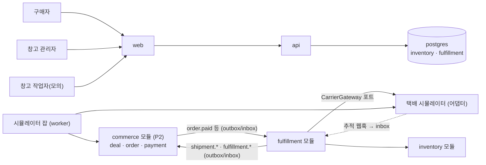

### 2.2 컨테이너 영향

새 컨테이너를 만들지 않는다. 같은 이미지의 `api`(REST), `worker`(웨이브·추적 폴링·대사·시뮬레이터·정리 잡), `ws-gateway`(작업자 알림은 기존 `/ws/private` 메시지 확장)에 모듈이 조립된다. 근거: 서비스 분리 기준은 P0(ADR-030)이 정하는데, 풀필먼트는 쓰기 부하가 낮고 상거래와 이벤트로만 만나므로 **모듈러 모놀리스 안에 둔다**(잠정 공통 결정).

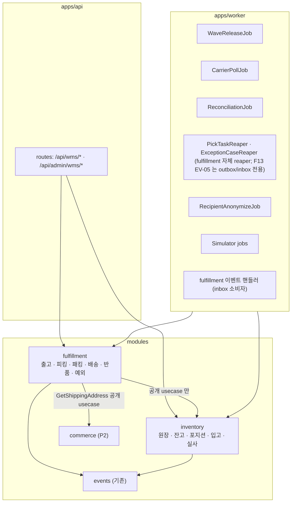

### 2.3 모듈 지도 (추가)

| 모듈 | 쓰기 스키마 | 읽기 스키마 | 소비자 / 프로젝터 | 의존할 수 있는 것 |
|---|---|---|---|---|
| `inventory` | `inventory` | `inventory_read` | `inventory-projector`, `earmark-consumer`(`deal.published`·`deal.settled`·`deal.stock_adjusted`·`deal.restocked`) | `events` 공개 포트, `identity`(역할 확인). **층 L4**(P0 §2.2). 공개 `InTx`(B12 쌍 #10): `AllocateInTx`·`ReleaseAllocationInTx`·`IssueInTx`·`RecordMovementInTx`(PICK·PUTBACK·RETURN_RECEIPT·RESTOCK·DISPOSE) |
| `fulfillment` | `fulfillment` | `fulfillment_read` | `fulfillment-consumer`(`order.paid`·`order.cancel_requested`·`order.cancelled`·`order.disputed`·`payment.refunded`·`order.return_requested`·`order.address_corrected`), `fulfillment-projector`, `carrier-webhook-consumer` | `inventory`(`InTx`, **B12 쌍 #10**), `order` 공개 usecase `GetShippingAddress`(읽기, L4 < L5), `events` 공개 포트, `identity`. **층 L5** |

- **순환 금지**: `fulfillment → inventory` 단방향. 재고 변동을 `fulfillment` 에 알리는 것은 이벤트(`inventory.*`)로만 한다. **모듈 간 한 트랜잭션은 P0 §2.4 허용 쌍 #10**(`fulfillment` 조율자 → `inventory.AllocateInTx`·`ReleaseAllocationInTx`·`IssueInTx`·`RecordMovementInTx`; 호출 목록과 조율자 이름은 §8.4)이다. `inventory` 가 `deal` 을 호출하지 않고(약정 상한은 `inventory.earmark_changed` 이벤트로 `deal` 에 알림), `fulfillment` 가 `order` 상태를 직접 바꾸지 않는다(이벤트).
- **이름 주의**: 이 문서의 `inventory.ledger_entry`(물리 재고 이동 원장)는 `inventory` 모듈 소유이고 **금전·포인트 `ledger` 모듈(P0 §2.5)과 무관**하다.
- `order`(commerce) 는 `fulfillment` 를 직접 호출하지 않는다. 이벤트로만 만난다(§9, P0 §8.3). 예외는 `fulfillment` 가 `order.GetShippingAddress`(읽기 usecase, 감사 `system.shipping_address_read`)를 호출하는 한 곳.

### 2.4 모듈 내부 구조 (M1 ADR-019 그대로)

```
modules/inventory/src/
  domain/    sku-position.ts · stock-balance.ts · ledger-entry.ts · location.ts · allocation.ts · asn.ts · count-task.ts
  service/   allocation-policy.ts · movement-rules.ts · reconciliation-rules.ts
  port/      ledger-writer.ts · position-repository.ts · balance-repository.ts · allocation-repository.ts …
  usecase/   command/ (receive-asn.ts · putaway.ts · allocate-sku.ts · plan-locations.ts · issue-stock.ts · adjust-stock.ts …)
             query/   (get-position.ts · list-balances.ts · …)
             event/   (inventory-projector.ts · earmark-consumer.ts)
  adapter/postgres/ …  raw/ (선점 쿼리 등, ADR-025)

modules/fulfillment/src/
  domain/    fulfillment-order.ts · pick-task.ts · package.ts · shipment.ts · return-case.ts · exception-case.ts · wave.ts
  service/   wave-strategy.ts · cancel-policy.ts · tracking-normalizer.ts · exception-triage.ts
  port/      carrier-gateway.ts (ADR-044) · commerce-address-reader.ts · …
  usecase/   command/ query/ event/
  adapter/   postgres/ · carrier-simulator/
```

---

## 3. WMS 도메인 모델

### 3.1 구성 요소와 관계

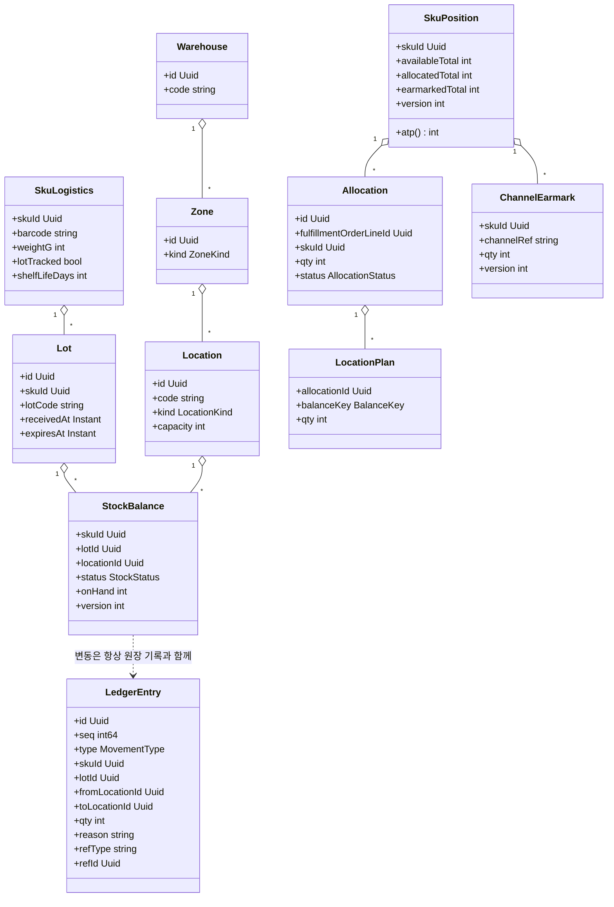

### 3.2 위치 종류 (가상 위치 포함)

| 종류 | 예 | 의미 |
|---|---|---|
| `STORAGE` | 선반·팔레트 위치 | 보관(판매 가능 대상) |
| `PICK_FACE` | 피킹 존 위치 | 피킹 전용 보관 (보충 대상) |
| `RECEIVING` | 입고 도크 | 입고 직후, 검수 전 |
| `QC_PASSED` | 검수 합격 대기 구역 | 검수는 통과했으나 **적치 전**(아직 피킹 불가 → 판매 가능 합계에 넣지 않는다) |
| `QUARANTINE` | 격리 | 검수 불합격·반품 검수 중 — 판매 불가 |
| `STAGING` | 패킹 스테이션 대기 | 피킹 완료 후 **패킹·포장 완료·인수인계 대기까지**(별도 위치 종류를 두지 않는다; 물리적으로 창고 안, `ISSUE` 전까지 판매 대상 합계에 포함) |
| `DISPOSAL` | 폐기 | 폐기 대기·완료 |
| `EXTERNAL` | 창고 밖 | 입고 전(공급처)·출고 후(택배사/고객). 가상 위치 |

**판매 대상 위치 집합** `SELLABLE_KINDS = {STORAGE, PICK_FACE, STAGING}` — 이 집합 안에서의 이동(`MOVE`·`PICK`·`PUTBACK`)은 `available_total` 을 바꾸지 않고, 집합 경계를 넘는 이동(`PUTAWAY`·`RESTOCK`·`ISSUE`·`DISPOSE`·`ADJUST_*`)만 바꾼다(§3.4).

이동은 항상 `from → to` 쌍이고 한쪽이 `EXTERNAL` 일 수 있다(입고·출고). 그래서 **창고 안 모든 위치의 합은 외부 경계를 넘는 이동 외에는 변하지 않는다**는 보존 법칙으로 대사할 수 있다(§4.4).

### 3.3 재고 이동 유형 (원장)

| 유형 | from → to | 효과 | 발생 시점 |
|---|---|---|---|
| `RECEIPT` | EXTERNAL → RECEIVING | +창고 재고 | 입고 접수 |
| `INSPECT_PASS` / `INSPECT_FAIL` | RECEIVING → QC_PASSED / QUARANTINE | 구역 이동(`available_total` 불변) | 검수 |
| `PUTAWAY` | QC_PASSED → STORAGE·PICK_FACE | 적치(+`available_total`) | 적치 확정 |
| `MOVE` | 위치 → 위치 | 보충·재배치 | 이동 작업 |
| `PICK` | STORAGE·PICK_FACE → STAGING | 피킹 | 피킹 스캔 확정 |
| `PUTBACK` | STAGING → STORAGE·PICK_FACE | 취소·쇼트 후 되돌림 | 되돌림 확정 |
| `ISSUE` | STAGING → EXTERNAL | −창고 재고(`available_total` 과 `allocated_total` 을 **같은 UPDATE 에서** 함께 −) | 인수인계(출고) 확정 |
| `RETURN_RECEIPT` | EXTERNAL → QUARANTINE | +창고 재고 | 반품 입고 |
| `RESTOCK` | QUARANTINE → STORAGE | 재입고(+`available_total`) | 반품 검수 합격 |
| `DISPOSE` | QUARANTINE·STORAGE → DISPOSAL → EXTERNAL | −창고 재고 | 폐기 확정 |
| `ADJUST_PLUS` / `ADJUST_MINUS` | EXTERNAL ↔ 위치 | 실사·손실·발견 | 승인된 조정 |

`INSPECT_PASS` 와 `PUTAWAY` 는 **서로 다른 구간**(RECEIVING→QC_PASSED, QC_PASSED→STORAGE)이라 같은 재고를 두 번 옮기지 않는다(`on_hand ≥ 0` CHECK 와 충돌 없음).

**원장은 추가 전용**이다. 잘못 기록한 항목은 수정하지 않고 **반대 이동으로 정정**한다(`reason=CORRECTION`, 원 항목 `refId`).

### 3.4 이중 원장: 세 가지 수량 (ADR-042 요약)

| 수준 | 소유 | 질문 | 정본 |
|---|---|---|---|
| ① **물리 재고** | `inventory` | 창고 안에 실제로 몇 개 있나(위치·로트별) | `inventory.ledger_entry` (이동 기록 합) → `stock_balance` (물질화) |
| ② **약정(commitment)** | `inventory` | 그중 이미 누군가에게 약속된 것은 몇 개인가 | `sku_position.allocated_total`(주문 할당) + `earmarked_total`(채널 약정) |
| ③ **판매 가능 재고** | `commerce`(P2) | 지금 팔 수 있는 수량 | `deal.stock` + Redis(ADR-010). 총량은 ②의 **채널 약정(earmark)을 넘지 못한다** |

```
availableTotal = Σ stock_balance.on_hand  (status = AVAILABLE, 위치 종류가 SELLABLE_KINDS = STORAGE·PICK_FACE·STAGING)
                 — ISSUE 로 건물을 떠나기 전까지 판매 대상 재고 전부(피킹된 STAGING·포장 완료·인수인계 대기 포함)
ATP(sku)       = availableTotal − allocatedTotal − earmarkedTotal      (자유 판매 가능 수량)
불변식 P1      allocatedTotal + earmarkedTotal ≤ availableTotal        (언제나, CHECK + 조건부 UPDATE)
```

**P1 이 모든 이동에서 안정한가 (숫자 검증).** 시작: STORAGE 10, `allocated=10`, `earmarked=0` (ATP 0, 전량 할당).

| 이동 | `available` | `allocated` | P1 (`al+ear ≤ av`) | ATP | 비고 |
|---|---|---|---|---|---|
| (시작) | 10 | 10 | 10 ≤ 10 ✓ | 0 | |
| `PICK` 1 (STORAGE→STAGING) | 10 | 10 | ✓ | 0 | 집합 안 이동 → 합계 불변. 전량 할당 SKU 도 피킹 가능 |
| `ISSUE` 1 (STAGING→EXTERNAL) | **9** | **9** | 9 ≤ 9 ✓ | 0 | 두 값을 **같은 UPDATE** 에서 함께 −. ATP 가 한 번 더 늘지 않는다(이중 계산 없음) |
| (시작에서) `PICK` 1 후 취소: `PUTBACK` 1 + 할당 해제 | 10 → 10 | 10 → 9 | ✓ | 0 → 1 | PUTBACK 은 집합 안 이동, 할당 해제로 ATP +1 |
| (시작에서) `ADJUST_MINUS` 1 (파손) | 9 | 10 | **10 ≤ 9 ✗ 거절** | — | 조건 `available − q ≥ allocated + earmarked` 불충족 → 먼저 영향받는 할당 1건을 해제(`ReleaseAllocationInTx`)하고 재할당·백오더·취소로 푼 뒤 조정(§7.1 `DAMAGED_ITEM`) |
| `PUTAWAY` 5 (QC_PASSED→STORAGE) | 15 | 10 | ✓ | 5 | 집합 경계를 넘으므로 + |

`ISSUE` 가 `allocated` 만 줄이고 `available` 은 그대로 두면 ATP 가 +1 되는 이중 계산이 되고, `PICK` 이 합계를 줄이면 전량 할당 SKU 가 CHECK 에 걸린다. 위 정의(집합 + ISSUE 동시 −)는 두 문제를 모두 없앤다.

- 타임딜은 `deal` 생성 시 `earmark(sku, "deal:<id>", Q)` 를 `inventory` 에 요청해 **물리 재고를 먼저 묶는다**. 그래야 Redis 로 Q 개를 팔고도 출고 때 물리 재고가 모자라는 일이 없다.
- 주문이 결제되면 `order.paid` 가 오고, 풀필먼트가 **약정에서 할당으로 소비**한다: `earmark −q`, `allocated +q` (`AcceptOrder` 의 같은 트랜잭션, `availableTotal` 불변). 약정의 **해제 규칙**은 §4.6.

---

## 4. 재고 정합성과 할당 (ADR-042)

### 4.1 2단계 할당: SKU 수준 약정 → 로케이션 수준 계획

> **트랜잭션 경계(P0 §2.4 B12 쌍 #10, 단일 트랜잭션)**: `fulfillment` 의 `AcceptOrder`(조율자, L5)가 **한 트랜잭션**에서 ① `FulfillmentOrder`·줄 생성(수취인 봉투 포함) ② `inventory.AllocateInTx(tx, …)`(L4)를 **`sku_id` 오름차순으로 줄마다** 호출 ③ 결과에 따라 `ALLOCATED`/`PARTIALLY_ALLOCATED`/`ALLOCATING`(백오더 대기)/`REJECTED` 로 상태 확정 ④ outbox(`fulfillment.accepted` 또는 `fulfillment.rejected`)를 함께 커밋한다. 접수와 할당 사이에 커밋 경계가 없으므로 "접수만 되고 할당 전에 크래시" 같은 중간 상태가 존재하지 않는다(재시작 시 재시도는 inbox 멱등 + `fulfillment_order.order_id` 유일로 안전). 배송지는 tx **앞에서** `order.GetShippingAddress(shippingAddressRef)` 로 읽어 둔다(읽기, tx 밖; AcceptOrder 시점). 할당 실패(0행)는 `inventory.allocation_failed`(내부 신호)로 표현하고 `fulfillment` 가 같은 tx 안에서 `REJECTED` + `fulfillment.rejected` 로 변환한다. `inventory` 는 `fulfillment`·`order` 를 호출하지 않는다.

| 단계 | 시점 | 하는 일 | 실패 |
|---|---|---|---|
| **1. SKU 할당 (commit)** | 주문 수신 직후 | `sku_position` 에 **조건부 UPDATE** 로 `allocated_total += q` (또는 earmark 소비) | 부족 → 부분 할당/백오더/거절 (정책) |
| **2. 로케이션 계획 (plan)** | 웨이브 출고 시점 | 로트·위치를 골라 `location_plan` 행 생성 (FEFO/FIFO, 근접성) | 해당 위치 실재고 부족(쇼트) → 재계획·예외 |

이유: SKU 수준 게이트가 **정합성 불변식 P1 의 단일 심판**이라 단순하고, 로케이션 선택은 늦게(피킹 직전) 해야 재고 이동·보충 변화를 반영한다. 로케이션 계획이 실패해도 SKU 약정은 유지되므로 "약속은 지켰는데 위치가 틀린" 상황을 쇼트 피킹 예외로 풀 수 있다.

### 4.2 SKU 할당 쿼리 (개념, T0)

```
UPDATE inventory.sku_position
   SET allocated_total = allocated_total + :q, version = version + 1
 WHERE sku_id = :sku
   AND available_total - allocated_total - earmarked_total >= :q       -- 자유 재고 충분할 때만
RETURNING version                                                       -- 0행이면 부족
```
earmark 소비는 `earmarked_total = earmarked_total - :q, allocated_total = allocated_total + :q` 를 같은 문장에서 `WHERE earmark.qty >= :q` 조건으로 한다. 한 SKU 의 포지션 행은 한 번에 한 트랜잭션만 갱신하므로 **같은 SKU 의 할당이 직렬화**된다.

**다품목 주문의 잠금 순서 규칙(교착 방지).** 주문이 여러 SKU 를 갖는 경우 포지션 행은 **`sku_id` 오름차순**으로만 갱신한다(`AcceptOrder`·`BackorderRetry`·`HandOverShipments`·취소 시 `ReleaseAllocationInTx` 모두 동일). 오름차순이 아니면 주문 1(A,B)과 주문 2(B,A)가 한 트랜잭션 안에서 서로의 첫 행을 쥔 채 두 번째 행을 기다리는 교착이 생긴다. 모든 usecase 가 같은 순서로 잠그므로 교착이 없다. 전체 잠금 순서(주문 행 → 포지션 → 잔고)는 §8.4.
- 처리량 추정(제안, 미측정): 트랜잭션 2~5ms 라면 SKU 당 초당 200~500 건. 타임딜 폭주는 상거래의 Redis 선점이 이미 걸러내므로 여기 도달하는 속도는 결제 완료 속도(훨씬 낮음).
- 핫 SKU 경합이 문제가 되면 포지션 행을 슬롯 N 개로 분할(`sku_position_slot`)하는 확장이 있으나 **M1+ 규모에서는 하지 않는다**(미결).

### 4.3 할당 정책 (전략)

| 정책 | 동작 | 용도 |
|---|---|---|
| `ALL_OR_NOTHING` (기본) | 모든 줄이 충족돼야 할당. 부족하면 주문 전체 거절 또는 대기 | 단일 배송 |
| `ALLOW_PARTIAL` | 가능한 줄/수량만 할당, 나머지는 백오더 | 분할 배송 허용 주문 |
| `BACKORDER_WAIT` | 부족분을 대기열에 두고 입고 시 자동 재시도 | 입고 예정이 있는 경우 |

부분 할당은 `FulfillmentOrder` 를 `PARTIALLY_ALLOCATED` 로 두고, 할당된 줄로 먼저 `FulfillmentShipment`(분할 배송 1)를 만든다. 백오더는 입고 완료 이벤트(`inventory.stock_received`)가 소비자 `backorder-retry` 를 깨운다.

### 4.4 대사 (reconciliation)

| 대사 | 비교 | 불일치 처리 |
|---|---|---|
| **R1** 원장↔잔고 | `Σ ledger(to) − Σ ledger(from)` per (sku, lot, location) vs `stock_balance.on_hand` | 파생값이므로 **잔고를 원장 기준으로 재계산**하고 이상 기록 |
| **R2** 잔고↔포지션 | `Σ balance.on_hand(AVAILABLE, SELLABLE_KINDS = STORAGE·PICK_FACE·STAGING)` vs `sku_position.available_total` | 포지션 재계산 + 이상 기록 |
| **R3** 포지션↔할당 | `Σ allocation(active)` vs `sku_position.allocated_total` | 포지션 재계산 + 이상 기록 |
| **R4** 약정↔상거래 | `channel_earmark` vs `deal.stock` (공개 읽기 usecase 또는 이벤트 누적) | **사람 개입**(두 정본이 다름) |
| **R5** 보존 법칙 | 창고 안 총량 + 누적 외부 경계 이동 = 0 | 위반 시 즉시 경보 |
| **R6** 물리 실사 | 실사 수량 vs `stock_balance` | `ADJUST_*` 조정 요청 (승인 필요) |

- 대사는 **읽기 위주 잡**이고 정정은 별도 승인 흐름이다(R1~R3 의 파생 재계산만 자동).
- 자동 수정이 안 되는 불일치(R4·R5·R6)는 `inventory.discrepancy` 행과 예외 큐(§7)로 간다.
- 실행 주기(제안): R1~R3 15분, R4 1시간, R5 매 이동 직후 샘플링 + 1시간 전수.

### 4.5 불변식 요약 (CHECK·시험)

| 불변식 | 강제 수단 |
|---|---|
| P1 `allocated + earmarked ≤ available` | `sku_position` CHECK + 조건부 UPDATE |
| P2 `on_hand ≥ 0` (잔고) | `stock_balance` CHECK |
| P3 원장 합 = 잔고 | 같은 트랜잭션에서 두 쪽 갱신 + R1 대사 |
| P4 `issued ≤ allocated` | 출고 확정 UPDATE 의 조건 (`allocated_total ≥ q`) |
| P5 한 FulfillmentOrder 줄당 활성 할당 ≤ 주문 수량 | `allocation` 부분 유일/합 CHECK 는 어려우므로 usecase + 시험 |
| P6 원장 불변 | 애플리케이션 경로에 UPDATE/DELETE 없음, DB 권한(제안) |

### 4.6 약정(earmark) 수명주기와 해제 규칙

판매 가능 총량 ≤ 약정 상한 규칙은 상거래(`deal`)가 받는다(P2). 약정의 증감은 아래 이벤트로만 일어난다.

**활성화 시점 (D24)**: 약정은 6c 에서 켜진다. 그 전의 딜은 약정 없이 게시되었으므로, 켤 때 **진행 중 딜(open/scheduled)** 마다 `earmark(sku, "deal:<id>", 남은 판매 가능 수량)` 를 초기 동기화 잡이 만들고(재고가 모자라면 해당 딜을 `publish_rejected` 사유로 관리자 큐에 올린다), 이미 닫히거나 정산된 딜은 대상이 아니다.

| 시점 | 이벤트 | 약정 변화 | 비고 |
|---|---|---|---|
| 딜 게시 | `deal.published {dealId, skuId, totalQty}` | `+Q` (`allocated + earmarked + Q ≤ available` 조건부 UPDATE) | 실패 시 `inventory.earmark_rejected` |
| 결제 확정 주문 수신 | `order.paid` (`AcceptOrder`) | `−q` (+`allocated +q`) | 약정 부족(`earmark.qty < q`)이면 자유 재고로 폴백, 둘 다 없으면 `fulfillment.rejected(OUT_OF_STOCK)`(드문 경로, `pf_wms_earmark_shortfall_total`) |
| 딜 마감 | `deal.closed` | **변화 없음** | 마감 시점에는 결제 확정됐지만 `order.paid` 가 아직 소비되지 않은 주문, 마감 후 확정되는 예약이 있을 수 있어 해제하지 않는다 |
| 딜 정산 완료 | `deal.settled {dealId, skuId, totalQty, confirmedQty}` | **`−(totalQty − confirmedQty)` 만 해제** | `confirmedQty` 는 구매 확정 수량(소비되었거나 소비 대기 중인 약정 포함). 남는 약정 `confirmedQty − 소비분` 은 아직 올 `order.paid` 용으로 유지 |
| 운영 조정 | `deal.stock_adjusted {delta}` | `±delta` | |
| 출고 전 취소 | `deal.restocked {dealId, skuId, qty, reason:'cancel'}` | `+qty` (할당 해제와 쌍) | 취소로 풀린 할당이 판매 가능 재고로 돌아오는 경로. 사유가 `OUT_OF_STOCK` 거절이면 복원하지 않는다 |

`deal.settled` 는 P2 상태 `settled` 전이(활성 예약 0·미결제 주문 0 조건) 시 발행한다. 마감(`closed`)과 정산(`settled`) 사이에 `order.paid` 가 늦게 소비돼도 약정이 이미 해제된 일이 없다는 것이 핵심이다.

---

## 5. 주문 → 출고 사가와 상태 머신

### 5.1 사가 방식: 하이브리드 (ADR-043)

| 선택지 | 장점 | 단점 |
|---|---|---|
| 코레오그래피(순수 이벤트) | 결합 낮음 | 흐름이 흩어져 추적·보상 정의가 어렵다 |
| 오케스트레이션(중앙 조정자) | 흐름 명시, 보상 한곳 | 조정자가 상태를 소유해 크기가 커진다 |
| **하이브리드 (채택)** | 모듈 간은 코레오그래피, 모듈 안은 오케스트레이션 | 두 방식을 구분해야 한다 |

- **모듈 간**(commerce ↔ fulfillment): 이벤트로만 만난다. `order.paid` → (`fulfillment.accepted`(할당 성공 후, 할당 결과 포함) | `fulfillment.rejected`) → `shipment.dispatched` → `shipment.delivered`. `fulfillment.accepted` 는 `AcceptOrder` 단일 트랜잭션에서 **할당이 성공한 뒤에만** 발행되므로 상거래가 "수락됨"을 본 뒤 같은 주문의 `rejected` 를 받는 일이 없다(사후 중단은 `fulfillment.cancelled`).
- **모듈 안**(fulfillment): `FulfillmentOrder` 애그리거트가 **프로세스 매니저**다. 상태와 다음 단계를 한 행(`version` 조건 갱신)이 갖고, 각 단계의 실행은 작업(PickTask, Package, Shipment)과 이벤트가 구동한다. 단계는 멱등이고 재시작에 안전하다.

### 5.2 FulfillmentOrder 상태 머신

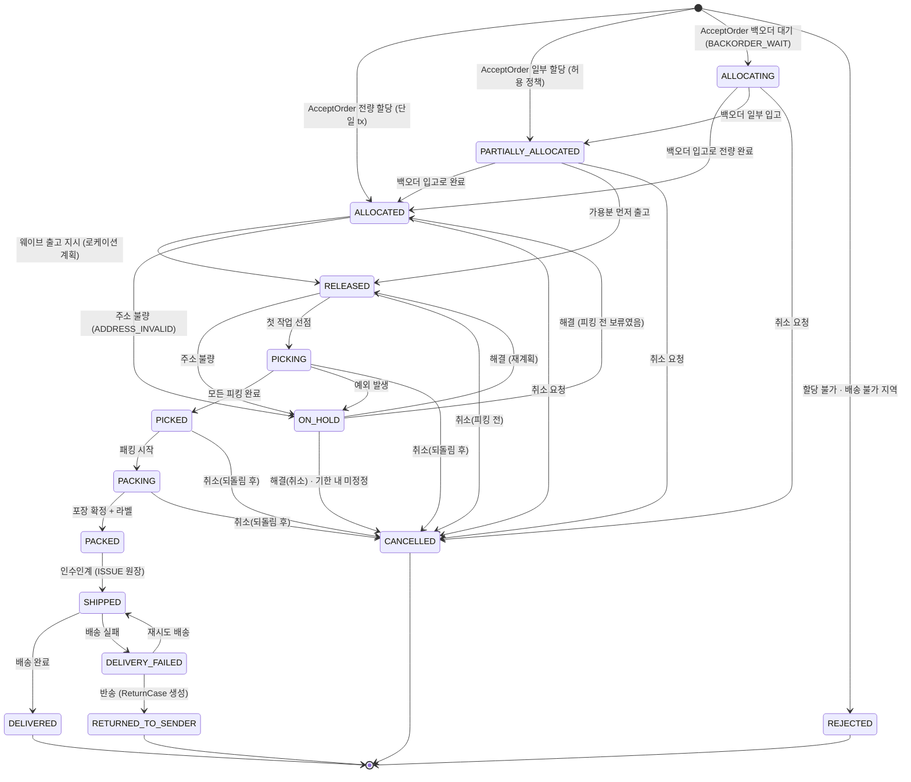

- **접수 상태는 커밋되지 않는다.** `RECEIVED` 는 `AcceptOrder` 트랜잭션 안의 일시 상태일 뿐 저장되지 않으므로 상태 머신에 없다(최초 상태는 `ALLOCATED`·`PARTIALLY_ALLOCATED`·`ALLOCATING`(백오더 대기)·`REJECTED`). 따라서 "accepted 발행 후 할당 전 중단", "접수만 되고 재개 규칙이 없는 상태"가 존재하지 않는다.
- **ON_HOLD 의 도달 경로**: `ADDRESS_INVALID`(주소 형식 오류 등 정정 가능 불량)는 `AcceptOrder` 의 주소 검증이나 웨이브 단계 검증에서 `ALLOCATED`/`RELEASED` → `ON_HOLD` 로 간다(`hold_reason`, `held_from_state` 기록). 정정(`order.address_corrected`)이 오면 `held_from_state` 로 복귀(`ALLOCATED` 또는 `RELEASED`)하고 배송지를 다시 스냅샷한다. 기한(72시간, 제안) 내 정정이 없으면 `CANCELLED` + `fulfillment.cancelled {stage:'ON_HOLD', reason:'ADDRESS_NOT_CORRECTED'}`. **배송 불가 지역**(`ADDRESS_UNSHIPPABLE`)은 정정 대상이 아니므로 `AcceptOrder` 에서 곧바로 `REJECTED` + `fulfillment.rejected {reason:'ADDRESS_UNSHIPPABLE'}`.
- **RETURNED_TO_SENDER** 는 종결이 아니라 **반품 흐름의 시작**이다: 반송 확정 시 `ReturnCase`(`origin = RTS`)가 만들어져 `RETURN_RECEIPT` → 검수 → `RESTOCK`/`DISPOSE` 로 이어진다(§5.3).
- 상태 전이는 모두 `version` 조건부 UPDATE 이고, 전이마다 `fulfillment_order_event`(추가 전용 이력)와 outbox 이벤트가 같은 트랜잭션에 쓰인다.
- `PACKED` 이후 취소는 상태 머신에서 허용하지 않는다(§5.4 취소 표). 대신 출고 후 반품 경로로 간다.

### 5.3 하위 상태 머신

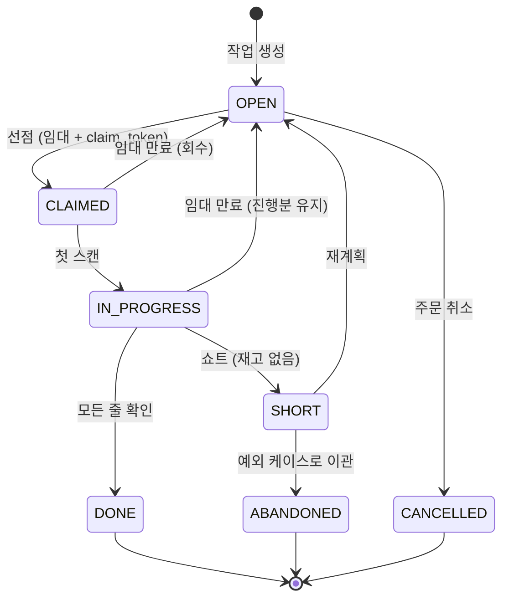

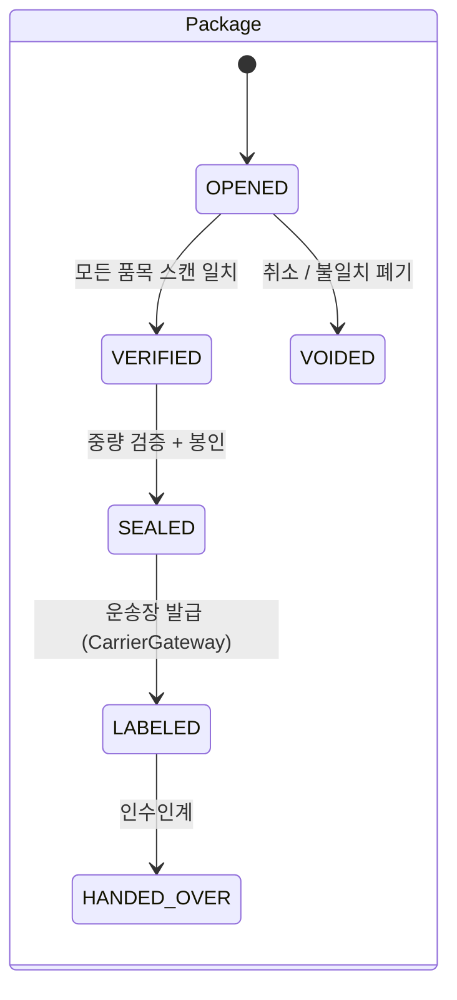

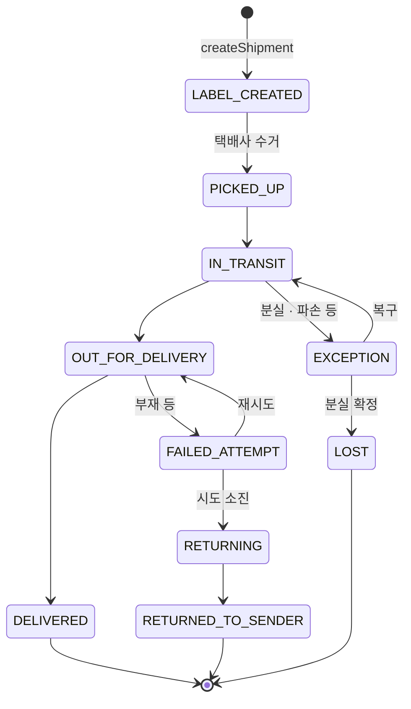

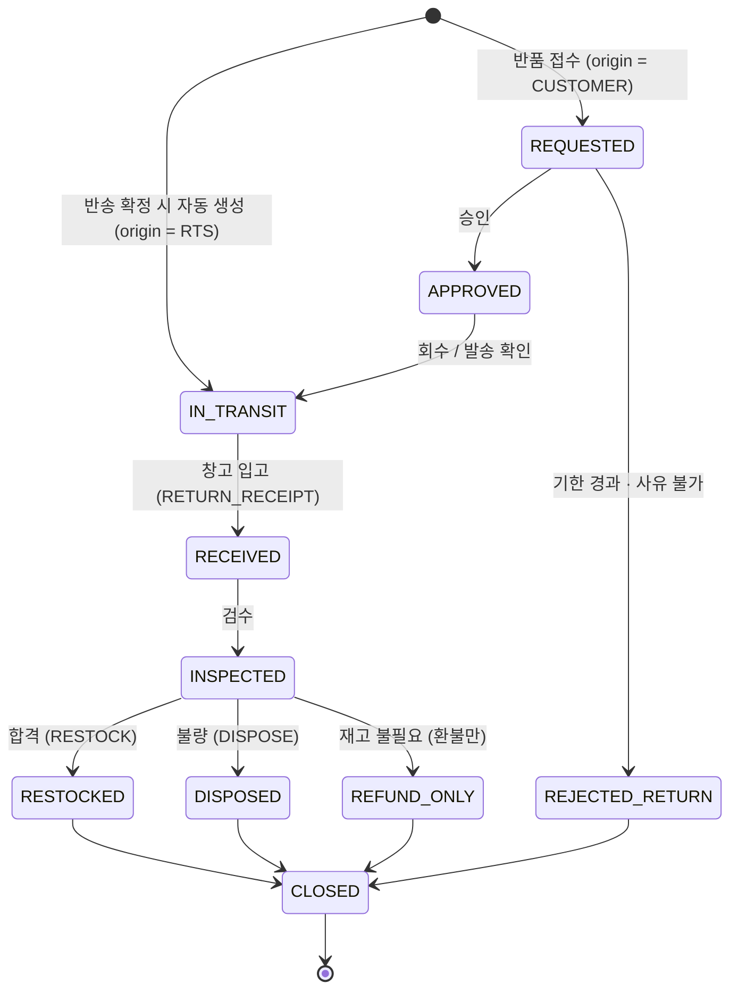

**추적 순환 전이의 단조 조건.** 순위 규칙(ADR-044)에서 순환이 허용된 쌍(`FAILED_ATTEMPT ↔ OUT_FOR_DELIVERY`, `EXCEPTION ↔ IN_TRANSIT`)은 상태를 되돌릴 수 있으므로, **현재 반영된 이벤트보다 `attempt_no`(배송 시도 번호; EXCEPTION 은 `exception_seq`) 또는 `occurred_at` 이 엄격히 큰 이벤트만** 순환 전이를 일으킨다. 같거나 작은 값(늦게 도착한 재전송 포함)은 이력만 남긴다. 예: OFD(attempt 1) → FAILED(attempt 1) 후에 OFD(attempt 1)가 재전송돼도 FAILED 에서 OFD 로 되돌아가지 않는다.

### 5.4 취소 판정표 (경합 규칙)

`order.cancel_requested` 가 와도 창고의 물리 진행과 경합한다. 판정은 `CancelPolicy`(domain service) 한 곳이다.

| 취소 시점의 상태 | 동작 | 재고 처리 | 응답 이벤트 |
|---|---|---|---|
| ALLOCATING(백오더 대기) · PARTIALLY_ALLOCATED(출고 전) | 즉시 취소 | 할당 있으면 해제, 백오더 행 삭제 | `fulfillment.cancelled` |
| ON_HOLD | 즉시 취소(`held_from_state` 와 무관) | 할당 해제 | `fulfillment.cancelled` |
| ALLOCATED · RELEASED(작업 OPEN) | 즉시 취소, 열린 작업은 `CANCELLED` | 할당 해제, 로케이션 계획 삭제 | `fulfillment.cancelled` |
| PICKING(일부 피킹 진행) | `cancel_requested=true` 표시 → 진행 중 작업을 마친 뒤 **PUTBACK 작업** 생성 → 되돌림 완료 후 `CANCELLED` | PICK 된 수량 PUTBACK, 할당 해제 | `fulfillment.cancelled` (되돌림 후) |
| PICKED · PACKING | PUTBACK 작업 후 취소 (패킹 중이면 `Package` VOIDED) | 동일 | 동일 |
| PACKED | **취소 불가**(라벨 발급 후). 거절 + 출고 후 반품 안내 | 변동 없음 | `fulfillment.cancel_rejected` |
| SHIPPED 이후 | 취소 불가 → 반품 경로 | 변동 없음 | `fulfillment.cancel_rejected` |

**외부 사유 취소**: `order.cancelled`·`order.disputed`·`payment.refunded`(관리자 환불·분쟁 등으로 상거래가 먼저 주문을 닫은 경우)를 받으면 `reason = EXTERNAL` 로 위 판정표를 같은 방식으로 적용한다(PACKED 이후는 취소 불가 → 출고 후 반품/회수 안내). 응답 이벤트는 `fulfillment.cancelled`/`cancel_rejected` 이고 환불은 이미 상거래 쪽에서 진행 중이므로 중복 환불 근거로 쓰이지 않게 `reason` 으로 구분한다.

경합 처리: 취소 요청과 상태 전이는 모두 `FulfillmentOrder.version` 조건부 UPDATE 이므로 한쪽만 이긴다. 진 쪽은 최신 상태를 읽고 판정표를 다시 적용한다(재시도 1회).

### 5.5 클래스 구조와 상속

```mermaid
classDiagram
    class AggregateRoot~Id~ {
        <<abstract>>
        +version int
        #record(event) void
        +pullEvents() DomainEvent[]
    }
    class FulfillmentOrder {
        +state FoState
        +policy AllocationPolicy
        +lines FoLine[]
        +accept(allocation) void  // AcceptOrder 단일 tx
        +completeAllocation(result) void  // 백오더 입고
        +hold(reason) void
        +resumeFromHold() void
        +release(plan) void
        +requestCancel() CancelDecision
        +markShipped(shipment) void
    }
    class PickTask {
        +state TaskState
        +leaseUntil Instant
        +claimToken string
        +lines PickLine[]
        +claim(worker, now) void
        +scan(scanId, code, qty) ScanResult
        +complete() void
        +markShort(line) void
    }
    class Package {
        +state PackageState
        +verify(scan) void
        +seal(weightG) void
        +attachLabel(label) void
    }
    class Shipment {
        +state ShipmentState
        +trackingNo string
        +apply(event NormalizedTrackingEvent) bool  // 순위 + 단조(attempt_no/occurred_at) 조건
    }
    class ReturnCase {
        +origin ReturnOrigin  // CUSTOMER | RTS
        +state ReturnState
        +receive() void
        +inspect(result) void
    }
    class ExceptionCase {
        +kind ExceptionKind
        +state CaseState
        +resolve(resolution) void
    }
    AggregateRoot <|-- FulfillmentOrder
    AggregateRoot <|-- PickTask
    AggregateRoot <|-- Package
    AggregateRoot <|-- Shipment
    AggregateRoot <|-- ReturnCase
    AggregateRoot <|-- ExceptionCase

    class WaveStrategy {
        <<interface>>
        +select(candidates, now) Wave
    }
    class ImmediateRelease
    class SizeOrTimeWave
    class CutoffWave
    WaveStrategy <|.. ImmediateRelease
    WaveStrategy <|.. SizeOrTimeWave
    WaveStrategy <|.. CutoffWave

    class AllocationPolicy {
        <<interface>>
        +decide(lines, position) AllocationDecision
    }
    class AllOrNothing
    class AllowPartial
    class BackorderWait
    AllocationPolicy <|.. AllOrNothing
    AllocationPolicy <|.. AllowPartial
    AllocationPolicy <|.. BackorderWait

    class LocationSelector {
        <<interface>>
        +choose(sku, qty, balances) LocationPlan[]
    }
    class FefoSelector
    class FifoSelector
    class NearestFaceSelector
    LocationSelector <|.. FefoSelector
    LocationSelector <|.. FifoSelector
    LocationSelector <|.. NearestFaceSelector

    class WmsException {
        <<abstract>>
        +code string
    }
    class StockInsufficientError
    class AllocationConflictError
    class TaskLeaseLostError
    class ScanMismatchError
    class InvalidStateError
    WmsException <|-- StockInsufficientError
    WmsException <|-- AllocationConflictError
    WmsException <|-- TaskLeaseLostError
    WmsException <|-- ScanMismatchError
    WmsException <|-- InvalidStateError
```

M1 의 `AppError` 계층에 편입한다: `StockInsufficientError`·`AllocationConflictError`·`InvalidStateError` 는 `ConflictError`(409), `ScanMismatchError` 는 `ValidationError` 계열(422), `TaskLeaseLostError` 는 `TransientError.LeaseLostError` 와 같은 의미의 도메인 오류(409).

---

## 6. 기능 카탈로그 (WM-)

요구/단계 열의 `W0~W7` 은 §18 구현 순서다.

### 6.1 마스터·입고 (inventory)

| ID | 기능 | 트리거 | usecase / 클래스 | 접근 테이블 | 단계 |
|---|---|---|---|---|---|
| WM-01 | 창고·구역·로케이션 등록 | 관리자 | `DefineLocation` | `warehouse`·`zone`·`location` W | W1 |
| WM-02 | SKU 물류 정보 등록 | 관리자 | `RegisterSkuLogistics` | `sku_logistics` W | W1 |
| WM-10 | 입고 예정(ASN) 등록 | 관리자 | `CreateAsn` | `asn`·`asn_line` W | W1 |
| WM-11 | 입고 접수 | 작업자 | `ReceiveAsnLine` (원장 RECEIPT) | `asn_line`·`ledger_entry`·`stock_balance` W | W1 |
| WM-12 | 검수(합격/불합격) | 작업자 | `InspectReceipt` (INSPECT_PASS: RECEIVING→QC_PASSED / INSPECT_FAIL: →QUARANTINE) | 위 + `inspection` W | W1 |
| WM-13 | 적치 지시·확정 | 작업자 | `Putaway` (원장 PUTAWAY: QC_PASSED→STORAGE·PICK_FACE, 포지션 `available_total +`) | `ledger_entry`·`stock_balance`·`sku_position` W | W1 |

### 6.2 재고 (inventory)

| ID | 기능 | 트리거 | usecase / 클래스 | 접근 테이블 | 단계 |
|---|---|---|---|---|---|
| WM-20 | 원장 기록 | 모든 이동 usecase 내부 | `LedgerWriter.append` (잔고·포지션 갱신 동반) | `ledger_entry`·`stock_balance`·`sku_position` W | W1 |
| WM-21 | 재고 조회 | 관리자 | `GetPosition` · `ListBalances` | `inventory_read` R | W1 |
| WM-22 | 이동(보충·재배치) | 작업자 | `MoveStock` (MOVE) | 원장 계열 W | W2 |
| WM-23 | 재고 실사 | 관리자·작업자 | `OpenCountTask` · `SubmitCount` | `count_task`·`count_line` W | W6 |
| WM-24 | 조정 요청·승인 | 작업자·관리자 | `RequestAdjustment` · `ApproveAdjustment` (ADJUST_*) | `adjustment`·원장 계열 W, 감사 | W6 |
| WM-25 | 대사 잡 (R1~R6) | 주기 | `RunReconciliation` | 원장·잔고·포지션·할당 R, `discrepancy` W | W6 |
| WM-26 | 채널 약정(earmark) | `deal.published`·`deal.settled`·`deal.stock_adjusted`·`deal.restocked` | `EarmarkStock` · `ReleaseEarmark` | `channel_earmark`·`sku_position` W | W3 |
| WM-27 | 저재고 알림 | 포지션 변동 | `LowStockDetector` → `inventory.low_stock` | `sku_position` R, outbox W | W2 |

### 6.3 출고 (fulfillment)

| ID | 기능 | 트리거 | usecase / 클래스 | 접근 테이블 | 단계 |
|---|---|---|---|---|---|
| WM-30 | 주문 수신·할당 | inbox `order.paid` | `AcceptOrder` (**단일 tx**: 접수 + 배송지 스냅샷 암호화 + `AllocateInTx` + accepted/rejected outbox) | `fulfillment_order`·`fo_line`·`sku_position`·`allocation`·`inbox` W | W2 |
| WM-31 | SKU 할당 단계 | `AcceptOrder`·`BackorderRetry` 내부 | `AllocateOrder` (`AllocationPolicy`; 독립 트랜잭션이 아니라 위 usecase 의 단계) | `sku_position`·`allocation` W | W2 |
| WM-32 | 부분 할당·백오더 | WM-31 결과 / `inventory.stock_received` | `BackorderRetry` | `backorder` W | W3 |
| WM-33 | 웨이브 생성·출고 지시 | 잡 | `ReleaseWave` (`WaveStrategy`, 로케이션 계획) | `wave`·`location_plan`·`pick_task` W | W3 |
| WM-34 | 피킹 작업 생성 | WM-33 | `GeneratePickTasks` | `pick_task`·`pick_line` W | W3 |
| WM-35 | 작업 선점(임대) | 작업자 | `ClaimPickTask` (CAS) | `pick_task` W | W3 |
| WM-36 | 피킹 스캔 | 작업자 | `ConfirmPickScan` (멱등 `scan_id`, 원장 PICK) | `pick_scan`·원장 계열 W | W3 |
| WM-37 | 쇼트 피킹 | 작업자 | `ReportShortPick` → 재계획 또는 예외 | `pick_task`·`exception_case` W | W3 |
| WM-38 | 패킹 시작·품목 검증 | 작업자 | `StartPacking` · `VerifyPackScan` | `package`·`pack_scan` W | W3 |
| WM-39 | 포장 확정·라벨 | 작업자 | `SealPackage` (CarrierGateway.createShipment) | `package`·`shipment` W | W4 |
| WM-40 | 출고(인수인계) | 작업자·택배 수거 | `HandOverShipments`(= P0 쌍 #10 의 `DispatchShipment`; 원장 ISSUE, 포지션 `available −`·`allocated −` 동시) | 원장 계열·`shipment` W | W4 |
| WM-41 | 취소 처리 | inbox `order.cancel_requested`·`order.cancelled`·`order.disputed`·`payment.refunded` | `CancelFulfillment` (`CancelPolicy`) | 상태별 | W3 |

### 6.4 배송 추적 (fulfillment)

| ID | 기능 | 트리거 | usecase / 클래스 | 접근 테이블 | 단계 |
|---|---|---|---|---|---|
| WM-50 | 택배 어댑터 포트 | — | `CarrierGateway` + `SimulatedCarrier` | — | W4 |
| WM-51 | 추적 폴링 | 잡 | `PollTracking` | `shipment`·`carrier_event` W | W4 |
| WM-52 | 추적 웹훅 수신 | 시뮬레이터 → `POST /api/hooks/carrier/:carrier` | `ReceiveCarrierEvent` (inbox 저장) | `inbox_message` W | W4 |
| WM-53 | 상태 정규화·반영 | inbox | `ApplyTrackingEvent` (`TrackingNormalizer`, 순서·중복 처리) | `shipment`·`carrier_event` W | W4 |
| WM-54 | 배송 완료·실패·반송 처리 | WM-53 | `CompleteDelivery` · `HandleFailedAttempt` · `HandleReturnedToSender`(ReturnCase `origin=RTS` 생성) | `shipment`·`fulfillment_order` W | W4 |

### 6.5 반품 (fulfillment)

| ID | 기능 | 트리거 | usecase / 클래스 | 접근 테이블 | 단계 |
|---|---|---|---|---|---|
| WM-60 | 반품 접수 | inbox `order.return_requested`(P2) | `OpenReturn` | `return_case` W | W5 |
| WM-61 | 반품 입고 | 작업자 | `ReceiveReturn` (RETURN_RECEIPT) | 원장 계열·`return_case` W | W5 |
| WM-62 | 반품 검수·처분 결정 | 작업자 | `InspectReturn` (`ReturnDisposition`) | `return_inspection` W | W5 |
| WM-63 | 재입고 / 폐기 | WM-62 | `RestockReturn` · `DisposeReturn` | 원장 계열 W | W5 |

### 6.6 예외 (fulfillment)

| ID | 기능 | 트리거 | usecase / 클래스 | 접근 테이블 | 단계 |
|---|---|---|---|---|---|
| WM-70 | 예외 케이스 생성 | 각 usecase 의 실패 경로 | `OpenExceptionCase` (`ExceptionTriage`) | `exception_case` W | W6 |
| WM-71 | 예외 큐 조회·배정 | 관리자 | `ListExceptions` · `AssignException` (선점) | `exception_case` R/W | W6 |
| WM-72 | 예외 해결 | 관리자 | `ResolveException` (감사) | `exception_case` 등 W | W6 |

### 6.7 화면·읽기 모델

| ID | 기능 | 경로/컴포넌트 | 단계 |
|---|---|---|---|
| WM-80 | 작업자 작업 목록 | `/wms/tasks` | W3 |
| WM-81 | 피킹 화면(스캔 흐름) | `/wms/pick/:taskId` | W3 |
| WM-82 | 패킹 화면 | `/wms/pack/:foId` | W3 |
| WM-83 | 입고·검수 화면 | `/wms/receiving` | W1 |
| WM-84 | 관리자 파이프라인 대시보드 | `/admin/wms` | W4 |
| WM-85 | 재고 조회 화면 | `/admin/wms/inventory` | W1 |
| WM-86 | 예외 큐 화면 | `/admin/wms/exceptions` | W6 |
| WM-87 | 구매자 배송 추적 뷰 | 상거래 주문 상세(P2)에 `tracking_view` 제공 | W4 |

### 6.8 시뮬레이터·운영

| ID | 기능 | 위치 | 단계 |
|---|---|---|---|
| WM-90 | 주문 생성기 | worker 잡 `OrderGenerator` | W4 |
| WM-91 | 택배 시뮬레이터 | `SimulatedCarrier` + `CarrierSimJob` | W4 |
| WM-92 | 카오스 주입(`FaultInjector` 확장) | testkit·시뮬레이터 | W7 |
| WM-93 | 작업자 봇 | worker 잡 `WorkerBot` (자동 피킹·패킹) | W4 |
| WM-95 | 지표·경보 | observability | W2~ |
| WM-96 | 개인정보 익명화·보관 정리 | `RecipientAnonymizeJob` + `RetentionRule` | W5 |
| WM-97 | 감사 기록 | `AuditWriter` 호출 | W2~ |

기능 수: **WM-01·02·10~13·20~27·30~41·50~54·60~63·70~72·80~87·90~93·95~97 = 56개**.

---

## 7. 예외 흐름과 사람 개입 큐

### 7.1 예외 종류와 처리

| 종류 | 발생 | 자동 처리 | 사람 개입 |
|---|---|---|---|
| `SHORT_PICK` | 피킹 위치에 재고 없음 | 같은 SKU 의 다른 위치로 **재계획** 1회 | 재계획 실패 → 케이스: 실사 요청 + 재고 조정 / 취소·환불 |
| `STOCK_MISMATCH` | 대사 R1~R3·R6 불일치 | 파생값 재계산 | R4~R6 → 케이스 |
| `WRONG_ITEM_SCANNED` | 피킹·패킹 스캔 불일치 | 거절 + 재스캔 안내(예외 아님) | 반복 3회 → 케이스 |
| `DAMAGED_ITEM` | 피킹·패킹 중 파손 보고 | `ADJUST_MINUS`(승인 대기) 요청 + 재할당 시도 | 승인·재할당 불가 시 취소 |
| `LOST_IN_WAREHOUSE` | 위치에서 못 찾음 | 위치 `suspect` 표시 + 실사 작업 | 조정 승인 |
| `ADDRESS_INVALID` | 배송지 검증 실패(우편번호 형식 오류 등 **정정 가능** 불량) | 주문 `ON_HOLD`(`ALLOCATED`/`RELEASED` 에서 진입, §5.2) | 상거래에 정정 요청 이벤트 → 응답 대기(기한 72시간 후 `fulfillment.cancelled`) |
| `ADDRESS_UNSHIPPABLE` | 배송 불가 지역 | `AcceptOrder` 에서 즉시 `REJECTED` | 없음(환불은 상거래) |
| `CARRIER_REJECT` | 택배 어댑터가 운송장 거절 | 재시도 3회(백오프) | 대체 택배사/수동 처리 |
| `PACK_WEIGHT_MISMATCH` | 중량이 허용 오차 밖 | 재포장 안내 | 반복 시 케이스 |
| `DELIVERY_FAILED` | 시도 소진 | 반송 처리(`RETURNING` → `RETURNED_TO_SENDER` → `ReturnCase(origin=RTS)` → 반송 입고·검수·재입고) | 재배송/환불 결정(상거래) |
| `STUCK_TASK` | 작업이 임대 만료를 반복 | 재배정 | N 회 초과 시 케이스 |

### 7.2 예외 케이스 상태와 큐

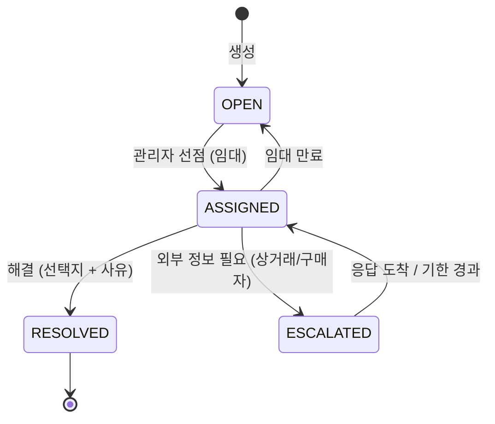

### 7.3 분류 순서도

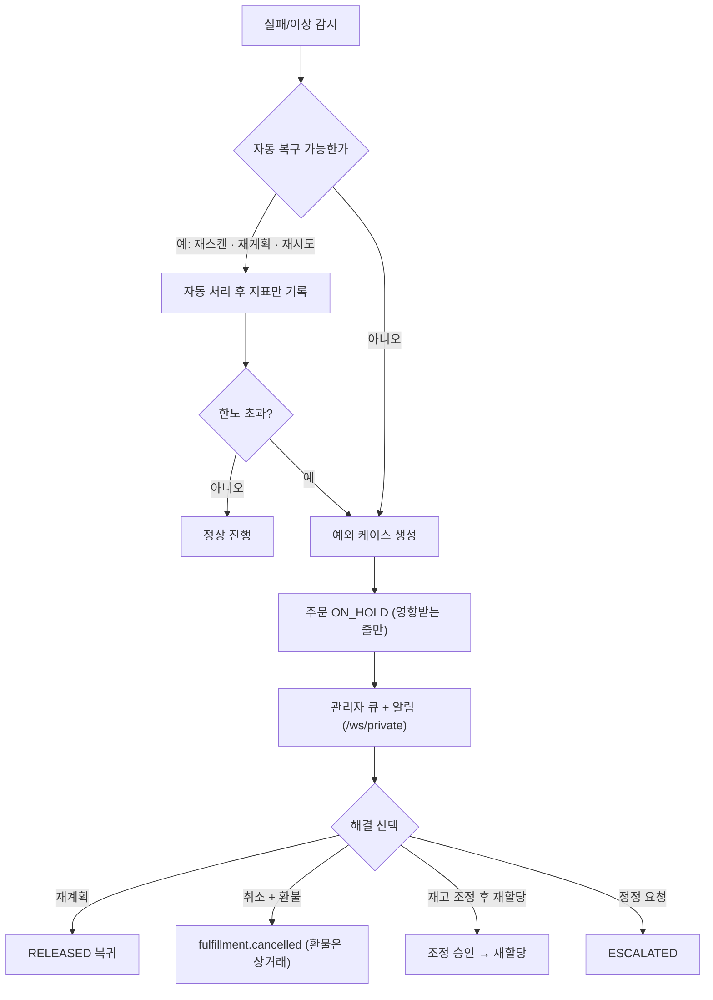

---

## 8. 동시성·정합성

### 8.1 경합 지점과 해결 수단

| 경합 | 수단 | 규약 |
|---|---|---|
| 같은 SKU 동시 할당 | `sku_position` 조건부 UPDATE (+ CHECK) | ADR-021 낙관적/조건부 |
| 같은 주문 이벤트 중복 수신 | inbox PK + `fulfillment_order.order_id` 유일 | ADR-020 |
| 주문 상태 전이 경합(취소 vs 진행) | `fulfillment_order.version` 조건부 UPDATE | ADR-021 |
| 피킹 작업 중복 선점 | `pick_task` CAS: `status='OPEN' → 'CLAIMED'`, `claim_token`, `lease_until` | ADR-021 §선점·임대·펜싱 |
| 만료 후 늦은 스캔 | 스캔은 `claim_token` 일치 조건, 불일치 시 `task_lease_lost`(409) | 펜싱 |
| 같은 스캔 중복 전송(오프라인 재전송) | `pick_scan` 유일 (`task_id`, `scan_id`) → 같은 결과 재생 | 멱등 |
| 같은 출고 지시 중복 | `shipment` 유일 (`fulfillment_order_id`, `seq`) + 택배사 멱등 키 | 멱등 |
| 같은 로트·위치 재고 동시 이동 | `stock_balance` 조건부 UPDATE (`on_hand − :q ≥ 0`) | CHECK 심판 |
| 대사 잡 중복 실행 | 어드바이저리 락(싱글톤) | ADR-021 |
| 예외 케이스 동시 해결 | `exception_case` CAS(`ASSIGNED` + 토큰) | 선점 |
| 다품목 주문 간 포지션 행 교착 | SKU 를 `sku_id` 오름차순으로만 갱신 | §4.2·§8.4 |
| 임대 만료 회수 | fulfillment 자체 reaper(`pick_task`·`exception_case`). F13 EV-05 는 outbox/inbox 만 대상 | ADR-021 |

### 8.2 처리 순서와 트랜잭션 경계

- 모든 쓰기는 `UnitOfWork.run`(ADR-025). **외부 호출(택배 어댑터)은 트랜잭션 밖**(ADR-021 4번): 선점 → 외부 호출 → 완료.
- 출고 확정(WM-40)은 한 트랜잭션에서 `ISSUE` 원장 + 잔고/포지션 갱신 + `shipment` 상태 + outbox(`shipment.dispatched`)를 쓴다.
- 집합체별 순서(F11 §3.5 규약): `FulfillmentOrder` 단위 이벤트는 같은 행을 `FOR NO KEY UPDATE` 로 잠근 뒤 outbox 를 쓴다.

### 8.3 로케이션 선택의 경합

로케이션 계획은 후보 잔고를 `FOR UPDATE SKIP LOCKED` 로 읽고(T1), 부족하면 일반 `FOR UPDATE`(id 순서, `lock_timeout 2s`)로 한 번 더 시도한 뒤에야 "부족"으로 판정한다. SKIP LOCKED 가 만든 **거짓 부족**(다른 트랜잭션이 잠근 행)을 구분하기 위해서다. 같은 순서로 잠그므로 교착이 없다.

### 8.4 모듈 간 InTx 호출 목록과 잠금 순서 (B12 쌍 #10)

| 조율자(fulfillment, L5) | 호출(inventory, L4) | 원장 이동 | `available`/`allocated` |
|---|---|---|---|
| `AcceptOrder` · `BackorderRetry` | `AllocateInTx` (줄마다, `sku_id` 오름차순) | — | `allocated +`, (약정 소비 시 `earmarked −`) |
| `CancelFulfillment`(피킹 전 취소) | `ReleaseAllocationInTx` | — | `allocated −` |
| `ConfirmPickScan` | `RecordMovementInTx(PICK)` | STORAGE·PICK_FACE→STAGING | 불변 |
| PUTBACK 작업 스캔 | `RecordMovementInTx(PUTBACK)` + (취소 시) `ReleaseAllocationInTx` | STAGING→STORAGE·PICK_FACE | 불변 / `allocated −` |
| `HandOverShipments`(= `DispatchShipment`) | `IssueInTx` | STAGING→EXTERNAL (`ISSUE`) | `available −`, `allocated −` **동시** |
| `ReceiveReturn` | `RecordMovementInTx(RETURN_RECEIPT)` | EXTERNAL→QUARANTINE | 불변(QUARANTINE 은 판매 대상 아님) |
| `RestockReturn` | `RecordMovementInTx(RESTOCK)` | QUARANTINE→STORAGE | `available +` |
| `DisposeReturn` | `RecordMovementInTx(DISPOSE)` | QUARANTINE→DISPOSAL→EXTERNAL | 불변 |
| ALL_OR_NOTHING 중도 실패 | (호출 없음) savepoint 롤백으로 성공분 취소 | — | — |

이 목록이 `modules/tx-pairs.json` 쌍 #10 의 정본이다(P0 §2.4). 목록 밖 `InTx` 호출은 CI 실패.

**잠금 순서(모든 usecase 공통)**: ① `fulfillment_order` 행(`FOR NO KEY UPDATE`) → ② `sku_position` 행들(`sku_id` 오름차순) → ③ `stock_balance` 행들(`(sku_id, lot_id, location_id)` 오름차순) → ④ `allocation`/`location_plan`. 역순 잠금이 있으면 교착 가능성이 있으므로 코드 리뷰 체크 항목이다.

---

## 9. 이벤트 카탈로그

봉투·버전 규칙은 M1 05 와 같다(`type` = `<aggregate>.<verb-past>`, `schemaVersion`, `traceId`, `ownerKey`). **페이로드에 수취인 개인정보를 싣지 않는다.**

### 9.1 P2 와의 계약 가정 (수신)

| `type` | 발행 | 페이로드(가정) | 풀필먼트의 반응 |
|---|---|---|---|
| `order.paid` | commerce | `orderId`, `orderVersion`, `lines[{lineId, skuId, qty, dealId?}]`, `shippingAddressRef`, `shippingMethod`, `paidAt` | `AcceptOrder` (배송지는 **AcceptOrder 시점**에 tx 앞에서 `order.GetShippingAddress(shippingAddressRef)` 로 읽어 풀필먼트 자기 봉투로 다시 암호화해 저장) |
| `order.cancel_requested` | commerce | `orderId`, `reason` | `CancelFulfillment` (판정표 §5.4) |
| `order.return_requested` | order | `orderId`, `returnId`, `lines`, `reason` | `OpenReturn` |
| `order.address_corrected` | order | `orderId`, `shippingAddressRef` (새 rev) | `ON_HOLD` 해제 + 배송지 재스냅샷 |
| `order.cancelled` · `order.disputed` · `payment.refunded` | order · payment | `orderId`, `reason` | 외부 사유 취소로 `CancelFulfillment`(`reason=EXTERNAL`, §5.4). 이미 출고된 주문은 반품/회수 안내 |
| `deal.published` | deal | `dealId`, `skuId`, `totalQty` | `EarmarkStock` (거절 시 `inventory.earmark_rejected` 발행) |
| `deal.settled` | deal | `dealId`, `skuId`, `totalQty`, **`confirmedQty`** | `ReleaseEarmark` — `totalQty − confirmedQty` 만 해제(§4.6). `deal.closed` 는 약정을 바꾸지 않는다 |
| `deal.restocked` | deal | `dealId`, `skuId`, `qty`, `reason`(`cancel`) | 약정 `+qty` (할당 해제와 쌍) |
| `deal.stock_adjusted` | commerce | `dealId`, `skuId`, `delta` | 약정 조정 |

가정이 깨지면 바뀌는 곳: 이벤트 이름·필드는 `fulfillment-consumer` 의 매핑 한 곳. **주소를 참조(`shippingAddressRef`)로 받는다는 가정**과 **`deal.settled.confirmedQty` 를 P2 가 싣는다는 가정**(약정 해제량 계산)이 핵심이며, P2 가 주소를 페이로드에 직접 싣겠다면 outbox 보관(7일) 동안 평문 PII 가 DB 에 남으므로 **거절하고 참조 방식을 요구**한다.

### 9.2 발행

| `type` | 시점(같은 트랜잭션) | 페이로드 | 소비자 |
|---|---|---|---|
| `fulfillment.accepted` | `AcceptOrder` 단일 tx 안, **할당 성공 후**(`allocation` = `FULL`·`PARTIAL`·`PENDING`(백오더 대기)) | `orderId`, `foId`, `allocation`, `lines[{lineId, qtyAllocated}]` | commerce(주문 상태 "출고 준비") |
| `fulfillment.rejected` | 할당 불가 | `orderId`, `reason`(`OUT_OF_STOCK`·`ADDRESS_UNSHIPPABLE`) | **order(환불 사가의 근거, 상거래가 소비하는 유일한 거절 신호)** — `inventory.allocation_failed` 는 inventory→fulfillment **내부 신호**이고 fulfillment 가 이를 `fulfillment.rejected` 로 변환 |
| `fulfillment.allocation_completed` | 백오더 입고로 부분/대기 할당이 완료 | `orderId`, `foId`, `lines` | `fulfillment-projector` (상거래는 소비하지 않음 — accepted 가 이미 출고 준비를 알림). P0 §8.3 은 `.allocated`/`.partially_allocated` 를 `accepted` 로 병합하고 이 이벤트로 대체했다(정합 완료) |
| `fulfillment.cancelled` | 취소 완료 | `orderId`, `stage`, `reason`(`REQUESTED`·`EXTERNAL`·`ADDRESS_NOT_CORRECTED`·`OUT_OF_STOCK_AFTER_ACCEPT` 등) | commerce(환불 진행, `payment-fulfillment-refunder`) — `reason=EXTERNAL` 은 환불 중복 방지용 구분 |
| `fulfillment.cancel_rejected` | 취소 불가 | `orderId`, `stage` | commerce |
| `package.packed` | 포장 확정 | `foId`, `packageId` | 읽기 모델 |
| `shipment.dispatched` | 인수인계 | `orderId`, `foId`, `carrier`, `trackingNo`, `lines` | commerce(주문 상태), 구매자 알림 |
| `shipment.status_changed` | 추적 정규화 반영 | `shipmentId`, `status`, `occurredAt` | 읽기 모델 |
| `shipment.delivered` | 배송 완료 | `orderId`, `deliveredAt` | commerce(에스크로 자동 확정 타이머 시작 등 P2 소관) |
| `shipment.delivery_failed` | 시도 소진 | `orderId`, `attempts` | commerce |
| `return.received` | 반품 입고 | `returnId`, `orderId` | commerce |
| `return.inspected` | 검수 완료 | `returnId`, **`orderId`**, `origin`(`CUSTOMER`·`RTS`), `disposition`(`RESTOCK`·`DISPOSE`·`REFUND_ONLY`) | **commerce(환불 판단, `payment-fulfillment-refunder`)** |
| `inventory.allocation_failed` | 할당 조건부 UPDATE 0행(inventory 내부) | `skuId`, `foLineId`, `qty` | **fulfillment 만**(상거래는 소비하지 않음) |
| `inventory.earmark_changed` · `inventory.earmark_rejected` | 약정 변경 / 거절(`allocated + earmarked > available`) | `skuId`, `channelRef`, `qty`, (`reason`) | **deal**(`deal_read.sku_capacity` 갱신·딜 게시 거절 근거) |
| `inventory.stock_received` | 입고 확정 | `skuId`, `qty` | `backorder-retry`, commerce |
| `inventory.low_stock` | 임계 하회 | `skuId`, `atp` | 관리자 알림 |
| `inventory.discrepancy_detected` | 대사 이상 | `kind`, `skuId` | 예외 큐 |

**순서 보장 단위.** `fulfillment.*`·`shipment.*`·`package.*`·`return.*` 이벤트의 outbox `aggregate_id` 는 항상 **`orderId`** 다(`foId`·`shipmentId`·`returnId` 로 갈리지 않는다). 그래야 M1 F13 의 집합체 선두 규칙으로 상거래가 주문 단위 순서(accepted → dispatched → delivered)를 받는다. 쓰는 쪽은 `fulfillment_order` 행을 `FOR NO KEY UPDATE` 로 잠근 뒤 outbox 를 쓴다(§8.2).

### 9.3 소비자 매트릭스

| 소비자 | 소유 | 구독 | 효과 |
|---|---|---|---|
| `fulfillment-consumer` | fulfillment | `order.paid`·`order.cancel_requested`·`order.cancelled`·`order.disputed`·`payment.refunded`·`order.return_requested`·`order.address_corrected` | 출고 흐름 시작/취소(요청·외부 사유)/반품 |
| `earmark-consumer` | inventory | `deal.published`·`deal.settled`·`deal.stock_adjusted`·`deal.restocked` | 약정 증감(§4.6) |
| `carrier-webhook-consumer` | fulfillment | 웹훅 inbox | 추적 반영 |
| `fulfillment-projector` | fulfillment | `fulfillment.*`·`shipment.*`·`package.*`·`return.*` | `fulfillment_read` 갱신 |
| `inventory-projector` | inventory | `inventory.*` + 원장 이벤트 | `inventory_read` 갱신 |
| `backorder-retry` | fulfillment | `inventory.stock_received` | 백오더 재할당 |

---

## 10. 데이터 모델 (개요)

스키마: `inventory`, `inventory_read`, `fulfillment`, `fulfillment_read`. 모든 PK 는 uuid v7(ADR-017). 스키마 간 FK 없음(id 값으로만 참조). 컬럼은 핵심만 적는다(전수는 구현 시 `database-schema.md` 에 반영).

### 10.1 inventory (쓰기)

| 테이블 | 핵심 컬럼 | 제약·인덱스 | 등급 |
|---|---|---|---|
| `warehouse`·`zone`·`location` | `code`, `kind`(`STORAGE`·`PICK_FACE`·`RECEIVING`·`QC_PASSED`·`QUARANTINE`·`STAGING`·`DISPOSAL`·`EXTERNAL`), `capacity` | `location.code` 유일, `kind` CHECK | SYS |
| `sku_logistics` | `sku_id` PK, `barcode`, `weight_g`, `lot_tracked`, `shelf_life_days` | `barcode` 유일 | SYS |
| `lot` | `id`, `sku_id`, `lot_code`, `received_at`, `expires_at` | 유일(`sku_id`,`lot_code`) | SYS |
| `ledger_entry` | `id`, `seq` bigint, `type`, `sku_id`, `lot_id`, `from_location_id`, `to_location_id`, `qty` > 0, `reason`, `ref_type`, `ref_id`, `actor_key`, `trace_id`, `at` | **추가 전용**, `(sku_id, at)`·`(ref_type, ref_id)` 인덱스, `qty > 0` CHECK | SYS, `actor_key`=PSD |
| `stock_balance` | PK(`sku_id`,`lot_id`,`location_id`,`status`), `on_hand` ≥ 0, `version` | CHECK `on_hand >= 0`, 부분 인덱스 `WHERE on_hand > 0` | SYS |
| `sku_position` | `sku_id` PK, `available_total`(= Σ `on_hand`, `SELLABLE_KINDS`), `allocated_total`, `earmarked_total`, `version` | **CHECK `allocated_total + earmarked_total <= available_total`**, 각 ≥ 0. `ISSUE` 는 `available_total`·`allocated_total` 을 같은 UPDATE 에서 함께 −(§3.4 숫자 검증) | SYS |
| `allocation` | `id`, `fo_line_id`, `sku_id`, `qty`, `status`(`ACTIVE`·`RELEASED`·`ISSUED`), `created_at` | `(sku_id,status)` 부분 인덱스 `WHERE status='ACTIVE'`, 유일(`fo_line_id`) 활성 | SYS |
| `location_plan` | `allocation_id`, `sku_id`, `lot_id`, `location_id`, `qty`, `status` | `(allocation_id)` | SYS |
| `channel_earmark` | PK(`sku_id`,`channel_ref`), `qty` ≥ 0, `version` | `channel_ref` 예 `deal:<id>` | SYS |
| `asn`·`asn_line`·`inspection` | 입고 예정·검수 | `asn.code` 유일 | SYS |
| `count_task`·`count_line`·`adjustment` | 실사·조정(승인 상태, 승인자) | `adjustment.status` 상태 CHECK | SYS, `approved_by`=PSD |
| `discrepancy` | `kind`(R1~R6), `sku_id`, `detail` jsonb(수량만), `status` | `(status, kind)` 인덱스 | SYS |
| `request_key`·`inbox_message` | M1 공통 형태 | PK 규약 동일 | M1 §9.1 |

### 10.2 fulfillment (쓰기)

| 테이블 | 핵심 컬럼 | 제약·인덱스 | 등급 |
|---|---|---|---|
| `fulfillment_order` | `id`, `order_id` **유일**, `state`, `policy`, `priority`, `cancel_requested`, `hold_reason`, `held_from_state`, `region_code`, **`recipient_enc`**, `recipient_anonymize_at`, `version`, 시각들 | `(state, priority, created_at)` 부분 인덱스(큐용), 유일 `order_id` | `recipient_enc`=**ENC**, `region_code`=PII(시·도 수준 평문, **익명화 대상 아님**), 나머지 SYS |
| `fo_line` | `id`, `fo_id`, `sku_id`, `qty_ordered`, `qty_allocated`, `qty_picked`, `qty_shipped` | CHECK `qty_shipped <= qty_picked <= qty_allocated <= qty_ordered` | SYS |
| `fulfillment_order_event` | `fo_id`, `from_state`, `to_state`, `at`, `trace_id` | **추가 전용** | SYS |
| `wave` | `id`, `strategy`, `released_at`, `order_count` | | SYS |
| `pick_task` | `id`, `wave_id`, `fo_id`, `state`, `claimed_by`(PSD), `claim_token`, `lease_until`, `attempts`, `version` | 부분 인덱스 `WHERE state='OPEN'`(큐), ADR-021 §2-1 공통 컬럼 | SYS, `claimed_by`=PSD |
| `pick_line` | `task_id`, `location_id`, `sku_id`, `lot_id`, `qty_plan`, `qty_picked`, `state` | | SYS |
| `pick_scan` | `task_id`, **`scan_id`**, `code`, `qty`, `result`, `at` | **유일 (`task_id`,`scan_id`)** | SYS |
| `package`·`pack_scan` | `fo_id`, `seq`, `state`, `weight_g`, `carton_code` | 유일(`fo_id`,`seq`) | SYS |
| `shipment` | `id`, `fo_id`, `seq`, `carrier`, `tracking_no`, `state`, `last_attempt_no`, `last_event_at`, `version` | **유일 (`fo_id`,`seq`)**, 유일 (`carrier`,`tracking_no`) | SYS |
| `carrier_event` | `carrier`, **`event_id`**, `shipment_id`, `raw_status`, `normalized`, `attempt_no`, `occurred_at`, `received_at` | **유일 (`carrier`,`event_id`)** | SYS |
| `return_case`·`return_inspection` | `order_id`, `origin`(`CUSTOMER`·`RTS`), `state`, `disposition` | 유일(`return_id`) | SYS |
| `exception_case` | `id`, `kind`, `ref_type`, `ref_id`, `state`, `assigned_to`(PSD), `claim_token`, `lease_until`, `resolution`, `resolved_by`(PSD) | 부분 인덱스 `WHERE state='OPEN'` | SYS |
| `backorder` | `fo_line_id`, `qty_pending`, `since` | | SYS |
| `request_key`·`inbox_message` | M1 공통 형태 | | M1 §9.1 |

### 10.3 읽기 모델 (`inventory_read`, `fulfillment_read`)

| 테이블 | 용도 | 비고 |
|---|---|---|
| `fulfillment_read.order_view` | 관리자 파이프라인·주문 상세(상태, 줄, 시각) | **수취인 정보 없음**, 이름은 마스킹 표시만 필요 시 별도 usecase |
| `fulfillment_read.pipeline_counter` | 상태별 건수·평균 체류(분 단위 집계) | 배치 프로젝션(M1 `flow_counter` 방식) |
| `fulfillment_read.tracking_view` | 구매자용 배송 추적(상태 이력) | P2 가 공개 usecase 로 읽음 |
| `fulfillment_read.task_queue_view` | 작업자 대기 작업(부분 인덱스) | `last_seq` 규약 |
| `inventory_read.position_view` | SKU 별 재고·ATP | |
| `inventory_read.balance_view` | 위치별 재고 | |
| `inventory_read.discrepancy_view` | 대사 이상 목록 | |

읽기 모델은 M1 규약대로 `*_seq` 필드별 순번으로 오래된 이벤트를 무시한다. **작업 선점·재고 판단은 쓰기 모델**을 읽는다(읽기 모델은 화면 전용).

### 10.4 개인정보와 데이터 보호 등급 (ADR-026 확장 제안)

| 데이터 | 등급 | 보호 | 보관 |
|---|---|---|---|
| 수취인 이름·전화·주소·우편번호·배송 메모 (`recipient_enc`) | **ENC** | 필드 암호화 AES-256-GCM 봉투, AAD `fulfillment.fulfillment_order.recipient_enc:<id>`, 단일 JSON 봉투 | **익명화 시점 = `recipient_anonymize_at`** (봉투 NULL, 암호학적 삭제). 정의: 배송 완료(`shipment.delivered.deliveredAt`) + **반품 기한(5일)** 경과 후 **30일** → 완료 후 35일. 반품 케이스가 열려 있으면 `max(완료+5일, 반품 CLOSED)` + 30일. 취소·거절·반송 종결 주문은 종결 시점 + 30일. P0 §9.5·§9.6 정본, 사용자 확정 대기(U4) |
| `region_code` (시·도) | PII | 평문(통계·택배 구역 판단) | **익명화 대상이 아님** — 시·도 단위는 단독으로 개인을 식별하지 못하고 통계 목적이다. 주문 보관과 함께(필요 시 U4 에서 삭제로 변경) |
| 작업자 ID (`claimed_by`, `approved_by`) | PSD | 평문, 로그 레이블 금지 | 이력 보관 |
| 재고 수량·위치·로트 | SYS | 평문 | 원장 영구(추가 전용), 읽기 모델은 재구성 가능 |
| 운송장 번호 | PII(준) | 평문 — 택배 추적에 필요, 단 **로그·지표 레이블 금지**. P0 §9.2 와 같은 PII(준) | 주문과 함께 |
| 택배 이벤트 원본 | SYS | `raw_status` 만 저장, 원본 본문에 주소가 있으면 저장하지 않음 | 90일(제안) |

규칙:
- 송장 출력·패킹에 필요한 수취인 정보는 `GetPackingSlip` usecase 가 **복호화해서 반환**하고, 호출은 감사 `recipient_viewed`(category `admin`)로 남긴다. 화면에는 필요한 최소 필드만 준다.
- 배송지 스냅샷은 **`AcceptOrder` 시점**(§4.1)에 상거래에서 읽어 풀필먼트가 **자기 봉투로 다시 암호화**한다(상거래의 키 회전과 독립). 정정(`order.address_corrected`) 때는 새 rev 를 다시 스냅샷한다.
- 키 회전 대상 필드 이름은 `<스키마>.<테이블>.<컬럼>` 형식: `worker rotate-field-keys --field fulfillment.fulfillment_order.recipient_enc` (P0 §9.5 통합표와 같은 표기).
- 클래스 맵(`classification.ts`)에 위 컬럼을 등록하지 않으면 CI 가 실패한다(`check:classification`).

---

## 11. API · WS 계약 개요

모든 쓰기는 `Idempotency-Key` 필수(M1 03 §3). 오류 wire code 는 접두사 없음. 새 코드: `stock_insufficient`(409), `allocation_conflict`(409), `task_lease_lost`(409), `scan_mismatch`(422), `invalid_state`(409), `cancel_not_allowed`(409).

### 11.1 작업자 (역할 `operator`)

| 메서드·경로 | 요청 | 응답 | 비고 |
|---|---|---|---|
| `GET /api/wms/tasks` | 쿼리 `kind`, `limit` | 대기 작업(읽기 모델 `task_queue_view`) | 화면용 |
| `POST /api/wms/tasks/{id}/claim` | — | `{ task, claimToken, leaseUntil }` | 쓰기 모델 CAS |
| `POST /api/wms/tasks/{id}/renew` | `{ claimToken }` | `{ leaseUntil }` | 임대 연장(스캔마다 자동 연장 대안) |
| `POST /api/wms/tasks/{id}/scan` | `{ claimToken, scanId, code, qty }` | `{ result, nextStep }` | `scanId` 멱등 |
| `POST /api/wms/tasks/{id}/short` | `{ claimToken, lineId, found }` | `{ replanned }` | |
| `POST /api/wms/tasks/{id}/complete` | `{ claimToken }` | `{ state }` | |
| `POST /api/wms/pack/{foId}/scan` | `{ scanId, code, qty }` | `{ verified }` | |
| `POST /api/wms/pack/{foId}/seal` | `{ weightG }` | `{ label }` | 택배 어댑터 호출은 트랜잭션 밖 |
| `POST /api/wms/handover` | `{ shipmentIds[] }` | `{ dispatched }` | 일괄 인수인계 |
| `POST /api/wms/receiving/{asnLineId}` | `{ qty, lotCode, damaged? }` | `{ receiptId }` | |

### 11.2 관리자 (`admin`, 기존 `RequireAdmin` 확장)

| 메서드·경로 | 용도 |
|---|---|
| `GET /api/admin/wms/pipeline` | 상태별 건수·체류 시간 |
| `GET /api/admin/wms/orders/{id}` | 주문 상세(수취인 마스킹) |
| `POST /api/admin/wms/orders/{id}/packing-slip` | 수취인 복호화 조회(감사) |
| `GET /api/admin/wms/inventory` · `/inventory/{sku}` | 재고 |
| `POST /api/admin/wms/asn` · `/locations` · `/skus` | 마스터 |
| `POST /api/admin/wms/adjustments` · `/adjustments/{id}/approve` | 조정 |
| `GET /api/admin/wms/exceptions` · `POST …/{id}/assign` · `…/{id}/resolve` | 예외 큐 |
| `POST /api/admin/wms/simulator/*` | 시뮬레이터 켜기/끄기, 카오스 주입 |
| `POST /api/hooks/carrier/{carrier}` | 택배 웹훅(서명 검증, 인증은 §14) |

### 11.3 구매자 (P2 가 소유하는 주문 API 에 연결)

`GET /api/orders/{id}/tracking` 은 P2 의 라우트가 `fulfillment_read.tracking_view` 를 공개 usecase 로 읽어 응답한다(풀필먼트는 구매자 API 를 직접 열지 않는다).

### 11.4 WS

기존 `/ws/private`(세션 소유자 전용) 메시지 확장. 새 연결 종류를 만들지 않는다(잠정 공통 결정).

| `t` | 대상 | 본문 |
|---|---|---|
| `wms.task_available` | `operator` 세션 | `{ taskId, kind, priority }` |
| `wms.task_reassigned` | 이전 선점자 | `{ taskId }` (임대 만료 후 다른 사람이 선점) |
| `wms.exception_opened` | `admin` | `{ caseId, kind }` |
| `wms.pipeline_changed` | `admin` | `{ counters }` (집계, 개별 식별자 없음) |

순번·재개는 없다(private 은 best-effort, M1 04 §5). 놓친 알림은 REST 로 다시 읽는다.

---

## 12. 핵심 시퀀스

### 12.1 정상 흐름: 결제 완료 → 배송 완료

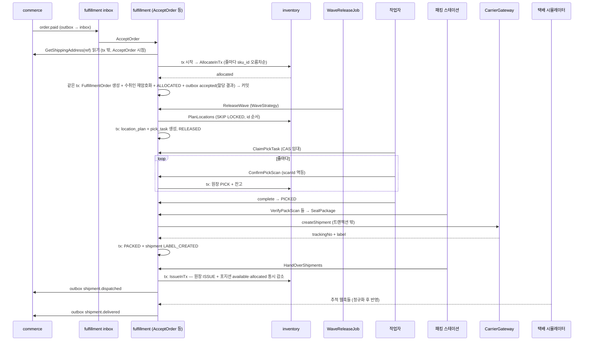

### 12.2 동시 할당 경합 (마지막 1개)

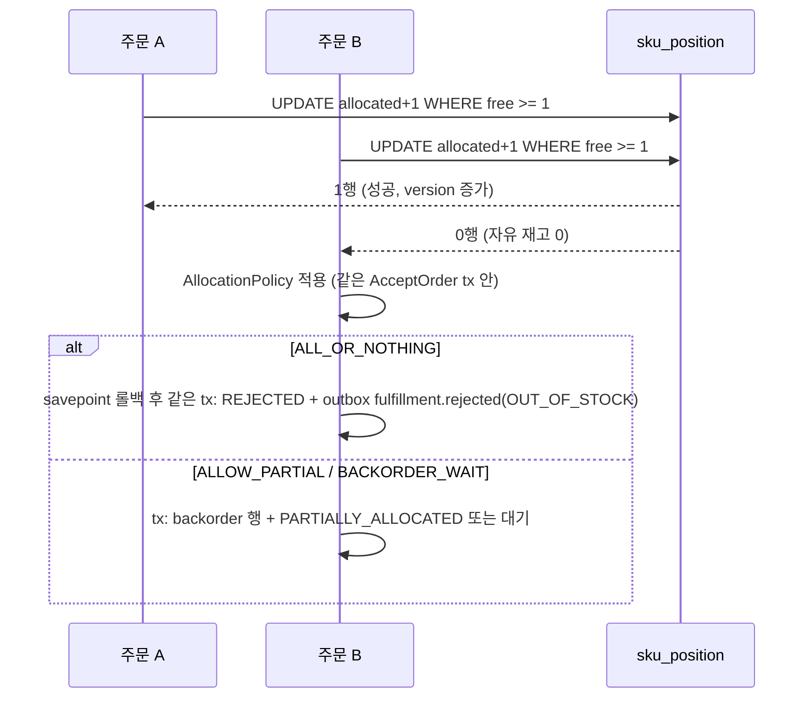

### 12.3 피킹 임대 만료와 늦은 스캔

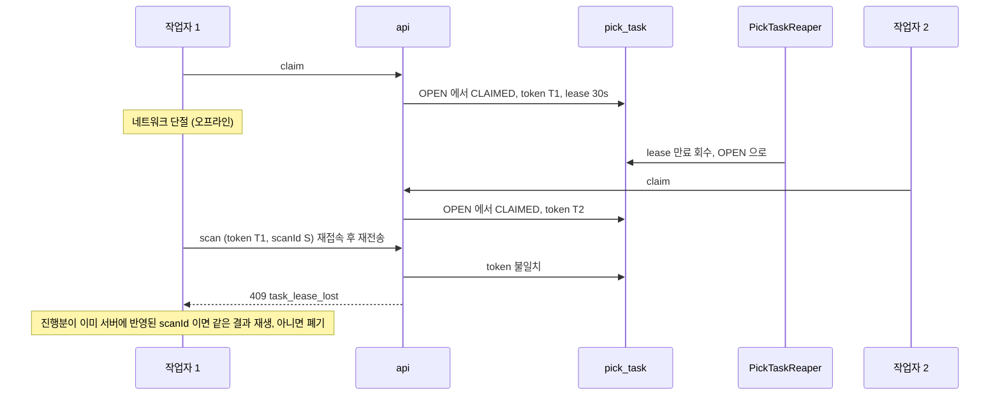

### 12.4 피킹 중 취소

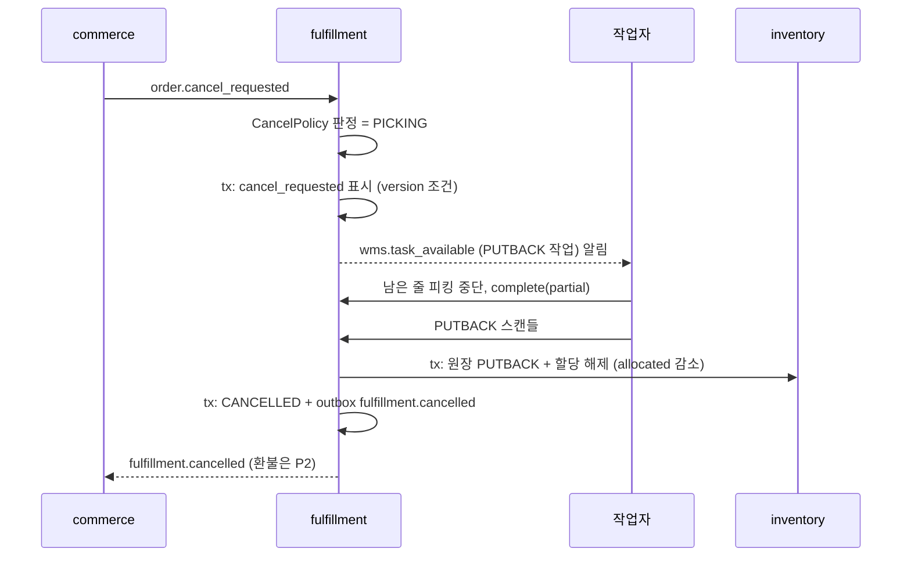

### 12.5 추적 웹훅: 중복·순서 뒤바뀜

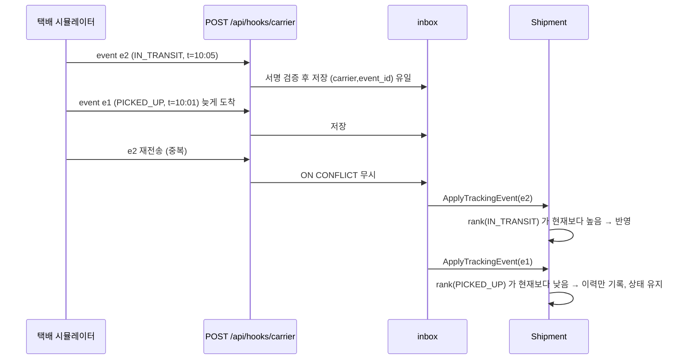

### 12.6 반품과 재입고

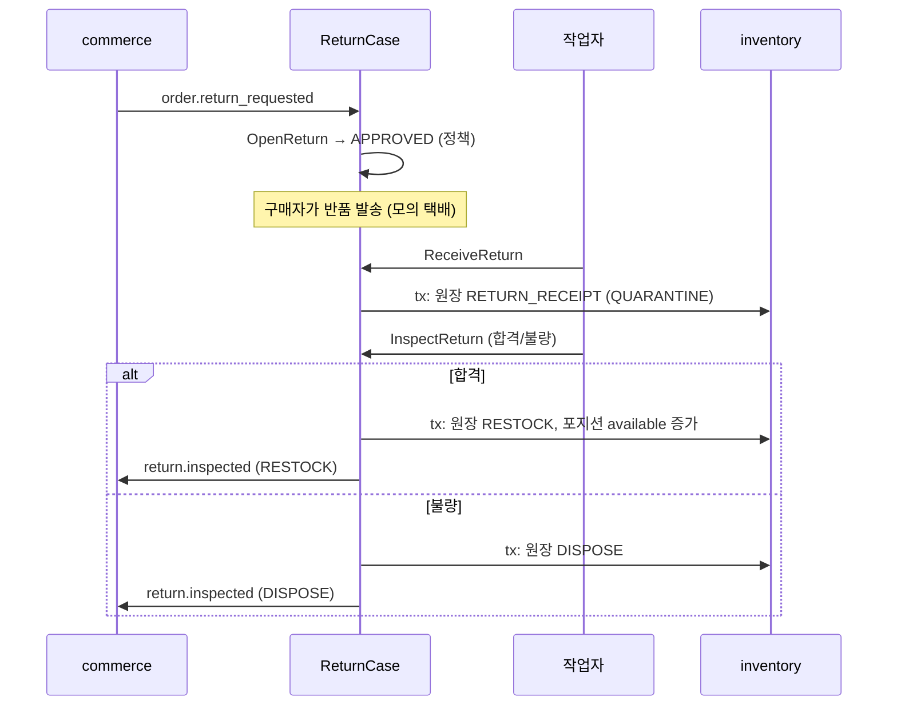

### 12.7 배송 실패 → 반송 → 재입고

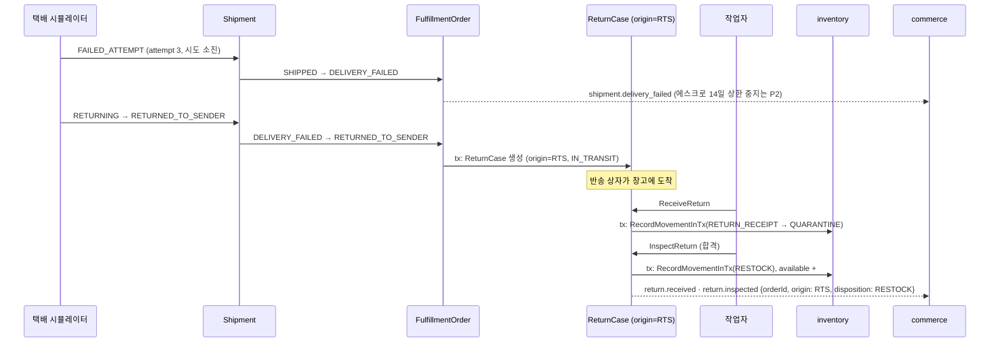

---

## 13. 핵심 순서도

### 13.1 SKU 할당 판정

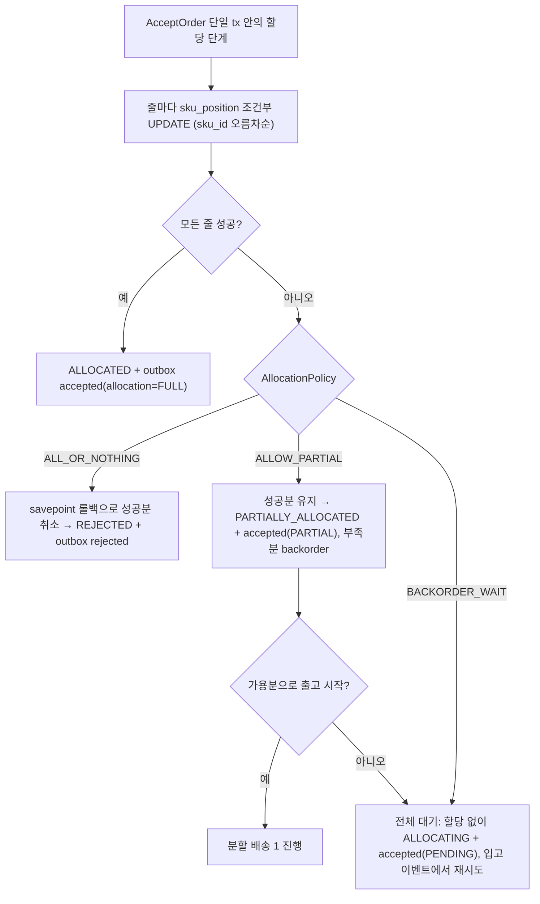

### 13.2 웨이브 선택

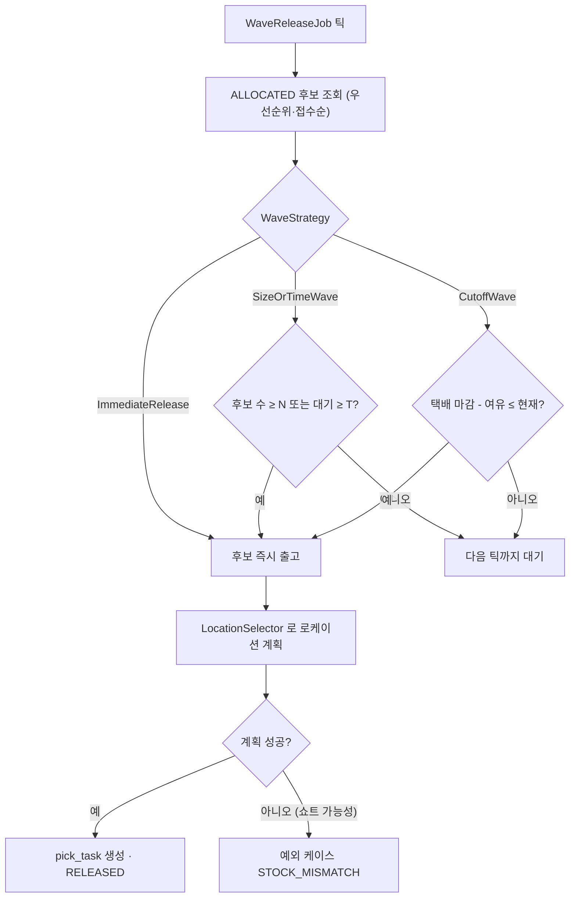

### 13.3 피킹 스캔 판정

```mermaid
flowchart TD
    A["스캔 도착 (claimToken, scanId, code, qty)"] --> B{"claimToken 일치 + 임대 유효?"}
    B -- "아니오" --> C["409 task_lease_lost"]
    B -- "예" --> D{"scanId 이미 처리됨?"}
    D -- "예" --> E["저장된 결과 재생 (멱등)"]
    D -- "아니오" --> F{"위치/SKU 코드가 현재 줄과 일치?"}
    F -- "아니오" --> G["422 scan_mismatch (+ 반복 횟수 기록)"]
    F -- "예" --> H{"qty ≤ 남은 수량?"}
    H -- "아니오" --> G
    H -- "예" --> I["tx: pick_scan + 원장 PICK + 잔고 + 줄 진행"]
    I --> J{"작업의 모든 줄 완료?"}
    J -- "예" --> K["DONE → 주문 PICKED 판정"]
    J -- "아니오" --> L["다음 줄 안내"]
```

---

## 14. 보안·악용 방어·감사

| 항목 | 규칙 |
|---|---|
| 역할 | **`operator`**(창고 작업자, `OPERATOR_GITHUB_IDS` 허용목록)와 **`admin`**(창고 관리: 재고 조정 승인·예외 해결·강제 취소, `ADMIN_GITHUB_IDS`)을 쓴다(P0 D11). `warehouse_worker`/`warehouse_admin` 이라는 별도 역할 표는 **두지 않는다**. 데모 모드 샌드박스 작업자 체험 허용 여부는 **사용자 결정**(P0 §16 U3), 허용하더라도 `demo_` 데이터만 접근 |
| 웹훅 | `POST /api/hooks/carrier/:carrier` 는 **HMAC 서명 + 타임스탬프(재생 방지)** 검증, 실패 시 401. 서명 키는 시크릿 파일(`CARRIER_WEBHOOK_SECRET`) |
| 개인정보 | §10.4. 로그·지표·이벤트·읽기 모델에 수취인 정보 금지. `Redactor` 거부 목록에 `recipient`, `address`, `phone` 추가 |
| 속도 제한 | 등급 제안: `write.scan` 세션당 분당 120, `write.claim` 분당 30, `write.wms_admin` 분당 60, 웹훅은 접속 주소(nginx)당 분당 600 |
| 감사 action 추가 | 행위자 `actor_role` 은 `operator`·`admin`(ADR-027 의 `actor_role` 열거에 `agent`·`operator` 추가가 필요 — P0 §12.4 변경 요청 표에 있음). category `admin`: `stock_adjustment_approved`, `recipient_viewed`, `exception_resolved`, `order_force_cancelled`; category `system`: `reconciliation_ran`, `recipient_anonymized`, `simulator_toggled` |
| 보안사고 | 수취인 PII 유출 시 영향 산정표에 `fulfillment_order.recipient_enc` 행 추가(ADR-028 §DB 덤프 유출), 필드 키 유출 시 재암호화 절차에 대상 필드 포함 |

---

## 15. 관측

지표는 M1 규약(`pf_` 접두, 식별자 레이블 금지, 고정 열거 레이블은 기동 시 0 초기화).

| 이름 | 종류 | 레이블 | 의미 |
|---|---|---|---|
| `pf_wms_orders` | G | `state` | 상태별 주문 수 |
| `pf_wms_order_stage_seconds` | H | `stage`(`allocate`,`release`,`pick`,`pack`,`ship`,`deliver`) | 단계별 체류 시간 |
| `pf_wms_allocation_total` | C | `result`(`allocated`,`partial`,`rejected`,`conflict_retry`) | 할당 결과 |
| `pf_wms_pick_claim_total` | C | `result`(`ok`,`lost`,`empty`) | 작업 선점 |
| `pf_wms_pick_scan_total` | C | `result`(`ok`,`replayed`,`mismatch`,`lease_lost`) | 스캔 결과 |
| `pf_wms_short_pick_total` | C | `outcome`(`replanned`,`escalated`) | 쇼트 |
| `pf_wms_shipments` | G | `status` | 배송 상태별 |
| `pf_wms_carrier_event_total` | C | `carrier`,`result`(`applied`,`duplicate`,`stale`,`rejected`) | 추적 이벤트 |
| `pf_wms_carrier_event_lag_seconds` | H | `carrier` | 택배 발생→수신 지연 |
| `pf_wms_exception_open` | G | `kind` | 열린 예외 |
| `pf_wms_reconciliation_discrepancies` | G | `kind`(R1~R6) | 미해결 불일치 |
| `pf_wms_invariant_violations_total` | C | `invariant`(P1~P6) | 불변식 위반(0 이어야 함) |
| `pf_wms_offline_replay_total` | C | `result` | 오프라인 재전송 결과 |
| `pf_wms_low_stock` | G | — | 임계 하회 SKU 수 |
| `pf_wms_earmark_shortfall_total` | C | — | 약정 소비 실패(약정 < 주문 수량, 드문 경로) |

경보 후보: `pf_wms_invariant_violations_total` 증가(critical), `pf_wms_reconciliation_discrepancies > 0` 30분 지속(warn), `pf_wms_order_stage_seconds` 상위 분위수 SLA 초과(warn), `pf_wms_orders{state="ON_HOLD"}` 증가(warn), 추적 지연(warn).

로그 필드: `module=fulfillment`, `usecase`, `fo_id`(식별자 로그 허용, 레이블 금지), `trace_id`. 수취인 정보 금지.

---

## 16. 시험 전략

M1 08 의 계층·등급 체계를 따른다. 이 영역의 AC 후보:

| ID | 인수 기준 (후보) | 시험 |
|---|---|---|
| AC-WM-01 | 결제 완료 주문이 배송 완료까지 상태 전이를 거친다 | E2E L3 (시뮬레이터) |
| AC-WM-02 | 같은 `order.paid` 를 두 번 받아도 주문·할당이 한 번이다 | 중복 주입 L3 |
| AC-WM-03 | 같은 스캔(`scanId`)을 두 번 보내도 재고가 한 번만 움직인다 | L3 |
| AC-WM-04 | 마지막 1개에 N=50 동시 할당 → 정확히 1건 성공, 나머지는 정책대로, P1 유지 | 동시성 L3 |
| AC-WM-05 | 임대 만료 후 이전 작업자의 스캔은 `409 task_lease_lost` 로 거절되고 효과가 없다 | fencing L3 |
| AC-WM-06 | 취소 판정표(§5.4) 각 상태에서 기대 결과 | 표 기반 L3 |
| AC-WM-07 | 추적 이벤트가 중복·순서 역전돼도 상태가 후퇴하지 않는다 | L2·L3 |
| AC-WM-08 | 대사가 주입된 불일치(R1~R6)를 찾고 정상 데이터에서 오탐 0 | 카오스 + 대사 L3 |
| AC-WM-09 | 반품 합격 시 재입고되어 `available_total` 이 증가하고 폐기 시 감소한다 | L3 |
| AC-WM-10 | 수취인 평문이 DB 덤프·outbox·로그·읽기 모델에 없다 | 센티널 L3 |
| AC-WM-11 | 불변식 P1~P6 이 부하·카오스 중 위반 0 | 속성 기반 + 부하 L3 |
| AC-WM-12 | `recipient_anonymize_at`(완료 + 반품 기한 5일 + 30일) 경과 시 수취인 봉투가 익명화되고 `region_code` 는 남는다 | 시계 주입 L3 |
| AC-WM-13 | 전량 할당 SKU 의 PICK·ISSUE·PUTBACK·ADJUST_MINUS 시퀀스에서 P1 이 깨지지 않고(PICK 가능, ISSUE 후 ATP 불변, ADJUST_MINUS 는 거절 후 할당 해제 경로) §3.4 표와 일치 | 속성 기반 + 표 기반 L2·L3 |
| AC-WM-14 | 주문 (A,B)·(B,A) 를 동시에 1000쌍 수락해도 교착 0 이고 정확히 재고만큼 할당 | 동시성 L3 |
| AC-WM-15 | 딜 `closed` 와 `settled` 사이에 `order.paid` 가 늦게 소비돼도 약정이 이미 해제된 일이 없고 `settled` 에서 `totalQty − confirmedQty` 만 해제 | 이벤트 순서 주입 L3 |

시험 기법:
- **속성 기반**(L2): 임의의 이동 시퀀스(`fast-check` 류, 도구 미확인)에서 원장 합 = 잔고, 보존 법칙이 유지됨.
- **결정적 경합 재현**: 08 의 `FaultInjector`(`faults.hit('inventory.allocate_sku.after_gate')` 등)와 `Gate` 로 순서를 강제.
- **카오스**: 웨이브 중 worker kill, DB 일시 단절, 택배 웹훅 폭주·중복·역순, 시계 점프.
- **부하(k6)**: 주문 10건/초 5분(제안), 작업자 봇 50명 — p95 스캔 응답 300ms 이하(제안), 불변식 위반 0.

---

## 17. 시뮬레이터

| 구성 | 동작 | 제어 |
|---|---|---|
| `OrderGenerator` | 설정한 분포(SKU 가중치, 줄 수, 취소 확률, 주소 오류 확률, 반품 확률)로 P2 의 `order.paid` 와 같은 모양의 이벤트를 발행. 개발·데모용 | 관리자 토글, 초당 상한, 시드 고정(재현) |
| `SimulatedCarrier` | `CarrierGateway` 구현. 운송장 발급, 상태 진행(수거→이동→배달 시도→완료/실패)을 **설정된 지연**으로 진행. 웹훅/폴링 둘 다 제공 | 지연 분포, 실패율, 중복·역순 주입 |
| `WorkerBot` | 열린 작업을 자동으로 선점·스캔·완료(사람 없이 파이프라인 구동) | 봇 수, 오류율(오스캔·쇼트) |
| `SimClock` | `Clock` 포트의 가속 구현(배송 며칠을 분 단위로) | 가속 배율, **시험·데모에서만** |
| `FaultInjector` | M1 testkit 확장: 택배 웹훅 지연·유실, DB 지연, 잡 중단 | 시험 코드, 관리자 카오스 API |

규칙: 시뮬레이터는 **기본 꺼짐**이고 켠 사실은 감사(`simulator_toggled`)에 남는다. 시뮬레이터가 만든 주문은 `is_simulated=true` 표식으로 구분하고 M1 공개 지표에 섞이지 않게 레이블을 분리한다(레이블 값은 고정 열거).

---

## 18. 자원·확장, M1 접점, 구현 순서

### 18.1 자원

| 항목 | 영향 |
|---|---|
| 컨테이너 | 추가 없음 |
| DB | 원장이 가장 빨리 커진다(이동 1건당 1행). 하루 주문 1만 건·평균 줄 3 시 약 10 만 행/일(제안) → 인덱스 포함 100~200MB/월 규모로 추정(미측정). 장기 보관은 파티셔닝 후보(미결) |
| worker CPU | 웨이브·대사·시뮬레이터 잡이 주기 실행. 대사 R1 은 최근 변동 구간만 증분 계산(전수는 야간) |
| 메모리 | Postgres 작업 메모리 정도. 앱 메모리 증가는 모듈 코드 크기 수준 |

### 18.2 M1 과의 접점·변경점

| 대상 | 변경 |
|---|---|
| 신원(identity) | `operator` 역할(`OPERATOR_GITHUB_IDS` 허용목록)을 `RolePolicy` 에 추가(P0 D11), `agent`·`admin` 과 같은 방식 |
| 이벤트 카탈로그(05) | §9 이벤트 추가, `order.paid` 계약 확정 필요 |
| 보관 정리 | `RetentionRule` 등록: `carrier_event` 90일, 수취인 익명화(`recipient_anonymize_at`, 완료 + 반품 기한 5일 + 30일), `pick_scan` 90일, 시뮬레이터 데이터 7일. 회수(reaper)는 이 영역 자체 reaper 가 맡는다(F13 EV-05 는 outbox/inbox 전용) |
| 감사(ADR-027) | action 추가(§14), `actor_role` 에 `operator` 추가 |
| 데이터 보호(ADR-026) | 컬럼 등급 등록, 키 회전 대상 필드 `fulfillment.fulfillment_order.recipient_enc` 추가(KEK/DEK 상향 후에는 P0 §9 키링 기준). 운송장 번호 등급은 PII(준)로 P0 와 정합 요청 |
| ws-gateway | `/ws/private` 메시지 종류 추가(§11.4) — 새 연결 종류 없음 |
| nginx | 웹훅 경로 limit_req zone 추가 |
| Redis 이음새(ADR-024) | 풀필먼트는 Redis 를 쓰지 않는다. 재고 약정은 DB 가 정본이고 상거래의 Redis 와 이벤트로만 만난다 |
| 쿼리 계층(ADR-025) | `raw/` 에 선점·로케이션 계획·대사 쿼리 등록 |

### 18.3 구현 순서와 위험

| 단계 | 내용 | 완료 기준 | 선행 |
|---|---|---|---|
| W0 | 계약 확정(P2 `order.paid`), 역할 설계(P0), **`operator` 도입·약정 활성화 계획**(초기 동기화 잡) | 계약 문서 합의 | P2·P0, 6a |
| W1 | `inventory`: 마스터, 원장·잔고·포지션, 입고·검수·적치, 재고 조회 | 원장 합 = 잔고 속성 시험, 입고 E2E | W0 |
| W2 | 출고 수신·할당·상태 머신 골격, 저재고 알림 | AC-WM-02·04 | W1 |
| W3 | 웨이브·로케이션 계획·피킹 작업(임대·스캔)·패킹·취소·약정 | AC-WM-03·05·06 | W2 |
| W4 | 출고(ISSUE)·택배 어댑터·추적·시뮬레이터·대시보드·구매자 추적 뷰 | AC-WM-01·07 | W3 |
| W5 | 반품·익명화 | AC-WM-09·12 | W4 |
| W6 | 예외 큐·실사·조정·대사 | AC-WM-08 | W4 |
| W7 | 카오스·부하·인수 | AC-WM-10·11 | W5·W6 |

위험과 완화:

| 위험 | 완화 |
|---|---|
| **범위 폭발**(WMS 는 끝이 없다) | §1.1 제외 목록을 DoD 의 일부로 고정. W4 까지가 최소 가치(D1~D3), W5~W7 은 중단 가능 |
| 두 정본(상거래 재고 vs 물리 재고)의 불일치 | 약정(earmark)을 단일 접점으로, R4 대사와 경보 |
| 핫 SKU 직렬화 | 처리량 측정(W2), 필요 시 포지션 슬롯 분할(미결) |
| 모의라 현실성이 낮아 보임 | 시뮬레이터의 실패·지연·중복·역순 주입으로 "견고성"을 보이는 데 집중 |
| PII 평문 누출 | 센티널 시험을 CI 에 포함(AC-WM-10) |

---

## 19. 미결

| 항목 | 결정 시점 |
|---|---|
| P2 `order.paid` 페이로드와 `shippingAddressRef` 방식 합의 | W0 |
| SKU 마스터의 소유(상거래 카탈로그 vs `sku_logistics` 분리 소유) | W0 (잠정: 물류 속성만 `inventory` 소유) |
| 데모 모드에서 방문자가 샌드박스 작업자 역할을 할 수 있는지(공개 상호작용) | W3 전 사용자 결정 |
| 임대 길이(피킹 30초 제안), 오프라인 허용 한도(120초 제안), 웨이브 크기 N·대기 T | W3 측정 |
| 수취인 익명화 기한(완료 + 반품 기한 5일 + 30일 = 35일, 제안), 택배 이벤트 보관 90일, ADDRESS_INVALID 정정 기한 72시간(제안) | 사용자 확인(U4) |
| 포지션 슬롯 분할, 원장 파티셔닝 | W2·운영 측정 |
| 바코드 형식(GS1 준수 여부), 라벨 레이아웃 | W4 (미확인) |
| 실제 택배사 API 연동 여부(인터페이스만 열어 둠) | 사용자 결정, 기본은 비연동 |
| 중량 허용 오차, 재포장 정책 | W3 |
| 조정 승인 임계 수량, 실사 주기 | W6 |
| 교환 처리(반품 + 신규 주문) UX | W5 |
| 분할 배송의 구매자 노출(배송 N건) | W4, P2 와 협의 |
