# P4. 채팅 영역 아키텍처 설계 (Phase 6a CS 채팅 · Phase 1 대국 채팅)

로드맵의 채팅 두 갈래를 M1 의 기반 위에 얹는 설계다. **대국 채팅**(Phase 1, 바둑 룸에 종속)과 **CS 채팅**(Phase 6, 상담원과 고객, 주문 연동)을 하나의 범용 채팅 엔진(`chat` 모듈)과 그 위의 티켓 모듈(`support`)로 나눈다.
> **구현 순서 (P0 D24).** `chat` 코어(방·참가자·메시지·방 카운터)와 **`/ws/room` 은 6a(CS 채팅)에서 먼저 도입**된다 — 구현 순서 5-a, Phase 3~5 다음. 대국 채팅은 바둑(Phase 1, 구현 순서 6)에서 **방 종류(`game_players`·`game_spectators`)만 추가**한다. 따라서 이 문서의 구현 순서는 ① 범용 `chat` 코어 → ② CS(`support`) → ③ 나중에 대국 채팅 룸 종류이고, 대국 채팅 DoD 는 바둑과 함께 닫는다(§1.1). 6a 의 선행 요구는 Phase 3~5 에 더해 **Phase 5 의 KEK/DEK v2**(CS 본문 암호화가 v2 봉투를 쓴다)이고, 6c 는 6a 의 `RolePolicy`(G12)를 선행으로 한다. CS 채팅의 배송 정보 노출은 6c(WMS)까지 `shipment: null` 이다(P0 §1.4 G10). 착수 전 설계 재검토(P0 §12.5)를 거친다.

M1 규약(모듈러 모놀리스 · CQRS · domain/service/usecase · outbox/inbox · CAS+임대+version · 쓰기는 트랜잭션 · 데이터 등급 · 감사 · `pf_` 지표)을 그대로 따른다. 결정은 ADR-045~047(**Proposed**, 사용자 확정 전)에 있다.

근거: README 로드맵, ADR-003·008·014·015·017~028, [design/04 WS 프로토콜](../04-ws-protocol.md), [F14 realtime](../features/14-realtime.md), [F15 web](../features/15-web.md), [F00 카탈로그](../features/00-feature-catalog.md), [database-schema.md](../../domains/database-schema.md).

> 다이어그램 해당 여부 — 컨텍스트·모듈 의존·클래스(상속 포함)·상태 머신·시퀀스·순서도를 모두 둔다. 확정할 수 없는 값은 **제안/미확인**으로 표기한다. 이 저장소 밖의 다른 프로젝트 코드는 참고하지 않았다(ADR-015). 웹 조사는 하지 않았고, 법적 사항은 **법무 검토 필요·미확인**으로만 적는다.

---

## 0. 잠정 전제와 이 문서가 제안하는 결정

다른 영역(P0 공통 진화, P1 바둑, P2 상거래, P3 풀필먼트)과의 전제를 먼저 적는다. **2026-11-04 영역 간 조정으로 아래 항목은 P0 정본(§8.3 이벤트, §2.4 B12, D19 presence, D11 역할)에 맞췄다.** 어긋나면 P0 가 이긴다.

| # | 잠정 전제 (다른 영역이 정본) | 이 문서의 의존 |
|---|---|---|
| T1 | 모듈러 모놀리스 유지, `chat`·`support` 는 모듈 (P0, ADR-030 제안) | 모듈 지도 §2.2 |
| T2 | 실시간은 M1 의 `/ws/public`·`/ws/private` 에 더해 **방 범위 연결 `/ws/room`**(인증 필수, 한 연결에 여러 방 구독) (P0, ADR-032 제안) | §13.2 |
| T3 | 대국 룸·관전자·기보는 P1 이 소유하고, 채팅은 대국에 **종속된 방**을 갖는다. P1 이 `game.started`·`game.finished`·`game.abandoned` 를 낸다(P0 §8.3 정본; 초안의 `game.created`·`game.observer_*` 는 폐기 — 관전자는 이벤트가 아니라 `/ws/room` 구독과 `RoomAccessPolicy` 판정으로 다룬다) | §12.2 |
| T4 | 주문은 P2 가 소유한다. 고객은 로그인 사용자다 | §3.4 |
| T5 | 이벤트 전달 계층(ADR-006)은 채팅 규모에서 Postgres 폴링으로도 충분하다. Redis Streams 로 바뀌어도 소비자·inbox 는 불변(ADR-024) | §20 |
| T6 | 상담원(`agent`) 역할은 M1 관리자와 같은 **설정 허용목록**(`AGENT_GITHUB_IDS`)으로 시작한다 (P0 D11) | §3.3 |
| T7 | `RoomAccessPolicy`·`RoomEventSource`·`RoomSnapshotProvider`·`RoomMessageMapper` 포트는 **`realtime`(L2)이 소유**한다(P0 §6.6, ADR-032). `game` 은 `GameRoomPolicy`, `chat` 은 `ChatRoomPolicy`, `support` 는 `CsRoomPolicy` 를 구현해 조립부에서 등록한다. **이 문서가 포트를 정의하지 않는다**(`chat` 이 정의하고 `game` 이 구현한다는 초안 서술은 폐기: `game → chat` 금지와 충돌) | §2.2, §3.5 |
| T8 | 룸 키는 P0 §6.3: `game:<gameId>`, `chat:<chatRoomId>`, `cs:<ticketId>`. 대국 채팅은 `game` 에 연결된 **chat 룸 두 개**(`game_players`, `game_spectators`, 각자 uuid)다. 프로토콜 필드는 `room`(키)·`ch:'room'`·`rm` 이고 메시지 이름은 `room.join`/`room.joined`/`room.snapshot`/`room.closed`/`replay.end` | §13.2 |

**이 문서가 제안하는 결정**

| # | 결정 | 상세 |
|---|---|---|
| D1 | **채팅 쓰기는 REST**, WS 는 푸시 + 구독 제어 + 휘발성 `typing` 만 인바운드 | ADR-045, §4 |
| D2 | **방별 순번을 명령 쪽에서 부여**(방 카운터 행 `UPDATE … RETURNING`). 중복 전송은 유일 키 충돌 시 **트랜잭션을 롤백하고 기존 메시지를 돌려줘** seq 구멍을 만들지 않는다 | ADR-045, §4.1~4.3 |
| D3 | **클라이언트 메시지 id 멱등**(`UNIQUE (room_id, sender_key, client_msg_id)`) | §4.3 |
| D4 | **`chat`(범용 엔진)과 `support`(티켓)을 분리**, `support` 가 `chat` 공개 usecase 를 호출 | ADR-046, §2.2 |
| D5 | **관전자 방은 대국 중 플레이어에게 보이지 않는다**(치팅 방지, ADR-009) | §3.2 |
| D6 | **CS 방 본문은 필드 암호화**, WS 는 **알림만**(키가 gateway 에 가지 않는다) | ADR-047, §7 |
| D7 | 상담원 배정은 **pull 선점(CAS) + 임대 + 펜싱 토큰** | ADR-046, §16 |
| D8 | 첨부 파일은 **범위 밖** | §8 |
| D9 | CS 알림은 이메일 없이 **앱 내 읽지 않음 + (선택) Web Push**, 운영 알림은 Discord(개인정보 없이) | §10 |
| D10 | **CS 방은 재개·응답 재생에서도 본문을 내보내지 않는다**: `request_key` 에는 `{messageId, seq}` 만, 재개는 `chat.notice` 만, 본문은 REST 조회(복호화) | ADR-045·047, §4.3·§4.6 |
| D11 | 상담원 참가자 추가·제거는 claim/release/reaper 와 **같은 트랜잭션**(`AddParticipantInTx`·`RemoveParticipantInTx`), `typing` 은 임대를 연장하지 않는다 | ADR-046, §15 |
| D12 | 메시지 **삭제 경로**(`DeleteMessage`, `chat.message_deleted`)를 정의하고 스키마 `CHECK` 가 묘비를 허용한다 | §7.4, §11.1 |

---

## 1. 범위와 DoD

### 1.1 Phase 1 — 대국 채팅 (P1 바둑과 함께 완료 · 구현 순서 6 — 6a 는 CS 룸(본문 없는 알림 push + REST)만 실행했으므로 **평문 본문 push·관전자 비공개·`ChatRoomPolicy` 는 Phase 1 에서 처음 실행**된다)
- **포함**: 대국 방의 플레이어 채팅(`game_players`), 관전자 채팅(`game_spectators`), 입장·퇴장 시스템 메시지, 재접속 복구, 신고·숨김·뮤트, 속도 제한, 보관.
- **DoD 후보**: ① 두 브라우저가 한 대국에서 채팅하고 관전자 채팅은 대국 중 플레이어에게 보이지 않는다 ② 연결을 끊었다 다시 붙이면 놓친 메시지가 순서대로 복구된다 ③ 같은 메시지를 두 번 보내도 한 건만 남는다 ④ 신고 → 관리자 숨김이 구독자에게 반영된다 ⑤ 대국 종료 후 방이 읽기 전용이 되고 관전자 방이 공개된다 ⑥ **서버 롤링 재시작 중에도 룸 재구독이 재개(replay/snapshot)로 복구된다**(룸 재구독 시험). (이 DoD 는 README 로드맵 Phase 1 DoD 에 반영했다: 복구·중복 전송·관전자 비공개.)

### 1.2 Phase 6a — CS 채팅 (독립 DoD, 중단 가능 · **구현 순서 5-a, 채팅 코어와 `/ws/room` 을 처음 도입**)
- **포함**: 로그인 고객의 티켓 접수, 상담원 선점·응대·해결·종료, 주문 연동, 재오픈, 응대 지표, 대화 본문 암호화와 열람 감사.
- **DoD 후보**: ① 고객이 주문을 연결해 티켓을 열고 상담원이 선점해 대화한 뒤 해결·종료한다 ② 두 상담원이 동시에 같은 티켓을 집어도 한 명만 성공한다 ③ DB 덤프·로그·이벤트에 대화 본문 평문이 없다 ④ 상담원이 대화를 열면(열람 세션당 1회) 감사 기록이 남는다 ⑤ 무응답 상담원의 티켓이 임대 만료로 대기열에 돌아온다 ⑥ **서버 롤링 재시작 중 룸 재구독이 알림 전용 재개로 복구된다**(룸 재구독 시험). 6a 는 CS 룸만 실행한다 — 평문 본문 push·관전자 비공개·`ChatRoomPolicy` 는 Phase 1 에서 처음 실행된다.

---

## 2. 아키텍처 개요

### 2.1 컨텍스트와 컨테이너

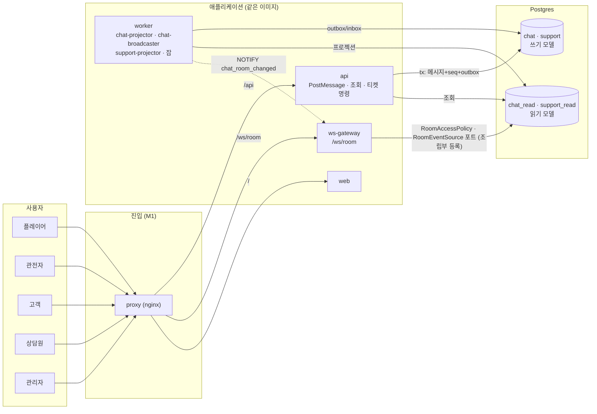

### 2.2 모듈 지도와 의존

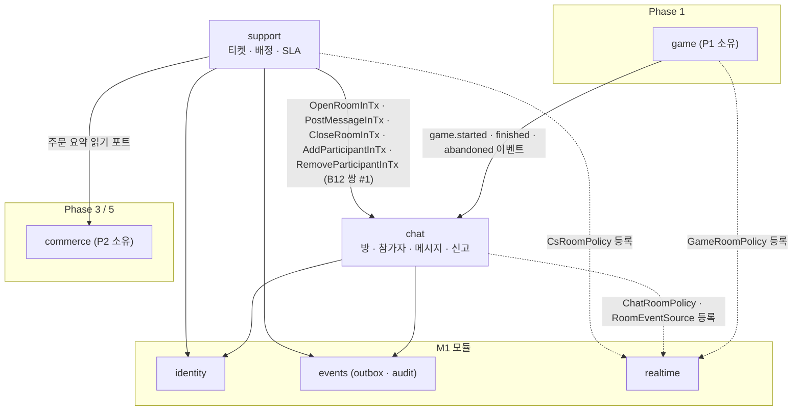

- `chat` 은 `game`·`support` 를 **모른다**(`game → chat`·`chat → support` 모두 금지, P0 §2.4). 방 접근 규칙의 포트 `RoomAccessPolicy` 는 **`realtime`(L2)이 소유**하고(P0 §6.6, 의존 역전), `game`(`GameRoomPolicy`)·`chat`(`ChatRoomPolicy`)·`support`(`CsRoomPolicy`)가 구현을 **조립부(`apps/*/compose`)에서 등록**한다. gateway 는 `chat` 공개 usecase 도 `chat_read` 도 직접 부르지 않고 `RoomRegistry` 의 포트(`RoomAccessPolicy`·`RoomEventSource`·`RoomSnapshotProvider`·`RoomMessageMapper`)만 호출한다.
- `support` 가 `chat` 쓰기를 **같은 트랜잭션 안**에서 해야 하는 경우(티켓 상태 전이 + 메시지·방·참가자)는 **P0 §2.4 B12 허용 쌍 #1**로 푼다. 조율자(L5 `support`): `OpenTicket`·`ClaimTicket`·`ReleaseTicket`·`ReplyTicket`·`ResolveTicket`·`CloseTicket`·`TicketAutoCloser`·`TicketLeaseReaper`. 참여 함수(L3 `chat`): `OpenRoomInTx`·`CloseRoomInTx`·`PostMessageInTx`·`AddParticipantInTx`·`RemoveParticipantInTx`. `…InTx` 는 `TxContext` 를 첫 인자로 받고 새 트랜잭션을 열지 않으며(중첩 `uow.run` 금지 유지), 목록 밖 호출은 CI 가 막는다(`modules/tx-pairs.json`). P0 쌍 #1 의 조율자·함수 목록 갱신은 §21 C3 로 요청한다.

---

## 3. 도메인

### 3.1 방(Room) 종류와 상속

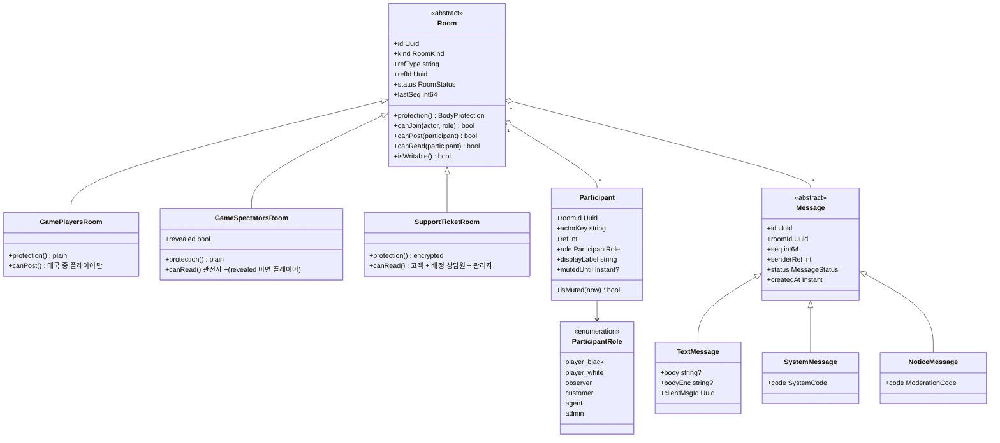

- `RoomKind`: `game_players` · `game_spectators` · `support_ticket`. 방 종류가 **본문 보호 방식**(`plain`/`encrypted`)과 접근 규칙을 정한다.
- `SystemMessage` 는 서버가 만드는 안내(입장·퇴장, "상담원이 배정되었습니다")이고 본문 없이 **코드**만 가진다. 클라이언트가 로케일별 문구로 렌더한다.
- `NoticeMessage` 는 모더레이션 결과 표시("관리자가 메시지를 숨겼습니다") 용 시스템 메시지다.

### 3.2 접근 권한 매트릭스

| 행위 | `game_players` 방 | `game_spectators` 방 | `support_ticket` 방 |
|---|---|---|---|
| 읽기 | 플레이어, **관전자(읽기 전용)** | 관전자, 대국 종료 후(`revealed`) 플레이어 | 고객, 배정 상담원, 관리자 |
| 쓰기 | **대국 중 플레이어만** | 관전자 | 고객, **배정된** 상담원 |
| 신고 | 참가자 누구나(자기 메시지 제외) | 같음 | 고객·상담원 |
| 숨김 | 관리자 | 관리자 | 관리자(상담원은 불가) |
| 뮤트 | 관리자 | 관리자 | 관리자 |
| 대국 종료 후 | 읽기 전용 | 읽기 전용 + 플레이어에게 공개 | `resolved` 까지 쓰기, `closed` 에서 읽기 전용 |

- **D5(치팅 방지)**: 관전자가 플레이어에게 수를 알려 주는 것을 막으려고 `game_spectators` 방은 대국 중 플레이어의 구독을 거절한다. 대국이 끝나면 P1 의 `game.finished` 이벤트로 `revealed = true` 가 되어 플레이어도 읽는다.
  - **이 규칙은 부정 방지 수단이 아니다(검토 반영)**: 관전자는 대국 밖 채널(메신저·음성)로 수를 알려 줄 수 있어 방 비공개로는 막을 수 없다. 비레이팅 대국에서는 **UX 배려(대국 중 상대 방의 잡담이 보이지 않게)** 로 격하하고, **레이팅 대국의 우회 억제는 관전 화면 N수 지연(phases/01 소관, 제안값은 그쪽에서 정한다)** 이 맡는다. 레이팅 대국의 관전 채팅은 종료 시 공개(위)를 유지하고, 관전 지연이 없는 동안은 레이팅 대국 관전 채팅 자체를 읽기 전용 알림으로 두자는 안을 phases/01 에 요청한다
- 쓰기 권한은 **쓰기 모델**(`chat.participant`, `chat.room`)로 판정한다. 구독 권한과 REST 조회·읽음·신고의 인가는 모두 `RoomAccessPolicy.decide(actor, room)`(쓰기 모델 기준: 대국 참가 상태, 티켓의 `customer_user_id`/`agent_user_id`)로 하며 **`participant` 행의 유무에 의존하지 않는다**. 관전자는 **첫 메시지·읽음·신고 때** 참가자 행이 지연 생성된다(§12.2). CS 방은 배정이 풀린 직후 읽기 모델 지연에 기대지 않도록 `CsRoomPolicy` 가 `ticket.agent_user_id` 를 쓰기 모델에서 확인한다.
- 참가자 `ref` 는 **방 범위 불투명 번호**다. 클라이언트에는 행위자 키(`session:`/`user:`)를 노출하지 않는다(PSD 보호, 서버 직렬화 1회 재사용 규칙을 깨지 않으려는 이유도 같다).

### 3.3 역할과 신원
| 역할 | 판정 | 비고 |
|---|---|---|
| 플레이어·관전자 | P1 의 대국 참가·관전 상태 | **U21: 플레이어는 로그인 필수, 익명은 관전자만**이다. 플레이어는 로그인 사용자라 뮤트가 새 세션으로 우회되지 않고, **관전자가 새 익명 세션으로 재입장하는 우회만** 알려진 위험이다(§22) |
| 고객 | **로그인 사용자** | 티켓은 로그인 필요(주문 연동) |
| 상담원 | `AGENT_GITHUB_IDS` 허용목록(숫자 GitHub ID) | M1 `ADMIN_GITHUB_IDS` 와 같은 방식, DB 플래그 없음 |
| 관리자 | `ADMIN_GITHUB_IDS` | M1 과 동일 |

### 3.4 티켓(Ticket) 상태 머신
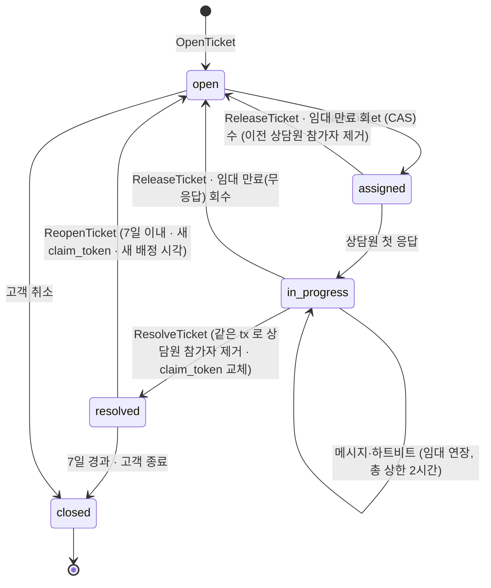
전이 규칙·임대·펜싱은 [ADR-046](../../adr/ADR-046-cs-ticket-and-agent-assignment.md). 티켓의 `order_id` 는 고객 소유 검증 후 연결한다. **회수(reaper)와 `ReleaseTicket` 은 `assigned`·`in_progress` 모두에서** 일어나고 `claim_token` 을 교체한다. **해결(`resolved`)·종료(`closed`) 전이는 같은 트랜잭션에서 담당 상담원을 참가자에서 제거(`RemoveParticipantInTx`)하고 `claim_token` 을 교체**한다 — 해결 뒤에도 열람 권한이 남거나 재오픈이 임대 총 상한(`claimed_at + 2시간`)과 충돌하는 것을 막는다. **재오픈은 `open` 대기열로 돌아가** 일반 `ClaimTicket` 으로 새 토큰·새 `claimed_at`·새 임대를 받는다(이전 상담원 우선 배정은 없다). 같은 상담원의 즉시 재선점은 별도 조항 없이 `open` 으로 돌아온 티켓을 다시 `ClaimTicket` 하는 일반 경로뿐이다.

### 3.5 서비스·정책 클래스

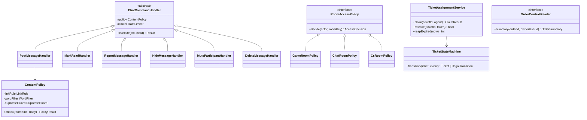

- `RoomAccessPolicy` 인터페이스는 **`realtime` 소유**(P0 §6.6)이며 위 그림은 구현 관계만 보인다. `GameRoomPolicy` 는 `game` 모듈, `CsRoomPolicy` 는 `support` 모듈 소속이다.
- `OrderContextReader.summary(orderId, ownerUserId)` 는 P2 의 공개 읽기 usecase `GetOrderSummaryForSupport(orderId, ownerUserId)` 를 감싼다. **소유자 검증을 P2 가 지원해야** 하며(현재 P2 시그니처에는 소유자 인자가 없다 — 요청 §21 C9), 티켓 접수 때의 `order_not_owned` 판정이 이를 쓴다.

---

## 4. 전달 보장과 정합성

### 4.1 쓰기 경로 (PostMessage)

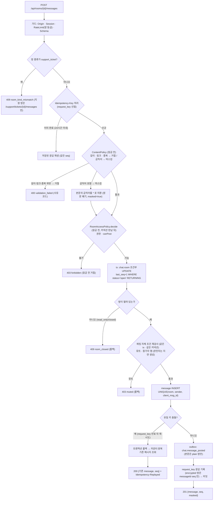
- **방 행 잠금 중에는 다른 커넥션을 쓰지 않는다(검토 반영, P0 R7)**: 방 행을 잠근 채 `RoomAccessPolicy`(P1 대국 참가 상태 등 타 모듈 조회가 풀에서 별도 커넥션을 잡는다)를 부르면 풀이 작을 때 잠금 보유 요청들이 서로 커넥션을 기다리며 풀 교착이 생길 수 있다. 그래서 **정책 판정은 잠금 전**(ContentPolicy 와 같은 단계)에 하고, 잠금 안에서는 **채팅 자체 조건만 같은 tx 로 재검사**한다 — 방 열림(UPDATE 조건)·뮤트·참가자 행. 정책 판정과 잠금 사이에 권한이 바뀌는 틈은 `game.finished` 등 상태 이벤트가 방을 닫는 쪽(조건부 UPDATE)이 최종 심판이라 허용한다. 시험 CH-AC16: 풀 크기 2에서 동시 전송 3건이 교착 없이 모두 완료되거나 거절된다.
- 방 행 잠금(`UPDATE … WHERE status='open' RETURNING last_seq`)은 **조건부 UPDATE** 이므로 "닫힌 방에 쓰지 않는다"는 검사와 순번 부여를 한 문장으로 한다(ADR-021 1번).
- **정책 판정(`ContentPolicy`)은 방 잠금 이전**에 한다(불필요한 순번 소모·잠금 보유를 막는다). 길이·링크·중복은 거절이고 **금칙어(U17)는 거절하지 않고 마스킹**한다 — 서버가 금칙어를 `*` 로 치환한 본문으로 계속 진행하며, 이후 모든 경로(저장·outbox·push·재생·읽기 모델·`request_key` 응답)에는 치환된 본문만 흐른다(§6.2). 중복 판정 `DuplicateGuard` 는 "10초 안 같은 본문" 휴리스틱일 뿐이고, **정확한 심판은 유일 키**다.
- **seq 구멍 방지(검토 반영)**: 방 카운터를 올린 *뒤* 유일 키 충돌이 나면 카운터만 오른 채 커밋될 수 있다. 그래서 충돌을 감지하면 **트랜잭션을 롤백(카운터 원복)하고 기존 메시지를 별도로 조회해 응답**한다. 이 경로는 `request_key` 가 24시간 뒤 만료된 후 같은 `client_msg_id` 가 다시 올 때 생긴다. 이렇게 하면 방 `seq` 는 어떤 경로에서도 연속이고, 클라이언트의 gap 검사(§4.6)는 구멍을 영원히 gap 으로 보는 일이 없다.

### 4.2 순번 설계 평가 (요약 — 상세 ADR-045)
- M1 의 `change_log` 채널 카운터는 **소비자(broadcaster)** 가 부여한다. 채팅에 그대로 쓰면 순번이 **전달 순서**이고 보관이 1시간이라 방 이력 재개에 부족하다.
- 채택안은 **명령 쪽 방 카운터**다. 순번이 작성 순서의 정본이고, 쓰기 모델의 `room.last_seq` 가 `head` 의 정본이며, 영속 읽기 모델이 재개 본문 원본이 된다(읽기 모델 지연은 §4.6 규칙으로 흡수). 대가는 방 단위 쓰기 직렬화이며 방당 쓰기율이 낮아 문제가 없다(§20).

### 4.3 멱등과 중복 방지
| 계층 | 장치 |
|---|---|
| HTTP | `Idempotency-Key` + `request_key`(24시간, M1 규칙). 같은 키·같은 요청 → 같은 응답 재생 |
| 도메인 | `client_msg_id` = `Idempotency-Key`. `UNIQUE (room_id, sender_key, client_msg_id)` 가 최종 심판. `request_key` 만료 뒤 충돌은 **롤백 후 기존 메시지 반환**(§4.1) |
| 요청 지문 | `request_key.request_hash` 는 **서버 비밀 키 HMAC-SHA256**(`<kid>:<hex>`, 키 회전은 현재+직전 2개·직전 키는 보관 24시간+1시간 뒤 폐기, database-schema `request_key`)이다. **encrypted 방(CS)은 본문을 지문에 넣지 않고 `roomId·clientMsgId·길이` 만 쓴다**(본문 변경 감지는 `UNIQUE (room_id, sender_key, client_msg_id)` 충돌 시 기존 행의 `messageId` 반환으로 갈음). 비밀 키는 DB·백업에 없고 `request_key` 는 백업에서 제외한다(features/17 에 요청) |
| 응답 재생 | encrypted 방(CS)의 `request_key.response_body` 는 **`{messageId, seq}` 만** 저장한다(평문 본문이 24시간 DB 에 남는 것을 막는다, database-schema §9.1). 재생 시 본문이 필요하면 클라이언트가 REST 조회로 가져온다 |
| 전달 | outbox/inbox 의 `(consumer, message_id)` 유일 키(ADR-020) |
| 표시 | 클라이언트는 `messageId`/`seq` 로 중복 제거(자기 전송 응답과 푸시가 겹침) |

### 4.4 시퀀스 — 정상 전송과 푸시

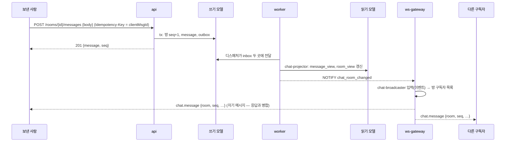
`chat-broadcaster` 는 worker 의 inbox 소비자이고 gateway 는 `NOTIFY` 로 깨어나 푸시용 메시지를 가져간다(M1 F14 구조 재사용). 푸시 본문은 **방 순번을 이벤트에서 그대로** 쓴다. **CS 방은 `chat.notice {room, seq}` 알림만** 보내고 본문은 REST 로 가져온다(§7.3).

### 4.5 시퀀스 — 중복 전송 (네트워크 재시도)
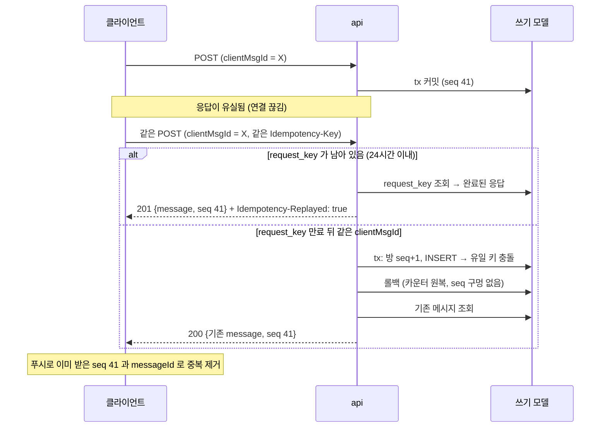

### 4.6 시퀀스 — 재접속과 재개

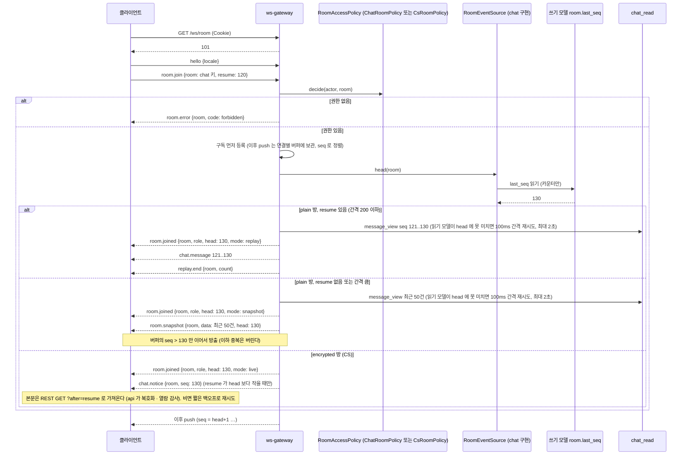
- **구독을 먼저 등록하고 나서** `head` 를 읽는다. `head` 이하는 쓰기 모델에 이미 있으므로 읽기 모델이 따라잡는 대로 재생하고, `head` 초과는 구독 후 push 로 들어온다 → 두 구간 사이에 빠지는 메시지가 없다(검토 R3 #4).
- **읽기 모델 지연**: `chat-broadcaster` 와 `chat-projector` 는 서로 다른 소비자라 push 가 읽기 모델 투영보다 앞설 수 있다. 재생이 `head` 에 못 미치면 gateway 가 100ms 간격으로 최대 2초 재시도하고, 그래도 모자라면 **뒤처진 스냅샷·재생을 내보내지 않고** `room.error {room, code: unavailable, fatal: true}` + close `4500`(클라이언트 지수 백오프+지터 재접속)으로 거절한다 — `head` 를 알려 주고 가진 만큼만 보내면 클라이언트가 이미 `head` 까지 받았다고 믿어 그 사이 메시지가 영구 누락될 수 있어서다(방명록 RT-05 와 같은 방식, features/14). **replay·snapshot 두 모드가 같은 계약**이고, 대국 룸(phases/01)도 같다. 이 거절은 지표 `pf_ws_snapshot_catchup_timeout_total` 로 센다. REST `GET ?after=` 의 빈 응답(투영 지연)은 클라이언트가 짧은 백오프(250ms→1s, 최대 5회)로 재시도한다.
- **유휴 누락 감지**: 룸 연결의 25초 `hb` 에 구독 중인 plain 방의 현재 `head` 를 싣는다(`hb { heads: { <room>: head } }`, encrypted 방 포함 — 알림 전용 방은 `chat.notice` 누락 감지에 쓴다). 클라이언트는 마지막 `seq` < `head` 면 gap 으로 보고 `room.join { resume }` 을 다시 보낸다. 대국 룸의 `clock` 메시지도 같은 이름 `head` 를 싣는다(phases/01). **이미 구독 중인 방에 `room.join` 을 다시 보내면** 구독(구독자 집합)을 그대로 둔 채 `resume` 이 있으면 그 이후를 재생하고 없으면 `room.snapshot` 을 다시 보낸다(해시 불일치·순번 공백 때의 재동기화 요청 — phases/01 §5.3 과 같은 규칙)
- **CS(encrypted) 방은 알림 전용**이다: gateway 는 본문을 읽지도 보내지도 않는다(키가 없다). 재개에서도 `room.joined{head}` 와 `chat.notice` 만 보낸다.
- 클라이언트는 방별로 `seq` 연속성을 검사하고(건너뛰면 `room.join { resume }` 재요청) 중복 `seq` 는 무시한다(M1 `SeqTracker` 방별 확장).
- 재생 상한은 한 번에 200건(제안). 더 놓쳤으면 스냅샷으로 대체하고 위쪽 이력은 REST `GET …?before=` 로 가져온다.
- 재생·스냅샷 원천은 `RoomEventSource.after`·`RoomSnapshotProvider` 구현이다. 도메인이 자체 순번 로그를 가진 룸이므로 `room_log`/`room_seq` 를 쓰지 않는다(P0 §6.4). `head` 를 쓰기 모델에서 읽는 것은 카운터 한 값만이며 P0 §2.4 에 등재할 문서화된 CQRS 예외 **X2** 다(대국의 `game_event` 읽기와 같은 성격, §21 C10).

### 4.7 권한 없는 구독 시도와 강제 퇴출
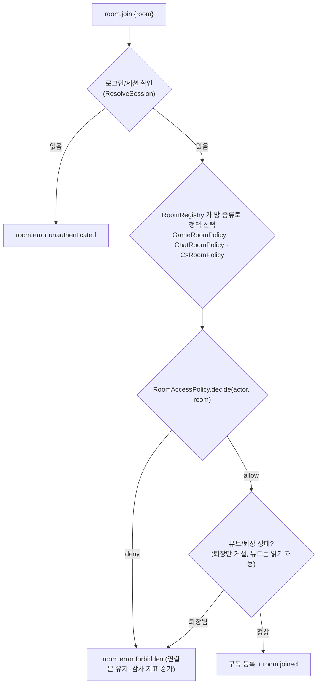
- **강제 퇴출**: `chat.participant_removed`·`chat.room_closed`·`game.finished(revealed 변경)` 이벤트를 gateway(`RoomRegistry` 경유)가 받으면 정책을 **재판정**하고 실패 시 `room.closed {room, reason}` 으로 구독을 해제한다. 이벤트를 놓치는 경우를 대비해 **30초마다 구독 권한을 재검증**한다(M1 세션 재검증과 같은 주기). 배정이 풀린 이전 상담원은 `CsRoomPolicy` 가 쓰기 모델의 `ticket.agent_user_id` 로 판정하므로 읽기 모델 지연과 무관하게 막힌다.
- 구독 거절은 **연결을 끊지 않는다**(`room.error` 만). 반복 거절은 속도 제한(`room.join` 초당 5회, 초과 시 `4429`, P0 §6.8)과 감사 지표(`pf_chat_join_denied_total`)로 본다.

### 4.8 방별 팬아웃과 백프레셔
- gateway 는 `RoomHub`(방 id → 구독 연결 집합)을 두고 **같은 메시지를 직렬화 1회**(M1 D8)로 구독자에게 보낸다.
- 연결별 `SendQueue`(64건/256KB, M1 규칙)가 그대로 적용되고 초과 시 `4408` 로 격리한다. **단 `room.join` 재생(최대 200건)은 이 큐를 거치지 않고** 드레인 기반 별도 경로(features/14 RT-06)로 보내며, 클라이언트는 지수 백오프+지터로 재접속하고 연속 `4408` 이면 `resume` 없이 스냅샷 모드로 간다(재생이 큐 상한을 넘겨 재접속 루프에 빠지는 것을 막는다). 채팅 메시지는 **합치지 않는다**(덮어쓰기 의미가 없다). 반응 합치기와 달리 모든 메시지가 의미를 갖기 때문이다.
- 큰 방 한계(제안): P0 §6.8 의 룸별 상한(제안 200) 이내에서 대국 방 관전자 **최대 100명**, CS 방 참가자 3명 이하(고객 + 상담원 + 관리자 열람 시 일시). 한도 초과 입장은 `room.error room_full`.

---

## 5. 히스토리 조회와 읽기 모델

### 5.1 읽기 모델 (CQRS, `chat_read` / `support_read`)
| 테이블 | 키 | 용도 |
|---|---|---|
| `chat_read.message_view` | PK (`room_id`, `seq`) | 이력 조회·재생. `status` 와 `status_seq` 로 숨김·삭제 반영(삭제는 `body`·`body_enc` 를 비움) |
| `chat_read.room_view` | PK `room_id` | `head_seq`, `status`, `revealed`, 마지막 메시지 시각 |
| `chat_read.participant_view` | PK (`room_id`, `actor_key`) | 구독 권한 판정, `last_read_seq`, `muted_until` |
| `support_read.ticket_view` | PK `ticket_id` | 고객·상담원 목록, 상태, 마지막 활동 |
| `support_read.agent_queue_view` | PK `ticket_id` | 대기열(`status='open'`) 조회 |

### 5.2 조회 계약
| 경로 | 설명 |
|---|---|
| `GET /api/rooms/{id}/messages?before=<seq>&limit=50` | 과거 방향 키셋 페이지. `before` 없으면 최신 |
| `GET /api/rooms/{id}/messages?after=<seq>` | 최신 방향(재개·알림 후 가져오기). 상한 200 |
| `GET /api/rooms/mine` | 내 방 목록 + 읽지 않은 개수(`room_view.head_seq - participant_view.last_read_seq`) |
| `POST /api/rooms/{id}/read {seq}` | 읽음 표시. 클라이언트가 합쳐서(예: 2초 디바운스) 보낸다 |

- **인가**: 위 경로의 접근 판정은 `RoomAccessPolicy.decide(actor, room)` 이며 `participant` 행이 없는 관전자도 읽기·읽음·신고를 할 수 있다(읽음·신고 때 참가자 행을 지연 생성, §12.2).
- **CS 방**: `GET …/messages` 는 api 가 `body_enc` 를 복호화해 돌려주고 `no-store` 이며, 응답 시 **열람 세션당 1회** 감사 기록한다(§6.4). 읽기 모델 투영이 `chat.notice.seq` 보다 늦으면 빈 결과가 올 수 있고, 클라이언트는 짧은 백오프로 재시도한다(§4.6).
- **읽지 않은 개수**는 쓰기 시점에 세지 않고 두 읽기 모델의 차이로 **계산**한다(쓰기 증폭 방지).
- `chat.read_marked` 이벤트는 투영 지연을 허용하는 **저우선**이다(유실되어도 다음 읽음 표시가 덮어쓴다 — 단조 증가 값이라 `WHERE last_read_seq < $seq` 로 안전).

### 5.3 읽기-내-쓰기
전송 응답이 `message` 전체를 돌려주므로 보낸 사람은 즉시 표시한다. 푸시로 같은 `messageId` 가 오면 **병합(교체)** 한다(M1 ADR-018 규칙). CS 방의 즉시 응답은 평문 본문을 포함하되 `no-store` 이고 **`request_key` 에는 저장하지 않는다**(재생 응답은 `{messageId, seq}` 만 — 본문은 REST 조회).

---

## 6. 모더레이션과 남용 방어

### 6.1 속도 제한 등급 (초기값 제안 — 트래픽 미측정, 측정 후 조정, 03 §1.1 의 표에 추가 필요)
메시지 신고는 새 등급을 만들지 않고 **M1 의 `write.report`**(03 §1.1)를 재사용한다.
| 등급 | 대상 | 보충 속도 | capacity | 추가 창 |
|---|---|---|---|---|
| `write.chat.players` | 대국 플레이어 채팅 | 30건/분 | 5 | 400건/시간 |
| `write.chat.spectators` | 관전자 채팅 | 15건/분 | 3 | 150건/시간 |
| `write.chat.read` | 읽음 표시 | 30건/분 | 10 | — |
| `write.support.open` | 티켓 접수 | 3건/시간 | 3 | 열린 티켓 상한 3 |
| `write.support.customer` | CS 고객 메시지 | 20건/분 | 5 | 200건/시간 |
| `write.support.agent` | 상담원 메시지·전이 | 60건/분 | 20 | — |
| WS `typing` | 방별 상태 표시 | 서버가 방당 3초에 1건만 수용 | — | 초과분 조용히 버림 |
| WS `room.join` | 구독 | 연결당 초당 5회 (P0 §6.8) | — | 초과 시 `4429` |

### 6.2 콘텐츠 정책 (`ContentPolicy`)
| 항목 | 대국 채팅 | CS 채팅 |
|---|---|---|
| 길이 | 1~300자(코드포인트, NFC), 5줄 | 1~1000자, 20줄 |
| 링크 | 자동 링크 금지(텍스트로만 렌더), URL 패턴 포함 시 거절(제안) | 허용(텍스트로 렌더, 자동 링크 금지) |
| 금칙어 | **마스킹(U17 확정)**: 설정 목록에 든 단어를 서버가 `*` 로 치환(아래 규칙). 거절하지 않는다. 초기 목록은 구현 시 사용자가 제공(`[사용자 제공 예정: 금칙어 초기 목록]`, 목록이 비면 이 규칙은 통과와 같다) | 적용하지 않음 |
| 중복 | 같은 발신자가 10초 안에 같은 본문 → 거절 | 적용하지 않음 |
| 렌더 | 텍스트 전용(HTML·마크다운 해석 없음, XSS 방지 ADR-008) | 같음 |

**금칙어 마스킹 규칙 (U17, 제안)**

| 항목 | 규칙 |
|---|---|
| 치환 | 일치한 구간의 **코드포인트마다 `*` 1개**(3글자 단어 → `***`, 길이 보존). 치환 뒤에도 길이·줄 수가 변하지 않으므로 길이 판정은 치환 전후 같다 |
| 비교 방식 | 비교용 정규화 사본(NFC, 대소문자 접기, 제로폭 문자 제거)에서 찾고, 일치 구간을 **원문 오프셋으로 되돌려** 치환한다. 비교용 사본은 메모리에서만 쓰고 저장하지 않는다 |
| 원문 | **저장하지 않는다**(제안). `message.body`·읽기 모델·outbox·push·`request_key.response_body`·로그 어디에도 치환 전 본문이 없다. 남기는 것은 `message.masked`(boolean)와 지표뿐이다 |
| 응답 | `201 {message(치환된 본문), seq, masked}` — 클라이언트는 `masked=true` 일 때 "일부 단어가 가려졌습니다"를 보여 준다. 낙관적 표시를 한 클라이언트는 응답의 본문으로 교체한다 |
| 멱등 | `request_hash` 는 요청 본문(치환 전)을 **서버 비밀 키 HMAC**(§4.3)으로 서명해 계산하고(키 없는 해시는 덤프에서 금칙어·원문이 사전 대입으로 역산된다), 재생은 **저장된 치환 결과**를 돌려준다. 목록이 바뀌어도 이미 저장된 메시지를 **소급 치환하지 않는다** |
| 중복 판정 | `DuplicateGuard` 는 치환 후 본문으로 비교한다(원문 해시를 따로 두지 않는다). 다른 금칙어를 번갈아 보내도 같은 본문으로 보일 수 있으나 속도 제한이 보완한다 |
| 우회 | 띄어쓰기·특수문자 삽입·자모 분리·비슷한 글자 치환은 **막지 않는다**(범위 밖). 신고(§6.3)와 관리자 숨김·뮤트로 보완한다 |

**위험 — 마스킹과 증거 보존의 균형.** 원문을 저장하지 않으면 개인정보 노출은 줄지만 신고 처리자는 **치환된 본문만** 본다. 따라서 ① 우회형 욕설은 애초에 치환되지 않아 그대로 신고 스냅샷에 남지만, ② 치환된 메시지는 무엇이 쓰였는지 복원할 수 없어 "금칙어를 반복 시도하는 사용자"를 본문으로 판정할 수 없고(`masked` 건수로만 추정), ③ 정상 단어가 목록에 걸린 **오탐**도 사용자가 원문을 확인·정정할 수 없다. 완화는 `masked` 플래그와 사용자별 마스킹 횟수 지표, 신고 시 앞뒤 5건 스냅샷(치환본)이다. 원문을 짧게(예 7일, ENC) 보관하는 안은 PUB 등급 가정과 보관 최소화 원칙을 깨고 키 회전 대상이 늘어 **채택하지 않았다** — 모더레이션 한계가 문제로 드러나면 재검토한다(§23).

### 6.3 신고 → 관리자 처리 (시퀀스)
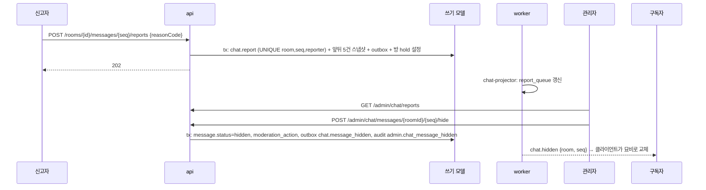
- 신고 시 **앞뒤 5건 스냅샷**을 보존하고 방에 `hold` 를 걸어 보관 정리(§7.4)가 증거를 지우지 않게 한다.
- **`hold` 해제**: `ResolveChatReport` 가 그 방의 **미처리 신고가 0건**이 되는 순간 `hold=false` 로 되돌리고 `purge_after` 를 `max(기존, 처리 시각 + 보관 기간)` 으로 다시 계산한다(처리 후에도 스냅샷은 `ReportSnapshotRule` 이 90일 뒤 정리).
- CS 방 신고 스냅샷(`snapshot_enc`)은 암호화된 채로 보존한다(관리자만 복호화, 열람 감사).
- 숨김은 삭제가 아니라 `status` 변경이며 `seq` 는 유지된다(재개 시 묘비로 전달).

### 6.4 뮤트·차단·감사
- 관리자 뮤트: `participant.muted_until` 를 조건부 갱신(`version`). 뮤트된 참가자의 전송은 `403 muted` + `Retry-After`.
- 사용자 간 차단(로컬 숨김)은 **클라이언트 측**으로만 시작한다(서버 팬아웃 필터를 만들면 직렬화 1회 규칙이 깨진다).
- 감사 action(ADR-027 확장 제안): category 는 모두 기존 `admin`(보관 90일)이다. `admin.chat_message_hidden`, `admin.chat_message_deleted`, `admin.chat_participant_muted`, `admin.chat_participant_unmuted`, `admin.chat_report_resolved`, `admin.support_conversation_opened`(상담원·관리자의 CS 대화 열람), `admin.support_ticket_claimed`·`released`·`resolved`. **`actor_role` 열거에 `agent`(그리고 P3 의 `operator`)를 추가**한다(ADR-027, M1 변경 C4). P0 §9.4 도 같은 이름 `admin.support_conversation_opened` 를 쓴다(통일 완료).
- **열람 감사의 단위**: `GET …/messages` 마다가 아니라 **대화 열람 세션당 1회**다 — 같은 `(actor, room)` 의 첫 복호화 조회에서 1행을 쓰고 이후 30분간(제안) 같은 행위자의 재조회는 기록하지 않는다(알림마다 `audit_log` 가 쏠리지 않게). 열람 감사는 읽기 usecase 가 여는 **짧은 쓰기 tx**(ADR-025 예외, M1 `report_note_read` 와 같은 패턴)다.

---

## 7. 개인정보·보관·암호화 (ADR-047)

### 7.1 등급 분류
| 데이터 | 등급 | 이유 |
|---|---|---|
| 대국 채팅 본문 | **PUB** | 대국 방 접근자 누구에게나 보임 |
| CS 채팅 본문 | **ENC** | 이름·주소·주문 정보 등이 섞임(ADR-026 재검토 조건 충족) |
| 발신자 행위자 키, 참가자 키 | PSD | 방 범위 `ref` 로만 노출 |
| 표시 이름 스냅샷(`display_label`) | PII | 사용자 표시 이름 |
| 티켓 제목 | 제목 자유 텍스트 금지 → `subject_code` 열거(**SYS**) | 개인정보 입력 경로 최소화 |
| 주문 id | PSD | 식별자 |
| 참가자 `actor_key`, 메시지 `sender_key`, 신고자 `reporter_key` | PSD | 세션 키(`session:`)는 세션 만료 시 **익명화 대상**(아래) |
| 신고 스냅샷 `snapshot_enc`(CS 방) | **ENC** | 신고 앞뒤 대화 복사본 |

**세션 키 익명화**: 세션은 7일이면 삭제되는데 채팅 보관은 대국 30일·CS 1년·신고 스냅샷 90일이다. 그래서 `chat` 이 `AnonymizeSessionData` 를 등록한다(ID-10 `PurgeExpiredSessions` 가 호출): `participant.actor_key`·`message.sender_key`·`report.reporter_key` 의 `session:` 값을 행마다 `purged:<uuid>` 로 교체하고 `chat_read.participant_view.actor_key` 를 같은 방식으로 정리한다(읽기 모델을 이벤트 없이 직접 쓰는 예외, §21 C5). 멱등 유일 키는 행마다 다른 값이라 충돌하지 않는다.

### 7.2 CS 본문 암호화와 키 경계
- 쓰기: api 가 `FieldCipher.encrypt(body, "chat.message.body_enc:<messageId>")` 로 암호화해 저장한다. 이벤트·outbox·푸시·`request_key` 응답에 본문은 없다.
- 읽기: REST 조회 usecase(api)가 복호화한다. **KEK/DEK 키 재료는 api·worker 에만** 있고 ws-gateway 에는 없다(설정 스키마 시험으로 강제, P0 §9.3 체크리스트 ⑦).
- 읽기 모델 `message_view.body_enc` 는 암호문 그대로 복사한다(투영기는 복호화하지 않는다).
- **키 방식**: Phase 6 시점에는 P0 D13 의 KEK/DEK 상향이 이미 끝났다(ENC 가 3개 이상이 될 예정이므로 Phase 5 착수 직전 선제 상향). 봉투는 `v2.<dekId>.<base64url(iv ‖ ct ‖ tag)>` 이고 키는 `KEK_KEYS_FILE` 유래 DEK 다(M1 의 `FIELD_KEYS`/v1 봉투 서술은 상향 전 설명). AAD 는 그대로 `chat.message.body_enc:<messageId>`.
- **ENC 필드**: `chat.message.body_enc`(+ 읽기 사본 `chat_read.message_view.body_enc`)와 `chat.report.snapshot_enc` 둘 — P0 §9.5 통합표 #6·#7(ENC 이름은 3단 `<schema>.<table>.<column>`). 둘 다 **키 회전 대상**이며(`rotate-field-keys --field` 레지스트리에 `chat.message.body_enc`·`chat.report.snapshot_enc`), 통합표 기준으로 KEK/DEK 상향 조건은 **이미 충족**이다(채팅이 필드를 늘린 것이 근접이 아니라 충족에 기여).

### 7.3 푸시 방식 (방 종류별)
| 방 | `chat.message` 푸시 | 이유 |
|---|---|---|
| `game_*` (plain) | **본문 포함** | 공개 데이터, 재조회 불필요, 지연 최소 |
| `support_ticket` (encrypted) | **알림만** `chat.notice {room, seq}` (재개·스냅샷 모드에서도 동일: `room.joined{head}` + 알림) | gateway 에 키를 두지 않기 위해. 클라이언트가 `GET …?after=` 로 가져오며 api 가 복호화·감사 |

### 7.4 보관·삭제
| 데이터 | 제안 보관 | 정리 |
|---|---|---|
| 대국 채팅(`message`, 읽기 모델) | 대국 종료 + **30일** | 방 단위 배치 삭제(ADR-025). `hold`(신고) 방은 제외 |
| CS 티켓·메시지 | 종료 + **1년** (법적 보관 의무는 **법무 검토 필요·미확인**) | 같음 |
| 신고 스냅샷 | 처리 후 90일 | 증거, 처리 후 삭제 |
| `chat.read_marked` 등 이벤트 | outbox 7일 | 일반 규칙 |
| 읽기 모델의 이벤트 없는 삭제·세션 키 정리 | — | database-schema §9 예외 목록에 추가 필요(M1 변경 C5) |

**삭제 경로(`DeleteMessage`, CH-23)**: 발신자 본인(또는 관리자)이 `DELETE /api/rooms/{roomId}/messages/{seq}`(CS 방은 `DELETE /api/support/tickets/{id}/messages/{seq}`)로 요청한다. 한 트랜잭션에서 `message.body`/`body_enc` 를 **NULL 로 비우고** `status=deleted`, `deleted_at` 을 기록하고 발신자 연결(`sender_key`)을 `purged:<uuid>` 로 끊으며 `chat.message_deleted` 를 발행한다. 스키마 `CHECK` 는 `status='deleted'` 일 때 본문 컬럼이 모두 NULL 인 것을 허용한다(§11.1). 투영기는 `message_view` 의 본문을 비우고 `status_seq` 를 올리며, gateway 는 `chat.deleted {room, seq}` 로 클라이언트가 묘비로 교체하게 한다. **`hold` 방(신고 보류)·법적 보존 대상은 거절**하고 사유를 기록한다(정책은 법무 검토 후, 미확인). 대국 채팅도 같은 경로로 본인 메시지를 삭제할 수 있고(PUB 이라도 개인정보가 섞였을 때), 그 메시지의 신고 스냅샷(`snapshot_enc`)에는 삭제가 소급되지 않는다(증거 보존, 처리 후 90일 뒤 삭제).

**신고 전 삭제의 증거 소실 방지(검토 반영)**: 가해자가 신고 전에 삭제하면 증거가 사라진다. 그래서 `DeleteMessage` 는 같은 트랜잭션에서 plain 방 메시지의 `body`(이미 마스킹된 값)를 **기존 ENC 필드 `message.body_enc` 로 암호화해 옮기고 `quarantine_until = now() + 72시간`(제안)을 기록**한다(새 ENC 필드를 만들지 않는다 — P0 §9.5 통합표 불변. CS 방은 이미 `body_enc` 이므로 `quarantine_until` 만 기록). `status='deleted'` 묘비라도 격리 기간에는 `body_enc` 만 NOT NULL 을 허용한다. 격리본은 클라이언트·읽기 모델(`message_view` 는 비운다)·푸시·이벤트에 나가지 않고 관리자 신고 처리 화면만 열람 감사와 함께 복호화한다. 72시간 안에 신고가 접수되면(삭제된 메시지를 포함한 앞뒤 5건) 격리본을 신고 스냅샷으로 **승격**(대국 방은 `snapshot` 평문, CS 방은 `snapshot_enc`)하고 `hold` 규칙을 따르며, 신고가 없으면 정리 배치가 `quarantine_until` 이후 `body_enc` 를 NULL 로 만든다. 사용자에게는 "삭제 즉시 노출 중단, 신고 대비 72시간 보관 후 영구 삭제"를 고지한다. 보관 기간 72시간은 제안이며 법무 검토 후 확정한다

### 7.5 로그·감사
채팅 본문·표시 이름은 로그에 남기지 않는다(`room_id`·`seq` 는 허용). CS 대화 열람은 **열람 세션당 1회** 감사 기록한다(§6.4).

---

## 8. 첨부 파일 — 범위 밖
| 판단 | 근거 |
|---|---|
| **범위 밖(M1~Phase 6 전체)** | 업로드 저장소·악성 파일 검사·이미지 처리·개인정보(영수증 사진 등)·CSP/다운로드 헤더·용량 비용이 모두 새로 생긴다. 무료 단일 호스트 원칙에 맞지 않고 "백엔드 역량 증명" 목적에서 이득이 작다 |
| 대안 | CS 에서 증빙이 필요하면 텍스트로 주문 번호·상황을 적게 하고, 상담원은 주문 요약(읽기 포트)을 본다 |
| 재검토 | Phase 6 이후 사용자 요구가 생길 때 별도 ADR(오브젝트 스토리지, ADR-016 순서에 후보 없음) |

---

## 9. presence 와 typing
- 방 접속자 수(`room.presence {room, spectators, players}`, P0 §6.3 과 같은 모양)와 `room.typing {room, ref}` 는 **휘발성 메시지**다: 순번 없음, DB 에 쓰지 않음, 재개 시 최신값만(M1 `VolatileMessage` 규칙).
- `typing {room}` 은 클라이언트→서버 인바운드(M1 "WS 읽기 전용"의 예외, ADR-045). 서버는 방당 3초에 1건만 수용하고 같은 방 구독자에게 전달한다. 권한이 없는 방의 `typing` 은 무시한다.
- **`typing` 은 임대를 연장하지 않는다**(DB 쓰기가 없는 휘발성 신호이고 gateway 에는 쓰기 경로가 없다). 임대 연장은 REST 메시지 전송 또는 상담원 하트비트(`POST /api/agent/tickets/{id}/heartbeat`)로만 하며 총 상한이 있다(§16, ADR-046).
- **presence 는 `realtime` 모듈이 소유**한다(P0 D19·§6.9, `PresenceCounter` 포트). 채팅은 방 접속자 수를 `GetRoomPresence` 로 **읽어 표시만** 하고 증감하지 않는다. 대국 방의 관전자 수·플레이어 접속 상태도 같은 값이다(중복 구현 없음).

---

## 10. 알림 (오프라인 사용자)
이메일을 수집하지 않으므로(ADR-008) 가능한 수단과 판정은 다음과 같다.

| 수단 | 대상 | 판정 |
|---|---|---|
| 앱 내 읽지 않음 표시 | 고객 | **채택**. `GET /api/rooms/mine` 의 읽지 않은 개수, 접속 시 배지 |
| Web Push(VAPID, 서비스 워커) | 고객 | **선택(Phase 6 후반)**. 무료, 브라우저 권한 필요, 구독 토큰이 PII 에 준하므로 `ENC` 후보. 지원·동작은 **미확인** |
| Discord 운영 채널 | 운영자(상담원) | **채택**. 새 티켓 접수 시 `subject_code` 와 티켓 번호만 알림(개인정보·본문 금지). ADR-027 후속 결정의 Discord 연락처 재사용 |
| 이메일·SMS | 고객 | 범위 밖(수집하지 않음) |

---

## 11. 데이터 모델

database-schema.md 형식을 따른다. 컬럼 전수가 아니라 **핵심 테이블·제약·인덱스·보호 등급·보관**이다. `chat`·`support` 는 각자 inbox 와 `request_key` 를 갖는다(M1 규칙, 공통 컬럼은 §4-5 참조).

### 11.1 `chat` (쓰기)
**`room`**
| 컬럼 | 설명 | 등급 |
|---|---|---|
| `id` uuid PK | | SYS |
| `kind` | `game_players` / `game_spectators` / `support_ticket` | SYS |
| `ref_type`, `ref_id` | 소속(`game`/`ticket`)과 id | SYS |
| `protection` | `plain` / `encrypted` (kind 에서 정해짐) | SYS |
| `status` | `open` / `read_only` / `closed` | SYS |
| `last_seq` bigint | 방 순번 카운터(기본 0) | SYS |
| `revealed` boolean | 관전자 방을 플레이어에게 공개 | SYS |
| `hold` boolean | 신고·분쟁 보류(정리 제외) | SYS |
| `version`, `created_at`, `closed_at`, `purge_after` | | SYS |
- UNIQUE (`ref_type`, `ref_id`, `kind`). 인덱스 `(purge_after) WHERE hold = false AND purge_after IS NOT NULL`.

**`participant`**
| 컬럼 | 설명 | 등급 |
|---|---|---|
| `room_id`, `actor_key` PK | 행위자 키. 세션 만료 시 `purged:<uuid>` 로 익명화(§7.1). **관전자는 첫 메시지·읽음·신고 때 지연 생성**되므로 행이 없어도 접근은 `RoomAccessPolicy` 가 판정한다 | PSD |
| `ref` smallint | 방 범위 번호, UNIQUE (`room_id`, `ref`). **익명 관전자는 방 안의 공유 번호 풀(초기 200, 제안)에서 활성 동안만 빌려 쓰고 세션이 끊기면 반납**해 새 익명 세션 남발이 번호·행을 무한히 늘리지 못한다. 풀이 차면 새 익명 관전자는 읽기 전용이다 | SYS |
| `role` | `player_black` 등 | SYS |
| `display_label` | 표시 이름 스냅샷 | PII |
| `muted_until`, `joined_at`, `left_at`, `version` | | SYS |

**`message`**
| 컬럼 | 설명 | 등급 |
|---|---|---|
| `id` uuid PK, `room_id` FK | | SYS |
| `seq` bigint | 방 순번 | SYS |
| `participant_ref` smallint | 보낸 참가자 | SYS |
| `sender_key` | 행위자 키(멱등 유일 키용). 세션 만료·삭제 요청 시 `purged:<uuid>` | PSD |
| `kind` | `text` / `system` / `notice` | SYS |
| `body` text | plain 방의 본문(금칙어는 `*` 로 치환된 뒤 값, 원문은 저장하지 않음 — §6.2) | PUB |
| `masked` boolean | 금칙어 치환이 있었는지(기본 false, 본문 복원 불가) | SYS |
| `body_enc` text | encrypted 방의 AES-256-GCM 봉투. 삭제된 plain 방 메시지의 **72시간 격리본**도 같은 필드에 둔다(`quarantine_until` 이전까지, §7.4) | **ENC** |
| `quarantine_until` timestamptz | 삭제 격리 만료(NULL = 격리 없음). 인덱스 `(quarantine_until) WHERE quarantine_until IS NOT NULL` | SYS |
| `client_msg_id` uuid | 멱등 키(시스템 메시지는 NULL) | SYS |
| `status` | `visible` / `hidden` / `deleted`(묘비: 본문 컬럼이 모두 NULL) | SYS |
| `created_at`, `hidden_at`, `deleted_at` | | SYS |
- UNIQUE (`room_id`, `seq`); UNIQUE (`room_id`, `sender_key`, `client_msg_id`) WHERE `client_msg_id IS NOT NULL`.
- CHECK: `kind <> 'text' OR status = 'deleted' OR ((body IS NULL) <> (body_enc IS NULL))` — 삭제(`status='deleted'`)된 묘비는 본문 컬럼이 **둘 다 NULL**(또는 격리 중 `body_enc` 만 NOT NULL, `body` 는 항상 NULL)이어도 허용하고, 그 외 텍스트 메시지는 정확히 하나만 NOT NULL. `body` 길이 ≤ 앱 상한의 2배(ADR-023 규칙). 방 종류가 plain 이면 `body_enc` 는 NULL, encrypted 면 `body` 는 NULL 이어야 한다는 방 종류별 제약은 앱·시험으로 강제.

**`report`**, **`moderation_action`**: M1 `guestbook` 의 동일 이름 표와 같은 모양(`reporter_key`(PSD, 세션 만료 시 익명화), `reason_code`, `status`, `resolution`, `snapshot_enc`). 신고 스냅샷은 CS 방이면 **`ENC`**(`chat.report.snapshot_enc`, 키 회전 대상), 대국 방이면 `snapshot` 평문(PUB).

### 11.2 `chat_read`
위 §5.1 표. `message_view` 컬럼: `room_id`, `seq`, `message_id`, `sender_ref`, `sender_label`(PII), `sender_role`, `kind`, `body`(PUB)/`body_enc`(ENC), `status`, `created_at`, `status_seq`. 갱신 규칙은 M1 필드별 순번(`status_seq < $seq`) 방식.

### 11.3 `support` (쓰기)
**`ticket`**
| 컬럼 | 설명 | 등급 |
|---|---|---|
| `id` PK, `room_id` | 채팅 방 연결 | SYS |
| `customer_user_id` | 고객 | PSD |
| `order_id` | 주문 연결(선택) | PSD |
| `subject_code` | 고정 열거 | SYS |
| `status` | §3.4 | SYS |
| `agent_user_id`, `claim_token`, `lease_until`, `claimed_at` | 배정·펜싱·임대. 임대 연장은 `lease_until ≤ claimed_at + 2시간`(총 상한, 제안)을 넘지 못한다 | PSD / SYS |
| `version` | 낙관적 버전 | SYS |
| `first_response_at`, `resolved_at`, `closed_at`, `reopen_until`, `created_at` | SLA·재오픈 창 | SYS |
- 인덱스: `(status, created_at) WHERE status = 'open'`(대기열), `(agent_user_id, status)`, `(customer_user_id, created_at DESC)`, `(lease_until) WHERE status IN ('assigned','in_progress')`(reaper).

**`ticket_event`** (추가 전용): `ticket_id`, `at`, `from_status`, `to_status`, `actor_key`(PSD), `reason_code`. SLA 계산과 분쟁 시 이력.

### 11.4 `support_read`
`ticket_view`(고객·상담원 목록), `agent_queue_view`(대기열 정렬). `note`/본문은 두지 않는다.

### 11.5 보관 규칙 등록 (RetentionRule 모듈 등록 방식, F13)
`chat` 이 `GameChatRule`(종료+30일), `ReportSnapshotRule`(처리+90일)을, `support` 가 `SupportTicketRule`(종료+1년)을 등록한다. `hold` 방은 모든 규칙에서 제외한다(해제 시점은 §6.3). `chat` 은 세션 키 익명화(`AnonymizeSessionData`, §7.1)도 등록한다.

---

## 12. 이벤트 카탈로그

### 12.1 발행 (봉투는 M1 05 §1 그대로, `ownerKey` 는 행위자 키)
| `type` | 발행 | 페이로드(v1) | 소비자 |
|---|---|---|---|
| `chat.room_opened` | OpenRoom | `roomId`, `kind`, `refType`, `refId`, `protection` | projector |
| `chat.room_closed` | CloseRoom | `roomId`, `reason`(`game_finished`/`game_abandoned`/`ticket_closed`/`retention`) | projector, broadcaster |
| `chat.room_revealed` | RevealRoom | `roomId` | projector, broadcaster |
| `chat.participant_added` / `_removed` | 참가자 변경(`AddParticipantInTx`·`RemoveParticipantInTx` 포함: 상담원 배정·반납·회수) | `roomId`, `ref`, `role`, (removed) `reason` | projector, broadcaster |
| `chat.message_posted` | PostMessage | `roomId`, `seq`, `messageId`, `participantRef`, `kind`, `createdAt`, **plain 방만** `body` | projector, broadcaster |
| `chat.message_hidden` | HideMessage | `roomId`, `seq`, `messageId` | projector, broadcaster |
| `chat.message_deleted` | DeleteMessage | `roomId`, `seq`, `messageId` (본문 없음) | projector(본문 비우기), broadcaster(`chat.deleted`) |
| `chat.participant_muted` / `_unmuted` | 뮤트 | `roomId`, `ref`, `until` | projector |
| `chat.read_marked` | MarkRead | `roomId`, `ref`, `seq` | projector |
| `chat.message_reported` | ReportMessage | `reportId`, `roomId`, `seq` | projector(관리자 큐) |
| `support.ticket_opened` | OpenTicket | `ticketId`, `roomId`, `subjectCode`, `orderRef?` | support-projector, support-notifier |
| `support.ticket_claimed` / `_released` | 배정 | `ticketId`, `agentRef`/`reason` | support-projector, broadcaster |
| `support.ticket_first_replied` | 첫 응답 | `ticketId`, `secondsToFirstReply` | support-projector(지표) |
| `support.ticket_resolved` / `_reopened` / `_closed` | 전이 | `ticketId`, (resolved) `reopenUntil` | support-projector |

- **CS 방의 `chat.message_posted` 에는 본문이 없다**(메타만). 공개 변환 시 `ownerKey` 제거 규칙은 M1 그대로.
- 집합체 단위는 **방**이다: `aggregate_type=chat_room`, `aggregate_id=roomId` → F13 집합체 선두 규칙으로 방별 이벤트 순서가 보장된다.

### 12.2 구독 (P1 이벤트, P0 §8.3 정본 이름)
`game.started {gameId, 설정, 참가자 표시}` → 두 방(플레이어 방·관전자 방) 열기 + **플레이어**를 참가자로 추가 · `game.finished {gameId}` → 플레이어 방 `read_only` + 관전자 방 `revealed` · `game.abandoned {gameId}` → 방 종료(`chat.room_closed reason=game_abandoned`; P1 의 소비자 표에는 `chat-game-sync` 가 빠져 있어 정정을 P1 소유자에게 요청). **관전자 참가자는 이벤트로 동기화하지 않는다**: 관전자는 `/ws/room` 의 `room.join` 때 `GameRoomPolicy`(game 구현)가 허용하면 구독하고, **첫 메시지 전송·읽음 표시·신고 때** 해당 usecase 가 참가자 행을 지연 생성(UPSERT)한다 — 그 전의 REST 조회는 참가자 행이 아니라 `RoomAccessPolicy.decide` 로 인가한다. 관전자 수는 presence(`realtime`)로만 안다.

### 12.3 소비자
| 소비자 | 소유 | 구독 | 효과 |
|---|---|---|---|
| `chat-projector` | chat | `chat.*` | `message_view`, `room_view`, `participant_view`, 관리자 큐 |
| `chat-broadcaster` | realtime | `chat.message_posted/hidden/room_*/participant_*` | 푸시 입력, 구독 정리 신호 |
| `chat-game-sync` | chat | `game.started`·`game.finished`·`game.abandoned`(P1) | 방·플레이어 참가자 수명 |
| `support-projector` | support | `support.*` | `ticket_view`, `agent_queue_view` |
| `support-notifier` | support | `support.ticket_opened` (P0 §8.3 소비자 열에도 `support-notifier` 가 `support.ticket_opened` 에 한해 있어야 한다) | Discord 운영 알림(개인정보 없음) |

**`chat` 은 `support.*` 이벤트를 구독하지 않는다**(`chat → support` 의존 금지). 티켓 해결·종료에 따른 방 상태는 `support` 조율자가 `CloseRoomInTx` 로 같은 트랜잭션에서 바꾼다(B12 쌍 #1). P0 §8.3 의 `support.ticket_*` 소비자 표기에서 `chat` 을 빼도록 P0 소유자에게 요청한다(§21 C3).

---

## 13. API·WS 계약 개요

### 13.1 REST
| 메서드·경로 | 인증 | 설명 |
|---|---|---|
| `POST /api/rooms/{roomId}/messages` | `RoomAccessPolicy` 허용 | 전송 (`game_*` 방만. 지원 방(`support_ticket`)은 `409 room_kind_mismatch`, 아래 지원 경로로) |
| `GET /api/rooms/{roomId}/messages` | `RoomAccessPolicy` 허용 | 이력(`before`/`after`). CS 방은 복호화·열람 감사 |
| `GET /api/rooms/mine` | 로그인/세션 | 내 방 + 읽지 않은 개수 |
| `POST /api/rooms/{roomId}/read` | `RoomAccessPolicy` 허용 | 읽음 표시(참가자 행 지연 생성) |
| `POST /api/rooms/{roomId}/messages/{seq}/reports` | `RoomAccessPolicy` 허용 | 신고(속도 제한은 M1 `write.report`) |
| `DELETE /api/rooms/{roomId}/messages/{seq}` | 발신자 본인 · 관리자 | 삭제(묘비). `hold` 방은 거절 |
| `GET /api/admin/chat/reports` · `POST …/resolve` | 관리자 | 신고 큐·처리 |
| `POST /api/admin/chat/messages/{roomId}/{seq}/hide` | 관리자 | 숨김 |
| `POST /api/admin/chat/rooms/{roomId}/participants/{ref}/mute\|unmute` | 관리자 | 뮤트 |
| `POST /api/support/tickets` · `GET /api/support/tickets/mine` · `GET …/{id}` | 고객 | 접수·목록·상세 |
| `POST /api/support/tickets/{id}/messages` | 고객·배정 상담원 | **지원 방 전송은 이 경로만**(티켓 상태·임대 처리를 위해 `support` 가 감싼다) |
| `DELETE /api/support/tickets/{id}/messages/{seq}` | 발신 고객(상담원 메시지는 관리자) | CS 메시지 삭제 요청(법적 보존 시 거절) |
| `POST /api/support/tickets/{id}/reopen` · `/close` | 고객 | 재오픈·종료 |
| `GET /api/agent/tickets?status=` | 상담원 | 대기열·내 티켓 |
| `POST /api/agent/tickets/{id}/claim\|release\|resolve` | 상담원 | 선점·반납·해결(claim 은 `AddParticipantInTx`, release 는 `RemoveParticipantInTx`) |
| `POST /api/agent/tickets/{id}/heartbeat` | 배정 상담원 | 임대 연장(`claim_token` 조건, 분당 1회, 총 상한 2시간) |

오류·헤더·멱등·페이지네이션은 M1 03 의 규약을 그대로 쓴다. 추가 오류 코드(wire code, 접두사 없음): `room_closed`(409), `room_full`(409), `room_kind_mismatch`(409), `muted`(403), `not_participant`(403), `ticket_conflict`(409), `order_not_owned`(403), `hold_active`(409, 보류 방 삭제 거절).

### 13.2 WebSocket `/ws/room` (P0 §6.3 형식에 맞춤 — ADR-032 확정 대기)
- 연결: 인증 필수(`/ws/private` 과 같은 세션 쿠키 검증), `hello` 5초 규칙·`hb`·백프레셔·종료 코드는 M1 04 와 동일. **방이 필요한 화면에 들어갈 때만 연결**한다(첫 진입 연결이 아니므로 M1 소켓 수 추정에 영향이 작다).
- 룸 키(P0 §6.3): `chat:<chatRoomId>`(대국 채팅의 플레이어 방·관전자 방은 각각 별도 uuid), `cs:<ticketId>`. 대국 자체는 `game:<gameId>`(P1 소유). 봉투에 `ch:'room'`, `rm:'<type>:<id>'`.
- 클라이언트 → 서버(허용 목록 전부): 룸 도메인 인바운드는 **3종**(`room.join {room, resume?}`·`room.leave {room}`·휘발성 `typing {room}`)이고, 연결 공통 `hello`·`ping`(M1 04)을 더한 5개가 허용 목록의 전부다. 3종은 `/ws/room` 에서 새로 허용하는 것이다. 그 밖의 인바운드는 `room.error {code: inbound_not_allowed}`(반복 시 `4400`). **`room.join` 은 연결당 초당 5회**(P0 §6.8), 초과 시 `4429`.
- 서버 → 클라이언트:

| `t` | 본문 | 비고 |
|---|---|---|
| `room.joined` | `{room, role, head, mode: live\|replay\|snapshot}` | `head` = 쓰기 모델 `room.last_seq` |
| `room.snapshot` | `{room, data: {messages[]}, head}` | 스냅샷 모드(plain 방만) |
| `replay.end` | `{room, count}` | 재생 완료 |
| `chat.message` | `{room, seq, messageId, ref, label, role, kind, body, createdAt}` | **순번 메시지**(plain 방만) |
| `chat.notice` | `{room, seq}` | encrypted 방(CS) 알림만 — 재개 시에도 사용 |
| `chat.hidden` · `chat.deleted` | `{room, seq}` | 묘비로 교체 |
| `room.state` | `{room, status, revealed}` | 읽기 전용·공개 변화(채팅 도메인 메시지) |
| `room.closed` | `{room, reason}` | 권한 상실·방 종료(구독 해제) |
| `room.presence` · `room.typing` | 휘발성 `{room, …}` | 순번 없음. presence 값은 `realtime` 소유(`room.presence {room, spectators, players}`) |
| `room.error` | `{room?, code}` | 구독 거절(연결 유지) |

## 14. 기능 카탈로그 (접두사 CH- / SP-)

### 14.1 CH — 범용 채팅 (`chat`)
| ID | 기능 | 트리거 | usecase / 클래스 | 접근 테이블 | 단계 |
|---|---|---|---|---|---|
| CH-01 | 방 열기 | `game.started` / `OpenTicket` | `OpenRoom` | `room` W, `participant` W | P1 |
| CH-02 | 방 닫기·읽기 전용·공개 | `game.finished`·`game.abandoned` / 티켓 종료 | `CloseRoom`, `RevealRoom` | `room` W | P1 |
| CH-03 | 관전자 참가자 지연 생성 | 첫 `PostMessage`·`MarkRead`·`ReportMessage` | `EnsureParticipant`(UPSERT), `AddParticipantInTx`·`RemoveParticipantInTx` | `participant` W | P1 |
| CH-04 | 메시지 전송 | `POST /rooms/{id}/messages` | `PostMessage` | `room`·`message`·`request_key`·outbox W | P1 |
| CH-05 | 이력 조회 | `GET …/messages` | `ListMessages` | `message_view` R | P1 |
| CH-06 | 내 방 목록·읽지 않음 | `GET /rooms/mine` | `ListMyRooms` | `room_view`·`participant_view` R | P1 |
| CH-07 | 읽음 표시 | `POST …/read` | `MarkRead` | `participant` W | P1 |
| CH-08 | 신고 | `POST …/reports` | `ReportMessage` | `report` W, 방 hold | P1 |
| CH-09 | 숨김 | 관리자 | `HideMessage` | `message` W, `moderation_action` | P1 |
| CH-10 | 뮤트·해제 | 관리자 | `MuteParticipant` | `participant` W | P1 |
| CH-11 | 신고 처리 | 관리자 | `ResolveChatReport` | `report` W | P1 |
| CH-12 | 프로젝터 | inbox | `ChatProjector` | `chat_read.*` W | P1 |
| CH-13 | 브로드캐스터 | inbox | `ChatBroadcaster` | — | P1 |
| CH-14 | 구독 권한 판정 구현·강제 퇴출 재판정 | `room.join`, 이벤트 | `ChatRoomPolicy`(포트 `RoomAccessPolicy` 는 realtime 소유) | 쓰기 모델 R | P1 |
| CH-15 | 방 이벤트 원천·스냅샷·변환 구현(핸들러 `RoomSocketHandler` 는 realtime 소유) | `room.join` | `ChatRoomEventSource`, `ChatSnapshotProvider`, `ChatMessageMapper` | `room.last_seq` R | P1 |
| CH-16 | 재생·읽기 모델 지연 대기(§4.6) | `room.join` | `ChatReplayReader` | `message_view` R | P1 |
| CH-17 | typing 중계(presence 는 realtime 소유 `GetRoomPresence` 읽기) | WS | `TypingRelay` | — | P1 |
| CH-18 | 콘텐츠 정책 | PostMessage 안 | `ContentPolicy` | — | P1 |
| CH-19 | 보관 규칙 | worker | `GameChatRule`, `ReportSnapshotRule` | 삭제 | P1 |
| CH-20 | 웹: 대국 채팅 패널 | 화면 | `ChatPanel`, `useRoomSocket` | — | P1 |
| CH-21 | 웹: 방 목록·읽지 않음 | 화면 | `RoomList` | — | P1 |
| CH-22 | 웹: 관리자 신고 큐 | 화면 | `AdminChatReports` | — | P1 |
| CH-23 | 메시지 삭제(묘비) | `DELETE …/messages/{seq}` | `DeleteMessage` | `message` W, outbox(`chat.message_deleted`) | P1 |
| CH-24 | 세션 키 익명화 등록 | `PurgeExpiredSessions` | `AnonymizeSessionData`(chat 몫) | `participant`·`message`·`report` W, `participant_view` W(예외) | P1 |

### 14.2 SP — CS 지원 (`support`)
| ID | 기능 | 트리거 | usecase / 클래스 | 접근 테이블 | 단계 |
|---|---|---|---|---|---|
| SP-01 | 티켓 접수 | `POST /support/tickets` | `OpenTicket` | `ticket` W, `chat.OpenRoom` | P6 |
| SP-02 | 내 티켓 목록·상세 | GET | `ListMyTickets`, `GetTicket` | `ticket_view` R | P6 |
| SP-03 | 상담원 대기열 | GET | `ListAgentQueue` | `agent_queue_view` R | P6 |
| SP-04 | 선점 | claim | `ClaimTicket`(+`AddParticipantInTx`) | `ticket` W(CAS), `participant` W | P6 |
| SP-05 | 반납 | release | `ReleaseTicket`(+`RemoveParticipantInTx`, 시스템 메시지) | `ticket`·`participant` W | P6 |
| SP-06 | 메시지 전송(티켓) | POST | `ReplyTicket`(PostMessageInTx) | `ticket`·`message` W | P6 |
| SP-07 | 해결 | resolve | `ResolveTicket` | `ticket` W | P6 |
| SP-08 | 재오픈·종료 | reopen/close | `ReopenTicket`, `CloseTicket` | `ticket` W | P6 |
| SP-09 | 임대 회수 | worker | `TicketLeaseReaper`(+`RemoveParticipantInTx`) | `ticket`·`participant` W | P6 |
| SP-10 | 자동 종료 | worker | `TicketAutoCloser` | `ticket` W | P6 |
| SP-11 | 프로젝터 | inbox | `SupportProjector` | `support_read.*` W | P6 |
| SP-12 | 주문 컨텍스트 | 상담원 화면 | `OrderContextReader`(commerce 읽기 포트) | — | P6 |
| SP-13 | 새 티켓 운영 알림 | inbox | `SupportNotifier` | Discord | P6 |
| SP-14 | SLA 지표 | scrape | `SupportMetrics` | — | P6 |
| SP-15 | 대화 열람 복호화·감사(열람 세션당 1회) | GET | `ListMessages`(encrypted) + `AuditWriter` | `message_view` R, `audit_log` W | P6 |
| SP-16 | 웹: 고객 티켓 화면 | 화면 | `TicketPage` | — | P6 |
| SP-17 | 웹: 상담원 콘솔 | 화면 | `AgentConsole` | — | P6 |
| SP-18 | 상담원 허용목록 정책 | 가드 | `AgentPolicy` | 설정 | P6 |
| SP-19 | 임대 하트비트 | `POST /agent/tickets/{id}/heartbeat` | `TicketHeartbeat` | `ticket` W(`claim_token` 조건, 총 상한 2시간) | P6 |
| SP-20 | 지원 방 구독 판정 구현 | `room.join` | `CsRoomPolicy`(쓰기 모델 `ticket.agent_user_id` 기준) | `ticket` R | P6 |

---

## 15. 핵심 시퀀스 · 순서도 (CS 중심)

### 15.1 티켓 접수와 첫 응답
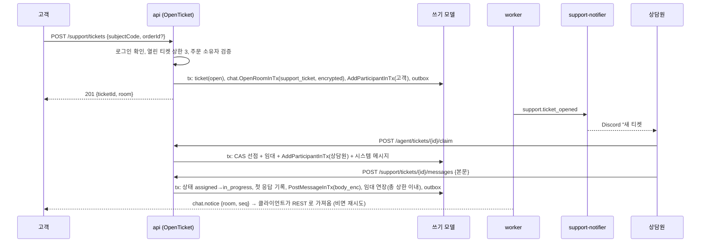

### 15.2 상담원 메시지 처리 순서도
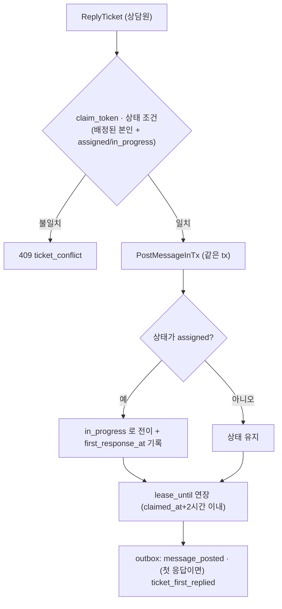

### 15.3 구독 권한 판정은 §4.7, 신고 처리 흐름은 §6.3, 순번 부여와 쓰기 순서도는 §4.1.

### 15.4 반납·임대 회수와 참가자 제거
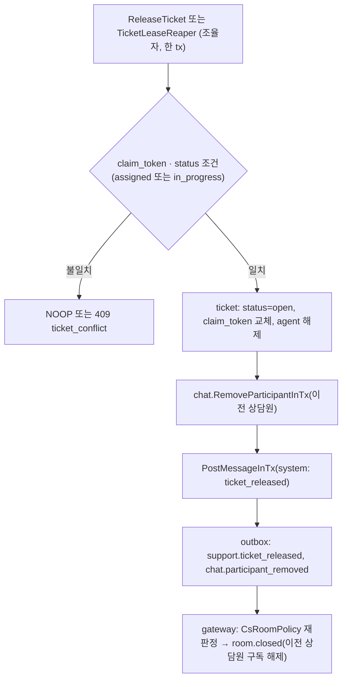
- 제거된 상담원은 **`CsRoomPolicy` 가 쓰기 모델 `ticket.agent_user_id` 로 판정**하므로 읽기 모델 지연이 있어도 REST 조회가 즉시 막힌다.

---

## 16. 동시성 지점

| 지점 | 경합 | 장치 | 근거 |
|---|---|---|---|
| 같은 방 동시 전송 | 순번 부여, 닫힌 방 | 방 행 조건부 UPDATE(`WHERE status='open'`), `RETURNING last_seq` | ADR-021 1번 |
| 같은 메시지 중복 전송 | 재시도, `request_key` 만료 뒤 재시도 | `request_key` 재생 + `UNIQUE (room, sender, client_msg_id)` 충돌 시 **롤백 후 기존 행 반환**(seq 구멍 없음) | ADR-021 6번, §4.1 |
| 상담원 동시 선점 | 같은 티켓을 두 명이 | `UPDATE … WHERE status='open' AND version=$v` 조건부, 패자 409 | ADR-046 |
| 임대 회수 vs 상담원 응답 | 늦은 응답 | `claim_token` 펜싱. 임대 연장은 REST 메시지·하트비트만(`typing` 아님), 총 상한 2시간 | ADR-021 3번 |
| 배정 해제 직후 이전 상담원의 조회 | 읽기 모델 지연 | `CsRoomPolicy` 가 쓰기 모델 `ticket.agent_user_id` 로 판정 | ADR-046 |
| 재개 시 push 와 투영의 지연 차 | 구독 직전 push 유실 | 구독 먼저 등록 → `head`(쓰기 모델) 이후 읽기 모델 대기·재시도 | §4.6 |
| 뮤트 vs 전송 | 뮤트 직후 도착한 전송 | 전송 tx 가 `participant` 를 읽을 때 `FOR SHARE`, 뮤트는 `version` 조건부 UPDATE | 낙관적 버전 |
| 숨김 vs 푸시 | 푸시된 뒤 숨김 | `chat.hidden` 으로 교체(결과적 일관성), 재생은 `status_seq` 로 최신 반영 | M1 필드별 순번 |
| 방 종료 vs 전송 | 대국 종료 직후 전송 | 방 닫힘이 방 행 UPDATE 이므로 같은 행 락에서 직렬화 | 방 카운터 행 |
| 프로젝터 순서 | 같은 방 이벤트 | 집합체 선두 규칙(`aggregate_id = roomId`) | F13 |

---

## 17. 실패 모드와 복구

| 장애 | 증상 | 복구 |
|---|---|---|
| worker 정지 | 전송은 되나 푸시·이력 반영이 늦음 | outbox/inbox 적체 후 재개, 지표 경보 |
| gateway 재시작 | 구독 끊김 | 클라이언트 재접속 + `resume`, `bye` 우아한 종료(M1) |
| DB 장애 | 전송 `503` | 재시도(멱등), 읽기도 불가 |
| 푸시 유실(느린 소비자 `4408`) | 클라이언트가 gap 감지 | 재연결 + `resume` |
| 투영 오염 | 이력이 틀림 | `rebuild chat-message-view`(M1 재구성 절차) |
| 읽기 모델 지연(projector 가 broadcaster 보다 늦음) | 재개·CS 조회가 비어 보임 | 구독 먼저, `head` 는 쓰기 모델, 대기·재시도(§4.6) |
| `request_key` 만료 뒤 같은 메시지 재전송 | 카운터 증가 후 충돌 | 롤백 후 기존 행 반환(§4.1) — seq 구멍 없음 |
| 상담원 이탈 | 임대 만료 | 대기열 복귀, 다른 상담원이 선점 |
| 키 분실(CS) | 복호화 불가 | 키링 백업(ADR-026), 해당 필드만 손실 |
| 주문 읽기 포트 실패 | 상담원 화면에 주문 요약 없음 | 대화는 계속, 요약만 "불러오지 못함" |

---

## 18. 관측

**지표**(`pf_` 규약, 식별자 레이블 금지)
| 이름 | 종류 | 레이블 |
|---|---|---|
| `pf_chat_messages_total` | C | `room_kind`, `kind` |
| `pf_chat_send_rejected_total` | C | `reason`(고정 열거: `muted`·`closed`·`policy`·`rate`·`forbidden`·`kind_mismatch`; `policy` 는 길이·링크·중복만, 금칙어는 거절이 아니다) |
| `pf_chat_masked_total` | C | `room_kind` (금칙어 마스킹이 일어난 전송 수. 사용자·단어 레이블 금지) |
| `pf_chat_send_duplicate_total` | C | `path`(고정 열거: `replayed`·`rolled_back`) |
| `pf_chat_room_subscribers` | G | `room_kind` |
| `pf_chat_fanout_seconds` | H | `room_kind` (메시지 저장→소켓 전송) |
| `pf_chat_replay_total` | C | `mode`(`replay`·`snapshot`) |
| `pf_chat_join_denied_total` | C | `room_kind` |
| `pf_chat_moderation_actions_total` | C | `action` |
| `pf_support_tickets` | G | `status` |
| `pf_support_first_response_seconds` | H | — |
| `pf_support_claim_conflicts_total` | C | — |
| `pf_support_lease_expired_total` | C | — |
| `pf_support_conversation_opened_total` | C | `role`(`agent`·`admin`) |

고정 열거 카운터는 기동 시 0 으로 미리 노출한다(M1 F17 §3.2 규칙). 경보 후보: 푸시 지연 p95 상승, 상담원 선점 대기 시간 길어짐, 대기열 길이, 복호화 실패.

**감사**: §6.4. **로그**: 본문·표시 이름 금지.

---

## 19. 시험 전략 (AC 후보 — 번호는 확정 시 부여)

| 후보 | 내용 | 종류 |
|---|---|---|
| CH-AC1 | 같은 방 동시 전송 N 건 → seq 연속·유일, 순서 = 커밋 순서 | L3 동시성 |
| CH-AC2 | 같은 `clientMsgId` 동시 2회 → 메시지 1건, 같은 seq 응답 | L3 |
| CH-AC3 | 중간 seq 를 놓치고 `resume` → 누락 없이 재생(재생 상한 초과 시 스냅샷) | L3 재접속 |
| CH-AC4 | 관전자 방 메시지가 대국 중 플레이어에게 전달·조회되지 않고, 종료 후 공개된다 | L3 |
| CH-AC5 | 권한 없는 `room.join` 은 `room.error forbidden` 이고 연결 유지, 푸시 없음 | L3 |
| CH-AC6 | 신고 → 숨김 → 구독자에게 `chat.hidden`, 재생 시 묘비 | L3 |
| CH-AC7 | 뮤트된 참가자의 전송 `403 muted`, 관전자 속도 제한 `429` + `Retry-After` | L3 |
| CH-AC8 | 닫힌 방 전송 `409 room_closed`, 대국 종료 직후 경합에서 순번이 꼬이지 않는다 | L3 |
| CH-AC9 | `request_key` 만료 뒤 같은 `clientMsgId` 재전송 → 기존 메시지 반환, `room.last_seq` 불변(seq 구멍 없음) | L3 |
| CH-AC10 | 읽기 모델 투영을 지연시킨 채 재개·`GET ?after=` → 누락 없이 복구(대기·재시도), 구독 직전 push 유실 없음 | L3 |
| CH-AC11 | 메시지 삭제 → 본문 NULL 묘비, 구독자 `chat.deleted`, 재생 시 묘비, `hold` 방 삭제 거절 | L3 |
| CH-AC15 | 신고 전 삭제된 메시지를 72시간 안에 신고하면 격리본이 스냅샷으로 승격되고, 72시간 뒤에는 `body_enc` 가 NULL 로 정리되며, 격리본이 읽기 모델·push·outbox·로그에 없다(센티널) | L3 센티널 |
| CH-AC12 | 세션 만료 후 `participant`/`sender_key`/`reporter_key` 가 `purged:` 로 바뀌고 멱등 유일 키 충돌이 없다 | L3 |
| CH-AC13 | 금칙어가 든 전송 → `201` 이고 `masked=true`, 본문은 코드포인트 수가 같은 `*` 치환본이다. 센티널 금칙어가 DB 덤프·outbox·push·읽기 모델·`request_key` 응답·로그에 없고, **덤프의 `request_hash` 에서 센티널의 키 없는 SHA-256 값도 발견되지 않는다**. 거절 지표는 늘지 않는다 | L3 센티널 |
| CH-AC14 | 링크·10초 내 같은 본문은 여전히 `400 validation_failed`, CS 방은 금칙어 규칙을 적용하지 않는다, 같은 `clientMsgId` 재전송은 저장된 치환본을 돌려준다(목록 변경 후에도 동일) | L3 |
| SP-AC1 | 두 상담원이 동시에 claim → 한 명만 성공 | L3 동시성 |
| SP-AC2 | 임대 만료 후 이전 상담원의 resolve 거절, 티켓이 대기열 복귀 | L3 |
| SP-AC3 | CS 본문 센티널이 DB 덤프·outbox·읽기 모델(평문)·`request_key.response_body`·로그에 없고, **`request_hash` 는 본문 비의존(`roomId·clientMsgId·길이`)이라 센티널 SHA-256 이 덤프에 없다** | L3 |
| SP-AC4 | ws-gateway 설정에 키 재료(`KEK_KEYS_FILE`/DEK, 상향 전 `FIELD_KEYS`)가 없다, 푸시 메시지에 본문이 없다 | L2·L3 |
| SP-AC5 | 상담원이 대화를 열면 감사 행이 생기고 롤백 시 사라진다 | L3 |
| SP-AC6 | 고객이 남의 주문을 연결하면 `403 order_not_owned` | L2 |
| SP-AC7 | 해결 7일 경계 재오픈, 자동 종료 | L2(가짜 시계) |
| SP-AC8 | release/reaper 뒤 이전 상담원은 REST 조회가 즉시 거절되고 구독이 `room.closed` 로 해제된다(읽기 모델 지연과 무관) | L3 |
| SP-AC9 | CS 방 재개·스냅샷 모드에서 gateway 가 `chat.notice` 외에는 아무 본문도 보내지 않는다(설정에 키 없음) | L3 |
| SP-AC10 | `typing` 을 보내도 `lease_until` 이 늘지 않고 총 상한(2시간)을 넘는 연장이 거절된다 | L3 |
| SP-AC11 | 해결(`resolved`) 직후 이전 상담원의 REST 열람이 `403`, 재오픈 티켓은 `open` 에서 새 `claim_token`·새 `claimed_at` 으로 재배정되고 총 상한은 새 배정 시각부터 계산된다 | L3 |
| CH-AC16 | 풀 크기 2 에서 동시 전송 3건이 교착 없이 모두 끝난다(정책 판정은 잠금 전, 잠금 안은 채팅 자체 조건만) | L3 |
| CH-AC17 | 읽기 모델 투영을 멈춘 채 `room.join`(replay·snapshot 모두) → 2초 뒤 `room.error unavailable` + `4500`, 스냅샷의 `head` 이하 누락이 없다. 구독 먼저 버퍼링한 push 중 `seq > head` 만 스냅샷 뒤 방출된다 | L3 카오스 |
| CH-AC18 | 유휴 연결에서 `hb.heads` 가 마지막 `seq` 보다 크면 클라이언트가 `resume` 재요청한다. 재생 200건이 송신 큐 상한(64건)을 넘겨도 `4408` 이 나지 않고, 연속 `4408` 후 재접속은 `resume` 없이 스냅샷 모드다 | L3 |
| 카오스 | worker 중단 중 전송 → 재개 후 이력 순서·푸시 복구, gateway 재시작 중 재접속 폭풍 | L3 |
| 부하 | k6: 동시 방 20개 × 방당 구독 20, 초당 메시지율 계단식 → `pf_chat_fanout_seconds` p95 | L3 |

---

## 20. 자원과 확장 (모두 **추정**, 측정 전)

| 항목 | 추정 | 근거 |
|---|---|---|
| 동시 방 | 대국 방 쌍 10개 + CS 방 1~3개 | 동시 접속 50 목표(M1) |
| 방당 구독 | 플레이어 2 + 관전자 ≤ 100(상한) | §4.8 |
| 메시지율 | 평균 방당 0.2건/초, 피크 2건/초 | 대국 채팅 가정 |
| 추가 소켓 | `/ws/room` 은 방 페이지에서만 연결: 탭당 +1(최대 M1 추정 200 + 방 입장자 수) | M1 연결 추정에 가산 |
| 메모리 | 연결당 증분은 M1 실측(약 5.5KB, 앱 큐 포함 시 최대 50KB 가정) 재사용 | F14 |
| DB 증가 | 대국 10건/일 × 메시지 200개 × 30일 ≈ 60k 행, 행당 약 300B → 약 20MB | 추정 |
| 방 카운터 경합 | 방당 쓰기율 2건/초 ≪ 행 잠금 처리량 | 실측 필요 |

확장 한계는 방 행 잠금(방당 직렬화)과 단일 gateway 의 팬아웃이다. Redis Streams/Valkey pub-sub 으로 gateway 다중화(ADR-024 도입 기준)와 방 단위 샤딩이 후속 경로다.

---

## 21. M1 과의 접점·변경점 (변경 요청은 정본 소유자가 반영)

| # | 변경 요청 | 대상 |
|---|---|---|
| C1 | `/ws/room` 연결 종류와 인바운드 3종(`room.join`·`room.leave`·`typing`) 추가, "WS 읽기 전용" 예외 명시 | design/04, ADR-018 주석, P0 ADR-032 |
| C2 | 속도 제한 등급 6종 추가(§6.1; 신고는 M1 `write.report` 재사용) | design/03 §1.1 |
| C3 | **B12 정본 = P0 §2.4**: `…InTx` 공개 usecase 허용 쌍(채팅은 #1 `support`→`chat`), 중첩 `uow.run` 금지 유지, 허용 목록 밖 호출 CI 실패 — design/01·F16 §8.2·ADR-019 에 반영(통합 요청표 P0 §12.4 #5). **쌍 #1 을 이 문서 §2.2 의 조율자 8개·참여 함수 5개(`OpenRoomInTx`·`CloseRoomInTx`·`PostMessageInTx`·`AddParticipantInTx`·`RemoveParticipantInTx`)로 확장**하고, P0 §8.3 의 `support.ticket_*` 소비자에서 `chat` 을 뺄 것 | ADR-019, F16 §8.2, P0 |
| C4 | 감사 `actor_role` 에 `agent`(그리고 `operator`) 추가, action 추가(§6.4, category 는 `admin` 유지). 열람 감사는 **대화 열람 세션당 1회**. 상담원 판정은 **설정 허용목록 `AGENT_GITHUB_IDS`** (P0 D11) | ADR-027, design/01 env, P0 §9.4 |
| C5 | 읽기 모델 이벤트 없는 쓰기 예외에 채팅 보관 정리·**세션 키 익명화(`AnonymizeSessionData` 의 `participant_view` 정리)** 추가, `hold` 규칙 | database-schema §9 |
| C6 | database-schema §9.1 에 채팅 컬럼 등급 추가(`message.sender_key`·`participant.actor_key`·`report.reporter_key` PSD, `snapshot_enc`·`body_enc` ENC), `chat.message.body_enc` 와 `chat.report.snapshot_enc` 를 `rotate-field-keys` 대상에 추가. ENC 필드 수는 P0 §9.5 통합표 기준으로 상향 조건 **충족** | database-schema, ADR-026 |
| C7 | 환경변수: gateway 에는 키 재료(`KEK_KEYS_FILE`/DEK, 상향 전 `FIELD_KEYS`) 없음 시험, `CHAT_*` 한도(방당 관전자 상한 등) | design/01 |
| C8 | 기능 카탈로그 접두사 CH-/SP- 와 `chat`·`support` 모듈 등록 | F00, P0 |
| C9 | P2 `GetOrderSummaryForSupport(orderId, ownerUserId)` — 소유자 검증 인자 추가 | P2 §주문 |
| C10 | CQRS 예외 등재: 채팅 룸의 `head` 를 gateway(`RoomEventSource.head`)가 쓰기 모델 `chat.room.last_seq` 에서 읽는 것(대국 `game_event` 읽기 X1 과 같은 성격 — 이 예외를 **X2** 로 부른다; ADR-048 의 결정 E1…E8 과 별개) | P0 §2.4, database-schema §1 |

**다른 영역과의 접점**
| 영역 | 계약 |
|---|---|
| P0 | 채널 모델(`/ws/room`, ADR-032), 서비스 경계(모놀리스 유지, ADR-030), 이벤트 전달 계층(ADR-031: 채팅 규모에선 폴링으로 충분), RBAC `agent`, 자원 예산 |
| P1 바둑 | (조정 완료) `game.started`·`game.finished`·`game.abandoned`(P1 소비자 표에 `chat-game-sync` 추가 요청), `GameRoomPolicy` 구현(포트 소유는 `realtime`), 관전자 방 비공개 규칙(UX 배려 — 부정 억제는 관전 지연), 플레이어 로그인 필수(U21, 익명은 관전자만). presence 는 `realtime` 소유(D19) |
| P2 상거래 | `OrderContextReader` 읽기 포트(요약·**소유자 검증 인자** 요청 C9), 환불·분쟁은 채팅이 아니라 commerce 관리 도구로(채팅이 주문 상태를 바꾸지 않는다) |
| P3 풀필먼트 | 배송 추적 요약을 `OrderContextReader` 에 포함 요청(읽기 전용), 반품 접수를 티켓에서 시작하는 연동은 후속 |

---

## 22. 구현 순서와 위험

> 구현 순서(P0 D24): 1~5 는 **6a(CS 채팅)에서 먼저**, 6~8 은 6a 안에서 이어지고, 대국 연동은 **Phase 1(바둑) 때** 한다.

| 순서 | 작업 | 단계 |
|---|---|---|
| 1 | `chat` 모듈 골격: `room`·`participant`·`message`·방 카운터, `PostMessage`(멱등·순번), 프로젝터, 이력 조회 | **6a 초반** |
| 2 | `/ws/room` **도입**: 구독 권한(`RoomAccessPolicy` 포트·`ChatRoomPolicy`·`CsRoomPolicy`), 허브, 푸시, 재개(replay/snapshot) | 6a |
| 3 | `support`: 티켓 상태 머신·선점·임대·reaper (B12 쌍 #1) | 6a |
| 4 | CS 암호화, 알림 전용 푸시, 열람 감사, 상담원 콘솔 | 6a |
| 5 | 모더레이션: 신고·숨김·뮤트, 콘텐츠 정책, 속도 제한, 보관 규칙, 지표, 웹 패널 | 6a |
| 6 | Web Push(선택) | 6a 후반 |
| 7 | **대국 연동**: `chat-game-sync`(`game.*` 소비), `GameRoomPolicy`(대국 룸 종류 `game_players`·`game_spectators` 추가), 관전자 방 비공개·공개 | **Phase 1 (바둑과 함께)** |
| 8 | 대국 채팅 DoD 시험(복구·중복·관전자 비공개) | Phase 1 |

| 위험 | 완화 |
|---|---|
| P1 이벤트 계약이 바뀜 | `chat-game-sync` 를 얇은 어댑터로, 계약 시험 |
| REST 전송 지연이 답답함 | 지표 측정 후 WS 전송 도입 판단(ADR-045 철회 조건) |
| 방 카운터 핫스팟 | 쓰기율 상한·관전자 별도 등급 |
| 금칙어 마스킹 우회(띄어쓰기·자모 분리)와 원문 미보존으로 인한 모더레이션 한계(§6.2) | 신고·숨김·뮤트로 보완, `masked` 지표로 상습 추정, 한계가 드러나면 원문 단기 ENC 보관 재검토 |
| 개인정보가 대국 채팅에 섞임 | 신고·보관 30일·본인 삭제 경로(`DeleteMessage`) |
| 관전자 익명의 뮤트 우회(새 익명 세션으로 재입장) | 세션·방 단위 속도 제한, 관리자 방 단위 뮤트·강퇴, 신고 누적 시 방 읽기 전용 전환. 플레이어는 U21 로 로그인 필수라 해당하지 않는다 |
| CS 범위 팽창(첨부·일정·스킬 라우팅) | Phase 6 독립 DoD, 첨부 범위 밖 고정 |

---

## 23. 미결과 신규 ADR

| 항목 | 결정 시점 |
|---|---|
| ~~금칙어 정책(마스킹 vs 거절)~~ | **닫힘(2026-11-05, U17)**: 마스킹(`*` 치환 후 전송), 원문 저장 안 함(제안) |
| ~~금칙어 초기 목록~~ | **결정(2026-11-14)**: 빈 목록으로 시작(규칙은 확정, 목록이 비면 통과와 같다). 운영 중 추가 |
| ~~관전자 익명 허용, 플레이어 로그인 필수 여부~~ | **닫힘(U21, 2026-11-05)**: 플레이어(레이팅·비레이팅 불문)는 로그인 필수, 익명은 **관전자만**(뮤트 우회는 관전자에 한한 알려진 위험, §22). 2026-11-04 의 '익명 비레이팅 대국 허용'은 폐기 |
| ~~`*InTx` 공개 usecase 규칙(C3)~~ | **닫힘(2026-11-04)**: P0 §2.4 B12 정본 |
| ~~Web Push 채택 여부와 구독 토큰 등급~~ | **결정(2026-11-14)**: 채택하지 않는다. 필요해지면 그때 ADR 로 다시 연다 |
| ~~CS 보관 기간~~ | **결정(2026-11-14, 데모 기준)**: 1년. 법적 보존과의 충돌·삭제 요청 처리 정책은 실서비스라면 법무 검토(미확인 유지) |
| ~~대국 채팅 보관 기간~~ | **결정(2026-11-14)**: 종료 후 30일 |
| ~~방 presence 의 소유(P1 vs chat)~~ | **닫힘(2026-11-04)**: `realtime` 소유(P0 D19) |
| 재생 상한 200, 스냅샷 50, 관전자 상한 100, 읽기 모델 대기 2초, 열람 감사 윈도우 30분, 임대 총 상한 2시간, 하트비트 분당 1회 등 수치 | 측정 후 |

**신규 ADR (Proposed)**: [ADR-045](../../adr/ADR-045-chat-message-delivery.md) 채팅 메시지 전달 모델 · [ADR-046](../../adr/ADR-046-cs-ticket-and-agent-assignment.md) CS 티켓·상담원 배정 · [ADR-047](../../adr/ADR-047-chat-data-protection-retention.md) 채팅 데이터 보호·보관.
