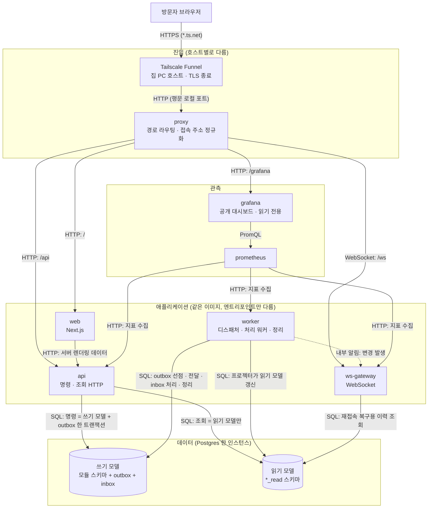
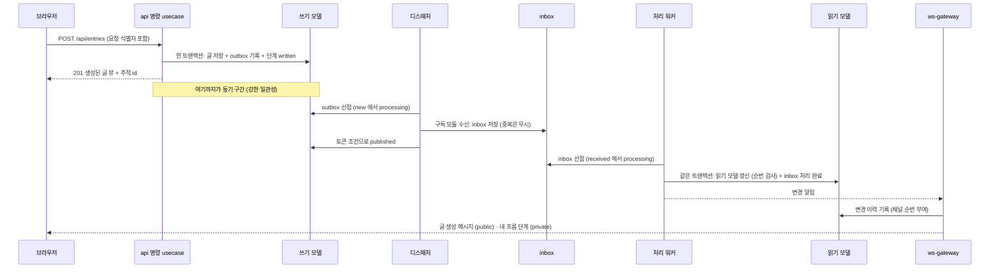
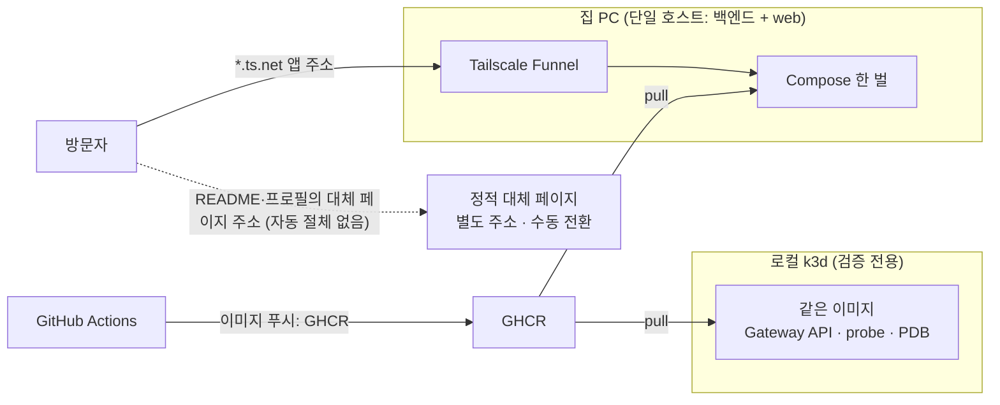

# 아키텍처

시스템이 어떻게 나뉘고, 요청과 이벤트가 어디를 지나며, 어디서 어긋날 수 있는가.
**경계와 흐름만** 다룬다 — 테이블 컬럼은 [database-schema.md](database-schema.md), 결정의 이유는 ADR 이 정본이다.
코드가 아직 없으므로 모든 이름은 **설계 이름**이다. 구현하면서 달라지면 이 문서를 먼저 고친다.

대상 범위는 **M1**이다. 후속 Phase 는 §12 에서 확장 지점만 밝힌다.

## 1. 기본 아키텍처 (모든 모듈이 따르는 네 가지)

| 기둥 | 한 줄 | ADR |
|---|---|---|
| **모듈러 모놀리스** | 단일 코드베이스, 엔트리포인트(api/ws-gateway/worker)만 다름 | 001 |
| **CQRS** | 명령은 쓰기 모델, 조회는 읽기 모델(프로젝션). 읽기 모델은 이벤트로만 갱신 | 018 |
| **domain · service · usecase** | usecase → service → domain 한 방향. 명령/조회 한 건 = usecase 하나 | 019 |
| **outbox + inbox** | 보내는 쪽은 쓰기와 같은 트랜잭션에 outbox, 받는 쪽은 inbox 에 저장 후 처리 | 005, 020 |
| (횡단) **동시성 제어** | 처리 전 조건부 UPDATE 로 `processing` 선점, 임대·토큰, 낙관적 버전 | 021 |

## 2. 구성 요소와 경계



- 점선은 **비동기·조건부**다.
- 라이브는 **집 PC 단일 호스트**이고 백엔드와 web 이 모두 여기서 돈다. 방문자는 항상 Tailscale Funnel(`https://<호스트>.<tailnet 이름>.ts.net`, 도메인 미구입)을 거치고 TLS 는 PC 에서 종료되며 nginx 는 평문 로컬 포트로 받는다. 실제 클라이언트 IP 를 얻는지는 **미확인(G14)** 이다. Grafana 관리 화면은 Funnel 로 노출하지 않고 `tailscale serve` 로 tailnet 내부에서만 연다. Oracle 경로(방문자가 `proxy` 로 직접, TLS 종료를 `proxy` 가 맡음)는 선택적 후속이며 미추진이다.
- `worker` 는 `change_log` 에 쓰며 `NOTIFY` 로 깨우고, `ws-gateway` 가 `change_log` 를 읽어 보낸다(1초 폴링 보완, ADR-023). **`ws-gateway` 는 읽기 모델을 읽어 복구**할 수 있다.
- 읽기 모델과 쓰기 모델은 **같은 Postgres 인스턴스의 다른 스키마**다(논리 분리, ADR-018).

## 3. 컨테이너 책임

| 구성 | 책임 | 상태 | 비고 |
|---|---|---|---|
| `proxy` | 경로 라우팅, TLS 종료(Oracle 경로 — 선택적 후속, 미추진; 집 PC 경로는 Funnel 이 종료), **원 접속 주소를 한 헤더로 정규화**(Funnel 의 IP 헤더는 미확인, G14 ④ — 확인 전에는 클라이언트 값을 전부 버린다), 접속 주소별 속도 제한(IP 가 안 보이면 세션/계정 기준 우선) | 무상태 | **nginx**(ADR-022, 관문 G7) |
| `web` | 화면 렌더링(소개·아키텍처는 서버 렌더링, 데모는 클라이언트) | 무상태 | ko/en. Bun 실행(관문 G3, 실패 시 Node 22) |
| `api` | 인증, **명령 usecase**(쓰기)와 **조회 usecase**(읽기) 실행 | 무상태 | 명령은 outbox 기록까지 |
| `ws-gateway` | 연결 유지, 구독, 브로드캐스트, 재접속 복구 | **연결을 쥔다** | 재시작 시 클라이언트 재접속(ADR-014) |
| `worker` | 디스패처(동시 하나만 활성), 처리 워커(inbox), 회수 작업, 정리 | 무상태(락·임대로 조정) | |
| `postgres` | 정본(쓰기 모델) + 읽기 모델 | 상태 | 볼륨 필수 |
| `prometheus` / `grafana` | 지표 수집 / 공개 대시보드 | 상태(보존 기간 제한) | ADR-007 |

## 4. 모듈 내부 구조 (domain · service · usecase)

모든 모듈이 같은 모양이다(ADR-019).

```
modules/<name>/
  domain/            엔티티 · 값 객체 · 도메인 이벤트 · 불변식 (순수)
  service/           여러 엔티티에 걸친 도메인 규칙 (순수)
  usecase/
    command/         명령 한 건 = 파일 한 개   ← 트랜잭션 경계
    query/           조회 한 건 = 파일 한 개   ← 읽기 모델만
    event/           수신 메시지 처리 (프로젝터 · 소비자)
  port/              저장소 · outbox · inbox · 시계 · 식별자 (인터페이스)
  adapter/           포트 구현 (postgres …)
  index              모듈 공개 API
```

| 규칙 | 내용 |
|---|---|
| 의존 방향 | **usecase → service → domain.** 역방향 금지. adapter 는 port 를 구현하고, 조립은 엔트리포인트에서 |
| domain · service | I/O·시간·난수 직접 호출 금지. DB 없이 단위 시험 |
| usecase | 트랜잭션을 열고 닫는 유일한 곳. SQL 을 직접 쓰지 않는다(포트 사용) |
| 쓰기 포트 vs 읽기 포트 | `command` 는 쓰기 포트만, `query` 는 읽기 포트만 주입받는다 → **구조로 CQRS 가 강제**된다 |
| 엔트리포인트 | 입력 검증 → usecase 호출 → 응답 매핑. 규칙 없음 |
| 모듈 간 호출 | 상대 모듈의 `index` 가 내보낸 usecase 만. 상대의 domain·adapter·테이블 직접 참조 금지 |

### 모듈 지도 (M1)

| 모듈 | 쓰기 스키마 | 읽기 스키마 | 소비자 / 프로젝터 | 의존할 수 있는 것 |
|---|---|---|---|---|
| `identity` | `identity` | — | — | `db`, `config` |
| `guestbook` | `guestbook` | `guestbook_read` | `guestbook-projector` | `identity` 공개 usecase(세션 확인), `events` 공개 포트(outbox 기록) |
| `events` | `events` | `events_read` | — (주기 집계) | `db`, `protocol` |
| `realtime` | `realtime`(inbox) | `realtime_read` | `realtime-broadcaster` | `identity` 공개 usecase(`ResolveSession`), `guestbook` 공개 포트(`ReadPublicEntries`, 스냅샷), `events` 공개 포트(`FlowSummaryReader`·`TraceReader`), `protocol` |
| `observability` | — | — | — | `config` |

`worker` 엔트리포인트는 정리 잡을 위해 `identity` 공개 usecase(`ListExpiredSessionIds`·`DeleteSessions`)도 조립한다(모듈 간 호출은 항상 상대 모듈의 공개 `index` 로만). 순환 의존 금지. 위반은 CI 의 임포트 경계 검사로 실패시킨다(ADR-001).

## 5. 요청 경로 (M1 초안)

REST 와 WebSocket 계약의 **정본은 `packages/protocol`** 이고 문서로는 [design/03](../design/03-api-contract.md)·[04](../design/04-ws-protocol.md) 가 상세다. 아래 표는 그 **파생 지도**(종류만)다.

### REST — 명령 (`usecase/command`)
| 경로 | 인증 | 하는 일 |
|---|---|---|
| `POST /api/entries` | 익명 허용 | `PostEntry`: 글 저장 + outbox |
| `PATCH` / `DELETE /api/entries/{id}` | **로그인 + 본인** | `EditEntry`·`DeleteEntry`: **`version` 조건 갱신**, 어긋나면 409 |
| `PUT` / `DELETE /api/entries/{id}/reactions/{emoji}` | 익명 허용 | `AddReaction`·`RemoveReaction`: 유일 키가 중복 심판 |
| `POST /api/entries/{id}/reports` | 익명 허용 | `ReportEntry` |
| `POST /api/admin/entries/{id}/hide` · `unhide` | **허용목록 관리자** | `HideEntry`: 버전 조건 갱신 + 조치 이력 + outbox |
| `POST /api/admin/reports/{id}/resolve` | 관리자 | `ResolveReport`: `open → resolved` 조건부 갱신 |
| `GET /api/auth/github` · `/callback`, `POST /api/auth/logout`(`Idempotency-Key` 면제) | — | 로그인 흐름 |
| `POST /api/admin/write-lock` | 관리자 | `SetWriteLock`: 긴급 쓰기 잠금 |
| `PUT /api/me/profile` | 로그인 | `UpdateProfile` |

**모든 쓰기 요청은 클라이언트가 만든 요청 식별자를 받는다.** 같은 식별자의 재요청은 같은 결과를 돌려준다(ADR-014, 연결이 끊긴 사이 재시도 안전).

### REST — 조회 (`usecase/query`)
| 경로 | 인증 | 읽는 곳 |
|---|---|---|
| `GET /api/entries` | 익명 허용 | `guestbook_read.entry_view` (커서) |
| `GET /api/me` | 익명 허용(**익명 세션 발급**) | 세션 확인(명령 쪽 보조 조회, 예외) |
| `GET /api/admin/reports` | 관리자 | `guestbook_read.report_queue` |
| `GET /api/flow/summary` · `/api/flow/trace/{id}` | 익명 허용 / 행위자 본인 | `events_read.flow_counter` / `events.trace_step`(공개 포트 `GetTrace`) |
| `GET /healthz`, `GET /readyz`, `GET /metrics` | **내부 전용** | probe·지표. 프록시에서 외부 차단 |

### WebSocket
| 채널 | 방향 | 메시지 종류(초안) |
|---|---|---|
| `/ws/public` | 서버 → 클라이언트 | 글 생성·수정·제거, 반응 변경, **전체 익명 흐름 요약**, 접속자 수. **최초 진입 시 연결**, 인증 불필요 |
| `/ws/private` | 서버 → 클라이언트 | **내 흐름 상세**(단계 기록). **세션 확인 후 연결**(익명 세션 포함), 세션 쿠키 필수 |
| 클라이언트 → 서버 | — | `hello`(public 은 마지막 수신 순번을 담은 재개 요청), `ping` |

**public 과 private 은 서로 다른 연결**이다(한 탭에 소켓 둘). 메시지 봉투·종료 코드는 [design/04](../design/04-ws-protocol.md).

## 6. 핵심 흐름: 글 작성에서 화면 반영까지

M1 의 중심 시나리오다. 시각화가 보여주는 것이 바로 이 흐름이다.



- **동기 구간은 저장까지**다. 응답 시간 목표(p95 300ms)는 이 구간에 걸린다.
- 이후는 **결과적 일관성**이다. 쓴 직후 목록 조회에 아직 없을 수 있으므로, 명령 응답에 생성된 뷰를 담아 주고 클라이언트가 공개 메시지와 **중복 없이 병합**한다(ADR-018).
- 소비가 실패하면 재시도·`dead` 로 격리되고 같은 경로로 시각화에 나타난다(ADR-005·020).

## 7. 동시성 제어 지점

모든 "한 번만"은 같은 모양이다: **조건부 UPDATE 로 `processing` 선점 → 처리 → 토큰 일치 조건으로 완료**(ADR-021).

| 지점 | 장치 | 충돌 시 |
|---|---|---|
| outbox 전달 | 단일 활성 디스패처(어드바이저리 락) + 항목 선점 + 토큰 완료 | 다른 인스턴스는 건너뜀 |
| inbox 처리 | PK 로 중복 수신 차단, 항목 선점 + 토큰 완료 | 중복은 무시, 선점 실패는 건너뜀 |
| 임대 만료 | 회수 작업이 `processing` 을 기대 상태로 되돌림 | 늦게 온 이전 주체의 완료는 0행으로 거절 |
| 글 수정·숨김 | `version` 조건 갱신 | 409 + 최신 상태 |
| 반응 추가 | 유일 키 | 중복은 무시(`200` 멱등, 이벤트 없음) |
| 신고 처리 | `open → resolved` 조건부 갱신 | 한 명만 성공 |
| 읽기 모델 갱신 | 행의 `last_seq` 비교 | 오래된 이벤트 무시 |
| 외부 호출(후속 Phase) | 선점 트랜잭션과 완료 트랜잭션 사이에 호출, 호출 동안 행 잠금 없음 | |

**효과 자체도 멱등**이어야 한다. 토큰은 상태 덮어쓰기를, 멱등은 효과 중복을 막는다 — 둘 다 필요하다.

## 8. 신뢰 경계와 보안 지점

| 경계 | 무엇을 믿고 무엇을 의심하는가 |
|---|---|
| 인터넷 → 프록시 | 모든 입력을 의심. 접속 주소 헤더는 **프록시가 지우고 다시 쓴다** |
| 프록시 → 앱 | 프록시가 넣은 정규화 헤더만 신뢰. 앱은 프록시 외 경로로 직접 노출하지 않는다 |
| 브라우저 → api/ws | 세션 쿠키로 신원 확인. 영구 쓰기는 로그인 필요. 관리 경로는 허용목록 |
| 앱 → 앱 | 같은 이미지·같은 네트워크. 내부 경로(`/metrics`, `/readyz`)는 외부 비공개 |
| 앱 → DB | 모듈은 자기 스키마(`<m>`, `<m>_read`)만. 조회 usecase 는 `_read` 만(구조로 강제). (구현 시) 역할 분리 검토 |
| 방문자 ↔ 방문자 | 다른 방문자의 글 내용·식별자는 요약 경로로 새지 않는다(서버에서 가공, AC-009) |
| 공개 Grafana | 보기 전용·프로비저닝된 대시보드만. 지표 레이블에 식별자 금지(ADR-007) |
| 외부 메시지(Phase 5 웹훅) | 서명 검증을 수신 usecase 첫 단계에서. 틀리면 inbox 에 저장하지 않는다(ADR-020) |

## 9. 배포 토폴로지



- 환경(집 PC 라이브, k3d 검증)은 **같은 이미지**를 쓴다. 차이는 설정과 오버라이드 파일뿐이다(ADR-002). Oracle 은 선택적 후속이라 그림에서 뺐다(카드 없음).
- 정적 폴백은 데모 영역을 제외한다(ADR-003, FR-070). 폴백은 2단계다: nginx 정적 페이지(앱 다운), 별도 주소의 정적 대체 페이지(호스트·Funnel 다운; 호스팅 G11, 사람이 안내를 갱신하는 수동 전환, Worker 절체 G13 은 도메인 확보 시 후속 보류, [design/16](../design/16-outage-fallback-page.md)) — ADR-023. **집 PC 중단은 사이트 전체 중단(단일 장애점)이며 사용자가 수용한다.**

## 10. 장애 모드

| 무엇이 죽으면 | 방문자가 보는 것 | 시스템이 하는 일 |
|---|---|---|
| 집 PC·전원·회선·Funnel | **사이트 전체 중단(단일 장애점)**. 앱 주소는 연결 오류(자동 절체 없음, 수용), 별도 주소의 정적 대체 페이지만 응답 | 복구 후 자동 재개(systemd/compose 재시작 정책). 외부 가용성 점검으로 감지(서비스 검증 필요). Oracle 이전은 하지 않음 |
| `api` | 쓰기 실패 메시지, 읽기는 일시 불가 | 재시작. 명령은 트랜잭션이라 반쪽 저장 없음 |
| `ws-gateway` | 연결 끊김 표시 → 자동 재접속 | 순번 기반으로 놓친 변경 복구 또는 스냅샷(ADR-014) |
| `worker` | 글은 저장되나 읽기 모델 반영·시각화가 늦어짐 | outbox·inbox 가 쌓임. 재시작·임대 만료 후 이어서 처리. 적체·지연 지표가 오름 |
| 프로젝터 버그로 읽기 모델 오염 | 목록이 잘못 보임 | 읽기 모델을 비우고 정본·이벤트로 **재구성** |
| `postgres` | 전체 쓰기·읽기 불가 | 볼륨 복구 또는 백업 복원(일별 7·주별 4, 외부 보관, ADR-023) |
| `prometheus`/`grafana` | 대시보드만 비어 있음 | 사이트 기능에는 영향 없음 |
| Funnel 의 WebSocket 미통과(🔴 미검증, G14) | 실시간 갱신 안 됨 | 구현 초기 실측 후 대체 방식 결정(ADR-003) |
| Funnel 대역폭 한도 초과(수치 비공개, 베타) | 응답 지연·끊김 | G14 체감 측정, 자산·페이로드 축소 |
| 클라이언트 IP 미확인 | IP 기반 속도 제한이 약해짐(전역 한도화) | 세션/계정 기준 제한 우선(ADR-008), G14 ④ |
| Funnel 베타 정책 변경 | 노출 경로 상실 가능 | 재검토 조건(ADR-003), 도메인 확보 시 다른 노출 경로로 복귀 |
| 자동 절체 없음 | 중단 중 앱 주소는 연결 오류, 대체 페이지는 사람이 갱신 | README·프로필에 두 주소 병기, 외부 업타임 알림, 런북(design/16 §4.1). 수용 |

## 11. 측정할 것 (지표 지도)

| 영역 | 지표 (`pf_` 접두, 카탈로그 정본: [design/features/17](../design/features/17-ops-observability.md)) |
|---|---|
| 명령/조회 | `pf_http_request_duration_seconds`, `pf_http_requests_total`(상태 분류별 에러율), `pf_errors_total` |
| outbox | `pf_outbox_depth{status}`, `pf_outbox_dead_total`, `pf_outbox_oldest_age_seconds` |
| inbox / 읽기 모델 | `pf_inbox_depth`, `pf_inbox_oldest_age_seconds`, `pf_projection_lag_seconds`, `pf_projection_drift` |
| 동시성 | `pf_claim_attempts_total{result}`(선점 실패 수), `pf_lease_reclaimed_total`(임대 만료 회수 수), `pf_version_conflicts_total`(409), `pf_lease_lost_total`(fencing 거절) |
| 실시간 | `pf_ws_connections{channel}`, `pf_ws_resume_total`, `pf_ws_queue_overflow_total` |
| 쓰기 잠금·멱등 | `pf_write_locked_total`, `pf_idempotent_replays_total` |

## 12. 확장 지점 (Phase 별)

**구현 순서는 Phase 번호와 다르다(P0 D24): M1 → 3 → 4 → 5 → 6a(CS 채팅) → 6b → 6c → 6d → 1(바둑) → 2 → 6e.** 아래 표는 번호순이며 순서가 아니라 식별자다. 이력서 제출 가능 시점은 M1 + Phase 3 + Phase 4. 각 단계 착수 전 설계 재검토(P0 §12.5).

Phase 1~6 의 상세 설계는 [design/phases](../design/phases/00-platform-evolution.md) 가 정본이다(공통 진화 P0 + 바둑·상거래·풀필먼트·채팅). 여기는 요약과 포인터만 둔다. ADR-030~048 은 **Proposed**(사용자 확정 대기).

| 단계 | 추가되는 것 | 이 구조에서 바뀌는 곳 | 상세 |
|---|---|---|---|
| Phase 1 | `game` 모듈(`chat`·`/ws/room` 은 6a 에서 먼저 도입, 여기서는 대국 채팅 룸 종류 추가) | 대국 명령은 **REST**(WS 는 push 전용), `game_event` 로그 + NOTIFY fast lane, `realtime` 이 룸 포트·presence 소유 | [P1](../design/phases/01-baduk.md), [P4](../design/phases/04-chat.md), ADR-032·034·035·045 |
| Phase 2 | `analysis`(KataGo 별도 프로세스; `ledger` 는 Phase 3 에서 이미 도입) | 분석 큐는 **Postgres inbox 선점**(Redis 없음), 보상 전이는 B12 `InTx` | [P1](../design/phases/01-baduk.md) §9~10, ADR-036·037 |
| Phase 3 | `catalog`, `deal`, `order`, `ledger`(모의 USDC·POINT 지급·교환), 최소 `pricefeed`(고정 환율 소스), `payment`(원장 결제·혼합 결제), 최소 `escrow`(hold / release / refund)와 환불, Redis(재고) | 두 게이트 재고(Redis + DB CHECK), 구매 확정은 B12 `InTx` 쌍, Streams 판정 | [P2](../design/phases/02-commerce.md), ADR-031·038·040·048 |
| Phase 4 | 워크로드 분리 | `ws-gateway` 사이트/룸 분화, HPA·PDB, M1 G8 롤링 패턴 | [P0](../design/phases/00-platform-evolution.md) §10, ADR-033 |
| Phase 5 | `settlement` + `payment`·`escrow`·`pricefeed` 확장(카드 결제, 분쟁·동결·자동 확정, 실제 시세) | 웹훅 inbox, 모의 결제 어댑터, KEK/DEK 상향 | [P2](../design/phases/02-commerce.md), ADR-039~041 |
| Phase 6 (6a~6d) | `chat`·`support`(6a, `/ws/room` 도입), `inventory`·`fulfillment`(6c), 지갑 연결(6d) | 이중 재고 원장, 출고 사가, CS 티켓, 허용목록 역할(`agent`·`operator`) | [P3](../design/phases/03-fulfillment.md), [P4](../design/phases/04-chat.md), ADR-032·042~047 |
| Phase 6e | 마작(게임 규칙 플러그인, Phase 1 의 게임 프레임 재사용) | 마지막 구현 | [P1](../design/phases/01-baduk.md), ADR-034·035 |

**바뀌지 않는 것**: 모듈 경계 규칙(+ **B12**: 층 규칙과 `InTx` 허용 쌍, P0 §2.4), domain·service·usecase 의존 방향, CQRS(조회는 읽기 모델만), outbox/inbox 규약, 선점 규약, 프록시 + 경로 라우팅, 같은 이미지 원칙, 모든 쓰기는 트랜잭션.

## 13. 미결

| 항목 | 결정 시점 |
|---|---|
| nginx 이미지의 `realip` 포함 여부 (Oracle 경로 TLS 자동화는 미추진) | 관문 G7 (구현 단계 0) |
| 임대·백오프 초기값 조정 | 처리 시간 측정 후(규칙·초기값은 ADR-023) |
| 복구 시험 수행 | M1 후반(방식은 ADR-023, 외부 저장소는 G12) |
| 별도 주소 정적 호스팅 수단(Cloudflare Pages vs GitHub Pages) | 관문 G11 |
| Funnel 의 WebSocket·대역폭·클라이언트 IP·재시작·인증서 | 관문 G14 |
| 경계 검사 규칙 파일 작성(dependency-cruiser, 계층·CQRS 규칙) | 구현 단계 0 |
