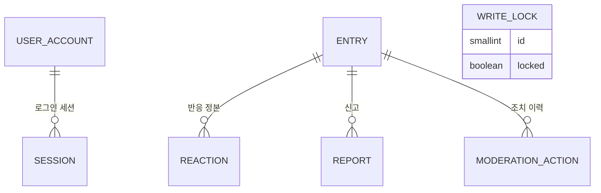
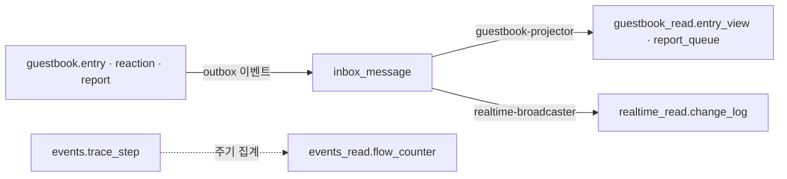

# 데이터베이스 구조

Postgres 스키마 설계. **M1 은 테이블 단위로 상세히, Phase 1~5 는 윤곽만** 둔다(아직 확정할 근거가 없다).
모든 이름은 **설계 이름**이다 — 코드가 아직 없다. 구현하면서 바뀌면 이 문서를 먼저 고친다.
근거: [ADR-017](../adr/ADR-017-database-conventions.md)(규약) · [ADR-018](../adr/ADR-018-cqrs.md)(CQRS) · [ADR-005](../adr/ADR-005-outbox-idempotent-consumer.md)(outbox) · [ADR-020](../adr/ADR-020-inbox.md)(inbox) · [ADR-021](../adr/ADR-021-concurrency-control.md)(동시성) · ADR-008(신원·보관) · ADR-010(재고) · ADR-011(정산).

## 1. 원칙

| 원칙 | 내용 |
|---|---|
| 스키마가 모듈 경계 | 모듈은 **쓰기 스키마 `<m>` 과 읽기 스키마 `<m>_read`** 를 단독 소유한다. 남의 테이블을 읽지 않는다 |
| 쓰기/읽기 분리 (CQRS) | 명령은 `<m>` 만, 조회는 `<m>_read` 만 다룬다. **읽기 모델은 명령이 직접 쓰지 않는다** — 이벤트(inbox 경유)나 집계 작업만 갱신. **예외는 셋뿐**이고 §9·§10 에 명시한다: ① 보관 정리가 이벤트 없이 읽기 모델 일부를 직접 쓴다(익명화) ② 재구성 잡이 그림자 테이블을 채운다 ③ 충돌 응답용 `LoadEntryForConflict` 가 쓰기 스키마를 **읽는다**(명령 쪽 보조 조회) |
| outbox + inbox | 보내는 쪽은 쓰기와 같은 트랜잭션에 outbox 기록, 받는 쪽은 inbox 에 저장 후 선점해 처리 |
| 선점 후 처리 | "한 번만" 필요한 항목은 조건부 UPDATE 로 `processing` 선점, 임대·토큰으로 보호 |
| 스키마 간 FK 없음 | 다른 모듈의 행은 **id 값으로만 참조** |
| 읽기 모델은 재구성 가능 | 비우고 정본·이벤트에서 다시 채울 수 있어야 한다 |
| 개인정보 최소 | 접속 주소·세션 평문 토큰을 저장하지 않는다 |
| 보관 기간이 설계에 들어온다 | 모든 테이블에 보관 정책 칸이 있다(§9) |

## 2. 공통 규약

| 항목 | 규약 |
|---|---|
| 기본키 | `uuid`, **앱이 생성하는 v7**(시간순 정렬 가능) |
| 시각 | 전부 `timestamptz`, UTC |
| 열거형 | `enum` 타입 대신 `text` + `CHECK` |
| 금액·수량 | 정수 최소 단위, 환율만 `numeric` |
| 삭제 | 사용자 콘텐츠는 상태 변경(`hidden`, `deleted` 묘비), 물리 삭제는 보관 정책 작업만 |
| 감사 | 관리자 행위·원장·감사 로그는 추가 전용 |
| 마이그레이션 | 앞으로만(forward-only). **Drizzle(`drizzle-kit`) 0.45.x**, 표현 불가 기능은 `generate --custom` raw SQL(관문 G10) |
| 격리 수준 | READ COMMITTED 기본. 정합성은 선점·버전·유일 제약으로 확보(ADR-021) |

### 2-1. 선점 대상 테이블의 공통 컬럼 (ADR-021)

| 컬럼 | 설명 |
|---|---|
| `status` | 항목별 상태 + `processing`(선점 중). 비즈니스 상태 `PENDING` 과 이름을 구분 |
| `claim_token` | uuid. 선점할 때마다 새로 발급, 해제 시 NULL. 완료 갱신은 토큰 일치 조건 |
| `claimed_by` | 선점 주체 이름(진단) |
| `lease_until` | 임대 만료 시각. 회수 작업이 만료된 `processing` 을 되돌림 |
| `attempts` | 재시도 횟수 |
| `version` | 사용자가 동시에 수정하는 엔티티에만. 낙관적 버전 |

## 3. 스키마 지도

| 모듈 | 쓰기 스키마 | 읽기 스키마 | 단계 |
|---|---|---|---|
| identity | `identity` | (없음) | M1 |
| guestbook | `guestbook` | `guestbook_read` | M1 |
| events | `events` | `events_read` | M1 |
| realtime | `realtime` | `realtime_read` | M1 |
| game | `game` | `game_read` | Phase 1 |
| ledger | `ledger` | `ledger_read` | Phase 2 |
| deal | `deal` | `deal_read` | Phase 3 |
| payment / pricefeed | `payment`, `pricefeed` | `payment_read` | Phase 5 |

`identity` 에 읽기 스키마가 없는 이유: 조회는 요청마다 하는 **단건 키 조회**(세션 확인)뿐이고 읽기 모델을 만들 이유가 없다(ADR-018 "조회가 없으면 읽기 모델 없음"). 이는 명령 쪽 보조 조회로 인정한 예외다.

## 4. M1 쓰기 모델

### 4-1. `identity`
**`user_account`** — GitHub 로그인 사용자

| 컬럼 | 타입 | 제약·설명 |
|---|---|---|
| `id` | uuid | PK |
| `github_id` | bigint | UNIQUE NOT NULL. 불변 식별자(로그인 이름은 바뀔 수 있어 키로 쓰지 않는다) |
| `login` | text | 표시용 스냅샷 |
| `display_name` | text | NOT NULL |
| `created_at`, `last_login_at` | timestamptz | |

관리자 여부는 **저장하지 않는다.** 허용목록(설정값)에 `github_id` 가 있는지 요청마다 판정 → 권한 상승을 DB 조작으로 만들 수 없다.

**`session`** — 익명·로그인 공용 세션

| 컬럼 | 타입 | 제약·설명 |
|---|---|---|
| `id` | uuid | PK. 외부 노출 식별자(글 귀속) |
| `token_hash` | bytea | UNIQUE NOT NULL. 쿠키 토큰의 해시 — 평문 저장 금지 |
| `user_id` | uuid | NULL = 익명. 같은 스키마라 FK 허용 |
| `created_at`, `last_seen_at` | timestamptz | |
| `expires_at` | timestamptz | NOT NULL. **마지막 활동 후 7일(슬라이딩)** — `last_seen_at` 갱신(1시간에 한 번)과 함께 `now + 7d` 로 연장. 로그아웃·회전은 행을 지우지 않고 `now` 로 즉시 만료시킨다(design/06) |

### 4-2. `guestbook` (쓰기)
**`entry`** — 방명록 글(정본)

| 컬럼 | 타입 | 제약·설명 |
|---|---|---|
| `id` | uuid | PK |
| `author_session_id` | uuid | NULL 가능, FK 없음(타 스키마). 세션 만료 시 익명화로 NULL |
| `author_user_id` | uuid | NULL = 익명 글. FK 없음 |
| `display_name` | text | NOT NULL. 작성 시점 스냅샷 |
| `body` | text | NOT NULL. 길이 `CHECK (status = 'deleted' OR char_length(body) BETWEEN 1 AND 1000)` — 앱 상한 500자의 2배(ADR-023). 삭제된 글은 본문을 비울 수 있다 |
| `status` | text | `visible` / `hidden` / `deleted`(soft delete, 묘비) |
| **`version`** | int | NOT NULL, 기본 1. 수정·숨김마다 +1. **낙관적 버전**(ADR-021) |
| `created_at`, `updated_at`, `hidden_at`, `deleted_at` | timestamptz | |

**`reaction`** — 이모지 반응(정본)

| 컬럼 | 설명 |
|---|---|
| `entry_id` | FK → `entry(id)` |
| `actor_key` | `user:<uuid>` 또는 `session:<uuid>` |
| `emoji` | 허용 목록은 앱의 고정 값, DB 는 길이 `CHECK` |
| `created_at` | |
| 키 | **PK (`entry_id`, `actor_key`, `emoji`)** — 동시 중복 추가는 한 건만 성공, 나머지는 `ON CONFLICT DO NOTHING` 으로 **200 멱등**(03 계약, 409 아님) |

**`report`** — 신고

| 컬럼 | 설명 |
|---|---|
| `id` PK, `entry_id` FK, `reporter_key` | UNIQUE (`entry_id`, `reporter_key`) |
| `reason_code` | `ReasonCode` 열거(앱 고정 값, DB 는 길이 `CHECK`) |
| `note` | 신고자 메모, 길이 ≤ 200. **이벤트에 싣지 않는다**(05) |
| `status` | `open` / `resolved`. `open → resolved` 는 **조건부 UPDATE**(동시 처리 시 한 명만 성공) |
| `resolution` | `dismissed` / `entry_hidden` (`resolved` 일 때) |
| `resolved_by` | uuid, 관리자 `user_id`, FK 없음 |
| `created_at`, `resolved_at` | |

**`moderation_action`** — 관리자 조치 이력(추가 전용)

| 컬럼 | 설명 |
|---|---|
| `id` PK, `entry_id` FK | |
| `admin_user_id` | uuid, FK 없음 |
| `action` | `hide` / `unhide` |
| `reason`, `created_at` | |

숨김은 `entry` 의 `version` 조건 갱신 + `moderation_action` 추가 + **outbox 기록**이 **한 트랜잭션**이다.

**`write_lock`** — 관리자 쓰기 잠금 스위치(단일 행, ADR-008·023, GB-10/11)

| 컬럼 | 타입 | 설명 |
|---|---|---|
| `id` | smallint | PK, `CHECK (id = 1)` — 항상 한 행(마이그레이션이 `locked=false` 로 삽입) |
| `locked` | boolean | NOT NULL, 기본 false |
| `reason` | text | 길이 ≤ 200, 표시용 |
| `changed_by` | uuid | 관리자 `user_id`, FK 없음 |
| `changed_at` | timestamptz | |
| `version` | int | NOT NULL, 기본 1. 낙관적 버전 |

이벤트를 발행하지 않는다. 변경 이력은 감사 로그로 남기며 이력 테이블은 두지 않는다.

**`inbox_message`** — 이 모듈이 받는 메시지(§4-5 공통 형태). 소비자: `guestbook-projector`.

**`request_key`** — 멱등 키 저장(`guestbook`·`identity` 각각, [design/03](../design/03-api-contract.md) §3)

| 컬럼 | 설명 |
|---|---|
| `actor_key`, `key` | PK. 행위자와 클라이언트 `Idempotency-Key` |
| `request_hash` | 요청 본문 해시(같은 키·다른 요청 감지) |
| `status` | `in_progress` / `done`. **영속되는 값은 `done` 뿐이다** — 선점·기록은 명령과 같은 트랜잭션이라 `in_progress` 행은 커밋 시점에 존재하지 않는다(동시 요청은 행 잠금 대기/`lock_timeout` 으로 `request_in_progress` 409). `in_progress` 는 후속 비동기 명령용으로 남겨 둔 값 |
| `response_status`, `response_body` | 재생용 원 응답(작은 jsonb) |
| `created_at` | 24시간 후 삭제 |

명령과 **같은 트랜잭션**에서 선점·기록한다.

### 4-3. `events` (쓰기)
**`outbox_event`** — 전달 대기열(ADR-005)

| 컬럼 | 설명 |
|---|---|
| `id` | uuid PK. 이벤트 식별자 = 수신 쪽 `message_id` |
| `seq` | bigint 단조 증가(전역) |
| `aggregate_type`, `aggregate_id` | 대상 |
| `type`, `payload` | 이벤트 종류, jsonb(스키마 정본은 `packages/protocol`) |
| `schema_version`, `occurred_at`, `aggregate_version` | 봉투 메타(05 §1): 페이로드 스키마 버전, 사건 시각, 그 시점 집합체 `version`. 소비자의 Upcaster 판정·`version` 반영에 쓴다 |
| `trace_id`, `owner_key` | 흐름 추적, 상세 열람 권한(`owner_key` = 행위자 키 `session:<id>` / `user:<id>`) |
| `status` | `new` / `processing` / `published` / `dead` |
| `claim_token`, `claimed_by`, `lease_until`, `attempts`, `next_attempt_at` | 선점·재시도(§2-1). `next_attempt_at` 기본값 `now()`(생성 즉시 선점 가능) |
| `last_error` | 길이 제한 |
| `created_at`, `published_at` | |

**순서 보장**: 디스패처는 **동시에 하나만 활성**(어드바이저리 락). `seq` 순서로 전달하면 대상별 순서가 지켜진다. 같은 집합체의 이벤트는 쓰는 쪽이 **집합체 행 잠금을 잡은 뒤** append 하므로 `seq` 순서 = 커밋 순서다(예: 반응 명령이 대상 `entry` 행에 `FOR NO KEY UPDATE`). `seq` 는 구멍이 있을 수 있는 비교용 값이다.

**`trace_step`** — 흐름 단계 기록(**추가 전용**, 시각화 입력)

| 컬럼 | 설명 |
|---|---|
| `id` | bigint identity PK. 같은 `at` 안의 단계 순서를 안정화하고 gateway 의 증분 읽기 커서로 쓴다 |
| `trace_id` | uuid (`(trace_id, id)` 인덱스) |
| `step` | `written` / `outboxed` / `dispatched` / `received` / `processed` / `retried` / `failed` / `dead` |
| `at` | timestamptz |
| `detail` | 짧은 jsonb. **글 본문을 넣지 않는다** |
| `owner_key` | 상세를 볼 수 있는 행위자 = 내부 행위자 키 그대로(`session:<id>` / `user:<id>`, 05) |

### 4-4. `realtime` (쓰기)
**`inbox_message`** — 소비자 `realtime-broadcaster` (§4-5 공통 형태). 이 모듈은 쓰기 모델이 inbox 뿐이다.

### 4-5. 모든 `inbox_message` 의 공통 형태 (ADR-020)

| 컬럼 | 설명 |
|---|---|
| `consumer` | 소비자 이름 |
| `message_id` | uuid. outbox 이벤트 id. **PK (`consumer`, `message_id`)** |
| `source`, `type` | 발신 모듈/외부, 종류 |
| `schema_version`, `occurred_at`, `aggregate_type`, `aggregate_version` | 봉투 메타를 그대로 복사(outbox 와 같은 값). Upcaster 판정과 프로젝터의 `version` 반영에 쓴다 |
| `trace_id`, `owner_key` | 봉투에서 복사. `trace_step`(received/processed) 기록과 `author_actor_key` 등 행위자 반영에 쓴다 |
| `seq` | 발신 쪽 순번(읽기 모델 순서 검사) |
| `aggregate_id` | uuid. 집합체별 선두 규칙(재시도 중인 앞 이벤트가 같은 집합체의 뒤 이벤트를 막음)에 쓰며 `(consumer, aggregate_id, seq)` 부분 인덱스(`status IN ('received','processing')`)를 둔다 |
| `payload` | jsonb |
| `status` | `received` / `processing` / `processed` / `dead` |
| `claim_token`, `claimed_by`, `lease_until`, `attempts`, `next_attempt_at` | 선점·재시도(§2-1). `next_attempt_at` 기본값 `now()` |
| `last_error` | |
| `received_at`, `processed_at` | |

outbox 행과 inbox 행은 **봉투(05 §1)의 모든 필드를 컬럼으로 갖는다**(`payload` 에는 종류별 본문만). 수신(`ReceiveMessage`)은 `INSERT … 충돌 시 무시`로 저장만 한다. 처리는 `received → processing`(선점) → 효과 적용 + `processed`(**같은 트랜잭션**, 토큰 일치 조건).

## 5. M1 읽기 모델 (프로젝션)

읽기 모델은 **조회에 맞춘 모양**이고 이벤트로만 갱신된다(예외 §1). 행마다 **순번 컬럼**을 가져 **더 오래된 이벤트는 무시**한다(재전달·역전 안전). `entry_view` 처럼 필드마다 다른 이벤트가 갱신하는 행은 **필드 묶음별 순번**을 둔다 — 단일 `last_seq` 면 병렬 워커에서 `hidden`(seq 11)이 먼저 반영될 때 `edited`(seq 10)가 영영 버려진다.

### 5-1. `guestbook_read`
**`entry_view`** — 목록 조회용 글 + 반응 집계

| 컬럼 | 설명 |
|---|---|
| `entry_id` | uuid PK |
| `display_name`, `body` | 표시용 (`deleted` 행은 본문을 비움) |
| `status` | `visible` / `hidden` / `deleted` (목록은 `visible` 만) |
| `version` | int. 명령 쪽 `entry.version` 의 반영값(03 의 `version`) |
| `author_kind` | `anonymous` / `user` |
| `author_actor_key` | text, NULL 가능. 행위자 키(`session:<id>` / `user:<id>`). `isMine`(익명 포함)·`canEdit` 계산용, **응답에 노출하지 않음**. 세션 정리가 익명 행을 NULL 로 만든다(§9) |
| `reactions` | jsonb. 이모지별 개수 (예: `{"👍": 3}`) |
| `created_at`, `updated_at` | |
| `content_seq` | `entry.posted`·`entry.edited` 반영 순번(본문·이름·`version`) |
| `status_seq` | `entry.hidden`·`unhidden`·`deleted` 반영 순번(`status`) |
| `reaction_seq` | jsonb. **이모지별** 마지막 `reaction.changed` 순번 (예: `{"👍": 41}`) |
| `last_seq` | 진단용(위 셋의 최댓값) |

각 이벤트는 자기 순번 컬럼만 비교한다(`WHERE content_seq < $seq` 등). 상세는 [F12](../design/features/12-guestbook-read.md).

이전 설계의 `reaction_summary` 는 `entry_view.reactions` 로 흡수했다. 목록은 JOIN 없이 한 테이블에서 읽는다.

**`report_queue`** — 관리자 신고 큐

| 컬럼 | 설명 |
|---|---|
| `report_id` PK, `entry_id` | |
| `entry_excerpt` | 본문 앞부분(길이 제한) |
| `reason_code`, `status`, `created_at` | `note` 는 두지 않는다(이벤트에 없음). 관리자는 필요 시 쓰기 모델 조회 |
| `resolution` | `dismissed` / `entry_hidden` / NULL(미처리). `report.resolved` 로 채움 |
| `last_seq` | 키 단위 가드(`last_seq < $seq`) |

**`my_reaction`** — 행위자별 눌림 표시(`myReactions`)

| 컬럼 | 설명 |
|---|---|
| `entry_id`, `actor_key`, `emoji` | PK. `reaction.changed`(행위자는 봉투 `ownerKey` = 행위자 키)로 갱신 |
| `present` | boolean. 눌림 여부. **삭제하지 않고 묘비로 남긴다** — 늦게 온 `added` 가 먼저 반영된 `removed` 를 되돌리지 못하게 |
| `last_seq` | 반영한 마지막 이벤트 순번 (`last_seq < $seq` 일 때만 갱신) |

세션 삭제 시 `actor_key` 의 `session:` 값은 정리 작업이 **이벤트 없이 직접 삭제**한다(§9 예외).

**`projection_state`** — 프로젝션 상태(재구성 조정, ADR-023 §6, GB-26)

| 컬럼 | 설명 |
|---|---|
| `name` | PK. 프로젝션 이름(예: `entry_view`) |
| `status` | `live` / `rebuilding` / `catching_up` / `swapping` |
| `fence_seq` | 재구성 기준 순번(이후 이벤트를 따라잡음) |
| `snapshot_loaded` | boolean. 스냅샷 적재 전/후 이중 적용 판단 |
| `updated_at` | |

**재구성 원천** — 프로젝션마다 다시 채우는 방법이 다르다(ADR-023 §6).

| 읽기 모델 | 재구성 원천 | 방식 |
|---|---|---|
| `entry_view` | 쓰기 모델 `entry`·`reaction` 스냅샷 + `fence_seq` 이후 이벤트 | 그림자 테이블 + 교체 |
| `my_reaction` | 쓰기 모델 `reaction` 스냅샷 + 이후 이벤트 | 같은 재구성 잡이 함께(`entry_view` 와 한 쌍) |
| `report_queue` | 쓰기 모델 `report` 스냅샷 + 이후 이벤트 | 자체 재구성(`rebuild report-queue`) |
| `flow_counter` | `trace_step` **재집계** | 이벤트 재생이 아니다. `trace_step` 보관(7일) 범위만 복구 가능 |
| `change_log` | 재구성하지 않는다 | 이력이므로 비우면 클라이언트가 스냅샷 경로로 복구 |

**`entry_view_next`** — 재구성 중에만 존재하는 임시 그림자 테이블. `entry_view` 와 같은 모양이며 교체 때 기존 `entry_view` 는 `entry_view_old` 로 이름이 바뀌어 보관 시간(제안 1시간) 뒤 삭제된다(F12 §9).

### 5-2. `events_read`
**`flow_counter`** — 전체 방문자 익명 요약(FR-041). `trace_step` 을 **주기 집계**해서 채운다(이벤트 구동이 아닌 **배치 프로젝션**).

| 컬럼 | 설명 |
|---|---|
| `bucket` | 분 단위 시각 |
| `step` | 단계 값 |
| `count` | bigint |
| 키 | PK (`bucket`, `step`) |

다른 방문자의 활동은 **이 테이블의 개수만** 클라이언트로 나간다 → 내용·식별자가 구조적으로 새지 않는다(AC-009).

### 5-3. `realtime_read`
**`change_log`** — 재접속 복구용 변경 이력(소비자 `realtime-broadcaster` 가 채움)

| 컬럼 | 설명 |
|---|---|
| `channel` | `public` 등 |
| `seq` | 채널별 단조 증가 순번 |
| `type`, `payload` | 클라이언트에 보낸 변경과 같은 내용 |
| `event_id` | uuid. 원 이벤트 id, **유일**(재전달 시 같은 이벤트가 두 행이 되지 않게) |
| `created_at` | |
| 키 | PK (`channel`, `seq`), UNIQUE (`event_id`) |

**`channel_seq`** — 채널별 순번 카운터(채널당 1행, 마이그레이션이 `public` 삽입)

| 컬럼 | 설명 |
|---|---|
| `channel` | PK |
| `last_seq` | bigint. `UPDATE … SET last_seq = last_seq + 1 … RETURNING` 으로 부여 — 행 잠금이 커밋까지 유지돼 seq 순서 = 커밋 순서, 롤백하면 함께 원복돼 구멍이 없다 |

재접속한 클라이언트가 마지막 수신 `seq` 를 보내면 그 이후를 돌려준다. 이력이 오래돼 없으면 **전체 스냅샷**(`entry_view` 에서 만든다). 보관은 짧게(값은 측정 후).

## 6. M1 관계도

관계는 **같은 스키마 안의 FK 만** 그린다.

쓰기 모델 → 읽기 모델의 흐름은 관계가 아니라 **이벤트**다:

## 7. 스키마 간 참조 (FK 없음, id 값으로만)

| 참조하는 쪽 | 가리키는 대상 | 무결성 책임 |
|---|---|---|
| `guestbook.entry.author_session_id` | `identity.session.id` | 앱. 세션 만료 시 보관 작업이 NULL 로 익명화 |
| `guestbook.entry.author_user_id` | `identity.user_account.id` | 앱 |
| `guestbook.moderation_action.admin_user_id` | `identity.user_account.id` | 앱 |
| `events.outbox_event.aggregate_id` | 각 모듈의 행 | 명령 usecase(같은 트랜잭션에서 기록) |
| `<m>.inbox_message.message_id` | `events.outbox_event.id` | 전달 계층이 같은 id 로 전달 |
| `guestbook_read.*.entry_id` | `guestbook.entry.id` | 프로젝터. 재구성으로 복구 가능 |
| `guestbook_read.entry_view.author_actor_key`, `my_reaction.actor_key` | `identity.session.id` / `user_account.id` (`session:` / `user:` 접두) | 프로젝터. 세션 삭제 시 정리 작업이 NULL/삭제 |

## 8. 인덱스 (질의에서 출발)

| 질의 | 인덱스 |
|---|---|
| 방명록 목록(보이는 글, 최신순, 커서) | `guestbook_read.entry_view (entry_id DESC) WHERE status = 'visible'` 부분 인덱스 |
| 관리자 신고 큐(커서 = `report_id DESC`) | `guestbook_read.report_queue (report_id DESC) WHERE status = 'open'` 부분 인덱스 + `(status, report_id DESC)` |
| 세션 조회(요청마다) | `identity.session (token_hash)` 유일 |
| 만료 세션 정리 | `identity.session (expires_at)` |
| 디스패처가 읽을 이벤트 | `events.outbox_event (seq) WHERE status = 'new'` 부분 인덱스(`next_attempt_at` 조건 포함 여부는 구현 시) |
| 임대 만료 회수 | `outbox_event (lease_until) WHERE status = 'processing'`, `inbox_message` 도 동일 |
| inbox 처리 대상 | `inbox_message (next_attempt_at) WHERE status = 'received'` |
| 집합체별 선두 규칙 | `inbox_message (consumer, aggregate_id, seq) WHERE status IN ('received','processing')`, `outbox_event (aggregate_id, seq)` |
| 흐름 상세·증분 읽기 | `trace_step (trace_id, id)`, PK `id` |
| 재구성 상태 | `projection_state` PK `name` |
| 정리 작업 | `outbox_event (created_at)`, `inbox_message (received_at)`, `trace_step (at)`, `flow_counter (bucket)` |
| 재접속 복구 | `change_log` 기본키가 곧 인덱스 |

인덱스는 질의가 생길 때 추가한다. 위는 M1 에서 이미 필요한 것만 적었다.

## 9. 보관·익명화 정책

| 데이터 | 보관 | 작업 |
|---|---|---|
| `entry`, `reaction`, `report`, `moderation_action`, `user_account` | 보관 | 없음 |
| `guestbook_read.*` | 정본을 따름 | 재구성 가능 |
| `session` | 만료(7일) 후 삭제 | 정리 작업 |
| `entry.author_session_id` | 세션 삭제 시 NULL | 같은 작업이 익명화 |
| `entry_view.author_actor_key` (`session:`) | 세션 삭제 시 NULL | **읽기 모델 직접 쓰기 예외 ①** — 이벤트 없이 정리 작업이 `AnonymizeSessionData` 로 쓴다(재구성해도 `entry.author_session_id` 가 NULL 이라 같은 결과) |
| `entry` (`deleted`) | 보관(묘비). **M1 에서는 물리 삭제 없음** | 후속 결정 |
| `entry_view` (`deleted`)·`report_queue` (`resolved`) | **M1 에서는 물리 삭제 없음**(행은 비운 채 남음). 삭제 기준은 후속 | 후속 결정 |
| `reaction.actor_key` (`session:`) | 세션 삭제 시 행마다 무작위 값으로 교체 | 집계는 유지, 행위자 식별은 불가 |
| `outbox_event`(`published`), `inbox_message`(`processed`), `trace_step`, `flow_counter` | 7일 | 정리 작업 |
| `request_key` | 24시간 | 정리 작업 |
| `my_reaction` (`session:` 행위자) | 세션 삭제 시 함께 | **읽기 모델 직접 쓰기 예외 ①** — 정리 작업이 이벤트 없이 삭제 |
| `outbox_event`·`inbox_message` (`dead`) | 30일, 테이블당 1만 건 상한 | ADR-023 |
| `realtime_read.change_log` | 1시간 또는 채널당 1만 행 중 먼저 닿는 쪽 | realtime 이 소유한 `ChangeLogRule`(ADR-023) |

정리 작업은 **한 번에 큰 삭제를 하지 않는다**(배치 크기 제한). **테이블을 소유한 모듈이 자기 `RetentionRule` 을 등록**하고(예: guestbook·identity `request_key`, 각 모듈 `inbox_message`, realtime `change_log`), worker 조립부가 `RetentionRunner` 에 주입해 실행한다 — events 가 남의 테이블을 직접 `DELETE` 하지 않는다(F13 §3.9).

**읽기 모델·쓰기 모델 경계의 예외(모두 명시)**: ① 위 익명화 두 건(`entry_view.author_actor_key`, `my_reaction`)은 이벤트 없이 직접 쓴다 ② 재구성 잡은 `entry_view_next` 를 채우고 교체한다 ③ `LoadEntryForConflict`(409 응답용)는 쓰기 스키마 `guestbook.entry` 를 읽는다. 그 외 모든 읽기 모델 갱신은 inbox 경유 이벤트다.

**모듈 사이 읽기는 테이블이 아니라 공개 usecase 포트로 한다**(예외 아님): realtime 의 스냅샷은 `guestbook.ReadPublicEntries`(guestbook 의 읽기 모델 조회)와 `events.FlowSummaryReader`·`events.TraceReader`(events 의 읽기·추적 조회)를 호출하고, worker 의 세션 정리 잡은 `identity` 공개 usecase 와 `guestbook.AnonymizeSessionData` 를 호출한다. 남의 테이블에 직접 `SELECT`/`DELETE` 하는 곳은 위 ①~③ 뿐이다.

## 10. 일관성 점검

| 점검 | 방법 | 지표 |
|---|---|---|
| 읽기 모델 ↔ 정본 | `entry_view.reactions` 를 `reaction` 개수와 대조 | `projection_drift` |
| 반영 지연 | 가장 오래된 미처리 inbox 의 나이 | `projection_lag_seconds`, `inbox_oldest_age_seconds` |
| 고착 항목 | 오래된 `processing` | `oldest_processing_age_seconds` |
| 재구성 고착 | `projection_state.status != live` 가 오래 지속 | `projection_rebuild_age_seconds` |
| 재구성 가능성 | 읽기 모델을 비우고 다시 채워 원래와 비교(시험) | — |

## 11. 후속 Phase 윤곽 (확정 아님)

| 스키마 | 테이블 | 핵심 제약 |
|---|---|---|
| `game` | `room`, `game`, `move`, `chat_message` | `move` (`game_id`, 순번) 유일. 상태 정본은 DB. 대국 진행은 `version` 조건 갱신 |
| `game_read` | `lobby_view`, `game_view` | 로비 목록·관전용 투영 |
| `ledger` | `account`, `ledger_entry`, `reward` | 원장 **추가 전용·복식**. `reward.status` = `PENDING`/`CONFIRMED`/`FLAGGED`/`REVOKED` + 분석 선점 `processing`(ADR-009·021) |
| `deal` | `deal`, `stock`, `purchase_order`, `reservation` | 확정+예약 ≤ 총량 `CHECK`. 예약: `active`→`confirming`→`confirmed`/`expired`(ADR-010) |
| `pricefeed` | `price_snapshot` | (통화쌍, 수집 시각) 유일 |
| `payment` | `quote`, `payment`, `escrow`, `settlement`, `audit_log`, `inbox_message`(웹훅) | 사용된 환율 스냅샷 id 고정, 감사 로그 추가 전용 |

## 12. 미결

ADR-023 이 규칙과 초기값을 정했다. 남은 것은 측정 후 조정뿐이다.

| 항목 | 결정 시점 |
|---|---|
| 임대 길이·백오프·배치 크기 조정 | 처리 시간 측정 후 |
| 재시도 시각은 `next_attempt_at` 으로 확정(`available_at` 는 쓰지 않는다) | — |
| `deleted` 행·`resolved` 신고 물리 삭제(M1 은 하지 않음), `entry_view_old` 보관 시간(제안 1시간) | 후속 / 재구성 구현 시 |
| `write_lock` 변경 이력 테이블 필요 여부(현재는 감사 로그) | 운영 중 |
